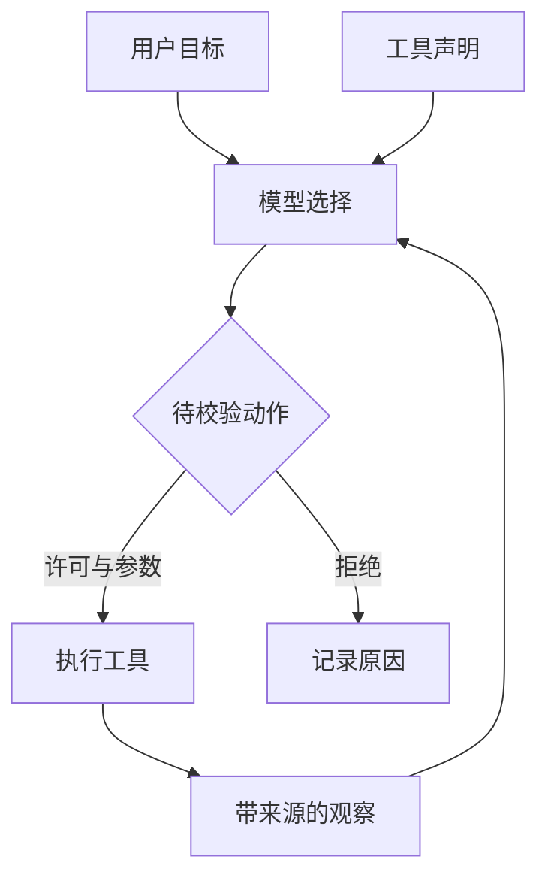
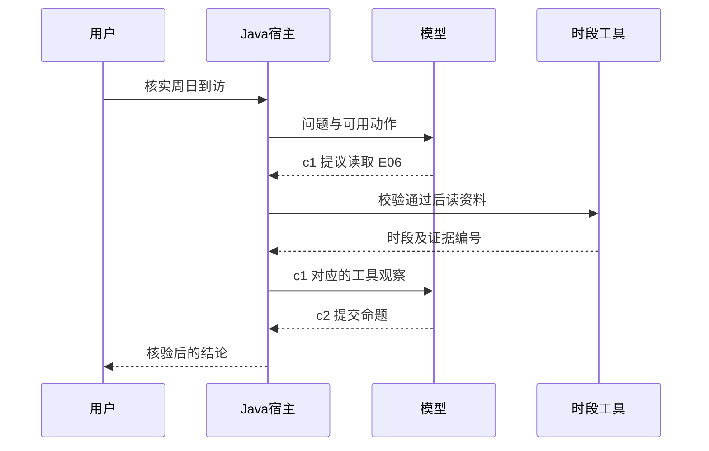
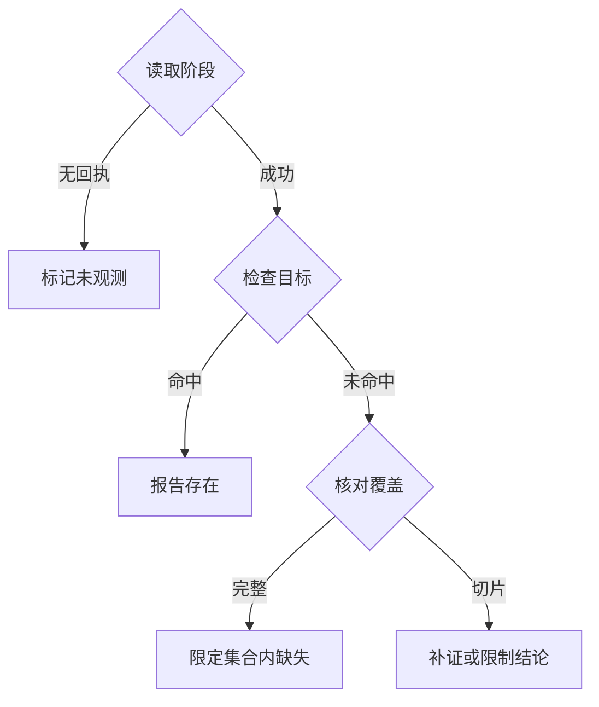

# 第 1 周每日课｜模型提议，Java 执行

从今天起，每天先读本页当日小节，按提示翻理论与实验，最后遮住答案自己推一次。第一天约用 20 分钟阅读、70 分钟运行、打断点和复做。

[本周理论](theory.md) · [本周实验](lab.md) · [总目录](../../README.md)

## 第 1 天　第一次看见 Agent 怎样行动

**策略输出与宿主执行之间有哪些可验证的边界**

本周配套研读：[一次回答怎样取得事实依据](readings/01.md)，文内有图和带解样例。

90 分钟。

假设你接手了一个 Java 服务，用户问“普通周日 19:00 能去花园街自修吗？”模型回复“我查过了”。你要找的是一次真实的读取。先把纸分三列，写“模型提出了什么、宿主做了什么、现在知道了什么”。只要还只有第一列，用户就还没有得到经核验的答案。

**课堂推演。** 第一轮模型提议 c1 查询 E06。先暂停：这里你知道地点，却不知道时段。Java 从课程快照读到 SUN 09:00–17:00，将它作为 c1 的结果。第二轮模型才收到时段，提出 c2 结案。Java 检查 19:00 是否处于这个区间，接受 closed。两轮模型、一次业务读取。对照理论页的三种程序，想清一个纯 Java 分支能否同样解这道题。

**上机。** 在仓库根目录执行 `py -3 examples/agent-loop/run.py sun`。对照实践页逐行输出，打开 AgentHost.java 的 lookup 和 finish。把情景换为 early，再换为 wrong。写下两个被拒绝的动作各缺什么。最后不看代码，重画 user → 模型提议 → 宿主执行 → 观察 → 下一轮提议。

**独立题。** 模型直接报出了正确的关门时间，还写上真实存在的 hours:E06。没有 lookup 记录，你给这一次运行判成功吗？

完成后展开讲评与验收

本题要求按快照核验，不能判通过。一个存在于数据集的证据 ID 只有在本次观察中出现并支持命题，才可用于交付。把 early 与 wrong 的输出放在两列，前者无观察，后者有观察但不支持结论；若无法解释区别，回到理论页“把一次交互拆成两次模型推理”。

## 第 2 天　一次推理看得见什么

**两次推理怎样跨过一次真实工具执行**

本周配套研读：[把异步观察放回正确的一轮](readings/02.md)，文内有图和带解样例。

75 分钟。

模型本轮只能使用发给它的上下文。把事实放进数据库，和把查询结果放进下一轮消息，是两个不同动作。应用在工具回传前后改变了模型可见的信息。

**课堂推演。** 在纸上写 system、user、assistant(tool_calls)、tool 四条消息。遮掉后两条，让同伴指出周日何时关闭；不查资料就缺依据。恢复消息，标出哪个字段把回复连回请求。

**上机。** 打开 run.py 的 messages.extend，打印本地脚本的角色、call_id 与 tool_call_id，省略密钥与整段原文。将同一轮观察分别与 c1、c2 配对，画出哪个配对有效。

**独立题。** 若服务端换了模型，能否让它从上一模型的内存中知道刚才查过什么？

完成后展开讲评与验收

应用须重建必要的消息或结构化状态。验收时给一份最小历史，包含原始目标、请求、匹配的观察，并解释少哪项会产生什么问题。

## 第 3 天　动作空间和工具说明

本周配套研读：[批量提议能省几次模型往返](readings/03.md)，文内有图和带解样例。

75 分钟。

模型面对的是若干允许动作。选择失误有两种来源：模型没分清能力，或宿主暴露了本来就不该有的动作。前者可改说明，后者须改代码和权限。

**课堂推演。** 把 lookup_hours 描述改为“查询一切信息”，模型可能拿它回答余座；将限定条件写为“普通时段，不含实时余座”后，动作边界可读。再看 forbidden，即使模型仍生成订位动作，宿主也拒绝。

**上机。** 运行 forbidden，核对执行次数为 0。写出一个合法 JSON 却不适用于本题的请求，再写一个形状错误的请求，分别标记语义和结构错误。

**独立题。** 把 book_room 从系统提示里删掉，是否足以保证不能预订？

完成后展开讲评与验收

还要由注册表或宿主分派拒绝未授权工具，且执行端不能暴露绕行路径。用 unknown_tool、0 次工具执行说明结论。

## 第 4 天　接上真实模型，保留同一宿主

本周配套研读：[一次 Java 动作为何必须经宿主裁决](readings/04.md)，文内有图和带解样例。

75 分钟。

为了能定位错误，一次只换一个部件。回放给定动作，能复测宿主。真实模型自己决定调用哪个工具，才能观察描述和问题表达对选工具的影响。

**课堂推演。** 同一 SAT 输入，脚本稳定请求一次资料；真实模型可能过早 finish 或连续要求查两次。宿主对两种来源做相同检查。一次真实成功也只能代表这次输入和配置。

**上机。** 按实践页的模型入口运行 sat 与 ambiguous。没有密钥就构造两份响应 JSON，一份含 tool_calls、一份只有正文，通过阅读 live 与 wire 预测适配结果，将在线项标未测。

**独立题。** 模型返回两项工具请求，但入门宿主每轮只支持一项，能否静默丢第二项？

完成后展开讲评与验收

不能默默改变模型的动作集合。入门适配器明确报错，后续支持批量时要关联每个 ID、逐项验参、整批核算预算。

## 第 5 天　工具失效时如何说真话

**没有命中时，覆盖范围决定下一步**

本周配套研读：[有限日志能支持哪一种否定](readings/05.md)，文内有图和带解样例。

75 分钟。

工具可能找到事实，也可能根本没有拿到结果。即使用户最后都看到“无法确认”，线上值班同学也需要知道是数据缺字段、系统超时，还是模型提早结案。

**课堂推演。** 对 timeout，Java 先记一次尝试并返回 TIMEOUT；脚本收到这个观察，下一轮提交 unknown。若折叠成空列表，后续模型很容易把服务故障说成地点没有服务。

**上机。** 跑 timeout 与 sat，标出两条轨迹第一次不同的事件。在日志旁分别补一句能对用户说的话，再写一条没有证据不能说的话。

**独立题。** 若失败后模型说“我没查到，所以关门了”，哪一步应该挡住？

完成后展开讲评与验收

宿主缺少本次适用的时段证据，应拒绝关闭判断；可以按预算重试读或说明本次未核实。

## 第 6 天　自己重写结束条件

本周配套研读：[开放区间够不够完成一次到访](readings/06.md)，文内有图和带解样例。

150 分钟。

业务系统通常同时约束正确性和资源。一个循环若始终等待模型主动停，最差情况下会不停查询。模型轮数与业务工具尝试数需要分开计，结束申请本身也用了一轮决策。

**课堂推演。** repeat 中每个调用 ID 都是新的，第三次业务读取将超过两次预算；replay 重用 c1，即便结果相同也应更早拒绝。去重与限额保护的是两个不同故障。

**上机。** 按实践页从空实现重写 finish，用 sun、wrong、early、timeout 验证四条分支。再跑 repeat 与 replay，核对首次拒绝的位置和工具次数。

**独立题。** 剩余工具预算为零，已经拿到足够证据，还要无条件报失败吗？

完成后展开讲评与验收

若模型轮与截止时间仍允许，可以整理已有证据，结束申请不再读取工具。用“最后一次取证后还可结案”的轨迹给出验收。

## 第 7 天　闭卷讲一条轨迹

本周配套研读：[追问、成功和部分结束](readings/07.md)，文内有图和带解样例。

60 分钟。

把陌生术语换成用户能看到的行为。试着在两分钟内讲清楚“提议”“执行”“观察”“终止”；每个词只配一行运行记录。

**课堂推演。** 把案例换成资料预审。模型提出读材料清单，工具列出已收项目，应用检查还缺哪项，模型起草说明。工具说缺文件时，不能据此宣布商户审核失败。

**上机。** 从空终端复跑一成一败。封存自己设计的 8 道留出任务（按意图分组，保留预期与禁做动作），另写 4 道可公开调试的题；示范案例归开发集。

**独立题。** 怎样证明你修的是 Java 验证逻辑，怎样证明模型更会选工具？

完成后展开讲评与验收

同一固定提议在宿主修改前后改变终态，说明运行时行为改变。用真实模型、相同题组与数据、分别记录工具选择才可比较模型行为。

