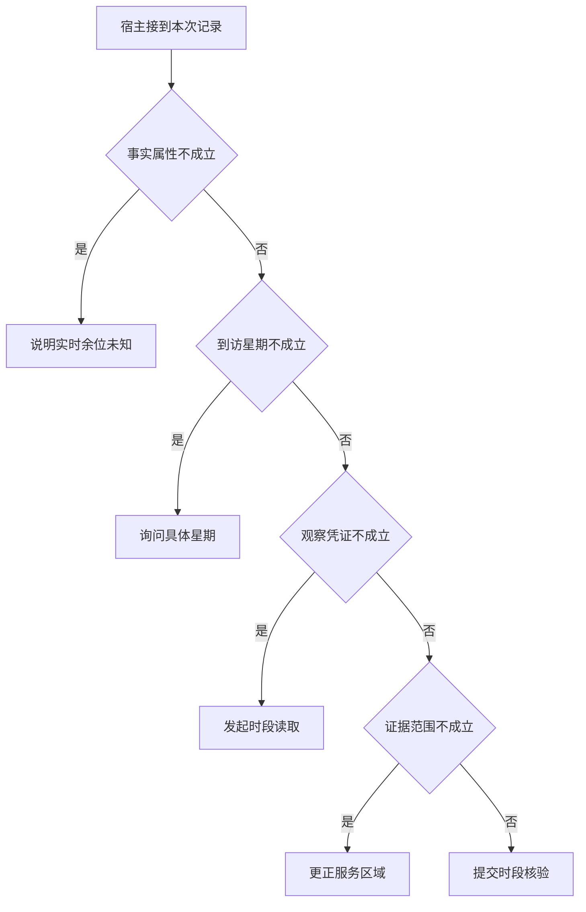

# 一次回答怎样取得事实依据

场馆助理接到一次周末到访核验。
给模型一个地点 ID 只解决了对象识别，资料来源和用户所问属性仍须对上。
先用真实时段的适用性检验结论，再考虑怎样组织两句自然语言。

本篇用一个封闭的教学决策器说明这一问题。输入是宿主收到的记录，不保证每个下游字段都已经获准使用。前置检查未成立时，下游即使带着缓存值，也不能拿来作业务断言。

## 先解决一个具体问题

**模型第一次吐出 lookup_hours(E06)，应用新知道了什么？**

只知道模型建议读这个对象。
直到 Java 收到时段并验证它属于 E06，系统才可以把“通常几点关”变成可验证的断言。
先遮住工具结果复述一遍，就能发现哪些知识是从环境进入系统的。


先取一个能走到「提交时段核验」的输入：星期明确、所问为常规时段、已有本轮业务回执、资料属于目标服务。
把这四个条件代回后文的图，前面各个拦截分支都未满足，最终才有“证据与当前对象日期及属性相符”这个判断。
还原这个现场时要分别问：哪些位来自可信状态，哪些只是在接口中出现、尚未获得解释资格的字段。

## 先沿一次决策走到底



从上到下取第一条成立的出口。只改一个开关时，只有它之前的检查都未截断，该变化才可能到达真实动作。

“到访星期”的两种输入分别是“星期明确”与“用户只说周末”。
两个普通周末日可能有不同终点，日期决定应比较哪段区间。

“事实属性”的两种输入分别是“所问为常规时段”与“所问为实时余位”。
公开时刻表无法观测当前空位，重复读取不会获得实时事实。

“观察凭证”的两种输入分别是“已有本轮业务回执”与“只有尚未执行的提议”。
模型的调用提议不能证明应用已取得新事实。

“证据范围”的两种输入分别是“资料属于目标服务”与“资料来自另一服务区域”。
同楼地点也可能服务不同，引用要绑定业务对象。

## 最少需要哪几项观察

### 说明实时余位未知

常规时刻表不提供实时座位。
在本节的全部组合中，有 8 种产生「说明实时余位未知」，这只是逻辑空间的计数，不能当作实际用户请求的比例。

只取得所问为实时余位，已经足以要求宿主「说明实时余位未知」。
保持这些已知项，其余开关自由变化，仍有 8 种补全，判断没有翻转。

若删掉关于事实属性的证据，另一份允许的现场是用户只说周末、所问为常规时段、只有尚未执行的提议、资料来自另一服务区域，它会使宿主「询问具体星期」。

### 询问具体星期

不同周末日的截止时间可能反转答案。
在本节的全部组合中，有 4 种产生「询问具体星期」，这只是逻辑空间的计数，不能当作实际用户请求的比例。

只取得用户只说周末、所问为常规时段，已经足以要求宿主「询问具体星期」。
保持这些已知项，其余开关自由变化，仍有 4 种补全，判断没有翻转。

若删掉关于到访星期的证据，另一份允许的现场是星期明确、所问为常规时段、只有尚未执行的提议、资料来自另一服务区域，它会使宿主「发起时段读取」。

若删掉关于事实属性的证据，另一份允许的现场是用户只说周末、所问为实时余位、只有尚未执行的提议、资料来自另一服务区域，它会使宿主「说明实时余位未知」。

### 发起时段读取

模型提议尚未取得业务事实。
在本节的全部组合中，有 2 种产生「发起时段读取」，这只是逻辑空间的计数，不能当作实际用户请求的比例。

只取得星期明确、所问为常规时段、只有尚未执行的提议，已经足以要求宿主「发起时段读取」。
保持这些已知项，其余开关自由变化，仍有 2 种补全，判断没有翻转。

若删掉关于到访星期的证据，另一份允许的现场是用户只说周末、所问为常规时段、只有尚未执行的提议、资料来自另一服务区域，它会使宿主「询问具体星期」。

若删掉关于事实属性的证据，另一份允许的现场是星期明确、所问为实时余位、只有尚未执行的提议、资料来自另一服务区域，它会使宿主「说明实时余位未知」。

若删掉关于观察凭证的证据，另一份允许的现场是星期明确、所问为常规时段、已有本轮业务回执、资料来自另一服务区域，它会使宿主「更正服务区域」。

### 更正服务区域

同楼设施的时刻不能代入自修室。
在本节的全部组合中，有 1 种产生「更正服务区域」，这只是逻辑空间的计数，不能当作实际用户请求的比例。

只取得星期明确、所问为常规时段、已有本轮业务回执、资料来自另一服务区域，已经足以要求宿主「更正服务区域」。
保持这些已知项，其余开关自由变化，仍有 1 种补全，判断没有翻转。

若删掉关于到访星期的证据，另一份允许的现场是用户只说周末、所问为常规时段、已有本轮业务回执、资料来自另一服务区域，它会使宿主「询问具体星期」。

若删掉关于事实属性的证据，另一份允许的现场是星期明确、所问为实时余位、已有本轮业务回执、资料来自另一服务区域，它会使宿主「说明实时余位未知」。

若删掉关于观察凭证的证据，另一份允许的现场是星期明确、所问为常规时段、只有尚未执行的提议、资料来自另一服务区域，它会使宿主「发起时段读取」。

若删掉关于证据范围的证据，另一份允许的现场是星期明确、所问为常规时段、已有本轮业务回执、资料属于目标服务，它会使宿主「提交时段核验」。

### 提交时段核验

证据与当前对象日期及属性相符。
在本节的全部组合中，有 1 种产生「提交时段核验」，这只是逻辑空间的计数，不能当作实际用户请求的比例。

只取得星期明确、所问为常规时段、已有本轮业务回执、资料属于目标服务，已经足以要求宿主「提交时段核验」。

若删掉关于到访星期的证据，另一份允许的现场是用户只说周末、所问为常规时段、已有本轮业务回执、资料属于目标服务，它会使宿主「询问具体星期」。

若删掉关于事实属性的证据，另一份允许的现场是星期明确、所问为实时余位、已有本轮业务回执、资料属于目标服务，它会使宿主「说明实时余位未知」。

若删掉关于观察凭证的证据，另一份允许的现场是星期明确、所问为常规时段、只有尚未执行的提议、资料属于目标服务，它会使宿主「发起时段读取」。

若删掉关于证据范围的证据，另一份允许的现场是星期明确、所问为常规时段、已有本轮业务回执、资料来自另一服务区域，它会使宿主「更正服务区域」。

## 以同一份契约解释截然不同的现场

<details>
<summary>展开推演与对应反例</summary>

下列样本按最先命中的业务分支排列。四位编码只作本篇页内定位，顺序与开头的四项输入一致。可以先猜下一动作，再展开相邻样本。

### 能够触发“说明实时余位未知”的现场

**样本 0000**

业务侧交来用户只说周末、所问为实时余位，执行侧还记录了只有尚未执行的提议、资料来自另一服务区域。
把样本压成最短证明，保留所问为实时余位就能支持「说明实时余位未知」。

在这份记录上，分别翻转「事实属性」中的任一项，其他项完全不变时，下一动作都会改变。

保持其余观察不动，单独切换「到访星期」、「观察凭证」、「证据范围」仍得到「说明实时余位未知」，它们在这个现场不是决定性变量。

要从本例改走「询问具体星期」，至少需要变动 1 项，一组最少改动是将所问为实时余位换成所问为常规时段。

要从本例改走「发起时段读取」，至少需要变动 2 项，一组最少改动是将用户只说周末、所问为实时余位换成星期明确、所问为常规时段。

要从本例改走「更正服务区域」，至少需要变动 3 项，一组最少改动是将用户只说周末、所问为实时余位、只有尚未执行的提议换成星期明确、所问为常规时段、已有本轮业务回执。

要从本例改走「提交时段核验」，至少需要变动 4 项，一组最少改动是将用户只说周末、所问为实时余位、只有尚未执行的提议、资料来自另一服务区域换成星期明确、所问为常规时段、已有本轮业务回执、资料属于目标服务。

**样本 0001**

业务侧交来用户只说周末、所问为实时余位，执行侧还记录了只有尚未执行的提议、资料属于目标服务。


要从本例改走「提交时段核验」，至少需要变动 3 项，一组最少改动是将用户只说周末、所问为实时余位、只有尚未执行的提议换成星期明确、所问为常规时段、已有本轮业务回执。

要从本例改走「更正服务区域」，至少需要变动 4 项，一组最少改动是将用户只说周末、所问为实时余位、只有尚未执行的提议、资料属于目标服务换成星期明确、所问为常规时段、已有本轮业务回执、资料来自另一服务区域。

**样本 0010**

业务侧交来用户只说周末、所问为实时余位，执行侧还记录了已有本轮业务回执、资料来自另一服务区域。


要从本例改走「更正服务区域」，至少需要变动 2 项，一组最少改动是将用户只说周末、所问为实时余位换成星期明确、所问为常规时段。

要从本例改走「发起时段读取」，至少需要变动 3 项，一组最少改动是将用户只说周末、所问为实时余位、已有本轮业务回执换成星期明确、所问为常规时段、只有尚未执行的提议。

要从本例改走「提交时段核验」，至少需要变动 3 项，一组最少改动是将用户只说周末、所问为实时余位、资料来自另一服务区域换成星期明确、所问为常规时段、资料属于目标服务。

**样本 0011**

业务侧交来用户只说周末、所问为实时余位，执行侧还记录了已有本轮业务回执、资料属于目标服务。


要从本例改走「提交时段核验」，至少需要变动 2 项，一组最少改动是将用户只说周末、所问为实时余位换成星期明确、所问为常规时段。


要从本例改走「更正服务区域」，至少需要变动 3 项，一组最少改动是将用户只说周末、所问为实时余位、资料属于目标服务换成星期明确、所问为常规时段、资料来自另一服务区域。

**样本 1000**

业务侧交来星期明确、所问为实时余位，执行侧还记录了只有尚未执行的提议、资料来自另一服务区域。


要从本例改走「发起时段读取」，至少需要变动 1 项，一组最少改动是将所问为实时余位换成所问为常规时段。

要从本例改走「询问具体星期」，至少需要变动 2 项，一组最少改动是将星期明确、所问为实时余位换成用户只说周末、所问为常规时段。

要从本例改走「更正服务区域」，至少需要变动 2 项，一组最少改动是将所问为实时余位、只有尚未执行的提议换成所问为常规时段、已有本轮业务回执。

要从本例改走「提交时段核验」，至少需要变动 3 项，一组最少改动是将所问为实时余位、只有尚未执行的提议、资料来自另一服务区域换成所问为常规时段、已有本轮业务回执、资料属于目标服务。

**样本 1001**

业务侧交来星期明确、所问为实时余位，执行侧还记录了只有尚未执行的提议、资料属于目标服务。


要从本例改走「提交时段核验」，至少需要变动 2 项，一组最少改动是将所问为实时余位、只有尚未执行的提议换成所问为常规时段、已有本轮业务回执。

要从本例改走「更正服务区域」，至少需要变动 3 项，一组最少改动是将所问为实时余位、只有尚未执行的提议、资料属于目标服务换成所问为常规时段、已有本轮业务回执、资料来自另一服务区域。

**样本 1010**

业务侧交来星期明确、所问为实时余位，执行侧还记录了已有本轮业务回执、资料来自另一服务区域。


要从本例改走「更正服务区域」，至少需要变动 1 项，一组最少改动是将所问为实时余位换成所问为常规时段。


要从本例改走「发起时段读取」，至少需要变动 2 项，一组最少改动是将所问为实时余位、已有本轮业务回执换成所问为常规时段、只有尚未执行的提议。

要从本例改走「提交时段核验」，至少需要变动 2 项，一组最少改动是将所问为实时余位、资料来自另一服务区域换成所问为常规时段、资料属于目标服务。

**样本 1011**

业务侧交来星期明确、所问为实时余位，执行侧还记录了已有本轮业务回执、资料属于目标服务。


要从本例改走「提交时段核验」，至少需要变动 1 项，一组最少改动是将所问为实时余位换成所问为常规时段。


要从本例改走「更正服务区域」，至少需要变动 2 项，一组最少改动是将所问为实时余位、资料属于目标服务换成所问为常规时段、资料来自另一服务区域。

### 能够触发“询问具体星期”的现场

**样本 0100**

业务侧交来用户只说周末、所问为常规时段，执行侧还记录了只有尚未执行的提议、资料来自另一服务区域。
把样本压成最短证明，保留用户只说周末、所问为常规时段就能支持「询问具体星期」。

在这份记录上，分别翻转「到访星期」、「事实属性」中的任一项，其他项完全不变时，下一动作都会改变。

保持其余观察不动，单独切换「观察凭证」、「证据范围」仍得到「询问具体星期」，它们在这个现场不是决定性变量。

本例没走更靠前的「说明实时余位未知」，因为所问为常规时段与那个入口的必要条件不符。

要从本例改走「说明实时余位未知」，至少需要变动 1 项，一组最少改动是将所问为常规时段换成所问为实时余位。

要从本例改走「发起时段读取」，至少需要变动 1 项，一组最少改动是将用户只说周末换成星期明确。

要从本例改走「更正服务区域」，至少需要变动 2 项，一组最少改动是将用户只说周末、只有尚未执行的提议换成星期明确、已有本轮业务回执。

要从本例改走「提交时段核验」，至少需要变动 3 项，一组最少改动是将用户只说周末、只有尚未执行的提议、资料来自另一服务区域换成星期明确、已有本轮业务回执、资料属于目标服务。

**样本 0101**

业务侧交来用户只说周末、所问为常规时段，执行侧还记录了只有尚未执行的提议、资料属于目标服务。


要从本例改走「提交时段核验」，至少需要变动 2 项，一组最少改动是将用户只说周末、只有尚未执行的提议换成星期明确、已有本轮业务回执。

要从本例改走「更正服务区域」，至少需要变动 3 项，一组最少改动是将用户只说周末、只有尚未执行的提议、资料属于目标服务换成星期明确、已有本轮业务回执、资料来自另一服务区域。

**样本 0110**

业务侧交来用户只说周末、所问为常规时段，执行侧还记录了已有本轮业务回执、资料来自另一服务区域。


要从本例改走「更正服务区域」，至少需要变动 1 项，一组最少改动是将用户只说周末换成星期明确。

要从本例改走「发起时段读取」，至少需要变动 2 项，一组最少改动是将用户只说周末、已有本轮业务回执换成星期明确、只有尚未执行的提议。

要从本例改走「提交时段核验」，至少需要变动 2 项，一组最少改动是将用户只说周末、资料来自另一服务区域换成星期明确、资料属于目标服务。

**样本 0111**

业务侧交来用户只说周末、所问为常规时段，执行侧还记录了已有本轮业务回执、资料属于目标服务。


要从本例改走「提交时段核验」，至少需要变动 1 项，一组最少改动是将用户只说周末换成星期明确。


要从本例改走「更正服务区域」，至少需要变动 2 项，一组最少改动是将用户只说周末、资料属于目标服务换成星期明确、资料来自另一服务区域。

### 能够触发“发起时段读取”的现场

**样本 1100**

业务侧交来星期明确、所问为常规时段，执行侧还记录了只有尚未执行的提议、资料来自另一服务区域。
把样本压成最短证明，保留星期明确、所问为常规时段、只有尚未执行的提议就能支持「发起时段读取」。

在这份记录上，分别翻转「到访星期」、「事实属性」、「观察凭证」中的任一项，其他项完全不变时，下一动作都会改变。

保持其余观察不动，单独切换「证据范围」仍得到「发起时段读取」，它们在这个现场不是决定性变量。


本例没走更靠前的「询问具体星期」，因为星期明确与那个入口的必要条件不符。

要从本例改走「询问具体星期」，至少需要变动 1 项，一组最少改动是将星期明确换成用户只说周末。


要从本例改走「更正服务区域」，至少需要变动 1 项，一组最少改动是将只有尚未执行的提议换成已有本轮业务回执。

要从本例改走「提交时段核验」，至少需要变动 2 项，一组最少改动是将只有尚未执行的提议、资料来自另一服务区域换成已有本轮业务回执、资料属于目标服务。

**样本 1101**

业务侧交来星期明确、所问为常规时段，执行侧还记录了只有尚未执行的提议、资料属于目标服务。


要从本例改走「提交时段核验」，至少需要变动 1 项，一组最少改动是将只有尚未执行的提议换成已有本轮业务回执。

要从本例改走「更正服务区域」，至少需要变动 2 项，一组最少改动是将只有尚未执行的提议、资料属于目标服务换成已有本轮业务回执、资料来自另一服务区域。

### 能够触发“更正服务区域”的现场

**样本 1110**

业务侧交来星期明确、所问为常规时段，执行侧还记录了已有本轮业务回执、资料来自另一服务区域。
把样本压成最短证明，保留星期明确、所问为常规时段、已有本轮业务回执、资料来自另一服务区域就能支持「更正服务区域」。

在这份记录上，分别翻转「到访星期」、「事实属性」、「观察凭证」、「证据范围」中的任一项，其他项完全不变时，下一动作都会改变。


本例没走更靠前的「发起时段读取」，因为已有本轮业务回执与那个入口的必要条件不符。


要从本例改走「发起时段读取」，至少需要变动 1 项，一组最少改动是将已有本轮业务回执换成只有尚未执行的提议。

要从本例改走「提交时段核验」，至少需要变动 1 项，一组最少改动是将资料来自另一服务区域换成资料属于目标服务。

### 能够触发“提交时段核验”的现场

**样本 1111**

业务侧交来星期明确、所问为常规时段，执行侧还记录了已有本轮业务回执、资料属于目标服务。
把样本压成最短证明，保留星期明确、所问为常规时段、已有本轮业务回执、资料属于目标服务就能支持「提交时段核验」。


本例没走更靠前的「更正服务区域」，因为资料属于目标服务与那个入口的必要条件不符。


要从本例改走「更正服务区域」，至少需要变动 1 项，一组最少改动是将资料属于目标服务换成资料来自另一服务区域。

</details>

## 当你只能看见一半记录

<details>
<summary>展开推演与对应反例</summary>

这次隐藏两个字段，保留另两个。对每个可见现场，检查四种合法补全是否同意。如仍有歧义，选择能使最坏剩余候选动作最少的字段继续查。并列时采用本篇字段顺序。

### 只保留到访星期与事实属性

已知用户只说周末、所问为实时余位时，四种补全的动作分布为说明实时余位未知（4 种）。

就“说明实时余位未知”这个动作而言，在用户只说周末、所问为实时余位的前提下，另外两项观察不会推翻它。

已知用户只说周末、所问为常规时段时，四种补全的动作分布为询问具体星期（4 种）。

就“询问具体星期”这个动作而言，在用户只说周末、所问为常规时段的前提下，另外两项观察不会推翻它。

已知星期明确、所问为实时余位时，四种补全的动作分布为说明实时余位未知（4 种）。

就“说明实时余位未知”这个动作而言，在星期明确、所问为实时余位的前提下，另外两项观察不会推翻它。

已知星期明确、所问为常规时段时，四种补全的动作分布为发起时段读取（2 种）、更正服务区域（1 种）、提交时段核验（1 种）。

在星期明确、所问为常规时段这个现场补读「观察凭证」，最坏还剩 2 种动作，计算时只衡量歧义，尚未扣读取代价。
若补来的观察为“只有尚未执行的提议”，范围缩成「发起时段读取」。若为“已有本轮业务回执”，则保留「更正服务区域」、「提交时段核验」。

区分不了的两条执行可以具体写成 1100 与 1110：它们共享已展示字段，却分别需要「发起时段读取」和「更正服务区域」。

### 只保留到访星期与观察凭证

已知用户只说周末、只有尚未执行的提议时，四种补全的动作分布为说明实时余位未知（2 种）、询问具体星期（2 种）。

在用户只说周末、只有尚未执行的提议这个现场补读「事实属性」，最坏还剩 1 种动作，计算时只衡量歧义，尚未扣读取代价。
若补来的观察为“所问为实时余位”，范围缩成「说明实时余位未知」。若为“所问为常规时段”，则保留「询问具体星期」。

区分不了的两条执行可以具体写成 0000 与 0100：它们共享已展示字段，却分别需要「说明实时余位未知」和「询问具体星期」。

已知用户只说周末、已有本轮业务回执时，四种补全的动作分布为说明实时余位未知（2 种）、询问具体星期（2 种）。

在用户只说周末、已有本轮业务回执这个现场补读「事实属性」，最坏还剩 1 种动作，计算时只衡量歧义，尚未扣读取代价。

区分不了的两条执行可以具体写成 0010 与 0110：它们共享已展示字段，却分别需要「说明实时余位未知」和「询问具体星期」。

已知星期明确、只有尚未执行的提议时，四种补全的动作分布为说明实时余位未知（2 种）、发起时段读取（2 种）。

在星期明确、只有尚未执行的提议这个现场补读「事实属性」，最坏还剩 1 种动作，计算时只衡量歧义，尚未扣读取代价。
若补来的观察为“所问为实时余位”，范围缩成「说明实时余位未知」。若为“所问为常规时段”，则保留「发起时段读取」。

区分不了的两条执行可以具体写成 1000 与 1100：它们共享已展示字段，却分别需要「说明实时余位未知」和「发起时段读取」。

已知星期明确、已有本轮业务回执时，四种补全的动作分布为说明实时余位未知（2 种）、更正服务区域（1 种）、提交时段核验（1 种）。

在星期明确、已有本轮业务回执这个现场补读「事实属性」，最坏还剩 2 种动作，计算时只衡量歧义，尚未扣读取代价。
若补来的观察为“所问为实时余位”，范围缩成「说明实时余位未知」。若为“所问为常规时段”，则保留「更正服务区域」、「提交时段核验」。

区分不了的两条执行可以具体写成 1010 与 1110：它们共享已展示字段，却分别需要「说明实时余位未知」和「更正服务区域」。

### 只保留事实属性与观察凭证

已知所问为实时余位、只有尚未执行的提议时，四种补全的动作分布为说明实时余位未知（4 种）。

就“说明实时余位未知”这个动作而言，在所问为实时余位、只有尚未执行的提议的前提下，另外两项观察不会推翻它。

已知所问为实时余位、已有本轮业务回执时，四种补全的动作分布为说明实时余位未知（4 种）。

就“说明实时余位未知”这个动作而言，在所问为实时余位、已有本轮业务回执的前提下，另外两项观察不会推翻它。

已知所问为常规时段、只有尚未执行的提议时，四种补全的动作分布为询问具体星期（2 种）、发起时段读取（2 种）。

在所问为常规时段、只有尚未执行的提议这个现场补读「到访星期」，最坏还剩 1 种动作，计算时只衡量歧义，尚未扣读取代价。
若补来的观察为“用户只说周末”，范围缩成「询问具体星期」。若为“星期明确”，则保留「发起时段读取」。

区分不了的两条执行可以具体写成 0100 与 1100：它们共享已展示字段，却分别需要「询问具体星期」和「发起时段读取」。

已知所问为常规时段、已有本轮业务回执时，四种补全的动作分布为询问具体星期（2 种）、更正服务区域（1 种）、提交时段核验（1 种）。

在所问为常规时段、已有本轮业务回执这个现场补读「到访星期」，最坏还剩 2 种动作，计算时只衡量歧义，尚未扣读取代价。
若补来的观察为“用户只说周末”，范围缩成「询问具体星期」。若为“星期明确”，则保留「更正服务区域」、「提交时段核验」。

区分不了的两条执行可以具体写成 0110 与 1110：它们共享已展示字段，却分别需要「询问具体星期」和「更正服务区域」。

### 只保留到访星期与证据范围

已知用户只说周末、资料来自另一服务区域时，四种补全的动作分布为说明实时余位未知（2 种）、询问具体星期（2 种）。

在用户只说周末、资料来自另一服务区域这个现场补读「事实属性」，最坏还剩 1 种动作，计算时只衡量歧义，尚未扣读取代价。


已知用户只说周末、资料属于目标服务时，四种补全的动作分布为说明实时余位未知（2 种）、询问具体星期（2 种）。

在用户只说周末、资料属于目标服务这个现场补读「事实属性」，最坏还剩 1 种动作，计算时只衡量歧义，尚未扣读取代价。

区分不了的两条执行可以具体写成 0001 与 0101：它们共享已展示字段，却分别需要「说明实时余位未知」和「询问具体星期」。

已知星期明确、资料来自另一服务区域时，四种补全的动作分布为说明实时余位未知（2 种）、发起时段读取（1 种）、更正服务区域（1 种）。

在星期明确、资料来自另一服务区域这个现场补读「事实属性」，最坏还剩 2 种动作，计算时只衡量歧义，尚未扣读取代价。
若补来的观察为“所问为实时余位”，范围缩成「说明实时余位未知」。若为“所问为常规时段”，则保留「发起时段读取」、「更正服务区域」。


已知星期明确、资料属于目标服务时，四种补全的动作分布为说明实时余位未知（2 种）、发起时段读取（1 种）、提交时段核验（1 种）。

在星期明确、资料属于目标服务这个现场补读「事实属性」，最坏还剩 2 种动作，计算时只衡量歧义，尚未扣读取代价。
若补来的观察为“所问为实时余位”，范围缩成「说明实时余位未知」。若为“所问为常规时段”，则保留「发起时段读取」、「提交时段核验」。

区分不了的两条执行可以具体写成 1001 与 1101：它们共享已展示字段，却分别需要「说明实时余位未知」和「发起时段读取」。

### 只保留事实属性与证据范围

已知所问为实时余位、资料来自另一服务区域时，四种补全的动作分布为说明实时余位未知（4 种）。

就“说明实时余位未知”这个动作而言，在所问为实时余位、资料来自另一服务区域的前提下，另外两项观察不会推翻它。

已知所问为实时余位、资料属于目标服务时，四种补全的动作分布为说明实时余位未知（4 种）。

就“说明实时余位未知”这个动作而言，在所问为实时余位、资料属于目标服务的前提下，另外两项观察不会推翻它。

已知所问为常规时段、资料来自另一服务区域时，四种补全的动作分布为询问具体星期（2 种）、发起时段读取（1 种）、更正服务区域（1 种）。

在所问为常规时段、资料来自另一服务区域这个现场补读「到访星期」，最坏还剩 2 种动作，计算时只衡量歧义，尚未扣读取代价。
若补来的观察为“用户只说周末”，范围缩成「询问具体星期」。若为“星期明确”，则保留「发起时段读取」、「更正服务区域」。


已知所问为常规时段、资料属于目标服务时，四种补全的动作分布为询问具体星期（2 种）、发起时段读取（1 种）、提交时段核验（1 种）。

在所问为常规时段、资料属于目标服务这个现场补读「到访星期」，最坏还剩 2 种动作，计算时只衡量歧义，尚未扣读取代价。
若补来的观察为“用户只说周末”，范围缩成「询问具体星期」。若为“星期明确”，则保留「发起时段读取」、「提交时段核验」。

区分不了的两条执行可以具体写成 0101 与 1101：它们共享已展示字段，却分别需要「询问具体星期」和「发起时段读取」。

### 只保留观察凭证与证据范围

已知只有尚未执行的提议、资料来自另一服务区域时，四种补全的动作分布为说明实时余位未知（2 种）、询问具体星期（1 种）、发起时段读取（1 种）。

在只有尚未执行的提议、资料来自另一服务区域这个现场补读「到访星期」，最坏还剩 2 种动作，计算时只衡量歧义，尚未扣读取代价。
若补来的观察为“用户只说周末”，范围缩成「说明实时余位未知」、「询问具体星期」。若为“星期明确”，则保留「说明实时余位未知」、「发起时段读取」。


已知只有尚未执行的提议、资料属于目标服务时，四种补全的动作分布为说明实时余位未知（2 种）、询问具体星期（1 种）、发起时段读取（1 种）。

在只有尚未执行的提议、资料属于目标服务这个现场补读「到访星期」，最坏还剩 2 种动作，计算时只衡量歧义，尚未扣读取代价。


已知已有本轮业务回执、资料来自另一服务区域时，四种补全的动作分布为说明实时余位未知（2 种）、询问具体星期（1 种）、更正服务区域（1 种）。

在已有本轮业务回执、资料来自另一服务区域这个现场补读「到访星期」，最坏还剩 2 种动作，计算时只衡量歧义，尚未扣读取代价。
若补来的观察为“用户只说周末”，范围缩成「说明实时余位未知」、「询问具体星期」。若为“星期明确”，则保留「说明实时余位未知」、「更正服务区域」。


已知已有本轮业务回执、资料属于目标服务时，四种补全的动作分布为说明实时余位未知（2 种）、询问具体星期（1 种）、提交时段核验（1 种）。

在已有本轮业务回执、资料属于目标服务这个现场补读「到访星期」，最坏还剩 2 种动作，计算时只衡量歧义，尚未扣读取代价。
若补来的观察为“用户只说周末”，范围缩成「说明实时余位未知」、「询问具体星期」。若为“星期明确”，则保留「说明实时余位未知」、「提交时段核验」。

区分不了的两条执行可以具体写成 0011 与 0111：它们共享已展示字段，却分别需要「说明实时余位未知」和「询问具体星期」。

</details>

## 单因素干预与边界测试

<details>
<summary>展开推演与对应反例</summary>

### 只改变到访星期

固定另外三个条件得到八对现场，从“用户只说周末”转为“星期明确”时，4 对翻转动作，另外 4 对保持不变。

令所问为实时余位、只有尚未执行的提议、资料来自另一服务区域，到访星期的两个取值均得到「说明实时余位未知」。在八对中，共有 4 对表现为这一种稳定出口。

有 2 对现场沿「询问具体星期」变到「发起时段读取」，可复现的一组受控背景为所问为常规时段、只有尚未执行的提议、资料来自另一服务区域。

有 1 对现场沿「询问具体星期」变到「更正服务区域」，可复现的一组受控背景为所问为常规时段、已有本轮业务回执、资料来自另一服务区域。

有 1 对现场沿「询问具体星期」变到「提交时段核验」，可复现的一组受控背景为所问为常规时段、已有本轮业务回执、资料属于目标服务。

### 只改变事实属性

固定另外三个条件得到八对现场，从“所问为实时余位”转为“所问为常规时段”时，8 对翻转动作，另外 0 对保持不变。

有 4 对现场沿「说明实时余位未知」变到「询问具体星期」，可复现的一组受控背景为用户只说周末、只有尚未执行的提议、资料来自另一服务区域。

有 2 对现场沿「说明实时余位未知」变到「发起时段读取」，可复现的一组受控背景为星期明确、只有尚未执行的提议、资料来自另一服务区域。

有 1 对现场沿「说明实时余位未知」变到「更正服务区域」，可复现的一组受控背景为星期明确、已有本轮业务回执、资料来自另一服务区域。

有 1 对现场沿「说明实时余位未知」变到「提交时段核验」，可复现的一组受控背景为星期明确、已有本轮业务回执、资料属于目标服务。

### 只改变观察凭证

固定另外三个条件得到八对现场，从“只有尚未执行的提议”转为“已有本轮业务回执”时，2 对翻转动作，另外 6 对保持不变。

令用户只说周末、所问为实时余位、资料来自另一服务区域，观察凭证的两个取值均得到「说明实时余位未知」。在八对中，共有 4 对表现为这一种稳定出口。

令用户只说周末、所问为常规时段、资料来自另一服务区域，观察凭证的两个取值均得到「询问具体星期」。在八对中，共有 2 对表现为这一种稳定出口。

有 1 对现场沿「发起时段读取」变到「更正服务区域」，可复现的一组受控背景为星期明确、所问为常规时段、资料来自另一服务区域。

有 1 对现场沿「发起时段读取」变到「提交时段核验」，可复现的一组受控背景为星期明确、所问为常规时段、资料属于目标服务。

### 只改变证据范围

固定另外三个条件得到八对现场，从“资料来自另一服务区域”转为“资料属于目标服务”时，1 对翻转动作，另外 7 对保持不变。

令用户只说周末、所问为实时余位、只有尚未执行的提议，证据范围的两个取值均得到「说明实时余位未知」。在八对中，共有 4 对表现为这一种稳定出口。

令用户只说周末、所问为常规时段、只有尚未执行的提议，证据范围的两个取值均得到「询问具体星期」。在八对中，共有 2 对表现为这一种稳定出口。

令星期明确、所问为常规时段、只有尚未执行的提议，证据范围的两个取值均得到「发起时段读取」。在八对中，共有 1 对表现为这一种稳定出口。

有 1 对现场沿「更正服务区域」变到「提交时段核验」，可复现的一组受控背景为星期明确、所问为常规时段、已有本轮业务回执。

</details>

## 哪些回归样本真能抓住实现错误

<details>
<summary>展开推演与对应反例</summary>

如果删除“说明实时余位未知”这个分支，在本篇 16 种输入里有 8 种会改走另一出口。

反例 0000 的完整记录为用户只说周末、所问为实时余位、只有尚未执行的提议、资料来自另一服务区域。正确结果是「说明实时余位未知」，这个改坏的实现却给出「询问具体星期」。

如果删除“询问具体星期”这个分支，在本篇 16 种输入里有 4 种会改走另一出口。

反例 0100 的完整记录为用户只说周末、所问为常规时段、只有尚未执行的提议、资料来自另一服务区域。正确结果是「询问具体星期」，这个改坏的实现却给出「发起时段读取」。

如果删除“发起时段读取”这个分支，在本篇 16 种输入里有 2 种会改走另一出口。

反例 1100 的完整记录为星期明确、所问为常规时段、只有尚未执行的提议、资料来自另一服务区域。正确结果是「发起时段读取」，这个改坏的实现却给出「更正服务区域」。

如果删除“更正服务区域”这个分支，在本篇 16 种输入里有 1 种会改走另一出口。

反例 1110 的完整记录为星期明确、所问为常规时段、已有本轮业务回执、资料来自另一服务区域。正确结果是「更正服务区域」，这个改坏的实现却给出「提交时段核验」。

如果交换“说明实时余位未知”和“询问具体星期”的判断次序，在本篇 16 种输入里有 4 种会改走另一出口。


如果交换“询问具体星期”和“发起时段读取”的判断次序，在本篇 16 种输入里有 2 种会改走另一出口。


如果交换“发起时段读取”和“更正服务区域”的判断次序，在本篇 16 种输入里有 1 种会改走另一出口。


补入样本 0000（用户只说周末、所问为实时余位、只有尚未执行的提议、资料来自另一服务区域）能新增检出「删除“说明实时余位未知”这个分支」、「交换“说明实时余位未知”和“询问具体星期”的判断次序」。

补入样本 0100（用户只说周末、所问为常规时段、只有尚未执行的提议、资料来自另一服务区域）能新增检出「删除“询问具体星期”这个分支」、「交换“询问具体星期”和“发起时段读取”的判断次序」。

补入样本 1100（星期明确、所问为常规时段、只有尚未执行的提议、资料来自另一服务区域）能新增检出「删除“发起时段读取”这个分支」、「交换“发起时段读取”和“更正服务区域”的判断次序」。

补入样本 1110（星期明确、所问为常规时段、已有本轮业务回执、资料来自另一服务区域）能新增检出「删除“更正服务区域”这个分支」。

这里每次选覆盖尚未捕获缺陷最多的样本，并不保证用例数全局最小。它给出的反例能作为 Java 单测输入。真实模型是否会自主产生这些提议，仍须单独评测。

</details>

## 把状态覆盖换成有抽样偏差的评测批次

<details>
<summary>展开推演与对应反例</summary>

前面的十六种记录各有一票。现在只改样本构成：对一个给定字段，把成立侧的每种记录各取三份、另一侧各取一份。这是人为配比的 32 份回放，不是线上频率估计。
将偏向成立与偏向不成立的两次批次对照，可以隔离分母变化。底层宿主和所有答案保持相同，比例仍可能移动。

### 改变“到访星期”的样本配比

只看「说明实时余位未知」，在星期明确的八个不同输入中有 4 个命中，在用户只说周末的另八个输入中有 4 个命中。
把「到访星期」成立侧按三倍取样，「说明实时余位未知」占 16/32，反过来向未成立侧倾斜后占 16/32。
两批「说明实时余位未知」的边际比例相同，是因为这个出口在“到访星期”的两侧计数相等，这不能单独证明每一对现场都不受它影响。

只看「询问具体星期」，在星期明确的八个不同输入中有 0 个命中，在用户只说周末的另八个输入中有 4 个命中。
把「到访星期」成立侧按三倍取样，「询问具体星期」占 4/32，反过来向未成立侧倾斜后占 12/32。
这次重加权使「询问具体星期」的占比相差 25 个百分点。若按两种不同的“到访星期”分布跑新旧版，不能把这项差异全部归功于实现。

只看「发起时段读取」，在星期明确的八个不同输入中有 2 个命中，在用户只说周末的另八个输入中有 0 个命中。
把「到访星期」成立侧按三倍取样，「发起时段读取」占 6/32，反过来向未成立侧倾斜后占 2/32。
这次重加权使「发起时段读取」的占比相差 12.5 个百分点。若按两种不同的“到访星期”分布跑新旧版，不能把这项差异全部归功于实现。

只看「更正服务区域」，在星期明确的八个不同输入中有 1 个命中，在用户只说周末的另八个输入中有 0 个命中。
把「到访星期」成立侧按三倍取样，「更正服务区域」占 3/32，反过来向未成立侧倾斜后占 1/32。
这次重加权使「更正服务区域」的占比相差 6.25 个百分点。若按两种不同的“到访星期”分布跑新旧版，不能把这项差异全部归功于实现。

只看「提交时段核验」，在星期明确的八个不同输入中有 1 个命中，在用户只说周末的另八个输入中有 0 个命中。
把「到访星期」成立侧按三倍取样，「提交时段核验」占 3/32，反过来向未成立侧倾斜后占 1/32。
这次重加权使「提交时段核验」的占比相差 6.25 个百分点。若按两种不同的“到访星期”分布跑新旧版，不能把这项差异全部归功于实现。

### 改变“事实属性”的样本配比

只看「说明实时余位未知」，在所问为常规时段的八个不同输入中有 0 个命中，在所问为实时余位的另八个输入中有 8 个命中。
把「事实属性」成立侧按三倍取样，「说明实时余位未知」占 8/32，反过来向未成立侧倾斜后占 24/32。
这次重加权使「说明实时余位未知」的占比相差 50 个百分点。若按两种不同的“事实属性”分布跑新旧版，不能把这项差异全部归功于实现。

只看「询问具体星期」，在所问为常规时段的八个不同输入中有 4 个命中，在所问为实时余位的另八个输入中有 0 个命中。
把「事实属性」成立侧按三倍取样，「询问具体星期」占 12/32，反过来向未成立侧倾斜后占 4/32。
这次重加权使「询问具体星期」的占比相差 25 个百分点。若按两种不同的“事实属性”分布跑新旧版，不能把这项差异全部归功于实现。

只看「发起时段读取」，在所问为常规时段的八个不同输入中有 2 个命中，在所问为实时余位的另八个输入中有 0 个命中。
把「事实属性」成立侧按三倍取样，「发起时段读取」占 6/32，反过来向未成立侧倾斜后占 2/32。
这次重加权使「发起时段读取」的占比相差 12.5 个百分点。若按两种不同的“事实属性”分布跑新旧版，不能把这项差异全部归功于实现。

只看「更正服务区域」，在所问为常规时段的八个不同输入中有 1 个命中，在所问为实时余位的另八个输入中有 0 个命中。
把「事实属性」成立侧按三倍取样，「更正服务区域」占 3/32，反过来向未成立侧倾斜后占 1/32。
这次重加权使「更正服务区域」的占比相差 6.25 个百分点。若按两种不同的“事实属性”分布跑新旧版，不能把这项差异全部归功于实现。

只看「提交时段核验」，在所问为常规时段的八个不同输入中有 1 个命中，在所问为实时余位的另八个输入中有 0 个命中。
把「事实属性」成立侧按三倍取样，「提交时段核验」占 3/32，反过来向未成立侧倾斜后占 1/32。
这次重加权使「提交时段核验」的占比相差 6.25 个百分点。若按两种不同的“事实属性”分布跑新旧版，不能把这项差异全部归功于实现。

### 改变“观察凭证”的样本配比

只看「说明实时余位未知」，在已有本轮业务回执的八个不同输入中有 4 个命中，在只有尚未执行的提议的另八个输入中有 4 个命中。
把「观察凭证」成立侧按三倍取样，「说明实时余位未知」占 16/32，反过来向未成立侧倾斜后占 16/32。
两批「说明实时余位未知」的边际比例相同，是因为这个出口在“观察凭证”的两侧计数相等，这不能单独证明每一对现场都不受它影响。

只看「询问具体星期」，在已有本轮业务回执的八个不同输入中有 2 个命中，在只有尚未执行的提议的另八个输入中有 2 个命中。
把「观察凭证」成立侧按三倍取样，「询问具体星期」占 8/32，反过来向未成立侧倾斜后占 8/32。
两批「询问具体星期」的边际比例相同，是因为这个出口在“观察凭证”的两侧计数相等，这不能单独证明每一对现场都不受它影响。

只看「发起时段读取」，在已有本轮业务回执的八个不同输入中有 0 个命中，在只有尚未执行的提议的另八个输入中有 2 个命中。
把「观察凭证」成立侧按三倍取样，「发起时段读取」占 2/32，反过来向未成立侧倾斜后占 6/32。
这次重加权使「发起时段读取」的占比相差 12.5 个百分点。若按两种不同的“观察凭证”分布跑新旧版，不能把这项差异全部归功于实现。

只看「更正服务区域」，在已有本轮业务回执的八个不同输入中有 1 个命中，在只有尚未执行的提议的另八个输入中有 0 个命中。
把「观察凭证」成立侧按三倍取样，「更正服务区域」占 3/32，反过来向未成立侧倾斜后占 1/32。
这次重加权使「更正服务区域」的占比相差 6.25 个百分点。若按两种不同的“观察凭证”分布跑新旧版，不能把这项差异全部归功于实现。

只看「提交时段核验」，在已有本轮业务回执的八个不同输入中有 1 个命中，在只有尚未执行的提议的另八个输入中有 0 个命中。
把「观察凭证」成立侧按三倍取样，「提交时段核验」占 3/32，反过来向未成立侧倾斜后占 1/32。
这次重加权使「提交时段核验」的占比相差 6.25 个百分点。若按两种不同的“观察凭证”分布跑新旧版，不能把这项差异全部归功于实现。

### 改变“证据范围”的样本配比

只看「说明实时余位未知」，在资料属于目标服务的八个不同输入中有 4 个命中，在资料来自另一服务区域的另八个输入中有 4 个命中。
把「证据范围」成立侧按三倍取样，「说明实时余位未知」占 16/32，反过来向未成立侧倾斜后占 16/32。
两批「说明实时余位未知」的边际比例相同，是因为这个出口在“证据范围”的两侧计数相等，这不能单独证明每一对现场都不受它影响。

只看「询问具体星期」，在资料属于目标服务的八个不同输入中有 2 个命中，在资料来自另一服务区域的另八个输入中有 2 个命中。
把「证据范围」成立侧按三倍取样，「询问具体星期」占 8/32，反过来向未成立侧倾斜后占 8/32。
两批「询问具体星期」的边际比例相同，是因为这个出口在“证据范围”的两侧计数相等，这不能单独证明每一对现场都不受它影响。

只看「发起时段读取」，在资料属于目标服务的八个不同输入中有 1 个命中，在资料来自另一服务区域的另八个输入中有 1 个命中。
把「证据范围」成立侧按三倍取样，「发起时段读取」占 4/32，反过来向未成立侧倾斜后占 4/32。
两批「发起时段读取」的边际比例相同，是因为这个出口在“证据范围”的两侧计数相等，这不能单独证明每一对现场都不受它影响。

只看「更正服务区域」，在资料属于目标服务的八个不同输入中有 0 个命中，在资料来自另一服务区域的另八个输入中有 1 个命中。
把「证据范围」成立侧按三倍取样，「更正服务区域」占 1/32，反过来向未成立侧倾斜后占 3/32。
这次重加权使「更正服务区域」的占比相差 6.25 个百分点。若按两种不同的“证据范围”分布跑新旧版，不能把这项差异全部归功于实现。

只看「提交时段核验」，在资料属于目标服务的八个不同输入中有 1 个命中，在资料来自另一服务区域的另八个输入中有 0 个命中。
把「证据范围」成立侧按三倍取样，「提交时段核验」占 3/32，反过来向未成立侧倾斜后占 1/32。
这次重加权使「提交时段核验」的占比相差 6.25 个百分点。若按两种不同的“证据范围”分布跑新旧版，不能把这项差异全部归功于实现。

</details>

## 只看终态，能逆推出多少原始事实

<details>
<summary>展开推演与对应反例</summary>

### 只保留“说明实时余位未知”这条结果时

「说明实时余位未知」不能证明到访星期取哪一侧：0000 和 1000 有相同终态，却分别记为“用户只说周末”和“星期明确”。

在本节契约与完整输入域内，仅知「说明实时余位未知」就能倒推出所问为实时余位，这一推断依赖版本未变且日志中的终态可信。

「说明实时余位未知」不能证明观察凭证取哪一侧：0000 和 0010 有相同终态，却分别记为“只有尚未执行的提议”和“已有本轮业务回执”。

「说明实时余位未知」不能证明证据范围取哪一侧：0000 和 0001 有相同终态，却分别记为“资料来自另一服务区域”和“资料属于目标服务”。

反查「说明实时余位未知」的诊断日志，优先保留能区分样本 0000 与 0100 的「事实属性」，否则很容易把邻近的「询问具体星期」看成同一种故障。

### 只保留“询问具体星期”这条结果时

在本节契约与完整输入域内，仅知「询问具体星期」就能倒推出用户只说周末，这一推断依赖版本未变且日志中的终态可信。

在本节契约与完整输入域内，仅知「询问具体星期」就能倒推出所问为常规时段，这一推断依赖版本未变且日志中的终态可信。

「询问具体星期」不能证明观察凭证取哪一侧：0100 和 0110 有相同终态，却分别记为“只有尚未执行的提议”和“已有本轮业务回执”。

「询问具体星期」不能证明证据范围取哪一侧：0100 和 0101 有相同终态，却分别记为“资料来自另一服务区域”和“资料属于目标服务”。

反查「询问具体星期」的诊断日志，优先保留能区分样本 0100 与 0000 的「事实属性」，否则很容易把邻近的「说明实时余位未知」看成同一种故障。

### 只保留“发起时段读取”这条结果时

在本节契约与完整输入域内，仅知「发起时段读取」就能倒推出星期明确，这一推断依赖版本未变且日志中的终态可信。

在本节契约与完整输入域内，仅知「发起时段读取」就能倒推出所问为常规时段，这一推断依赖版本未变且日志中的终态可信。

在本节契约与完整输入域内，仅知「发起时段读取」就能倒推出只有尚未执行的提议，这一推断依赖版本未变且日志中的终态可信。

「发起时段读取」不能证明证据范围取哪一侧：1100 和 1101 有相同终态，却分别记为“资料来自另一服务区域”和“资料属于目标服务”。

反查「发起时段读取」的诊断日志，优先保留能区分样本 1100 与 0100 的「到访星期」，否则很容易把邻近的「询问具体星期」看成同一种故障。

### 只保留“更正服务区域”这条结果时

在本节契约与完整输入域内，仅知「更正服务区域」就能倒推出星期明确，这一推断依赖版本未变且日志中的终态可信。

在本节契约与完整输入域内，仅知「更正服务区域」就能倒推出所问为常规时段，这一推断依赖版本未变且日志中的终态可信。

在本节契约与完整输入域内，仅知「更正服务区域」就能倒推出已有本轮业务回执，这一推断依赖版本未变且日志中的终态可信。

在本节契约与完整输入域内，仅知「更正服务区域」就能倒推出资料来自另一服务区域，这一推断依赖版本未变且日志中的终态可信。

反查「更正服务区域」的诊断日志，优先保留能区分样本 1110 与 0110 的「到访星期」，否则很容易把邻近的「询问具体星期」看成同一种故障。

### 只保留“提交时段核验”这条结果时

在本节契约与完整输入域内，仅知「提交时段核验」就能倒推出星期明确，这一推断依赖版本未变且日志中的终态可信。

在本节契约与完整输入域内，仅知「提交时段核验」就能倒推出所问为常规时段，这一推断依赖版本未变且日志中的终态可信。

在本节契约与完整输入域内，仅知「提交时段核验」就能倒推出已有本轮业务回执，这一推断依赖版本未变且日志中的终态可信。

在本节契约与完整输入域内，仅知「提交时段核验」就能倒推出资料属于目标服务，这一推断依赖版本未变且日志中的终态可信。

反查「提交时段核验」的诊断日志，优先保留能区分样本 1111 与 0111 的「到访星期」，否则很容易把邻近的「询问具体星期」看成同一种故障。

</details>

## 面试复述与复算

面试题可以从“模型第一次吐出 lookup_hours(E06)，应用新知道了什么？”起步。先给出本篇的触发条件和一条真实执行端可检查的证据，再用一个相邻反例限定结论的适用范围。

在仓库根目录执行下列命令可以重算本篇的一个输入。四位数字依次选择正文列出的四项条件，0 表示未成立或低档，1 表示成立或高档。
```powershell
node examples/reading-cases/replay.mjs 1 1 0101
```

[本周主文](../theory.md) · [配套实验](../lab.md) · [下一篇研读](02.md)
