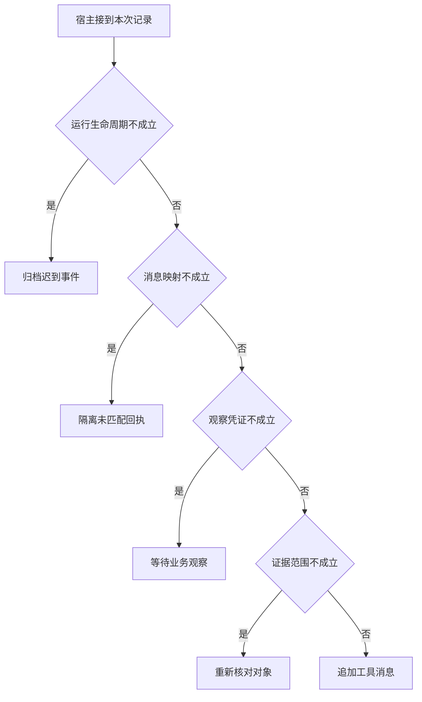

# 把异步观察放回正确的一轮

一个用户查询里可能同时有两项工具读取。
先把一张真实时刻表送给错误的调用 ID，即使数据正确，模型也会替另一个对象作答。
工程排查要把运行、动作和实体分开。

本篇用一个封闭的教学决策器说明这一问题。输入是宿主收到的记录，不保证每个下游字段都已经获准使用。前置检查未成立时，下游即使带着缓存值，也不能拿来作业务断言。

## 先解决一个具体问题

**工具返回内容正确，为什么用户仍然看到错馆的答案？**

把两个并行读取的回包顺序对调。
若结果跟着数组下标走，正确内容也会绑定到错误提议。
校验原调用编号和业务实体后再追加消息，才能在乱序时维持关联。


先取一个能走到「追加工具消息」的输入：本轮尚在处理、回执属于待处理调用、已有本轮业务回执、资料属于目标服务。
把这四个条件代回后文的图，前面各个拦截分支都未满足，最终才有“关联和业务范围均通过”这个判断。
还原这个现场时要分别问：哪些位来自可信状态，哪些只是在接口中出现、尚未获得解释资格的字段。

## 先沿一次决策走到底



从上到下取第一条成立的出口。只改一个开关时，只有它之前的检查都未截断，该变化才可能到达真实动作。

“运行生命周期”的两种输入分别是“本轮尚在处理”与“本轮已经终止”。
过期回执可归档，不能悄悄覆盖已交付的终态。

“消息映射”的两种输入分别是“回执属于待处理调用”与“无法对应本次调用”。
仅凭返回顺序归并可能将另一请求的观察放进历史。

“观察凭证”的两种输入分别是“已有本轮业务回执”与“只有尚未执行的提议”。
模型的调用提议不能证明应用已取得新事实。

“证据范围”的两种输入分别是“资料属于目标服务”与“资料来自另一服务区域”。
同楼地点也可能服务不同，引用要绑定业务对象。

## 最少需要哪几项观察

### 归档迟到事件

已经终止的请求不能被后台回执改写。
在本节的全部组合中，有 8 种产生「归档迟到事件」，这只是逻辑空间的计数，不能当作实际用户请求的比例。

只取得本轮已经终止，已经足以要求宿主「归档迟到事件」。
保持这些已知项，其余开关自由变化，仍有 8 种补全，判断没有翻转。

若删掉关于运行生命周期的证据，另一份允许的现场是本轮尚在处理、无法对应本次调用、只有尚未执行的提议、资料来自另一服务区域，它会使宿主「隔离未匹配回执」。

### 隔离未匹配回执

宿主找不到对应提议。
在本节的全部组合中，有 4 种产生「隔离未匹配回执」，这只是逻辑空间的计数，不能当作实际用户请求的比例。

只取得本轮尚在处理、无法对应本次调用，已经足以要求宿主「隔离未匹配回执」。
保持这些已知项，其余开关自由变化，仍有 4 种补全，判断没有翻转。

若删掉关于运行生命周期的证据，另一份允许的现场是本轮已经终止、无法对应本次调用、只有尚未执行的提议、资料来自另一服务区域，它会使宿主「归档迟到事件」。

若删掉关于消息映射的证据，另一份允许的现场是本轮尚在处理、回执属于待处理调用、只有尚未执行的提议、资料来自另一服务区域，它会使宿主「等待业务观察」。

### 等待业务观察

调用消息本身不提供查表结果。
在本节的全部组合中，有 2 种产生「等待业务观察」，这只是逻辑空间的计数，不能当作实际用户请求的比例。

只取得本轮尚在处理、回执属于待处理调用、只有尚未执行的提议，已经足以要求宿主「等待业务观察」。
保持这些已知项，其余开关自由变化，仍有 2 种补全，判断没有翻转。

若删掉关于运行生命周期的证据，另一份允许的现场是本轮已经终止、回执属于待处理调用、只有尚未执行的提议、资料来自另一服务区域，它会使宿主「归档迟到事件」。

若删掉关于消息映射的证据，另一份允许的现场是本轮尚在处理、无法对应本次调用、只有尚未执行的提议、资料来自另一服务区域，它会使宿主「隔离未匹配回执」。

若删掉关于观察凭证的证据，另一份允许的现场是本轮尚在处理、回执属于待处理调用、已有本轮业务回执、资料来自另一服务区域，它会使宿主「重新核对对象」。

### 重新核对对象

正确匹配回执仍可能取错场馆。
在本节的全部组合中，有 1 种产生「重新核对对象」，这只是逻辑空间的计数，不能当作实际用户请求的比例。

只取得本轮尚在处理、回执属于待处理调用、已有本轮业务回执、资料来自另一服务区域，已经足以要求宿主「重新核对对象」。
保持这些已知项，其余开关自由变化，仍有 1 种补全，判断没有翻转。

若删掉关于运行生命周期的证据，另一份允许的现场是本轮已经终止、回执属于待处理调用、已有本轮业务回执、资料来自另一服务区域，它会使宿主「归档迟到事件」。

若删掉关于消息映射的证据，另一份允许的现场是本轮尚在处理、无法对应本次调用、已有本轮业务回执、资料来自另一服务区域，它会使宿主「隔离未匹配回执」。

若删掉关于观察凭证的证据，另一份允许的现场是本轮尚在处理、回执属于待处理调用、只有尚未执行的提议、资料来自另一服务区域，它会使宿主「等待业务观察」。

若删掉关于证据范围的证据，另一份允许的现场是本轮尚在处理、回执属于待处理调用、已有本轮业务回执、资料属于目标服务，它会使宿主「追加工具消息」。

### 追加工具消息

关联和业务范围均通过。
在本节的全部组合中，有 1 种产生「追加工具消息」，这只是逻辑空间的计数，不能当作实际用户请求的比例。

只取得本轮尚在处理、回执属于待处理调用、已有本轮业务回执、资料属于目标服务，已经足以要求宿主「追加工具消息」。

若删掉关于运行生命周期的证据，另一份允许的现场是本轮已经终止、回执属于待处理调用、已有本轮业务回执、资料属于目标服务，它会使宿主「归档迟到事件」。

若删掉关于消息映射的证据，另一份允许的现场是本轮尚在处理、无法对应本次调用、已有本轮业务回执、资料属于目标服务，它会使宿主「隔离未匹配回执」。

若删掉关于观察凭证的证据，另一份允许的现场是本轮尚在处理、回执属于待处理调用、只有尚未执行的提议、资料属于目标服务，它会使宿主「等待业务观察」。

若删掉关于证据范围的证据，另一份允许的现场是本轮尚在处理、回执属于待处理调用、已有本轮业务回执、资料来自另一服务区域，它会使宿主「重新核对对象」。

## 以同一份契约解释截然不同的现场

<details>
<summary>展开推演与对应反例</summary>

下列样本按最先命中的业务分支排列。四位编码只作本篇页内定位，顺序与开头的四项输入一致。可以先猜下一动作，再展开相邻样本。

### 能够触发“归档迟到事件”的现场

**样本 0000**

业务侧交来本轮已经终止、无法对应本次调用，执行侧还记录了只有尚未执行的提议、资料来自另一服务区域。
把样本压成最短证明，保留本轮已经终止就能支持「归档迟到事件」。

在这份记录上，分别翻转「运行生命周期」中的任一项，其他项完全不变时，下一动作都会改变。

保持其余观察不动，单独切换「消息映射」、「观察凭证」、「证据范围」仍得到「归档迟到事件」，它们在这个现场不是决定性变量。

要从本例改走「隔离未匹配回执」，至少需要变动 1 项，一组最少改动是将本轮已经终止换成本轮尚在处理。

要从本例改走「等待业务观察」，至少需要变动 2 项，一组最少改动是将本轮已经终止、无法对应本次调用换成本轮尚在处理、回执属于待处理调用。

要从本例改走「重新核对对象」，至少需要变动 3 项，一组最少改动是将本轮已经终止、无法对应本次调用、只有尚未执行的提议换成本轮尚在处理、回执属于待处理调用、已有本轮业务回执。

要从本例改走「追加工具消息」，至少需要变动 4 项，一组最少改动是将本轮已经终止、无法对应本次调用、只有尚未执行的提议、资料来自另一服务区域换成本轮尚在处理、回执属于待处理调用、已有本轮业务回执、资料属于目标服务。

**样本 0001**

业务侧交来本轮已经终止、无法对应本次调用，执行侧还记录了只有尚未执行的提议、资料属于目标服务。


要从本例改走「追加工具消息」，至少需要变动 3 项，一组最少改动是将本轮已经终止、无法对应本次调用、只有尚未执行的提议换成本轮尚在处理、回执属于待处理调用、已有本轮业务回执。

要从本例改走「重新核对对象」，至少需要变动 4 项，一组最少改动是将本轮已经终止、无法对应本次调用、只有尚未执行的提议、资料属于目标服务换成本轮尚在处理、回执属于待处理调用、已有本轮业务回执、资料来自另一服务区域。

**样本 0010**

业务侧交来本轮已经终止、无法对应本次调用，执行侧还记录了已有本轮业务回执、资料来自另一服务区域。


要从本例改走「重新核对对象」，至少需要变动 2 项，一组最少改动是将本轮已经终止、无法对应本次调用换成本轮尚在处理、回执属于待处理调用。

要从本例改走「等待业务观察」，至少需要变动 3 项，一组最少改动是将本轮已经终止、无法对应本次调用、已有本轮业务回执换成本轮尚在处理、回执属于待处理调用、只有尚未执行的提议。

要从本例改走「追加工具消息」，至少需要变动 3 项，一组最少改动是将本轮已经终止、无法对应本次调用、资料来自另一服务区域换成本轮尚在处理、回执属于待处理调用、资料属于目标服务。

**样本 0011**

业务侧交来本轮已经终止、无法对应本次调用，执行侧还记录了已有本轮业务回执、资料属于目标服务。


要从本例改走「追加工具消息」，至少需要变动 2 项，一组最少改动是将本轮已经终止、无法对应本次调用换成本轮尚在处理、回执属于待处理调用。


要从本例改走「重新核对对象」，至少需要变动 3 项，一组最少改动是将本轮已经终止、无法对应本次调用、资料属于目标服务换成本轮尚在处理、回执属于待处理调用、资料来自另一服务区域。

**样本 0100**

业务侧交来本轮已经终止、回执属于待处理调用，执行侧还记录了只有尚未执行的提议、资料来自另一服务区域。


要从本例改走「等待业务观察」，至少需要变动 1 项，一组最少改动是将本轮已经终止换成本轮尚在处理。

要从本例改走「隔离未匹配回执」，至少需要变动 2 项，一组最少改动是将本轮已经终止、回执属于待处理调用换成本轮尚在处理、无法对应本次调用。

要从本例改走「重新核对对象」，至少需要变动 2 项，一组最少改动是将本轮已经终止、只有尚未执行的提议换成本轮尚在处理、已有本轮业务回执。

要从本例改走「追加工具消息」，至少需要变动 3 项，一组最少改动是将本轮已经终止、只有尚未执行的提议、资料来自另一服务区域换成本轮尚在处理、已有本轮业务回执、资料属于目标服务。

**样本 0101**

业务侧交来本轮已经终止、回执属于待处理调用，执行侧还记录了只有尚未执行的提议、资料属于目标服务。


要从本例改走「追加工具消息」，至少需要变动 2 项，一组最少改动是将本轮已经终止、只有尚未执行的提议换成本轮尚在处理、已有本轮业务回执。

要从本例改走「重新核对对象」，至少需要变动 3 项，一组最少改动是将本轮已经终止、只有尚未执行的提议、资料属于目标服务换成本轮尚在处理、已有本轮业务回执、资料来自另一服务区域。

**样本 0110**

业务侧交来本轮已经终止、回执属于待处理调用，执行侧还记录了已有本轮业务回执、资料来自另一服务区域。


要从本例改走「重新核对对象」，至少需要变动 1 项，一组最少改动是将本轮已经终止换成本轮尚在处理。


要从本例改走「等待业务观察」，至少需要变动 2 项，一组最少改动是将本轮已经终止、已有本轮业务回执换成本轮尚在处理、只有尚未执行的提议。

要从本例改走「追加工具消息」，至少需要变动 2 项，一组最少改动是将本轮已经终止、资料来自另一服务区域换成本轮尚在处理、资料属于目标服务。

**样本 0111**

业务侧交来本轮已经终止、回执属于待处理调用，执行侧还记录了已有本轮业务回执、资料属于目标服务。


要从本例改走「追加工具消息」，至少需要变动 1 项，一组最少改动是将本轮已经终止换成本轮尚在处理。


要从本例改走「重新核对对象」，至少需要变动 2 项，一组最少改动是将本轮已经终止、资料属于目标服务换成本轮尚在处理、资料来自另一服务区域。

### 能够触发“隔离未匹配回执”的现场

**样本 1000**

业务侧交来本轮尚在处理、无法对应本次调用，执行侧还记录了只有尚未执行的提议、资料来自另一服务区域。
把样本压成最短证明，保留本轮尚在处理、无法对应本次调用就能支持「隔离未匹配回执」。

在这份记录上，分别翻转「运行生命周期」、「消息映射」中的任一项，其他项完全不变时，下一动作都会改变。

保持其余观察不动，单独切换「观察凭证」、「证据范围」仍得到「隔离未匹配回执」，它们在这个现场不是决定性变量。

本例没走更靠前的「归档迟到事件」，因为本轮尚在处理与那个入口的必要条件不符。

要从本例改走「归档迟到事件」，至少需要变动 1 项，一组最少改动是将本轮尚在处理换成本轮已经终止。

要从本例改走「等待业务观察」，至少需要变动 1 项，一组最少改动是将无法对应本次调用换成回执属于待处理调用。

要从本例改走「重新核对对象」，至少需要变动 2 项，一组最少改动是将无法对应本次调用、只有尚未执行的提议换成回执属于待处理调用、已有本轮业务回执。

要从本例改走「追加工具消息」，至少需要变动 3 项，一组最少改动是将无法对应本次调用、只有尚未执行的提议、资料来自另一服务区域换成回执属于待处理调用、已有本轮业务回执、资料属于目标服务。

**样本 1001**

业务侧交来本轮尚在处理、无法对应本次调用，执行侧还记录了只有尚未执行的提议、资料属于目标服务。


要从本例改走「追加工具消息」，至少需要变动 2 项，一组最少改动是将无法对应本次调用、只有尚未执行的提议换成回执属于待处理调用、已有本轮业务回执。

要从本例改走「重新核对对象」，至少需要变动 3 项，一组最少改动是将无法对应本次调用、只有尚未执行的提议、资料属于目标服务换成回执属于待处理调用、已有本轮业务回执、资料来自另一服务区域。

**样本 1010**

业务侧交来本轮尚在处理、无法对应本次调用，执行侧还记录了已有本轮业务回执、资料来自另一服务区域。


要从本例改走「重新核对对象」，至少需要变动 1 项，一组最少改动是将无法对应本次调用换成回执属于待处理调用。

要从本例改走「等待业务观察」，至少需要变动 2 项，一组最少改动是将无法对应本次调用、已有本轮业务回执换成回执属于待处理调用、只有尚未执行的提议。

要从本例改走「追加工具消息」，至少需要变动 2 项，一组最少改动是将无法对应本次调用、资料来自另一服务区域换成回执属于待处理调用、资料属于目标服务。

**样本 1011**

业务侧交来本轮尚在处理、无法对应本次调用，执行侧还记录了已有本轮业务回执、资料属于目标服务。


要从本例改走「追加工具消息」，至少需要变动 1 项，一组最少改动是将无法对应本次调用换成回执属于待处理调用。


要从本例改走「重新核对对象」，至少需要变动 2 项，一组最少改动是将无法对应本次调用、资料属于目标服务换成回执属于待处理调用、资料来自另一服务区域。

### 能够触发“等待业务观察”的现场

**样本 1100**

业务侧交来本轮尚在处理、回执属于待处理调用，执行侧还记录了只有尚未执行的提议、资料来自另一服务区域。
把样本压成最短证明，保留本轮尚在处理、回执属于待处理调用、只有尚未执行的提议就能支持「等待业务观察」。

在这份记录上，分别翻转「运行生命周期」、「消息映射」、「观察凭证」中的任一项，其他项完全不变时，下一动作都会改变。

保持其余观察不动，单独切换「证据范围」仍得到「等待业务观察」，它们在这个现场不是决定性变量。


本例没走更靠前的「隔离未匹配回执」，因为回执属于待处理调用与那个入口的必要条件不符。


要从本例改走「隔离未匹配回执」，至少需要变动 1 项，一组最少改动是将回执属于待处理调用换成无法对应本次调用。

要从本例改走「重新核对对象」，至少需要变动 1 项，一组最少改动是将只有尚未执行的提议换成已有本轮业务回执。

要从本例改走「追加工具消息」，至少需要变动 2 项，一组最少改动是将只有尚未执行的提议、资料来自另一服务区域换成已有本轮业务回执、资料属于目标服务。

**样本 1101**

业务侧交来本轮尚在处理、回执属于待处理调用，执行侧还记录了只有尚未执行的提议、资料属于目标服务。


要从本例改走「追加工具消息」，至少需要变动 1 项，一组最少改动是将只有尚未执行的提议换成已有本轮业务回执。

要从本例改走「重新核对对象」，至少需要变动 2 项，一组最少改动是将只有尚未执行的提议、资料属于目标服务换成已有本轮业务回执、资料来自另一服务区域。

### 能够触发“重新核对对象”的现场

**样本 1110**

业务侧交来本轮尚在处理、回执属于待处理调用，执行侧还记录了已有本轮业务回执、资料来自另一服务区域。
把样本压成最短证明，保留本轮尚在处理、回执属于待处理调用、已有本轮业务回执、资料来自另一服务区域就能支持「重新核对对象」。

在这份记录上，分别翻转「运行生命周期」、「消息映射」、「观察凭证」、「证据范围」中的任一项，其他项完全不变时，下一动作都会改变。


本例没走更靠前的「等待业务观察」，因为已有本轮业务回执与那个入口的必要条件不符。


要从本例改走「等待业务观察」，至少需要变动 1 项，一组最少改动是将已有本轮业务回执换成只有尚未执行的提议。

要从本例改走「追加工具消息」，至少需要变动 1 项，一组最少改动是将资料来自另一服务区域换成资料属于目标服务。

### 能够触发“追加工具消息”的现场

**样本 1111**

业务侧交来本轮尚在处理、回执属于待处理调用，执行侧还记录了已有本轮业务回执、资料属于目标服务。
把样本压成最短证明，保留本轮尚在处理、回执属于待处理调用、已有本轮业务回执、资料属于目标服务就能支持「追加工具消息」。


本例没走更靠前的「重新核对对象」，因为资料属于目标服务与那个入口的必要条件不符。


要从本例改走「重新核对对象」，至少需要变动 1 项，一组最少改动是将资料属于目标服务换成资料来自另一服务区域。

</details>

## 当你只能看见一半记录

<details>
<summary>展开推演与对应反例</summary>

这次隐藏两个字段，保留另两个。对每个可见现场，检查四种合法补全是否同意。如仍有歧义，选择能使最坏剩余候选动作最少的字段继续查。并列时采用本篇字段顺序。

### 只保留运行生命周期与消息映射

已知本轮已经终止、无法对应本次调用时，四种补全的动作分布为归档迟到事件（4 种）。

就“归档迟到事件”这个动作而言，在本轮已经终止、无法对应本次调用的前提下，另外两项观察不会推翻它。

已知本轮已经终止、回执属于待处理调用时，四种补全的动作分布为归档迟到事件（4 种）。

就“归档迟到事件”这个动作而言，在本轮已经终止、回执属于待处理调用的前提下，另外两项观察不会推翻它。

已知本轮尚在处理、无法对应本次调用时，四种补全的动作分布为隔离未匹配回执（4 种）。

就“隔离未匹配回执”这个动作而言，在本轮尚在处理、无法对应本次调用的前提下，另外两项观察不会推翻它。

已知本轮尚在处理、回执属于待处理调用时，四种补全的动作分布为等待业务观察（2 种）、重新核对对象（1 种）、追加工具消息（1 种）。

在本轮尚在处理、回执属于待处理调用这个现场补读「观察凭证」，最坏还剩 2 种动作，计算时只衡量歧义，尚未扣读取代价。
若补来的观察为“只有尚未执行的提议”，范围缩成「等待业务观察」。若为“已有本轮业务回执”，则保留「重新核对对象」、「追加工具消息」。

区分不了的两条执行可以具体写成 1100 与 1110：它们共享已展示字段，却分别需要「等待业务观察」和「重新核对对象」。

### 只保留运行生命周期与观察凭证

已知本轮已经终止、只有尚未执行的提议时，四种补全的动作分布为归档迟到事件（4 种）。

就“归档迟到事件”这个动作而言，在本轮已经终止、只有尚未执行的提议的前提下，另外两项观察不会推翻它。

已知本轮已经终止、已有本轮业务回执时，四种补全的动作分布为归档迟到事件（4 种）。

就“归档迟到事件”这个动作而言，在本轮已经终止、已有本轮业务回执的前提下，另外两项观察不会推翻它。

已知本轮尚在处理、只有尚未执行的提议时，四种补全的动作分布为隔离未匹配回执（2 种）、等待业务观察（2 种）。

在本轮尚在处理、只有尚未执行的提议这个现场补读「消息映射」，最坏还剩 1 种动作，计算时只衡量歧义，尚未扣读取代价。
若补来的观察为“无法对应本次调用”，范围缩成「隔离未匹配回执」。若为“回执属于待处理调用”，则保留「等待业务观察」。

区分不了的两条执行可以具体写成 1000 与 1100：它们共享已展示字段，却分别需要「隔离未匹配回执」和「等待业务观察」。

已知本轮尚在处理、已有本轮业务回执时，四种补全的动作分布为隔离未匹配回执（2 种）、重新核对对象（1 种）、追加工具消息（1 种）。

在本轮尚在处理、已有本轮业务回执这个现场补读「消息映射」，最坏还剩 2 种动作，计算时只衡量歧义，尚未扣读取代价。
若补来的观察为“无法对应本次调用”，范围缩成「隔离未匹配回执」。若为“回执属于待处理调用”，则保留「重新核对对象」、「追加工具消息」。

区分不了的两条执行可以具体写成 1010 与 1110：它们共享已展示字段，却分别需要「隔离未匹配回执」和「重新核对对象」。

### 只保留消息映射与观察凭证

已知无法对应本次调用、只有尚未执行的提议时，四种补全的动作分布为归档迟到事件（2 种）、隔离未匹配回执（2 种）。

在无法对应本次调用、只有尚未执行的提议这个现场补读「运行生命周期」，最坏还剩 1 种动作，计算时只衡量歧义，尚未扣读取代价。
若补来的观察为“本轮已经终止”，范围缩成「归档迟到事件」。若为“本轮尚在处理”，则保留「隔离未匹配回执」。

区分不了的两条执行可以具体写成 0000 与 1000：它们共享已展示字段，却分别需要「归档迟到事件」和「隔离未匹配回执」。

已知无法对应本次调用、已有本轮业务回执时，四种补全的动作分布为归档迟到事件（2 种）、隔离未匹配回执（2 种）。

在无法对应本次调用、已有本轮业务回执这个现场补读「运行生命周期」，最坏还剩 1 种动作，计算时只衡量歧义，尚未扣读取代价。

区分不了的两条执行可以具体写成 0010 与 1010：它们共享已展示字段，却分别需要「归档迟到事件」和「隔离未匹配回执」。

已知回执属于待处理调用、只有尚未执行的提议时，四种补全的动作分布为归档迟到事件（2 种）、等待业务观察（2 种）。

在回执属于待处理调用、只有尚未执行的提议这个现场补读「运行生命周期」，最坏还剩 1 种动作，计算时只衡量歧义，尚未扣读取代价。
若补来的观察为“本轮已经终止”，范围缩成「归档迟到事件」。若为“本轮尚在处理”，则保留「等待业务观察」。

区分不了的两条执行可以具体写成 0100 与 1100：它们共享已展示字段，却分别需要「归档迟到事件」和「等待业务观察」。

已知回执属于待处理调用、已有本轮业务回执时，四种补全的动作分布为归档迟到事件（2 种）、重新核对对象（1 种）、追加工具消息（1 种）。

在回执属于待处理调用、已有本轮业务回执这个现场补读「运行生命周期」，最坏还剩 2 种动作，计算时只衡量歧义，尚未扣读取代价。
若补来的观察为“本轮已经终止”，范围缩成「归档迟到事件」。若为“本轮尚在处理”，则保留「重新核对对象」、「追加工具消息」。

区分不了的两条执行可以具体写成 0110 与 1110：它们共享已展示字段，却分别需要「归档迟到事件」和「重新核对对象」。

### 只保留运行生命周期与证据范围

已知本轮已经终止、资料来自另一服务区域时，四种补全的动作分布为归档迟到事件（4 种）。

就“归档迟到事件”这个动作而言，在本轮已经终止、资料来自另一服务区域的前提下，另外两项观察不会推翻它。

已知本轮已经终止、资料属于目标服务时，四种补全的动作分布为归档迟到事件（4 种）。

就“归档迟到事件”这个动作而言，在本轮已经终止、资料属于目标服务的前提下，另外两项观察不会推翻它。

已知本轮尚在处理、资料来自另一服务区域时，四种补全的动作分布为隔离未匹配回执（2 种）、等待业务观察（1 种）、重新核对对象（1 种）。

在本轮尚在处理、资料来自另一服务区域这个现场补读「消息映射」，最坏还剩 2 种动作，计算时只衡量歧义，尚未扣读取代价。
若补来的观察为“无法对应本次调用”，范围缩成「隔离未匹配回执」。若为“回执属于待处理调用”，则保留「等待业务观察」、「重新核对对象」。


已知本轮尚在处理、资料属于目标服务时，四种补全的动作分布为隔离未匹配回执（2 种）、等待业务观察（1 种）、追加工具消息（1 种）。

在本轮尚在处理、资料属于目标服务这个现场补读「消息映射」，最坏还剩 2 种动作，计算时只衡量歧义，尚未扣读取代价。
若补来的观察为“无法对应本次调用”，范围缩成「隔离未匹配回执」。若为“回执属于待处理调用”，则保留「等待业务观察」、「追加工具消息」。

区分不了的两条执行可以具体写成 1001 与 1101：它们共享已展示字段，却分别需要「隔离未匹配回执」和「等待业务观察」。

### 只保留消息映射与证据范围

已知无法对应本次调用、资料来自另一服务区域时，四种补全的动作分布为归档迟到事件（2 种）、隔离未匹配回执（2 种）。

在无法对应本次调用、资料来自另一服务区域这个现场补读「运行生命周期」，最坏还剩 1 种动作，计算时只衡量歧义，尚未扣读取代价。


已知无法对应本次调用、资料属于目标服务时，四种补全的动作分布为归档迟到事件（2 种）、隔离未匹配回执（2 种）。

在无法对应本次调用、资料属于目标服务这个现场补读「运行生命周期」，最坏还剩 1 种动作，计算时只衡量歧义，尚未扣读取代价。

区分不了的两条执行可以具体写成 0001 与 1001：它们共享已展示字段，却分别需要「归档迟到事件」和「隔离未匹配回执」。

已知回执属于待处理调用、资料来自另一服务区域时，四种补全的动作分布为归档迟到事件（2 种）、等待业务观察（1 种）、重新核对对象（1 种）。

在回执属于待处理调用、资料来自另一服务区域这个现场补读「运行生命周期」，最坏还剩 2 种动作，计算时只衡量歧义，尚未扣读取代价。
若补来的观察为“本轮已经终止”，范围缩成「归档迟到事件」。若为“本轮尚在处理”，则保留「等待业务观察」、「重新核对对象」。


已知回执属于待处理调用、资料属于目标服务时，四种补全的动作分布为归档迟到事件（2 种）、等待业务观察（1 种）、追加工具消息（1 种）。

在回执属于待处理调用、资料属于目标服务这个现场补读「运行生命周期」，最坏还剩 2 种动作，计算时只衡量歧义，尚未扣读取代价。
若补来的观察为“本轮已经终止”，范围缩成「归档迟到事件」。若为“本轮尚在处理”，则保留「等待业务观察」、「追加工具消息」。

区分不了的两条执行可以具体写成 0101 与 1101：它们共享已展示字段，却分别需要「归档迟到事件」和「等待业务观察」。

### 只保留观察凭证与证据范围

已知只有尚未执行的提议、资料来自另一服务区域时，四种补全的动作分布为归档迟到事件（2 种）、隔离未匹配回执（1 种）、等待业务观察（1 种）。

在只有尚未执行的提议、资料来自另一服务区域这个现场补读「运行生命周期」，最坏还剩 2 种动作，计算时只衡量歧义，尚未扣读取代价。
若补来的观察为“本轮已经终止”，范围缩成「归档迟到事件」。若为“本轮尚在处理”，则保留「隔离未匹配回执」、「等待业务观察」。


已知只有尚未执行的提议、资料属于目标服务时，四种补全的动作分布为归档迟到事件（2 种）、隔离未匹配回执（1 种）、等待业务观察（1 种）。

在只有尚未执行的提议、资料属于目标服务这个现场补读「运行生命周期」，最坏还剩 2 种动作，计算时只衡量歧义，尚未扣读取代价。


已知已有本轮业务回执、资料来自另一服务区域时，四种补全的动作分布为归档迟到事件（2 种）、隔离未匹配回执（1 种）、重新核对对象（1 种）。

在已有本轮业务回执、资料来自另一服务区域这个现场补读「运行生命周期」，最坏还剩 2 种动作，计算时只衡量歧义，尚未扣读取代价。
若补来的观察为“本轮已经终止”，范围缩成「归档迟到事件」。若为“本轮尚在处理”，则保留「隔离未匹配回执」、「重新核对对象」。


已知已有本轮业务回执、资料属于目标服务时，四种补全的动作分布为归档迟到事件（2 种）、隔离未匹配回执（1 种）、追加工具消息（1 种）。

在已有本轮业务回执、资料属于目标服务这个现场补读「运行生命周期」，最坏还剩 2 种动作，计算时只衡量歧义，尚未扣读取代价。
若补来的观察为“本轮已经终止”，范围缩成「归档迟到事件」。若为“本轮尚在处理”，则保留「隔离未匹配回执」、「追加工具消息」。

区分不了的两条执行可以具体写成 0011 与 1011：它们共享已展示字段，却分别需要「归档迟到事件」和「隔离未匹配回执」。

</details>

## 单因素干预与边界测试

<details>
<summary>展开推演与对应反例</summary>

### 只改变运行生命周期

固定另外三个条件得到八对现场，从“本轮已经终止”转为“本轮尚在处理”时，8 对翻转动作，另外 0 对保持不变。

有 4 对现场沿「归档迟到事件」变到「隔离未匹配回执」，可复现的一组受控背景为无法对应本次调用、只有尚未执行的提议、资料来自另一服务区域。

有 2 对现场沿「归档迟到事件」变到「等待业务观察」，可复现的一组受控背景为回执属于待处理调用、只有尚未执行的提议、资料来自另一服务区域。

有 1 对现场沿「归档迟到事件」变到「重新核对对象」，可复现的一组受控背景为回执属于待处理调用、已有本轮业务回执、资料来自另一服务区域。

有 1 对现场沿「归档迟到事件」变到「追加工具消息」，可复现的一组受控背景为回执属于待处理调用、已有本轮业务回执、资料属于目标服务。

### 只改变消息映射

固定另外三个条件得到八对现场，从“无法对应本次调用”转为“回执属于待处理调用”时，4 对翻转动作，另外 4 对保持不变。

令本轮已经终止、只有尚未执行的提议、资料来自另一服务区域，消息映射的两个取值均得到「归档迟到事件」。在八对中，共有 4 对表现为这一种稳定出口。

有 2 对现场沿「隔离未匹配回执」变到「等待业务观察」，可复现的一组受控背景为本轮尚在处理、只有尚未执行的提议、资料来自另一服务区域。

有 1 对现场沿「隔离未匹配回执」变到「重新核对对象」，可复现的一组受控背景为本轮尚在处理、已有本轮业务回执、资料来自另一服务区域。

有 1 对现场沿「隔离未匹配回执」变到「追加工具消息」，可复现的一组受控背景为本轮尚在处理、已有本轮业务回执、资料属于目标服务。

### 只改变观察凭证

固定另外三个条件得到八对现场，从“只有尚未执行的提议”转为“已有本轮业务回执”时，2 对翻转动作，另外 6 对保持不变。

令本轮已经终止、无法对应本次调用、资料来自另一服务区域，观察凭证的两个取值均得到「归档迟到事件」。在八对中，共有 4 对表现为这一种稳定出口。

令本轮尚在处理、无法对应本次调用、资料来自另一服务区域，观察凭证的两个取值均得到「隔离未匹配回执」。在八对中，共有 2 对表现为这一种稳定出口。

有 1 对现场沿「等待业务观察」变到「重新核对对象」，可复现的一组受控背景为本轮尚在处理、回执属于待处理调用、资料来自另一服务区域。

有 1 对现场沿「等待业务观察」变到「追加工具消息」，可复现的一组受控背景为本轮尚在处理、回执属于待处理调用、资料属于目标服务。

### 只改变证据范围

固定另外三个条件得到八对现场，从“资料来自另一服务区域”转为“资料属于目标服务”时，1 对翻转动作，另外 7 对保持不变。

令本轮已经终止、无法对应本次调用、只有尚未执行的提议，证据范围的两个取值均得到「归档迟到事件」。在八对中，共有 4 对表现为这一种稳定出口。

令本轮尚在处理、无法对应本次调用、只有尚未执行的提议，证据范围的两个取值均得到「隔离未匹配回执」。在八对中，共有 2 对表现为这一种稳定出口。

令本轮尚在处理、回执属于待处理调用、只有尚未执行的提议，证据范围的两个取值均得到「等待业务观察」。在八对中，共有 1 对表现为这一种稳定出口。

有 1 对现场沿「重新核对对象」变到「追加工具消息」，可复现的一组受控背景为本轮尚在处理、回执属于待处理调用、已有本轮业务回执。

</details>

## 哪些回归样本真能抓住实现错误

<details>
<summary>展开推演与对应反例</summary>

如果删除“归档迟到事件”这个分支，在本篇 16 种输入里有 8 种会改走另一出口。

反例 0000 的完整记录为本轮已经终止、无法对应本次调用、只有尚未执行的提议、资料来自另一服务区域。正确结果是「归档迟到事件」，这个改坏的实现却给出「隔离未匹配回执」。

如果删除“隔离未匹配回执”这个分支，在本篇 16 种输入里有 4 种会改走另一出口。

反例 1000 的完整记录为本轮尚在处理、无法对应本次调用、只有尚未执行的提议、资料来自另一服务区域。正确结果是「隔离未匹配回执」，这个改坏的实现却给出「等待业务观察」。

如果删除“等待业务观察”这个分支，在本篇 16 种输入里有 2 种会改走另一出口。

反例 1100 的完整记录为本轮尚在处理、回执属于待处理调用、只有尚未执行的提议、资料来自另一服务区域。正确结果是「等待业务观察」，这个改坏的实现却给出「重新核对对象」。

如果删除“重新核对对象”这个分支，在本篇 16 种输入里有 1 种会改走另一出口。

反例 1110 的完整记录为本轮尚在处理、回执属于待处理调用、已有本轮业务回执、资料来自另一服务区域。正确结果是「重新核对对象」，这个改坏的实现却给出「追加工具消息」。

如果交换“归档迟到事件”和“隔离未匹配回执”的判断次序，在本篇 16 种输入里有 4 种会改走另一出口。


如果交换“隔离未匹配回执”和“等待业务观察”的判断次序，在本篇 16 种输入里有 2 种会改走另一出口。


如果交换“等待业务观察”和“重新核对对象”的判断次序，在本篇 16 种输入里有 1 种会改走另一出口。


补入样本 0000（本轮已经终止、无法对应本次调用、只有尚未执行的提议、资料来自另一服务区域）能新增检出「删除“归档迟到事件”这个分支」、「交换“归档迟到事件”和“隔离未匹配回执”的判断次序」。

补入样本 1000（本轮尚在处理、无法对应本次调用、只有尚未执行的提议、资料来自另一服务区域）能新增检出「删除“隔离未匹配回执”这个分支」、「交换“隔离未匹配回执”和“等待业务观察”的判断次序」。

补入样本 1100（本轮尚在处理、回执属于待处理调用、只有尚未执行的提议、资料来自另一服务区域）能新增检出「删除“等待业务观察”这个分支」、「交换“等待业务观察”和“重新核对对象”的判断次序」。

补入样本 1110（本轮尚在处理、回执属于待处理调用、已有本轮业务回执、资料来自另一服务区域）能新增检出「删除“重新核对对象”这个分支」。

这里每次选覆盖尚未捕获缺陷最多的样本，并不保证用例数全局最小。它给出的反例能作为 Java 单测输入。真实模型是否会自主产生这些提议，仍须单独评测。

</details>

## 把状态覆盖换成有抽样偏差的评测批次

<details>
<summary>展开推演与对应反例</summary>

前面的十六种记录各有一票。现在只改样本构成：对一个给定字段，把成立侧的每种记录各取三份、另一侧各取一份。这是人为配比的 32 份回放，不是线上频率估计。
将偏向成立与偏向不成立的两次批次对照，可以隔离分母变化。底层宿主和所有答案保持相同，比例仍可能移动。

### 改变“运行生命周期”的样本配比

只看「归档迟到事件」，在本轮尚在处理的八个不同输入中有 0 个命中，在本轮已经终止的另八个输入中有 8 个命中。
把「运行生命周期」成立侧按三倍取样，「归档迟到事件」占 8/32，反过来向未成立侧倾斜后占 24/32。
这次重加权使「归档迟到事件」的占比相差 50 个百分点。若按两种不同的“运行生命周期”分布跑新旧版，不能把这项差异全部归功于实现。

只看「隔离未匹配回执」，在本轮尚在处理的八个不同输入中有 4 个命中，在本轮已经终止的另八个输入中有 0 个命中。
把「运行生命周期」成立侧按三倍取样，「隔离未匹配回执」占 12/32，反过来向未成立侧倾斜后占 4/32。
这次重加权使「隔离未匹配回执」的占比相差 25 个百分点。若按两种不同的“运行生命周期”分布跑新旧版，不能把这项差异全部归功于实现。

只看「等待业务观察」，在本轮尚在处理的八个不同输入中有 2 个命中，在本轮已经终止的另八个输入中有 0 个命中。
把「运行生命周期」成立侧按三倍取样，「等待业务观察」占 6/32，反过来向未成立侧倾斜后占 2/32。
这次重加权使「等待业务观察」的占比相差 12.5 个百分点。若按两种不同的“运行生命周期”分布跑新旧版，不能把这项差异全部归功于实现。

只看「重新核对对象」，在本轮尚在处理的八个不同输入中有 1 个命中，在本轮已经终止的另八个输入中有 0 个命中。
把「运行生命周期」成立侧按三倍取样，「重新核对对象」占 3/32，反过来向未成立侧倾斜后占 1/32。
这次重加权使「重新核对对象」的占比相差 6.25 个百分点。若按两种不同的“运行生命周期”分布跑新旧版，不能把这项差异全部归功于实现。

只看「追加工具消息」，在本轮尚在处理的八个不同输入中有 1 个命中，在本轮已经终止的另八个输入中有 0 个命中。
把「运行生命周期」成立侧按三倍取样，「追加工具消息」占 3/32，反过来向未成立侧倾斜后占 1/32。
这次重加权使「追加工具消息」的占比相差 6.25 个百分点。若按两种不同的“运行生命周期”分布跑新旧版，不能把这项差异全部归功于实现。

### 改变“消息映射”的样本配比

只看「归档迟到事件」，在回执属于待处理调用的八个不同输入中有 4 个命中，在无法对应本次调用的另八个输入中有 4 个命中。
把「消息映射」成立侧按三倍取样，「归档迟到事件」占 16/32，反过来向未成立侧倾斜后占 16/32。
两批「归档迟到事件」的边际比例相同，是因为这个出口在“消息映射”的两侧计数相等，这不能单独证明每一对现场都不受它影响。

只看「隔离未匹配回执」，在回执属于待处理调用的八个不同输入中有 0 个命中，在无法对应本次调用的另八个输入中有 4 个命中。
把「消息映射」成立侧按三倍取样，「隔离未匹配回执」占 4/32，反过来向未成立侧倾斜后占 12/32。
这次重加权使「隔离未匹配回执」的占比相差 25 个百分点。若按两种不同的“消息映射”分布跑新旧版，不能把这项差异全部归功于实现。

只看「等待业务观察」，在回执属于待处理调用的八个不同输入中有 2 个命中，在无法对应本次调用的另八个输入中有 0 个命中。
把「消息映射」成立侧按三倍取样，「等待业务观察」占 6/32，反过来向未成立侧倾斜后占 2/32。
这次重加权使「等待业务观察」的占比相差 12.5 个百分点。若按两种不同的“消息映射”分布跑新旧版，不能把这项差异全部归功于实现。

只看「重新核对对象」，在回执属于待处理调用的八个不同输入中有 1 个命中，在无法对应本次调用的另八个输入中有 0 个命中。
把「消息映射」成立侧按三倍取样，「重新核对对象」占 3/32，反过来向未成立侧倾斜后占 1/32。
这次重加权使「重新核对对象」的占比相差 6.25 个百分点。若按两种不同的“消息映射”分布跑新旧版，不能把这项差异全部归功于实现。

只看「追加工具消息」，在回执属于待处理调用的八个不同输入中有 1 个命中，在无法对应本次调用的另八个输入中有 0 个命中。
把「消息映射」成立侧按三倍取样，「追加工具消息」占 3/32，反过来向未成立侧倾斜后占 1/32。
这次重加权使「追加工具消息」的占比相差 6.25 个百分点。若按两种不同的“消息映射”分布跑新旧版，不能把这项差异全部归功于实现。

### 改变“观察凭证”的样本配比

只看「归档迟到事件」，在已有本轮业务回执的八个不同输入中有 4 个命中，在只有尚未执行的提议的另八个输入中有 4 个命中。
把「观察凭证」成立侧按三倍取样，「归档迟到事件」占 16/32，反过来向未成立侧倾斜后占 16/32。
两批「归档迟到事件」的边际比例相同，是因为这个出口在“观察凭证”的两侧计数相等，这不能单独证明每一对现场都不受它影响。

只看「隔离未匹配回执」，在已有本轮业务回执的八个不同输入中有 2 个命中，在只有尚未执行的提议的另八个输入中有 2 个命中。
把「观察凭证」成立侧按三倍取样，「隔离未匹配回执」占 8/32，反过来向未成立侧倾斜后占 8/32。
两批「隔离未匹配回执」的边际比例相同，是因为这个出口在“观察凭证”的两侧计数相等，这不能单独证明每一对现场都不受它影响。

只看「等待业务观察」，在已有本轮业务回执的八个不同输入中有 0 个命中，在只有尚未执行的提议的另八个输入中有 2 个命中。
把「观察凭证」成立侧按三倍取样，「等待业务观察」占 2/32，反过来向未成立侧倾斜后占 6/32。
这次重加权使「等待业务观察」的占比相差 12.5 个百分点。若按两种不同的“观察凭证”分布跑新旧版，不能把这项差异全部归功于实现。

只看「重新核对对象」，在已有本轮业务回执的八个不同输入中有 1 个命中，在只有尚未执行的提议的另八个输入中有 0 个命中。
把「观察凭证」成立侧按三倍取样，「重新核对对象」占 3/32，反过来向未成立侧倾斜后占 1/32。
这次重加权使「重新核对对象」的占比相差 6.25 个百分点。若按两种不同的“观察凭证”分布跑新旧版，不能把这项差异全部归功于实现。

只看「追加工具消息」，在已有本轮业务回执的八个不同输入中有 1 个命中，在只有尚未执行的提议的另八个输入中有 0 个命中。
把「观察凭证」成立侧按三倍取样，「追加工具消息」占 3/32，反过来向未成立侧倾斜后占 1/32。
这次重加权使「追加工具消息」的占比相差 6.25 个百分点。若按两种不同的“观察凭证”分布跑新旧版，不能把这项差异全部归功于实现。

### 改变“证据范围”的样本配比

只看「归档迟到事件」，在资料属于目标服务的八个不同输入中有 4 个命中，在资料来自另一服务区域的另八个输入中有 4 个命中。
把「证据范围」成立侧按三倍取样，「归档迟到事件」占 16/32，反过来向未成立侧倾斜后占 16/32。
两批「归档迟到事件」的边际比例相同，是因为这个出口在“证据范围”的两侧计数相等，这不能单独证明每一对现场都不受它影响。

只看「隔离未匹配回执」，在资料属于目标服务的八个不同输入中有 2 个命中，在资料来自另一服务区域的另八个输入中有 2 个命中。
把「证据范围」成立侧按三倍取样，「隔离未匹配回执」占 8/32，反过来向未成立侧倾斜后占 8/32。
两批「隔离未匹配回执」的边际比例相同，是因为这个出口在“证据范围”的两侧计数相等，这不能单独证明每一对现场都不受它影响。

只看「等待业务观察」，在资料属于目标服务的八个不同输入中有 1 个命中，在资料来自另一服务区域的另八个输入中有 1 个命中。
把「证据范围」成立侧按三倍取样，「等待业务观察」占 4/32，反过来向未成立侧倾斜后占 4/32。
两批「等待业务观察」的边际比例相同，是因为这个出口在“证据范围”的两侧计数相等，这不能单独证明每一对现场都不受它影响。

只看「重新核对对象」，在资料属于目标服务的八个不同输入中有 0 个命中，在资料来自另一服务区域的另八个输入中有 1 个命中。
把「证据范围」成立侧按三倍取样，「重新核对对象」占 1/32，反过来向未成立侧倾斜后占 3/32。
这次重加权使「重新核对对象」的占比相差 6.25 个百分点。若按两种不同的“证据范围”分布跑新旧版，不能把这项差异全部归功于实现。

只看「追加工具消息」，在资料属于目标服务的八个不同输入中有 1 个命中，在资料来自另一服务区域的另八个输入中有 0 个命中。
把「证据范围」成立侧按三倍取样，「追加工具消息」占 3/32，反过来向未成立侧倾斜后占 1/32。
这次重加权使「追加工具消息」的占比相差 6.25 个百分点。若按两种不同的“证据范围”分布跑新旧版，不能把这项差异全部归功于实现。

</details>

## 只看终态，能逆推出多少原始事实

<details>
<summary>展开推演与对应反例</summary>

### 只保留“归档迟到事件”这条结果时

在本节契约与完整输入域内，仅知「归档迟到事件」就能倒推出本轮已经终止，这一推断依赖版本未变且日志中的终态可信。

「归档迟到事件」不能证明消息映射取哪一侧：0000 和 0100 有相同终态，却分别记为“无法对应本次调用”和“回执属于待处理调用”。

「归档迟到事件」不能证明观察凭证取哪一侧：0000 和 0010 有相同终态，却分别记为“只有尚未执行的提议”和“已有本轮业务回执”。

「归档迟到事件」不能证明证据范围取哪一侧：0000 和 0001 有相同终态，却分别记为“资料来自另一服务区域”和“资料属于目标服务”。

反查「归档迟到事件」的诊断日志，优先保留能区分样本 0000 与 1000 的「运行生命周期」，否则很容易把邻近的「隔离未匹配回执」看成同一种故障。

### 只保留“隔离未匹配回执”这条结果时

在本节契约与完整输入域内，仅知「隔离未匹配回执」就能倒推出本轮尚在处理，这一推断依赖版本未变且日志中的终态可信。

在本节契约与完整输入域内，仅知「隔离未匹配回执」就能倒推出无法对应本次调用，这一推断依赖版本未变且日志中的终态可信。

「隔离未匹配回执」不能证明观察凭证取哪一侧：1000 和 1010 有相同终态，却分别记为“只有尚未执行的提议”和“已有本轮业务回执”。

「隔离未匹配回执」不能证明证据范围取哪一侧：1000 和 1001 有相同终态，却分别记为“资料来自另一服务区域”和“资料属于目标服务”。

反查「隔离未匹配回执」的诊断日志，优先保留能区分样本 1000 与 0000 的「运行生命周期」，否则很容易把邻近的「归档迟到事件」看成同一种故障。

### 只保留“等待业务观察”这条结果时

在本节契约与完整输入域内，仅知「等待业务观察」就能倒推出本轮尚在处理，这一推断依赖版本未变且日志中的终态可信。

在本节契约与完整输入域内，仅知「等待业务观察」就能倒推出回执属于待处理调用，这一推断依赖版本未变且日志中的终态可信。

在本节契约与完整输入域内，仅知「等待业务观察」就能倒推出只有尚未执行的提议，这一推断依赖版本未变且日志中的终态可信。

「等待业务观察」不能证明证据范围取哪一侧：1100 和 1101 有相同终态，却分别记为“资料来自另一服务区域”和“资料属于目标服务”。

反查「等待业务观察」的诊断日志，优先保留能区分样本 1100 与 0100 的「运行生命周期」，否则很容易把邻近的「归档迟到事件」看成同一种故障。

### 只保留“重新核对对象”这条结果时

在本节契约与完整输入域内，仅知「重新核对对象」就能倒推出本轮尚在处理，这一推断依赖版本未变且日志中的终态可信。

在本节契约与完整输入域内，仅知「重新核对对象」就能倒推出回执属于待处理调用，这一推断依赖版本未变且日志中的终态可信。

在本节契约与完整输入域内，仅知「重新核对对象」就能倒推出已有本轮业务回执，这一推断依赖版本未变且日志中的终态可信。

在本节契约与完整输入域内，仅知「重新核对对象」就能倒推出资料来自另一服务区域，这一推断依赖版本未变且日志中的终态可信。

反查「重新核对对象」的诊断日志，优先保留能区分样本 1110 与 0110 的「运行生命周期」，否则很容易把邻近的「归档迟到事件」看成同一种故障。

### 只保留“追加工具消息”这条结果时

在本节契约与完整输入域内，仅知「追加工具消息」就能倒推出本轮尚在处理，这一推断依赖版本未变且日志中的终态可信。

在本节契约与完整输入域内，仅知「追加工具消息」就能倒推出回执属于待处理调用，这一推断依赖版本未变且日志中的终态可信。

在本节契约与完整输入域内，仅知「追加工具消息」就能倒推出已有本轮业务回执，这一推断依赖版本未变且日志中的终态可信。

在本节契约与完整输入域内，仅知「追加工具消息」就能倒推出资料属于目标服务，这一推断依赖版本未变且日志中的终态可信。

反查「追加工具消息」的诊断日志，优先保留能区分样本 1111 与 0111 的「运行生命周期」，否则很容易把邻近的「归档迟到事件」看成同一种故障。

</details>

## 面试复述与复算

面试题可以从“工具返回内容正确，为什么用户仍然看到错馆的答案？”起步。先给出本篇的触发条件和一条真实执行端可检查的证据，再用一个相邻反例限定结论的适用范围。

在仓库根目录执行下列命令可以重算本篇的一个输入。四位数字依次选择正文列出的四项条件，0 表示未成立或低档，1 表示成立或高档。
```powershell
node examples/reading-cases/replay.mjs 1 2 0101
```

[本周主文](../theory.md) · [配套实验](../lab.md) · [下一篇研读](03.md)
