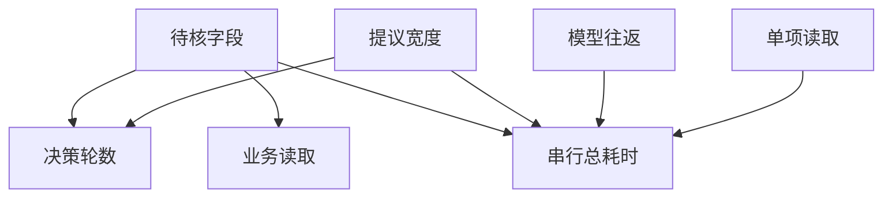

# 批量提议能省几次模型往返

一次读取多个已知主题，但工具在一个工作线程按项读取。
将批量提议和并发执行分开，才能解释节省的究竟是哪段等待。
最后一次整理仍要调用模型，所有主题相互独立且没有排队。

## 先解决一个具体问题

**模型一次提了三项读取，为什么业务调用计数没有减少？**

动作批次只合并了决策往返。看见一批提议后，执行器仍要取得每个必要事实。
明确区分一次模型调用、一批提议与真实执行次数，再决定有没有可并行的下游工作。


先从具体的低档设定开始：待核字段取 1项、提议宽度取 1项、模型往返取 180毫秒、单项读取取 25毫秒。
三个结果依次是决策轮数 2轮、业务读取 1次、串行总耗时 385毫秒。
先手算这个起点，读完后再把另一个输入切到高档，这样能知道数字变化时究竟改变了哪个假设。

## 先写清输入边界和三个观测量

用 a 表示待核字段，取 1项 或 3项，这两点是用于隔离因果影响的教学输入。

用 b 表示提议宽度，取 1项 或 2项，这两点是用于隔离因果影响的教学输入。

用 c 表示模型往返，取 180毫秒 或 520毫秒，这两点是用于隔离因果影响的教学输入。

用 d 表示单项读取，取 25毫秒 或 95毫秒，这两点是用于隔离因果影响的教学输入。

「决策轮数」的计算式为 `ceil(a/b)+1`，按业务量展开是 `ceil(待核字段/提议宽度)+1`，输出单位为轮。

「业务读取」的计算式为 `a`，按业务量展开是 `待核字段`，输出单位为次。

「串行总耗时」的计算式为 `(ceil(a/b)+1)*c+a*d`，按业务量展开是 `(ceil(待核字段/提议宽度)+1)×模型往返+待核字段×单项读取`，输出单位为毫秒。

公式中 ceil 与 floor 分别向上、向下取整，% 在表达式中作取余，** 为乘方，三元条件按“条件 ? 成立值 : 其他值”读取。展示数值最多保留三位小数，比较和反推采用未舍入值。



图上的箭头表示该输入出现在计算式中。同一输入通向多个指标时，三个读数可能共同移动。分支、取整或相互抵消又会使某些边在具体样本上没有可见增量。

## 从输入按单位逐步算到可比较的结果

<details>
<summary>展开推演与对应反例</summary>

### 样本 0000：待核字段 1、提议宽度 1

这一组设定为待核字段为 1项、提议宽度为 1项、模型往返为 180毫秒、单项读取为 25毫秒。

代入「决策轮数」：`ceil(1/1)+1`，得到 2轮。

代入「业务读取」：`1`，得到 1次。

代入「串行总耗时」：`(ceil(1/1)+1)*180+1*25`，得到 385毫秒。

以「串行总耗时」作主读数时，本组单独切换模型往返的绝对变化最大或并列最大，读数会从 385毫秒 变为 1065毫秒。

本组固定其余输入时，分别改变「提议宽度」均不会改变 385毫秒 这个主读数，是否影响另一指标仍需另算。

对角样本 1111 的主读数为 1845毫秒。它同时改了四项，差额不能充当任一单个因素的净收益。

### 样本 0001：待核字段 1、提议宽度 1

这一组设定为待核字段为 1项、提议宽度为 1项、模型往返为 180毫秒、单项读取为 95毫秒。

代入「决策轮数」：`ceil(1/1)+1`，得到 2轮。

代入「业务读取」：`1`，得到 1次。

代入「串行总耗时」：`(ceil(1/1)+1)*180+1*95`，得到 455毫秒。

以「串行总耗时」作主读数时，本组单独切换模型往返的绝对变化最大或并列最大，读数会从 455毫秒 变为 1135毫秒。

本组固定其余输入时，分别改变「提议宽度」均不会改变 455毫秒 这个主读数，是否影响另一指标仍需另算。

对角样本 1110 的主读数为 1635毫秒。它同时改了四项，差额不能充当任一单个因素的净收益。

### 样本 0010：待核字段 1、提议宽度 1

这一组设定为待核字段为 1项、提议宽度为 1项、模型往返为 520毫秒、单项读取为 25毫秒。

代入「决策轮数」：`ceil(1/1)+1`，得到 2轮。

代入「业务读取」：`1`，得到 1次。

代入「串行总耗时」：`(ceil(1/1)+1)*520+1*25`，得到 1065毫秒。

以「串行总耗时」作主读数时，本组单独切换待核字段的绝对变化最大或并列最大，读数会从 1065毫秒 变为 2155毫秒。

本组固定其余输入时，分别改变「提议宽度」均不会改变 1065毫秒 这个主读数，是否影响另一指标仍需另算。

对角样本 1101 的主读数为 825毫秒。它同时改了四项，差额不能充当任一单个因素的净收益。

### 样本 0011：待核字段 1、提议宽度 1

这一组设定为待核字段为 1项、提议宽度为 1项、模型往返为 520毫秒、单项读取为 95毫秒。

代入「决策轮数」：`ceil(1/1)+1`，得到 2轮。

代入「业务读取」：`1`，得到 1次。

代入「串行总耗时」：`(ceil(1/1)+1)*520+1*95`，得到 1135毫秒。

以「串行总耗时」作主读数时，本组单独切换待核字段的绝对变化最大或并列最大，读数会从 1135毫秒 变为 2365毫秒。

本组固定其余输入时，分别改变「提议宽度」均不会改变 1135毫秒 这个主读数，是否影响另一指标仍需另算。

对角样本 1100 的主读数为 615毫秒。它同时改了四项，差额不能充当任一单个因素的净收益。

### 样本 0100：待核字段 1、提议宽度 2

这一组设定为待核字段为 1项、提议宽度为 2项、模型往返为 180毫秒、单项读取为 25毫秒。

代入「决策轮数」：`ceil(1/2)+1`，得到 2轮。

代入「业务读取」：`1`，得到 1次。

代入「串行总耗时」：`(ceil(1/2)+1)*180+1*25`，得到 385毫秒。


对角样本 1011 的主读数为 2365毫秒。它同时改了四项，差额不能充当任一单个因素的净收益。

### 样本 0101：待核字段 1、提议宽度 2

这一组设定为待核字段为 1项、提议宽度为 2项、模型往返为 180毫秒、单项读取为 95毫秒。

代入「决策轮数」：`ceil(1/2)+1`，得到 2轮。

代入「业务读取」：`1`，得到 1次。

代入「串行总耗时」：`(ceil(1/2)+1)*180+1*95`，得到 455毫秒。


对角样本 1010 的主读数为 2155毫秒。它同时改了四项，差额不能充当任一单个因素的净收益。

### 样本 0110：待核字段 1、提议宽度 2

这一组设定为待核字段为 1项、提议宽度为 2项、模型往返为 520毫秒、单项读取为 25毫秒。

代入「决策轮数」：`ceil(1/2)+1`，得到 2轮。

代入「业务读取」：`1`，得到 1次。

代入「串行总耗时」：`(ceil(1/2)+1)*520+1*25`，得到 1065毫秒。

以「串行总耗时」作主读数时，本组单独切换模型往返的绝对变化最大或并列最大，读数会从 1065毫秒 变为 385毫秒。


对角样本 1001 的主读数为 1005毫秒。它同时改了四项，差额不能充当任一单个因素的净收益。

### 样本 0111：待核字段 1、提议宽度 2

这一组设定为待核字段为 1项、提议宽度为 2项、模型往返为 520毫秒、单项读取为 95毫秒。

代入「决策轮数」：`ceil(1/2)+1`，得到 2轮。

代入「业务读取」：`1`，得到 1次。

代入「串行总耗时」：`(ceil(1/2)+1)*520+1*95`，得到 1135毫秒。

以「串行总耗时」作主读数时，本组单独切换待核字段的绝对变化最大或并列最大，读数会从 1135毫秒 变为 1845毫秒。


对角样本 1000 的主读数为 795毫秒。它同时改了四项，差额不能充当任一单个因素的净收益。

### 样本 1000：待核字段 3、提议宽度 1

这一组设定为待核字段为 3项、提议宽度为 1项、模型往返为 180毫秒、单项读取为 25毫秒。

代入「决策轮数」：`ceil(3/1)+1`，得到 4轮。

代入「业务读取」：`3`，得到 3次。

代入「串行总耗时」：`(ceil(3/1)+1)*180+3*25`，得到 795毫秒。

以「串行总耗时」作主读数时，本组单独切换模型往返的绝对变化最大或并列最大，读数会从 795毫秒 变为 2155毫秒。

对角样本 0111 的主读数为 1135毫秒。它同时改了四项，差额不能充当任一单个因素的净收益。

### 样本 1001：待核字段 3、提议宽度 1

这一组设定为待核字段为 3项、提议宽度为 1项、模型往返为 180毫秒、单项读取为 95毫秒。

代入「决策轮数」：`ceil(3/1)+1`，得到 4轮。

代入「业务读取」：`3`，得到 3次。

代入「串行总耗时」：`(ceil(3/1)+1)*180+3*95`，得到 1005毫秒。

以「串行总耗时」作主读数时，本组单独切换模型往返的绝对变化最大或并列最大，读数会从 1005毫秒 变为 2365毫秒。

对角样本 0110 的主读数为 1065毫秒。它同时改了四项，差额不能充当任一单个因素的净收益。

### 样本 1010：待核字段 3、提议宽度 1

这一组设定为待核字段为 3项、提议宽度为 1项、模型往返为 520毫秒、单项读取为 25毫秒。

代入「决策轮数」：`ceil(3/1)+1`，得到 4轮。

代入「业务读取」：`3`，得到 3次。

代入「串行总耗时」：`(ceil(3/1)+1)*520+3*25`，得到 2155毫秒。

以「串行总耗时」作主读数时，本组单独切换模型往返的绝对变化最大或并列最大，读数会从 2155毫秒 变为 795毫秒。

对角样本 0101 的主读数为 455毫秒。它同时改了四项，差额不能充当任一单个因素的净收益。

### 样本 1011：待核字段 3、提议宽度 1

这一组设定为待核字段为 3项、提议宽度为 1项、模型往返为 520毫秒、单项读取为 95毫秒。

代入「决策轮数」：`ceil(3/1)+1`，得到 4轮。

代入「业务读取」：`3`，得到 3次。

代入「串行总耗时」：`(ceil(3/1)+1)*520+3*95`，得到 2365毫秒。

以「串行总耗时」作主读数时，本组单独切换模型往返的绝对变化最大或并列最大，读数会从 2365毫秒 变为 1005毫秒。

对角样本 0100 的主读数为 385毫秒。它同时改了四项，差额不能充当任一单个因素的净收益。

### 样本 1100：待核字段 3、提议宽度 2

这一组设定为待核字段为 3项、提议宽度为 2项、模型往返为 180毫秒、单项读取为 25毫秒。

代入「决策轮数」：`ceil(3/2)+1`，得到 3轮。

代入「业务读取」：`3`，得到 3次。

代入「串行总耗时」：`(ceil(3/2)+1)*180+3*25`，得到 615毫秒。

以「串行总耗时」作主读数时，本组单独切换模型往返的绝对变化最大或并列最大，读数会从 615毫秒 变为 1635毫秒。

对角样本 0011 的主读数为 1135毫秒。它同时改了四项，差额不能充当任一单个因素的净收益。

### 样本 1101：待核字段 3、提议宽度 2

这一组设定为待核字段为 3项、提议宽度为 2项、模型往返为 180毫秒、单项读取为 95毫秒。

代入「决策轮数」：`ceil(3/2)+1`，得到 3轮。

代入「业务读取」：`3`，得到 3次。

代入「串行总耗时」：`(ceil(3/2)+1)*180+3*95`，得到 825毫秒。

以「串行总耗时」作主读数时，本组单独切换模型往返的绝对变化最大或并列最大，读数会从 825毫秒 变为 1845毫秒。

对角样本 0010 的主读数为 1065毫秒。它同时改了四项，差额不能充当任一单个因素的净收益。

### 样本 1110：待核字段 3、提议宽度 2

这一组设定为待核字段为 3项、提议宽度为 2项、模型往返为 520毫秒、单项读取为 25毫秒。

代入「决策轮数」：`ceil(3/2)+1`，得到 3轮。

代入「业务读取」：`3`，得到 3次。

代入「串行总耗时」：`(ceil(3/2)+1)*520+3*25`，得到 1635毫秒。

以「串行总耗时」作主读数时，本组单独切换模型往返的绝对变化最大或并列最大，读数会从 1635毫秒 变为 615毫秒。

对角样本 0001 的主读数为 455毫秒。它同时改了四项，差额不能充当任一单个因素的净收益。

### 样本 1111：待核字段 3、提议宽度 2

这一组设定为待核字段为 3项、提议宽度为 2项、模型往返为 520毫秒、单项读取为 95毫秒。

代入「决策轮数」：`ceil(3/2)+1`，得到 3轮。

代入「业务读取」：`3`，得到 3次。

代入「串行总耗时」：`(ceil(3/2)+1)*520+3*95`，得到 1845毫秒。

以「串行总耗时」作主读数时，本组单独切换模型往返的绝对变化最大或并列最大，读数会从 1845毫秒 变为 825毫秒。

对角样本 0000 的主读数为 385毫秒。它同时改了四项，差额不能充当任一单个因素的净收益。

</details>

## 逐个干预：其余条件固定时，变化真的发生在哪里

<details>
<summary>展开推演与对应反例</summary>

### 只改变待核字段

固定提议宽度为 1项、模型往返为 180毫秒、单项读取为 25毫秒，只把待核字段从 1项改到 3项。
这一对的决策轮数从 2轮 变为 4轮，业务读取的差为 2次，串行总耗时的差为 410毫秒。

固定提议宽度为 1项、模型往返为 180毫秒、单项读取为 95毫秒，只把待核字段从 1项改到 3项。
这一对的决策轮数从 2轮 变为 4轮，业务读取的差为 2次，串行总耗时的差为 550毫秒。

固定提议宽度为 1项、模型往返为 520毫秒、单项读取为 25毫秒，只把待核字段从 1项改到 3项。
这一对的决策轮数从 2轮 变为 4轮，业务读取的差为 2次，串行总耗时的差为 1090毫秒。

固定提议宽度为 1项、模型往返为 520毫秒、单项读取为 95毫秒，只把待核字段从 1项改到 3项。
这一对的决策轮数从 2轮 变为 4轮，业务读取的差为 2次，串行总耗时的差为 1230毫秒。

固定提议宽度为 2项、模型往返为 180毫秒、单项读取为 25毫秒，只把待核字段从 1项改到 3项。
这一对的决策轮数从 2轮 变为 3轮，业务读取的差为 2次，串行总耗时的差为 230毫秒。

固定提议宽度为 2项、模型往返为 180毫秒、单项读取为 95毫秒，只把待核字段从 1项改到 3项。
这一对的决策轮数从 2轮 变为 3轮，业务读取的差为 2次，串行总耗时的差为 370毫秒。

固定提议宽度为 2项、模型往返为 520毫秒、单项读取为 25毫秒，只把待核字段从 1项改到 3项。
这一对的决策轮数从 2轮 变为 3轮，业务读取的差为 2次，串行总耗时的差为 570毫秒。

固定提议宽度为 2项、模型往返为 520毫秒、单项读取为 95毫秒，只把待核字段从 1项改到 3项。
这一对的决策轮数从 2轮 变为 3轮，业务读取的差为 2次，串行总耗时的差为 710毫秒。

综合八组受控背景，待核字段升到较高设定时「决策轮数」的差值区间是 1轮 至 2轮，共有 8 对出现可观察变化。

综合八组受控背景，待核字段升到较高设定时「业务读取」的差值区间是 2次，共有 8 对出现可观察变化。

综合八组受控背景，待核字段升到较高设定时「串行总耗时」的差值区间是 230毫秒 至 1230毫秒，共有 8 对出现可观察变化。

### 只改变提议宽度

固定待核字段为 1项、模型往返为 180毫秒、单项读取为 25毫秒，只把提议宽度从 1项改到 2项。
这一对的决策轮数从 2轮 变为 2轮，业务读取的差为 0次，串行总耗时的差为 0毫秒。

固定待核字段为 1项、模型往返为 180毫秒、单项读取为 95毫秒，只把提议宽度从 1项改到 2项。

固定待核字段为 1项、模型往返为 520毫秒、单项读取为 25毫秒，只把提议宽度从 1项改到 2项。

固定待核字段为 1项、模型往返为 520毫秒、单项读取为 95毫秒，只把提议宽度从 1项改到 2项。

固定待核字段为 3项、模型往返为 180毫秒、单项读取为 25毫秒，只把提议宽度从 1项改到 2项。
这一对的决策轮数从 4轮 变为 3轮，业务读取的差为 0次，串行总耗时的差为 -180毫秒。

固定待核字段为 3项、模型往返为 180毫秒、单项读取为 95毫秒，只把提议宽度从 1项改到 2项。

固定待核字段为 3项、模型往返为 520毫秒、单项读取为 25毫秒，只把提议宽度从 1项改到 2项。
这一对的决策轮数从 4轮 变为 3轮，业务读取的差为 0次，串行总耗时的差为 -520毫秒。

固定待核字段为 3项、模型往返为 520毫秒、单项读取为 95毫秒，只把提议宽度从 1项改到 2项。

综合八组受控背景，提议宽度升到较高设定时「决策轮数」的差值区间是 -1轮 至 0轮，共有 4 对出现可观察变化。

综合八组受控背景，提议宽度升到较高设定时「业务读取」的差值区间是 0次，共有 0 对出现可观察变化。

综合八组受控背景，提议宽度升到较高设定时「串行总耗时」的差值区间是 -520毫秒 至 0毫秒，共有 4 对出现可观察变化。

### 只改变模型往返

固定待核字段为 1项、提议宽度为 1项、单项读取为 25毫秒，只把模型往返从 180毫秒改到 520毫秒。
这一对的决策轮数从 2轮 变为 2轮，业务读取的差为 0次，串行总耗时的差为 680毫秒。

固定待核字段为 1项、提议宽度为 1项、单项读取为 95毫秒，只把模型往返从 180毫秒改到 520毫秒。

固定待核字段为 1项、提议宽度为 2项、单项读取为 25毫秒，只把模型往返从 180毫秒改到 520毫秒。

固定待核字段为 1项、提议宽度为 2项、单项读取为 95毫秒，只把模型往返从 180毫秒改到 520毫秒。

固定待核字段为 3项、提议宽度为 1项、单项读取为 25毫秒，只把模型往返从 180毫秒改到 520毫秒。
这一对的决策轮数从 4轮 变为 4轮，业务读取的差为 0次，串行总耗时的差为 1360毫秒。

固定待核字段为 3项、提议宽度为 1项、单项读取为 95毫秒，只把模型往返从 180毫秒改到 520毫秒。

固定待核字段为 3项、提议宽度为 2项、单项读取为 25毫秒，只把模型往返从 180毫秒改到 520毫秒。
这一对的决策轮数从 3轮 变为 3轮，业务读取的差为 0次，串行总耗时的差为 1020毫秒。

固定待核字段为 3项、提议宽度为 2项、单项读取为 95毫秒，只把模型往返从 180毫秒改到 520毫秒。

综合八组受控背景，模型往返升到较高设定时「决策轮数」的差值区间是 0轮，共有 0 对出现可观察变化。

综合八组受控背景，模型往返升到较高设定时「业务读取」的差值区间是 0次，共有 0 对出现可观察变化。

综合八组受控背景，模型往返升到较高设定时「串行总耗时」的差值区间是 680毫秒 至 1360毫秒，共有 8 对出现可观察变化。

### 只改变单项读取

固定待核字段为 1项、提议宽度为 1项、模型往返为 180毫秒，只把单项读取从 25毫秒改到 95毫秒。
这一对的决策轮数从 2轮 变为 2轮，业务读取的差为 0次，串行总耗时的差为 70毫秒。

固定待核字段为 1项、提议宽度为 1项、模型往返为 520毫秒，只把单项读取从 25毫秒改到 95毫秒。

固定待核字段为 1项、提议宽度为 2项、模型往返为 180毫秒，只把单项读取从 25毫秒改到 95毫秒。

固定待核字段为 1项、提议宽度为 2项、模型往返为 520毫秒，只把单项读取从 25毫秒改到 95毫秒。

固定待核字段为 3项、提议宽度为 1项、模型往返为 180毫秒，只把单项读取从 25毫秒改到 95毫秒。
这一对的决策轮数从 4轮 变为 4轮，业务读取的差为 0次，串行总耗时的差为 210毫秒。

固定待核字段为 3项、提议宽度为 1项、模型往返为 520毫秒，只把单项读取从 25毫秒改到 95毫秒。

固定待核字段为 3项、提议宽度为 2项、模型往返为 180毫秒，只把单项读取从 25毫秒改到 95毫秒。
这一对的决策轮数从 3轮 变为 3轮，业务读取的差为 0次，串行总耗时的差为 210毫秒。

固定待核字段为 3项、提议宽度为 2项、模型往返为 520毫秒，只把单项读取从 25毫秒改到 95毫秒。

综合八组受控背景，单项读取升到较高设定时「决策轮数」的差值区间是 0轮，共有 0 对出现可观察变化。

综合八组受控背景，单项读取升到较高设定时「业务读取」的差值区间是 0次，共有 0 对出现可观察变化。

综合八组受控背景，单项读取升到较高设定时「串行总耗时」的差值区间是 70毫秒 至 210毫秒，共有 8 对出现可观察变化。

</details>

## 只拿到部分输入，结论还能缩小到多大范围

<details>
<summary>展开推演与对应反例</summary>

### 已知待核字段和提议宽度

当待核字段为 1项、提议宽度为 1项时，另两项有四种补全，主读数「串行总耗时」只能限定为 385毫秒 至 1135毫秒。
这个条件下，取模型往返为 180毫秒、单项读取为 25毫秒可得到下界 385毫秒，取模型往返为 520毫秒、单项读取为 95毫秒可达到上界 1135毫秒。

用同样可见的待核字段为 1项、提议宽度为 1项去推「决策轮数」，能得到的范围为 2轮，不能把另一个指标的单位代入。

用同样可见的待核字段为 1项、提议宽度为 1项去推「业务读取」，能得到的范围为 1次，不能把另一个指标的单位代入。

若只许再问一项，按最坏区间宽度优先核对模型往返，补得低档时为 385毫秒 至 455毫秒，高档时为 1065毫秒 至 1135毫秒。

当待核字段为 1项、提议宽度为 2项时，另两项有四种补全，主读数「串行总耗时」只能限定为 385毫秒 至 1135毫秒。

用同样可见的待核字段为 1项、提议宽度为 2项去推「决策轮数」，能得到的范围为 2轮，不能把另一个指标的单位代入。

用同样可见的待核字段为 1项、提议宽度为 2项去推「业务读取」，能得到的范围为 1次，不能把另一个指标的单位代入。


当待核字段为 3项、提议宽度为 1项时，另两项有四种补全，主读数「串行总耗时」只能限定为 795毫秒 至 2365毫秒。
这个条件下，取模型往返为 180毫秒、单项读取为 25毫秒可得到下界 795毫秒，取模型往返为 520毫秒、单项读取为 95毫秒可达到上界 2365毫秒。

用同样可见的待核字段为 3项、提议宽度为 1项去推「决策轮数」，能得到的范围为 4轮，不能把另一个指标的单位代入。

用同样可见的待核字段为 3项、提议宽度为 1项去推「业务读取」，能得到的范围为 3次，不能把另一个指标的单位代入。

若只许再问一项，按最坏区间宽度优先核对模型往返，补得低档时为 795毫秒 至 1005毫秒，高档时为 2155毫秒 至 2365毫秒。

当待核字段为 3项、提议宽度为 2项时，另两项有四种补全，主读数「串行总耗时」只能限定为 615毫秒 至 1845毫秒。
这个条件下，取模型往返为 180毫秒、单项读取为 25毫秒可得到下界 615毫秒，取模型往返为 520毫秒、单项读取为 95毫秒可达到上界 1845毫秒。

用同样可见的待核字段为 3项、提议宽度为 2项去推「决策轮数」，能得到的范围为 3轮，不能把另一个指标的单位代入。

用同样可见的待核字段为 3项、提议宽度为 2项去推「业务读取」，能得到的范围为 3次，不能把另一个指标的单位代入。

若只许再问一项，按最坏区间宽度优先核对模型往返，补得低档时为 615毫秒 至 825毫秒，高档时为 1635毫秒 至 1845毫秒。

### 已知待核字段和模型往返

当待核字段为 1项、模型往返为 180毫秒时，另两项有四种补全，主读数「串行总耗时」只能限定为 385毫秒 至 455毫秒。
这个条件下，取提议宽度为 1项、单项读取为 25毫秒可得到下界 385毫秒，取提议宽度为 1项、单项读取为 95毫秒可达到上界 455毫秒。

用同样可见的待核字段为 1项、模型往返为 180毫秒去推「决策轮数」，能得到的范围为 2轮，不能把另一个指标的单位代入。

用同样可见的待核字段为 1项、模型往返为 180毫秒去推「业务读取」，能得到的范围为 1次，不能把另一个指标的单位代入。

若只许再问一项，按最坏区间宽度优先核对单项读取，补得低档时为 385毫秒，高档时为 455毫秒。

当待核字段为 1项、模型往返为 520毫秒时，另两项有四种补全，主读数「串行总耗时」只能限定为 1065毫秒 至 1135毫秒。
这个条件下，取提议宽度为 1项、单项读取为 25毫秒可得到下界 1065毫秒，取提议宽度为 1项、单项读取为 95毫秒可达到上界 1135毫秒。

用同样可见的待核字段为 1项、模型往返为 520毫秒去推「决策轮数」，能得到的范围为 2轮，不能把另一个指标的单位代入。

用同样可见的待核字段为 1项、模型往返为 520毫秒去推「业务读取」，能得到的范围为 1次，不能把另一个指标的单位代入。

若只许再问一项，按最坏区间宽度优先核对单项读取，补得低档时为 1065毫秒，高档时为 1135毫秒。

当待核字段为 3项、模型往返为 180毫秒时，另两项有四种补全，主读数「串行总耗时」只能限定为 615毫秒 至 1005毫秒。
这个条件下，取提议宽度为 2项、单项读取为 25毫秒可得到下界 615毫秒，取提议宽度为 1项、单项读取为 95毫秒可达到上界 1005毫秒。

用同样可见的待核字段为 3项、模型往返为 180毫秒去推「决策轮数」，能得到的范围为 3轮 至 4轮，不能把另一个指标的单位代入。

用同样可见的待核字段为 3项、模型往返为 180毫秒去推「业务读取」，能得到的范围为 3次，不能把另一个指标的单位代入。

若只许再问一项，按最坏区间宽度优先核对单项读取，补得低档时为 615毫秒 至 795毫秒，高档时为 825毫秒 至 1005毫秒。

当待核字段为 3项、模型往返为 520毫秒时，另两项有四种补全，主读数「串行总耗时」只能限定为 1635毫秒 至 2365毫秒。
这个条件下，取提议宽度为 2项、单项读取为 25毫秒可得到下界 1635毫秒，取提议宽度为 1项、单项读取为 95毫秒可达到上界 2365毫秒。

用同样可见的待核字段为 3项、模型往返为 520毫秒去推「决策轮数」，能得到的范围为 3轮 至 4轮，不能把另一个指标的单位代入。

用同样可见的待核字段为 3项、模型往返为 520毫秒去推「业务读取」，能得到的范围为 3次，不能把另一个指标的单位代入。

若只许再问一项，按最坏区间宽度优先核对提议宽度，补得低档时为 2155毫秒 至 2365毫秒，高档时为 1635毫秒 至 1845毫秒。

### 已知提议宽度和模型往返

当提议宽度为 1项、模型往返为 180毫秒时，另两项有四种补全，主读数「串行总耗时」只能限定为 385毫秒 至 1005毫秒。
这个条件下，取待核字段为 1项、单项读取为 25毫秒可得到下界 385毫秒，取待核字段为 3项、单项读取为 95毫秒可达到上界 1005毫秒。

用同样可见的提议宽度为 1项、模型往返为 180毫秒去推「决策轮数」，能得到的范围为 2轮 至 4轮，不能把另一个指标的单位代入。

用同样可见的提议宽度为 1项、模型往返为 180毫秒去推「业务读取」，能得到的范围为 1次 至 3次，不能把另一个指标的单位代入。

若只许再问一项，按最坏区间宽度优先核对待核字段，补得低档时为 385毫秒 至 455毫秒，高档时为 795毫秒 至 1005毫秒。

当提议宽度为 1项、模型往返为 520毫秒时，另两项有四种补全，主读数「串行总耗时」只能限定为 1065毫秒 至 2365毫秒。
这个条件下，取待核字段为 1项、单项读取为 25毫秒可得到下界 1065毫秒，取待核字段为 3项、单项读取为 95毫秒可达到上界 2365毫秒。

用同样可见的提议宽度为 1项、模型往返为 520毫秒去推「决策轮数」，能得到的范围为 2轮 至 4轮，不能把另一个指标的单位代入。

用同样可见的提议宽度为 1项、模型往返为 520毫秒去推「业务读取」，能得到的范围为 1次 至 3次，不能把另一个指标的单位代入。

若只许再问一项，按最坏区间宽度优先核对待核字段，补得低档时为 1065毫秒 至 1135毫秒，高档时为 2155毫秒 至 2365毫秒。

当提议宽度为 2项、模型往返为 180毫秒时，另两项有四种补全，主读数「串行总耗时」只能限定为 385毫秒 至 825毫秒。
这个条件下，取待核字段为 1项、单项读取为 25毫秒可得到下界 385毫秒，取待核字段为 3项、单项读取为 95毫秒可达到上界 825毫秒。

用同样可见的提议宽度为 2项、模型往返为 180毫秒去推「决策轮数」，能得到的范围为 2轮 至 3轮，不能把另一个指标的单位代入。

用同样可见的提议宽度为 2项、模型往返为 180毫秒去推「业务读取」，能得到的范围为 1次 至 3次，不能把另一个指标的单位代入。

若只许再问一项，按最坏区间宽度优先核对待核字段，补得低档时为 385毫秒 至 455毫秒，高档时为 615毫秒 至 825毫秒。

当提议宽度为 2项、模型往返为 520毫秒时，另两项有四种补全，主读数「串行总耗时」只能限定为 1065毫秒 至 1845毫秒。
这个条件下，取待核字段为 1项、单项读取为 25毫秒可得到下界 1065毫秒，取待核字段为 3项、单项读取为 95毫秒可达到上界 1845毫秒。

用同样可见的提议宽度为 2项、模型往返为 520毫秒去推「决策轮数」，能得到的范围为 2轮 至 3轮，不能把另一个指标的单位代入。

用同样可见的提议宽度为 2项、模型往返为 520毫秒去推「业务读取」，能得到的范围为 1次 至 3次，不能把另一个指标的单位代入。

若只许再问一项，按最坏区间宽度优先核对待核字段，补得低档时为 1065毫秒 至 1135毫秒，高档时为 1635毫秒 至 1845毫秒。

### 已知待核字段和单项读取

当待核字段为 1项、单项读取为 25毫秒时，另两项有四种补全，主读数「串行总耗时」只能限定为 385毫秒 至 1065毫秒。
这个条件下，取提议宽度为 1项、模型往返为 180毫秒可得到下界 385毫秒，取提议宽度为 1项、模型往返为 520毫秒可达到上界 1065毫秒。

用同样可见的待核字段为 1项、单项读取为 25毫秒去推「决策轮数」，能得到的范围为 2轮，不能把另一个指标的单位代入。

用同样可见的待核字段为 1项、单项读取为 25毫秒去推「业务读取」，能得到的范围为 1次，不能把另一个指标的单位代入。

若只许再问一项，按最坏区间宽度优先核对模型往返，补得低档时为 385毫秒，高档时为 1065毫秒。

当待核字段为 1项、单项读取为 95毫秒时，另两项有四种补全，主读数「串行总耗时」只能限定为 455毫秒 至 1135毫秒。
这个条件下，取提议宽度为 1项、模型往返为 180毫秒可得到下界 455毫秒，取提议宽度为 1项、模型往返为 520毫秒可达到上界 1135毫秒。

用同样可见的待核字段为 1项、单项读取为 95毫秒去推「决策轮数」，能得到的范围为 2轮，不能把另一个指标的单位代入。

用同样可见的待核字段为 1项、单项读取为 95毫秒去推「业务读取」，能得到的范围为 1次，不能把另一个指标的单位代入。

若只许再问一项，按最坏区间宽度优先核对模型往返，补得低档时为 455毫秒，高档时为 1135毫秒。

当待核字段为 3项、单项读取为 25毫秒时，另两项有四种补全，主读数「串行总耗时」只能限定为 615毫秒 至 2155毫秒。
这个条件下，取提议宽度为 2项、模型往返为 180毫秒可得到下界 615毫秒，取提议宽度为 1项、模型往返为 520毫秒可达到上界 2155毫秒。

用同样可见的待核字段为 3项、单项读取为 25毫秒去推「决策轮数」，能得到的范围为 3轮 至 4轮，不能把另一个指标的单位代入。

用同样可见的待核字段为 3项、单项读取为 25毫秒去推「业务读取」，能得到的范围为 3次，不能把另一个指标的单位代入。

若只许再问一项，按最坏区间宽度优先核对模型往返，补得低档时为 615毫秒 至 795毫秒，高档时为 1635毫秒 至 2155毫秒。

当待核字段为 3项、单项读取为 95毫秒时，另两项有四种补全，主读数「串行总耗时」只能限定为 825毫秒 至 2365毫秒。
这个条件下，取提议宽度为 2项、模型往返为 180毫秒可得到下界 825毫秒，取提议宽度为 1项、模型往返为 520毫秒可达到上界 2365毫秒。

用同样可见的待核字段为 3项、单项读取为 95毫秒去推「决策轮数」，能得到的范围为 3轮 至 4轮，不能把另一个指标的单位代入。

用同样可见的待核字段为 3项、单项读取为 95毫秒去推「业务读取」，能得到的范围为 3次，不能把另一个指标的单位代入。

若只许再问一项，按最坏区间宽度优先核对模型往返，补得低档时为 825毫秒 至 1005毫秒，高档时为 1845毫秒 至 2365毫秒。

### 已知提议宽度和单项读取

当提议宽度为 1项、单项读取为 25毫秒时，另两项有四种补全，主读数「串行总耗时」只能限定为 385毫秒 至 2155毫秒。
这个条件下，取待核字段为 1项、模型往返为 180毫秒可得到下界 385毫秒，取待核字段为 3项、模型往返为 520毫秒可达到上界 2155毫秒。

用同样可见的提议宽度为 1项、单项读取为 25毫秒去推「决策轮数」，能得到的范围为 2轮 至 4轮，不能把另一个指标的单位代入。

用同样可见的提议宽度为 1项、单项读取为 25毫秒去推「业务读取」，能得到的范围为 1次 至 3次，不能把另一个指标的单位代入。

若只许再问一项，按最坏区间宽度优先核对模型往返，补得低档时为 385毫秒 至 795毫秒，高档时为 1065毫秒 至 2155毫秒。

当提议宽度为 1项、单项读取为 95毫秒时，另两项有四种补全，主读数「串行总耗时」只能限定为 455毫秒 至 2365毫秒。
这个条件下，取待核字段为 1项、模型往返为 180毫秒可得到下界 455毫秒，取待核字段为 3项、模型往返为 520毫秒可达到上界 2365毫秒。

用同样可见的提议宽度为 1项、单项读取为 95毫秒去推「决策轮数」，能得到的范围为 2轮 至 4轮，不能把另一个指标的单位代入。

用同样可见的提议宽度为 1项、单项读取为 95毫秒去推「业务读取」，能得到的范围为 1次 至 3次，不能把另一个指标的单位代入。

若只许再问一项，按最坏区间宽度优先核对模型往返，补得低档时为 455毫秒 至 1005毫秒，高档时为 1135毫秒 至 2365毫秒。

当提议宽度为 2项、单项读取为 25毫秒时，另两项有四种补全，主读数「串行总耗时」只能限定为 385毫秒 至 1635毫秒。
这个条件下，取待核字段为 1项、模型往返为 180毫秒可得到下界 385毫秒，取待核字段为 3项、模型往返为 520毫秒可达到上界 1635毫秒。

用同样可见的提议宽度为 2项、单项读取为 25毫秒去推「决策轮数」，能得到的范围为 2轮 至 3轮，不能把另一个指标的单位代入。

用同样可见的提议宽度为 2项、单项读取为 25毫秒去推「业务读取」，能得到的范围为 1次 至 3次，不能把另一个指标的单位代入。

若只许再问一项，按最坏区间宽度优先核对模型往返，补得低档时为 385毫秒 至 615毫秒，高档时为 1065毫秒 至 1635毫秒。

当提议宽度为 2项、单项读取为 95毫秒时，另两项有四种补全，主读数「串行总耗时」只能限定为 455毫秒 至 1845毫秒。
这个条件下，取待核字段为 1项、模型往返为 180毫秒可得到下界 455毫秒，取待核字段为 3项、模型往返为 520毫秒可达到上界 1845毫秒。

用同样可见的提议宽度为 2项、单项读取为 95毫秒去推「决策轮数」，能得到的范围为 2轮 至 3轮，不能把另一个指标的单位代入。

用同样可见的提议宽度为 2项、单项读取为 95毫秒去推「业务读取」，能得到的范围为 1次 至 3次，不能把另一个指标的单位代入。

若只许再问一项，按最坏区间宽度优先核对模型往返，补得低档时为 455毫秒 至 825毫秒，高档时为 1135毫秒 至 1845毫秒。

### 已知模型往返和单项读取

当模型往返为 180毫秒、单项读取为 25毫秒时，另两项有四种补全，主读数「串行总耗时」只能限定为 385毫秒 至 795毫秒。
这个条件下，取待核字段为 1项、提议宽度为 1项可得到下界 385毫秒，取待核字段为 3项、提议宽度为 1项可达到上界 795毫秒。

用同样可见的模型往返为 180毫秒、单项读取为 25毫秒去推「决策轮数」，能得到的范围为 2轮 至 4轮，不能把另一个指标的单位代入。

用同样可见的模型往返为 180毫秒、单项读取为 25毫秒去推「业务读取」，能得到的范围为 1次 至 3次，不能把另一个指标的单位代入。

若只许再问一项，按最坏区间宽度优先核对待核字段，补得低档时为 385毫秒，高档时为 615毫秒 至 795毫秒。

当模型往返为 180毫秒、单项读取为 95毫秒时，另两项有四种补全，主读数「串行总耗时」只能限定为 455毫秒 至 1005毫秒。
这个条件下，取待核字段为 1项、提议宽度为 1项可得到下界 455毫秒，取待核字段为 3项、提议宽度为 1项可达到上界 1005毫秒。

用同样可见的模型往返为 180毫秒、单项读取为 95毫秒去推「决策轮数」，能得到的范围为 2轮 至 4轮，不能把另一个指标的单位代入。

用同样可见的模型往返为 180毫秒、单项读取为 95毫秒去推「业务读取」，能得到的范围为 1次 至 3次，不能把另一个指标的单位代入。

若只许再问一项，按最坏区间宽度优先核对待核字段，补得低档时为 455毫秒，高档时为 825毫秒 至 1005毫秒。

当模型往返为 520毫秒、单项读取为 25毫秒时，另两项有四种补全，主读数「串行总耗时」只能限定为 1065毫秒 至 2155毫秒。
这个条件下，取待核字段为 1项、提议宽度为 1项可得到下界 1065毫秒，取待核字段为 3项、提议宽度为 1项可达到上界 2155毫秒。

用同样可见的模型往返为 520毫秒、单项读取为 25毫秒去推「决策轮数」，能得到的范围为 2轮 至 4轮，不能把另一个指标的单位代入。

用同样可见的模型往返为 520毫秒、单项读取为 25毫秒去推「业务读取」，能得到的范围为 1次 至 3次，不能把另一个指标的单位代入。

若只许再问一项，按最坏区间宽度优先核对待核字段，补得低档时为 1065毫秒，高档时为 1635毫秒 至 2155毫秒。

当模型往返为 520毫秒、单项读取为 95毫秒时，另两项有四种补全，主读数「串行总耗时」只能限定为 1135毫秒 至 2365毫秒。
这个条件下，取待核字段为 1项、提议宽度为 1项可得到下界 1135毫秒，取待核字段为 3项、提议宽度为 1项可达到上界 2365毫秒。

用同样可见的模型往返为 520毫秒、单项读取为 95毫秒去推「决策轮数」，能得到的范围为 2轮 至 4轮，不能把另一个指标的单位代入。

用同样可见的模型往返为 520毫秒、单项读取为 95毫秒去推「业务读取」，能得到的范围为 1次 至 3次，不能把另一个指标的单位代入。

若只许再问一项，按最坏区间宽度优先核对待核字段，补得低档时为 1135毫秒，高档时为 1845毫秒 至 2365毫秒。

</details>

## 反过来审查一份报表：能从结果还原哪些输入

<details>
<summary>展开推演与对应反例</summary>

### 仅保留“决策轮数”的读数

报表只写「决策轮数=2轮」时，在本实验的离散取值中有 8 组输入与之相容。

对这个 2轮 的「决策轮数」读数，所有相容样本都要求待核字段为 1项。

只凭「决策轮数」的 2轮 无法确定提议宽度：0000 与 0100 的取值分别为 1 和 2项。

报表只写「决策轮数=4轮」时，在本实验的离散取值中有 4 组输入与之相容。

对这个 4轮 的「决策轮数」读数，所有相容样本都要求待核字段为 3项、提议宽度为 1项。

只凭「决策轮数」的 4轮 无法确定模型往返：1000 与 1010 的取值分别为 180 和 520毫秒。

报表只写「决策轮数=3轮」时，在本实验的离散取值中有 4 组输入与之相容。

对这个 3轮 的「决策轮数」读数，所有相容样本都要求待核字段为 3项、提议宽度为 2项。

只凭「决策轮数」的 3轮 无法确定模型往返：1100 与 1110 的取值分别为 180 和 520毫秒。

### 仅保留“业务读取”的读数

报表只写「业务读取=1次」时，在本实验的离散取值中有 8 组输入与之相容。

对这个 1次 的「业务读取」读数，所有相容样本都要求待核字段为 1项。

只凭「业务读取」的 1次 无法确定提议宽度：0000 与 0100 的取值分别为 1 和 2项。

报表只写「业务读取=3次」时，在本实验的离散取值中有 8 组输入与之相容。

对这个 3次 的「业务读取」读数，所有相容样本都要求待核字段为 3项。

只凭「业务读取」的 3次 无法确定提议宽度：1000 与 1100 的取值分别为 1 和 2项。

### 仅保留“串行总耗时”的读数

报表只写「串行总耗时=385毫秒」时，在本实验的离散取值中有 2 组输入与之相容。

对这个 385毫秒 的「串行总耗时」读数，所有相容样本都要求待核字段为 1项、模型往返为 180毫秒、单项读取为 25毫秒。

只凭「串行总耗时」的 385毫秒 无法确定提议宽度：0000 与 0100 的取值分别为 1 和 2项。

报表只写「串行总耗时=455毫秒」时，在本实验的离散取值中有 2 组输入与之相容。

对这个 455毫秒 的「串行总耗时」读数，所有相容样本都要求待核字段为 1项、模型往返为 180毫秒、单项读取为 95毫秒。

只凭「串行总耗时」的 455毫秒 无法确定提议宽度：0001 与 0101 的取值分别为 1 和 2项。

报表只写「串行总耗时=1065毫秒」时，在本实验的离散取值中有 2 组输入与之相容。

对这个 1065毫秒 的「串行总耗时」读数，所有相容样本都要求待核字段为 1项、模型往返为 520毫秒、单项读取为 25毫秒。

只凭「串行总耗时」的 1065毫秒 无法确定提议宽度：0010 与 0110 的取值分别为 1 和 2项。

报表只写「串行总耗时=1135毫秒」时，在本实验的离散取值中有 2 组输入与之相容。

对这个 1135毫秒 的「串行总耗时」读数，所有相容样本都要求待核字段为 1项、模型往返为 520毫秒、单项读取为 95毫秒。

只凭「串行总耗时」的 1135毫秒 无法确定提议宽度：0011 与 0111 的取值分别为 1 和 2项。

报表只写「串行总耗时=795毫秒」时，在本实验的离散取值中有 1 组输入与之相容。

对这个 795毫秒 的「串行总耗时」读数，所有相容样本都要求待核字段为 3项、提议宽度为 1项、模型往返为 180毫秒、单项读取为 25毫秒。

报表只写「串行总耗时=1005毫秒」时，在本实验的离散取值中有 1 组输入与之相容。

对这个 1005毫秒 的「串行总耗时」读数，所有相容样本都要求待核字段为 3项、提议宽度为 1项、模型往返为 180毫秒、单项读取为 95毫秒。

报表只写「串行总耗时=2155毫秒」时，在本实验的离散取值中有 1 组输入与之相容。

对这个 2155毫秒 的「串行总耗时」读数，所有相容样本都要求待核字段为 3项、提议宽度为 1项、模型往返为 520毫秒、单项读取为 25毫秒。

报表只写「串行总耗时=2365毫秒」时，在本实验的离散取值中有 1 组输入与之相容。

对这个 2365毫秒 的「串行总耗时」读数，所有相容样本都要求待核字段为 3项、提议宽度为 1项、模型往返为 520毫秒、单项读取为 95毫秒。

报表只写「串行总耗时=615毫秒」时，在本实验的离散取值中有 1 组输入与之相容。

对这个 615毫秒 的「串行总耗时」读数，所有相容样本都要求待核字段为 3项、提议宽度为 2项、模型往返为 180毫秒、单项读取为 25毫秒。

报表只写「串行总耗时=825毫秒」时，在本实验的离散取值中有 1 组输入与之相容。

对这个 825毫秒 的「串行总耗时」读数，所有相容样本都要求待核字段为 3项、提议宽度为 2项、模型往返为 180毫秒、单项读取为 95毫秒。

报表只写「串行总耗时=1635毫秒」时，在本实验的离散取值中有 1 组输入与之相容。

对这个 1635毫秒 的「串行总耗时」读数，所有相容样本都要求待核字段为 3项、提议宽度为 2项、模型往返为 520毫秒、单项读取为 25毫秒。

报表只写「串行总耗时=1845毫秒」时，在本实验的离散取值中有 1 组输入与之相容。

对这个 1845毫秒 的「串行总耗时」读数，所有相容样本都要求待核字段为 3项、提议宽度为 2项、模型往返为 520毫秒、单项读取为 95毫秒。

</details>

## 给错误算法找反例，再给正确算法画使用边界

<details>
<summary>展开推演与对应反例</summary>

### 错误地把最终整理轮漏掉

把「串行总耗时」错写成 `ceil(a/b)*c+a*d`，在 16 组教学输入中有 16 组会与参照计算不同。

对于待核字段为 1项、提议宽度为 1项、模型往返为 180毫秒、单项读取为 25毫秒，这个错误口径得 205毫秒，参照式为 385毫秒，偏差为 -180毫秒。

对于待核字段为 1项、提议宽度为 1项、模型往返为 180毫秒、单项读取为 95毫秒，这个错误口径得 275毫秒，参照式为 455毫秒，偏差为 -180毫秒。

对于待核字段为 1项、提议宽度为 1项、模型往返为 520毫秒、单项读取为 25毫秒，这个错误口径得 545毫秒，参照式为 1065毫秒，偏差为 -520毫秒。

对于待核字段为 1项、提议宽度为 1项、模型往返为 520毫秒、单项读取为 95毫秒，这个错误口径得 615毫秒，参照式为 1135毫秒，偏差为 -520毫秒。

对于待核字段为 1项、提议宽度为 2项、模型往返为 180毫秒、单项读取为 25毫秒，这个错误口径得 205毫秒，参照式为 385毫秒，偏差为 -180毫秒。

对于待核字段为 1项、提议宽度为 2项、模型往返为 180毫秒、单项读取为 95毫秒，这个错误口径得 275毫秒，参照式为 455毫秒，偏差为 -180毫秒。

对于待核字段为 1项、提议宽度为 2项、模型往返为 520毫秒、单项读取为 25毫秒，这个错误口径得 545毫秒，参照式为 1065毫秒，偏差为 -520毫秒。

对于待核字段为 1项、提议宽度为 2项、模型往返为 520毫秒、单项读取为 95毫秒，这个错误口径得 615毫秒，参照式为 1135毫秒，偏差为 -520毫秒。

对于待核字段为 3项、提议宽度为 1项、模型往返为 180毫秒、单项读取为 25毫秒，这个错误口径得 615毫秒，参照式为 795毫秒，偏差为 -180毫秒。

对于待核字段为 3项、提议宽度为 1项、模型往返为 180毫秒、单项读取为 95毫秒，这个错误口径得 825毫秒，参照式为 1005毫秒，偏差为 -180毫秒。

对于待核字段为 3项、提议宽度为 1项、模型往返为 520毫秒、单项读取为 25毫秒，这个错误口径得 1635毫秒，参照式为 2155毫秒，偏差为 -520毫秒。

对于待核字段为 3项、提议宽度为 1项、模型往返为 520毫秒、单项读取为 95毫秒，这个错误口径得 1845毫秒，参照式为 2365毫秒，偏差为 -520毫秒。

对于待核字段为 3项、提议宽度为 2项、模型往返为 180毫秒、单项读取为 25毫秒，这个错误口径得 435毫秒，参照式为 615毫秒，偏差为 -180毫秒。

对于待核字段为 3项、提议宽度为 2项、模型往返为 180毫秒、单项读取为 95毫秒，这个错误口径得 645毫秒，参照式为 825毫秒，偏差为 -180毫秒。

对于待核字段为 3项、提议宽度为 2项、模型往返为 520毫秒、单项读取为 25毫秒，这个错误口径得 1115毫秒，参照式为 1635毫秒，偏差为 -520毫秒。

对于待核字段为 3项、提议宽度为 2项、模型往返为 520毫秒、单项读取为 95毫秒，这个错误口径得 1325毫秒，参照式为 1845毫秒，偏差为 -520毫秒。

### 把批量提议误当成工具也完全并行

把「串行总耗时」错写成 `(ceil(a/b)+1)*c+ceil(a/b)*d`，在 16 组教学输入中有 4 组会与参照计算不同。

样本 0000 令错误式 `(ceil(a/b)+1)*c+ceil(a/b)*d` 恰好也给出 385毫秒，因此仅拿这次「串行总耗时」做回归发现不了该缺陷。

样本 0001 令错误式 `(ceil(a/b)+1)*c+ceil(a/b)*d` 恰好也给出 455毫秒，因此仅拿这次「串行总耗时」做回归发现不了该缺陷。

样本 0010 令错误式 `(ceil(a/b)+1)*c+ceil(a/b)*d` 恰好也给出 1065毫秒，因此仅拿这次「串行总耗时」做回归发现不了该缺陷。

样本 0011 令错误式 `(ceil(a/b)+1)*c+ceil(a/b)*d` 恰好也给出 1135毫秒，因此仅拿这次「串行总耗时」做回归发现不了该缺陷。

样本 0100 令错误式 `(ceil(a/b)+1)*c+ceil(a/b)*d` 恰好也给出 385毫秒，因此仅拿这次「串行总耗时」做回归发现不了该缺陷。

样本 0101 令错误式 `(ceil(a/b)+1)*c+ceil(a/b)*d` 恰好也给出 455毫秒，因此仅拿这次「串行总耗时」做回归发现不了该缺陷。

样本 0110 令错误式 `(ceil(a/b)+1)*c+ceil(a/b)*d` 恰好也给出 1065毫秒，因此仅拿这次「串行总耗时」做回归发现不了该缺陷。

样本 0111 令错误式 `(ceil(a/b)+1)*c+ceil(a/b)*d` 恰好也给出 1135毫秒，因此仅拿这次「串行总耗时」做回归发现不了该缺陷。

样本 1000 令错误式 `(ceil(a/b)+1)*c+ceil(a/b)*d` 恰好也给出 795毫秒，因此仅拿这次「串行总耗时」做回归发现不了该缺陷。

样本 1001 令错误式 `(ceil(a/b)+1)*c+ceil(a/b)*d` 恰好也给出 1005毫秒，因此仅拿这次「串行总耗时」做回归发现不了该缺陷。

样本 1010 令错误式 `(ceil(a/b)+1)*c+ceil(a/b)*d` 恰好也给出 2155毫秒，因此仅拿这次「串行总耗时」做回归发现不了该缺陷。

样本 1011 令错误式 `(ceil(a/b)+1)*c+ceil(a/b)*d` 恰好也给出 2365毫秒，因此仅拿这次「串行总耗时」做回归发现不了该缺陷。

对于待核字段为 3项、提议宽度为 2项、模型往返为 180毫秒、单项读取为 25毫秒，这个错误口径得 590毫秒，参照式为 615毫秒，偏差为 -25毫秒。

对于待核字段为 3项、提议宽度为 2项、模型往返为 180毫秒、单项读取为 95毫秒，这个错误口径得 730毫秒，参照式为 825毫秒，偏差为 -95毫秒。

对于待核字段为 3项、提议宽度为 2项、模型往返为 520毫秒、单项读取为 25毫秒，这个错误口径得 1610毫秒，参照式为 1635毫秒，偏差为 -25毫秒。

对于待核字段为 3项、提议宽度为 2项、模型往返为 520毫秒、单项读取为 95毫秒，这个错误口径得 1750毫秒，参照式为 1845毫秒，偏差为 -95毫秒。

</details>

## 从教学算例回到可验证的工程结论

要把这些数写入项目说明，先用真实输入替换教学常数，列明样本分母、实际资源限制和观测边界，再验证公式所需前提。两点敏感性只描述这两个设定之间的差异。

## 面试复述与复算

面试题可以从“模型一次提了三项读取，为什么业务调用计数没有减少？”起步。先给出本篇的触发条件和一条真实执行端可检查的证据，再用一个相邻反例限定结论的适用范围。

在仓库根目录执行下列命令可以重算本篇的一个输入。四位数字依次选择正文列出的四项条件，0 表示未成立或低档，1 表示成立或高档。
```powershell
node examples/reading-cases/replay.mjs 1 3 0101
```

[本周主文](../theory.md) · [配套实验](../lab.md) · [下一篇研读](04.md)
