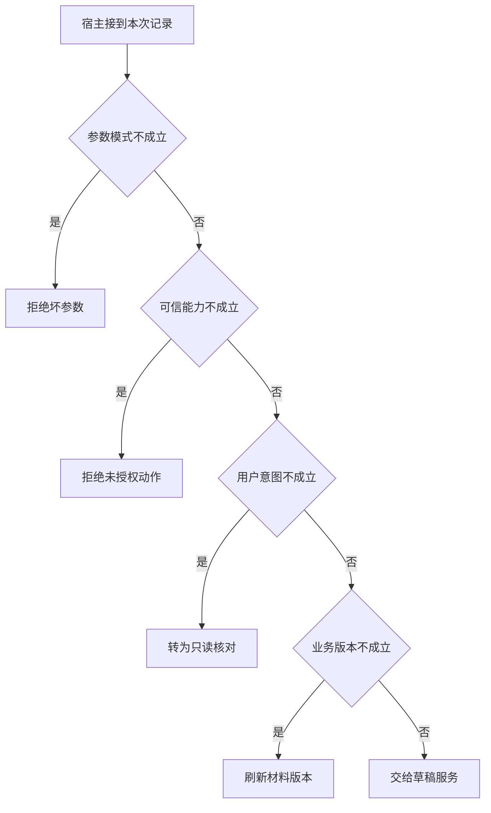

# 一次 Java 动作为何必须经宿主裁决

商户只授权检查材料时，模型仍可能提议新建草稿。
即使入参类型和申请编号都正确，执行器也不能捎带一次写入。
给同一参数换两份可信上下文即可构造反例。

本篇用一个封闭的教学决策器说明这一问题。输入是宿主收到的记录，不保证每个下游字段都已经获准使用。前置检查未成立时，下游即使带着缓存值，也不能拿来作业务断言。

## 先解决一个具体问题

**为什么不能让模型在参数中传一个 mayDraft？**

结构化字段提高了解码稳定性，却没有给模型赋予业务权力。
场景相同只更换认证主体，可信服务应作出不同的允许或拒绝。这条反例不能靠检查 JSON 结构挡住。


先取一个能走到「交给草稿服务」的输入：参数通过结构检查、宿主确认当前主体获准、用户明确要求起草、资料版本仍适用。
把这四个条件代回后文的图，前面各个拦截分支都未满足，最终才有“意图与授权以及资料前提均成立”这个判断。
还原这个现场时要分别问：哪些位来自可信状态，哪些只是在接口中出现、尚未获得解释资格的字段。

## 先沿一次决策走到底



从上到下取第一条成立的出口。只改一个开关时，只有它之前的检查都未截断，该变化才可能到达真实动作。

“参数模式”的两种输入分别是“参数通过结构检查”与“缺少可执行的必填参数”。
能解码文本并不等于可以调用业务方法。

“可信能力”的两种输入分别是“宿主确认当前主体获准”与“当前主体未获授权”。
权限取自可信入口或执行端，不由模型生成。

“用户意图”的两种输入分别是“用户明确要求起草”与“仅要求检查资料”。
只读查询不能自动扩大为外部状态变更。

“业务版本”的两种输入分别是“资料版本仍适用”与“观察所依据版本已过期”。
写入前应重新验证可能变化的业务前提。

## 最少需要哪几项观察

### 拒绝坏参数

未达到执行方法的最小参数条件。
在本节的全部组合中，有 8 种产生「拒绝坏参数」，这只是逻辑空间的计数，不能当作实际用户请求的比例。

只取得缺少可执行的必填参数，已经足以要求宿主「拒绝坏参数」。
保持这些已知项，其余开关自由变化，仍有 8 种补全，判断没有翻转。

若删掉关于参数模式的证据，另一份允许的现场是参数通过结构检查、当前主体未获授权、仅要求检查资料、观察所依据版本已过期，它会使宿主「拒绝未授权动作」。

### 拒绝未授权动作

服务端能力不能借给任意模型输出。
在本节的全部组合中，有 4 种产生「拒绝未授权动作」，这只是逻辑空间的计数，不能当作实际用户请求的比例。

只取得参数通过结构检查、当前主体未获授权，已经足以要求宿主「拒绝未授权动作」。
保持这些已知项，其余开关自由变化，仍有 4 种补全，判断没有翻转。

若删掉关于参数模式的证据，另一份允许的现场是缺少可执行的必填参数、当前主体未获授权、仅要求检查资料、观察所依据版本已过期，它会使宿主「拒绝坏参数」。

若删掉关于可信能力的证据，另一份允许的现场是参数通过结构检查、宿主确认当前主体获准、仅要求检查资料、观察所依据版本已过期，它会使宿主「转为只读核对」。

### 转为只读核对

用户未要求改变业务状态。
在本节的全部组合中，有 2 种产生「转为只读核对」，这只是逻辑空间的计数，不能当作实际用户请求的比例。

只取得参数通过结构检查、宿主确认当前主体获准、仅要求检查资料，已经足以要求宿主「转为只读核对」。
保持这些已知项，其余开关自由变化，仍有 2 种补全，判断没有翻转。

若删掉关于参数模式的证据，另一份允许的现场是缺少可执行的必填参数、宿主确认当前主体获准、仅要求检查资料、观察所依据版本已过期，它会使宿主「拒绝坏参数」。

若删掉关于可信能力的证据，另一份允许的现场是参数通过结构检查、当前主体未获授权、仅要求检查资料、观察所依据版本已过期，它会使宿主「拒绝未授权动作」。

若删掉关于用户意图的证据，另一份允许的现场是参数通过结构检查、宿主确认当前主体获准、用户明确要求起草、观察所依据版本已过期，它会使宿主「刷新材料版本」。

### 刷新材料版本

过期差集不能支持当前补件。
在本节的全部组合中，有 1 种产生「刷新材料版本」，这只是逻辑空间的计数，不能当作实际用户请求的比例。

只取得参数通过结构检查、宿主确认当前主体获准、用户明确要求起草、观察所依据版本已过期，已经足以要求宿主「刷新材料版本」。
保持这些已知项，其余开关自由变化，仍有 1 种补全，判断没有翻转。

若删掉关于参数模式的证据，另一份允许的现场是缺少可执行的必填参数、宿主确认当前主体获准、用户明确要求起草、观察所依据版本已过期，它会使宿主「拒绝坏参数」。

若删掉关于可信能力的证据，另一份允许的现场是参数通过结构检查、当前主体未获授权、用户明确要求起草、观察所依据版本已过期，它会使宿主「拒绝未授权动作」。

若删掉关于用户意图的证据，另一份允许的现场是参数通过结构检查、宿主确认当前主体获准、仅要求检查资料、观察所依据版本已过期，它会使宿主「转为只读核对」。

若删掉关于业务版本的证据，另一份允许的现场是参数通过结构检查、宿主确认当前主体获准、用户明确要求起草、资料版本仍适用，它会使宿主「交给草稿服务」。

### 交给草稿服务

意图与授权以及资料前提均成立。
在本节的全部组合中，有 1 种产生「交给草稿服务」，这只是逻辑空间的计数，不能当作实际用户请求的比例。

只取得参数通过结构检查、宿主确认当前主体获准、用户明确要求起草、资料版本仍适用，已经足以要求宿主「交给草稿服务」。

若删掉关于参数模式的证据，另一份允许的现场是缺少可执行的必填参数、宿主确认当前主体获准、用户明确要求起草、资料版本仍适用，它会使宿主「拒绝坏参数」。

若删掉关于可信能力的证据，另一份允许的现场是参数通过结构检查、当前主体未获授权、用户明确要求起草、资料版本仍适用，它会使宿主「拒绝未授权动作」。

若删掉关于用户意图的证据，另一份允许的现场是参数通过结构检查、宿主确认当前主体获准、仅要求检查资料、资料版本仍适用，它会使宿主「转为只读核对」。

若删掉关于业务版本的证据，另一份允许的现场是参数通过结构检查、宿主确认当前主体获准、用户明确要求起草、观察所依据版本已过期，它会使宿主「刷新材料版本」。

## 以同一份契约解释截然不同的现场

<details>
<summary>展开推演与对应反例</summary>

下列样本按最先命中的业务分支排列。四位编码只作本篇页内定位，顺序与开头的四项输入一致。可以先猜下一动作，再展开相邻样本。

### 能够触发“拒绝坏参数”的现场

**样本 0000**

业务侧交来缺少可执行的必填参数、当前主体未获授权，执行侧还记录了仅要求检查资料、观察所依据版本已过期。
把样本压成最短证明，保留缺少可执行的必填参数就能支持「拒绝坏参数」。

在这份记录上，分别翻转「参数模式」中的任一项，其他项完全不变时，下一动作都会改变。

保持其余观察不动，单独切换「可信能力」、「用户意图」、「业务版本」仍得到「拒绝坏参数」，它们在这个现场不是决定性变量。

要从本例改走「拒绝未授权动作」，至少需要变动 1 项，一组最少改动是将缺少可执行的必填参数换成参数通过结构检查。

要从本例改走「转为只读核对」，至少需要变动 2 项，一组最少改动是将缺少可执行的必填参数、当前主体未获授权换成参数通过结构检查、宿主确认当前主体获准。

要从本例改走「刷新材料版本」，至少需要变动 3 项，一组最少改动是将缺少可执行的必填参数、当前主体未获授权、仅要求检查资料换成参数通过结构检查、宿主确认当前主体获准、用户明确要求起草。

要从本例改走「交给草稿服务」，至少需要变动 4 项，一组最少改动是将缺少可执行的必填参数、当前主体未获授权、仅要求检查资料、观察所依据版本已过期换成参数通过结构检查、宿主确认当前主体获准、用户明确要求起草、资料版本仍适用。

**样本 0001**

业务侧交来缺少可执行的必填参数、当前主体未获授权，执行侧还记录了仅要求检查资料、资料版本仍适用。


要从本例改走「交给草稿服务」，至少需要变动 3 项，一组最少改动是将缺少可执行的必填参数、当前主体未获授权、仅要求检查资料换成参数通过结构检查、宿主确认当前主体获准、用户明确要求起草。

要从本例改走「刷新材料版本」，至少需要变动 4 项，一组最少改动是将缺少可执行的必填参数、当前主体未获授权、仅要求检查资料、资料版本仍适用换成参数通过结构检查、宿主确认当前主体获准、用户明确要求起草、观察所依据版本已过期。

**样本 0010**

业务侧交来缺少可执行的必填参数、当前主体未获授权，执行侧还记录了用户明确要求起草、观察所依据版本已过期。


要从本例改走「刷新材料版本」，至少需要变动 2 项，一组最少改动是将缺少可执行的必填参数、当前主体未获授权换成参数通过结构检查、宿主确认当前主体获准。

要从本例改走「转为只读核对」，至少需要变动 3 项，一组最少改动是将缺少可执行的必填参数、当前主体未获授权、用户明确要求起草换成参数通过结构检查、宿主确认当前主体获准、仅要求检查资料。

要从本例改走「交给草稿服务」，至少需要变动 3 项，一组最少改动是将缺少可执行的必填参数、当前主体未获授权、观察所依据版本已过期换成参数通过结构检查、宿主确认当前主体获准、资料版本仍适用。

**样本 0011**

业务侧交来缺少可执行的必填参数、当前主体未获授权，执行侧还记录了用户明确要求起草、资料版本仍适用。


要从本例改走「交给草稿服务」，至少需要变动 2 项，一组最少改动是将缺少可执行的必填参数、当前主体未获授权换成参数通过结构检查、宿主确认当前主体获准。


要从本例改走「刷新材料版本」，至少需要变动 3 项，一组最少改动是将缺少可执行的必填参数、当前主体未获授权、资料版本仍适用换成参数通过结构检查、宿主确认当前主体获准、观察所依据版本已过期。

**样本 0100**

业务侧交来缺少可执行的必填参数、宿主确认当前主体获准，执行侧还记录了仅要求检查资料、观察所依据版本已过期。


要从本例改走「转为只读核对」，至少需要变动 1 项，一组最少改动是将缺少可执行的必填参数换成参数通过结构检查。

要从本例改走「拒绝未授权动作」，至少需要变动 2 项，一组最少改动是将缺少可执行的必填参数、宿主确认当前主体获准换成参数通过结构检查、当前主体未获授权。

要从本例改走「刷新材料版本」，至少需要变动 2 项，一组最少改动是将缺少可执行的必填参数、仅要求检查资料换成参数通过结构检查、用户明确要求起草。

要从本例改走「交给草稿服务」，至少需要变动 3 项，一组最少改动是将缺少可执行的必填参数、仅要求检查资料、观察所依据版本已过期换成参数通过结构检查、用户明确要求起草、资料版本仍适用。

**样本 0101**

业务侧交来缺少可执行的必填参数、宿主确认当前主体获准，执行侧还记录了仅要求检查资料、资料版本仍适用。


要从本例改走「交给草稿服务」，至少需要变动 2 项，一组最少改动是将缺少可执行的必填参数、仅要求检查资料换成参数通过结构检查、用户明确要求起草。

要从本例改走「刷新材料版本」，至少需要变动 3 项，一组最少改动是将缺少可执行的必填参数、仅要求检查资料、资料版本仍适用换成参数通过结构检查、用户明确要求起草、观察所依据版本已过期。

**样本 0110**

业务侧交来缺少可执行的必填参数、宿主确认当前主体获准，执行侧还记录了用户明确要求起草、观察所依据版本已过期。


要从本例改走「刷新材料版本」，至少需要变动 1 项，一组最少改动是将缺少可执行的必填参数换成参数通过结构检查。


要从本例改走「转为只读核对」，至少需要变动 2 项，一组最少改动是将缺少可执行的必填参数、用户明确要求起草换成参数通过结构检查、仅要求检查资料。

要从本例改走「交给草稿服务」，至少需要变动 2 项，一组最少改动是将缺少可执行的必填参数、观察所依据版本已过期换成参数通过结构检查、资料版本仍适用。

**样本 0111**

业务侧交来缺少可执行的必填参数、宿主确认当前主体获准，执行侧还记录了用户明确要求起草、资料版本仍适用。


要从本例改走「交给草稿服务」，至少需要变动 1 项，一组最少改动是将缺少可执行的必填参数换成参数通过结构检查。


要从本例改走「刷新材料版本」，至少需要变动 2 项，一组最少改动是将缺少可执行的必填参数、资料版本仍适用换成参数通过结构检查、观察所依据版本已过期。

### 能够触发“拒绝未授权动作”的现场

**样本 1000**

业务侧交来参数通过结构检查、当前主体未获授权，执行侧还记录了仅要求检查资料、观察所依据版本已过期。
把样本压成最短证明，保留参数通过结构检查、当前主体未获授权就能支持「拒绝未授权动作」。

在这份记录上，分别翻转「参数模式」、「可信能力」中的任一项，其他项完全不变时，下一动作都会改变。

保持其余观察不动，单独切换「用户意图」、「业务版本」仍得到「拒绝未授权动作」，它们在这个现场不是决定性变量。

本例没走更靠前的「拒绝坏参数」，因为参数通过结构检查与那个入口的必要条件不符。

要从本例改走「拒绝坏参数」，至少需要变动 1 项，一组最少改动是将参数通过结构检查换成缺少可执行的必填参数。

要从本例改走「转为只读核对」，至少需要变动 1 项，一组最少改动是将当前主体未获授权换成宿主确认当前主体获准。

要从本例改走「刷新材料版本」，至少需要变动 2 项，一组最少改动是将当前主体未获授权、仅要求检查资料换成宿主确认当前主体获准、用户明确要求起草。

要从本例改走「交给草稿服务」，至少需要变动 3 项，一组最少改动是将当前主体未获授权、仅要求检查资料、观察所依据版本已过期换成宿主确认当前主体获准、用户明确要求起草、资料版本仍适用。

**样本 1001**

业务侧交来参数通过结构检查、当前主体未获授权，执行侧还记录了仅要求检查资料、资料版本仍适用。


要从本例改走「交给草稿服务」，至少需要变动 2 项，一组最少改动是将当前主体未获授权、仅要求检查资料换成宿主确认当前主体获准、用户明确要求起草。

要从本例改走「刷新材料版本」，至少需要变动 3 项，一组最少改动是将当前主体未获授权、仅要求检查资料、资料版本仍适用换成宿主确认当前主体获准、用户明确要求起草、观察所依据版本已过期。

**样本 1010**

业务侧交来参数通过结构检查、当前主体未获授权，执行侧还记录了用户明确要求起草、观察所依据版本已过期。


要从本例改走「刷新材料版本」，至少需要变动 1 项，一组最少改动是将当前主体未获授权换成宿主确认当前主体获准。

要从本例改走「转为只读核对」，至少需要变动 2 项，一组最少改动是将当前主体未获授权、用户明确要求起草换成宿主确认当前主体获准、仅要求检查资料。

要从本例改走「交给草稿服务」，至少需要变动 2 项，一组最少改动是将当前主体未获授权、观察所依据版本已过期换成宿主确认当前主体获准、资料版本仍适用。

**样本 1011**

业务侧交来参数通过结构检查、当前主体未获授权，执行侧还记录了用户明确要求起草、资料版本仍适用。


要从本例改走「交给草稿服务」，至少需要变动 1 项，一组最少改动是将当前主体未获授权换成宿主确认当前主体获准。


要从本例改走「刷新材料版本」，至少需要变动 2 项，一组最少改动是将当前主体未获授权、资料版本仍适用换成宿主确认当前主体获准、观察所依据版本已过期。

### 能够触发“转为只读核对”的现场

**样本 1100**

业务侧交来参数通过结构检查、宿主确认当前主体获准，执行侧还记录了仅要求检查资料、观察所依据版本已过期。
把样本压成最短证明，保留参数通过结构检查、宿主确认当前主体获准、仅要求检查资料就能支持「转为只读核对」。

在这份记录上，分别翻转「参数模式」、「可信能力」、「用户意图」中的任一项，其他项完全不变时，下一动作都会改变。

保持其余观察不动，单独切换「业务版本」仍得到「转为只读核对」，它们在这个现场不是决定性变量。


本例没走更靠前的「拒绝未授权动作」，因为宿主确认当前主体获准与那个入口的必要条件不符。


要从本例改走「拒绝未授权动作」，至少需要变动 1 项，一组最少改动是将宿主确认当前主体获准换成当前主体未获授权。

要从本例改走「刷新材料版本」，至少需要变动 1 项，一组最少改动是将仅要求检查资料换成用户明确要求起草。

要从本例改走「交给草稿服务」，至少需要变动 2 项，一组最少改动是将仅要求检查资料、观察所依据版本已过期换成用户明确要求起草、资料版本仍适用。

**样本 1101**

业务侧交来参数通过结构检查、宿主确认当前主体获准，执行侧还记录了仅要求检查资料、资料版本仍适用。


要从本例改走「交给草稿服务」，至少需要变动 1 项，一组最少改动是将仅要求检查资料换成用户明确要求起草。

要从本例改走「刷新材料版本」，至少需要变动 2 项，一组最少改动是将仅要求检查资料、资料版本仍适用换成用户明确要求起草、观察所依据版本已过期。

### 能够触发“刷新材料版本”的现场

**样本 1110**

业务侧交来参数通过结构检查、宿主确认当前主体获准，执行侧还记录了用户明确要求起草、观察所依据版本已过期。
把样本压成最短证明，保留参数通过结构检查、宿主确认当前主体获准、用户明确要求起草、观察所依据版本已过期就能支持「刷新材料版本」。

在这份记录上，分别翻转「参数模式」、「可信能力」、「用户意图」、「业务版本」中的任一项，其他项完全不变时，下一动作都会改变。


本例没走更靠前的「转为只读核对」，因为用户明确要求起草与那个入口的必要条件不符。


要从本例改走「转为只读核对」，至少需要变动 1 项，一组最少改动是将用户明确要求起草换成仅要求检查资料。

要从本例改走「交给草稿服务」，至少需要变动 1 项，一组最少改动是将观察所依据版本已过期换成资料版本仍适用。

### 能够触发“交给草稿服务”的现场

**样本 1111**

业务侧交来参数通过结构检查、宿主确认当前主体获准，执行侧还记录了用户明确要求起草、资料版本仍适用。
把样本压成最短证明，保留参数通过结构检查、宿主确认当前主体获准、用户明确要求起草、资料版本仍适用就能支持「交给草稿服务」。


本例没走更靠前的「刷新材料版本」，因为资料版本仍适用与那个入口的必要条件不符。


要从本例改走「刷新材料版本」，至少需要变动 1 项，一组最少改动是将资料版本仍适用换成观察所依据版本已过期。

</details>

## 当你只能看见一半记录

<details>
<summary>展开推演与对应反例</summary>

这次隐藏两个字段，保留另两个。对每个可见现场，检查四种合法补全是否同意。如仍有歧义，选择能使最坏剩余候选动作最少的字段继续查。并列时采用本篇字段顺序。

### 只保留参数模式与可信能力

已知缺少可执行的必填参数、当前主体未获授权时，四种补全的动作分布为拒绝坏参数（4 种）。

就“拒绝坏参数”这个动作而言，在缺少可执行的必填参数、当前主体未获授权的前提下，另外两项观察不会推翻它。

已知缺少可执行的必填参数、宿主确认当前主体获准时，四种补全的动作分布为拒绝坏参数（4 种）。

就“拒绝坏参数”这个动作而言，在缺少可执行的必填参数、宿主确认当前主体获准的前提下，另外两项观察不会推翻它。

已知参数通过结构检查、当前主体未获授权时，四种补全的动作分布为拒绝未授权动作（4 种）。

就“拒绝未授权动作”这个动作而言，在参数通过结构检查、当前主体未获授权的前提下，另外两项观察不会推翻它。

已知参数通过结构检查、宿主确认当前主体获准时，四种补全的动作分布为转为只读核对（2 种）、刷新材料版本（1 种）、交给草稿服务（1 种）。

在参数通过结构检查、宿主确认当前主体获准这个现场补读「用户意图」，最坏还剩 2 种动作，计算时只衡量歧义，尚未扣读取代价。
若补来的观察为“仅要求检查资料”，范围缩成「转为只读核对」。若为“用户明确要求起草”，则保留「刷新材料版本」、「交给草稿服务」。

区分不了的两条执行可以具体写成 1100 与 1110：它们共享已展示字段，却分别需要「转为只读核对」和「刷新材料版本」。

### 只保留参数模式与用户意图

已知缺少可执行的必填参数、仅要求检查资料时，四种补全的动作分布为拒绝坏参数（4 种）。

就“拒绝坏参数”这个动作而言，在缺少可执行的必填参数、仅要求检查资料的前提下，另外两项观察不会推翻它。

已知缺少可执行的必填参数、用户明确要求起草时，四种补全的动作分布为拒绝坏参数（4 种）。

就“拒绝坏参数”这个动作而言，在缺少可执行的必填参数、用户明确要求起草的前提下，另外两项观察不会推翻它。

已知参数通过结构检查、仅要求检查资料时，四种补全的动作分布为拒绝未授权动作（2 种）、转为只读核对（2 种）。

在参数通过结构检查、仅要求检查资料这个现场补读「可信能力」，最坏还剩 1 种动作，计算时只衡量歧义，尚未扣读取代价。
若补来的观察为“当前主体未获授权”，范围缩成「拒绝未授权动作」。若为“宿主确认当前主体获准”，则保留「转为只读核对」。

区分不了的两条执行可以具体写成 1000 与 1100：它们共享已展示字段，却分别需要「拒绝未授权动作」和「转为只读核对」。

已知参数通过结构检查、用户明确要求起草时，四种补全的动作分布为拒绝未授权动作（2 种）、刷新材料版本（1 种）、交给草稿服务（1 种）。

在参数通过结构检查、用户明确要求起草这个现场补读「可信能力」，最坏还剩 2 种动作，计算时只衡量歧义，尚未扣读取代价。
若补来的观察为“当前主体未获授权”，范围缩成「拒绝未授权动作」。若为“宿主确认当前主体获准”，则保留「刷新材料版本」、「交给草稿服务」。

区分不了的两条执行可以具体写成 1010 与 1110：它们共享已展示字段，却分别需要「拒绝未授权动作」和「刷新材料版本」。

### 只保留可信能力与用户意图

已知当前主体未获授权、仅要求检查资料时，四种补全的动作分布为拒绝坏参数（2 种）、拒绝未授权动作（2 种）。

在当前主体未获授权、仅要求检查资料这个现场补读「参数模式」，最坏还剩 1 种动作，计算时只衡量歧义，尚未扣读取代价。
若补来的观察为“缺少可执行的必填参数”，范围缩成「拒绝坏参数」。若为“参数通过结构检查”，则保留「拒绝未授权动作」。

区分不了的两条执行可以具体写成 0000 与 1000：它们共享已展示字段，却分别需要「拒绝坏参数」和「拒绝未授权动作」。

已知当前主体未获授权、用户明确要求起草时，四种补全的动作分布为拒绝坏参数（2 种）、拒绝未授权动作（2 种）。

在当前主体未获授权、用户明确要求起草这个现场补读「参数模式」，最坏还剩 1 种动作，计算时只衡量歧义，尚未扣读取代价。

区分不了的两条执行可以具体写成 0010 与 1010：它们共享已展示字段，却分别需要「拒绝坏参数」和「拒绝未授权动作」。

已知宿主确认当前主体获准、仅要求检查资料时，四种补全的动作分布为拒绝坏参数（2 种）、转为只读核对（2 种）。

在宿主确认当前主体获准、仅要求检查资料这个现场补读「参数模式」，最坏还剩 1 种动作，计算时只衡量歧义，尚未扣读取代价。
若补来的观察为“缺少可执行的必填参数”，范围缩成「拒绝坏参数」。若为“参数通过结构检查”，则保留「转为只读核对」。

区分不了的两条执行可以具体写成 0100 与 1100：它们共享已展示字段，却分别需要「拒绝坏参数」和「转为只读核对」。

已知宿主确认当前主体获准、用户明确要求起草时，四种补全的动作分布为拒绝坏参数（2 种）、刷新材料版本（1 种）、交给草稿服务（1 种）。

在宿主确认当前主体获准、用户明确要求起草这个现场补读「参数模式」，最坏还剩 2 种动作，计算时只衡量歧义，尚未扣读取代价。
若补来的观察为“缺少可执行的必填参数”，范围缩成「拒绝坏参数」。若为“参数通过结构检查”，则保留「刷新材料版本」、「交给草稿服务」。

区分不了的两条执行可以具体写成 0110 与 1110：它们共享已展示字段，却分别需要「拒绝坏参数」和「刷新材料版本」。

### 只保留参数模式与业务版本

已知缺少可执行的必填参数、观察所依据版本已过期时，四种补全的动作分布为拒绝坏参数（4 种）。

就“拒绝坏参数”这个动作而言，在缺少可执行的必填参数、观察所依据版本已过期的前提下，另外两项观察不会推翻它。

已知缺少可执行的必填参数、资料版本仍适用时，四种补全的动作分布为拒绝坏参数（4 种）。

就“拒绝坏参数”这个动作而言，在缺少可执行的必填参数、资料版本仍适用的前提下，另外两项观察不会推翻它。

已知参数通过结构检查、观察所依据版本已过期时，四种补全的动作分布为拒绝未授权动作（2 种）、转为只读核对（1 种）、刷新材料版本（1 种）。

在参数通过结构检查、观察所依据版本已过期这个现场补读「可信能力」，最坏还剩 2 种动作，计算时只衡量歧义，尚未扣读取代价。
若补来的观察为“当前主体未获授权”，范围缩成「拒绝未授权动作」。若为“宿主确认当前主体获准”，则保留「转为只读核对」、「刷新材料版本」。


已知参数通过结构检查、资料版本仍适用时，四种补全的动作分布为拒绝未授权动作（2 种）、转为只读核对（1 种）、交给草稿服务（1 种）。

在参数通过结构检查、资料版本仍适用这个现场补读「可信能力」，最坏还剩 2 种动作，计算时只衡量歧义，尚未扣读取代价。
若补来的观察为“当前主体未获授权”，范围缩成「拒绝未授权动作」。若为“宿主确认当前主体获准”，则保留「转为只读核对」、「交给草稿服务」。

区分不了的两条执行可以具体写成 1001 与 1101：它们共享已展示字段，却分别需要「拒绝未授权动作」和「转为只读核对」。

### 只保留可信能力与业务版本

已知当前主体未获授权、观察所依据版本已过期时，四种补全的动作分布为拒绝坏参数（2 种）、拒绝未授权动作（2 种）。

在当前主体未获授权、观察所依据版本已过期这个现场补读「参数模式」，最坏还剩 1 种动作，计算时只衡量歧义，尚未扣读取代价。


已知当前主体未获授权、资料版本仍适用时，四种补全的动作分布为拒绝坏参数（2 种）、拒绝未授权动作（2 种）。

在当前主体未获授权、资料版本仍适用这个现场补读「参数模式」，最坏还剩 1 种动作，计算时只衡量歧义，尚未扣读取代价。

区分不了的两条执行可以具体写成 0001 与 1001：它们共享已展示字段，却分别需要「拒绝坏参数」和「拒绝未授权动作」。

已知宿主确认当前主体获准、观察所依据版本已过期时，四种补全的动作分布为拒绝坏参数（2 种）、转为只读核对（1 种）、刷新材料版本（1 种）。

在宿主确认当前主体获准、观察所依据版本已过期这个现场补读「参数模式」，最坏还剩 2 种动作，计算时只衡量歧义，尚未扣读取代价。
若补来的观察为“缺少可执行的必填参数”，范围缩成「拒绝坏参数」。若为“参数通过结构检查”，则保留「转为只读核对」、「刷新材料版本」。


已知宿主确认当前主体获准、资料版本仍适用时，四种补全的动作分布为拒绝坏参数（2 种）、转为只读核对（1 种）、交给草稿服务（1 种）。

在宿主确认当前主体获准、资料版本仍适用这个现场补读「参数模式」，最坏还剩 2 种动作，计算时只衡量歧义，尚未扣读取代价。
若补来的观察为“缺少可执行的必填参数”，范围缩成「拒绝坏参数」。若为“参数通过结构检查”，则保留「转为只读核对」、「交给草稿服务」。

区分不了的两条执行可以具体写成 0101 与 1101：它们共享已展示字段，却分别需要「拒绝坏参数」和「转为只读核对」。

### 只保留用户意图与业务版本

已知仅要求检查资料、观察所依据版本已过期时，四种补全的动作分布为拒绝坏参数（2 种）、拒绝未授权动作（1 种）、转为只读核对（1 种）。

在仅要求检查资料、观察所依据版本已过期这个现场补读「参数模式」，最坏还剩 2 种动作，计算时只衡量歧义，尚未扣读取代价。
若补来的观察为“缺少可执行的必填参数”，范围缩成「拒绝坏参数」。若为“参数通过结构检查”，则保留「拒绝未授权动作」、「转为只读核对」。


已知仅要求检查资料、资料版本仍适用时，四种补全的动作分布为拒绝坏参数（2 种）、拒绝未授权动作（1 种）、转为只读核对（1 种）。

在仅要求检查资料、资料版本仍适用这个现场补读「参数模式」，最坏还剩 2 种动作，计算时只衡量歧义，尚未扣读取代价。


已知用户明确要求起草、观察所依据版本已过期时，四种补全的动作分布为拒绝坏参数（2 种）、拒绝未授权动作（1 种）、刷新材料版本（1 种）。

在用户明确要求起草、观察所依据版本已过期这个现场补读「参数模式」，最坏还剩 2 种动作，计算时只衡量歧义，尚未扣读取代价。
若补来的观察为“缺少可执行的必填参数”，范围缩成「拒绝坏参数」。若为“参数通过结构检查”，则保留「拒绝未授权动作」、「刷新材料版本」。


已知用户明确要求起草、资料版本仍适用时，四种补全的动作分布为拒绝坏参数（2 种）、拒绝未授权动作（1 种）、交给草稿服务（1 种）。

在用户明确要求起草、资料版本仍适用这个现场补读「参数模式」，最坏还剩 2 种动作，计算时只衡量歧义，尚未扣读取代价。
若补来的观察为“缺少可执行的必填参数”，范围缩成「拒绝坏参数」。若为“参数通过结构检查”，则保留「拒绝未授权动作」、「交给草稿服务」。

区分不了的两条执行可以具体写成 0011 与 1011：它们共享已展示字段，却分别需要「拒绝坏参数」和「拒绝未授权动作」。

</details>

## 单因素干预与边界测试

<details>
<summary>展开推演与对应反例</summary>

### 只改变参数模式

固定另外三个条件得到八对现场，从“缺少可执行的必填参数”转为“参数通过结构检查”时，8 对翻转动作，另外 0 对保持不变。

有 4 对现场沿「拒绝坏参数」变到「拒绝未授权动作」，可复现的一组受控背景为当前主体未获授权、仅要求检查资料、观察所依据版本已过期。

有 2 对现场沿「拒绝坏参数」变到「转为只读核对」，可复现的一组受控背景为宿主确认当前主体获准、仅要求检查资料、观察所依据版本已过期。

有 1 对现场沿「拒绝坏参数」变到「刷新材料版本」，可复现的一组受控背景为宿主确认当前主体获准、用户明确要求起草、观察所依据版本已过期。

有 1 对现场沿「拒绝坏参数」变到「交给草稿服务」，可复现的一组受控背景为宿主确认当前主体获准、用户明确要求起草、资料版本仍适用。

### 只改变可信能力

固定另外三个条件得到八对现场，从“当前主体未获授权”转为“宿主确认当前主体获准”时，4 对翻转动作，另外 4 对保持不变。

令缺少可执行的必填参数、仅要求检查资料、观察所依据版本已过期，可信能力的两个取值均得到「拒绝坏参数」。在八对中，共有 4 对表现为这一种稳定出口。

有 2 对现场沿「拒绝未授权动作」变到「转为只读核对」，可复现的一组受控背景为参数通过结构检查、仅要求检查资料、观察所依据版本已过期。

有 1 对现场沿「拒绝未授权动作」变到「刷新材料版本」，可复现的一组受控背景为参数通过结构检查、用户明确要求起草、观察所依据版本已过期。

有 1 对现场沿「拒绝未授权动作」变到「交给草稿服务」，可复现的一组受控背景为参数通过结构检查、用户明确要求起草、资料版本仍适用。

### 只改变用户意图

固定另外三个条件得到八对现场，从“仅要求检查资料”转为“用户明确要求起草”时，2 对翻转动作，另外 6 对保持不变。

令缺少可执行的必填参数、当前主体未获授权、观察所依据版本已过期，用户意图的两个取值均得到「拒绝坏参数」。在八对中，共有 4 对表现为这一种稳定出口。

令参数通过结构检查、当前主体未获授权、观察所依据版本已过期，用户意图的两个取值均得到「拒绝未授权动作」。在八对中，共有 2 对表现为这一种稳定出口。

有 1 对现场沿「转为只读核对」变到「刷新材料版本」，可复现的一组受控背景为参数通过结构检查、宿主确认当前主体获准、观察所依据版本已过期。

有 1 对现场沿「转为只读核对」变到「交给草稿服务」，可复现的一组受控背景为参数通过结构检查、宿主确认当前主体获准、资料版本仍适用。

### 只改变业务版本

固定另外三个条件得到八对现场，从“观察所依据版本已过期”转为“资料版本仍适用”时，1 对翻转动作，另外 7 对保持不变。

令缺少可执行的必填参数、当前主体未获授权、仅要求检查资料，业务版本的两个取值均得到「拒绝坏参数」。在八对中，共有 4 对表现为这一种稳定出口。

令参数通过结构检查、当前主体未获授权、仅要求检查资料，业务版本的两个取值均得到「拒绝未授权动作」。在八对中，共有 2 对表现为这一种稳定出口。

令参数通过结构检查、宿主确认当前主体获准、仅要求检查资料，业务版本的两个取值均得到「转为只读核对」。在八对中，共有 1 对表现为这一种稳定出口。

有 1 对现场沿「刷新材料版本」变到「交给草稿服务」，可复现的一组受控背景为参数通过结构检查、宿主确认当前主体获准、用户明确要求起草。

</details>

## 哪些回归样本真能抓住实现错误

<details>
<summary>展开推演与对应反例</summary>

如果删除“拒绝坏参数”这个分支，在本篇 16 种输入里有 8 种会改走另一出口。

反例 0000 的完整记录为缺少可执行的必填参数、当前主体未获授权、仅要求检查资料、观察所依据版本已过期。正确结果是「拒绝坏参数」，这个改坏的实现却给出「拒绝未授权动作」。

如果删除“拒绝未授权动作”这个分支，在本篇 16 种输入里有 4 种会改走另一出口。

反例 1000 的完整记录为参数通过结构检查、当前主体未获授权、仅要求检查资料、观察所依据版本已过期。正确结果是「拒绝未授权动作」，这个改坏的实现却给出「转为只读核对」。

如果删除“转为只读核对”这个分支，在本篇 16 种输入里有 2 种会改走另一出口。

反例 1100 的完整记录为参数通过结构检查、宿主确认当前主体获准、仅要求检查资料、观察所依据版本已过期。正确结果是「转为只读核对」，这个改坏的实现却给出「刷新材料版本」。

如果删除“刷新材料版本”这个分支，在本篇 16 种输入里有 1 种会改走另一出口。

反例 1110 的完整记录为参数通过结构检查、宿主确认当前主体获准、用户明确要求起草、观察所依据版本已过期。正确结果是「刷新材料版本」，这个改坏的实现却给出「交给草稿服务」。

如果交换“拒绝坏参数”和“拒绝未授权动作”的判断次序，在本篇 16 种输入里有 4 种会改走另一出口。


如果交换“拒绝未授权动作”和“转为只读核对”的判断次序，在本篇 16 种输入里有 2 种会改走另一出口。


如果交换“转为只读核对”和“刷新材料版本”的判断次序，在本篇 16 种输入里有 1 种会改走另一出口。


补入样本 0000（缺少可执行的必填参数、当前主体未获授权、仅要求检查资料、观察所依据版本已过期）能新增检出「删除“拒绝坏参数”这个分支」、「交换“拒绝坏参数”和“拒绝未授权动作”的判断次序」。

补入样本 1000（参数通过结构检查、当前主体未获授权、仅要求检查资料、观察所依据版本已过期）能新增检出「删除“拒绝未授权动作”这个分支」、「交换“拒绝未授权动作”和“转为只读核对”的判断次序」。

补入样本 1100（参数通过结构检查、宿主确认当前主体获准、仅要求检查资料、观察所依据版本已过期）能新增检出「删除“转为只读核对”这个分支」、「交换“转为只读核对”和“刷新材料版本”的判断次序」。

补入样本 1110（参数通过结构检查、宿主确认当前主体获准、用户明确要求起草、观察所依据版本已过期）能新增检出「删除“刷新材料版本”这个分支」。

这里每次选覆盖尚未捕获缺陷最多的样本，并不保证用例数全局最小。它给出的反例能作为 Java 单测输入。真实模型是否会自主产生这些提议，仍须单独评测。

</details>

## 把状态覆盖换成有抽样偏差的评测批次

<details>
<summary>展开推演与对应反例</summary>

前面的十六种记录各有一票。现在只改样本构成：对一个给定字段，把成立侧的每种记录各取三份、另一侧各取一份。这是人为配比的 32 份回放，不是线上频率估计。
将偏向成立与偏向不成立的两次批次对照，可以隔离分母变化。底层宿主和所有答案保持相同，比例仍可能移动。

### 改变“参数模式”的样本配比

只看「拒绝坏参数」，在参数通过结构检查的八个不同输入中有 0 个命中，在缺少可执行的必填参数的另八个输入中有 8 个命中。
把「参数模式」成立侧按三倍取样，「拒绝坏参数」占 8/32，反过来向未成立侧倾斜后占 24/32。
这次重加权使「拒绝坏参数」的占比相差 50 个百分点。若按两种不同的“参数模式”分布跑新旧版，不能把这项差异全部归功于实现。

只看「拒绝未授权动作」，在参数通过结构检查的八个不同输入中有 4 个命中，在缺少可执行的必填参数的另八个输入中有 0 个命中。
把「参数模式」成立侧按三倍取样，「拒绝未授权动作」占 12/32，反过来向未成立侧倾斜后占 4/32。
这次重加权使「拒绝未授权动作」的占比相差 25 个百分点。若按两种不同的“参数模式”分布跑新旧版，不能把这项差异全部归功于实现。

只看「转为只读核对」，在参数通过结构检查的八个不同输入中有 2 个命中，在缺少可执行的必填参数的另八个输入中有 0 个命中。
把「参数模式」成立侧按三倍取样，「转为只读核对」占 6/32，反过来向未成立侧倾斜后占 2/32。
这次重加权使「转为只读核对」的占比相差 12.5 个百分点。若按两种不同的“参数模式”分布跑新旧版，不能把这项差异全部归功于实现。

只看「刷新材料版本」，在参数通过结构检查的八个不同输入中有 1 个命中，在缺少可执行的必填参数的另八个输入中有 0 个命中。
把「参数模式」成立侧按三倍取样，「刷新材料版本」占 3/32，反过来向未成立侧倾斜后占 1/32。
这次重加权使「刷新材料版本」的占比相差 6.25 个百分点。若按两种不同的“参数模式”分布跑新旧版，不能把这项差异全部归功于实现。

只看「交给草稿服务」，在参数通过结构检查的八个不同输入中有 1 个命中，在缺少可执行的必填参数的另八个输入中有 0 个命中。
把「参数模式」成立侧按三倍取样，「交给草稿服务」占 3/32，反过来向未成立侧倾斜后占 1/32。
这次重加权使「交给草稿服务」的占比相差 6.25 个百分点。若按两种不同的“参数模式”分布跑新旧版，不能把这项差异全部归功于实现。

### 改变“可信能力”的样本配比

只看「拒绝坏参数」，在宿主确认当前主体获准的八个不同输入中有 4 个命中，在当前主体未获授权的另八个输入中有 4 个命中。
把「可信能力」成立侧按三倍取样，「拒绝坏参数」占 16/32，反过来向未成立侧倾斜后占 16/32。
两批「拒绝坏参数」的边际比例相同，是因为这个出口在“可信能力”的两侧计数相等，这不能单独证明每一对现场都不受它影响。

只看「拒绝未授权动作」，在宿主确认当前主体获准的八个不同输入中有 0 个命中，在当前主体未获授权的另八个输入中有 4 个命中。
把「可信能力」成立侧按三倍取样，「拒绝未授权动作」占 4/32，反过来向未成立侧倾斜后占 12/32。
这次重加权使「拒绝未授权动作」的占比相差 25 个百分点。若按两种不同的“可信能力”分布跑新旧版，不能把这项差异全部归功于实现。

只看「转为只读核对」，在宿主确认当前主体获准的八个不同输入中有 2 个命中，在当前主体未获授权的另八个输入中有 0 个命中。
把「可信能力」成立侧按三倍取样，「转为只读核对」占 6/32，反过来向未成立侧倾斜后占 2/32。
这次重加权使「转为只读核对」的占比相差 12.5 个百分点。若按两种不同的“可信能力”分布跑新旧版，不能把这项差异全部归功于实现。

只看「刷新材料版本」，在宿主确认当前主体获准的八个不同输入中有 1 个命中，在当前主体未获授权的另八个输入中有 0 个命中。
把「可信能力」成立侧按三倍取样，「刷新材料版本」占 3/32，反过来向未成立侧倾斜后占 1/32。
这次重加权使「刷新材料版本」的占比相差 6.25 个百分点。若按两种不同的“可信能力”分布跑新旧版，不能把这项差异全部归功于实现。

只看「交给草稿服务」，在宿主确认当前主体获准的八个不同输入中有 1 个命中，在当前主体未获授权的另八个输入中有 0 个命中。
把「可信能力」成立侧按三倍取样，「交给草稿服务」占 3/32，反过来向未成立侧倾斜后占 1/32。
这次重加权使「交给草稿服务」的占比相差 6.25 个百分点。若按两种不同的“可信能力”分布跑新旧版，不能把这项差异全部归功于实现。

### 改变“用户意图”的样本配比

只看「拒绝坏参数」，在用户明确要求起草的八个不同输入中有 4 个命中，在仅要求检查资料的另八个输入中有 4 个命中。
把「用户意图」成立侧按三倍取样，「拒绝坏参数」占 16/32，反过来向未成立侧倾斜后占 16/32。
两批「拒绝坏参数」的边际比例相同，是因为这个出口在“用户意图”的两侧计数相等，这不能单独证明每一对现场都不受它影响。

只看「拒绝未授权动作」，在用户明确要求起草的八个不同输入中有 2 个命中，在仅要求检查资料的另八个输入中有 2 个命中。
把「用户意图」成立侧按三倍取样，「拒绝未授权动作」占 8/32，反过来向未成立侧倾斜后占 8/32。
两批「拒绝未授权动作」的边际比例相同，是因为这个出口在“用户意图”的两侧计数相等，这不能单独证明每一对现场都不受它影响。

只看「转为只读核对」，在用户明确要求起草的八个不同输入中有 0 个命中，在仅要求检查资料的另八个输入中有 2 个命中。
把「用户意图」成立侧按三倍取样，「转为只读核对」占 2/32，反过来向未成立侧倾斜后占 6/32。
这次重加权使「转为只读核对」的占比相差 12.5 个百分点。若按两种不同的“用户意图”分布跑新旧版，不能把这项差异全部归功于实现。

只看「刷新材料版本」，在用户明确要求起草的八个不同输入中有 1 个命中，在仅要求检查资料的另八个输入中有 0 个命中。
把「用户意图」成立侧按三倍取样，「刷新材料版本」占 3/32，反过来向未成立侧倾斜后占 1/32。
这次重加权使「刷新材料版本」的占比相差 6.25 个百分点。若按两种不同的“用户意图”分布跑新旧版，不能把这项差异全部归功于实现。

只看「交给草稿服务」，在用户明确要求起草的八个不同输入中有 1 个命中，在仅要求检查资料的另八个输入中有 0 个命中。
把「用户意图」成立侧按三倍取样，「交给草稿服务」占 3/32，反过来向未成立侧倾斜后占 1/32。
这次重加权使「交给草稿服务」的占比相差 6.25 个百分点。若按两种不同的“用户意图”分布跑新旧版，不能把这项差异全部归功于实现。

### 改变“业务版本”的样本配比

只看「拒绝坏参数」，在资料版本仍适用的八个不同输入中有 4 个命中，在观察所依据版本已过期的另八个输入中有 4 个命中。
把「业务版本」成立侧按三倍取样，「拒绝坏参数」占 16/32，反过来向未成立侧倾斜后占 16/32。
两批「拒绝坏参数」的边际比例相同，是因为这个出口在“业务版本”的两侧计数相等，这不能单独证明每一对现场都不受它影响。

只看「拒绝未授权动作」，在资料版本仍适用的八个不同输入中有 2 个命中，在观察所依据版本已过期的另八个输入中有 2 个命中。
把「业务版本」成立侧按三倍取样，「拒绝未授权动作」占 8/32，反过来向未成立侧倾斜后占 8/32。
两批「拒绝未授权动作」的边际比例相同，是因为这个出口在“业务版本”的两侧计数相等，这不能单独证明每一对现场都不受它影响。

只看「转为只读核对」，在资料版本仍适用的八个不同输入中有 1 个命中，在观察所依据版本已过期的另八个输入中有 1 个命中。
把「业务版本」成立侧按三倍取样，「转为只读核对」占 4/32，反过来向未成立侧倾斜后占 4/32。
两批「转为只读核对」的边际比例相同，是因为这个出口在“业务版本”的两侧计数相等，这不能单独证明每一对现场都不受它影响。

只看「刷新材料版本」，在资料版本仍适用的八个不同输入中有 0 个命中，在观察所依据版本已过期的另八个输入中有 1 个命中。
把「业务版本」成立侧按三倍取样，「刷新材料版本」占 1/32，反过来向未成立侧倾斜后占 3/32。
这次重加权使「刷新材料版本」的占比相差 6.25 个百分点。若按两种不同的“业务版本”分布跑新旧版，不能把这项差异全部归功于实现。

只看「交给草稿服务」，在资料版本仍适用的八个不同输入中有 1 个命中，在观察所依据版本已过期的另八个输入中有 0 个命中。
把「业务版本」成立侧按三倍取样，「交给草稿服务」占 3/32，反过来向未成立侧倾斜后占 1/32。
这次重加权使「交给草稿服务」的占比相差 6.25 个百分点。若按两种不同的“业务版本”分布跑新旧版，不能把这项差异全部归功于实现。

</details>

## 只看终态，能逆推出多少原始事实

<details>
<summary>展开推演与对应反例</summary>

### 只保留“拒绝坏参数”这条结果时

在本节契约与完整输入域内，仅知「拒绝坏参数」就能倒推出缺少可执行的必填参数，这一推断依赖版本未变且日志中的终态可信。

「拒绝坏参数」不能证明可信能力取哪一侧：0000 和 0100 有相同终态，却分别记为“当前主体未获授权”和“宿主确认当前主体获准”。

「拒绝坏参数」不能证明用户意图取哪一侧：0000 和 0010 有相同终态，却分别记为“仅要求检查资料”和“用户明确要求起草”。

「拒绝坏参数」不能证明业务版本取哪一侧：0000 和 0001 有相同终态，却分别记为“观察所依据版本已过期”和“资料版本仍适用”。

反查「拒绝坏参数」的诊断日志，优先保留能区分样本 0000 与 1000 的「参数模式」，否则很容易把邻近的「拒绝未授权动作」看成同一种故障。

### 只保留“拒绝未授权动作”这条结果时

在本节契约与完整输入域内，仅知「拒绝未授权动作」就能倒推出参数通过结构检查，这一推断依赖版本未变且日志中的终态可信。

在本节契约与完整输入域内，仅知「拒绝未授权动作」就能倒推出当前主体未获授权，这一推断依赖版本未变且日志中的终态可信。

「拒绝未授权动作」不能证明用户意图取哪一侧：1000 和 1010 有相同终态，却分别记为“仅要求检查资料”和“用户明确要求起草”。

「拒绝未授权动作」不能证明业务版本取哪一侧：1000 和 1001 有相同终态，却分别记为“观察所依据版本已过期”和“资料版本仍适用”。

反查「拒绝未授权动作」的诊断日志，优先保留能区分样本 1000 与 0000 的「参数模式」，否则很容易把邻近的「拒绝坏参数」看成同一种故障。

### 只保留“转为只读核对”这条结果时

在本节契约与完整输入域内，仅知「转为只读核对」就能倒推出参数通过结构检查，这一推断依赖版本未变且日志中的终态可信。

在本节契约与完整输入域内，仅知「转为只读核对」就能倒推出宿主确认当前主体获准，这一推断依赖版本未变且日志中的终态可信。

在本节契约与完整输入域内，仅知「转为只读核对」就能倒推出仅要求检查资料，这一推断依赖版本未变且日志中的终态可信。

「转为只读核对」不能证明业务版本取哪一侧：1100 和 1101 有相同终态，却分别记为“观察所依据版本已过期”和“资料版本仍适用”。

反查「转为只读核对」的诊断日志，优先保留能区分样本 1100 与 0100 的「参数模式」，否则很容易把邻近的「拒绝坏参数」看成同一种故障。

### 只保留“刷新材料版本”这条结果时

在本节契约与完整输入域内，仅知「刷新材料版本」就能倒推出参数通过结构检查，这一推断依赖版本未变且日志中的终态可信。

在本节契约与完整输入域内，仅知「刷新材料版本」就能倒推出宿主确认当前主体获准，这一推断依赖版本未变且日志中的终态可信。

在本节契约与完整输入域内，仅知「刷新材料版本」就能倒推出用户明确要求起草，这一推断依赖版本未变且日志中的终态可信。

在本节契约与完整输入域内，仅知「刷新材料版本」就能倒推出观察所依据版本已过期，这一推断依赖版本未变且日志中的终态可信。

反查「刷新材料版本」的诊断日志，优先保留能区分样本 1110 与 0110 的「参数模式」，否则很容易把邻近的「拒绝坏参数」看成同一种故障。

### 只保留“交给草稿服务”这条结果时

在本节契约与完整输入域内，仅知「交给草稿服务」就能倒推出参数通过结构检查，这一推断依赖版本未变且日志中的终态可信。

在本节契约与完整输入域内，仅知「交给草稿服务」就能倒推出宿主确认当前主体获准，这一推断依赖版本未变且日志中的终态可信。

在本节契约与完整输入域内，仅知「交给草稿服务」就能倒推出用户明确要求起草，这一推断依赖版本未变且日志中的终态可信。

在本节契约与完整输入域内，仅知「交给草稿服务」就能倒推出资料版本仍适用，这一推断依赖版本未变且日志中的终态可信。

反查「交给草稿服务」的诊断日志，优先保留能区分样本 1111 与 0111 的「参数模式」，否则很容易把邻近的「拒绝坏参数」看成同一种故障。

</details>

## 面试复述与复算

面试题可以从“为什么不能让模型在参数中传一个 mayDraft？”起步。先给出本篇的触发条件和一条真实执行端可检查的证据，再用一个相邻反例限定结论的适用范围。

在仓库根目录执行下列命令可以重算本篇的一个输入。四位数字依次选择正文列出的四项条件，0 表示未成立或低档，1 表示成立或高档。
```powershell
node examples/reading-cases/replay.mjs 1 4 0101
```

[本周主文](../theory.md) · [配套实验](../lab.md) · [下一篇研读](05.md)
