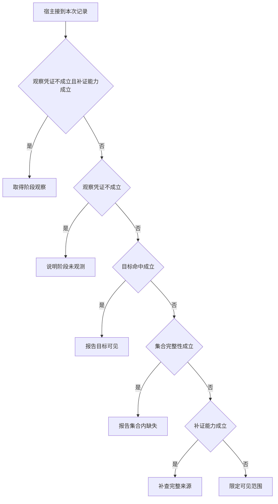

# 有限日志能支持哪一种否定

P7 没在页面前两名出现，而候选可能远大于两项。
这个反例能检验工具返回的是“在所见集合中没发现”，还是未经证实的“被过滤”。
改变记录覆盖面，再看动作是否应随之改变。

本篇用一个封闭的教学决策器说明这一问题。输入是宿主收到的记录，不保证每个下游字段都已经获准使用。前置检查未成立时，下游即使带着缓存值，也不能拿来作业务断言。

若读取尚未发生，载荷中的命中与范围位只是未经信任的原始字段，不能提前引用。

## 先解决一个具体问题

**有人把“目标没在前三名”写成“召回失败”，最便宜的纠错点在哪里？**

首先检查工具返回有没有带覆盖范围。
如果工具就把切片未见改名为已过滤，后续模型连原命题都看不见。
修正观察契约之后再评模型是否需要补查。


先取一个能走到「限定可见范围」的输入：已有本轮业务回执、记录只是可见切片、可见部分没有对象、目前没有补证来源。
把这四个条件代回后文的图，前面各个拦截分支都未满足，最终才有“不具备补证条件时保留未知”这个判断。
还原这个现场时要分别问：哪些位来自可信状态，哪些只是在接口中出现、尚未获得解释资格的字段。

## 先沿一次决策走到底



从上到下取第一条成立的出口。只改一个开关时，只有它之前的检查都未截断，该变化才可能到达真实动作。

“观察凭证”的两种输入分别是“已有本轮业务回执”与“只有尚未执行的提议”。
模型的调用提议不能证明应用已取得新事实。

“集合完整性”的两种输入分别是“记录覆盖全体目标集合”与“记录只是可见切片”。
否定存在性时须证明查过了所声称的范围。

“目标命中”的两种输入分别是“对象出现在可见记录”与“可见部分没有对象”。
存在可以由一个命中支持，缺失还需证明覆盖面。

“补证能力”的两种输入分别是“有可区分解释的只读来源”与“目前没有补证来源”。
继续请求模型不能自行创造缺失的外部证据。

## 最少需要哪几项观察

### 取得阶段观察

目前还没有读取但工具可用。
在本节的全部组合中，有 4 种产生「取得阶段观察」，这只是逻辑空间的计数，不能当作实际用户请求的比例。

只取得只有尚未执行的提议、有可区分解释的只读来源，已经足以要求宿主「取得阶段观察」。
保持这些已知项，其余开关自由变化，仍有 4 种补全，判断没有翻转。

若删掉关于观察凭证的证据，另一份允许的现场是已有本轮业务回执、记录只是可见切片、可见部分没有对象、有可区分解释的只读来源，它会使宿主「补查完整来源」。

若删掉关于补证能力的证据，另一份允许的现场是只有尚未执行的提议、记录只是可见切片、可见部分没有对象、目前没有补证来源，它会使宿主「说明阶段未观测」。

### 说明阶段未观测

没有实际记录也不能再取。
在本节的全部组合中，有 4 种产生「说明阶段未观测」，这只是逻辑空间的计数，不能当作实际用户请求的比例。

只取得只有尚未执行的提议、目前没有补证来源，已经足以要求宿主「说明阶段未观测」。

若删掉关于观察凭证的证据，另一份允许的现场是已有本轮业务回执、记录只是可见切片、可见部分没有对象、目前没有补证来源，它会使宿主「限定可见范围」。

若删掉关于补证能力的证据，另一份允许的现场是只有尚未执行的提议、记录只是可见切片、可见部分没有对象、有可区分解释的只读来源，它会使宿主「取得阶段观察」。

### 报告目标可见

一个属于本次的命中能支持存在性。
在本节的全部组合中，有 4 种产生「报告目标可见」，这只是逻辑空间的计数，不能当作实际用户请求的比例。

只取得已有本轮业务回执、对象出现在可见记录，已经足以要求宿主「报告目标可见」。

若删掉关于观察凭证的证据，另一份允许的现场是只有尚未执行的提议、记录只是可见切片、对象出现在可见记录、目前没有补证来源，它会使宿主「说明阶段未观测」。

若删掉关于目标命中的证据，另一份允许的现场是已有本轮业务回执、记录只是可见切片、可见部分没有对象、目前没有补证来源，它会使宿主「限定可见范围」。

### 报告集合内缺失

否定命题限定在已完整核验的集合。
在本节的全部组合中，有 2 种产生「报告集合内缺失」，这只是逻辑空间的计数，不能当作实际用户请求的比例。

只取得已有本轮业务回执、记录覆盖全体目标集合、可见部分没有对象，已经足以要求宿主「报告集合内缺失」。
保持这些已知项，其余开关自由变化，仍有 2 种补全，判断没有翻转。

若删掉关于观察凭证的证据，另一份允许的现场是只有尚未执行的提议、记录覆盖全体目标集合、可见部分没有对象、目前没有补证来源，它会使宿主「说明阶段未观测」。

若删掉关于集合完整性的证据，另一份允许的现场是已有本轮业务回执、记录只是可见切片、可见部分没有对象、目前没有补证来源，它会使宿主「限定可见范围」。

若删掉关于目标命中的证据，另一份允许的现场是已有本轮业务回执、记录覆盖全体目标集合、对象出现在可见记录、目前没有补证来源，它会使宿主「报告目标可见」。

### 补查完整来源

有限切片没出现不足以断言缺失。
在本节的全部组合中，有 1 种产生「补查完整来源」，这只是逻辑空间的计数，不能当作实际用户请求的比例。

只取得已有本轮业务回执、记录只是可见切片、可见部分没有对象、有可区分解释的只读来源，已经足以要求宿主「补查完整来源」。
保持这些已知项，其余开关自由变化，仍有 1 种补全，判断没有翻转。

若删掉关于观察凭证的证据，另一份允许的现场是只有尚未执行的提议、记录只是可见切片、可见部分没有对象、有可区分解释的只读来源，它会使宿主「取得阶段观察」。

若删掉关于集合完整性的证据，另一份允许的现场是已有本轮业务回执、记录覆盖全体目标集合、可见部分没有对象、有可区分解释的只读来源，它会使宿主「报告集合内缺失」。

若删掉关于目标命中的证据，另一份允许的现场是已有本轮业务回执、记录只是可见切片、对象出现在可见记录、有可区分解释的只读来源，它会使宿主「报告目标可见」。

若删掉关于补证能力的证据，另一份允许的现场是已有本轮业务回执、记录只是可见切片、可见部分没有对象、目前没有补证来源，它会使宿主「限定可见范围」。

### 限定可见范围

不具备补证条件时保留未知。
在本节的全部组合中，有 1 种产生「限定可见范围」，这只是逻辑空间的计数，不能当作实际用户请求的比例。

只取得已有本轮业务回执、记录只是可见切片、可见部分没有对象、目前没有补证来源，已经足以要求宿主「限定可见范围」。

若删掉关于观察凭证的证据，另一份允许的现场是只有尚未执行的提议、记录只是可见切片、可见部分没有对象、目前没有补证来源，它会使宿主「说明阶段未观测」。

若删掉关于集合完整性的证据，另一份允许的现场是已有本轮业务回执、记录覆盖全体目标集合、可见部分没有对象、目前没有补证来源，它会使宿主「报告集合内缺失」。

若删掉关于目标命中的证据，另一份允许的现场是已有本轮业务回执、记录只是可见切片、对象出现在可见记录、目前没有补证来源，它会使宿主「报告目标可见」。

若删掉关于补证能力的证据，另一份允许的现场是已有本轮业务回执、记录只是可见切片、可见部分没有对象、有可区分解释的只读来源，它会使宿主「补查完整来源」。

## 以同一份契约解释截然不同的现场

<details>
<summary>展开推演与对应反例</summary>

下列样本按最先命中的业务分支排列。四位编码只作本篇页内定位，顺序与开头的四项输入一致。可以先猜下一动作，再展开相邻样本。

### 能够触发“取得阶段观察”的现场

**样本 0001**

业务侧交来只有尚未执行的提议、记录只是可见切片，执行侧还记录了可见部分没有对象、有可区分解释的只读来源。
把样本压成最短证明，保留只有尚未执行的提议、有可区分解释的只读来源就能支持「取得阶段观察」。

在这份记录上，分别翻转「观察凭证」、「补证能力」中的任一项，其他项完全不变时，下一动作都会改变。

保持其余观察不动，单独切换「集合完整性」、「目标命中」仍得到「取得阶段观察」，它们在这个现场不是决定性变量。

要从本例改走「说明阶段未观测」，至少需要变动 1 项，一组最少改动是将有可区分解释的只读来源换成目前没有补证来源。

要从本例改走「补查完整来源」，至少需要变动 1 项，一组最少改动是将只有尚未执行的提议换成已有本轮业务回执。

要从本例改走「限定可见范围」，至少需要变动 2 项，一组最少改动是将只有尚未执行的提议、有可区分解释的只读来源换成已有本轮业务回执、目前没有补证来源。

要从本例改走「报告目标可见」，至少需要变动 2 项，一组最少改动是将只有尚未执行的提议、可见部分没有对象换成已有本轮业务回执、对象出现在可见记录。

要从本例改走「报告集合内缺失」，至少需要变动 2 项，一组最少改动是将只有尚未执行的提议、记录只是可见切片换成已有本轮业务回执、记录覆盖全体目标集合。

**样本 0011**

业务侧交来只有尚未执行的提议、记录只是可见切片，执行侧还记录了对象出现在可见记录、有可区分解释的只读来源。


要从本例改走「报告目标可见」，至少需要变动 1 项，一组最少改动是将只有尚未执行的提议换成已有本轮业务回执。

要从本例改走「补查完整来源」，至少需要变动 2 项，一组最少改动是将只有尚未执行的提议、对象出现在可见记录换成已有本轮业务回执、可见部分没有对象。

要从本例改走「限定可见范围」，至少需要变动 3 项，一组最少改动是将只有尚未执行的提议、对象出现在可见记录、有可区分解释的只读来源换成已有本轮业务回执、可见部分没有对象、目前没有补证来源。

要从本例改走「报告集合内缺失」，至少需要变动 3 项，一组最少改动是将只有尚未执行的提议、记录只是可见切片、对象出现在可见记录换成已有本轮业务回执、记录覆盖全体目标集合、可见部分没有对象。

**样本 0101**

业务侧交来只有尚未执行的提议、记录覆盖全体目标集合，执行侧还记录了可见部分没有对象、有可区分解释的只读来源。


要从本例改走「报告集合内缺失」，至少需要变动 1 项，一组最少改动是将只有尚未执行的提议换成已有本轮业务回执。

要从本例改走「补查完整来源」，至少需要变动 2 项，一组最少改动是将只有尚未执行的提议、记录覆盖全体目标集合换成已有本轮业务回执、记录只是可见切片。


要从本例改走「限定可见范围」，至少需要变动 3 项，一组最少改动是将只有尚未执行的提议、记录覆盖全体目标集合、有可区分解释的只读来源换成已有本轮业务回执、记录只是可见切片、目前没有补证来源。

**样本 0111**

业务侧交来只有尚未执行的提议、记录覆盖全体目标集合，执行侧还记录了对象出现在可见记录、有可区分解释的只读来源。


要从本例改走「报告集合内缺失」，至少需要变动 2 项，一组最少改动是将只有尚未执行的提议、对象出现在可见记录换成已有本轮业务回执、可见部分没有对象。

要从本例改走「补查完整来源」，至少需要变动 3 项，一组最少改动是将只有尚未执行的提议、记录覆盖全体目标集合、对象出现在可见记录换成已有本轮业务回执、记录只是可见切片、可见部分没有对象。

要从本例改走「限定可见范围」，至少需要变动 4 项，一组最少改动是将只有尚未执行的提议、记录覆盖全体目标集合、对象出现在可见记录、有可区分解释的只读来源换成已有本轮业务回执、记录只是可见切片、可见部分没有对象、目前没有补证来源。

### 能够触发“说明阶段未观测”的现场

**样本 0000**

业务侧交来只有尚未执行的提议、记录只是可见切片，执行侧还记录了可见部分没有对象、目前没有补证来源。
把样本压成最短证明，保留只有尚未执行的提议、目前没有补证来源就能支持「说明阶段未观测」。


保持其余观察不动，单独切换「集合完整性」、「目标命中」仍得到「说明阶段未观测」，它们在这个现场不是决定性变量。

本例没走更靠前的「取得阶段观察」，因为目前没有补证来源与那个入口的必要条件不符。

要从本例改走「取得阶段观察」，至少需要变动 1 项，一组最少改动是将目前没有补证来源换成有可区分解释的只读来源。

要从本例改走「限定可见范围」，至少需要变动 1 项，一组最少改动是将只有尚未执行的提议换成已有本轮业务回执。

要从本例改走「补查完整来源」，至少需要变动 2 项，一组最少改动是将只有尚未执行的提议、目前没有补证来源换成已有本轮业务回执、有可区分解释的只读来源。


**样本 0010**

业务侧交来只有尚未执行的提议、记录只是可见切片，执行侧还记录了对象出现在可见记录、目前没有补证来源。


要从本例改走「限定可见范围」，至少需要变动 2 项，一组最少改动是将只有尚未执行的提议、对象出现在可见记录换成已有本轮业务回执、可见部分没有对象。

要从本例改走「补查完整来源」，至少需要变动 3 项，一组最少改动是将只有尚未执行的提议、对象出现在可见记录、目前没有补证来源换成已有本轮业务回执、可见部分没有对象、有可区分解释的只读来源。


**样本 0100**

业务侧交来只有尚未执行的提议、记录覆盖全体目标集合，执行侧还记录了可见部分没有对象、目前没有补证来源。


要从本例改走「限定可见范围」，至少需要变动 2 项，一组最少改动是将只有尚未执行的提议、记录覆盖全体目标集合换成已有本轮业务回执、记录只是可见切片。


要从本例改走「补查完整来源」，至少需要变动 3 项，一组最少改动是将只有尚未执行的提议、记录覆盖全体目标集合、目前没有补证来源换成已有本轮业务回执、记录只是可见切片、有可区分解释的只读来源。

**样本 0110**

业务侧交来只有尚未执行的提议、记录覆盖全体目标集合，执行侧还记录了对象出现在可见记录、目前没有补证来源。


要从本例改走「限定可见范围」，至少需要变动 3 项，一组最少改动是将只有尚未执行的提议、记录覆盖全体目标集合、对象出现在可见记录换成已有本轮业务回执、记录只是可见切片、可见部分没有对象。

要从本例改走「补查完整来源」，至少需要变动 4 项，一组最少改动是将只有尚未执行的提议、记录覆盖全体目标集合、对象出现在可见记录、目前没有补证来源换成已有本轮业务回执、记录只是可见切片、可见部分没有对象、有可区分解释的只读来源。

### 能够触发“报告目标可见”的现场

**样本 1010**

业务侧交来已有本轮业务回执、记录只是可见切片，执行侧还记录了对象出现在可见记录、目前没有补证来源。
把样本压成最短证明，保留已有本轮业务回执、对象出现在可见记录就能支持「报告目标可见」。

在这份记录上，分别翻转「观察凭证」、「目标命中」中的任一项，其他项完全不变时，下一动作都会改变。

保持其余观察不动，单独切换「集合完整性」、「补证能力」仍得到「报告目标可见」，它们在这个现场不是决定性变量。

本例没走更靠前的「取得阶段观察」，因为已有本轮业务回执、目前没有补证来源与那个入口的必要条件不符。

本例没走更靠前的「说明阶段未观测」，因为已有本轮业务回执与那个入口的必要条件不符。

要从本例改走「说明阶段未观测」，至少需要变动 1 项，一组最少改动是将已有本轮业务回执换成只有尚未执行的提议。

要从本例改走「限定可见范围」，至少需要变动 1 项，一组最少改动是将对象出现在可见记录换成可见部分没有对象。

要从本例改走「取得阶段观察」，至少需要变动 2 项，一组最少改动是将已有本轮业务回执、目前没有补证来源换成只有尚未执行的提议、有可区分解释的只读来源。

要从本例改走「补查完整来源」，至少需要变动 2 项，一组最少改动是将对象出现在可见记录、目前没有补证来源换成可见部分没有对象、有可区分解释的只读来源。

要从本例改走「报告集合内缺失」，至少需要变动 2 项，一组最少改动是将记录只是可见切片、对象出现在可见记录换成记录覆盖全体目标集合、可见部分没有对象。

**样本 1011**

业务侧交来已有本轮业务回执、记录只是可见切片，执行侧还记录了对象出现在可见记录、有可区分解释的只读来源。


本例没走更靠前的「取得阶段观察」，因为已有本轮业务回执与那个入口的必要条件不符。


要从本例改走「取得阶段观察」，至少需要变动 1 项，一组最少改动是将已有本轮业务回执换成只有尚未执行的提议。

要从本例改走「补查完整来源」，至少需要变动 1 项，一组最少改动是将对象出现在可见记录换成可见部分没有对象。

要从本例改走「说明阶段未观测」，至少需要变动 2 项，一组最少改动是将已有本轮业务回执、有可区分解释的只读来源换成只有尚未执行的提议、目前没有补证来源。

要从本例改走「限定可见范围」，至少需要变动 2 项，一组最少改动是将对象出现在可见记录、有可区分解释的只读来源换成可见部分没有对象、目前没有补证来源。


**样本 1110**

业务侧交来已有本轮业务回执、记录覆盖全体目标集合，执行侧还记录了对象出现在可见记录、目前没有补证来源。


要从本例改走「报告集合内缺失」，至少需要变动 1 项，一组最少改动是将对象出现在可见记录换成可见部分没有对象。


要从本例改走「限定可见范围」，至少需要变动 2 项，一组最少改动是将记录覆盖全体目标集合、对象出现在可见记录换成记录只是可见切片、可见部分没有对象。

要从本例改走「补查完整来源」，至少需要变动 3 项，一组最少改动是将记录覆盖全体目标集合、对象出现在可见记录、目前没有补证来源换成记录只是可见切片、可见部分没有对象、有可区分解释的只读来源。

**样本 1111**

业务侧交来已有本轮业务回执、记录覆盖全体目标集合，执行侧还记录了对象出现在可见记录、有可区分解释的只读来源。


要从本例改走「补查完整来源」，至少需要变动 2 项，一组最少改动是将记录覆盖全体目标集合、对象出现在可见记录换成记录只是可见切片、可见部分没有对象。

要从本例改走「限定可见范围」，至少需要变动 3 项，一组最少改动是将记录覆盖全体目标集合、对象出现在可见记录、有可区分解释的只读来源换成记录只是可见切片、可见部分没有对象、目前没有补证来源。

### 能够触发“报告集合内缺失”的现场

**样本 1100**

业务侧交来已有本轮业务回执、记录覆盖全体目标集合，执行侧还记录了可见部分没有对象、目前没有补证来源。
把样本压成最短证明，保留已有本轮业务回执、记录覆盖全体目标集合、可见部分没有对象就能支持「报告集合内缺失」。

在这份记录上，分别翻转「观察凭证」、「集合完整性」、「目标命中」中的任一项，其他项完全不变时，下一动作都会改变。

保持其余观察不动，单独切换「补证能力」仍得到「报告集合内缺失」，它们在这个现场不是决定性变量。


本例没走更靠前的「报告目标可见」，因为可见部分没有对象与那个入口的必要条件不符。


要从本例改走「限定可见范围」，至少需要变动 1 项，一组最少改动是将记录覆盖全体目标集合换成记录只是可见切片。

要从本例改走「报告目标可见」，至少需要变动 1 项，一组最少改动是将可见部分没有对象换成对象出现在可见记录。


要从本例改走「补查完整来源」，至少需要变动 2 项，一组最少改动是将记录覆盖全体目标集合、目前没有补证来源换成记录只是可见切片、有可区分解释的只读来源。

**样本 1101**

业务侧交来已有本轮业务回执、记录覆盖全体目标集合，执行侧还记录了可见部分没有对象、有可区分解释的只读来源。


要从本例改走「补查完整来源」，至少需要变动 1 项，一组最少改动是将记录覆盖全体目标集合换成记录只是可见切片。


要从本例改走「限定可见范围」，至少需要变动 2 项，一组最少改动是将记录覆盖全体目标集合、有可区分解释的只读来源换成记录只是可见切片、目前没有补证来源。

### 能够触发“补查完整来源”的现场

**样本 1001**

业务侧交来已有本轮业务回执、记录只是可见切片，执行侧还记录了可见部分没有对象、有可区分解释的只读来源。
把样本压成最短证明，保留已有本轮业务回执、记录只是可见切片、可见部分没有对象、有可区分解释的只读来源就能支持「补查完整来源」。

在这份记录上，分别翻转「观察凭证」、「集合完整性」、「目标命中」、「补证能力」中的任一项，其他项完全不变时，下一动作都会改变。


本例没走更靠前的「报告集合内缺失」，因为记录只是可见切片与那个入口的必要条件不符。


要从本例改走「限定可见范围」，至少需要变动 1 项，一组最少改动是将有可区分解释的只读来源换成目前没有补证来源。


要从本例改走「报告集合内缺失」，至少需要变动 1 项，一组最少改动是将记录只是可见切片换成记录覆盖全体目标集合。


### 能够触发“限定可见范围”的现场

**样本 1000**

业务侧交来已有本轮业务回执、记录只是可见切片，执行侧还记录了可见部分没有对象、目前没有补证来源。
把样本压成最短证明，保留已有本轮业务回执、记录只是可见切片、可见部分没有对象、目前没有补证来源就能支持「限定可见范围」。


本例没走更靠前的「补查完整来源」，因为目前没有补证来源与那个入口的必要条件不符。


要从本例改走「补查完整来源」，至少需要变动 1 项，一组最少改动是将目前没有补证来源换成有可区分解释的只读来源。


</details>

## 当你只能看见一半记录

<details>
<summary>展开推演与对应反例</summary>

这次隐藏两个字段，保留另两个。对每个可见现场，检查四种合法补全是否同意。如仍有歧义，选择能使最坏剩余候选动作最少的字段继续查。并列时采用本篇字段顺序。

### 只保留观察凭证与集合完整性

已知只有尚未执行的提议、记录只是可见切片时，四种补全的动作分布为取得阶段观察（2 种）、说明阶段未观测（2 种）。

在只有尚未执行的提议、记录只是可见切片这个现场补读「补证能力」，最坏还剩 1 种动作，计算时只衡量歧义，尚未扣读取代价。
若补来的观察为“目前没有补证来源”，范围缩成「说明阶段未观测」。若为“有可区分解释的只读来源”，则保留「取得阶段观察」。

区分不了的两条执行可以具体写成 0000 与 0001：它们共享已展示字段，却分别需要「说明阶段未观测」和「取得阶段观察」。

已知只有尚未执行的提议、记录覆盖全体目标集合时，四种补全的动作分布为取得阶段观察（2 种）、说明阶段未观测（2 种）。

在只有尚未执行的提议、记录覆盖全体目标集合这个现场补读「补证能力」，最坏还剩 1 种动作，计算时只衡量歧义，尚未扣读取代价。

区分不了的两条执行可以具体写成 0100 与 0101：它们共享已展示字段，却分别需要「说明阶段未观测」和「取得阶段观察」。

已知已有本轮业务回执、记录只是可见切片时，四种补全的动作分布为报告目标可见（2 种）、补查完整来源（1 种）、限定可见范围（1 种）。

在已有本轮业务回执、记录只是可见切片这个现场补读「目标命中」，最坏还剩 2 种动作，计算时只衡量歧义，尚未扣读取代价。
若补来的观察为“可见部分没有对象”，范围缩成「限定可见范围」、「补查完整来源」。若为“对象出现在可见记录”，则保留「报告目标可见」。

区分不了的两条执行可以具体写成 1000 与 1001：它们共享已展示字段，却分别需要「限定可见范围」和「补查完整来源」。

已知已有本轮业务回执、记录覆盖全体目标集合时，四种补全的动作分布为报告目标可见（2 种）、报告集合内缺失（2 种）。

在已有本轮业务回执、记录覆盖全体目标集合这个现场补读「目标命中」，最坏还剩 1 种动作，计算时只衡量歧义，尚未扣读取代价。
若补来的观察为“可见部分没有对象”，范围缩成「报告集合内缺失」。若为“对象出现在可见记录”，则保留「报告目标可见」。

区分不了的两条执行可以具体写成 1100 与 1110：它们共享已展示字段，却分别需要「报告集合内缺失」和「报告目标可见」。

### 只保留观察凭证与目标命中

已知只有尚未执行的提议、可见部分没有对象时，四种补全的动作分布为取得阶段观察（2 种）、说明阶段未观测（2 种）。

在只有尚未执行的提议、可见部分没有对象这个现场补读「补证能力」，最坏还剩 1 种动作，计算时只衡量歧义，尚未扣读取代价。


已知只有尚未执行的提议、对象出现在可见记录时，四种补全的动作分布为取得阶段观察（2 种）、说明阶段未观测（2 种）。

在只有尚未执行的提议、对象出现在可见记录这个现场补读「补证能力」，最坏还剩 1 种动作，计算时只衡量歧义，尚未扣读取代价。

区分不了的两条执行可以具体写成 0010 与 0011：它们共享已展示字段，却分别需要「说明阶段未观测」和「取得阶段观察」。

已知已有本轮业务回执、可见部分没有对象时，四种补全的动作分布为报告集合内缺失（2 种）、补查完整来源（1 种）、限定可见范围（1 种）。

在已有本轮业务回执、可见部分没有对象这个现场补读「集合完整性」，最坏还剩 2 种动作，计算时只衡量歧义，尚未扣读取代价。
若补来的观察为“记录只是可见切片”，范围缩成「限定可见范围」、「补查完整来源」。若为“记录覆盖全体目标集合”，则保留「报告集合内缺失」。


已知已有本轮业务回执、对象出现在可见记录时，四种补全的动作分布为报告目标可见（4 种）。

就“报告目标可见”这个动作而言，在已有本轮业务回执、对象出现在可见记录的前提下，另外两项观察不会推翻它。

### 只保留集合完整性与目标命中

已知记录只是可见切片、可见部分没有对象时，四种补全的动作分布为取得阶段观察（1 种）、说明阶段未观测（1 种）、补查完整来源（1 种）、限定可见范围（1 种）。

在记录只是可见切片、可见部分没有对象这个现场补读「观察凭证」，最坏还剩 2 种动作，计算时只衡量歧义，尚未扣读取代价。
若补来的观察为“只有尚未执行的提议”，范围缩成「说明阶段未观测」、「取得阶段观察」。若为“已有本轮业务回执”，则保留「限定可见范围」、「补查完整来源」。


已知记录只是可见切片、对象出现在可见记录时，四种补全的动作分布为取得阶段观察（1 种）、说明阶段未观测（1 种）、报告目标可见（2 种）。

在记录只是可见切片、对象出现在可见记录这个现场补读「观察凭证」，最坏还剩 2 种动作，计算时只衡量歧义，尚未扣读取代价。
若补来的观察为“只有尚未执行的提议”，范围缩成「说明阶段未观测」、「取得阶段观察」。若为“已有本轮业务回执”，则保留「报告目标可见」。


已知记录覆盖全体目标集合、可见部分没有对象时，四种补全的动作分布为取得阶段观察（1 种）、说明阶段未观测（1 种）、报告集合内缺失（2 种）。

在记录覆盖全体目标集合、可见部分没有对象这个现场补读「观察凭证」，最坏还剩 2 种动作，计算时只衡量歧义，尚未扣读取代价。
若补来的观察为“只有尚未执行的提议”，范围缩成「说明阶段未观测」、「取得阶段观察」。若为“已有本轮业务回执”，则保留「报告集合内缺失」。


已知记录覆盖全体目标集合、对象出现在可见记录时，四种补全的动作分布为取得阶段观察（1 种）、说明阶段未观测（1 种）、报告目标可见（2 种）。

在记录覆盖全体目标集合、对象出现在可见记录这个现场补读「观察凭证」，最坏还剩 2 种动作，计算时只衡量歧义，尚未扣读取代价。

区分不了的两条执行可以具体写成 0110 与 0111：它们共享已展示字段，却分别需要「说明阶段未观测」和「取得阶段观察」。

### 只保留观察凭证与补证能力

已知只有尚未执行的提议、目前没有补证来源时，四种补全的动作分布为说明阶段未观测（4 种）。

就“说明阶段未观测”这个动作而言，在只有尚未执行的提议、目前没有补证来源的前提下，另外两项观察不会推翻它。

已知只有尚未执行的提议、有可区分解释的只读来源时，四种补全的动作分布为取得阶段观察（4 种）。

就“取得阶段观察”这个动作而言，在只有尚未执行的提议、有可区分解释的只读来源的前提下，另外两项观察不会推翻它。

已知已有本轮业务回执、目前没有补证来源时，四种补全的动作分布为报告目标可见（2 种）、报告集合内缺失（1 种）、限定可见范围（1 种）。

在已有本轮业务回执、目前没有补证来源这个现场补读「集合完整性」，最坏还剩 2 种动作，计算时只衡量歧义，尚未扣读取代价。
若补来的观察为“记录只是可见切片”，范围缩成「限定可见范围」、「报告目标可见」。若为“记录覆盖全体目标集合”，则保留「报告集合内缺失」、「报告目标可见」。

区分不了的两条执行可以具体写成 1000 与 1010：它们共享已展示字段，却分别需要「限定可见范围」和「报告目标可见」。

已知已有本轮业务回执、有可区分解释的只读来源时，四种补全的动作分布为报告目标可见（2 种）、报告集合内缺失（1 种）、补查完整来源（1 种）。

在已有本轮业务回执、有可区分解释的只读来源这个现场补读「集合完整性」，最坏还剩 2 种动作，计算时只衡量歧义，尚未扣读取代价。
若补来的观察为“记录只是可见切片”，范围缩成「补查完整来源」、「报告目标可见」。若为“记录覆盖全体目标集合”，则保留「报告集合内缺失」、「报告目标可见」。

区分不了的两条执行可以具体写成 1001 与 1011：它们共享已展示字段，却分别需要「补查完整来源」和「报告目标可见」。

### 只保留集合完整性与补证能力

已知记录只是可见切片、目前没有补证来源时，四种补全的动作分布为说明阶段未观测（2 种）、报告目标可见（1 种）、限定可见范围（1 种）。

在记录只是可见切片、目前没有补证来源这个现场补读「观察凭证」，最坏还剩 2 种动作，计算时只衡量歧义，尚未扣读取代价。
若补来的观察为“只有尚未执行的提议”，范围缩成「说明阶段未观测」。若为“已有本轮业务回执”，则保留「限定可见范围」、「报告目标可见」。

区分不了的两条执行可以具体写成 0000 与 1000：它们共享已展示字段，却分别需要「说明阶段未观测」和「限定可见范围」。

已知记录只是可见切片、有可区分解释的只读来源时，四种补全的动作分布为取得阶段观察（2 种）、报告目标可见（1 种）、补查完整来源（1 种）。

在记录只是可见切片、有可区分解释的只读来源这个现场补读「观察凭证」，最坏还剩 2 种动作，计算时只衡量歧义，尚未扣读取代价。
若补来的观察为“只有尚未执行的提议”，范围缩成「取得阶段观察」。若为“已有本轮业务回执”，则保留「补查完整来源」、「报告目标可见」。

区分不了的两条执行可以具体写成 0001 与 1001：它们共享已展示字段，却分别需要「取得阶段观察」和「补查完整来源」。

已知记录覆盖全体目标集合、目前没有补证来源时，四种补全的动作分布为说明阶段未观测（2 种）、报告目标可见（1 种）、报告集合内缺失（1 种）。

在记录覆盖全体目标集合、目前没有补证来源这个现场补读「观察凭证」，最坏还剩 2 种动作，计算时只衡量歧义，尚未扣读取代价。
若补来的观察为“只有尚未执行的提议”，范围缩成「说明阶段未观测」。若为“已有本轮业务回执”，则保留「报告集合内缺失」、「报告目标可见」。

区分不了的两条执行可以具体写成 0100 与 1100：它们共享已展示字段，却分别需要「说明阶段未观测」和「报告集合内缺失」。

已知记录覆盖全体目标集合、有可区分解释的只读来源时，四种补全的动作分布为取得阶段观察（2 种）、报告目标可见（1 种）、报告集合内缺失（1 种）。

在记录覆盖全体目标集合、有可区分解释的只读来源这个现场补读「观察凭证」，最坏还剩 2 种动作，计算时只衡量歧义，尚未扣读取代价。
若补来的观察为“只有尚未执行的提议”，范围缩成「取得阶段观察」。若为“已有本轮业务回执”，则保留「报告集合内缺失」、「报告目标可见」。

区分不了的两条执行可以具体写成 0101 与 1101：它们共享已展示字段，却分别需要「取得阶段观察」和「报告集合内缺失」。

### 只保留目标命中与补证能力

已知可见部分没有对象、目前没有补证来源时，四种补全的动作分布为说明阶段未观测（2 种）、报告集合内缺失（1 种）、限定可见范围（1 种）。

在可见部分没有对象、目前没有补证来源这个现场补读「观察凭证」，最坏还剩 2 种动作，计算时只衡量歧义，尚未扣读取代价。
若补来的观察为“只有尚未执行的提议”，范围缩成「说明阶段未观测」。若为“已有本轮业务回执”，则保留「限定可见范围」、「报告集合内缺失」。


已知可见部分没有对象、有可区分解释的只读来源时，四种补全的动作分布为取得阶段观察（2 种）、报告集合内缺失（1 种）、补查完整来源（1 种）。

在可见部分没有对象、有可区分解释的只读来源这个现场补读「观察凭证」，最坏还剩 2 种动作，计算时只衡量歧义，尚未扣读取代价。
若补来的观察为“只有尚未执行的提议”，范围缩成「取得阶段观察」。若为“已有本轮业务回执”，则保留「补查完整来源」、「报告集合内缺失」。


已知对象出现在可见记录、目前没有补证来源时，四种补全的动作分布为说明阶段未观测（2 种）、报告目标可见（2 种）。

在对象出现在可见记录、目前没有补证来源这个现场补读「观察凭证」，最坏还剩 1 种动作，计算时只衡量歧义，尚未扣读取代价。
若补来的观察为“只有尚未执行的提议”，范围缩成「说明阶段未观测」。若为“已有本轮业务回执”，则保留「报告目标可见」。

区分不了的两条执行可以具体写成 0010 与 1010：它们共享已展示字段，却分别需要「说明阶段未观测」和「报告目标可见」。

已知对象出现在可见记录、有可区分解释的只读来源时，四种补全的动作分布为取得阶段观察（2 种）、报告目标可见（2 种）。

在对象出现在可见记录、有可区分解释的只读来源这个现场补读「观察凭证」，最坏还剩 1 种动作，计算时只衡量歧义，尚未扣读取代价。
若补来的观察为“只有尚未执行的提议”，范围缩成「取得阶段观察」。若为“已有本轮业务回执”，则保留「报告目标可见」。

区分不了的两条执行可以具体写成 0011 与 1011：它们共享已展示字段，却分别需要「取得阶段观察」和「报告目标可见」。

</details>

## 单因素干预与边界测试

<details>
<summary>展开推演与对应反例</summary>

### 只改变观察凭证

固定另外三个条件得到八对现场，从“只有尚未执行的提议”转为“已有本轮业务回执”时，8 对翻转动作，另外 0 对保持不变。

有 1 对现场沿「说明阶段未观测」变到「限定可见范围」，可复现的一组受控背景为记录只是可见切片、可见部分没有对象、目前没有补证来源。

有 1 对现场沿「取得阶段观察」变到「补查完整来源」，可复现的一组受控背景为记录只是可见切片、可见部分没有对象、有可区分解释的只读来源。

有 2 对现场沿「说明阶段未观测」变到「报告目标可见」，可复现的一组受控背景为记录只是可见切片、对象出现在可见记录、目前没有补证来源。

有 2 对现场沿「取得阶段观察」变到「报告目标可见」，可复现的一组受控背景为记录只是可见切片、对象出现在可见记录、有可区分解释的只读来源。

有 1 对现场沿「说明阶段未观测」变到「报告集合内缺失」，可复现的一组受控背景为记录覆盖全体目标集合、可见部分没有对象、目前没有补证来源。

有 1 对现场沿「取得阶段观察」变到「报告集合内缺失」，可复现的一组受控背景为记录覆盖全体目标集合、可见部分没有对象、有可区分解释的只读来源。

### 只改变集合完整性

固定另外三个条件得到八对现场，从“记录只是可见切片”转为“记录覆盖全体目标集合”时，2 对翻转动作，另外 6 对保持不变。

令只有尚未执行的提议、可见部分没有对象、目前没有补证来源，集合完整性的两个取值均得到「说明阶段未观测」。在八对中，共有 2 对表现为这一种稳定出口。

令只有尚未执行的提议、可见部分没有对象、有可区分解释的只读来源，集合完整性的两个取值均得到「取得阶段观察」。在八对中，共有 2 对表现为这一种稳定出口。

有 1 对现场沿「限定可见范围」变到「报告集合内缺失」，可复现的一组受控背景为已有本轮业务回执、可见部分没有对象、目前没有补证来源。

有 1 对现场沿「补查完整来源」变到「报告集合内缺失」，可复现的一组受控背景为已有本轮业务回执、可见部分没有对象、有可区分解释的只读来源。

令已有本轮业务回执、对象出现在可见记录、目前没有补证来源，集合完整性的两个取值均得到「报告目标可见」。在八对中，共有 2 对表现为这一种稳定出口。

### 只改变目标命中

固定另外三个条件得到八对现场，从“可见部分没有对象”转为“对象出现在可见记录”时，4 对翻转动作，另外 4 对保持不变。

令只有尚未执行的提议、记录只是可见切片、目前没有补证来源，目标命中的两个取值均得到「说明阶段未观测」。在八对中，共有 2 对表现为这一种稳定出口。

令只有尚未执行的提议、记录只是可见切片、有可区分解释的只读来源，目标命中的两个取值均得到「取得阶段观察」。在八对中，共有 2 对表现为这一种稳定出口。

有 1 对现场沿「限定可见范围」变到「报告目标可见」，可复现的一组受控背景为已有本轮业务回执、记录只是可见切片、目前没有补证来源。

有 1 对现场沿「补查完整来源」变到「报告目标可见」，可复现的一组受控背景为已有本轮业务回执、记录只是可见切片、有可区分解释的只读来源。

有 2 对现场沿「报告集合内缺失」变到「报告目标可见」，可复现的一组受控背景为已有本轮业务回执、记录覆盖全体目标集合、目前没有补证来源。

### 只改变补证能力

固定另外三个条件得到八对现场，从“目前没有补证来源”转为“有可区分解释的只读来源”时，5 对翻转动作，另外 3 对保持不变。

有 4 对现场沿「说明阶段未观测」变到「取得阶段观察」，可复现的一组受控背景为只有尚未执行的提议、记录只是可见切片、可见部分没有对象。

有 1 对现场沿「限定可见范围」变到「补查完整来源」，可复现的一组受控背景为已有本轮业务回执、记录只是可见切片、可见部分没有对象。

令已有本轮业务回执、记录只是可见切片、对象出现在可见记录，补证能力的两个取值均得到「报告目标可见」。在八对中，共有 2 对表现为这一种稳定出口。

令已有本轮业务回执、记录覆盖全体目标集合、可见部分没有对象，补证能力的两个取值均得到「报告集合内缺失」。在八对中，共有 1 对表现为这一种稳定出口。

</details>

## 哪些回归样本真能抓住实现错误

<details>
<summary>展开推演与对应反例</summary>

如果删除“取得阶段观察”这个分支，在本篇 16 种输入里有 4 种会改走另一出口。

反例 0001 的完整记录为只有尚未执行的提议、记录只是可见切片、可见部分没有对象、有可区分解释的只读来源。正确结果是「取得阶段观察」，这个改坏的实现却给出「说明阶段未观测」。

如果删除“说明阶段未观测”这个分支，在本篇 16 种输入里有 4 种会改走另一出口。

反例 0000 的完整记录为只有尚未执行的提议、记录只是可见切片、可见部分没有对象、目前没有补证来源。正确结果是「说明阶段未观测」，这个改坏的实现却给出「限定可见范围」。

如果删除“报告目标可见”这个分支，在本篇 16 种输入里有 4 种会改走另一出口。

反例 1010 的完整记录为已有本轮业务回执、记录只是可见切片、对象出现在可见记录、目前没有补证来源。正确结果是「报告目标可见」，这个改坏的实现却给出「限定可见范围」。

如果删除“报告集合内缺失”这个分支，在本篇 16 种输入里有 2 种会改走另一出口。

反例 1100 的完整记录为已有本轮业务回执、记录覆盖全体目标集合、可见部分没有对象、目前没有补证来源。正确结果是「报告集合内缺失」，这个改坏的实现却给出「限定可见范围」。

如果删除“补查完整来源”这个分支，在本篇 16 种输入里有 1 种会改走另一出口。

反例 1001 的完整记录为已有本轮业务回执、记录只是可见切片、可见部分没有对象、有可区分解释的只读来源。正确结果是「补查完整来源」，这个改坏的实现却给出「限定可见范围」。

如果交换“取得阶段观察”和“说明阶段未观测”的判断次序，在本篇 16 种输入里有 4 种会改走另一出口。


如果交换“说明阶段未观测”和“报告目标可见”的判断次序，在本篇 16 种输入里有 2 种会改走另一出口。

反例 0010 的完整记录为只有尚未执行的提议、记录只是可见切片、对象出现在可见记录、目前没有补证来源。正确结果是「说明阶段未观测」，这个改坏的实现却给出「报告目标可见」。

如果交换“报告目标可见”和“报告集合内缺失”的判断次序，在本篇 16 种输入里有 2 种会改走另一出口。

反例 1110 的完整记录为已有本轮业务回执、记录覆盖全体目标集合、对象出现在可见记录、目前没有补证来源。正确结果是「报告目标可见」，这个改坏的实现却给出「报告集合内缺失」。

如果交换“报告集合内缺失”和“补查完整来源”的判断次序，在本篇 16 种输入里有 1 种会改走另一出口。

反例 1101 的完整记录为已有本轮业务回执、记录覆盖全体目标集合、可见部分没有对象、有可区分解释的只读来源。正确结果是「报告集合内缺失」，这个改坏的实现却给出「补查完整来源」。

补入样本 0001（只有尚未执行的提议、记录只是可见切片、可见部分没有对象、有可区分解释的只读来源）能新增检出「删除“取得阶段观察”这个分支」、「交换“取得阶段观察”和“说明阶段未观测”的判断次序」。

补入样本 0010（只有尚未执行的提议、记录只是可见切片、对象出现在可见记录、目前没有补证来源）能新增检出「删除“说明阶段未观测”这个分支」、「交换“说明阶段未观测”和“报告目标可见”的判断次序」。

补入样本 1101（已有本轮业务回执、记录覆盖全体目标集合、可见部分没有对象、有可区分解释的只读来源）能新增检出「删除“报告集合内缺失”这个分支」、「交换“报告集合内缺失”和“补查完整来源”的判断次序」。

补入样本 1110（已有本轮业务回执、记录覆盖全体目标集合、对象出现在可见记录、目前没有补证来源）能新增检出「删除“报告目标可见”这个分支」、「交换“报告目标可见”和“报告集合内缺失”的判断次序」。

补入样本 1001（已有本轮业务回执、记录只是可见切片、可见部分没有对象、有可区分解释的只读来源）能新增检出「删除“补查完整来源”这个分支」。

这里每次选覆盖尚未捕获缺陷最多的样本，并不保证用例数全局最小。它给出的反例能作为 Java 单测输入。真实模型是否会自主产生这些提议，仍须单独评测。

</details>

## 把状态覆盖换成有抽样偏差的评测批次

<details>
<summary>展开推演与对应反例</summary>

前面的十六种记录各有一票。现在只改样本构成：对一个给定字段，把成立侧的每种记录各取三份、另一侧各取一份。这是人为配比的 32 份回放，不是线上频率估计。
将偏向成立与偏向不成立的两次批次对照，可以隔离分母变化。底层宿主和所有答案保持相同，比例仍可能移动。

### 改变“观察凭证”的样本配比

只看「取得阶段观察」，在已有本轮业务回执的八个不同输入中有 0 个命中，在只有尚未执行的提议的另八个输入中有 4 个命中。
把「观察凭证」成立侧按三倍取样，「取得阶段观察」占 4/32，反过来向未成立侧倾斜后占 12/32。
这次重加权使「取得阶段观察」的占比相差 25 个百分点。若按两种不同的“观察凭证”分布跑新旧版，不能把这项差异全部归功于实现。

只看「说明阶段未观测」，在已有本轮业务回执的八个不同输入中有 0 个命中，在只有尚未执行的提议的另八个输入中有 4 个命中。
把「观察凭证」成立侧按三倍取样，「说明阶段未观测」占 4/32，反过来向未成立侧倾斜后占 12/32。
这次重加权使「说明阶段未观测」的占比相差 25 个百分点。若按两种不同的“观察凭证”分布跑新旧版，不能把这项差异全部归功于实现。

只看「报告目标可见」，在已有本轮业务回执的八个不同输入中有 4 个命中，在只有尚未执行的提议的另八个输入中有 0 个命中。
把「观察凭证」成立侧按三倍取样，「报告目标可见」占 12/32，反过来向未成立侧倾斜后占 4/32。
这次重加权使「报告目标可见」的占比相差 25 个百分点。若按两种不同的“观察凭证”分布跑新旧版，不能把这项差异全部归功于实现。

只看「报告集合内缺失」，在已有本轮业务回执的八个不同输入中有 2 个命中，在只有尚未执行的提议的另八个输入中有 0 个命中。
把「观察凭证」成立侧按三倍取样，「报告集合内缺失」占 6/32，反过来向未成立侧倾斜后占 2/32。
这次重加权使「报告集合内缺失」的占比相差 12.5 个百分点。若按两种不同的“观察凭证”分布跑新旧版，不能把这项差异全部归功于实现。

只看「补查完整来源」，在已有本轮业务回执的八个不同输入中有 1 个命中，在只有尚未执行的提议的另八个输入中有 0 个命中。
把「观察凭证」成立侧按三倍取样，「补查完整来源」占 3/32，反过来向未成立侧倾斜后占 1/32。
这次重加权使「补查完整来源」的占比相差 6.25 个百分点。若按两种不同的“观察凭证”分布跑新旧版，不能把这项差异全部归功于实现。

只看「限定可见范围」，在已有本轮业务回执的八个不同输入中有 1 个命中，在只有尚未执行的提议的另八个输入中有 0 个命中。
把「观察凭证」成立侧按三倍取样，「限定可见范围」占 3/32，反过来向未成立侧倾斜后占 1/32。
这次重加权使「限定可见范围」的占比相差 6.25 个百分点。若按两种不同的“观察凭证”分布跑新旧版，不能把这项差异全部归功于实现。

### 改变“集合完整性”的样本配比

只看「取得阶段观察」，在记录覆盖全体目标集合的八个不同输入中有 2 个命中，在记录只是可见切片的另八个输入中有 2 个命中。
把「集合完整性」成立侧按三倍取样，「取得阶段观察」占 8/32，反过来向未成立侧倾斜后占 8/32。
两批「取得阶段观察」的边际比例相同，是因为这个出口在“集合完整性”的两侧计数相等，这不能单独证明每一对现场都不受它影响。

只看「说明阶段未观测」，在记录覆盖全体目标集合的八个不同输入中有 2 个命中，在记录只是可见切片的另八个输入中有 2 个命中。
把「集合完整性」成立侧按三倍取样，「说明阶段未观测」占 8/32，反过来向未成立侧倾斜后占 8/32。
两批「说明阶段未观测」的边际比例相同，是因为这个出口在“集合完整性”的两侧计数相等，这不能单独证明每一对现场都不受它影响。

只看「报告目标可见」，在记录覆盖全体目标集合的八个不同输入中有 2 个命中，在记录只是可见切片的另八个输入中有 2 个命中。
把「集合完整性」成立侧按三倍取样，「报告目标可见」占 8/32，反过来向未成立侧倾斜后占 8/32。
两批「报告目标可见」的边际比例相同，是因为这个出口在“集合完整性”的两侧计数相等，这不能单独证明每一对现场都不受它影响。

只看「报告集合内缺失」，在记录覆盖全体目标集合的八个不同输入中有 2 个命中，在记录只是可见切片的另八个输入中有 0 个命中。
把「集合完整性」成立侧按三倍取样，「报告集合内缺失」占 6/32，反过来向未成立侧倾斜后占 2/32。
这次重加权使「报告集合内缺失」的占比相差 12.5 个百分点。若按两种不同的“集合完整性”分布跑新旧版，不能把这项差异全部归功于实现。

只看「补查完整来源」，在记录覆盖全体目标集合的八个不同输入中有 0 个命中，在记录只是可见切片的另八个输入中有 1 个命中。
把「集合完整性」成立侧按三倍取样，「补查完整来源」占 1/32，反过来向未成立侧倾斜后占 3/32。
这次重加权使「补查完整来源」的占比相差 6.25 个百分点。若按两种不同的“集合完整性”分布跑新旧版，不能把这项差异全部归功于实现。

只看「限定可见范围」，在记录覆盖全体目标集合的八个不同输入中有 0 个命中，在记录只是可见切片的另八个输入中有 1 个命中。
把「集合完整性」成立侧按三倍取样，「限定可见范围」占 1/32，反过来向未成立侧倾斜后占 3/32。
这次重加权使「限定可见范围」的占比相差 6.25 个百分点。若按两种不同的“集合完整性”分布跑新旧版，不能把这项差异全部归功于实现。

### 改变“目标命中”的样本配比

只看「取得阶段观察」，在对象出现在可见记录的八个不同输入中有 2 个命中，在可见部分没有对象的另八个输入中有 2 个命中。
把「目标命中」成立侧按三倍取样，「取得阶段观察」占 8/32，反过来向未成立侧倾斜后占 8/32。
两批「取得阶段观察」的边际比例相同，是因为这个出口在“目标命中”的两侧计数相等，这不能单独证明每一对现场都不受它影响。

只看「说明阶段未观测」，在对象出现在可见记录的八个不同输入中有 2 个命中，在可见部分没有对象的另八个输入中有 2 个命中。
把「目标命中」成立侧按三倍取样，「说明阶段未观测」占 8/32，反过来向未成立侧倾斜后占 8/32。
两批「说明阶段未观测」的边际比例相同，是因为这个出口在“目标命中”的两侧计数相等，这不能单独证明每一对现场都不受它影响。

只看「报告目标可见」，在对象出现在可见记录的八个不同输入中有 4 个命中，在可见部分没有对象的另八个输入中有 0 个命中。
把「目标命中」成立侧按三倍取样，「报告目标可见」占 12/32，反过来向未成立侧倾斜后占 4/32。
这次重加权使「报告目标可见」的占比相差 25 个百分点。若按两种不同的“目标命中”分布跑新旧版，不能把这项差异全部归功于实现。

只看「报告集合内缺失」，在对象出现在可见记录的八个不同输入中有 0 个命中，在可见部分没有对象的另八个输入中有 2 个命中。
把「目标命中」成立侧按三倍取样，「报告集合内缺失」占 2/32，反过来向未成立侧倾斜后占 6/32。
这次重加权使「报告集合内缺失」的占比相差 12.5 个百分点。若按两种不同的“目标命中”分布跑新旧版，不能把这项差异全部归功于实现。

只看「补查完整来源」，在对象出现在可见记录的八个不同输入中有 0 个命中，在可见部分没有对象的另八个输入中有 1 个命中。
把「目标命中」成立侧按三倍取样，「补查完整来源」占 1/32，反过来向未成立侧倾斜后占 3/32。
这次重加权使「补查完整来源」的占比相差 6.25 个百分点。若按两种不同的“目标命中”分布跑新旧版，不能把这项差异全部归功于实现。

只看「限定可见范围」，在对象出现在可见记录的八个不同输入中有 0 个命中，在可见部分没有对象的另八个输入中有 1 个命中。
把「目标命中」成立侧按三倍取样，「限定可见范围」占 1/32，反过来向未成立侧倾斜后占 3/32。
这次重加权使「限定可见范围」的占比相差 6.25 个百分点。若按两种不同的“目标命中”分布跑新旧版，不能把这项差异全部归功于实现。

### 改变“补证能力”的样本配比

只看「取得阶段观察」，在有可区分解释的只读来源的八个不同输入中有 4 个命中，在目前没有补证来源的另八个输入中有 0 个命中。
把「补证能力」成立侧按三倍取样，「取得阶段观察」占 12/32，反过来向未成立侧倾斜后占 4/32。
这次重加权使「取得阶段观察」的占比相差 25 个百分点。若按两种不同的“补证能力”分布跑新旧版，不能把这项差异全部归功于实现。

只看「说明阶段未观测」，在有可区分解释的只读来源的八个不同输入中有 0 个命中，在目前没有补证来源的另八个输入中有 4 个命中。
把「补证能力」成立侧按三倍取样，「说明阶段未观测」占 4/32，反过来向未成立侧倾斜后占 12/32。
这次重加权使「说明阶段未观测」的占比相差 25 个百分点。若按两种不同的“补证能力”分布跑新旧版，不能把这项差异全部归功于实现。

只看「报告目标可见」，在有可区分解释的只读来源的八个不同输入中有 2 个命中，在目前没有补证来源的另八个输入中有 2 个命中。
把「补证能力」成立侧按三倍取样，「报告目标可见」占 8/32，反过来向未成立侧倾斜后占 8/32。
两批「报告目标可见」的边际比例相同，是因为这个出口在“补证能力”的两侧计数相等，这不能单独证明每一对现场都不受它影响。

只看「报告集合内缺失」，在有可区分解释的只读来源的八个不同输入中有 1 个命中，在目前没有补证来源的另八个输入中有 1 个命中。
把「补证能力」成立侧按三倍取样，「报告集合内缺失」占 4/32，反过来向未成立侧倾斜后占 4/32。
两批「报告集合内缺失」的边际比例相同，是因为这个出口在“补证能力”的两侧计数相等，这不能单独证明每一对现场都不受它影响。

只看「补查完整来源」，在有可区分解释的只读来源的八个不同输入中有 1 个命中，在目前没有补证来源的另八个输入中有 0 个命中。
把「补证能力」成立侧按三倍取样，「补查完整来源」占 3/32，反过来向未成立侧倾斜后占 1/32。
这次重加权使「补查完整来源」的占比相差 6.25 个百分点。若按两种不同的“补证能力”分布跑新旧版，不能把这项差异全部归功于实现。

只看「限定可见范围」，在有可区分解释的只读来源的八个不同输入中有 0 个命中，在目前没有补证来源的另八个输入中有 1 个命中。
把「补证能力」成立侧按三倍取样，「限定可见范围」占 1/32，反过来向未成立侧倾斜后占 3/32。
这次重加权使「限定可见范围」的占比相差 6.25 个百分点。若按两种不同的“补证能力”分布跑新旧版，不能把这项差异全部归功于实现。

</details>

## 只看终态，能逆推出多少原始事实

<details>
<summary>展开推演与对应反例</summary>

### 只保留“取得阶段观察”这条结果时

在本节契约与完整输入域内，仅知「取得阶段观察」就能倒推出只有尚未执行的提议，这一推断依赖版本未变且日志中的终态可信。

「取得阶段观察」不能证明集合完整性取哪一侧：0001 和 0101 有相同终态，却分别记为“记录只是可见切片”和“记录覆盖全体目标集合”。

「取得阶段观察」不能证明目标命中取哪一侧：0001 和 0011 有相同终态，却分别记为“可见部分没有对象”和“对象出现在可见记录”。

在本节契约与完整输入域内，仅知「取得阶段观察」就能倒推出有可区分解释的只读来源，这一推断依赖版本未变且日志中的终态可信。

反查「取得阶段观察」的诊断日志，优先保留能区分样本 0001 与 0000 的「补证能力」，否则很容易把邻近的「说明阶段未观测」看成同一种故障。

### 只保留“说明阶段未观测”这条结果时

在本节契约与完整输入域内，仅知「说明阶段未观测」就能倒推出只有尚未执行的提议，这一推断依赖版本未变且日志中的终态可信。

「说明阶段未观测」不能证明集合完整性取哪一侧：0000 和 0100 有相同终态，却分别记为“记录只是可见切片”和“记录覆盖全体目标集合”。

「说明阶段未观测」不能证明目标命中取哪一侧：0000 和 0010 有相同终态，却分别记为“可见部分没有对象”和“对象出现在可见记录”。

在本节契约与完整输入域内，仅知「说明阶段未观测」就能倒推出目前没有补证来源，这一推断依赖版本未变且日志中的终态可信。

反查「说明阶段未观测」的诊断日志，优先保留能区分样本 0000 与 0001 的「补证能力」，否则很容易把邻近的「取得阶段观察」看成同一种故障。

### 只保留“报告目标可见”这条结果时

在本节契约与完整输入域内，仅知「报告目标可见」就能倒推出已有本轮业务回执，这一推断依赖版本未变且日志中的终态可信。

「报告目标可见」不能证明集合完整性取哪一侧：1010 和 1110 有相同终态，却分别记为“记录只是可见切片”和“记录覆盖全体目标集合”。

在本节契约与完整输入域内，仅知「报告目标可见」就能倒推出对象出现在可见记录，这一推断依赖版本未变且日志中的终态可信。

「报告目标可见」不能证明补证能力取哪一侧：1010 和 1011 有相同终态，却分别记为“目前没有补证来源”和“有可区分解释的只读来源”。

反查「报告目标可见」的诊断日志，优先保留能区分样本 1010 与 0010 的「观察凭证」，否则很容易把邻近的「说明阶段未观测」看成同一种故障。

### 只保留“报告集合内缺失”这条结果时

在本节契约与完整输入域内，仅知「报告集合内缺失」就能倒推出已有本轮业务回执，这一推断依赖版本未变且日志中的终态可信。

在本节契约与完整输入域内，仅知「报告集合内缺失」就能倒推出记录覆盖全体目标集合，这一推断依赖版本未变且日志中的终态可信。

在本节契约与完整输入域内，仅知「报告集合内缺失」就能倒推出可见部分没有对象，这一推断依赖版本未变且日志中的终态可信。

「报告集合内缺失」不能证明补证能力取哪一侧：1100 和 1101 有相同终态，却分别记为“目前没有补证来源”和“有可区分解释的只读来源”。

反查「报告集合内缺失」的诊断日志，优先保留能区分样本 1100 与 0100 的「观察凭证」，否则很容易把邻近的「说明阶段未观测」看成同一种故障。

### 只保留“补查完整来源”这条结果时

在本节契约与完整输入域内，仅知「补查完整来源」就能倒推出已有本轮业务回执，这一推断依赖版本未变且日志中的终态可信。

在本节契约与完整输入域内，仅知「补查完整来源」就能倒推出记录只是可见切片，这一推断依赖版本未变且日志中的终态可信。

在本节契约与完整输入域内，仅知「补查完整来源」就能倒推出可见部分没有对象，这一推断依赖版本未变且日志中的终态可信。

在本节契约与完整输入域内，仅知「补查完整来源」就能倒推出有可区分解释的只读来源，这一推断依赖版本未变且日志中的终态可信。

反查「补查完整来源」的诊断日志，优先保留能区分样本 1001 与 0001 的「观察凭证」，否则很容易把邻近的「取得阶段观察」看成同一种故障。

### 只保留“限定可见范围”这条结果时

在本节契约与完整输入域内，仅知「限定可见范围」就能倒推出已有本轮业务回执，这一推断依赖版本未变且日志中的终态可信。

在本节契约与完整输入域内，仅知「限定可见范围」就能倒推出记录只是可见切片，这一推断依赖版本未变且日志中的终态可信。

在本节契约与完整输入域内，仅知「限定可见范围」就能倒推出可见部分没有对象，这一推断依赖版本未变且日志中的终态可信。

在本节契约与完整输入域内，仅知「限定可见范围」就能倒推出目前没有补证来源，这一推断依赖版本未变且日志中的终态可信。

反查「限定可见范围」的诊断日志，优先保留能区分样本 1000 与 0000 的「观察凭证」，否则很容易把邻近的「说明阶段未观测」看成同一种故障。

</details>

## 面试复述与复算

面试题可以从“有人把“目标没在前三名”写成“召回失败”，最便宜的纠错点在哪里？”起步。先给出本篇的触发条件和一条真实执行端可检查的证据，再用一个相邻反例限定结论的适用范围。

在仓库根目录执行下列命令可以重算本篇的一个输入。四位数字依次选择正文列出的四项条件，0 表示未成立或低档，1 表示成立或高档。
```powershell
node examples/reading-cases/replay.mjs 1 5 0101
```

[本周主文](../theory.md) · [配套实验](../lab.md) · [下一篇研读](06.md)
