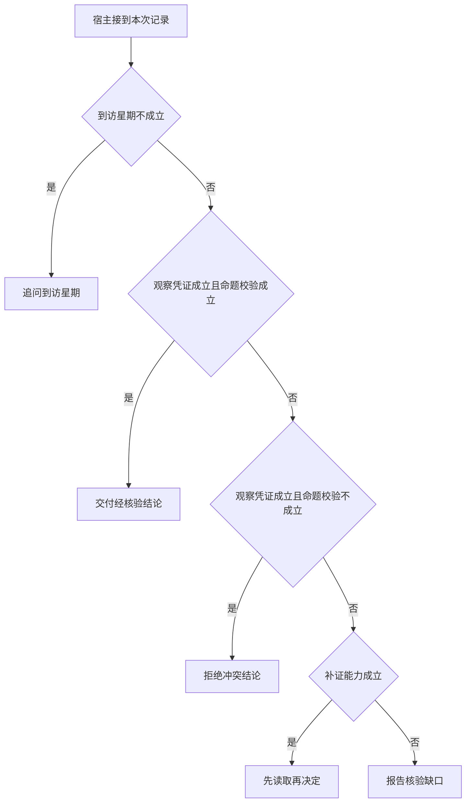

# 追问、成功和部分结束

三个请求最后都可能结束，但用户后续该做的事不同。
追问要求用户补充日期，资料未收录要求换来源，已查到却判断错则是运行时拒绝。
应把终止理由与工具计数分开。

本篇用一个封闭的教学决策器说明这一问题。输入是宿主收到的记录，不保证每个下游字段都已经获准使用。前置检查未成立时，下游即使带着缓存值，也不能拿来作业务断言。

## 先解决一个具体问题

**工具额度耗尽以后，有了充分证据还能答吗？**

可以把工具预算与整理答案的模型轮及时间分开。
没有余量再查资料不等于已有事实无效。若连整理轮也没有，则只能交付程序能校验和表达的部分。


先取一个能走到「报告核验缺口」的输入：星期明确、只有尚未执行的提议、候选与领域条件冲突、目前没有补证来源。
把这四个条件代回后文的图，前面各个拦截分支都未满足，最终才有“缺少可用的时段观察”这个判断。
还原这个现场时要分别问：哪些位来自可信状态，哪些只是在接口中出现、尚未获得解释资格的字段。

## 先沿一次决策走到底



从上到下取第一条成立的出口。只改一个开关时，只有它之前的检查都未截断，该变化才可能到达真实动作。

“到访星期”的两种输入分别是“星期明确”与“用户只说周末”。
两个普通周末日可能有不同终点，日期决定应比较哪段区间。

“观察凭证”的两种输入分别是“已有本轮业务回执”与“只有尚未执行的提议”。
模型的调用提议不能证明应用已取得新事实。

“命题校验”的两种输入分别是“候选通过业务断言”与“候选与领域条件冲突”。
有正确的引用编号仍可能推断出错误结论。

“补证能力”的两种输入分别是“有可区分解释的只读来源”与“目前没有补证来源”。
继续请求模型不能自行创造缺失的外部证据。

## 最少需要哪几项观察

### 追问到访星期

缺少改变结论的时间条件。
在本节的全部组合中，有 8 种产生「追问到访星期」，这只是逻辑空间的计数，不能当作实际用户请求的比例。

只取得用户只说周末，已经足以要求宿主「追问到访星期」。
保持这些已知项，其余开关自由变化，仍有 8 种补全，判断没有翻转。

若删掉关于到访星期的证据，另一份允许的现场是星期明确、只有尚未执行的提议、候选与领域条件冲突、目前没有补证来源，它会使宿主「报告核验缺口」。

### 交付经核验结论

有本次观察且断言成立。
在本节的全部组合中，有 2 种产生「交付经核验结论」，这只是逻辑空间的计数，不能当作实际用户请求的比例。

只取得星期明确、已有本轮业务回执、候选通过业务断言，已经足以要求宿主「交付经核验结论」。
保持这些已知项，其余开关自由变化，仍有 2 种补全，判断没有翻转。

若删掉关于到访星期的证据，另一份允许的现场是用户只说周末、已有本轮业务回执、候选通过业务断言、目前没有补证来源，它会使宿主「追问到访星期」。

若删掉关于观察凭证的证据，另一份允许的现场是星期明确、只有尚未执行的提议、候选通过业务断言、目前没有补证来源，它会使宿主「报告核验缺口」。

若删掉关于命题校验的证据，另一份允许的现场是星期明确、已有本轮业务回执、候选与领域条件冲突、目前没有补证来源，它会使宿主「拒绝冲突结论」。

### 拒绝冲突结论

已取得时段但候选判断错误。
在本节的全部组合中，有 2 种产生「拒绝冲突结论」，这只是逻辑空间的计数，不能当作实际用户请求的比例。

只取得星期明确、已有本轮业务回执、候选与领域条件冲突，已经足以要求宿主「拒绝冲突结论」。

若删掉关于到访星期的证据，另一份允许的现场是用户只说周末、已有本轮业务回执、候选与领域条件冲突、目前没有补证来源，它会使宿主「追问到访星期」。

若删掉关于观察凭证的证据，另一份允许的现场是星期明确、只有尚未执行的提议、候选与领域条件冲突、目前没有补证来源，它会使宿主「报告核验缺口」。

若删掉关于命题校验的证据，另一份允许的现场是星期明确、已有本轮业务回执、候选通过业务断言、目前没有补证来源，它会使宿主「交付经核验结论」。

### 先读取再决定

仍有能力取得所需事实。
在本节的全部组合中，有 2 种产生「先读取再决定」，这只是逻辑空间的计数，不能当作实际用户请求的比例。

只取得星期明确、只有尚未执行的提议、有可区分解释的只读来源，已经足以要求宿主「先读取再决定」。

若删掉关于到访星期的证据，另一份允许的现场是用户只说周末、只有尚未执行的提议、候选与领域条件冲突、有可区分解释的只读来源，它会使宿主「追问到访星期」。

若删掉关于观察凭证的证据，另一份允许的现场是星期明确、已有本轮业务回执、候选与领域条件冲突、有可区分解释的只读来源，它会使宿主「拒绝冲突结论」。

若删掉关于补证能力的证据，另一份允许的现场是星期明确、只有尚未执行的提议、候选与领域条件冲突、目前没有补证来源，它会使宿主「报告核验缺口」。

### 报告核验缺口

缺少可用的时段观察。
在本节的全部组合中，有 2 种产生「报告核验缺口」，这只是逻辑空间的计数，不能当作实际用户请求的比例。

只取得星期明确、只有尚未执行的提议、目前没有补证来源，已经足以要求宿主「报告核验缺口」。

若删掉关于到访星期的证据，另一份允许的现场是用户只说周末、只有尚未执行的提议、候选与领域条件冲突、目前没有补证来源，它会使宿主「追问到访星期」。

若删掉关于观察凭证的证据，另一份允许的现场是星期明确、已有本轮业务回执、候选与领域条件冲突、目前没有补证来源，它会使宿主「拒绝冲突结论」。

若删掉关于补证能力的证据，另一份允许的现场是星期明确、只有尚未执行的提议、候选与领域条件冲突、有可区分解释的只读来源，它会使宿主「先读取再决定」。

## 以同一份契约解释截然不同的现场

<details>
<summary>展开推演与对应反例</summary>

下列样本按最先命中的业务分支排列。四位编码只作本篇页内定位，顺序与开头的四项输入一致。可以先猜下一动作，再展开相邻样本。

### 能够触发“追问到访星期”的现场

**样本 0000**

业务侧交来用户只说周末、只有尚未执行的提议，执行侧还记录了候选与领域条件冲突、目前没有补证来源。
把样本压成最短证明，保留用户只说周末就能支持「追问到访星期」。

在这份记录上，分别翻转「到访星期」中的任一项，其他项完全不变时，下一动作都会改变。

保持其余观察不动，单独切换「观察凭证」、「命题校验」、「补证能力」仍得到「追问到访星期」，它们在这个现场不是决定性变量。

要从本例改走「报告核验缺口」，至少需要变动 1 项，一组最少改动是将用户只说周末换成星期明确。

要从本例改走「先读取再决定」，至少需要变动 2 项，一组最少改动是将用户只说周末、目前没有补证来源换成星期明确、有可区分解释的只读来源。

要从本例改走「拒绝冲突结论」，至少需要变动 2 项，一组最少改动是将用户只说周末、只有尚未执行的提议换成星期明确、已有本轮业务回执。

要从本例改走「交付经核验结论」，至少需要变动 3 项，一组最少改动是将用户只说周末、只有尚未执行的提议、候选与领域条件冲突换成星期明确、已有本轮业务回执、候选通过业务断言。

**样本 0001**

业务侧交来用户只说周末、只有尚未执行的提议，执行侧还记录了候选与领域条件冲突、有可区分解释的只读来源。


要从本例改走「先读取再决定」，至少需要变动 1 项，一组最少改动是将用户只说周末换成星期明确。

要从本例改走「报告核验缺口」，至少需要变动 2 项，一组最少改动是将用户只说周末、有可区分解释的只读来源换成星期明确、目前没有补证来源。


**样本 0010**

业务侧交来用户只说周末、只有尚未执行的提议，执行侧还记录了候选通过业务断言、目前没有补证来源。


要从本例改走「交付经核验结论」，至少需要变动 2 项，一组最少改动是将用户只说周末、只有尚未执行的提议换成星期明确、已有本轮业务回执。

要从本例改走「拒绝冲突结论」，至少需要变动 3 项，一组最少改动是将用户只说周末、只有尚未执行的提议、候选通过业务断言换成星期明确、已有本轮业务回执、候选与领域条件冲突。

**样本 0011**

业务侧交来用户只说周末、只有尚未执行的提议，执行侧还记录了候选通过业务断言、有可区分解释的只读来源。


**样本 0100**

业务侧交来用户只说周末、已有本轮业务回执，执行侧还记录了候选与领域条件冲突、目前没有补证来源。


要从本例改走「拒绝冲突结论」，至少需要变动 1 项，一组最少改动是将用户只说周末换成星期明确。

要从本例改走「报告核验缺口」，至少需要变动 2 项，一组最少改动是将用户只说周末、已有本轮业务回执换成星期明确、只有尚未执行的提议。

要从本例改走「交付经核验结论」，至少需要变动 2 项，一组最少改动是将用户只说周末、候选与领域条件冲突换成星期明确、候选通过业务断言。

要从本例改走「先读取再决定」，至少需要变动 3 项，一组最少改动是将用户只说周末、已有本轮业务回执、目前没有补证来源换成星期明确、只有尚未执行的提议、有可区分解释的只读来源。

**样本 0101**

业务侧交来用户只说周末、已有本轮业务回执，执行侧还记录了候选与领域条件冲突、有可区分解释的只读来源。


要从本例改走「先读取再决定」，至少需要变动 2 项，一组最少改动是将用户只说周末、已有本轮业务回执换成星期明确、只有尚未执行的提议。


要从本例改走「报告核验缺口」，至少需要变动 3 项，一组最少改动是将用户只说周末、已有本轮业务回执、有可区分解释的只读来源换成星期明确、只有尚未执行的提议、目前没有补证来源。

**样本 0110**

业务侧交来用户只说周末、已有本轮业务回执，执行侧还记录了候选通过业务断言、目前没有补证来源。


要从本例改走「交付经核验结论」，至少需要变动 1 项，一组最少改动是将用户只说周末换成星期明确。


要从本例改走「拒绝冲突结论」，至少需要变动 2 项，一组最少改动是将用户只说周末、候选通过业务断言换成星期明确、候选与领域条件冲突。


**样本 0111**

业务侧交来用户只说周末、已有本轮业务回执，执行侧还记录了候选通过业务断言、有可区分解释的只读来源。


### 能够触发“交付经核验结论”的现场

**样本 1110**

业务侧交来星期明确、已有本轮业务回执，执行侧还记录了候选通过业务断言、目前没有补证来源。
把样本压成最短证明，保留星期明确、已有本轮业务回执、候选通过业务断言就能支持「交付经核验结论」。

在这份记录上，分别翻转「到访星期」、「观察凭证」、「命题校验」中的任一项，其他项完全不变时，下一动作都会改变。

保持其余观察不动，单独切换「补证能力」仍得到「交付经核验结论」，它们在这个现场不是决定性变量。

本例没走更靠前的「追问到访星期」，因为星期明确与那个入口的必要条件不符。

要从本例改走「追问到访星期」，至少需要变动 1 项，一组最少改动是将星期明确换成用户只说周末。

要从本例改走「报告核验缺口」，至少需要变动 1 项，一组最少改动是将已有本轮业务回执换成只有尚未执行的提议。

要从本例改走「拒绝冲突结论」，至少需要变动 1 项，一组最少改动是将候选通过业务断言换成候选与领域条件冲突。

要从本例改走「先读取再决定」，至少需要变动 2 项，一组最少改动是将已有本轮业务回执、目前没有补证来源换成只有尚未执行的提议、有可区分解释的只读来源。

**样本 1111**

业务侧交来星期明确、已有本轮业务回执，执行侧还记录了候选通过业务断言、有可区分解释的只读来源。


要从本例改走「先读取再决定」，至少需要变动 1 项，一组最少改动是将已有本轮业务回执换成只有尚未执行的提议。


要从本例改走「报告核验缺口」，至少需要变动 2 项，一组最少改动是将已有本轮业务回执、有可区分解释的只读来源换成只有尚未执行的提议、目前没有补证来源。

### 能够触发“拒绝冲突结论”的现场

**样本 1100**

业务侧交来星期明确、已有本轮业务回执，执行侧还记录了候选与领域条件冲突、目前没有补证来源。
把样本压成最短证明，保留星期明确、已有本轮业务回执、候选与领域条件冲突就能支持「拒绝冲突结论」。


保持其余观察不动，单独切换「补证能力」仍得到「拒绝冲突结论」，它们在这个现场不是决定性变量。


本例没走更靠前的「交付经核验结论」，因为候选与领域条件冲突与那个入口的必要条件不符。


要从本例改走「交付经核验结论」，至少需要变动 1 项，一组最少改动是将候选与领域条件冲突换成候选通过业务断言。


**样本 1101**

业务侧交来星期明确、已有本轮业务回执，执行侧还记录了候选与领域条件冲突、有可区分解释的只读来源。


### 能够触发“先读取再决定”的现场

**样本 1001**

业务侧交来星期明确、只有尚未执行的提议，执行侧还记录了候选与领域条件冲突、有可区分解释的只读来源。
把样本压成最短证明，保留星期明确、只有尚未执行的提议、有可区分解释的只读来源就能支持「先读取再决定」。

在这份记录上，分别翻转「到访星期」、「观察凭证」、「补证能力」中的任一项，其他项完全不变时，下一动作都会改变。

保持其余观察不动，单独切换「命题校验」仍得到「先读取再决定」，它们在这个现场不是决定性变量。


本例没走更靠前的「交付经核验结论」，因为只有尚未执行的提议、候选与领域条件冲突与那个入口的必要条件不符。

本例没走更靠前的「拒绝冲突结论」，因为只有尚未执行的提议与那个入口的必要条件不符。


要从本例改走「报告核验缺口」，至少需要变动 1 项，一组最少改动是将有可区分解释的只读来源换成目前没有补证来源。

要从本例改走「拒绝冲突结论」，至少需要变动 1 项，一组最少改动是将只有尚未执行的提议换成已有本轮业务回执。

要从本例改走「交付经核验结论」，至少需要变动 2 项，一组最少改动是将只有尚未执行的提议、候选与领域条件冲突换成已有本轮业务回执、候选通过业务断言。

**样本 1011**

业务侧交来星期明确、只有尚未执行的提议，执行侧还记录了候选通过业务断言、有可区分解释的只读来源。


本例没走更靠前的「交付经核验结论」，因为只有尚未执行的提议与那个入口的必要条件不符。

本例没走更靠前的「拒绝冲突结论」，因为只有尚未执行的提议、候选通过业务断言与那个入口的必要条件不符。


要从本例改走「交付经核验结论」，至少需要变动 1 项，一组最少改动是将只有尚未执行的提议换成已有本轮业务回执。

要从本例改走「拒绝冲突结论」，至少需要变动 2 项，一组最少改动是将只有尚未执行的提议、候选通过业务断言换成已有本轮业务回执、候选与领域条件冲突。

### 能够触发“报告核验缺口”的现场

**样本 1000**

业务侧交来星期明确、只有尚未执行的提议，执行侧还记录了候选与领域条件冲突、目前没有补证来源。
把样本压成最短证明，保留星期明确、只有尚未执行的提议、目前没有补证来源就能支持「报告核验缺口」。


保持其余观察不动，单独切换「命题校验」仍得到「报告核验缺口」，它们在这个现场不是决定性变量。


本例没走更靠前的「先读取再决定」，因为目前没有补证来源与那个入口的必要条件不符。


要从本例改走「先读取再决定」，至少需要变动 1 项，一组最少改动是将目前没有补证来源换成有可区分解释的只读来源。


**样本 1010**

业务侧交来星期明确、只有尚未执行的提议，执行侧还记录了候选通过业务断言、目前没有补证来源。


</details>

## 当你只能看见一半记录

<details>
<summary>展开推演与对应反例</summary>

这次隐藏两个字段，保留另两个。对每个可见现场，检查四种合法补全是否同意。如仍有歧义，选择能使最坏剩余候选动作最少的字段继续查。并列时采用本篇字段顺序。

### 只保留到访星期与观察凭证

已知用户只说周末、只有尚未执行的提议时，四种补全的动作分布为追问到访星期（4 种）。

就“追问到访星期”这个动作而言，在用户只说周末、只有尚未执行的提议的前提下，另外两项观察不会推翻它。

已知用户只说周末、已有本轮业务回执时，四种补全的动作分布为追问到访星期（4 种）。

就“追问到访星期”这个动作而言，在用户只说周末、已有本轮业务回执的前提下，另外两项观察不会推翻它。

已知星期明确、只有尚未执行的提议时，四种补全的动作分布为先读取再决定（2 种）、报告核验缺口（2 种）。

在星期明确、只有尚未执行的提议这个现场补读「补证能力」，最坏还剩 1 种动作，计算时只衡量歧义，尚未扣读取代价。
若补来的观察为“目前没有补证来源”，范围缩成「报告核验缺口」。若为“有可区分解释的只读来源”，则保留「先读取再决定」。

区分不了的两条执行可以具体写成 1000 与 1001：它们共享已展示字段，却分别需要「报告核验缺口」和「先读取再决定」。

已知星期明确、已有本轮业务回执时，四种补全的动作分布为交付经核验结论（2 种）、拒绝冲突结论（2 种）。

在星期明确、已有本轮业务回执这个现场补读「命题校验」，最坏还剩 1 种动作，计算时只衡量歧义，尚未扣读取代价。
若补来的观察为“候选与领域条件冲突”，范围缩成「拒绝冲突结论」。若为“候选通过业务断言”，则保留「交付经核验结论」。

区分不了的两条执行可以具体写成 1100 与 1110：它们共享已展示字段，却分别需要「拒绝冲突结论」和「交付经核验结论」。

### 只保留到访星期与命题校验

已知用户只说周末、候选与领域条件冲突时，四种补全的动作分布为追问到访星期（4 种）。

就“追问到访星期”这个动作而言，在用户只说周末、候选与领域条件冲突的前提下，另外两项观察不会推翻它。

已知用户只说周末、候选通过业务断言时，四种补全的动作分布为追问到访星期（4 种）。

就“追问到访星期”这个动作而言，在用户只说周末、候选通过业务断言的前提下，另外两项观察不会推翻它。

已知星期明确、候选与领域条件冲突时，四种补全的动作分布为拒绝冲突结论（2 种）、先读取再决定（1 种）、报告核验缺口（1 种）。

在星期明确、候选与领域条件冲突这个现场补读「观察凭证」，最坏还剩 2 种动作，计算时只衡量歧义，尚未扣读取代价。
若补来的观察为“只有尚未执行的提议”，范围缩成「报告核验缺口」、「先读取再决定」。若为“已有本轮业务回执”，则保留「拒绝冲突结论」。


已知星期明确、候选通过业务断言时，四种补全的动作分布为交付经核验结论（2 种）、先读取再决定（1 种）、报告核验缺口（1 种）。

在星期明确、候选通过业务断言这个现场补读「观察凭证」，最坏还剩 2 种动作，计算时只衡量歧义，尚未扣读取代价。
若补来的观察为“只有尚未执行的提议”，范围缩成「报告核验缺口」、「先读取再决定」。若为“已有本轮业务回执”，则保留「交付经核验结论」。

区分不了的两条执行可以具体写成 1010 与 1011：它们共享已展示字段，却分别需要「报告核验缺口」和「先读取再决定」。

### 只保留观察凭证与命题校验

已知只有尚未执行的提议、候选与领域条件冲突时，四种补全的动作分布为追问到访星期（2 种）、先读取再决定（1 种）、报告核验缺口（1 种）。

在只有尚未执行的提议、候选与领域条件冲突这个现场补读「到访星期」，最坏还剩 2 种动作，计算时只衡量歧义，尚未扣读取代价。
若补来的观察为“用户只说周末”，范围缩成「追问到访星期」。若为“星期明确”，则保留「报告核验缺口」、「先读取再决定」。

区分不了的两条执行可以具体写成 0000 与 1000：它们共享已展示字段，却分别需要「追问到访星期」和「报告核验缺口」。

已知只有尚未执行的提议、候选通过业务断言时，四种补全的动作分布为追问到访星期（2 种）、先读取再决定（1 种）、报告核验缺口（1 种）。

在只有尚未执行的提议、候选通过业务断言这个现场补读「到访星期」，最坏还剩 2 种动作，计算时只衡量歧义，尚未扣读取代价。

区分不了的两条执行可以具体写成 0010 与 1010：它们共享已展示字段，却分别需要「追问到访星期」和「报告核验缺口」。

已知已有本轮业务回执、候选与领域条件冲突时，四种补全的动作分布为追问到访星期（2 种）、拒绝冲突结论（2 种）。

在已有本轮业务回执、候选与领域条件冲突这个现场补读「到访星期」，最坏还剩 1 种动作，计算时只衡量歧义，尚未扣读取代价。
若补来的观察为“用户只说周末”，范围缩成「追问到访星期」。若为“星期明确”，则保留「拒绝冲突结论」。

区分不了的两条执行可以具体写成 0100 与 1100：它们共享已展示字段，却分别需要「追问到访星期」和「拒绝冲突结论」。

已知已有本轮业务回执、候选通过业务断言时，四种补全的动作分布为追问到访星期（2 种）、交付经核验结论（2 种）。

在已有本轮业务回执、候选通过业务断言这个现场补读「到访星期」，最坏还剩 1 种动作，计算时只衡量歧义，尚未扣读取代价。
若补来的观察为“用户只说周末”，范围缩成「追问到访星期」。若为“星期明确”，则保留「交付经核验结论」。

区分不了的两条执行可以具体写成 0110 与 1110：它们共享已展示字段，却分别需要「追问到访星期」和「交付经核验结论」。

### 只保留到访星期与补证能力

已知用户只说周末、目前没有补证来源时，四种补全的动作分布为追问到访星期（4 种）。

就“追问到访星期”这个动作而言，在用户只说周末、目前没有补证来源的前提下，另外两项观察不会推翻它。

已知用户只说周末、有可区分解释的只读来源时，四种补全的动作分布为追问到访星期（4 种）。

就“追问到访星期”这个动作而言，在用户只说周末、有可区分解释的只读来源的前提下，另外两项观察不会推翻它。

已知星期明确、目前没有补证来源时，四种补全的动作分布为交付经核验结论（1 种）、拒绝冲突结论（1 种）、报告核验缺口（2 种）。

在星期明确、目前没有补证来源这个现场补读「观察凭证」，最坏还剩 2 种动作，计算时只衡量歧义，尚未扣读取代价。
若补来的观察为“只有尚未执行的提议”，范围缩成「报告核验缺口」。若为“已有本轮业务回执”，则保留「拒绝冲突结论」、「交付经核验结论」。

区分不了的两条执行可以具体写成 1000 与 1100：它们共享已展示字段，却分别需要「报告核验缺口」和「拒绝冲突结论」。

已知星期明确、有可区分解释的只读来源时，四种补全的动作分布为交付经核验结论（1 种）、拒绝冲突结论（1 种）、先读取再决定（2 种）。

在星期明确、有可区分解释的只读来源这个现场补读「观察凭证」，最坏还剩 2 种动作，计算时只衡量歧义，尚未扣读取代价。
若补来的观察为“只有尚未执行的提议”，范围缩成「先读取再决定」。若为“已有本轮业务回执”，则保留「拒绝冲突结论」、「交付经核验结论」。

区分不了的两条执行可以具体写成 1001 与 1101：它们共享已展示字段，却分别需要「先读取再决定」和「拒绝冲突结论」。

### 只保留观察凭证与补证能力

已知只有尚未执行的提议、目前没有补证来源时，四种补全的动作分布为追问到访星期（2 种）、报告核验缺口（2 种）。

在只有尚未执行的提议、目前没有补证来源这个现场补读「到访星期」，最坏还剩 1 种动作，计算时只衡量歧义，尚未扣读取代价。
若补来的观察为“用户只说周末”，范围缩成「追问到访星期」。若为“星期明确”，则保留「报告核验缺口」。


已知只有尚未执行的提议、有可区分解释的只读来源时，四种补全的动作分布为追问到访星期（2 种）、先读取再决定（2 种）。

在只有尚未执行的提议、有可区分解释的只读来源这个现场补读「到访星期」，最坏还剩 1 种动作，计算时只衡量歧义，尚未扣读取代价。
若补来的观察为“用户只说周末”，范围缩成「追问到访星期」。若为“星期明确”，则保留「先读取再决定」。

区分不了的两条执行可以具体写成 0001 与 1001：它们共享已展示字段，却分别需要「追问到访星期」和「先读取再决定」。

已知已有本轮业务回执、目前没有补证来源时，四种补全的动作分布为追问到访星期（2 种）、交付经核验结论（1 种）、拒绝冲突结论（1 种）。

在已有本轮业务回执、目前没有补证来源这个现场补读「到访星期」，最坏还剩 2 种动作，计算时只衡量歧义，尚未扣读取代价。
若补来的观察为“用户只说周末”，范围缩成「追问到访星期」。若为“星期明确”，则保留「拒绝冲突结论」、「交付经核验结论」。


已知已有本轮业务回执、有可区分解释的只读来源时，四种补全的动作分布为追问到访星期（2 种）、交付经核验结论（1 种）、拒绝冲突结论（1 种）。

在已有本轮业务回执、有可区分解释的只读来源这个现场补读「到访星期」，最坏还剩 2 种动作，计算时只衡量歧义，尚未扣读取代价。

区分不了的两条执行可以具体写成 0101 与 1101：它们共享已展示字段，却分别需要「追问到访星期」和「拒绝冲突结论」。

### 只保留命题校验与补证能力

已知候选与领域条件冲突、目前没有补证来源时，四种补全的动作分布为追问到访星期（2 种）、拒绝冲突结论（1 种）、报告核验缺口（1 种）。

在候选与领域条件冲突、目前没有补证来源这个现场补读「到访星期」，最坏还剩 2 种动作，计算时只衡量歧义，尚未扣读取代价。
若补来的观察为“用户只说周末”，范围缩成「追问到访星期」。若为“星期明确”，则保留「报告核验缺口」、「拒绝冲突结论」。


已知候选与领域条件冲突、有可区分解释的只读来源时，四种补全的动作分布为追问到访星期（2 种）、拒绝冲突结论（1 种）、先读取再决定（1 种）。

在候选与领域条件冲突、有可区分解释的只读来源这个现场补读「到访星期」，最坏还剩 2 种动作，计算时只衡量歧义，尚未扣读取代价。
若补来的观察为“用户只说周末”，范围缩成「追问到访星期」。若为“星期明确”，则保留「先读取再决定」、「拒绝冲突结论」。


已知候选通过业务断言、目前没有补证来源时，四种补全的动作分布为追问到访星期（2 种）、交付经核验结论（1 种）、报告核验缺口（1 种）。

在候选通过业务断言、目前没有补证来源这个现场补读「到访星期」，最坏还剩 2 种动作，计算时只衡量歧义，尚未扣读取代价。
若补来的观察为“用户只说周末”，范围缩成「追问到访星期」。若为“星期明确”，则保留「报告核验缺口」、「交付经核验结论」。


已知候选通过业务断言、有可区分解释的只读来源时，四种补全的动作分布为追问到访星期（2 种）、交付经核验结论（1 种）、先读取再决定（1 种）。

在候选通过业务断言、有可区分解释的只读来源这个现场补读「到访星期」，最坏还剩 2 种动作，计算时只衡量歧义，尚未扣读取代价。
若补来的观察为“用户只说周末”，范围缩成「追问到访星期」。若为“星期明确”，则保留「先读取再决定」、「交付经核验结论」。

区分不了的两条执行可以具体写成 0011 与 1011：它们共享已展示字段，却分别需要「追问到访星期」和「先读取再决定」。

</details>

## 单因素干预与边界测试

<details>
<summary>展开推演与对应反例</summary>

### 只改变到访星期

固定另外三个条件得到八对现场，从“用户只说周末”转为“星期明确”时，8 对翻转动作，另外 0 对保持不变。

有 2 对现场沿「追问到访星期」变到「报告核验缺口」，可复现的一组受控背景为只有尚未执行的提议、候选与领域条件冲突、目前没有补证来源。

有 2 对现场沿「追问到访星期」变到「先读取再决定」，可复现的一组受控背景为只有尚未执行的提议、候选与领域条件冲突、有可区分解释的只读来源。

有 2 对现场沿「追问到访星期」变到「拒绝冲突结论」，可复现的一组受控背景为已有本轮业务回执、候选与领域条件冲突、目前没有补证来源。

有 2 对现场沿「追问到访星期」变到「交付经核验结论」，可复现的一组受控背景为已有本轮业务回执、候选通过业务断言、目前没有补证来源。

### 只改变观察凭证

固定另外三个条件得到八对现场，从“只有尚未执行的提议”转为“已有本轮业务回执”时，4 对翻转动作，另外 4 对保持不变。

令用户只说周末、候选与领域条件冲突、目前没有补证来源，观察凭证的两个取值均得到「追问到访星期」。在八对中，共有 4 对表现为这一种稳定出口。

有 1 对现场沿「报告核验缺口」变到「拒绝冲突结论」，可复现的一组受控背景为星期明确、候选与领域条件冲突、目前没有补证来源。

有 1 对现场沿「先读取再决定」变到「拒绝冲突结论」，可复现的一组受控背景为星期明确、候选与领域条件冲突、有可区分解释的只读来源。

有 1 对现场沿「报告核验缺口」变到「交付经核验结论」，可复现的一组受控背景为星期明确、候选通过业务断言、目前没有补证来源。

有 1 对现场沿「先读取再决定」变到「交付经核验结论」，可复现的一组受控背景为星期明确、候选通过业务断言、有可区分解释的只读来源。

### 只改变命题校验

固定另外三个条件得到八对现场，从“候选与领域条件冲突”转为“候选通过业务断言”时，2 对翻转动作，另外 6 对保持不变。

令用户只说周末、只有尚未执行的提议、目前没有补证来源，命题校验的两个取值均得到「追问到访星期」。在八对中，共有 4 对表现为这一种稳定出口。

令星期明确、只有尚未执行的提议、目前没有补证来源，命题校验的两个取值均得到「报告核验缺口」。在八对中，共有 1 对表现为这一种稳定出口。

令星期明确、只有尚未执行的提议、有可区分解释的只读来源，命题校验的两个取值均得到「先读取再决定」。在八对中，共有 1 对表现为这一种稳定出口。

有 2 对现场沿「拒绝冲突结论」变到「交付经核验结论」，可复现的一组受控背景为星期明确、已有本轮业务回执、目前没有补证来源。

### 只改变补证能力

固定另外三个条件得到八对现场，从“目前没有补证来源”转为“有可区分解释的只读来源”时，2 对翻转动作，另外 6 对保持不变。

令用户只说周末、只有尚未执行的提议、候选与领域条件冲突，补证能力的两个取值均得到「追问到访星期」。在八对中，共有 4 对表现为这一种稳定出口。

有 2 对现场沿「报告核验缺口」变到「先读取再决定」，可复现的一组受控背景为星期明确、只有尚未执行的提议、候选与领域条件冲突。

令星期明确、已有本轮业务回执、候选与领域条件冲突，补证能力的两个取值均得到「拒绝冲突结论」。在八对中，共有 1 对表现为这一种稳定出口。

令星期明确、已有本轮业务回执、候选通过业务断言，补证能力的两个取值均得到「交付经核验结论」。在八对中，共有 1 对表现为这一种稳定出口。

</details>

## 哪些回归样本真能抓住实现错误

<details>
<summary>展开推演与对应反例</summary>

如果删除“追问到访星期”这个分支，在本篇 16 种输入里有 8 种会改走另一出口。

反例 0000 的完整记录为用户只说周末、只有尚未执行的提议、候选与领域条件冲突、目前没有补证来源。正确结果是「追问到访星期」，这个改坏的实现却给出「报告核验缺口」。

如果删除“交付经核验结论”这个分支，在本篇 16 种输入里有 2 种会改走另一出口。

反例 1110 的完整记录为星期明确、已有本轮业务回执、候选通过业务断言、目前没有补证来源。正确结果是「交付经核验结论」，这个改坏的实现却给出「报告核验缺口」。

如果删除“拒绝冲突结论”这个分支，在本篇 16 种输入里有 2 种会改走另一出口。

反例 1100 的完整记录为星期明确、已有本轮业务回执、候选与领域条件冲突、目前没有补证来源。正确结果是「拒绝冲突结论」，这个改坏的实现却给出「报告核验缺口」。

如果删除“先读取再决定”这个分支，在本篇 16 种输入里有 2 种会改走另一出口。

反例 1001 的完整记录为星期明确、只有尚未执行的提议、候选与领域条件冲突、有可区分解释的只读来源。正确结果是「先读取再决定」，这个改坏的实现却给出「报告核验缺口」。

如果交换“追问到访星期”和“交付经核验结论”的判断次序，在本篇 16 种输入里有 2 种会改走另一出口。

反例 0110 的完整记录为用户只说周末、已有本轮业务回执、候选通过业务断言、目前没有补证来源。正确结果是「追问到访星期」，这个改坏的实现却给出「交付经核验结论」。

如果交换“交付经核验结论”和“拒绝冲突结论”的判断次序，在本篇 16 种输入里有 0 种会改走另一出口。

对于“交换“交付经核验结论”和“拒绝冲突结论”的判断次序”这项修改，在声明输入域内没有区分它的样本，不能宣称测试捕捉到了故障。

如果交换“拒绝冲突结论”和“先读取再决定”的判断次序，在本篇 16 种输入里有 1 种会改走另一出口。

反例 1101 的完整记录为星期明确、已有本轮业务回执、候选与领域条件冲突、有可区分解释的只读来源。正确结果是「拒绝冲突结论」，这个改坏的实现却给出「先读取再决定」。

补入样本 0110（用户只说周末、已有本轮业务回执、候选通过业务断言、目前没有补证来源）能新增检出「删除“追问到访星期”这个分支」、「交换“追问到访星期”和“交付经核验结论”的判断次序」。

补入样本 1101（星期明确、已有本轮业务回执、候选与领域条件冲突、有可区分解释的只读来源）能新增检出「删除“拒绝冲突结论”这个分支」、「交换“拒绝冲突结论”和“先读取再决定”的判断次序」。

补入样本 1001（星期明确、只有尚未执行的提议、候选与领域条件冲突、有可区分解释的只读来源）能新增检出「删除“先读取再决定”这个分支」。

补入样本 1110（星期明确、已有本轮业务回执、候选通过业务断言、目前没有补证来源）能新增检出「删除“交付经核验结论”这个分支」。

这里每次选覆盖尚未捕获缺陷最多的样本，并不保证用例数全局最小。它给出的反例能作为 Java 单测输入。真实模型是否会自主产生这些提议，仍须单独评测。

</details>

## 把状态覆盖换成有抽样偏差的评测批次

<details>
<summary>展开推演与对应反例</summary>

前面的十六种记录各有一票。现在只改样本构成：对一个给定字段，把成立侧的每种记录各取三份、另一侧各取一份。这是人为配比的 32 份回放，不是线上频率估计。
将偏向成立与偏向不成立的两次批次对照，可以隔离分母变化。底层宿主和所有答案保持相同，比例仍可能移动。

### 改变“到访星期”的样本配比

只看「追问到访星期」，在星期明确的八个不同输入中有 0 个命中，在用户只说周末的另八个输入中有 8 个命中。
把「到访星期」成立侧按三倍取样，「追问到访星期」占 8/32，反过来向未成立侧倾斜后占 24/32。
这次重加权使「追问到访星期」的占比相差 50 个百分点。若按两种不同的“到访星期”分布跑新旧版，不能把这项差异全部归功于实现。

只看「交付经核验结论」，在星期明确的八个不同输入中有 2 个命中，在用户只说周末的另八个输入中有 0 个命中。
把「到访星期」成立侧按三倍取样，「交付经核验结论」占 6/32，反过来向未成立侧倾斜后占 2/32。
这次重加权使「交付经核验结论」的占比相差 12.5 个百分点。若按两种不同的“到访星期”分布跑新旧版，不能把这项差异全部归功于实现。

只看「拒绝冲突结论」，在星期明确的八个不同输入中有 2 个命中，在用户只说周末的另八个输入中有 0 个命中。
把「到访星期」成立侧按三倍取样，「拒绝冲突结论」占 6/32，反过来向未成立侧倾斜后占 2/32。
这次重加权使「拒绝冲突结论」的占比相差 12.5 个百分点。若按两种不同的“到访星期”分布跑新旧版，不能把这项差异全部归功于实现。

只看「先读取再决定」，在星期明确的八个不同输入中有 2 个命中，在用户只说周末的另八个输入中有 0 个命中。
把「到访星期」成立侧按三倍取样，「先读取再决定」占 6/32，反过来向未成立侧倾斜后占 2/32。
这次重加权使「先读取再决定」的占比相差 12.5 个百分点。若按两种不同的“到访星期”分布跑新旧版，不能把这项差异全部归功于实现。

只看「报告核验缺口」，在星期明确的八个不同输入中有 2 个命中，在用户只说周末的另八个输入中有 0 个命中。
把「到访星期」成立侧按三倍取样，「报告核验缺口」占 6/32，反过来向未成立侧倾斜后占 2/32。
这次重加权使「报告核验缺口」的占比相差 12.5 个百分点。若按两种不同的“到访星期”分布跑新旧版，不能把这项差异全部归功于实现。

### 改变“观察凭证”的样本配比

只看「追问到访星期」，在已有本轮业务回执的八个不同输入中有 4 个命中，在只有尚未执行的提议的另八个输入中有 4 个命中。
把「观察凭证」成立侧按三倍取样，「追问到访星期」占 16/32，反过来向未成立侧倾斜后占 16/32。
两批「追问到访星期」的边际比例相同，是因为这个出口在“观察凭证”的两侧计数相等，这不能单独证明每一对现场都不受它影响。

只看「交付经核验结论」，在已有本轮业务回执的八个不同输入中有 2 个命中，在只有尚未执行的提议的另八个输入中有 0 个命中。
把「观察凭证」成立侧按三倍取样，「交付经核验结论」占 6/32，反过来向未成立侧倾斜后占 2/32。
这次重加权使「交付经核验结论」的占比相差 12.5 个百分点。若按两种不同的“观察凭证”分布跑新旧版，不能把这项差异全部归功于实现。

只看「拒绝冲突结论」，在已有本轮业务回执的八个不同输入中有 2 个命中，在只有尚未执行的提议的另八个输入中有 0 个命中。
把「观察凭证」成立侧按三倍取样，「拒绝冲突结论」占 6/32，反过来向未成立侧倾斜后占 2/32。
这次重加权使「拒绝冲突结论」的占比相差 12.5 个百分点。若按两种不同的“观察凭证”分布跑新旧版，不能把这项差异全部归功于实现。

只看「先读取再决定」，在已有本轮业务回执的八个不同输入中有 0 个命中，在只有尚未执行的提议的另八个输入中有 2 个命中。
把「观察凭证」成立侧按三倍取样，「先读取再决定」占 2/32，反过来向未成立侧倾斜后占 6/32。
这次重加权使「先读取再决定」的占比相差 12.5 个百分点。若按两种不同的“观察凭证”分布跑新旧版，不能把这项差异全部归功于实现。

只看「报告核验缺口」，在已有本轮业务回执的八个不同输入中有 0 个命中，在只有尚未执行的提议的另八个输入中有 2 个命中。
把「观察凭证」成立侧按三倍取样，「报告核验缺口」占 2/32，反过来向未成立侧倾斜后占 6/32。
这次重加权使「报告核验缺口」的占比相差 12.5 个百分点。若按两种不同的“观察凭证”分布跑新旧版，不能把这项差异全部归功于实现。

### 改变“命题校验”的样本配比

只看「追问到访星期」，在候选通过业务断言的八个不同输入中有 4 个命中，在候选与领域条件冲突的另八个输入中有 4 个命中。
把「命题校验」成立侧按三倍取样，「追问到访星期」占 16/32，反过来向未成立侧倾斜后占 16/32。
两批「追问到访星期」的边际比例相同，是因为这个出口在“命题校验”的两侧计数相等，这不能单独证明每一对现场都不受它影响。

只看「交付经核验结论」，在候选通过业务断言的八个不同输入中有 2 个命中，在候选与领域条件冲突的另八个输入中有 0 个命中。
把「命题校验」成立侧按三倍取样，「交付经核验结论」占 6/32，反过来向未成立侧倾斜后占 2/32。
这次重加权使「交付经核验结论」的占比相差 12.5 个百分点。若按两种不同的“命题校验”分布跑新旧版，不能把这项差异全部归功于实现。

只看「拒绝冲突结论」，在候选通过业务断言的八个不同输入中有 0 个命中，在候选与领域条件冲突的另八个输入中有 2 个命中。
把「命题校验」成立侧按三倍取样，「拒绝冲突结论」占 2/32，反过来向未成立侧倾斜后占 6/32。
这次重加权使「拒绝冲突结论」的占比相差 12.5 个百分点。若按两种不同的“命题校验”分布跑新旧版，不能把这项差异全部归功于实现。

只看「先读取再决定」，在候选通过业务断言的八个不同输入中有 1 个命中，在候选与领域条件冲突的另八个输入中有 1 个命中。
把「命题校验」成立侧按三倍取样，「先读取再决定」占 4/32，反过来向未成立侧倾斜后占 4/32。
两批「先读取再决定」的边际比例相同，是因为这个出口在“命题校验”的两侧计数相等，这不能单独证明每一对现场都不受它影响。

只看「报告核验缺口」，在候选通过业务断言的八个不同输入中有 1 个命中，在候选与领域条件冲突的另八个输入中有 1 个命中。
把「命题校验」成立侧按三倍取样，「报告核验缺口」占 4/32，反过来向未成立侧倾斜后占 4/32。
两批「报告核验缺口」的边际比例相同，是因为这个出口在“命题校验”的两侧计数相等，这不能单独证明每一对现场都不受它影响。

### 改变“补证能力”的样本配比

只看「追问到访星期」，在有可区分解释的只读来源的八个不同输入中有 4 个命中，在目前没有补证来源的另八个输入中有 4 个命中。
把「补证能力」成立侧按三倍取样，「追问到访星期」占 16/32，反过来向未成立侧倾斜后占 16/32。
两批「追问到访星期」的边际比例相同，是因为这个出口在“补证能力”的两侧计数相等，这不能单独证明每一对现场都不受它影响。

只看「交付经核验结论」，在有可区分解释的只读来源的八个不同输入中有 1 个命中，在目前没有补证来源的另八个输入中有 1 个命中。
把「补证能力」成立侧按三倍取样，「交付经核验结论」占 4/32，反过来向未成立侧倾斜后占 4/32。
两批「交付经核验结论」的边际比例相同，是因为这个出口在“补证能力”的两侧计数相等，这不能单独证明每一对现场都不受它影响。

只看「拒绝冲突结论」，在有可区分解释的只读来源的八个不同输入中有 1 个命中，在目前没有补证来源的另八个输入中有 1 个命中。
把「补证能力」成立侧按三倍取样，「拒绝冲突结论」占 4/32，反过来向未成立侧倾斜后占 4/32。
两批「拒绝冲突结论」的边际比例相同，是因为这个出口在“补证能力”的两侧计数相等，这不能单独证明每一对现场都不受它影响。

只看「先读取再决定」，在有可区分解释的只读来源的八个不同输入中有 2 个命中，在目前没有补证来源的另八个输入中有 0 个命中。
把「补证能力」成立侧按三倍取样，「先读取再决定」占 6/32，反过来向未成立侧倾斜后占 2/32。
这次重加权使「先读取再决定」的占比相差 12.5 个百分点。若按两种不同的“补证能力”分布跑新旧版，不能把这项差异全部归功于实现。

只看「报告核验缺口」，在有可区分解释的只读来源的八个不同输入中有 0 个命中，在目前没有补证来源的另八个输入中有 2 个命中。
把「补证能力」成立侧按三倍取样，「报告核验缺口」占 2/32，反过来向未成立侧倾斜后占 6/32。
这次重加权使「报告核验缺口」的占比相差 12.5 个百分点。若按两种不同的“补证能力”分布跑新旧版，不能把这项差异全部归功于实现。

</details>

## 只看终态，能逆推出多少原始事实

<details>
<summary>展开推演与对应反例</summary>

### 只保留“追问到访星期”这条结果时

在本节契约与完整输入域内，仅知「追问到访星期」就能倒推出用户只说周末，这一推断依赖版本未变且日志中的终态可信。

「追问到访星期」不能证明观察凭证取哪一侧：0000 和 0100 有相同终态，却分别记为“只有尚未执行的提议”和“已有本轮业务回执”。

「追问到访星期」不能证明命题校验取哪一侧：0000 和 0010 有相同终态，却分别记为“候选与领域条件冲突”和“候选通过业务断言”。

「追问到访星期」不能证明补证能力取哪一侧：0000 和 0001 有相同终态，却分别记为“目前没有补证来源”和“有可区分解释的只读来源”。

反查「追问到访星期」的诊断日志，优先保留能区分样本 0000 与 1000 的「到访星期」，否则很容易把邻近的「报告核验缺口」看成同一种故障。

### 只保留“交付经核验结论”这条结果时

在本节契约与完整输入域内，仅知「交付经核验结论」就能倒推出星期明确，这一推断依赖版本未变且日志中的终态可信。

在本节契约与完整输入域内，仅知「交付经核验结论」就能倒推出已有本轮业务回执，这一推断依赖版本未变且日志中的终态可信。

在本节契约与完整输入域内，仅知「交付经核验结论」就能倒推出候选通过业务断言，这一推断依赖版本未变且日志中的终态可信。

「交付经核验结论」不能证明补证能力取哪一侧：1110 和 1111 有相同终态，却分别记为“目前没有补证来源”和“有可区分解释的只读来源”。

反查「交付经核验结论」的诊断日志，优先保留能区分样本 1110 与 0110 的「到访星期」，否则很容易把邻近的「追问到访星期」看成同一种故障。

### 只保留“拒绝冲突结论”这条结果时

在本节契约与完整输入域内，仅知「拒绝冲突结论」就能倒推出星期明确，这一推断依赖版本未变且日志中的终态可信。

在本节契约与完整输入域内，仅知「拒绝冲突结论」就能倒推出已有本轮业务回执，这一推断依赖版本未变且日志中的终态可信。

在本节契约与完整输入域内，仅知「拒绝冲突结论」就能倒推出候选与领域条件冲突，这一推断依赖版本未变且日志中的终态可信。

「拒绝冲突结论」不能证明补证能力取哪一侧：1100 和 1101 有相同终态，却分别记为“目前没有补证来源”和“有可区分解释的只读来源”。

反查「拒绝冲突结论」的诊断日志，优先保留能区分样本 1100 与 0100 的「到访星期」，否则很容易把邻近的「追问到访星期」看成同一种故障。

### 只保留“先读取再决定”这条结果时

在本节契约与完整输入域内，仅知「先读取再决定」就能倒推出星期明确，这一推断依赖版本未变且日志中的终态可信。

在本节契约与完整输入域内，仅知「先读取再决定」就能倒推出只有尚未执行的提议，这一推断依赖版本未变且日志中的终态可信。

「先读取再决定」不能证明命题校验取哪一侧：1001 和 1011 有相同终态，却分别记为“候选与领域条件冲突”和“候选通过业务断言”。

在本节契约与完整输入域内，仅知「先读取再决定」就能倒推出有可区分解释的只读来源，这一推断依赖版本未变且日志中的终态可信。

反查「先读取再决定」的诊断日志，优先保留能区分样本 1001 与 0001 的「到访星期」，否则很容易把邻近的「追问到访星期」看成同一种故障。

### 只保留“报告核验缺口”这条结果时

在本节契约与完整输入域内，仅知「报告核验缺口」就能倒推出星期明确，这一推断依赖版本未变且日志中的终态可信。

在本节契约与完整输入域内，仅知「报告核验缺口」就能倒推出只有尚未执行的提议，这一推断依赖版本未变且日志中的终态可信。

「报告核验缺口」不能证明命题校验取哪一侧：1000 和 1010 有相同终态，却分别记为“候选与领域条件冲突”和“候选通过业务断言”。

在本节契约与完整输入域内，仅知「报告核验缺口」就能倒推出目前没有补证来源，这一推断依赖版本未变且日志中的终态可信。

反查「报告核验缺口」的诊断日志，优先保留能区分样本 1000 与 0000 的「到访星期」，否则很容易把邻近的「追问到访星期」看成同一种故障。

</details>

## 面试复述与复算

面试题可以从“工具额度耗尽以后，有了充分证据还能答吗？”起步。先给出本篇的触发条件和一条真实执行端可检查的证据，再用一个相邻反例限定结论的适用范围。

在仓库根目录执行下列命令可以重算本篇的一个输入。四位数字依次选择正文列出的四项条件，0 表示未成立或低档，1 表示成立或高档。
```powershell
node examples/reading-cases/replay.mjs 1 7 0101
```

[本周主文](../theory.md) · [配套实验](../lab.md)
