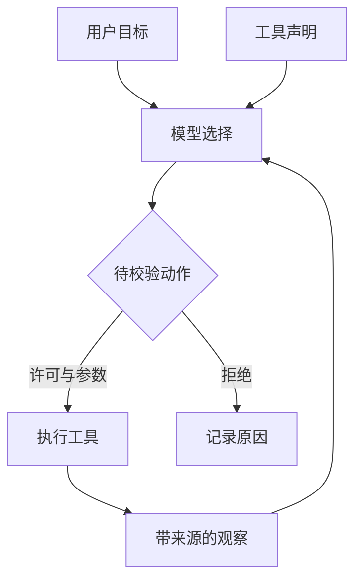
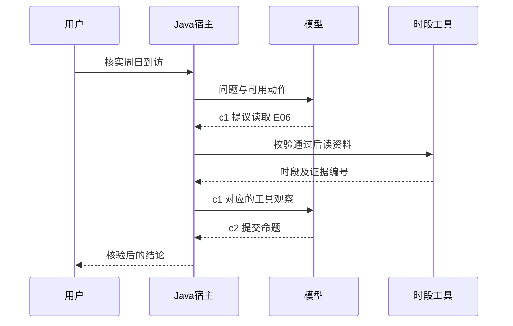
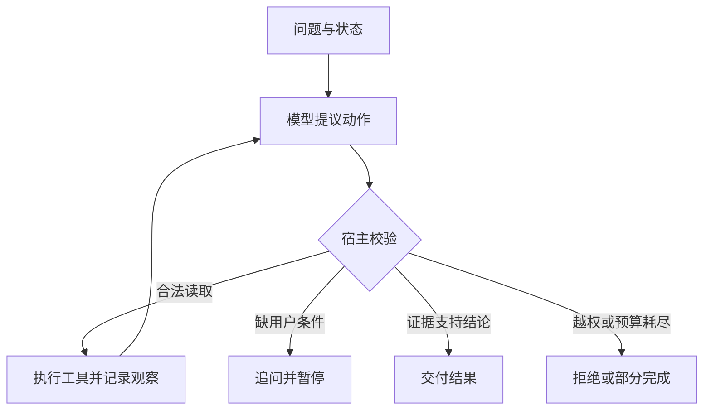
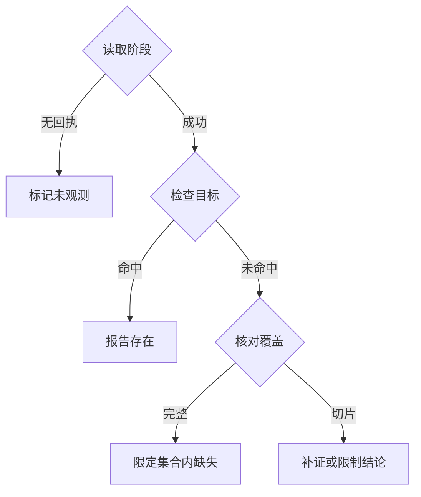

# 第 1 章　从一次模型推理到一个能行动的 Agent

本周读法：先连续阅读机制正文，再按需要进入下面七篇。每篇开头可以直接读案例与流程图，展开部分专门用于手算边界、追问或复算不同输入。场馆资料沿用公开快照，诊断和预审的故障输入为教学模拟。

- [一次回答怎样取得事实依据](readings/01.md)
- [把异步观察放回正确的一轮](readings/02.md)
- [批量提议能省几次模型往返](readings/03.md)（定量推演）
- [一次 Java 动作为何必须经宿主裁决](readings/04.md)
- [有限日志能支持哪一种否定](readings/05.md)
- [开放区间够不够完成一次到访](readings/06.md)（定量推演）
- [追问、成功和部分结束](readings/07.md)

一家商户的申请只上传了营业执照。运营问：“资料齐了吗？缺什么就帮我起草一份补件说明。”设想你评审两个 Java 服务。第一个把问题发给模型，回复“缺结算证明，已起草”。第二个先读取申请，核对规则，获准后在草稿表中写入一行，再返回草稿编号。两段文字可能完全一样，但只有第二种设计让你能在数据库里找到这份草稿。现在再给第一个服务加上读取、写入和校验，这就是本章要推导的应用结构。

## 模型怎样从一段话选出一个动作

语言模型接收的是一串 token。一次自回归生成可以理解为反复解同一类问题：给定到目前为止的输入和已生成前缀，下一个 token 的条件分布是什么？选出一个，把它追加到前缀，再算下一项。对一串输出，其生成概率可按链式法则拆成这些条件概率的乘积。这个公式解释了一个看似矛盾的现象：模型能流畅地生成完全合规的函数调用，同时把申请号填错。前一个词让下一个词很自然，和数据库里这个对象确实属于当前用户，是两套不同的判定。

**策略输出与宿主执行之间有哪些可验证的边界**




现代语言模型可以用注意力在生成当前位置的表示时组合先前位置的信息。用户说“缺什么就起草”，工具说明包含“起草补件通知”，这些输入都可能影响动作名的分布。训练阶段学到参数；本次请求把用户目标、工具说明和观察作为输入，做的是推理。把新的时刻表作为消息送入下一轮，更新了输入条件；重新训练参数是另一项操作。由此也能解释为什么只在本地新建一张表，模型下次回答未必知道表里的变化。[Transformer 原论文](https://arxiv.org/abs/1706.03762)

把一次选择简化成三个动作。假设模型给“查材料、起草、结束”的概率分别为 0.60、0.30、0.10，这组数字只为演算。取概率最大的动作会选择“查材料”。收到“缺结算证明”的观察后，下一次选择的条件改变，“起草”可能成为首选。如果用户只授权检查材料，哪怕“起草”的概率升到 0.99，宿主仍应拒绝执行。**概率用于描述模型倾向；业务权限要能在模型选错时依然成立。** 降低采样随机性可以让选择更稳定，却也可能让同一种错误稳定重现。

在课堂里把它写成两个函数会更清楚。第一个是策略：输入当前可见历史，输出行动提议。第二个是环境的状态转移：给定当前状态和允许的行动，执行业务函数并产生观察。前者可以换模型、提示或脚本，后者可以是内存函数、数据库事务或 RPC。若把它们写成一个“让模型查完并保证成功”的字符串提示，就丢掉了执行证据和可测试的边界。

## 是谁决定下一步

| 程序 | 第一次取到资料后会发生什么 | 谁负责决定 |
| --- | --- | --- |
| 普通生成 | 模型根据提示直接作答 | 一次模型调用结束 |
| 固定工作流 | 按给定星期读表、检查区间、渲染结论 | Java 代码预先指定顺序 |
| 带工具的 Agent | 模型看到观察后，可以继续查、请求澄清或提交答复 | 模型提出动作，宿主程序逐个裁决并执行 |

当地点、日期、规则都已给出，写固定工作流通常很自然。让 Agent 参与的价值出现在不同用户说法需要走不同路径时。“周末”可能缺少星期，“有没有实时余座”超出了时间表范围，“周日晚上还能去吗”则可以直接核查。工具集合可以完全相同，决定下一步的机制不同，行为、成本与可测试性就不同。

## 还原一轮工具调用里的四种身份

沿用课程的真实快照，把问题缩小到“普通十一月周日 19:00 花园街学生自修室按表开放吗？”选定对象 E06，先不讨论地名检索。用户这句话给了目标、星期和时刻，尚未给出官方时段。此时应用发送的消息带规则和问题，同时声明只读工具名、用途和参数。工具的实现仍在本地，用哪一种底层存储对模型是透明的。

**两次推理怎样跨过一次真实工具执行**




第一轮模型输出的核心是一个**工具提议**。用简化的线上消息表示，外层消息说明谁提出调用，内层才是动作名和参数。

```json
{"role":"assistant","tool_calls":[{"id":"c1","type":"function","function":{"name":"lookup_hours","arguments":"{\"place\":\"E06\"}"}}]}
```

宿主先解码参数，再检查对象是否在允许范围、动作是否适合当前状态、额度是否足够。它随后读取公开快照，将执行结果作为工具消息关联回 c1。此处的周日时段为 09:00–17:00。有了这个观察，应用才发第二次模型请求。把同一条事实放进没有标识的普通用户消息里，文本可能仍然读得懂，但你已经失去“哪次调用返回了它”的机器可检验关系；有两次并发读取时尤其容易串线。

| 相同对话中的标识 | 在哪里产生 | 回答的工程问题 |
| --- | --- | --- |
| 用户会话或运行 ID | 应用入口 | 这条记录属于哪位用户的哪一次执行？ |
| c1 | 本轮模型工具消息 | 这一份观察对应哪一个调用提议？ |
| E06 | 地点名录 | 工具读取的是哪个业务对象？ |
| hours:E06 | 证据快照 | 当前结论引用哪一份资料？ |

试着把后三项合并成地点 ID。两次请求同属 E06、分查时间和设施时，返回结果都能对上地点，却无法判断哪条观察可以完成哪个待办动作。反过来，用 c1 当证据 ID，只能证明这次调用发生过，仍不知道结论能否由这份资料推出。分开建模使你可以单独处理消息重放、业务对象选错和引用错位。

## Java 工程里的最小控制循环

```text
state = 用户目标、消息、已见证据、剩余预算
有预算时：
    动作 = model(目标、消息、允许的工具)
    宿主检验动作形状和本轮权限
    如果动作是结束申请：检查证据和成功条件，输出终态
    如果动作是工具调用：执行并得到观察，关联调用 ID
    把请求和观察都追加到消息，开始下一轮
超出预算：保留部分结果并报告终止原因
```

“状态”是程序下一次做决定仍然需要的信息。循环局部变量保存已执行次数，消息保存模型能看见的历史，工具观察保存确实读到的外部结果。三种状态可以暂时都放在内存里，不能随意用一段对话摘要互换。例如摘要“已核验”并不能代替证据 ID。本周只实现单轮用户输入、每轮一个动作。后面再扩展并行工具、会话记忆和跨进程恢复。



## 宿主为什么要二次验收模型的结论

模型第二轮提交 closed。Java 先检查本次运行是否已有 FOUND，再检查引用是否指向该时段，并按课程约定的左闭右开区间比较：09:00 ≤ 19:00 < 17:00 不成立，故普通周日 19:00 已超过时刻表截止时间。区间边界也有含义：若题目改成恰好 17:00，在本课约定下同样不在开放区间；若实际业务有最后入场时刻，需要另列规则与来源。用户若把“按表开放”改成“现在有空位”，这条证明随即失效。命题的对象、时刻、属性和证据范围必须一同核验。

逐行读[课程宿主](../../examples/agent-loop/AgentHost.java)能看清这个顺序。`step` 校验字段、调用 ID 和动作名，`lookup` 只在真正尝试读取时扣工具额度，`finish` 根据本次是否见到证据及区间判断接受或拒绝。该课把数据切片的准备与模型驱动放在 [run.py](../../examples/agent-loop/run.py)，Java 消费课程输入并决定哪次动作可以获得该切片。这里没有每个断言都能推广的通用验证器。“欢迎、安静、适合久坐”等体验性主张不能靠比较一个时间字段验真；没有支持材料时，应缩小回答范围。

在这里加入两个故障才会理解“Agent 可靠”有哪几层。一次是模型没查就报出一个碰巧正确的答案；第二次是它查到了正确的表，却说周六 19:00 已关闭。前者失败于取证，后者失败于推断。若对两者只写一个“请确保引用来源”的提示，第二种错误仍可能穿过去。若机械规定调用工具一次即通过，两种错误中的第二种照样通过。检查“曾执行”和“内容支持”是两个不同断言。在入门宿主里，一次申请终止也占用模型轮次，却不会增加业务读取次数。这解释了成功轨迹为什么是两轮决策、一次业务工具，而非两次查表。

## 哪些知识应该固化进代码，哪些留给模型

设想用户把问题改成“我只能周末晚上去，哪天行？”判断周六 19:00 在 09:00–20:00 内、周日 19:00 不在 09:00–17:00 内，是稳定、便宜、可单测的区间计算；解释“哪天行”所指的比较目标，则可以由模型提取。一个可维护的设计是让模型提出带结构的参数，让宿主验证条件、读取资料、计算结果，再允许模型把已有结论写成面向用户的解释。用户没有给出具体“晚上”时刻时，系统可以列出两个时段或追问计划到达时间，具体选择取决于能否在现有信息下提供有用答案。

同样的服务也可完全用工作流实现。假如输入永远是固定表单，字段齐全，规则只有几个确定分支，模型作为逐步决策者会增加时间和故障点。开放式请求的价值在于输入与意图组合较多，中间观察可能改变接下来的动作。决定让多少步骤由模型控制时，要找出它究竟消除了哪类硬编码分支，再用真实表达的任务比较质量与代价。接了一个模型或暴露了一个工具，都只能说明系统有哪些部件，单凭这一点推不出自治程度。

## 把搜索故障定位当成第二个环境

既然已经做过 suggestion 与 textsearch 的效果定位，可以用一个更熟悉的反例检验模型边界。下表是教学构造的三个请求。用户说的都是“怎么没搜到目标”，申请调查的文字完全相同，Java 从环境里取得的观察却不同。

**没有命中时，覆盖范围决定下一步**




| 请求 | 传输与业务观察 | 合理的下一步 | 现在即可排除的说法 |
| --- | --- | --- | --- |
| R1 | 请求成功、业务成功、完整候选为空 | 检查查询范围或意图，必要时取另一个可区分观察 | 已在排序阶段降权 |
| R2 | 请求超时，尚无有效业务返回 | 检查可重试性与剩余预算 | 候选数确定为零 |
| R3 | 请求成功，只记录前两名，目标未出现 | 索取完整阶段或说明可见范围 | 整个候选集合一定没有目标 |

用这个表做一次“反事实换观察”：保持用户消息一字不变，只把工具结果从 R1 换成 R2。如果系统仍生成同一个根因，可能有两个完全不同的问题。其一，程序只给模型发了最初的用户消息，后续观察没进入历史；其二，观察确实传进去了，但把三个状态统一序列化成一个空数组，模型失去了用来区分它们的信号。应当先核对第二轮模型输入有没有保留传输状态、业务状态和范围。仅凭最终回答怎么措辞，不能在这两个原因之间作出选择。

进一步想，哪一部分值得交给模型？对一个已知字段查目标 ID 是否出现，可以用 Java 严格比较完成，保留目标原始类型与完整字符串。把“可见前两名”解释成什么、不够时应补查哪一环节，则取决于用户目标与工具能力。这就是给熟悉后端的开发者最有用的分工：让确定性的工具提供可复验的观察，让模型决定是否还需要更多信息，让宿主检查结论是否超出观察范围。

## 逐行读懂模型适配器，而不是背一个框架名

打开课程的 `run.py`，从 `live(messages)` 找到模型边界。应用传入角色化消息和工具声明，请求模型输出一个动作；返回的参数字段要再 JSON 解码。来到 `wire`，它根据动作名校验精确的参数键集合，将提议编码给 Java。随后 Java 的 `step` 输出 OBS 或 END。如果是 OBS，驱动将原始 assistant 请求和对应 tool 消息一起放回历史，下一轮才能看到“刚才是谁要求查什么、观察到了什么”。如果是 END，宿主已经接受或拒绝本次结果，无需把结束本身再包装成一个模型轮。这个设计解释了一道常见面试追问：“函数调用能直接把 Java 方法传给模型吗？”能传的是描述、参数和执行结果；真实方法、数据与权限留在应用中。

这个适配器故意把决策约束为每轮一个函数动作，连提交最终结论都要走 `finish`。实际应用也可以接受普通文本作为候选终答，条件是它经过与该领域风险相称的校验。有多个并列动作时还要逐项绑定调用 ID。你如果只看示例代码，很容易把“每次必须调用函数”误记成 Agent 的定义；把线上输入输出还原后，就能看出这是教学宿主为方便验收所选的一种协议。

## 写第一份系统提示时，先规定模型怎么承认不知道

给模型一句“你是专业诊断助手”只能提供任务背景。要改变可观察行为，需要明确它收到什么、可以做什么、什么时候算完成。以场馆时段核验为例，可以在系统消息中给出这段最小教学说明：

> 你负责核对普通周末时段。已指定星期时，先取得对应地点的时段。缺星期且答案会因星期而变时，请用户补充。每轮提出一个允许的动作。提交结论时附上本次工具返回的证据 ID；只有查表失败才以“本次未核实”结束。

读完自己做一个反例：用户问“周末几点关闭”，周六与周日不同。只会照搬“缺星期就追问”也可能让体验变差，因为同时列出两天时段也能完整回答。修提示前先确定产品任务。若产品要确认一次具体到访，追问有价值；若用户要看周末安排，按两天列出反而更直接。本课第一版宿主故意把题目范围收窄为某天 19:00，这条说明不能直接当通用地点助手的系统提示。

少样本提示是再附几组“输入—理想动作”示范，让模型从例子中看出区别。例如一条示范展示明确星期直接读，另一条展示信息不足先问。若所有示范都以工具调用开头，模型在简单寒暄或无法补证的任务上也可能机械地调工具。评提示时换用未出现的说法，固定其余条件，统计多余调用和漏查两种方向的错误。规则应尽量短、互相兼容；需要绝对保证的约束继续由 Java 检查。这样你就能解释提示工程在系统里到底改变了哪个概率、又没有替代哪项业务保证。

要观察真实模型怎样选动作，课程的同一入口支持两个执行模式。从仓库根目录运行 `py -3 examples/agent-loop/run.py sun` 时，决策来自确定性脚本。配置自己的兼容模型服务后运行 `py -3 examples/agent-loop/run.py sun --live`，才会由真实模型产生工具提议。两者沿用相同数据与 Java 校验器，适合用来单独改变决策者。比较时再加一组条件不全的问法，并分别保存模型原始动作、宿主观察和终态；若只跑一次已知时段题，即使成功也无法判断模型在开放式问题上的可靠性。[环境变量与接口形状](lab.md)

如果面试官问“换成 Java SDK 要重写多少”，从适配边界回答：把发 HTTP、解码 provider 消息和追加带调用 ID 的结果迁入 Java 即可；业务工具、权限、证据验证和终态语义都可以保持不变。如果新 SDK 默认自己跑工具循环，必须明确关闭一层循环或把计量迁进实际执行层。能复用的是协议无关的语义，不能盲目复用的是供应商专有的字段、流式事件与默认执行行为。

## 面试推演：怎样证明模型真的“会用工具”

**面试官问：“自动化测试全部通过，能说明模型会选工具吗？”** 先交代被替换的边界。脚本发出固定提议，宿主成功拒绝重复调用，说明对于这段输入，程序保护有效。要评模型策略，必须保留真实模型决策，准备“直接查询、缺条件应问、工具无此能力、读取失败需降级”的输入，逐题保存动作与终态。模型请求了正确工具，但没有带对对象，属于选参错误；宿主拦住了它，运行时保护成功，用户任务仍可能未完成。这三项成绩应分别报告。

**追问：“每轮拿到一个字就能立刻执行吗？”** 流式接口可以先显示进度，工具名和 JSON 参数在生成过程中可能分片到达。看到半个参数时无法完成类型、对象和授权校验。适配层要先按调用标识组装完整提议，确认结束、解码并校验后才执行。若中途断开，记录未形成可执行提议，尤其不能从零碎文本推导写操作。即使流程为了时延采用流式回复，副作用仍要在确定的边界后发生。

**换一道题。** 模型已看过“缺结算证明”的旧结果，今天用户说“我刚补交，帮我再查”。原结论可能过期，新的用户目标要求重新取证。宿主应读取最新材料版本，再允许生成答复；即使最后结论没变，第二次读取也有实际价值。若用户只想重读之前的说明，可以复用旧结果并标记当时版本。能够说清何时复用、何时查询，你就已经从复述流程走到了设计流程。

[配套实验](lab.md) · [按天练习](daily.md) · [下一篇](../week-02/theory.md) · [返回文章目录](../../README.md)
