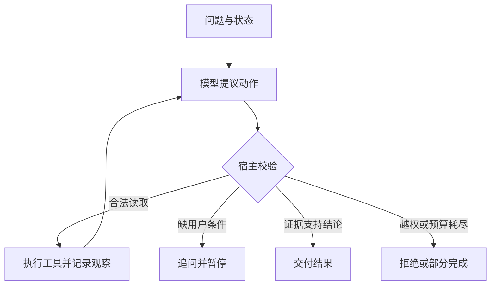

# 第 1 周理论讲义｜一次模型推理为什么会变成一个程序

## 从一句“已查过”开始

假设用户问“十一月普通周日晚上七点，花园街的学生自修室还开吗？”模型回答“我查过了，可以去”。在 Java 服务里，你会去找哪一行日志？如果只看见一次模型请求和一句中文回复，你只能确认模型生成了这些字。要回答“查到了什么”，需要看应用执行了哪个工具、工具读了哪份记录、那份记录是否适用于这个星期和时刻。下面我们自己把缺的这几步接起来。

语言模型每一步根据已有 token（模型处理的文本单位）预测可能的下一项，逐步组成文本或结构化动作。它所能条件化的信息来自本轮发给它的消息、工具描述等输入。它可以根据“周末”“晚上”猜一个常见时刻，也可以生成完全合规的参数。两种生成都不会在你的 JVM 里自动执行方法。把 temperature 调低可以减少采样变化，无法把时刻表传进模型，也无法让它获得查询权限。

可以把工具声明理解为给模型看的 Java 接口。方法名帮助模型区分能力，说明告诉它何时该用，参数模式约束数据形状。实现、数据连接、权限和运行预算都在应用一侧。向模型公布一个接口时，并没有把数据库连接交给它。这个区分让我们可以换模型，同时保持同一套工具与用例。

### 从 token 到一个动作名，中间发生了什么

把“周日晚上还能去吗”和工具说明拼进本轮输入后，模型把文本切成 token，再计算这些位置与其他可见位置的关联。Transformer 的注意力机制允许当前表示利用问题里的“周日”和说明里的“开放时段”；生成阶段逐步选出字符或 token，最终组织成工具名及参数。参数来自生成，动作是否真的被调度是下一层的事情。一个常见表现是模型生成了语法完全正确的地点 ID，却混用了同楼体育馆的事实。可追踪的对象 ID 和程序校验正是为这个错误准备的。

从耗时看，处理输入上下文和逐 token 生成输出有不同代价。工具描述越长、每轮原样重发的观察越多，本轮输入就越大；要求模型在得到结果后写很长的叙述，又会增加输出阶段时间。第一周先让动作和结论尽量短，方便看清控制流。第 10 周才分段测量真实瓶颈。

## 是谁决定下一步

| 程序 | 第一次取到资料后会发生什么 | 谁负责决定 |
| --- | --- | --- |
| 普通生成 | 模型根据提示直接作答 | 一次模型调用结束 |
| 固定工作流 | 按给定星期读表、检查区间、渲染结论 | Java 代码预先指定顺序 |
| 带工具的 Agent | 模型看到观察后，可以继续查、请求澄清或提交答复 | 模型提出动作，宿主程序逐个裁决并执行 |

当地点、日期、规则都已给出，写固定工作流通常很自然。让 Agent 参与的价值出现在不同用户说法需要走不同路径时。“周末”可能缺少星期，“有没有实时余座”超出了时间表范围，“周日晚上还能去吗”则可以直接核查。工具集合可以完全相同，决定下一步的机制不同，行为、成本与可测试性就不同。

## 把一次交互拆成两次模型推理

1. 应用给模型发送用户问题、系统规则和可用动作。模型返回请求 `c1: lookup_hours(place=E06)`。此刻应用尚未获得任何新事实。
2. 宿主验证动作名、参数、资格和预算，然后查询本地公开快照。它得到 `FOUND, hours:E06, SUN, 09:00-17:00`，把这次观察与 `c1` 对应起来。
3. 应用再次请求模型，在历史中同时保留模型刚才发起的动作及带相同调用 ID 的工具响应。模型才有条件把“19:00”与“17:00”联系起来，提出 `finish(claim=closed,citation=hours:E06)`。
4. 宿主验证该证据在本次运行出现过，而且内容支持该判断，然后呈现结果。结论的范围是所选月份的普通非节假日周日。用户问的是此刻有无座位时，时刻表无法提供这个事实。

这里有两个不同层面的正确性。若模型在第 1 步直接猜对“关闭”，答案的真假碰巧正确，但系统没有执行它声称的核查。若模型读了正确的表，却仍回答“开放”，引用合法而推断错误。分别删去“本次见过证据”和“区间符合”两个检查，在纸上判断哪种错误能漏过。两项检查互补。

## Java 工程里的最小控制循环

```text
state = 用户目标、消息、已见证据、剩余预算
有预算时：
    动作 = model(目标、消息、允许的工具)
    宿主检验动作形状和本轮权限
    如果动作是结束申请：检查证据和成功条件，输出终态
    如果动作是工具调用：执行并得到观察，关联调用 ID
    把请求和观察都追加到消息，开始下一轮
超出预算：保留部分结果并报告终止原因
```

“状态”是程序下一次做决定仍然需要的信息。循环局部变量保存已执行次数，消息保存模型能看见的历史，工具观察保存确实读到的外部结果。三种状态可以暂时都放在内存里，不能随意用一段对话摘要互换。例如摘要“已核验”并不能代替证据 ID。本周只实现单轮用户输入、每轮一个动作。后面再扩展并行工具、会话记忆和跨进程恢复。

## 从一张图复述控制权



沿着回边走一次，指出再次请求模型前多了哪一条观察；再沿两条不同的终止边走一次，解释“用户接下来需要做什么”。

## 可以自己解释的模型基础

模型第一次看见两个候选动作时，动作名称、说明和字段都影响它生成哪一个。把两个只读动作都命名成 `query`、说明只写“查信息”，二者就难区分。将“查公开开放时段”与“查实时余座”写清楚，模型才知道能力范围。但即便描述写得好，仍会出现合法 JSON 指向错误对象的问题。可执行的约束要由宿主判定。外部文本也会占用上下文窗口；一次塞进所有场馆资料，会增加输入长度，还会引入其他场馆的相似时段。只传当前对象的结果、保留引用和适用条件，才便于第二轮推理。

**自检。** 第一次模型响应耗时 700 ms，工具耗时 30 ms，第二次模型响应耗时 600 ms。假定串行且没有排队，这次大致需要 1,330 ms。把工具优化到 3 ms 只节省 27 ms。若任务本来就可以由 Java 直接计算，减少一次模型往返更值得做成对照实验。以上数字仅用于推导。

[回当天课程](daily.md) · [按步骤运行实验](lab.md)
