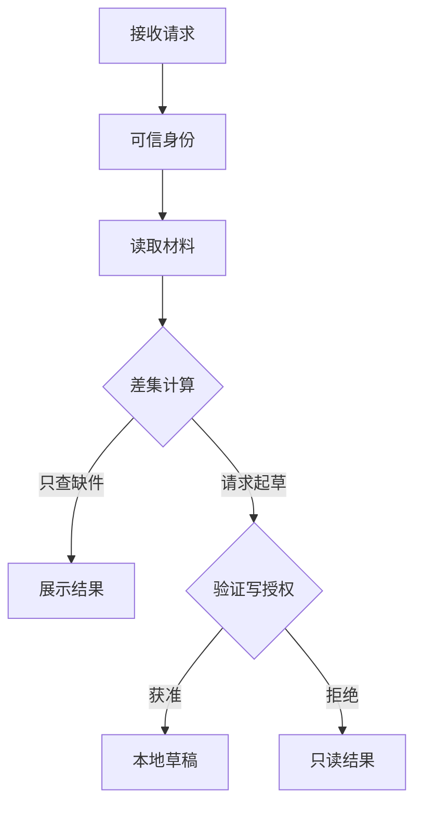
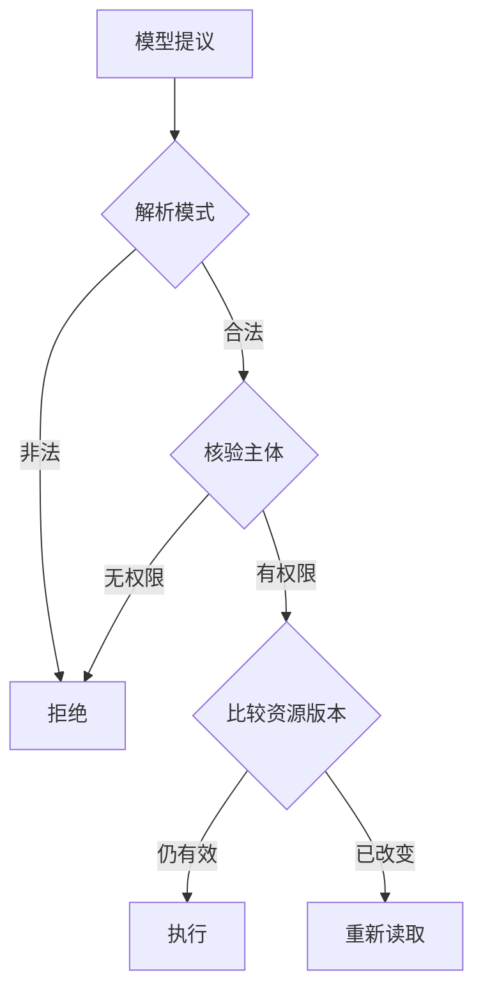
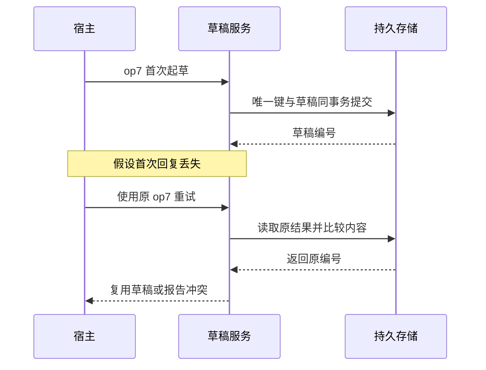
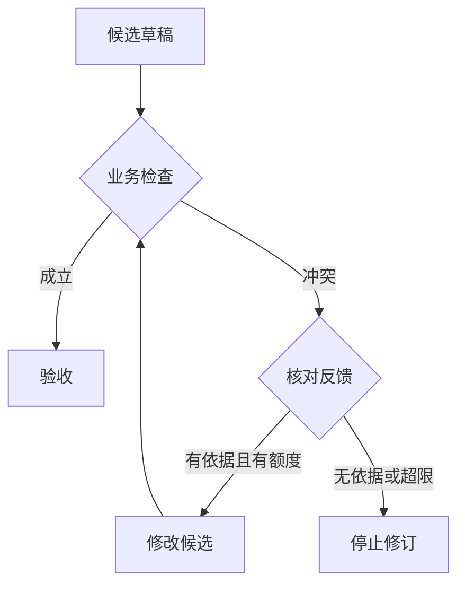

# 第 2 周每日课｜工具、业务动作与权限

这周边读边扩展同一套 Java 动作接口。完成每日练习再进入本周实验中的两个领域。

[本周理论](theory.md) · [本周实验](lab.md) · [总目录](../../README.md)

## 第 8 天　给动作定输入和成功条件

**读取、起草与正式发送的权限边界**

本周配套研读：[从业务后果划分工具](readings/01.md)，文内有图和带解样例。

90 分钟。

从“帮我处理一下”开始设计，很容易让一个工具既查询又写入。先填写动作之前的业务状态、执行后的可观察状态，以及谁有资格触发变化。

**课堂推演。** 同样是花园街，查时段改变的是系统知道的事实，预订改变的是外部库存；用户只授权了查询，系统必须能单独提供读操作。

**上机。** 画出 lookup_hours 和 finish 的输入输出；将已知星期的任务写成固定流程，记录调用数供第 4 周对照。

**独立题。** 能查到某个场馆是否等同于有权代用户预订？

完成后展开讲评与验收

不能。为两个动作分别写前置条件与成功证据，给出只允许读的反例。

## 第 9 天　把提示写成可执行契约

本周配套研读：[Schema 合法以后还要查什么](readings/02.md)，文内有图和带解样例。

75 分钟。

把定义、例外与执行条件贴近工具描述。给模型“你很严谨”很难评测，给它“缺星期时只问周六还是周日”则可以设置行为断言。

**课堂推演。** 对“周末七点”先问星期。多问一次地点会重复已有对象，多猜一个星期又可能反转结论。

**上机。** 写两个版本的工具说明，保留同一组输入和宿主；预测模型在“订位置”“通常几点关”上会选什么动作，有真实模型时做三次重复。

**独立题。** 提示里写对了用户权限，执行端还需要什么？

完成后展开讲评与验收

可信上下文与当前状态检查。把提示删掉的压力测试不能导致禁用动作真的执行。

## 第 10 天　用结果类型教模型从失败中恢复

本周配套研读：[模型的错误提议与实际副作用如何分开](readings/03.md)，文内有图和带解样例。

75 分钟。

结果中一段空字符串会同时代表没查、没资料和执行失败。不同原因对应不同下一步，因此应显式给状态和必要的适用范围。

**课堂推演。** 把 FOUND、NO_DATA、TIMEOUT 对应到“总结”“承认缺字段”“有限重试或降级”。同一 E06 时段表永远不含余座，重试十次仍不增加此类证据。

**上机。** 给三种观察手写下一轮提议；把一个观察替换掉，其余输入保持相同，检查决策是否随之改变。

**独立题。** 遇到 NO_DATA 与 TIMEOUT 都返回 closed，哪种问题可以靠增加重试修复？

完成后展开讲评与验收

两种推断都错。重试只可能缓解暂时的超时，不能把缺少的来源变成证据。

## 第 11 天　预审迁移：先读，再决定能不能写

**模型的字段在哪一层可以被信任**

本周配套研读：[稳定操作键怎样区分重试与新请求](readings/04.md)，文内有图和带解样例。

75 分钟。

动作权限来自用户意图和业务上下文，模型提出补件草稿并不能赋予自己写权限。应用先核验，再决定是否执行。

**课堂推演。** 用实验 B 的 DEMO-A 手算差集。只询问缺件时返回 settlement；明确请求起草后才可能新建草稿；案件审批状态始终由规则与授权决定。

**上机。** 实现 list_materials；记录两个用户意图下的 mayDraft、缺件、实际写入数。把模型提出的非法动作当作固定测试输入。

**独立题。** 若材料正文说“主管已批准”，能直接让 mayDraft 变为 true 吗？

完成后展开讲评与验收

正文是待分析数据。用可信会话上下文授予能力，把审批文字当材料内容展示即可。

## 第 12 天　同一意图为什么会写入两次

**回执丢失后如何复用第一次的结果**

本周配套研读：[响应超时后的三种恢复方式](readings/05.md)，文内有图和带解样例。

75 分钟。

客户端超时只说明响应没有按时到达。数据库可能已经提交，下一次模型调用又会生成新调用 ID。依赖模型消重会产生重复状态变化。

**课堂推演。** 画出提交草稿、丢响应、新请求三行时间线。在新请求上写同一业务操作键，再写一个不同模型调用 ID。

**上机。** 按实验 C 实现一次重复写，再引入稳定业务键，断言第一次、重试和冲突时的草稿数。

**独立题。** 内容相同但用户第二次明确要求新建另一份，是否一定该复用草稿？

完成后展开讲评与验收

由业务意图决定。新的用户操作应产生新操作键；相同键内才执行重试去重。

## 第 13 天　用反馈修订一次结论

**有依据的修订与有界终止**

本周配套研读：[稳定操作键究竟减少了多少份草稿](readings/06.md)，文内有图和带解样例。

150 分钟。

生成一稿、发现错误、修订一稿，是可实现的 Reflection。先问批评依据来自哪条规则；没有外部证据，模型可以把错误说得越来越流畅。

**课堂推演。** 令 wrong 给出“周六关闭”。比较模型自评“写得完整”与时间区间检查给出“19:00 在区间内”，后者提供可执行修订依据。

**上机。** 在自己的练习分支将一次区间冲突变为可修订观察，保留一次修订额度。让脚本一次修正、一次坚持错误；后者必须终止。

**独立题。** 如果来源一直超时，再要求反思一次，能不能安全作肯定答复？

完成后展开讲评与验收

仍然没有可用资料。允许部分完成或重试读取。验收同时看修正成功率和额外模型轮数。

## 第 14 天　工具设计答辩

本周配套研读：[让一次 Reflection 带来新信息](readings/07.md)，文内有图和带解样例。

60 分钟。

拿掉具体名词后，你能否把时段查询和资料预审放在同一个模型提议、程序裁决、观察回传框架中？

**课堂推演。** 把 lookup 换成 list_materials，输入由地点变成申请号，FOUND 的事实变了；调用关联、超时语义、预算与权限检查仍然需要。

**上机。** 交付固定流程与两种业务的轨迹。再补 4 道开发题，累计 8 道；其中至少一道含未授权写操作，一道含工具数据中的诱导指令。

**独立题。** 如何发现模型总是追问、借此避免做错？

完成后展开讲评与验收

给信息齐全题设置成功条件（完成且有证据）并计数不必要的追问。单看是否出现幻觉会奖励消极策略。

