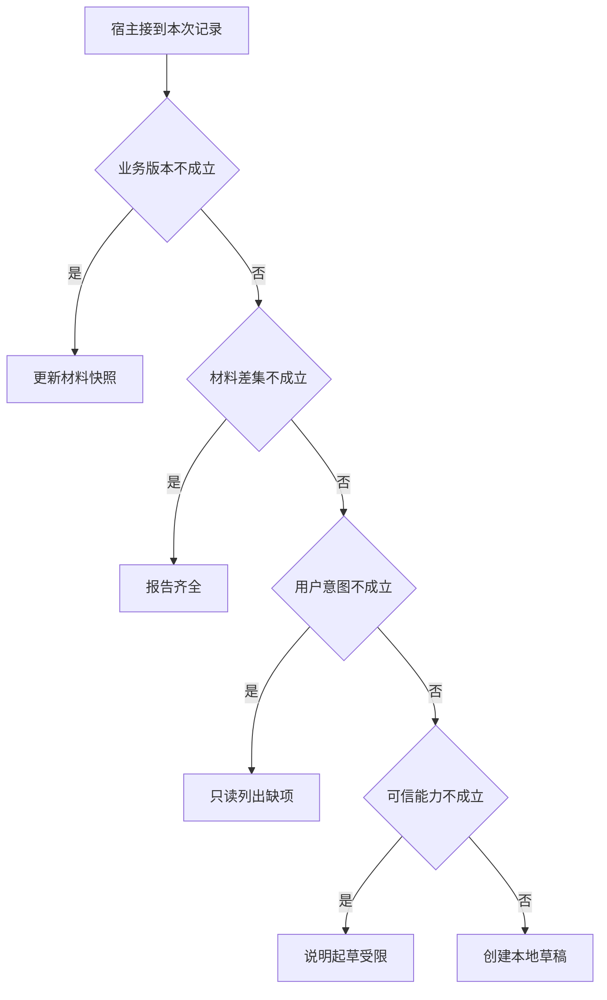

# 从业务后果划分工具

核对材料差集本身不改变申请。
只有用户明确要求且获授权，才创建草稿。
将两种操作作为独立工具，可以用写入前后草稿数证明只读任务真的没有产生副作用。

本篇用一个封闭的教学决策器说明这一问题。输入是宿主收到的记录，不保证每个下游字段都已经获准使用。前置检查未成立时，下游即使带着缓存值，也不能拿来作业务断言。

## 先解决一个具体问题

**把“读材料、起草、发送”合成一项工具会发生什么？**

一次合理读请求也可能触发外部通知。
按副作用边界拆开后，读路径可以用草稿数保持不变作断言，真正起草则需查回新实体。
正式发送还应独立建模。


先取一个能走到「创建本地草稿」的输入：资料版本仍适用、已证实有缺件、用户明确要求起草、宿主确认当前主体获准。
把这四个条件代回后文的图，前面各个拦截分支都未满足，最终才有“本轮具备起草需要的业务和权限条件”这个判断。
还原这个现场时要分别问：哪些位来自可信状态，哪些只是在接口中出现、尚未获得解释资格的字段。

## 先沿一次决策走到底



从上到下取第一条成立的出口。只改一个开关时，只有它之前的检查都未截断，该变化才可能到达真实动作。

“业务版本”的两种输入分别是“资料版本仍适用”与“观察所依据版本已过期”。
写入前应重新验证可能变化的业务前提。

“材料差集”的两种输入分别是“已证实有缺件”与“已证实材料齐全”。
补件草稿需要当前规则与材料差集作依据。

“用户意图”的两种输入分别是“用户明确要求起草”与“仅要求检查资料”。
只读查询不能自动扩大为外部状态变更。

“可信能力”的两种输入分别是“宿主确认当前主体获准”与“当前主体未获授权”。
权限取自可信入口或执行端，不由模型生成。

## 最少需要哪几项观察

### 更新材料快照

规则与材料应处于当前版本。
在本节的全部组合中，有 8 种产生「更新材料快照」，这只是逻辑空间的计数，不能当作实际用户请求的比例。

只取得观察所依据版本已过期，已经足以要求宿主「更新材料快照」。
保持这些已知项，其余开关自由变化，仍有 8 种补全，判断没有翻转。

若删掉关于业务版本的证据，另一份允许的现场是资料版本仍适用、已证实材料齐全、仅要求检查资料、当前主体未获授权，它会使宿主「报告齐全」。

### 报告齐全

没有可核实的补件项。
在本节的全部组合中，有 4 种产生「报告齐全」，这只是逻辑空间的计数，不能当作实际用户请求的比例。

只取得资料版本仍适用、已证实材料齐全，已经足以要求宿主「报告齐全」。
保持这些已知项，其余开关自由变化，仍有 4 种补全，判断没有翻转。

若删掉关于业务版本的证据，另一份允许的现场是观察所依据版本已过期、已证实材料齐全、仅要求检查资料、当前主体未获授权，它会使宿主「更新材料快照」。

若删掉关于材料差集的证据，另一份允许的现场是资料版本仍适用、已证实有缺件、仅要求检查资料、当前主体未获授权，它会使宿主「只读列出缺项」。

### 只读列出缺项

查询本身已足够完成用户目标。
在本节的全部组合中，有 2 种产生「只读列出缺项」，这只是逻辑空间的计数，不能当作实际用户请求的比例。

只取得资料版本仍适用、已证实有缺件、仅要求检查资料，已经足以要求宿主「只读列出缺项」。
保持这些已知项，其余开关自由变化，仍有 2 种补全，判断没有翻转。

若删掉关于业务版本的证据，另一份允许的现场是观察所依据版本已过期、已证实有缺件、仅要求检查资料、当前主体未获授权，它会使宿主「更新材料快照」。

若删掉关于材料差集的证据，另一份允许的现场是资料版本仍适用、已证实材料齐全、仅要求检查资料、当前主体未获授权，它会使宿主「报告齐全」。

若删掉关于用户意图的证据，另一份允许的现场是资料版本仍适用、已证实有缺件、用户明确要求起草、当前主体未获授权，它会使宿主「说明起草受限」。

### 说明起草受限

用户意图不自动产生权限。
在本节的全部组合中，有 1 种产生「说明起草受限」，这只是逻辑空间的计数，不能当作实际用户请求的比例。

只取得资料版本仍适用、已证实有缺件、用户明确要求起草、当前主体未获授权，已经足以要求宿主「说明起草受限」。
保持这些已知项，其余开关自由变化，仍有 1 种补全，判断没有翻转。

若删掉关于业务版本的证据，另一份允许的现场是观察所依据版本已过期、已证实有缺件、用户明确要求起草、当前主体未获授权，它会使宿主「更新材料快照」。

若删掉关于材料差集的证据，另一份允许的现场是资料版本仍适用、已证实材料齐全、用户明确要求起草、当前主体未获授权，它会使宿主「报告齐全」。

若删掉关于用户意图的证据，另一份允许的现场是资料版本仍适用、已证实有缺件、仅要求检查资料、当前主体未获授权，它会使宿主「只读列出缺项」。

若删掉关于可信能力的证据，另一份允许的现场是资料版本仍适用、已证实有缺件、用户明确要求起草、宿主确认当前主体获准，它会使宿主「创建本地草稿」。

### 创建本地草稿

本轮具备起草需要的业务和权限条件。
在本节的全部组合中，有 1 种产生「创建本地草稿」，这只是逻辑空间的计数，不能当作实际用户请求的比例。

只取得资料版本仍适用、已证实有缺件、用户明确要求起草、宿主确认当前主体获准，已经足以要求宿主「创建本地草稿」。

若删掉关于业务版本的证据，另一份允许的现场是观察所依据版本已过期、已证实有缺件、用户明确要求起草、宿主确认当前主体获准，它会使宿主「更新材料快照」。

若删掉关于材料差集的证据，另一份允许的现场是资料版本仍适用、已证实材料齐全、用户明确要求起草、宿主确认当前主体获准，它会使宿主「报告齐全」。

若删掉关于用户意图的证据，另一份允许的现场是资料版本仍适用、已证实有缺件、仅要求检查资料、宿主确认当前主体获准，它会使宿主「只读列出缺项」。

若删掉关于可信能力的证据，另一份允许的现场是资料版本仍适用、已证实有缺件、用户明确要求起草、当前主体未获授权，它会使宿主「说明起草受限」。

## 以同一份契约解释截然不同的现场

<details>
<summary>展开推演与对应反例</summary>

下列样本按最先命中的业务分支排列。四位编码只作本篇页内定位，顺序与开头的四项输入一致。可以先猜下一动作，再展开相邻样本。

### 能够触发“更新材料快照”的现场

**样本 0000**

业务侧交来观察所依据版本已过期、已证实材料齐全，执行侧还记录了仅要求检查资料、当前主体未获授权。
把样本压成最短证明，保留观察所依据版本已过期就能支持「更新材料快照」。

在这份记录上，分别翻转「业务版本」中的任一项，其他项完全不变时，下一动作都会改变。

保持其余观察不动，单独切换「材料差集」、「用户意图」、「可信能力」仍得到「更新材料快照」，它们在这个现场不是决定性变量。

要从本例改走「报告齐全」，至少需要变动 1 项，一组最少改动是将观察所依据版本已过期换成资料版本仍适用。

要从本例改走「只读列出缺项」，至少需要变动 2 项，一组最少改动是将观察所依据版本已过期、已证实材料齐全换成资料版本仍适用、已证实有缺件。

要从本例改走「说明起草受限」，至少需要变动 3 项，一组最少改动是将观察所依据版本已过期、已证实材料齐全、仅要求检查资料换成资料版本仍适用、已证实有缺件、用户明确要求起草。

要从本例改走「创建本地草稿」，至少需要变动 4 项，一组最少改动是将观察所依据版本已过期、已证实材料齐全、仅要求检查资料、当前主体未获授权换成资料版本仍适用、已证实有缺件、用户明确要求起草、宿主确认当前主体获准。

**样本 0001**

业务侧交来观察所依据版本已过期、已证实材料齐全，执行侧还记录了仅要求检查资料、宿主确认当前主体获准。


要从本例改走「创建本地草稿」，至少需要变动 3 项，一组最少改动是将观察所依据版本已过期、已证实材料齐全、仅要求检查资料换成资料版本仍适用、已证实有缺件、用户明确要求起草。

要从本例改走「说明起草受限」，至少需要变动 4 项，一组最少改动是将观察所依据版本已过期、已证实材料齐全、仅要求检查资料、宿主确认当前主体获准换成资料版本仍适用、已证实有缺件、用户明确要求起草、当前主体未获授权。

**样本 0010**

业务侧交来观察所依据版本已过期、已证实材料齐全，执行侧还记录了用户明确要求起草、当前主体未获授权。


要从本例改走「说明起草受限」，至少需要变动 2 项，一组最少改动是将观察所依据版本已过期、已证实材料齐全换成资料版本仍适用、已证实有缺件。

要从本例改走「只读列出缺项」，至少需要变动 3 项，一组最少改动是将观察所依据版本已过期、已证实材料齐全、用户明确要求起草换成资料版本仍适用、已证实有缺件、仅要求检查资料。

要从本例改走「创建本地草稿」，至少需要变动 3 项，一组最少改动是将观察所依据版本已过期、已证实材料齐全、当前主体未获授权换成资料版本仍适用、已证实有缺件、宿主确认当前主体获准。

**样本 0011**

业务侧交来观察所依据版本已过期、已证实材料齐全，执行侧还记录了用户明确要求起草、宿主确认当前主体获准。


要从本例改走「创建本地草稿」，至少需要变动 2 项，一组最少改动是将观察所依据版本已过期、已证实材料齐全换成资料版本仍适用、已证实有缺件。


要从本例改走「说明起草受限」，至少需要变动 3 项，一组最少改动是将观察所依据版本已过期、已证实材料齐全、宿主确认当前主体获准换成资料版本仍适用、已证实有缺件、当前主体未获授权。

**样本 0100**

业务侧交来观察所依据版本已过期、已证实有缺件，执行侧还记录了仅要求检查资料、当前主体未获授权。


要从本例改走「只读列出缺项」，至少需要变动 1 项，一组最少改动是将观察所依据版本已过期换成资料版本仍适用。

要从本例改走「报告齐全」，至少需要变动 2 项，一组最少改动是将观察所依据版本已过期、已证实有缺件换成资料版本仍适用、已证实材料齐全。

要从本例改走「说明起草受限」，至少需要变动 2 项，一组最少改动是将观察所依据版本已过期、仅要求检查资料换成资料版本仍适用、用户明确要求起草。

要从本例改走「创建本地草稿」，至少需要变动 3 项，一组最少改动是将观察所依据版本已过期、仅要求检查资料、当前主体未获授权换成资料版本仍适用、用户明确要求起草、宿主确认当前主体获准。

**样本 0101**

业务侧交来观察所依据版本已过期、已证实有缺件，执行侧还记录了仅要求检查资料、宿主确认当前主体获准。


要从本例改走「创建本地草稿」，至少需要变动 2 项，一组最少改动是将观察所依据版本已过期、仅要求检查资料换成资料版本仍适用、用户明确要求起草。

要从本例改走「说明起草受限」，至少需要变动 3 项，一组最少改动是将观察所依据版本已过期、仅要求检查资料、宿主确认当前主体获准换成资料版本仍适用、用户明确要求起草、当前主体未获授权。

**样本 0110**

业务侧交来观察所依据版本已过期、已证实有缺件，执行侧还记录了用户明确要求起草、当前主体未获授权。


要从本例改走「说明起草受限」，至少需要变动 1 项，一组最少改动是将观察所依据版本已过期换成资料版本仍适用。


要从本例改走「只读列出缺项」，至少需要变动 2 项，一组最少改动是将观察所依据版本已过期、用户明确要求起草换成资料版本仍适用、仅要求检查资料。

要从本例改走「创建本地草稿」，至少需要变动 2 项，一组最少改动是将观察所依据版本已过期、当前主体未获授权换成资料版本仍适用、宿主确认当前主体获准。

**样本 0111**

业务侧交来观察所依据版本已过期、已证实有缺件，执行侧还记录了用户明确要求起草、宿主确认当前主体获准。


要从本例改走「创建本地草稿」，至少需要变动 1 项，一组最少改动是将观察所依据版本已过期换成资料版本仍适用。


要从本例改走「说明起草受限」，至少需要变动 2 项，一组最少改动是将观察所依据版本已过期、宿主确认当前主体获准换成资料版本仍适用、当前主体未获授权。

### 能够触发“报告齐全”的现场

**样本 1000**

业务侧交来资料版本仍适用、已证实材料齐全，执行侧还记录了仅要求检查资料、当前主体未获授权。
把样本压成最短证明，保留资料版本仍适用、已证实材料齐全就能支持「报告齐全」。

在这份记录上，分别翻转「业务版本」、「材料差集」中的任一项，其他项完全不变时，下一动作都会改变。

保持其余观察不动，单独切换「用户意图」、「可信能力」仍得到「报告齐全」，它们在这个现场不是决定性变量。

本例没走更靠前的「更新材料快照」，因为资料版本仍适用与那个入口的必要条件不符。

要从本例改走「更新材料快照」，至少需要变动 1 项，一组最少改动是将资料版本仍适用换成观察所依据版本已过期。

要从本例改走「只读列出缺项」，至少需要变动 1 项，一组最少改动是将已证实材料齐全换成已证实有缺件。

要从本例改走「说明起草受限」，至少需要变动 2 项，一组最少改动是将已证实材料齐全、仅要求检查资料换成已证实有缺件、用户明确要求起草。

要从本例改走「创建本地草稿」，至少需要变动 3 项，一组最少改动是将已证实材料齐全、仅要求检查资料、当前主体未获授权换成已证实有缺件、用户明确要求起草、宿主确认当前主体获准。

**样本 1001**

业务侧交来资料版本仍适用、已证实材料齐全，执行侧还记录了仅要求检查资料、宿主确认当前主体获准。


要从本例改走「创建本地草稿」，至少需要变动 2 项，一组最少改动是将已证实材料齐全、仅要求检查资料换成已证实有缺件、用户明确要求起草。

要从本例改走「说明起草受限」，至少需要变动 3 项，一组最少改动是将已证实材料齐全、仅要求检查资料、宿主确认当前主体获准换成已证实有缺件、用户明确要求起草、当前主体未获授权。

**样本 1010**

业务侧交来资料版本仍适用、已证实材料齐全，执行侧还记录了用户明确要求起草、当前主体未获授权。


要从本例改走「说明起草受限」，至少需要变动 1 项，一组最少改动是将已证实材料齐全换成已证实有缺件。

要从本例改走「只读列出缺项」，至少需要变动 2 项，一组最少改动是将已证实材料齐全、用户明确要求起草换成已证实有缺件、仅要求检查资料。

要从本例改走「创建本地草稿」，至少需要变动 2 项，一组最少改动是将已证实材料齐全、当前主体未获授权换成已证实有缺件、宿主确认当前主体获准。

**样本 1011**

业务侧交来资料版本仍适用、已证实材料齐全，执行侧还记录了用户明确要求起草、宿主确认当前主体获准。


要从本例改走「创建本地草稿」，至少需要变动 1 项，一组最少改动是将已证实材料齐全换成已证实有缺件。


要从本例改走「说明起草受限」，至少需要变动 2 项，一组最少改动是将已证实材料齐全、宿主确认当前主体获准换成已证实有缺件、当前主体未获授权。

### 能够触发“只读列出缺项”的现场

**样本 1100**

业务侧交来资料版本仍适用、已证实有缺件，执行侧还记录了仅要求检查资料、当前主体未获授权。
把样本压成最短证明，保留资料版本仍适用、已证实有缺件、仅要求检查资料就能支持「只读列出缺项」。

在这份记录上，分别翻转「业务版本」、「材料差集」、「用户意图」中的任一项，其他项完全不变时，下一动作都会改变。

保持其余观察不动，单独切换「可信能力」仍得到「只读列出缺项」，它们在这个现场不是决定性变量。


本例没走更靠前的「报告齐全」，因为已证实有缺件与那个入口的必要条件不符。


要从本例改走「报告齐全」，至少需要变动 1 项，一组最少改动是将已证实有缺件换成已证实材料齐全。

要从本例改走「说明起草受限」，至少需要变动 1 项，一组最少改动是将仅要求检查资料换成用户明确要求起草。

要从本例改走「创建本地草稿」，至少需要变动 2 项，一组最少改动是将仅要求检查资料、当前主体未获授权换成用户明确要求起草、宿主确认当前主体获准。

**样本 1101**

业务侧交来资料版本仍适用、已证实有缺件，执行侧还记录了仅要求检查资料、宿主确认当前主体获准。


要从本例改走「创建本地草稿」，至少需要变动 1 项，一组最少改动是将仅要求检查资料换成用户明确要求起草。

要从本例改走「说明起草受限」，至少需要变动 2 项，一组最少改动是将仅要求检查资料、宿主确认当前主体获准换成用户明确要求起草、当前主体未获授权。

### 能够触发“说明起草受限”的现场

**样本 1110**

业务侧交来资料版本仍适用、已证实有缺件，执行侧还记录了用户明确要求起草、当前主体未获授权。
把样本压成最短证明，保留资料版本仍适用、已证实有缺件、用户明确要求起草、当前主体未获授权就能支持「说明起草受限」。

在这份记录上，分别翻转「业务版本」、「材料差集」、「用户意图」、「可信能力」中的任一项，其他项完全不变时，下一动作都会改变。


本例没走更靠前的「只读列出缺项」，因为用户明确要求起草与那个入口的必要条件不符。


要从本例改走「只读列出缺项」，至少需要变动 1 项，一组最少改动是将用户明确要求起草换成仅要求检查资料。

要从本例改走「创建本地草稿」，至少需要变动 1 项，一组最少改动是将当前主体未获授权换成宿主确认当前主体获准。

### 能够触发“创建本地草稿”的现场

**样本 1111**

业务侧交来资料版本仍适用、已证实有缺件，执行侧还记录了用户明确要求起草、宿主确认当前主体获准。
把样本压成最短证明，保留资料版本仍适用、已证实有缺件、用户明确要求起草、宿主确认当前主体获准就能支持「创建本地草稿」。


本例没走更靠前的「说明起草受限」，因为宿主确认当前主体获准与那个入口的必要条件不符。


要从本例改走「说明起草受限」，至少需要变动 1 项，一组最少改动是将宿主确认当前主体获准换成当前主体未获授权。

</details>

## 当你只能看见一半记录

<details>
<summary>展开推演与对应反例</summary>

这次隐藏两个字段，保留另两个。对每个可见现场，检查四种合法补全是否同意。如仍有歧义，选择能使最坏剩余候选动作最少的字段继续查。并列时采用本篇字段顺序。

### 只保留业务版本与材料差集

已知观察所依据版本已过期、已证实材料齐全时，四种补全的动作分布为更新材料快照（4 种）。

就“更新材料快照”这个动作而言，在观察所依据版本已过期、已证实材料齐全的前提下，另外两项观察不会推翻它。

已知观察所依据版本已过期、已证实有缺件时，四种补全的动作分布为更新材料快照（4 种）。

就“更新材料快照”这个动作而言，在观察所依据版本已过期、已证实有缺件的前提下，另外两项观察不会推翻它。

已知资料版本仍适用、已证实材料齐全时，四种补全的动作分布为报告齐全（4 种）。

就“报告齐全”这个动作而言，在资料版本仍适用、已证实材料齐全的前提下，另外两项观察不会推翻它。

已知资料版本仍适用、已证实有缺件时，四种补全的动作分布为只读列出缺项（2 种）、说明起草受限（1 种）、创建本地草稿（1 种）。

在资料版本仍适用、已证实有缺件这个现场补读「用户意图」，最坏还剩 2 种动作，计算时只衡量歧义，尚未扣读取代价。
若补来的观察为“仅要求检查资料”，范围缩成「只读列出缺项」。若为“用户明确要求起草”，则保留「说明起草受限」、「创建本地草稿」。

区分不了的两条执行可以具体写成 1100 与 1110：它们共享已展示字段，却分别需要「只读列出缺项」和「说明起草受限」。

### 只保留业务版本与用户意图

已知观察所依据版本已过期、仅要求检查资料时，四种补全的动作分布为更新材料快照（4 种）。

就“更新材料快照”这个动作而言，在观察所依据版本已过期、仅要求检查资料的前提下，另外两项观察不会推翻它。

已知观察所依据版本已过期、用户明确要求起草时，四种补全的动作分布为更新材料快照（4 种）。

就“更新材料快照”这个动作而言，在观察所依据版本已过期、用户明确要求起草的前提下，另外两项观察不会推翻它。

已知资料版本仍适用、仅要求检查资料时，四种补全的动作分布为报告齐全（2 种）、只读列出缺项（2 种）。

在资料版本仍适用、仅要求检查资料这个现场补读「材料差集」，最坏还剩 1 种动作，计算时只衡量歧义，尚未扣读取代价。
若补来的观察为“已证实材料齐全”，范围缩成「报告齐全」。若为“已证实有缺件”，则保留「只读列出缺项」。

区分不了的两条执行可以具体写成 1000 与 1100：它们共享已展示字段，却分别需要「报告齐全」和「只读列出缺项」。

已知资料版本仍适用、用户明确要求起草时，四种补全的动作分布为报告齐全（2 种）、说明起草受限（1 种）、创建本地草稿（1 种）。

在资料版本仍适用、用户明确要求起草这个现场补读「材料差集」，最坏还剩 2 种动作，计算时只衡量歧义，尚未扣读取代价。
若补来的观察为“已证实材料齐全”，范围缩成「报告齐全」。若为“已证实有缺件”，则保留「说明起草受限」、「创建本地草稿」。

区分不了的两条执行可以具体写成 1010 与 1110：它们共享已展示字段，却分别需要「报告齐全」和「说明起草受限」。

### 只保留材料差集与用户意图

已知已证实材料齐全、仅要求检查资料时，四种补全的动作分布为更新材料快照（2 种）、报告齐全（2 种）。

在已证实材料齐全、仅要求检查资料这个现场补读「业务版本」，最坏还剩 1 种动作，计算时只衡量歧义，尚未扣读取代价。
若补来的观察为“观察所依据版本已过期”，范围缩成「更新材料快照」。若为“资料版本仍适用”，则保留「报告齐全」。

区分不了的两条执行可以具体写成 0000 与 1000：它们共享已展示字段，却分别需要「更新材料快照」和「报告齐全」。

已知已证实材料齐全、用户明确要求起草时，四种补全的动作分布为更新材料快照（2 种）、报告齐全（2 种）。

在已证实材料齐全、用户明确要求起草这个现场补读「业务版本」，最坏还剩 1 种动作，计算时只衡量歧义，尚未扣读取代价。

区分不了的两条执行可以具体写成 0010 与 1010：它们共享已展示字段，却分别需要「更新材料快照」和「报告齐全」。

已知已证实有缺件、仅要求检查资料时，四种补全的动作分布为更新材料快照（2 种）、只读列出缺项（2 种）。

在已证实有缺件、仅要求检查资料这个现场补读「业务版本」，最坏还剩 1 种动作，计算时只衡量歧义，尚未扣读取代价。
若补来的观察为“观察所依据版本已过期”，范围缩成「更新材料快照」。若为“资料版本仍适用”，则保留「只读列出缺项」。

区分不了的两条执行可以具体写成 0100 与 1100：它们共享已展示字段，却分别需要「更新材料快照」和「只读列出缺项」。

已知已证实有缺件、用户明确要求起草时，四种补全的动作分布为更新材料快照（2 种）、说明起草受限（1 种）、创建本地草稿（1 种）。

在已证实有缺件、用户明确要求起草这个现场补读「业务版本」，最坏还剩 2 种动作，计算时只衡量歧义，尚未扣读取代价。
若补来的观察为“观察所依据版本已过期”，范围缩成「更新材料快照」。若为“资料版本仍适用”，则保留「说明起草受限」、「创建本地草稿」。

区分不了的两条执行可以具体写成 0110 与 1110：它们共享已展示字段，却分别需要「更新材料快照」和「说明起草受限」。

### 只保留业务版本与可信能力

已知观察所依据版本已过期、当前主体未获授权时，四种补全的动作分布为更新材料快照（4 种）。

就“更新材料快照”这个动作而言，在观察所依据版本已过期、当前主体未获授权的前提下，另外两项观察不会推翻它。

已知观察所依据版本已过期、宿主确认当前主体获准时，四种补全的动作分布为更新材料快照（4 种）。

就“更新材料快照”这个动作而言，在观察所依据版本已过期、宿主确认当前主体获准的前提下，另外两项观察不会推翻它。

已知资料版本仍适用、当前主体未获授权时，四种补全的动作分布为报告齐全（2 种）、只读列出缺项（1 种）、说明起草受限（1 种）。

在资料版本仍适用、当前主体未获授权这个现场补读「材料差集」，最坏还剩 2 种动作，计算时只衡量歧义，尚未扣读取代价。
若补来的观察为“已证实材料齐全”，范围缩成「报告齐全」。若为“已证实有缺件”，则保留「只读列出缺项」、「说明起草受限」。


已知资料版本仍适用、宿主确认当前主体获准时，四种补全的动作分布为报告齐全（2 种）、只读列出缺项（1 种）、创建本地草稿（1 种）。

在资料版本仍适用、宿主确认当前主体获准这个现场补读「材料差集」，最坏还剩 2 种动作，计算时只衡量歧义，尚未扣读取代价。
若补来的观察为“已证实材料齐全”，范围缩成「报告齐全」。若为“已证实有缺件”，则保留「只读列出缺项」、「创建本地草稿」。

区分不了的两条执行可以具体写成 1001 与 1101：它们共享已展示字段，却分别需要「报告齐全」和「只读列出缺项」。

### 只保留材料差集与可信能力

已知已证实材料齐全、当前主体未获授权时，四种补全的动作分布为更新材料快照（2 种）、报告齐全（2 种）。

在已证实材料齐全、当前主体未获授权这个现场补读「业务版本」，最坏还剩 1 种动作，计算时只衡量歧义，尚未扣读取代价。


已知已证实材料齐全、宿主确认当前主体获准时，四种补全的动作分布为更新材料快照（2 种）、报告齐全（2 种）。

在已证实材料齐全、宿主确认当前主体获准这个现场补读「业务版本」，最坏还剩 1 种动作，计算时只衡量歧义，尚未扣读取代价。

区分不了的两条执行可以具体写成 0001 与 1001：它们共享已展示字段，却分别需要「更新材料快照」和「报告齐全」。

已知已证实有缺件、当前主体未获授权时，四种补全的动作分布为更新材料快照（2 种）、只读列出缺项（1 种）、说明起草受限（1 种）。

在已证实有缺件、当前主体未获授权这个现场补读「业务版本」，最坏还剩 2 种动作，计算时只衡量歧义，尚未扣读取代价。
若补来的观察为“观察所依据版本已过期”，范围缩成「更新材料快照」。若为“资料版本仍适用”，则保留「只读列出缺项」、「说明起草受限」。


已知已证实有缺件、宿主确认当前主体获准时，四种补全的动作分布为更新材料快照（2 种）、只读列出缺项（1 种）、创建本地草稿（1 种）。

在已证实有缺件、宿主确认当前主体获准这个现场补读「业务版本」，最坏还剩 2 种动作，计算时只衡量歧义，尚未扣读取代价。
若补来的观察为“观察所依据版本已过期”，范围缩成「更新材料快照」。若为“资料版本仍适用”，则保留「只读列出缺项」、「创建本地草稿」。

区分不了的两条执行可以具体写成 0101 与 1101：它们共享已展示字段，却分别需要「更新材料快照」和「只读列出缺项」。

### 只保留用户意图与可信能力

已知仅要求检查资料、当前主体未获授权时，四种补全的动作分布为更新材料快照（2 种）、报告齐全（1 种）、只读列出缺项（1 种）。

在仅要求检查资料、当前主体未获授权这个现场补读「业务版本」，最坏还剩 2 种动作，计算时只衡量歧义，尚未扣读取代价。
若补来的观察为“观察所依据版本已过期”，范围缩成「更新材料快照」。若为“资料版本仍适用”，则保留「报告齐全」、「只读列出缺项」。


已知仅要求检查资料、宿主确认当前主体获准时，四种补全的动作分布为更新材料快照（2 种）、报告齐全（1 种）、只读列出缺项（1 种）。

在仅要求检查资料、宿主确认当前主体获准这个现场补读「业务版本」，最坏还剩 2 种动作，计算时只衡量歧义，尚未扣读取代价。


已知用户明确要求起草、当前主体未获授权时，四种补全的动作分布为更新材料快照（2 种）、报告齐全（1 种）、说明起草受限（1 种）。

在用户明确要求起草、当前主体未获授权这个现场补读「业务版本」，最坏还剩 2 种动作，计算时只衡量歧义，尚未扣读取代价。
若补来的观察为“观察所依据版本已过期”，范围缩成「更新材料快照」。若为“资料版本仍适用”，则保留「报告齐全」、「说明起草受限」。


已知用户明确要求起草、宿主确认当前主体获准时，四种补全的动作分布为更新材料快照（2 种）、报告齐全（1 种）、创建本地草稿（1 种）。

在用户明确要求起草、宿主确认当前主体获准这个现场补读「业务版本」，最坏还剩 2 种动作，计算时只衡量歧义，尚未扣读取代价。
若补来的观察为“观察所依据版本已过期”，范围缩成「更新材料快照」。若为“资料版本仍适用”，则保留「报告齐全」、「创建本地草稿」。

区分不了的两条执行可以具体写成 0011 与 1011：它们共享已展示字段，却分别需要「更新材料快照」和「报告齐全」。

</details>

## 单因素干预与边界测试

<details>
<summary>展开推演与对应反例</summary>

### 只改变业务版本

固定另外三个条件得到八对现场，从“观察所依据版本已过期”转为“资料版本仍适用”时，8 对翻转动作，另外 0 对保持不变。

有 4 对现场沿「更新材料快照」变到「报告齐全」，可复现的一组受控背景为已证实材料齐全、仅要求检查资料、当前主体未获授权。

有 2 对现场沿「更新材料快照」变到「只读列出缺项」，可复现的一组受控背景为已证实有缺件、仅要求检查资料、当前主体未获授权。

有 1 对现场沿「更新材料快照」变到「说明起草受限」，可复现的一组受控背景为已证实有缺件、用户明确要求起草、当前主体未获授权。

有 1 对现场沿「更新材料快照」变到「创建本地草稿」，可复现的一组受控背景为已证实有缺件、用户明确要求起草、宿主确认当前主体获准。

### 只改变材料差集

固定另外三个条件得到八对现场，从“已证实材料齐全”转为“已证实有缺件”时，4 对翻转动作，另外 4 对保持不变。

令观察所依据版本已过期、仅要求检查资料、当前主体未获授权，材料差集的两个取值均得到「更新材料快照」。在八对中，共有 4 对表现为这一种稳定出口。

有 2 对现场沿「报告齐全」变到「只读列出缺项」，可复现的一组受控背景为资料版本仍适用、仅要求检查资料、当前主体未获授权。

有 1 对现场沿「报告齐全」变到「说明起草受限」，可复现的一组受控背景为资料版本仍适用、用户明确要求起草、当前主体未获授权。

有 1 对现场沿「报告齐全」变到「创建本地草稿」，可复现的一组受控背景为资料版本仍适用、用户明确要求起草、宿主确认当前主体获准。

### 只改变用户意图

固定另外三个条件得到八对现场，从“仅要求检查资料”转为“用户明确要求起草”时，2 对翻转动作，另外 6 对保持不变。

令观察所依据版本已过期、已证实材料齐全、当前主体未获授权，用户意图的两个取值均得到「更新材料快照」。在八对中，共有 4 对表现为这一种稳定出口。

令资料版本仍适用、已证实材料齐全、当前主体未获授权，用户意图的两个取值均得到「报告齐全」。在八对中，共有 2 对表现为这一种稳定出口。

有 1 对现场沿「只读列出缺项」变到「说明起草受限」，可复现的一组受控背景为资料版本仍适用、已证实有缺件、当前主体未获授权。

有 1 对现场沿「只读列出缺项」变到「创建本地草稿」，可复现的一组受控背景为资料版本仍适用、已证实有缺件、宿主确认当前主体获准。

### 只改变可信能力

固定另外三个条件得到八对现场，从“当前主体未获授权”转为“宿主确认当前主体获准”时，1 对翻转动作，另外 7 对保持不变。

令观察所依据版本已过期、已证实材料齐全、仅要求检查资料，可信能力的两个取值均得到「更新材料快照」。在八对中，共有 4 对表现为这一种稳定出口。

令资料版本仍适用、已证实材料齐全、仅要求检查资料，可信能力的两个取值均得到「报告齐全」。在八对中，共有 2 对表现为这一种稳定出口。

令资料版本仍适用、已证实有缺件、仅要求检查资料，可信能力的两个取值均得到「只读列出缺项」。在八对中，共有 1 对表现为这一种稳定出口。

有 1 对现场沿「说明起草受限」变到「创建本地草稿」，可复现的一组受控背景为资料版本仍适用、已证实有缺件、用户明确要求起草。

</details>

## 哪些回归样本真能抓住实现错误

<details>
<summary>展开推演与对应反例</summary>

如果删除“更新材料快照”这个分支，在本篇 16 种输入里有 8 种会改走另一出口。

反例 0000 的完整记录为观察所依据版本已过期、已证实材料齐全、仅要求检查资料、当前主体未获授权。正确结果是「更新材料快照」，这个改坏的实现却给出「报告齐全」。

如果删除“报告齐全”这个分支，在本篇 16 种输入里有 4 种会改走另一出口。

反例 1000 的完整记录为资料版本仍适用、已证实材料齐全、仅要求检查资料、当前主体未获授权。正确结果是「报告齐全」，这个改坏的实现却给出「只读列出缺项」。

如果删除“只读列出缺项”这个分支，在本篇 16 种输入里有 2 种会改走另一出口。

反例 1100 的完整记录为资料版本仍适用、已证实有缺件、仅要求检查资料、当前主体未获授权。正确结果是「只读列出缺项」，这个改坏的实现却给出「说明起草受限」。

如果删除“说明起草受限”这个分支，在本篇 16 种输入里有 1 种会改走另一出口。

反例 1110 的完整记录为资料版本仍适用、已证实有缺件、用户明确要求起草、当前主体未获授权。正确结果是「说明起草受限」，这个改坏的实现却给出「创建本地草稿」。

如果交换“更新材料快照”和“报告齐全”的判断次序，在本篇 16 种输入里有 4 种会改走另一出口。


如果交换“报告齐全”和“只读列出缺项”的判断次序，在本篇 16 种输入里有 2 种会改走另一出口。


如果交换“只读列出缺项”和“说明起草受限”的判断次序，在本篇 16 种输入里有 1 种会改走另一出口。


补入样本 0000（观察所依据版本已过期、已证实材料齐全、仅要求检查资料、当前主体未获授权）能新增检出「删除“更新材料快照”这个分支」、「交换“更新材料快照”和“报告齐全”的判断次序」。

补入样本 1000（资料版本仍适用、已证实材料齐全、仅要求检查资料、当前主体未获授权）能新增检出「删除“报告齐全”这个分支」、「交换“报告齐全”和“只读列出缺项”的判断次序」。

补入样本 1100（资料版本仍适用、已证实有缺件、仅要求检查资料、当前主体未获授权）能新增检出「删除“只读列出缺项”这个分支」、「交换“只读列出缺项”和“说明起草受限”的判断次序」。

补入样本 1110（资料版本仍适用、已证实有缺件、用户明确要求起草、当前主体未获授权）能新增检出「删除“说明起草受限”这个分支」。

这里每次选覆盖尚未捕获缺陷最多的样本，并不保证用例数全局最小。它给出的反例能作为 Java 单测输入。真实模型是否会自主产生这些提议，仍须单独评测。

</details>

## 把状态覆盖换成有抽样偏差的评测批次

<details>
<summary>展开推演与对应反例</summary>

前面的十六种记录各有一票。现在只改样本构成：对一个给定字段，把成立侧的每种记录各取三份、另一侧各取一份。这是人为配比的 32 份回放，不是线上频率估计。
将偏向成立与偏向不成立的两次批次对照，可以隔离分母变化。底层宿主和所有答案保持相同，比例仍可能移动。

### 改变“业务版本”的样本配比

只看「更新材料快照」，在资料版本仍适用的八个不同输入中有 0 个命中，在观察所依据版本已过期的另八个输入中有 8 个命中。
把「业务版本」成立侧按三倍取样，「更新材料快照」占 8/32，反过来向未成立侧倾斜后占 24/32。
这次重加权使「更新材料快照」的占比相差 50 个百分点。若按两种不同的“业务版本”分布跑新旧版，不能把这项差异全部归功于实现。

只看「报告齐全」，在资料版本仍适用的八个不同输入中有 4 个命中，在观察所依据版本已过期的另八个输入中有 0 个命中。
把「业务版本」成立侧按三倍取样，「报告齐全」占 12/32，反过来向未成立侧倾斜后占 4/32。
这次重加权使「报告齐全」的占比相差 25 个百分点。若按两种不同的“业务版本”分布跑新旧版，不能把这项差异全部归功于实现。

只看「只读列出缺项」，在资料版本仍适用的八个不同输入中有 2 个命中，在观察所依据版本已过期的另八个输入中有 0 个命中。
把「业务版本」成立侧按三倍取样，「只读列出缺项」占 6/32，反过来向未成立侧倾斜后占 2/32。
这次重加权使「只读列出缺项」的占比相差 12.5 个百分点。若按两种不同的“业务版本”分布跑新旧版，不能把这项差异全部归功于实现。

只看「说明起草受限」，在资料版本仍适用的八个不同输入中有 1 个命中，在观察所依据版本已过期的另八个输入中有 0 个命中。
把「业务版本」成立侧按三倍取样，「说明起草受限」占 3/32，反过来向未成立侧倾斜后占 1/32。
这次重加权使「说明起草受限」的占比相差 6.25 个百分点。若按两种不同的“业务版本”分布跑新旧版，不能把这项差异全部归功于实现。

只看「创建本地草稿」，在资料版本仍适用的八个不同输入中有 1 个命中，在观察所依据版本已过期的另八个输入中有 0 个命中。
把「业务版本」成立侧按三倍取样，「创建本地草稿」占 3/32，反过来向未成立侧倾斜后占 1/32。
这次重加权使「创建本地草稿」的占比相差 6.25 个百分点。若按两种不同的“业务版本”分布跑新旧版，不能把这项差异全部归功于实现。

### 改变“材料差集”的样本配比

只看「更新材料快照」，在已证实有缺件的八个不同输入中有 4 个命中，在已证实材料齐全的另八个输入中有 4 个命中。
把「材料差集」成立侧按三倍取样，「更新材料快照」占 16/32，反过来向未成立侧倾斜后占 16/32。
两批「更新材料快照」的边际比例相同，是因为这个出口在“材料差集”的两侧计数相等，这不能单独证明每一对现场都不受它影响。

只看「报告齐全」，在已证实有缺件的八个不同输入中有 0 个命中，在已证实材料齐全的另八个输入中有 4 个命中。
把「材料差集」成立侧按三倍取样，「报告齐全」占 4/32，反过来向未成立侧倾斜后占 12/32。
这次重加权使「报告齐全」的占比相差 25 个百分点。若按两种不同的“材料差集”分布跑新旧版，不能把这项差异全部归功于实现。

只看「只读列出缺项」，在已证实有缺件的八个不同输入中有 2 个命中，在已证实材料齐全的另八个输入中有 0 个命中。
把「材料差集」成立侧按三倍取样，「只读列出缺项」占 6/32，反过来向未成立侧倾斜后占 2/32。
这次重加权使「只读列出缺项」的占比相差 12.5 个百分点。若按两种不同的“材料差集”分布跑新旧版，不能把这项差异全部归功于实现。

只看「说明起草受限」，在已证实有缺件的八个不同输入中有 1 个命中，在已证实材料齐全的另八个输入中有 0 个命中。
把「材料差集」成立侧按三倍取样，「说明起草受限」占 3/32，反过来向未成立侧倾斜后占 1/32。
这次重加权使「说明起草受限」的占比相差 6.25 个百分点。若按两种不同的“材料差集”分布跑新旧版，不能把这项差异全部归功于实现。

只看「创建本地草稿」，在已证实有缺件的八个不同输入中有 1 个命中，在已证实材料齐全的另八个输入中有 0 个命中。
把「材料差集」成立侧按三倍取样，「创建本地草稿」占 3/32，反过来向未成立侧倾斜后占 1/32。
这次重加权使「创建本地草稿」的占比相差 6.25 个百分点。若按两种不同的“材料差集”分布跑新旧版，不能把这项差异全部归功于实现。

### 改变“用户意图”的样本配比

只看「更新材料快照」，在用户明确要求起草的八个不同输入中有 4 个命中，在仅要求检查资料的另八个输入中有 4 个命中。
把「用户意图」成立侧按三倍取样，「更新材料快照」占 16/32，反过来向未成立侧倾斜后占 16/32。
两批「更新材料快照」的边际比例相同，是因为这个出口在“用户意图”的两侧计数相等，这不能单独证明每一对现场都不受它影响。

只看「报告齐全」，在用户明确要求起草的八个不同输入中有 2 个命中，在仅要求检查资料的另八个输入中有 2 个命中。
把「用户意图」成立侧按三倍取样，「报告齐全」占 8/32，反过来向未成立侧倾斜后占 8/32。
两批「报告齐全」的边际比例相同，是因为这个出口在“用户意图”的两侧计数相等，这不能单独证明每一对现场都不受它影响。

只看「只读列出缺项」，在用户明确要求起草的八个不同输入中有 0 个命中，在仅要求检查资料的另八个输入中有 2 个命中。
把「用户意图」成立侧按三倍取样，「只读列出缺项」占 2/32，反过来向未成立侧倾斜后占 6/32。
这次重加权使「只读列出缺项」的占比相差 12.5 个百分点。若按两种不同的“用户意图”分布跑新旧版，不能把这项差异全部归功于实现。

只看「说明起草受限」，在用户明确要求起草的八个不同输入中有 1 个命中，在仅要求检查资料的另八个输入中有 0 个命中。
把「用户意图」成立侧按三倍取样，「说明起草受限」占 3/32，反过来向未成立侧倾斜后占 1/32。
这次重加权使「说明起草受限」的占比相差 6.25 个百分点。若按两种不同的“用户意图”分布跑新旧版，不能把这项差异全部归功于实现。

只看「创建本地草稿」，在用户明确要求起草的八个不同输入中有 1 个命中，在仅要求检查资料的另八个输入中有 0 个命中。
把「用户意图」成立侧按三倍取样，「创建本地草稿」占 3/32，反过来向未成立侧倾斜后占 1/32。
这次重加权使「创建本地草稿」的占比相差 6.25 个百分点。若按两种不同的“用户意图”分布跑新旧版，不能把这项差异全部归功于实现。

### 改变“可信能力”的样本配比

只看「更新材料快照」，在宿主确认当前主体获准的八个不同输入中有 4 个命中，在当前主体未获授权的另八个输入中有 4 个命中。
把「可信能力」成立侧按三倍取样，「更新材料快照」占 16/32，反过来向未成立侧倾斜后占 16/32。
两批「更新材料快照」的边际比例相同，是因为这个出口在“可信能力”的两侧计数相等，这不能单独证明每一对现场都不受它影响。

只看「报告齐全」，在宿主确认当前主体获准的八个不同输入中有 2 个命中，在当前主体未获授权的另八个输入中有 2 个命中。
把「可信能力」成立侧按三倍取样，「报告齐全」占 8/32，反过来向未成立侧倾斜后占 8/32。
两批「报告齐全」的边际比例相同，是因为这个出口在“可信能力”的两侧计数相等，这不能单独证明每一对现场都不受它影响。

只看「只读列出缺项」，在宿主确认当前主体获准的八个不同输入中有 1 个命中，在当前主体未获授权的另八个输入中有 1 个命中。
把「可信能力」成立侧按三倍取样，「只读列出缺项」占 4/32，反过来向未成立侧倾斜后占 4/32。
两批「只读列出缺项」的边际比例相同，是因为这个出口在“可信能力”的两侧计数相等，这不能单独证明每一对现场都不受它影响。

只看「说明起草受限」，在宿主确认当前主体获准的八个不同输入中有 0 个命中，在当前主体未获授权的另八个输入中有 1 个命中。
把「可信能力」成立侧按三倍取样，「说明起草受限」占 1/32，反过来向未成立侧倾斜后占 3/32。
这次重加权使「说明起草受限」的占比相差 6.25 个百分点。若按两种不同的“可信能力”分布跑新旧版，不能把这项差异全部归功于实现。

只看「创建本地草稿」，在宿主确认当前主体获准的八个不同输入中有 1 个命中，在当前主体未获授权的另八个输入中有 0 个命中。
把「可信能力」成立侧按三倍取样，「创建本地草稿」占 3/32，反过来向未成立侧倾斜后占 1/32。
这次重加权使「创建本地草稿」的占比相差 6.25 个百分点。若按两种不同的“可信能力”分布跑新旧版，不能把这项差异全部归功于实现。

</details>

## 只看终态，能逆推出多少原始事实

<details>
<summary>展开推演与对应反例</summary>

### 只保留“更新材料快照”这条结果时

在本节契约与完整输入域内，仅知「更新材料快照」就能倒推出观察所依据版本已过期，这一推断依赖版本未变且日志中的终态可信。

「更新材料快照」不能证明材料差集取哪一侧：0000 和 0100 有相同终态，却分别记为“已证实材料齐全”和“已证实有缺件”。

「更新材料快照」不能证明用户意图取哪一侧：0000 和 0010 有相同终态，却分别记为“仅要求检查资料”和“用户明确要求起草”。

「更新材料快照」不能证明可信能力取哪一侧：0000 和 0001 有相同终态，却分别记为“当前主体未获授权”和“宿主确认当前主体获准”。

反查「更新材料快照」的诊断日志，优先保留能区分样本 0000 与 1000 的「业务版本」，否则很容易把邻近的「报告齐全」看成同一种故障。

### 只保留“报告齐全”这条结果时

在本节契约与完整输入域内，仅知「报告齐全」就能倒推出资料版本仍适用，这一推断依赖版本未变且日志中的终态可信。

在本节契约与完整输入域内，仅知「报告齐全」就能倒推出已证实材料齐全，这一推断依赖版本未变且日志中的终态可信。

「报告齐全」不能证明用户意图取哪一侧：1000 和 1010 有相同终态，却分别记为“仅要求检查资料”和“用户明确要求起草”。

「报告齐全」不能证明可信能力取哪一侧：1000 和 1001 有相同终态，却分别记为“当前主体未获授权”和“宿主确认当前主体获准”。

反查「报告齐全」的诊断日志，优先保留能区分样本 1000 与 0000 的「业务版本」，否则很容易把邻近的「更新材料快照」看成同一种故障。

### 只保留“只读列出缺项”这条结果时

在本节契约与完整输入域内，仅知「只读列出缺项」就能倒推出资料版本仍适用，这一推断依赖版本未变且日志中的终态可信。

在本节契约与完整输入域内，仅知「只读列出缺项」就能倒推出已证实有缺件，这一推断依赖版本未变且日志中的终态可信。

在本节契约与完整输入域内，仅知「只读列出缺项」就能倒推出仅要求检查资料，这一推断依赖版本未变且日志中的终态可信。

「只读列出缺项」不能证明可信能力取哪一侧：1100 和 1101 有相同终态，却分别记为“当前主体未获授权”和“宿主确认当前主体获准”。

反查「只读列出缺项」的诊断日志，优先保留能区分样本 1100 与 0100 的「业务版本」，否则很容易把邻近的「更新材料快照」看成同一种故障。

### 只保留“说明起草受限”这条结果时

在本节契约与完整输入域内，仅知「说明起草受限」就能倒推出资料版本仍适用，这一推断依赖版本未变且日志中的终态可信。

在本节契约与完整输入域内，仅知「说明起草受限」就能倒推出已证实有缺件，这一推断依赖版本未变且日志中的终态可信。

在本节契约与完整输入域内，仅知「说明起草受限」就能倒推出用户明确要求起草，这一推断依赖版本未变且日志中的终态可信。

在本节契约与完整输入域内，仅知「说明起草受限」就能倒推出当前主体未获授权，这一推断依赖版本未变且日志中的终态可信。

反查「说明起草受限」的诊断日志，优先保留能区分样本 1110 与 0110 的「业务版本」，否则很容易把邻近的「更新材料快照」看成同一种故障。

### 只保留“创建本地草稿”这条结果时

在本节契约与完整输入域内，仅知「创建本地草稿」就能倒推出资料版本仍适用，这一推断依赖版本未变且日志中的终态可信。

在本节契约与完整输入域内，仅知「创建本地草稿」就能倒推出已证实有缺件，这一推断依赖版本未变且日志中的终态可信。

在本节契约与完整输入域内，仅知「创建本地草稿」就能倒推出用户明确要求起草，这一推断依赖版本未变且日志中的终态可信。

在本节契约与完整输入域内，仅知「创建本地草稿」就能倒推出宿主确认当前主体获准，这一推断依赖版本未变且日志中的终态可信。

反查「创建本地草稿」的诊断日志，优先保留能区分样本 1111 与 0111 的「业务版本」，否则很容易把邻近的「更新材料快照」看成同一种故障。

</details>

## 面试复述与复算

面试题可以从“把“读材料、起草、发送”合成一项工具会发生什么？”起步。先给出本篇的触发条件和一条真实执行端可检查的证据，再用一个相邻反例限定结论的适用范围。

在仓库根目录执行下列命令可以重算本篇的一个输入。四位数字依次选择正文列出的四项条件，0 表示未成立或低档，1 表示成立或高档。
```powershell
node examples/reading-cases/replay.mjs 2 1 0101
```

[本周主文](../theory.md) · [配套实验](../lab.md) · [下一篇研读](02.md)
