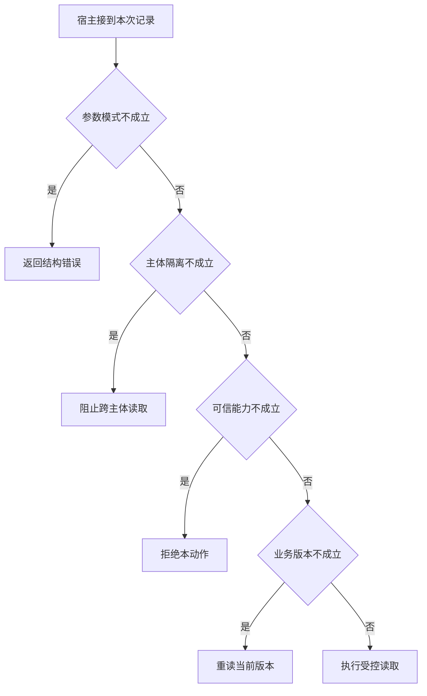

# Schema 合法以后还要查什么

模拟两个结构完全相同的案件。
把合法申请号改为另一用户的 ID，模型输出仍能通过 JSON 校验。在写入前才发现越界已经太迟，因为私有材料可能已经装入模型上下文。

本篇用一个封闭的教学决策器说明这一问题。输入是宿主收到的记录，不保证每个下游字段都已经获准使用。前置检查未成立时，下游即使带着缓存值，也不能拿来作业务断言。

## 先解决一个具体问题

**申请号是合法字符串，为什么仍然要在读前拒绝？**

因为结构模式描述的是值的形状，资源归属描述的是值与主体的关系。
可以换成另一主体的真实申请号作反例，若模型看见了私有材料，最后一步脱敏已经太迟。


先取一个能走到「执行受控读取」的输入：参数通过结构检查、数据与当前主体匹配、宿主确认当前主体获准、资料版本仍适用。
把这四个条件代回后文的图，前面各个拦截分支都未满足，最终才有“四层业务检查都成立”这个判断。
还原这个现场时要分别问：哪些位来自可信状态，哪些只是在接口中出现、尚未获得解释资格的字段。

## 先沿一次决策走到底



从上到下取第一条成立的出口。只改一个开关时，只有它之前的检查都未截断，该变化才可能到达真实动作。

“参数模式”的两种输入分别是“参数通过结构检查”与“缺少可执行的必填参数”。
能解码文本并不等于可以调用业务方法。

“主体隔离”的两种输入分别是“数据与当前主体匹配”与“数据属于另一主体”。
隔离应发生在把材料交给模型之前。

“可信能力”的两种输入分别是“宿主确认当前主体获准”与“当前主体未获授权”。
权限取自可信入口或执行端，不由模型生成。

“业务版本”的两种输入分别是“资料版本仍适用”与“观察所依据版本已过期”。
写入前应重新验证可能变化的业务前提。

## 最少需要哪几项观察

### 返回结构错误

参数无法映射到受控方法。
在本节的全部组合中，有 8 种产生「返回结构错误」，这只是逻辑空间的计数，不能当作实际用户请求的比例。

只取得缺少可执行的必填参数，已经足以要求宿主「返回结构错误」。
保持这些已知项，其余开关自由变化，仍有 8 种补全，判断没有翻转。

若删掉关于参数模式的证据，另一份允许的现场是参数通过结构检查、数据属于另一主体、当前主体未获授权、观察所依据版本已过期，它会使宿主「阻止跨主体读取」。

### 阻止跨主体读取

必须在资料离开服务前核验归属。
在本节的全部组合中，有 4 种产生「阻止跨主体读取」，这只是逻辑空间的计数，不能当作实际用户请求的比例。

只取得参数通过结构检查、数据属于另一主体，已经足以要求宿主「阻止跨主体读取」。
保持这些已知项，其余开关自由变化，仍有 4 种补全，判断没有翻转。

若删掉关于参数模式的证据，另一份允许的现场是缺少可执行的必填参数、数据属于另一主体、当前主体未获授权、观察所依据版本已过期，它会使宿主「返回结构错误」。

若删掉关于主体隔离的证据，另一份允许的现场是参数通过结构检查、数据与当前主体匹配、当前主体未获授权、观察所依据版本已过期，它会使宿主「拒绝本动作」。

### 拒绝本动作

身份匹配和获得相应能力不同。
在本节的全部组合中，有 2 种产生「拒绝本动作」，这只是逻辑空间的计数，不能当作实际用户请求的比例。

只取得参数通过结构检查、数据与当前主体匹配、当前主体未获授权，已经足以要求宿主「拒绝本动作」。
保持这些已知项，其余开关自由变化，仍有 2 种补全，判断没有翻转。

若删掉关于参数模式的证据，另一份允许的现场是缺少可执行的必填参数、数据与当前主体匹配、当前主体未获授权、观察所依据版本已过期，它会使宿主「返回结构错误」。

若删掉关于主体隔离的证据，另一份允许的现场是参数通过结构检查、数据属于另一主体、当前主体未获授权、观察所依据版本已过期，它会使宿主「阻止跨主体读取」。

若删掉关于可信能力的证据，另一份允许的现场是参数通过结构检查、数据与当前主体匹配、宿主确认当前主体获准、观察所依据版本已过期，它会使宿主「重读当前版本」。

### 重读当前版本

过期前提不能支持当前判断。
在本节的全部组合中，有 1 种产生「重读当前版本」，这只是逻辑空间的计数，不能当作实际用户请求的比例。

只取得参数通过结构检查、数据与当前主体匹配、宿主确认当前主体获准、观察所依据版本已过期，已经足以要求宿主「重读当前版本」。
保持这些已知项，其余开关自由变化，仍有 1 种补全，判断没有翻转。

若删掉关于参数模式的证据，另一份允许的现场是缺少可执行的必填参数、数据与当前主体匹配、宿主确认当前主体获准、观察所依据版本已过期，它会使宿主「返回结构错误」。

若删掉关于主体隔离的证据，另一份允许的现场是参数通过结构检查、数据属于另一主体、宿主确认当前主体获准、观察所依据版本已过期，它会使宿主「阻止跨主体读取」。

若删掉关于可信能力的证据，另一份允许的现场是参数通过结构检查、数据与当前主体匹配、当前主体未获授权、观察所依据版本已过期，它会使宿主「拒绝本动作」。

若删掉关于业务版本的证据，另一份允许的现场是参数通过结构检查、数据与当前主体匹配、宿主确认当前主体获准、资料版本仍适用，它会使宿主「执行受控读取」。

### 执行受控读取

四层业务检查都成立。
在本节的全部组合中，有 1 种产生「执行受控读取」，这只是逻辑空间的计数，不能当作实际用户请求的比例。

只取得参数通过结构检查、数据与当前主体匹配、宿主确认当前主体获准、资料版本仍适用，已经足以要求宿主「执行受控读取」。

若删掉关于参数模式的证据，另一份允许的现场是缺少可执行的必填参数、数据与当前主体匹配、宿主确认当前主体获准、资料版本仍适用，它会使宿主「返回结构错误」。

若删掉关于主体隔离的证据，另一份允许的现场是参数通过结构检查、数据属于另一主体、宿主确认当前主体获准、资料版本仍适用，它会使宿主「阻止跨主体读取」。

若删掉关于可信能力的证据，另一份允许的现场是参数通过结构检查、数据与当前主体匹配、当前主体未获授权、资料版本仍适用，它会使宿主「拒绝本动作」。

若删掉关于业务版本的证据，另一份允许的现场是参数通过结构检查、数据与当前主体匹配、宿主确认当前主体获准、观察所依据版本已过期，它会使宿主「重读当前版本」。

## 以同一份契约解释截然不同的现场

<details>
<summary>展开推演与对应反例</summary>

下列样本按最先命中的业务分支排列。四位编码只作本篇页内定位，顺序与开头的四项输入一致。可以先猜下一动作，再展开相邻样本。

### 能够触发“返回结构错误”的现场

**样本 0000**

业务侧交来缺少可执行的必填参数、数据属于另一主体，执行侧还记录了当前主体未获授权、观察所依据版本已过期。
把样本压成最短证明，保留缺少可执行的必填参数就能支持「返回结构错误」。

在这份记录上，分别翻转「参数模式」中的任一项，其他项完全不变时，下一动作都会改变。

保持其余观察不动，单独切换「主体隔离」、「可信能力」、「业务版本」仍得到「返回结构错误」，它们在这个现场不是决定性变量。

要从本例改走「阻止跨主体读取」，至少需要变动 1 项，一组最少改动是将缺少可执行的必填参数换成参数通过结构检查。

要从本例改走「拒绝本动作」，至少需要变动 2 项，一组最少改动是将缺少可执行的必填参数、数据属于另一主体换成参数通过结构检查、数据与当前主体匹配。

要从本例改走「重读当前版本」，至少需要变动 3 项，一组最少改动是将缺少可执行的必填参数、数据属于另一主体、当前主体未获授权换成参数通过结构检查、数据与当前主体匹配、宿主确认当前主体获准。

要从本例改走「执行受控读取」，至少需要变动 4 项，一组最少改动是将缺少可执行的必填参数、数据属于另一主体、当前主体未获授权、观察所依据版本已过期换成参数通过结构检查、数据与当前主体匹配、宿主确认当前主体获准、资料版本仍适用。

**样本 0001**

业务侧交来缺少可执行的必填参数、数据属于另一主体，执行侧还记录了当前主体未获授权、资料版本仍适用。


要从本例改走「执行受控读取」，至少需要变动 3 项，一组最少改动是将缺少可执行的必填参数、数据属于另一主体、当前主体未获授权换成参数通过结构检查、数据与当前主体匹配、宿主确认当前主体获准。

要从本例改走「重读当前版本」，至少需要变动 4 项，一组最少改动是将缺少可执行的必填参数、数据属于另一主体、当前主体未获授权、资料版本仍适用换成参数通过结构检查、数据与当前主体匹配、宿主确认当前主体获准、观察所依据版本已过期。

**样本 0010**

业务侧交来缺少可执行的必填参数、数据属于另一主体，执行侧还记录了宿主确认当前主体获准、观察所依据版本已过期。


要从本例改走「重读当前版本」，至少需要变动 2 项，一组最少改动是将缺少可执行的必填参数、数据属于另一主体换成参数通过结构检查、数据与当前主体匹配。

要从本例改走「拒绝本动作」，至少需要变动 3 项，一组最少改动是将缺少可执行的必填参数、数据属于另一主体、宿主确认当前主体获准换成参数通过结构检查、数据与当前主体匹配、当前主体未获授权。

要从本例改走「执行受控读取」，至少需要变动 3 项，一组最少改动是将缺少可执行的必填参数、数据属于另一主体、观察所依据版本已过期换成参数通过结构检查、数据与当前主体匹配、资料版本仍适用。

**样本 0011**

业务侧交来缺少可执行的必填参数、数据属于另一主体，执行侧还记录了宿主确认当前主体获准、资料版本仍适用。


要从本例改走「执行受控读取」，至少需要变动 2 项，一组最少改动是将缺少可执行的必填参数、数据属于另一主体换成参数通过结构检查、数据与当前主体匹配。


要从本例改走「重读当前版本」，至少需要变动 3 项，一组最少改动是将缺少可执行的必填参数、数据属于另一主体、资料版本仍适用换成参数通过结构检查、数据与当前主体匹配、观察所依据版本已过期。

**样本 0100**

业务侧交来缺少可执行的必填参数、数据与当前主体匹配，执行侧还记录了当前主体未获授权、观察所依据版本已过期。


要从本例改走「拒绝本动作」，至少需要变动 1 项，一组最少改动是将缺少可执行的必填参数换成参数通过结构检查。

要从本例改走「阻止跨主体读取」，至少需要变动 2 项，一组最少改动是将缺少可执行的必填参数、数据与当前主体匹配换成参数通过结构检查、数据属于另一主体。

要从本例改走「重读当前版本」，至少需要变动 2 项，一组最少改动是将缺少可执行的必填参数、当前主体未获授权换成参数通过结构检查、宿主确认当前主体获准。

要从本例改走「执行受控读取」，至少需要变动 3 项，一组最少改动是将缺少可执行的必填参数、当前主体未获授权、观察所依据版本已过期换成参数通过结构检查、宿主确认当前主体获准、资料版本仍适用。

**样本 0101**

业务侧交来缺少可执行的必填参数、数据与当前主体匹配，执行侧还记录了当前主体未获授权、资料版本仍适用。


要从本例改走「执行受控读取」，至少需要变动 2 项，一组最少改动是将缺少可执行的必填参数、当前主体未获授权换成参数通过结构检查、宿主确认当前主体获准。

要从本例改走「重读当前版本」，至少需要变动 3 项，一组最少改动是将缺少可执行的必填参数、当前主体未获授权、资料版本仍适用换成参数通过结构检查、宿主确认当前主体获准、观察所依据版本已过期。

**样本 0110**

业务侧交来缺少可执行的必填参数、数据与当前主体匹配，执行侧还记录了宿主确认当前主体获准、观察所依据版本已过期。


要从本例改走「重读当前版本」，至少需要变动 1 项，一组最少改动是将缺少可执行的必填参数换成参数通过结构检查。


要从本例改走「拒绝本动作」，至少需要变动 2 项，一组最少改动是将缺少可执行的必填参数、宿主确认当前主体获准换成参数通过结构检查、当前主体未获授权。

要从本例改走「执行受控读取」，至少需要变动 2 项，一组最少改动是将缺少可执行的必填参数、观察所依据版本已过期换成参数通过结构检查、资料版本仍适用。

**样本 0111**

业务侧交来缺少可执行的必填参数、数据与当前主体匹配，执行侧还记录了宿主确认当前主体获准、资料版本仍适用。


要从本例改走「执行受控读取」，至少需要变动 1 项，一组最少改动是将缺少可执行的必填参数换成参数通过结构检查。


要从本例改走「重读当前版本」，至少需要变动 2 项，一组最少改动是将缺少可执行的必填参数、资料版本仍适用换成参数通过结构检查、观察所依据版本已过期。

### 能够触发“阻止跨主体读取”的现场

**样本 1000**

业务侧交来参数通过结构检查、数据属于另一主体，执行侧还记录了当前主体未获授权、观察所依据版本已过期。
把样本压成最短证明，保留参数通过结构检查、数据属于另一主体就能支持「阻止跨主体读取」。

在这份记录上，分别翻转「参数模式」、「主体隔离」中的任一项，其他项完全不变时，下一动作都会改变。

保持其余观察不动，单独切换「可信能力」、「业务版本」仍得到「阻止跨主体读取」，它们在这个现场不是决定性变量。

本例没走更靠前的「返回结构错误」，因为参数通过结构检查与那个入口的必要条件不符。

要从本例改走「返回结构错误」，至少需要变动 1 项，一组最少改动是将参数通过结构检查换成缺少可执行的必填参数。

要从本例改走「拒绝本动作」，至少需要变动 1 项，一组最少改动是将数据属于另一主体换成数据与当前主体匹配。

要从本例改走「重读当前版本」，至少需要变动 2 项，一组最少改动是将数据属于另一主体、当前主体未获授权换成数据与当前主体匹配、宿主确认当前主体获准。

要从本例改走「执行受控读取」，至少需要变动 3 项，一组最少改动是将数据属于另一主体、当前主体未获授权、观察所依据版本已过期换成数据与当前主体匹配、宿主确认当前主体获准、资料版本仍适用。

**样本 1001**

业务侧交来参数通过结构检查、数据属于另一主体，执行侧还记录了当前主体未获授权、资料版本仍适用。


要从本例改走「执行受控读取」，至少需要变动 2 项，一组最少改动是将数据属于另一主体、当前主体未获授权换成数据与当前主体匹配、宿主确认当前主体获准。

要从本例改走「重读当前版本」，至少需要变动 3 项，一组最少改动是将数据属于另一主体、当前主体未获授权、资料版本仍适用换成数据与当前主体匹配、宿主确认当前主体获准、观察所依据版本已过期。

**样本 1010**

业务侧交来参数通过结构检查、数据属于另一主体，执行侧还记录了宿主确认当前主体获准、观察所依据版本已过期。


要从本例改走「重读当前版本」，至少需要变动 1 项，一组最少改动是将数据属于另一主体换成数据与当前主体匹配。

要从本例改走「拒绝本动作」，至少需要变动 2 项，一组最少改动是将数据属于另一主体、宿主确认当前主体获准换成数据与当前主体匹配、当前主体未获授权。

要从本例改走「执行受控读取」，至少需要变动 2 项，一组最少改动是将数据属于另一主体、观察所依据版本已过期换成数据与当前主体匹配、资料版本仍适用。

**样本 1011**

业务侧交来参数通过结构检查、数据属于另一主体，执行侧还记录了宿主确认当前主体获准、资料版本仍适用。


要从本例改走「执行受控读取」，至少需要变动 1 项，一组最少改动是将数据属于另一主体换成数据与当前主体匹配。


要从本例改走「重读当前版本」，至少需要变动 2 项，一组最少改动是将数据属于另一主体、资料版本仍适用换成数据与当前主体匹配、观察所依据版本已过期。

### 能够触发“拒绝本动作”的现场

**样本 1100**

业务侧交来参数通过结构检查、数据与当前主体匹配，执行侧还记录了当前主体未获授权、观察所依据版本已过期。
把样本压成最短证明，保留参数通过结构检查、数据与当前主体匹配、当前主体未获授权就能支持「拒绝本动作」。

在这份记录上，分别翻转「参数模式」、「主体隔离」、「可信能力」中的任一项，其他项完全不变时，下一动作都会改变。

保持其余观察不动，单独切换「业务版本」仍得到「拒绝本动作」，它们在这个现场不是决定性变量。


本例没走更靠前的「阻止跨主体读取」，因为数据与当前主体匹配与那个入口的必要条件不符。


要从本例改走「阻止跨主体读取」，至少需要变动 1 项，一组最少改动是将数据与当前主体匹配换成数据属于另一主体。

要从本例改走「重读当前版本」，至少需要变动 1 项，一组最少改动是将当前主体未获授权换成宿主确认当前主体获准。

要从本例改走「执行受控读取」，至少需要变动 2 项，一组最少改动是将当前主体未获授权、观察所依据版本已过期换成宿主确认当前主体获准、资料版本仍适用。

**样本 1101**

业务侧交来参数通过结构检查、数据与当前主体匹配，执行侧还记录了当前主体未获授权、资料版本仍适用。


要从本例改走「执行受控读取」，至少需要变动 1 项，一组最少改动是将当前主体未获授权换成宿主确认当前主体获准。

要从本例改走「重读当前版本」，至少需要变动 2 项，一组最少改动是将当前主体未获授权、资料版本仍适用换成宿主确认当前主体获准、观察所依据版本已过期。

### 能够触发“重读当前版本”的现场

**样本 1110**

业务侧交来参数通过结构检查、数据与当前主体匹配，执行侧还记录了宿主确认当前主体获准、观察所依据版本已过期。
把样本压成最短证明，保留参数通过结构检查、数据与当前主体匹配、宿主确认当前主体获准、观察所依据版本已过期就能支持「重读当前版本」。

在这份记录上，分别翻转「参数模式」、「主体隔离」、「可信能力」、「业务版本」中的任一项，其他项完全不变时，下一动作都会改变。


本例没走更靠前的「拒绝本动作」，因为宿主确认当前主体获准与那个入口的必要条件不符。


要从本例改走「拒绝本动作」，至少需要变动 1 项，一组最少改动是将宿主确认当前主体获准换成当前主体未获授权。

要从本例改走「执行受控读取」，至少需要变动 1 项，一组最少改动是将观察所依据版本已过期换成资料版本仍适用。

### 能够触发“执行受控读取”的现场

**样本 1111**

业务侧交来参数通过结构检查、数据与当前主体匹配，执行侧还记录了宿主确认当前主体获准、资料版本仍适用。
把样本压成最短证明，保留参数通过结构检查、数据与当前主体匹配、宿主确认当前主体获准、资料版本仍适用就能支持「执行受控读取」。


本例没走更靠前的「重读当前版本」，因为资料版本仍适用与那个入口的必要条件不符。


要从本例改走「重读当前版本」，至少需要变动 1 项，一组最少改动是将资料版本仍适用换成观察所依据版本已过期。

</details>

## 当你只能看见一半记录

<details>
<summary>展开推演与对应反例</summary>

这次隐藏两个字段，保留另两个。对每个可见现场，检查四种合法补全是否同意。如仍有歧义，选择能使最坏剩余候选动作最少的字段继续查。并列时采用本篇字段顺序。

### 只保留参数模式与主体隔离

已知缺少可执行的必填参数、数据属于另一主体时，四种补全的动作分布为返回结构错误（4 种）。

就“返回结构错误”这个动作而言，在缺少可执行的必填参数、数据属于另一主体的前提下，另外两项观察不会推翻它。

已知缺少可执行的必填参数、数据与当前主体匹配时，四种补全的动作分布为返回结构错误（4 种）。

就“返回结构错误”这个动作而言，在缺少可执行的必填参数、数据与当前主体匹配的前提下，另外两项观察不会推翻它。

已知参数通过结构检查、数据属于另一主体时，四种补全的动作分布为阻止跨主体读取（4 种）。

就“阻止跨主体读取”这个动作而言，在参数通过结构检查、数据属于另一主体的前提下，另外两项观察不会推翻它。

已知参数通过结构检查、数据与当前主体匹配时，四种补全的动作分布为拒绝本动作（2 种）、重读当前版本（1 种）、执行受控读取（1 种）。

在参数通过结构检查、数据与当前主体匹配这个现场补读「可信能力」，最坏还剩 2 种动作，计算时只衡量歧义，尚未扣读取代价。
若补来的观察为“当前主体未获授权”，范围缩成「拒绝本动作」。若为“宿主确认当前主体获准”，则保留「重读当前版本」、「执行受控读取」。

区分不了的两条执行可以具体写成 1100 与 1110：它们共享已展示字段，却分别需要「拒绝本动作」和「重读当前版本」。

### 只保留参数模式与可信能力

已知缺少可执行的必填参数、当前主体未获授权时，四种补全的动作分布为返回结构错误（4 种）。

就“返回结构错误”这个动作而言，在缺少可执行的必填参数、当前主体未获授权的前提下，另外两项观察不会推翻它。

已知缺少可执行的必填参数、宿主确认当前主体获准时，四种补全的动作分布为返回结构错误（4 种）。

就“返回结构错误”这个动作而言，在缺少可执行的必填参数、宿主确认当前主体获准的前提下，另外两项观察不会推翻它。

已知参数通过结构检查、当前主体未获授权时，四种补全的动作分布为阻止跨主体读取（2 种）、拒绝本动作（2 种）。

在参数通过结构检查、当前主体未获授权这个现场补读「主体隔离」，最坏还剩 1 种动作，计算时只衡量歧义，尚未扣读取代价。
若补来的观察为“数据属于另一主体”，范围缩成「阻止跨主体读取」。若为“数据与当前主体匹配”，则保留「拒绝本动作」。

区分不了的两条执行可以具体写成 1000 与 1100：它们共享已展示字段，却分别需要「阻止跨主体读取」和「拒绝本动作」。

已知参数通过结构检查、宿主确认当前主体获准时，四种补全的动作分布为阻止跨主体读取（2 种）、重读当前版本（1 种）、执行受控读取（1 种）。

在参数通过结构检查、宿主确认当前主体获准这个现场补读「主体隔离」，最坏还剩 2 种动作，计算时只衡量歧义，尚未扣读取代价。
若补来的观察为“数据属于另一主体”，范围缩成「阻止跨主体读取」。若为“数据与当前主体匹配”，则保留「重读当前版本」、「执行受控读取」。

区分不了的两条执行可以具体写成 1010 与 1110：它们共享已展示字段，却分别需要「阻止跨主体读取」和「重读当前版本」。

### 只保留主体隔离与可信能力

已知数据属于另一主体、当前主体未获授权时，四种补全的动作分布为返回结构错误（2 种）、阻止跨主体读取（2 种）。

在数据属于另一主体、当前主体未获授权这个现场补读「参数模式」，最坏还剩 1 种动作，计算时只衡量歧义，尚未扣读取代价。
若补来的观察为“缺少可执行的必填参数”，范围缩成「返回结构错误」。若为“参数通过结构检查”，则保留「阻止跨主体读取」。

区分不了的两条执行可以具体写成 0000 与 1000：它们共享已展示字段，却分别需要「返回结构错误」和「阻止跨主体读取」。

已知数据属于另一主体、宿主确认当前主体获准时，四种补全的动作分布为返回结构错误（2 种）、阻止跨主体读取（2 种）。

在数据属于另一主体、宿主确认当前主体获准这个现场补读「参数模式」，最坏还剩 1 种动作，计算时只衡量歧义，尚未扣读取代价。

区分不了的两条执行可以具体写成 0010 与 1010：它们共享已展示字段，却分别需要「返回结构错误」和「阻止跨主体读取」。

已知数据与当前主体匹配、当前主体未获授权时，四种补全的动作分布为返回结构错误（2 种）、拒绝本动作（2 种）。

在数据与当前主体匹配、当前主体未获授权这个现场补读「参数模式」，最坏还剩 1 种动作，计算时只衡量歧义，尚未扣读取代价。
若补来的观察为“缺少可执行的必填参数”，范围缩成「返回结构错误」。若为“参数通过结构检查”，则保留「拒绝本动作」。

区分不了的两条执行可以具体写成 0100 与 1100：它们共享已展示字段，却分别需要「返回结构错误」和「拒绝本动作」。

已知数据与当前主体匹配、宿主确认当前主体获准时，四种补全的动作分布为返回结构错误（2 种）、重读当前版本（1 种）、执行受控读取（1 种）。

在数据与当前主体匹配、宿主确认当前主体获准这个现场补读「参数模式」，最坏还剩 2 种动作，计算时只衡量歧义，尚未扣读取代价。
若补来的观察为“缺少可执行的必填参数”，范围缩成「返回结构错误」。若为“参数通过结构检查”，则保留「重读当前版本」、「执行受控读取」。

区分不了的两条执行可以具体写成 0110 与 1110：它们共享已展示字段，却分别需要「返回结构错误」和「重读当前版本」。

### 只保留参数模式与业务版本

已知缺少可执行的必填参数、观察所依据版本已过期时，四种补全的动作分布为返回结构错误（4 种）。

就“返回结构错误”这个动作而言，在缺少可执行的必填参数、观察所依据版本已过期的前提下，另外两项观察不会推翻它。

已知缺少可执行的必填参数、资料版本仍适用时，四种补全的动作分布为返回结构错误（4 种）。

就“返回结构错误”这个动作而言，在缺少可执行的必填参数、资料版本仍适用的前提下，另外两项观察不会推翻它。

已知参数通过结构检查、观察所依据版本已过期时，四种补全的动作分布为阻止跨主体读取（2 种）、拒绝本动作（1 种）、重读当前版本（1 种）。

在参数通过结构检查、观察所依据版本已过期这个现场补读「主体隔离」，最坏还剩 2 种动作，计算时只衡量歧义，尚未扣读取代价。
若补来的观察为“数据属于另一主体”，范围缩成「阻止跨主体读取」。若为“数据与当前主体匹配”，则保留「拒绝本动作」、「重读当前版本」。


已知参数通过结构检查、资料版本仍适用时，四种补全的动作分布为阻止跨主体读取（2 种）、拒绝本动作（1 种）、执行受控读取（1 种）。

在参数通过结构检查、资料版本仍适用这个现场补读「主体隔离」，最坏还剩 2 种动作，计算时只衡量歧义，尚未扣读取代价。
若补来的观察为“数据属于另一主体”，范围缩成「阻止跨主体读取」。若为“数据与当前主体匹配”，则保留「拒绝本动作」、「执行受控读取」。

区分不了的两条执行可以具体写成 1001 与 1101：它们共享已展示字段，却分别需要「阻止跨主体读取」和「拒绝本动作」。

### 只保留主体隔离与业务版本

已知数据属于另一主体、观察所依据版本已过期时，四种补全的动作分布为返回结构错误（2 种）、阻止跨主体读取（2 种）。

在数据属于另一主体、观察所依据版本已过期这个现场补读「参数模式」，最坏还剩 1 种动作，计算时只衡量歧义，尚未扣读取代价。


已知数据属于另一主体、资料版本仍适用时，四种补全的动作分布为返回结构错误（2 种）、阻止跨主体读取（2 种）。

在数据属于另一主体、资料版本仍适用这个现场补读「参数模式」，最坏还剩 1 种动作，计算时只衡量歧义，尚未扣读取代价。

区分不了的两条执行可以具体写成 0001 与 1001：它们共享已展示字段，却分别需要「返回结构错误」和「阻止跨主体读取」。

已知数据与当前主体匹配、观察所依据版本已过期时，四种补全的动作分布为返回结构错误（2 种）、拒绝本动作（1 种）、重读当前版本（1 种）。

在数据与当前主体匹配、观察所依据版本已过期这个现场补读「参数模式」，最坏还剩 2 种动作，计算时只衡量歧义，尚未扣读取代价。
若补来的观察为“缺少可执行的必填参数”，范围缩成「返回结构错误」。若为“参数通过结构检查”，则保留「拒绝本动作」、「重读当前版本」。


已知数据与当前主体匹配、资料版本仍适用时，四种补全的动作分布为返回结构错误（2 种）、拒绝本动作（1 种）、执行受控读取（1 种）。

在数据与当前主体匹配、资料版本仍适用这个现场补读「参数模式」，最坏还剩 2 种动作，计算时只衡量歧义，尚未扣读取代价。
若补来的观察为“缺少可执行的必填参数”，范围缩成「返回结构错误」。若为“参数通过结构检查”，则保留「拒绝本动作」、「执行受控读取」。

区分不了的两条执行可以具体写成 0101 与 1101：它们共享已展示字段，却分别需要「返回结构错误」和「拒绝本动作」。

### 只保留可信能力与业务版本

已知当前主体未获授权、观察所依据版本已过期时，四种补全的动作分布为返回结构错误（2 种）、阻止跨主体读取（1 种）、拒绝本动作（1 种）。

在当前主体未获授权、观察所依据版本已过期这个现场补读「参数模式」，最坏还剩 2 种动作，计算时只衡量歧义，尚未扣读取代价。
若补来的观察为“缺少可执行的必填参数”，范围缩成「返回结构错误」。若为“参数通过结构检查”，则保留「阻止跨主体读取」、「拒绝本动作」。


已知当前主体未获授权、资料版本仍适用时，四种补全的动作分布为返回结构错误（2 种）、阻止跨主体读取（1 种）、拒绝本动作（1 种）。

在当前主体未获授权、资料版本仍适用这个现场补读「参数模式」，最坏还剩 2 种动作，计算时只衡量歧义，尚未扣读取代价。


已知宿主确认当前主体获准、观察所依据版本已过期时，四种补全的动作分布为返回结构错误（2 种）、阻止跨主体读取（1 种）、重读当前版本（1 种）。

在宿主确认当前主体获准、观察所依据版本已过期这个现场补读「参数模式」，最坏还剩 2 种动作，计算时只衡量歧义，尚未扣读取代价。
若补来的观察为“缺少可执行的必填参数”，范围缩成「返回结构错误」。若为“参数通过结构检查”，则保留「阻止跨主体读取」、「重读当前版本」。


已知宿主确认当前主体获准、资料版本仍适用时，四种补全的动作分布为返回结构错误（2 种）、阻止跨主体读取（1 种）、执行受控读取（1 种）。

在宿主确认当前主体获准、资料版本仍适用这个现场补读「参数模式」，最坏还剩 2 种动作，计算时只衡量歧义，尚未扣读取代价。
若补来的观察为“缺少可执行的必填参数”，范围缩成「返回结构错误」。若为“参数通过结构检查”，则保留「阻止跨主体读取」、「执行受控读取」。

区分不了的两条执行可以具体写成 0011 与 1011：它们共享已展示字段，却分别需要「返回结构错误」和「阻止跨主体读取」。

</details>

## 单因素干预与边界测试

<details>
<summary>展开推演与对应反例</summary>

### 只改变参数模式

固定另外三个条件得到八对现场，从“缺少可执行的必填参数”转为“参数通过结构检查”时，8 对翻转动作，另外 0 对保持不变。

有 4 对现场沿「返回结构错误」变到「阻止跨主体读取」，可复现的一组受控背景为数据属于另一主体、当前主体未获授权、观察所依据版本已过期。

有 2 对现场沿「返回结构错误」变到「拒绝本动作」，可复现的一组受控背景为数据与当前主体匹配、当前主体未获授权、观察所依据版本已过期。

有 1 对现场沿「返回结构错误」变到「重读当前版本」，可复现的一组受控背景为数据与当前主体匹配、宿主确认当前主体获准、观察所依据版本已过期。

有 1 对现场沿「返回结构错误」变到「执行受控读取」，可复现的一组受控背景为数据与当前主体匹配、宿主确认当前主体获准、资料版本仍适用。

### 只改变主体隔离

固定另外三个条件得到八对现场，从“数据属于另一主体”转为“数据与当前主体匹配”时，4 对翻转动作，另外 4 对保持不变。

令缺少可执行的必填参数、当前主体未获授权、观察所依据版本已过期，主体隔离的两个取值均得到「返回结构错误」。在八对中，共有 4 对表现为这一种稳定出口。

有 2 对现场沿「阻止跨主体读取」变到「拒绝本动作」，可复现的一组受控背景为参数通过结构检查、当前主体未获授权、观察所依据版本已过期。

有 1 对现场沿「阻止跨主体读取」变到「重读当前版本」，可复现的一组受控背景为参数通过结构检查、宿主确认当前主体获准、观察所依据版本已过期。

有 1 对现场沿「阻止跨主体读取」变到「执行受控读取」，可复现的一组受控背景为参数通过结构检查、宿主确认当前主体获准、资料版本仍适用。

### 只改变可信能力

固定另外三个条件得到八对现场，从“当前主体未获授权”转为“宿主确认当前主体获准”时，2 对翻转动作，另外 6 对保持不变。

令缺少可执行的必填参数、数据属于另一主体、观察所依据版本已过期，可信能力的两个取值均得到「返回结构错误」。在八对中，共有 4 对表现为这一种稳定出口。

令参数通过结构检查、数据属于另一主体、观察所依据版本已过期，可信能力的两个取值均得到「阻止跨主体读取」。在八对中，共有 2 对表现为这一种稳定出口。

有 1 对现场沿「拒绝本动作」变到「重读当前版本」，可复现的一组受控背景为参数通过结构检查、数据与当前主体匹配、观察所依据版本已过期。

有 1 对现场沿「拒绝本动作」变到「执行受控读取」，可复现的一组受控背景为参数通过结构检查、数据与当前主体匹配、资料版本仍适用。

### 只改变业务版本

固定另外三个条件得到八对现场，从“观察所依据版本已过期”转为“资料版本仍适用”时，1 对翻转动作，另外 7 对保持不变。

令缺少可执行的必填参数、数据属于另一主体、当前主体未获授权，业务版本的两个取值均得到「返回结构错误」。在八对中，共有 4 对表现为这一种稳定出口。

令参数通过结构检查、数据属于另一主体、当前主体未获授权，业务版本的两个取值均得到「阻止跨主体读取」。在八对中，共有 2 对表现为这一种稳定出口。

令参数通过结构检查、数据与当前主体匹配、当前主体未获授权，业务版本的两个取值均得到「拒绝本动作」。在八对中，共有 1 对表现为这一种稳定出口。

有 1 对现场沿「重读当前版本」变到「执行受控读取」，可复现的一组受控背景为参数通过结构检查、数据与当前主体匹配、宿主确认当前主体获准。

</details>

## 哪些回归样本真能抓住实现错误

<details>
<summary>展开推演与对应反例</summary>

如果删除“返回结构错误”这个分支，在本篇 16 种输入里有 8 种会改走另一出口。

反例 0000 的完整记录为缺少可执行的必填参数、数据属于另一主体、当前主体未获授权、观察所依据版本已过期。正确结果是「返回结构错误」，这个改坏的实现却给出「阻止跨主体读取」。

如果删除“阻止跨主体读取”这个分支，在本篇 16 种输入里有 4 种会改走另一出口。

反例 1000 的完整记录为参数通过结构检查、数据属于另一主体、当前主体未获授权、观察所依据版本已过期。正确结果是「阻止跨主体读取」，这个改坏的实现却给出「拒绝本动作」。

如果删除“拒绝本动作”这个分支，在本篇 16 种输入里有 2 种会改走另一出口。

反例 1100 的完整记录为参数通过结构检查、数据与当前主体匹配、当前主体未获授权、观察所依据版本已过期。正确结果是「拒绝本动作」，这个改坏的实现却给出「重读当前版本」。

如果删除“重读当前版本”这个分支，在本篇 16 种输入里有 1 种会改走另一出口。

反例 1110 的完整记录为参数通过结构检查、数据与当前主体匹配、宿主确认当前主体获准、观察所依据版本已过期。正确结果是「重读当前版本」，这个改坏的实现却给出「执行受控读取」。

如果交换“返回结构错误”和“阻止跨主体读取”的判断次序，在本篇 16 种输入里有 4 种会改走另一出口。


如果交换“阻止跨主体读取”和“拒绝本动作”的判断次序，在本篇 16 种输入里有 2 种会改走另一出口。


如果交换“拒绝本动作”和“重读当前版本”的判断次序，在本篇 16 种输入里有 1 种会改走另一出口。


补入样本 0000（缺少可执行的必填参数、数据属于另一主体、当前主体未获授权、观察所依据版本已过期）能新增检出「删除“返回结构错误”这个分支」、「交换“返回结构错误”和“阻止跨主体读取”的判断次序」。

补入样本 1000（参数通过结构检查、数据属于另一主体、当前主体未获授权、观察所依据版本已过期）能新增检出「删除“阻止跨主体读取”这个分支」、「交换“阻止跨主体读取”和“拒绝本动作”的判断次序」。

补入样本 1100（参数通过结构检查、数据与当前主体匹配、当前主体未获授权、观察所依据版本已过期）能新增检出「删除“拒绝本动作”这个分支」、「交换“拒绝本动作”和“重读当前版本”的判断次序」。

补入样本 1110（参数通过结构检查、数据与当前主体匹配、宿主确认当前主体获准、观察所依据版本已过期）能新增检出「删除“重读当前版本”这个分支」。

这里每次选覆盖尚未捕获缺陷最多的样本，并不保证用例数全局最小。它给出的反例能作为 Java 单测输入。真实模型是否会自主产生这些提议，仍须单独评测。

</details>

## 把状态覆盖换成有抽样偏差的评测批次

<details>
<summary>展开推演与对应反例</summary>

前面的十六种记录各有一票。现在只改样本构成：对一个给定字段，把成立侧的每种记录各取三份、另一侧各取一份。这是人为配比的 32 份回放，不是线上频率估计。
将偏向成立与偏向不成立的两次批次对照，可以隔离分母变化。底层宿主和所有答案保持相同，比例仍可能移动。

### 改变“参数模式”的样本配比

只看「返回结构错误」，在参数通过结构检查的八个不同输入中有 0 个命中，在缺少可执行的必填参数的另八个输入中有 8 个命中。
把「参数模式」成立侧按三倍取样，「返回结构错误」占 8/32，反过来向未成立侧倾斜后占 24/32。
这次重加权使「返回结构错误」的占比相差 50 个百分点。若按两种不同的“参数模式”分布跑新旧版，不能把这项差异全部归功于实现。

只看「阻止跨主体读取」，在参数通过结构检查的八个不同输入中有 4 个命中，在缺少可执行的必填参数的另八个输入中有 0 个命中。
把「参数模式」成立侧按三倍取样，「阻止跨主体读取」占 12/32，反过来向未成立侧倾斜后占 4/32。
这次重加权使「阻止跨主体读取」的占比相差 25 个百分点。若按两种不同的“参数模式”分布跑新旧版，不能把这项差异全部归功于实现。

只看「拒绝本动作」，在参数通过结构检查的八个不同输入中有 2 个命中，在缺少可执行的必填参数的另八个输入中有 0 个命中。
把「参数模式」成立侧按三倍取样，「拒绝本动作」占 6/32，反过来向未成立侧倾斜后占 2/32。
这次重加权使「拒绝本动作」的占比相差 12.5 个百分点。若按两种不同的“参数模式”分布跑新旧版，不能把这项差异全部归功于实现。

只看「重读当前版本」，在参数通过结构检查的八个不同输入中有 1 个命中，在缺少可执行的必填参数的另八个输入中有 0 个命中。
把「参数模式」成立侧按三倍取样，「重读当前版本」占 3/32，反过来向未成立侧倾斜后占 1/32。
这次重加权使「重读当前版本」的占比相差 6.25 个百分点。若按两种不同的“参数模式”分布跑新旧版，不能把这项差异全部归功于实现。

只看「执行受控读取」，在参数通过结构检查的八个不同输入中有 1 个命中，在缺少可执行的必填参数的另八个输入中有 0 个命中。
把「参数模式」成立侧按三倍取样，「执行受控读取」占 3/32，反过来向未成立侧倾斜后占 1/32。
这次重加权使「执行受控读取」的占比相差 6.25 个百分点。若按两种不同的“参数模式”分布跑新旧版，不能把这项差异全部归功于实现。

### 改变“主体隔离”的样本配比

只看「返回结构错误」，在数据与当前主体匹配的八个不同输入中有 4 个命中，在数据属于另一主体的另八个输入中有 4 个命中。
把「主体隔离」成立侧按三倍取样，「返回结构错误」占 16/32，反过来向未成立侧倾斜后占 16/32。
两批「返回结构错误」的边际比例相同，是因为这个出口在“主体隔离”的两侧计数相等，这不能单独证明每一对现场都不受它影响。

只看「阻止跨主体读取」，在数据与当前主体匹配的八个不同输入中有 0 个命中，在数据属于另一主体的另八个输入中有 4 个命中。
把「主体隔离」成立侧按三倍取样，「阻止跨主体读取」占 4/32，反过来向未成立侧倾斜后占 12/32。
这次重加权使「阻止跨主体读取」的占比相差 25 个百分点。若按两种不同的“主体隔离”分布跑新旧版，不能把这项差异全部归功于实现。

只看「拒绝本动作」，在数据与当前主体匹配的八个不同输入中有 2 个命中，在数据属于另一主体的另八个输入中有 0 个命中。
把「主体隔离」成立侧按三倍取样，「拒绝本动作」占 6/32，反过来向未成立侧倾斜后占 2/32。
这次重加权使「拒绝本动作」的占比相差 12.5 个百分点。若按两种不同的“主体隔离”分布跑新旧版，不能把这项差异全部归功于实现。

只看「重读当前版本」，在数据与当前主体匹配的八个不同输入中有 1 个命中，在数据属于另一主体的另八个输入中有 0 个命中。
把「主体隔离」成立侧按三倍取样，「重读当前版本」占 3/32，反过来向未成立侧倾斜后占 1/32。
这次重加权使「重读当前版本」的占比相差 6.25 个百分点。若按两种不同的“主体隔离”分布跑新旧版，不能把这项差异全部归功于实现。

只看「执行受控读取」，在数据与当前主体匹配的八个不同输入中有 1 个命中，在数据属于另一主体的另八个输入中有 0 个命中。
把「主体隔离」成立侧按三倍取样，「执行受控读取」占 3/32，反过来向未成立侧倾斜后占 1/32。
这次重加权使「执行受控读取」的占比相差 6.25 个百分点。若按两种不同的“主体隔离”分布跑新旧版，不能把这项差异全部归功于实现。

### 改变“可信能力”的样本配比

只看「返回结构错误」，在宿主确认当前主体获准的八个不同输入中有 4 个命中，在当前主体未获授权的另八个输入中有 4 个命中。
把「可信能力」成立侧按三倍取样，「返回结构错误」占 16/32，反过来向未成立侧倾斜后占 16/32。
两批「返回结构错误」的边际比例相同，是因为这个出口在“可信能力”的两侧计数相等，这不能单独证明每一对现场都不受它影响。

只看「阻止跨主体读取」，在宿主确认当前主体获准的八个不同输入中有 2 个命中，在当前主体未获授权的另八个输入中有 2 个命中。
把「可信能力」成立侧按三倍取样，「阻止跨主体读取」占 8/32，反过来向未成立侧倾斜后占 8/32。
两批「阻止跨主体读取」的边际比例相同，是因为这个出口在“可信能力”的两侧计数相等，这不能单独证明每一对现场都不受它影响。

只看「拒绝本动作」，在宿主确认当前主体获准的八个不同输入中有 0 个命中，在当前主体未获授权的另八个输入中有 2 个命中。
把「可信能力」成立侧按三倍取样，「拒绝本动作」占 2/32，反过来向未成立侧倾斜后占 6/32。
这次重加权使「拒绝本动作」的占比相差 12.5 个百分点。若按两种不同的“可信能力”分布跑新旧版，不能把这项差异全部归功于实现。

只看「重读当前版本」，在宿主确认当前主体获准的八个不同输入中有 1 个命中，在当前主体未获授权的另八个输入中有 0 个命中。
把「可信能力」成立侧按三倍取样，「重读当前版本」占 3/32，反过来向未成立侧倾斜后占 1/32。
这次重加权使「重读当前版本」的占比相差 6.25 个百分点。若按两种不同的“可信能力”分布跑新旧版，不能把这项差异全部归功于实现。

只看「执行受控读取」，在宿主确认当前主体获准的八个不同输入中有 1 个命中，在当前主体未获授权的另八个输入中有 0 个命中。
把「可信能力」成立侧按三倍取样，「执行受控读取」占 3/32，反过来向未成立侧倾斜后占 1/32。
这次重加权使「执行受控读取」的占比相差 6.25 个百分点。若按两种不同的“可信能力”分布跑新旧版，不能把这项差异全部归功于实现。

### 改变“业务版本”的样本配比

只看「返回结构错误」，在资料版本仍适用的八个不同输入中有 4 个命中，在观察所依据版本已过期的另八个输入中有 4 个命中。
把「业务版本」成立侧按三倍取样，「返回结构错误」占 16/32，反过来向未成立侧倾斜后占 16/32。
两批「返回结构错误」的边际比例相同，是因为这个出口在“业务版本”的两侧计数相等，这不能单独证明每一对现场都不受它影响。

只看「阻止跨主体读取」，在资料版本仍适用的八个不同输入中有 2 个命中，在观察所依据版本已过期的另八个输入中有 2 个命中。
把「业务版本」成立侧按三倍取样，「阻止跨主体读取」占 8/32，反过来向未成立侧倾斜后占 8/32。
两批「阻止跨主体读取」的边际比例相同，是因为这个出口在“业务版本”的两侧计数相等，这不能单独证明每一对现场都不受它影响。

只看「拒绝本动作」，在资料版本仍适用的八个不同输入中有 1 个命中，在观察所依据版本已过期的另八个输入中有 1 个命中。
把「业务版本」成立侧按三倍取样，「拒绝本动作」占 4/32，反过来向未成立侧倾斜后占 4/32。
两批「拒绝本动作」的边际比例相同，是因为这个出口在“业务版本”的两侧计数相等，这不能单独证明每一对现场都不受它影响。

只看「重读当前版本」，在资料版本仍适用的八个不同输入中有 0 个命中，在观察所依据版本已过期的另八个输入中有 1 个命中。
把「业务版本」成立侧按三倍取样，「重读当前版本」占 1/32，反过来向未成立侧倾斜后占 3/32。
这次重加权使「重读当前版本」的占比相差 6.25 个百分点。若按两种不同的“业务版本”分布跑新旧版，不能把这项差异全部归功于实现。

只看「执行受控读取」，在资料版本仍适用的八个不同输入中有 1 个命中，在观察所依据版本已过期的另八个输入中有 0 个命中。
把「业务版本」成立侧按三倍取样，「执行受控读取」占 3/32，反过来向未成立侧倾斜后占 1/32。
这次重加权使「执行受控读取」的占比相差 6.25 个百分点。若按两种不同的“业务版本”分布跑新旧版，不能把这项差异全部归功于实现。

</details>

## 只看终态，能逆推出多少原始事实

<details>
<summary>展开推演与对应反例</summary>

### 只保留“返回结构错误”这条结果时

在本节契约与完整输入域内，仅知「返回结构错误」就能倒推出缺少可执行的必填参数，这一推断依赖版本未变且日志中的终态可信。

「返回结构错误」不能证明主体隔离取哪一侧：0000 和 0100 有相同终态，却分别记为“数据属于另一主体”和“数据与当前主体匹配”。

「返回结构错误」不能证明可信能力取哪一侧：0000 和 0010 有相同终态，却分别记为“当前主体未获授权”和“宿主确认当前主体获准”。

「返回结构错误」不能证明业务版本取哪一侧：0000 和 0001 有相同终态，却分别记为“观察所依据版本已过期”和“资料版本仍适用”。

反查「返回结构错误」的诊断日志，优先保留能区分样本 0000 与 1000 的「参数模式」，否则很容易把邻近的「阻止跨主体读取」看成同一种故障。

### 只保留“阻止跨主体读取”这条结果时

在本节契约与完整输入域内，仅知「阻止跨主体读取」就能倒推出参数通过结构检查，这一推断依赖版本未变且日志中的终态可信。

在本节契约与完整输入域内，仅知「阻止跨主体读取」就能倒推出数据属于另一主体，这一推断依赖版本未变且日志中的终态可信。

「阻止跨主体读取」不能证明可信能力取哪一侧：1000 和 1010 有相同终态，却分别记为“当前主体未获授权”和“宿主确认当前主体获准”。

「阻止跨主体读取」不能证明业务版本取哪一侧：1000 和 1001 有相同终态，却分别记为“观察所依据版本已过期”和“资料版本仍适用”。

反查「阻止跨主体读取」的诊断日志，优先保留能区分样本 1000 与 0000 的「参数模式」，否则很容易把邻近的「返回结构错误」看成同一种故障。

### 只保留“拒绝本动作”这条结果时

在本节契约与完整输入域内，仅知「拒绝本动作」就能倒推出参数通过结构检查，这一推断依赖版本未变且日志中的终态可信。

在本节契约与完整输入域内，仅知「拒绝本动作」就能倒推出数据与当前主体匹配，这一推断依赖版本未变且日志中的终态可信。

在本节契约与完整输入域内，仅知「拒绝本动作」就能倒推出当前主体未获授权，这一推断依赖版本未变且日志中的终态可信。

「拒绝本动作」不能证明业务版本取哪一侧：1100 和 1101 有相同终态，却分别记为“观察所依据版本已过期”和“资料版本仍适用”。

反查「拒绝本动作」的诊断日志，优先保留能区分样本 1100 与 0100 的「参数模式」，否则很容易把邻近的「返回结构错误」看成同一种故障。

### 只保留“重读当前版本”这条结果时

在本节契约与完整输入域内，仅知「重读当前版本」就能倒推出参数通过结构检查，这一推断依赖版本未变且日志中的终态可信。

在本节契约与完整输入域内，仅知「重读当前版本」就能倒推出数据与当前主体匹配，这一推断依赖版本未变且日志中的终态可信。

在本节契约与完整输入域内，仅知「重读当前版本」就能倒推出宿主确认当前主体获准，这一推断依赖版本未变且日志中的终态可信。

在本节契约与完整输入域内，仅知「重读当前版本」就能倒推出观察所依据版本已过期，这一推断依赖版本未变且日志中的终态可信。

反查「重读当前版本」的诊断日志，优先保留能区分样本 1110 与 0110 的「参数模式」，否则很容易把邻近的「返回结构错误」看成同一种故障。

### 只保留“执行受控读取”这条结果时

在本节契约与完整输入域内，仅知「执行受控读取」就能倒推出参数通过结构检查，这一推断依赖版本未变且日志中的终态可信。

在本节契约与完整输入域内，仅知「执行受控读取」就能倒推出数据与当前主体匹配，这一推断依赖版本未变且日志中的终态可信。

在本节契约与完整输入域内，仅知「执行受控读取」就能倒推出宿主确认当前主体获准，这一推断依赖版本未变且日志中的终态可信。

在本节契约与完整输入域内，仅知「执行受控读取」就能倒推出资料版本仍适用，这一推断依赖版本未变且日志中的终态可信。

反查「执行受控读取」的诊断日志，优先保留能区分样本 1111 与 0111 的「参数模式」，否则很容易把邻近的「返回结构错误」看成同一种故障。

</details>

## 面试复述与复算

面试题可以从“申请号是合法字符串，为什么仍然要在读前拒绝？”起步。先给出本篇的触发条件和一条真实执行端可检查的证据，再用一个相邻反例限定结论的适用范围。

在仓库根目录执行下列命令可以重算本篇的一个输入。四位数字依次选择正文列出的四项条件，0 表示未成立或低档，1 表示成立或高档。
```powershell
node examples/reading-cases/replay.mjs 2 2 0101
```

[本周主文](../theory.md) · [配套实验](../lab.md) · [下一篇研读](03.md)
