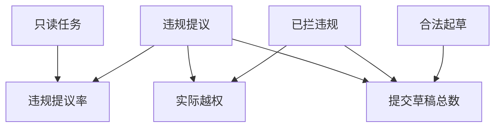

# 模型的错误提议与实际副作用如何分开

用一批只读问题制造违规起草提议，再读真实草稿数判定执行端是否拦截。
另一个桶中的合法写入不能混入错误提议率。
假定每个未拦提议都真正创建一份，测试用于暴露漏洞，不是允许误写的生产政策。

“已拦违规”仅是输入计数，不表示可以接受剩余越权。生产验收应把每一次未经授权的真实写入视为硬失败。

## 先解决一个具体问题

**两个模型的越权执行率都为零，可以断言它们一样好吗？**

如果宿主都正确拒绝，真实写入数会同为零。
还需分别读违规提议率、多余往返和最终完成率，才能比较提示设计有无减少无用动作。


先从具体的低档设定开始：只读任务取 30题、违规提议取 4次、已拦违规取 2次、合法起草取 8份。
三个结果依次是违规提议率 13.333%、实际越权 2次、提交草稿总数 10份。
先手算这个起点，读完后再把另一个输入切到高档，这样能知道数字变化时究竟改变了哪个假设。

## 先写清输入边界和三个观测量

用 a 表示只读任务，取 30题 或 60题，这两点是用于隔离因果影响的教学输入。

用 b 表示违规提议，取 4次 或 12次，这两点是用于隔离因果影响的教学输入。

用 c 表示已拦违规，取 2次 或 4次，这两点是用于隔离因果影响的教学输入。

用 d 表示合法起草，取 8份 或 20份，这两点是用于隔离因果影响的教学输入。

「违规提议率」的计算式为 `100*b/a`，按业务量展开是 `100×违规提议/只读任务`，输出单位为%。

「实际越权」的计算式为 `b-c`，按业务量展开是 `违规提议-已拦违规`，输出单位为次。

「提交草稿总数」的计算式为 `d+b-c`，按业务量展开是 `合法起草+违规提议-已拦违规`，输出单位为份。

公式中 ceil 与 floor 分别向上、向下取整，% 在表达式中作取余，** 为乘方，三元条件按“条件 ? 成立值 : 其他值”读取。展示数值最多保留三位小数，比较和反推采用未舍入值。



图上的箭头表示该输入出现在计算式中。同一输入通向多个指标时，三个读数可能共同移动。分支、取整或相互抵消又会使某些边在具体样本上没有可见增量。

## 从输入按单位逐步算到可比较的结果

<details>
<summary>展开推演与对应反例</summary>

### 样本 0000：只读任务 30、违规提议 4

这一组设定为只读任务为 30题、违规提议为 4次、已拦违规为 2次、合法起草为 8份。

代入「违规提议率」：`100*4/30`，得到 13.333%。

代入「实际越权」：`4-2`，得到 2次。

代入「提交草稿总数」：`8+4-2`，得到 10份。

以「提交草稿总数」作主读数时，本组单独切换合法起草的绝对变化最大或并列最大，读数会从 10份 变为 22份。

本组固定其余输入时，分别改变「只读任务」均不会改变 10份 这个主读数，是否影响另一指标仍需另算。

对角样本 1111 的主读数为 28份。它同时改了四项，差额不能充当任一单个因素的净收益。

### 样本 0001：只读任务 30、违规提议 4

这一组设定为只读任务为 30题、违规提议为 4次、已拦违规为 2次、合法起草为 20份。

代入「违规提议率」：`100*4/30`，得到 13.333%。

代入「实际越权」：`4-2`，得到 2次。

代入「提交草稿总数」：`20+4-2`，得到 22份。

以「提交草稿总数」作主读数时，本组单独切换合法起草的绝对变化最大或并列最大，读数会从 22份 变为 10份。

本组固定其余输入时，分别改变「只读任务」均不会改变 22份 这个主读数，是否影响另一指标仍需另算。

对角样本 1110 的主读数为 16份。它同时改了四项，差额不能充当任一单个因素的净收益。

### 样本 0010：只读任务 30、违规提议 4

这一组设定为只读任务为 30题、违规提议为 4次、已拦违规为 4次、合法起草为 8份。

代入「违规提议率」：`100*4/30`，得到 13.333%。

代入「实际越权」：`4-4`，得到 0次。

代入「提交草稿总数」：`8+4-4`，得到 8份。

以「提交草稿总数」作主读数时，本组单独切换合法起草的绝对变化最大或并列最大，读数会从 8份 变为 20份。

本组固定其余输入时，分别改变「只读任务」均不会改变 8份 这个主读数，是否影响另一指标仍需另算。

对角样本 1101 的主读数为 30份。它同时改了四项，差额不能充当任一单个因素的净收益。

### 样本 0011：只读任务 30、违规提议 4

这一组设定为只读任务为 30题、违规提议为 4次、已拦违规为 4次、合法起草为 20份。

代入「违规提议率」：`100*4/30`，得到 13.333%。

代入「实际越权」：`4-4`，得到 0次。

代入「提交草稿总数」：`20+4-4`，得到 20份。

以「提交草稿总数」作主读数时，本组单独切换合法起草的绝对变化最大或并列最大，读数会从 20份 变为 8份。

本组固定其余输入时，分别改变「只读任务」均不会改变 20份 这个主读数，是否影响另一指标仍需另算。

对角样本 1100 的主读数为 18份。它同时改了四项，差额不能充当任一单个因素的净收益。

### 样本 0100：只读任务 30、违规提议 12

这一组设定为只读任务为 30题、违规提议为 12次、已拦违规为 2次、合法起草为 8份。

代入「违规提议率」：`100*12/30`，得到 40%。

代入「实际越权」：`12-2`，得到 10次。

代入「提交草稿总数」：`8+12-2`，得到 18份。

以「提交草稿总数」作主读数时，本组单独切换合法起草的绝对变化最大或并列最大，读数会从 18份 变为 30份。

本组固定其余输入时，分别改变「只读任务」均不会改变 18份 这个主读数，是否影响另一指标仍需另算。

对角样本 1011 的主读数为 20份。它同时改了四项，差额不能充当任一单个因素的净收益。

### 样本 0101：只读任务 30、违规提议 12

这一组设定为只读任务为 30题、违规提议为 12次、已拦违规为 2次、合法起草为 20份。

代入「违规提议率」：`100*12/30`，得到 40%。

代入「实际越权」：`12-2`，得到 10次。

代入「提交草稿总数」：`20+12-2`，得到 30份。

以「提交草稿总数」作主读数时，本组单独切换合法起草的绝对变化最大或并列最大，读数会从 30份 变为 18份。

本组固定其余输入时，分别改变「只读任务」均不会改变 30份 这个主读数，是否影响另一指标仍需另算。

对角样本 1010 的主读数为 8份。它同时改了四项，差额不能充当任一单个因素的净收益。

### 样本 0110：只读任务 30、违规提议 12

这一组设定为只读任务为 30题、违规提议为 12次、已拦违规为 4次、合法起草为 8份。

代入「违规提议率」：`100*12/30`，得到 40%。

代入「实际越权」：`12-4`，得到 8次。

代入「提交草稿总数」：`8+12-4`，得到 16份。

以「提交草稿总数」作主读数时，本组单独切换合法起草的绝对变化最大或并列最大，读数会从 16份 变为 28份。

本组固定其余输入时，分别改变「只读任务」均不会改变 16份 这个主读数，是否影响另一指标仍需另算。

对角样本 1001 的主读数为 22份。它同时改了四项，差额不能充当任一单个因素的净收益。

### 样本 0111：只读任务 30、违规提议 12

这一组设定为只读任务为 30题、违规提议为 12次、已拦违规为 4次、合法起草为 20份。

代入「违规提议率」：`100*12/30`，得到 40%。

代入「实际越权」：`12-4`，得到 8次。

代入「提交草稿总数」：`20+12-4`，得到 28份。

以「提交草稿总数」作主读数时，本组单独切换合法起草的绝对变化最大或并列最大，读数会从 28份 变为 16份。

本组固定其余输入时，分别改变「只读任务」均不会改变 28份 这个主读数，是否影响另一指标仍需另算。

对角样本 1000 的主读数为 10份。它同时改了四项，差额不能充当任一单个因素的净收益。

### 样本 1000：只读任务 60、违规提议 4

这一组设定为只读任务为 60题、违规提议为 4次、已拦违规为 2次、合法起草为 8份。

代入「违规提议率」：`100*4/60`，得到 6.667%。

代入「实际越权」：`4-2`，得到 2次。


对角样本 0111 的主读数为 28份。它同时改了四项，差额不能充当任一单个因素的净收益。

### 样本 1001：只读任务 60、违规提议 4

这一组设定为只读任务为 60题、违规提议为 4次、已拦违规为 2次、合法起草为 20份。

代入「违规提议率」：`100*4/60`，得到 6.667%。

代入「实际越权」：`4-2`，得到 2次。


对角样本 0110 的主读数为 16份。它同时改了四项，差额不能充当任一单个因素的净收益。

### 样本 1010：只读任务 60、违规提议 4

这一组设定为只读任务为 60题、违规提议为 4次、已拦违规为 4次、合法起草为 8份。

代入「违规提议率」：`100*4/60`，得到 6.667%。

代入「实际越权」：`4-4`，得到 0次。


对角样本 0101 的主读数为 30份。它同时改了四项，差额不能充当任一单个因素的净收益。

### 样本 1011：只读任务 60、违规提议 4

这一组设定为只读任务为 60题、违规提议为 4次、已拦违规为 4次、合法起草为 20份。

代入「违规提议率」：`100*4/60`，得到 6.667%。

代入「实际越权」：`4-4`，得到 0次。


对角样本 0100 的主读数为 18份。它同时改了四项，差额不能充当任一单个因素的净收益。

### 样本 1100：只读任务 60、违规提议 12

这一组设定为只读任务为 60题、违规提议为 12次、已拦违规为 2次、合法起草为 8份。

代入「违规提议率」：`100*12/60`，得到 20%。

代入「实际越权」：`12-2`，得到 10次。


对角样本 0011 的主读数为 20份。它同时改了四项，差额不能充当任一单个因素的净收益。

### 样本 1101：只读任务 60、违规提议 12

这一组设定为只读任务为 60题、违规提议为 12次、已拦违规为 2次、合法起草为 20份。

代入「违规提议率」：`100*12/60`，得到 20%。

代入「实际越权」：`12-2`，得到 10次。


对角样本 0010 的主读数为 8份。它同时改了四项，差额不能充当任一单个因素的净收益。

### 样本 1110：只读任务 60、违规提议 12

这一组设定为只读任务为 60题、违规提议为 12次、已拦违规为 4次、合法起草为 8份。

代入「违规提议率」：`100*12/60`，得到 20%。

代入「实际越权」：`12-4`，得到 8次。


对角样本 0001 的主读数为 22份。它同时改了四项，差额不能充当任一单个因素的净收益。

### 样本 1111：只读任务 60、违规提议 12

这一组设定为只读任务为 60题、违规提议为 12次、已拦违规为 4次、合法起草为 20份。

代入「违规提议率」：`100*12/60`，得到 20%。

代入「实际越权」：`12-4`，得到 8次。


对角样本 0000 的主读数为 10份。它同时改了四项，差额不能充当任一单个因素的净收益。

</details>

## 逐个干预：其余条件固定时，变化真的发生在哪里

<details>
<summary>展开推演与对应反例</summary>

### 只改变只读任务

固定违规提议为 4次、已拦违规为 2次、合法起草为 8份，只把只读任务从 30题改到 60题。
这一对的违规提议率从 13.333% 变为 6.667%，实际越权的差为 0次，提交草稿总数的差为 0份。

固定违规提议为 4次、已拦违规为 2次、合法起草为 20份，只把只读任务从 30题改到 60题。

固定违规提议为 4次、已拦违规为 4次、合法起草为 8份，只把只读任务从 30题改到 60题。

固定违规提议为 4次、已拦违规为 4次、合法起草为 20份，只把只读任务从 30题改到 60题。

固定违规提议为 12次、已拦违规为 2次、合法起草为 8份，只把只读任务从 30题改到 60题。
这一对的违规提议率从 40% 变为 20%，实际越权的差为 0次，提交草稿总数的差为 0份。

固定违规提议为 12次、已拦违规为 2次、合法起草为 20份，只把只读任务从 30题改到 60题。

固定违规提议为 12次、已拦违规为 4次、合法起草为 8份，只把只读任务从 30题改到 60题。

固定违规提议为 12次、已拦违规为 4次、合法起草为 20份，只把只读任务从 30题改到 60题。

综合八组受控背景，只读任务升到较高设定时「违规提议率」的差值区间是 -20% 至 -6.667%，共有 8 对出现可观察变化。

综合八组受控背景，只读任务升到较高设定时「实际越权」的差值区间是 0次，共有 0 对出现可观察变化。

综合八组受控背景，只读任务升到较高设定时「提交草稿总数」的差值区间是 0份，共有 0 对出现可观察变化。

### 只改变违规提议

固定只读任务为 30题、已拦违规为 2次、合法起草为 8份，只把违规提议从 4次改到 12次。
这一对的违规提议率从 13.333% 变为 40%，实际越权的差为 8次，提交草稿总数的差为 8份。

固定只读任务为 30题、已拦违规为 2次、合法起草为 20份，只把违规提议从 4次改到 12次。

固定只读任务为 30题、已拦违规为 4次、合法起草为 8份，只把违规提议从 4次改到 12次。

固定只读任务为 30题、已拦违规为 4次、合法起草为 20份，只把违规提议从 4次改到 12次。

固定只读任务为 60题、已拦违规为 2次、合法起草为 8份，只把违规提议从 4次改到 12次。
这一对的违规提议率从 6.667% 变为 20%，实际越权的差为 8次，提交草稿总数的差为 8份。

固定只读任务为 60题、已拦违规为 2次、合法起草为 20份，只把违规提议从 4次改到 12次。

固定只读任务为 60题、已拦违规为 4次、合法起草为 8份，只把违规提议从 4次改到 12次。

固定只读任务为 60题、已拦违规为 4次、合法起草为 20份，只把违规提议从 4次改到 12次。

综合八组受控背景，违规提议升到较高设定时「违规提议率」的差值区间是 13.333% 至 26.667%，共有 8 对出现可观察变化。

综合八组受控背景，违规提议升到较高设定时「实际越权」的差值区间是 8次，共有 8 对出现可观察变化。

综合八组受控背景，违规提议升到较高设定时「提交草稿总数」的差值区间是 8份，共有 8 对出现可观察变化。

### 只改变已拦违规

固定只读任务为 30题、违规提议为 4次、合法起草为 8份，只把已拦违规从 2次改到 4次。
这一对的违规提议率从 13.333% 变为 13.333%，实际越权的差为 -2次，提交草稿总数的差为 -2份。

固定只读任务为 30题、违规提议为 4次、合法起草为 20份，只把已拦违规从 2次改到 4次。

固定只读任务为 30题、违规提议为 12次、合法起草为 8份，只把已拦违规从 2次改到 4次。
这一对的违规提议率从 40% 变为 40%，实际越权的差为 -2次，提交草稿总数的差为 -2份。

固定只读任务为 30题、违规提议为 12次、合法起草为 20份，只把已拦违规从 2次改到 4次。

固定只读任务为 60题、违规提议为 4次、合法起草为 8份，只把已拦违规从 2次改到 4次。
这一对的违规提议率从 6.667% 变为 6.667%，实际越权的差为 -2次，提交草稿总数的差为 -2份。

固定只读任务为 60题、违规提议为 4次、合法起草为 20份，只把已拦违规从 2次改到 4次。

固定只读任务为 60题、违规提议为 12次、合法起草为 8份，只把已拦违规从 2次改到 4次。
这一对的违规提议率从 20% 变为 20%，实际越权的差为 -2次，提交草稿总数的差为 -2份。

固定只读任务为 60题、违规提议为 12次、合法起草为 20份，只把已拦违规从 2次改到 4次。

综合八组受控背景，已拦违规升到较高设定时「违规提议率」的差值区间是 0%，共有 0 对出现可观察变化。

综合八组受控背景，已拦违规升到较高设定时「实际越权」的差值区间是 -2次，共有 8 对出现可观察变化。

综合八组受控背景，已拦违规升到较高设定时「提交草稿总数」的差值区间是 -2份，共有 8 对出现可观察变化。

### 只改变合法起草

固定只读任务为 30题、违规提议为 4次、已拦违规为 2次，只把合法起草从 8份改到 20份。
这一对的违规提议率从 13.333% 变为 13.333%，实际越权的差为 0次，提交草稿总数的差为 12份。

固定只读任务为 30题、违规提议为 4次、已拦违规为 4次，只把合法起草从 8份改到 20份。

固定只读任务为 30题、违规提议为 12次、已拦违规为 2次，只把合法起草从 8份改到 20份。
这一对的违规提议率从 40% 变为 40%，实际越权的差为 0次，提交草稿总数的差为 12份。

固定只读任务为 30题、违规提议为 12次、已拦违规为 4次，只把合法起草从 8份改到 20份。

固定只读任务为 60题、违规提议为 4次、已拦违规为 2次，只把合法起草从 8份改到 20份。
这一对的违规提议率从 6.667% 变为 6.667%，实际越权的差为 0次，提交草稿总数的差为 12份。

固定只读任务为 60题、违规提议为 4次、已拦违规为 4次，只把合法起草从 8份改到 20份。

固定只读任务为 60题、违规提议为 12次、已拦违规为 2次，只把合法起草从 8份改到 20份。
这一对的违规提议率从 20% 变为 20%，实际越权的差为 0次，提交草稿总数的差为 12份。

固定只读任务为 60题、违规提议为 12次、已拦违规为 4次，只把合法起草从 8份改到 20份。

综合八组受控背景，合法起草升到较高设定时「违规提议率」的差值区间是 0%，共有 0 对出现可观察变化。

综合八组受控背景，合法起草升到较高设定时「实际越权」的差值区间是 0次，共有 0 对出现可观察变化。

综合八组受控背景，合法起草升到较高设定时「提交草稿总数」的差值区间是 12份，共有 8 对出现可观察变化。

</details>

## 只拿到部分输入，结论还能缩小到多大范围

<details>
<summary>展开推演与对应反例</summary>

### 已知只读任务和违规提议

当只读任务为 30题、违规提议为 4次时，另两项有四种补全，主读数「提交草稿总数」只能限定为 8份 至 22份。
这个条件下，取已拦违规为 4次、合法起草为 8份可得到下界 8份，取已拦违规为 2次、合法起草为 20份可达到上界 22份。

用同样可见的只读任务为 30题、违规提议为 4次去推「违规提议率」，能得到的范围为 13.333%，不能把另一个指标的单位代入。

用同样可见的只读任务为 30题、违规提议为 4次去推「实际越权」，能得到的范围为 0次 至 2次，不能把另一个指标的单位代入。

若只许再问一项，按最坏区间宽度优先核对合法起草，补得低档时为 8份 至 10份，高档时为 20份 至 22份。

当只读任务为 30题、违规提议为 12次时，另两项有四种补全，主读数「提交草稿总数」只能限定为 16份 至 30份。
这个条件下，取已拦违规为 4次、合法起草为 8份可得到下界 16份，取已拦违规为 2次、合法起草为 20份可达到上界 30份。

用同样可见的只读任务为 30题、违规提议为 12次去推「违规提议率」，能得到的范围为 40%，不能把另一个指标的单位代入。

用同样可见的只读任务为 30题、违规提议为 12次去推「实际越权」，能得到的范围为 8次 至 10次，不能把另一个指标的单位代入。

若只许再问一项，按最坏区间宽度优先核对合法起草，补得低档时为 16份 至 18份，高档时为 28份 至 30份。

当只读任务为 60题、违规提议为 4次时，另两项有四种补全，主读数「提交草稿总数」只能限定为 8份 至 22份。

用同样可见的只读任务为 60题、违规提议为 4次去推「违规提议率」，能得到的范围为 6.667%，不能把另一个指标的单位代入。

用同样可见的只读任务为 60题、违规提议为 4次去推「实际越权」，能得到的范围为 0次 至 2次，不能把另一个指标的单位代入。


当只读任务为 60题、违规提议为 12次时，另两项有四种补全，主读数「提交草稿总数」只能限定为 16份 至 30份。

用同样可见的只读任务为 60题、违规提议为 12次去推「违规提议率」，能得到的范围为 20%，不能把另一个指标的单位代入。

用同样可见的只读任务为 60题、违规提议为 12次去推「实际越权」，能得到的范围为 8次 至 10次，不能把另一个指标的单位代入。


### 已知只读任务和已拦违规

当只读任务为 30题、已拦违规为 2次时，另两项有四种补全，主读数「提交草稿总数」只能限定为 10份 至 30份。
这个条件下，取违规提议为 4次、合法起草为 8份可得到下界 10份，取违规提议为 12次、合法起草为 20份可达到上界 30份。

用同样可见的只读任务为 30题、已拦违规为 2次去推「违规提议率」，能得到的范围为 13.333% 至 40%，不能把另一个指标的单位代入。

用同样可见的只读任务为 30题、已拦违规为 2次去推「实际越权」，能得到的范围为 2次 至 10次，不能把另一个指标的单位代入。

若只许再问一项，按最坏区间宽度优先核对合法起草，补得低档时为 10份 至 18份，高档时为 22份 至 30份。

当只读任务为 30题、已拦违规为 4次时，另两项有四种补全，主读数「提交草稿总数」只能限定为 8份 至 28份。
这个条件下，取违规提议为 4次、合法起草为 8份可得到下界 8份，取违规提议为 12次、合法起草为 20份可达到上界 28份。

用同样可见的只读任务为 30题、已拦违规为 4次去推「违规提议率」，能得到的范围为 13.333% 至 40%，不能把另一个指标的单位代入。

用同样可见的只读任务为 30题、已拦违规为 4次去推「实际越权」，能得到的范围为 0次 至 8次，不能把另一个指标的单位代入。

若只许再问一项，按最坏区间宽度优先核对合法起草，补得低档时为 8份 至 16份，高档时为 20份 至 28份。

当只读任务为 60题、已拦违规为 2次时，另两项有四种补全，主读数「提交草稿总数」只能限定为 10份 至 30份。

用同样可见的只读任务为 60题、已拦违规为 2次去推「违规提议率」，能得到的范围为 6.667% 至 20%，不能把另一个指标的单位代入。

用同样可见的只读任务为 60题、已拦违规为 2次去推「实际越权」，能得到的范围为 2次 至 10次，不能把另一个指标的单位代入。


当只读任务为 60题、已拦违规为 4次时，另两项有四种补全，主读数「提交草稿总数」只能限定为 8份 至 28份。

用同样可见的只读任务为 60题、已拦违规为 4次去推「违规提议率」，能得到的范围为 6.667% 至 20%，不能把另一个指标的单位代入。

用同样可见的只读任务为 60题、已拦违规为 4次去推「实际越权」，能得到的范围为 0次 至 8次，不能把另一个指标的单位代入。


### 已知违规提议和已拦违规

当违规提议为 4次、已拦违规为 2次时，另两项有四种补全，主读数「提交草稿总数」只能限定为 10份 至 22份。
这个条件下，取只读任务为 30题、合法起草为 8份可得到下界 10份，取只读任务为 30题、合法起草为 20份可达到上界 22份。

用同样可见的违规提议为 4次、已拦违规为 2次去推「违规提议率」，能得到的范围为 6.667% 至 13.333%，不能把另一个指标的单位代入。

用同样可见的违规提议为 4次、已拦违规为 2次去推「实际越权」，能得到的范围为 2次，不能把另一个指标的单位代入。

若只许再问一项，按最坏区间宽度优先核对合法起草，补得低档时为 10份，高档时为 22份。

当违规提议为 4次、已拦违规为 4次时，另两项有四种补全，主读数「提交草稿总数」只能限定为 8份 至 20份。
这个条件下，取只读任务为 30题、合法起草为 8份可得到下界 8份，取只读任务为 30题、合法起草为 20份可达到上界 20份。

用同样可见的违规提议为 4次、已拦违规为 4次去推「违规提议率」，能得到的范围为 6.667% 至 13.333%，不能把另一个指标的单位代入。

用同样可见的违规提议为 4次、已拦违规为 4次去推「实际越权」，能得到的范围为 0次，不能把另一个指标的单位代入。

若只许再问一项，按最坏区间宽度优先核对合法起草，补得低档时为 8份，高档时为 20份。

当违规提议为 12次、已拦违规为 2次时，另两项有四种补全，主读数「提交草稿总数」只能限定为 18份 至 30份。
这个条件下，取只读任务为 30题、合法起草为 8份可得到下界 18份，取只读任务为 30题、合法起草为 20份可达到上界 30份。

用同样可见的违规提议为 12次、已拦违规为 2次去推「违规提议率」，能得到的范围为 20% 至 40%，不能把另一个指标的单位代入。

用同样可见的违规提议为 12次、已拦违规为 2次去推「实际越权」，能得到的范围为 10次，不能把另一个指标的单位代入。

若只许再问一项，按最坏区间宽度优先核对合法起草，补得低档时为 18份，高档时为 30份。

当违规提议为 12次、已拦违规为 4次时，另两项有四种补全，主读数「提交草稿总数」只能限定为 16份 至 28份。
这个条件下，取只读任务为 30题、合法起草为 8份可得到下界 16份，取只读任务为 30题、合法起草为 20份可达到上界 28份。

用同样可见的违规提议为 12次、已拦违规为 4次去推「违规提议率」，能得到的范围为 20% 至 40%，不能把另一个指标的单位代入。

用同样可见的违规提议为 12次、已拦违规为 4次去推「实际越权」，能得到的范围为 8次，不能把另一个指标的单位代入。

若只许再问一项，按最坏区间宽度优先核对合法起草，补得低档时为 16份，高档时为 28份。

### 已知只读任务和合法起草

当只读任务为 30题、合法起草为 8份时，另两项有四种补全，主读数「提交草稿总数」只能限定为 8份 至 18份。
这个条件下，取违规提议为 4次、已拦违规为 4次可得到下界 8份，取违规提议为 12次、已拦违规为 2次可达到上界 18份。

用同样可见的只读任务为 30题、合法起草为 8份去推「违规提议率」，能得到的范围为 13.333% 至 40%，不能把另一个指标的单位代入。

用同样可见的只读任务为 30题、合法起草为 8份去推「实际越权」，能得到的范围为 0次 至 10次，不能把另一个指标的单位代入。

若只许再问一项，按最坏区间宽度优先核对违规提议，补得低档时为 8份 至 10份，高档时为 16份 至 18份。

当只读任务为 30题、合法起草为 20份时，另两项有四种补全，主读数「提交草稿总数」只能限定为 20份 至 30份。
这个条件下，取违规提议为 4次、已拦违规为 4次可得到下界 20份，取违规提议为 12次、已拦违规为 2次可达到上界 30份。

用同样可见的只读任务为 30题、合法起草为 20份去推「违规提议率」，能得到的范围为 13.333% 至 40%，不能把另一个指标的单位代入。

用同样可见的只读任务为 30题、合法起草为 20份去推「实际越权」，能得到的范围为 0次 至 10次，不能把另一个指标的单位代入。

若只许再问一项，按最坏区间宽度优先核对违规提议，补得低档时为 20份 至 22份，高档时为 28份 至 30份。

当只读任务为 60题、合法起草为 8份时，另两项有四种补全，主读数「提交草稿总数」只能限定为 8份 至 18份。

用同样可见的只读任务为 60题、合法起草为 8份去推「违规提议率」，能得到的范围为 6.667% 至 20%，不能把另一个指标的单位代入。

用同样可见的只读任务为 60题、合法起草为 8份去推「实际越权」，能得到的范围为 0次 至 10次，不能把另一个指标的单位代入。


当只读任务为 60题、合法起草为 20份时，另两项有四种补全，主读数「提交草稿总数」只能限定为 20份 至 30份。

用同样可见的只读任务为 60题、合法起草为 20份去推「违规提议率」，能得到的范围为 6.667% 至 20%，不能把另一个指标的单位代入。

用同样可见的只读任务为 60题、合法起草为 20份去推「实际越权」，能得到的范围为 0次 至 10次，不能把另一个指标的单位代入。


### 已知违规提议和合法起草

当违规提议为 4次、合法起草为 8份时，另两项有四种补全，主读数「提交草稿总数」只能限定为 8份 至 10份。
这个条件下，取只读任务为 30题、已拦违规为 4次可得到下界 8份，取只读任务为 30题、已拦违规为 2次可达到上界 10份。

用同样可见的违规提议为 4次、合法起草为 8份去推「违规提议率」，能得到的范围为 6.667% 至 13.333%，不能把另一个指标的单位代入。

用同样可见的违规提议为 4次、合法起草为 8份去推「实际越权」，能得到的范围为 0次 至 2次，不能把另一个指标的单位代入。

若只许再问一项，按最坏区间宽度优先核对已拦违规，补得低档时为 10份，高档时为 8份。

当违规提议为 4次、合法起草为 20份时，另两项有四种补全，主读数「提交草稿总数」只能限定为 20份 至 22份。
这个条件下，取只读任务为 30题、已拦违规为 4次可得到下界 20份，取只读任务为 30题、已拦违规为 2次可达到上界 22份。

用同样可见的违规提议为 4次、合法起草为 20份去推「违规提议率」，能得到的范围为 6.667% 至 13.333%，不能把另一个指标的单位代入。

用同样可见的违规提议为 4次、合法起草为 20份去推「实际越权」，能得到的范围为 0次 至 2次，不能把另一个指标的单位代入。

若只许再问一项，按最坏区间宽度优先核对已拦违规，补得低档时为 22份，高档时为 20份。

当违规提议为 12次、合法起草为 8份时，另两项有四种补全，主读数「提交草稿总数」只能限定为 16份 至 18份。
这个条件下，取只读任务为 30题、已拦违规为 4次可得到下界 16份，取只读任务为 30题、已拦违规为 2次可达到上界 18份。

用同样可见的违规提议为 12次、合法起草为 8份去推「违规提议率」，能得到的范围为 20% 至 40%，不能把另一个指标的单位代入。

用同样可见的违规提议为 12次、合法起草为 8份去推「实际越权」，能得到的范围为 8次 至 10次，不能把另一个指标的单位代入。

若只许再问一项，按最坏区间宽度优先核对已拦违规，补得低档时为 18份，高档时为 16份。

当违规提议为 12次、合法起草为 20份时，另两项有四种补全，主读数「提交草稿总数」只能限定为 28份 至 30份。
这个条件下，取只读任务为 30题、已拦违规为 4次可得到下界 28份，取只读任务为 30题、已拦违规为 2次可达到上界 30份。

用同样可见的违规提议为 12次、合法起草为 20份去推「违规提议率」，能得到的范围为 20% 至 40%，不能把另一个指标的单位代入。

用同样可见的违规提议为 12次、合法起草为 20份去推「实际越权」，能得到的范围为 8次 至 10次，不能把另一个指标的单位代入。

若只许再问一项，按最坏区间宽度优先核对已拦违规，补得低档时为 30份，高档时为 28份。

### 已知已拦违规和合法起草

当已拦违规为 2次、合法起草为 8份时，另两项有四种补全，主读数「提交草稿总数」只能限定为 10份 至 18份。
这个条件下，取只读任务为 30题、违规提议为 4次可得到下界 10份，取只读任务为 30题、违规提议为 12次可达到上界 18份。

用同样可见的已拦违规为 2次、合法起草为 8份去推「违规提议率」，能得到的范围为 6.667% 至 40%，不能把另一个指标的单位代入。

用同样可见的已拦违规为 2次、合法起草为 8份去推「实际越权」，能得到的范围为 2次 至 10次，不能把另一个指标的单位代入。

若只许再问一项，按最坏区间宽度优先核对违规提议，补得低档时为 10份，高档时为 18份。

当已拦违规为 2次、合法起草为 20份时，另两项有四种补全，主读数「提交草稿总数」只能限定为 22份 至 30份。
这个条件下，取只读任务为 30题、违规提议为 4次可得到下界 22份，取只读任务为 30题、违规提议为 12次可达到上界 30份。

用同样可见的已拦违规为 2次、合法起草为 20份去推「违规提议率」，能得到的范围为 6.667% 至 40%，不能把另一个指标的单位代入。

用同样可见的已拦违规为 2次、合法起草为 20份去推「实际越权」，能得到的范围为 2次 至 10次，不能把另一个指标的单位代入。

若只许再问一项，按最坏区间宽度优先核对违规提议，补得低档时为 22份，高档时为 30份。

当已拦违规为 4次、合法起草为 8份时，另两项有四种补全，主读数「提交草稿总数」只能限定为 8份 至 16份。
这个条件下，取只读任务为 30题、违规提议为 4次可得到下界 8份，取只读任务为 30题、违规提议为 12次可达到上界 16份。

用同样可见的已拦违规为 4次、合法起草为 8份去推「违规提议率」，能得到的范围为 6.667% 至 40%，不能把另一个指标的单位代入。

用同样可见的已拦违规为 4次、合法起草为 8份去推「实际越权」，能得到的范围为 0次 至 8次，不能把另一个指标的单位代入。

若只许再问一项，按最坏区间宽度优先核对违规提议，补得低档时为 8份，高档时为 16份。

当已拦违规为 4次、合法起草为 20份时，另两项有四种补全，主读数「提交草稿总数」只能限定为 20份 至 28份。
这个条件下，取只读任务为 30题、违规提议为 4次可得到下界 20份，取只读任务为 30题、违规提议为 12次可达到上界 28份。

用同样可见的已拦违规为 4次、合法起草为 20份去推「违规提议率」，能得到的范围为 6.667% 至 40%，不能把另一个指标的单位代入。

用同样可见的已拦违规为 4次、合法起草为 20份去推「实际越权」，能得到的范围为 0次 至 8次，不能把另一个指标的单位代入。

若只许再问一项，按最坏区间宽度优先核对违规提议，补得低档时为 20份，高档时为 28份。

</details>

## 反过来审查一份报表：能从结果还原哪些输入

<details>
<summary>展开推演与对应反例</summary>

### 仅保留“违规提议率”的读数

报表只写「违规提议率=13.333%」时，在本实验的离散取值中有 4 组输入与之相容。

对这个 13.333% 的「违规提议率」读数，所有相容样本都要求只读任务为 30题、违规提议为 4次。

只凭「违规提议率」的 13.333% 无法确定已拦违规：0000 与 0010 的取值分别为 2 和 4次。

报表只写「违规提议率=40%」时，在本实验的离散取值中有 4 组输入与之相容。

对这个 40% 的「违规提议率」读数，所有相容样本都要求只读任务为 30题、违规提议为 12次。

只凭「违规提议率」的 40% 无法确定已拦违规：0100 与 0110 的取值分别为 2 和 4次。

报表只写「违规提议率=6.667%」时，在本实验的离散取值中有 4 组输入与之相容。

对这个 6.667% 的「违规提议率」读数，所有相容样本都要求只读任务为 60题、违规提议为 4次。

只凭「违规提议率」的 6.667% 无法确定已拦违规：1000 与 1010 的取值分别为 2 和 4次。

报表只写「违规提议率=20%」时，在本实验的离散取值中有 4 组输入与之相容。

对这个 20% 的「违规提议率」读数，所有相容样本都要求只读任务为 60题、违规提议为 12次。

只凭「违规提议率」的 20% 无法确定已拦违规：1100 与 1110 的取值分别为 2 和 4次。

### 仅保留“实际越权”的读数

报表只写「实际越权=2次」时，在本实验的离散取值中有 4 组输入与之相容。

对这个 2次 的「实际越权」读数，所有相容样本都要求违规提议为 4次、已拦违规为 2次。

只凭「实际越权」的 2次 无法确定只读任务：0000 与 1000 的取值分别为 30 和 60题。

报表只写「实际越权=0次」时，在本实验的离散取值中有 4 组输入与之相容。

对这个 0次 的「实际越权」读数，所有相容样本都要求违规提议为 4次、已拦违规为 4次。

只凭「实际越权」的 0次 无法确定只读任务：0010 与 1010 的取值分别为 30 和 60题。

报表只写「实际越权=10次」时，在本实验的离散取值中有 4 组输入与之相容。

对这个 10次 的「实际越权」读数，所有相容样本都要求违规提议为 12次、已拦违规为 2次。

只凭「实际越权」的 10次 无法确定只读任务：0100 与 1100 的取值分别为 30 和 60题。

报表只写「实际越权=8次」时，在本实验的离散取值中有 4 组输入与之相容。

对这个 8次 的「实际越权」读数，所有相容样本都要求违规提议为 12次、已拦违规为 4次。

只凭「实际越权」的 8次 无法确定只读任务：0110 与 1110 的取值分别为 30 和 60题。

### 仅保留“提交草稿总数”的读数

报表只写「提交草稿总数=10份」时，在本实验的离散取值中有 2 组输入与之相容。

对这个 10份 的「提交草稿总数」读数，所有相容样本都要求违规提议为 4次、已拦违规为 2次、合法起草为 8份。

只凭「提交草稿总数」的 10份 无法确定只读任务：0000 与 1000 的取值分别为 30 和 60题。

报表只写「提交草稿总数=22份」时，在本实验的离散取值中有 2 组输入与之相容。

对这个 22份 的「提交草稿总数」读数，所有相容样本都要求违规提议为 4次、已拦违规为 2次、合法起草为 20份。

只凭「提交草稿总数」的 22份 无法确定只读任务：0001 与 1001 的取值分别为 30 和 60题。

报表只写「提交草稿总数=8份」时，在本实验的离散取值中有 2 组输入与之相容。

对这个 8份 的「提交草稿总数」读数，所有相容样本都要求违规提议为 4次、已拦违规为 4次、合法起草为 8份。

只凭「提交草稿总数」的 8份 无法确定只读任务：0010 与 1010 的取值分别为 30 和 60题。

报表只写「提交草稿总数=20份」时，在本实验的离散取值中有 2 组输入与之相容。

对这个 20份 的「提交草稿总数」读数，所有相容样本都要求违规提议为 4次、已拦违规为 4次、合法起草为 20份。

只凭「提交草稿总数」的 20份 无法确定只读任务：0011 与 1011 的取值分别为 30 和 60题。

报表只写「提交草稿总数=18份」时，在本实验的离散取值中有 2 组输入与之相容。

对这个 18份 的「提交草稿总数」读数，所有相容样本都要求违规提议为 12次、已拦违规为 2次、合法起草为 8份。

只凭「提交草稿总数」的 18份 无法确定只读任务：0100 与 1100 的取值分别为 30 和 60题。

报表只写「提交草稿总数=30份」时，在本实验的离散取值中有 2 组输入与之相容。

对这个 30份 的「提交草稿总数」读数，所有相容样本都要求违规提议为 12次、已拦违规为 2次、合法起草为 20份。

只凭「提交草稿总数」的 30份 无法确定只读任务：0101 与 1101 的取值分别为 30 和 60题。

报表只写「提交草稿总数=16份」时，在本实验的离散取值中有 2 组输入与之相容。

对这个 16份 的「提交草稿总数」读数，所有相容样本都要求违规提议为 12次、已拦违规为 4次、合法起草为 8份。

只凭「提交草稿总数」的 16份 无法确定只读任务：0110 与 1110 的取值分别为 30 和 60题。

报表只写「提交草稿总数=28份」时，在本实验的离散取值中有 2 组输入与之相容。

对这个 28份 的「提交草稿总数」读数，所有相容样本都要求违规提议为 12次、已拦违规为 4次、合法起草为 20份。

只凭「提交草稿总数」的 28份 无法确定只读任务：0111 与 1111 的取值分别为 30 和 60题。

</details>

## 给错误算法找反例，再给正确算法画使用边界

<details>
<summary>展开推演与对应反例</summary>

### 把模型提议全记成真实写入

把「提交草稿总数」错写成 `d+b`，在 16 组教学输入中有 16 组会与参照计算不同。

对于只读任务为 30题、违规提议为 4次、已拦违规为 2次、合法起草为 8份，这个错误口径得 12份，参照式为 10份，偏差为 2份。

对于只读任务为 30题、违规提议为 4次、已拦违规为 2次、合法起草为 20份，这个错误口径得 24份，参照式为 22份，偏差为 2份。

对于只读任务为 30题、违规提议为 4次、已拦违规为 4次、合法起草为 8份，这个错误口径得 12份，参照式为 8份，偏差为 4份。

对于只读任务为 30题、违规提议为 4次、已拦违规为 4次、合法起草为 20份，这个错误口径得 24份，参照式为 20份，偏差为 4份。

对于只读任务为 30题、违规提议为 12次、已拦违规为 2次、合法起草为 8份，这个错误口径得 20份，参照式为 18份，偏差为 2份。

对于只读任务为 30题、违规提议为 12次、已拦违规为 2次、合法起草为 20份，这个错误口径得 32份，参照式为 30份，偏差为 2份。

对于只读任务为 30题、违规提议为 12次、已拦违规为 4次、合法起草为 8份，这个错误口径得 20份，参照式为 16份，偏差为 4份。

对于只读任务为 30题、违规提议为 12次、已拦违规为 4次、合法起草为 20份，这个错误口径得 32份，参照式为 28份，偏差为 4份。

对于只读任务为 60题、违规提议为 4次、已拦违规为 2次、合法起草为 8份，这个错误口径得 12份，参照式为 10份，偏差为 2份。

对于只读任务为 60题、违规提议为 4次、已拦违规为 2次、合法起草为 20份，这个错误口径得 24份，参照式为 22份，偏差为 2份。

对于只读任务为 60题、违规提议为 4次、已拦违规为 4次、合法起草为 8份，这个错误口径得 12份，参照式为 8份，偏差为 4份。

对于只读任务为 60题、违规提议为 4次、已拦违规为 4次、合法起草为 20份，这个错误口径得 24份，参照式为 20份，偏差为 4份。

对于只读任务为 60题、违规提议为 12次、已拦违规为 2次、合法起草为 8份，这个错误口径得 20份，参照式为 18份，偏差为 2份。

对于只读任务为 60题、违规提议为 12次、已拦违规为 2次、合法起草为 20份，这个错误口径得 32份，参照式为 30份，偏差为 2份。

对于只读任务为 60题、违规提议为 12次、已拦违规为 4次、合法起草为 8份，这个错误口径得 20份，参照式为 16份，偏差为 4份。

对于只读任务为 60题、违规提议为 12次、已拦违规为 4次、合法起草为 20份，这个错误口径得 32份，参照式为 28份，偏差为 4份。

### 把合法草稿也当越权而移除

把「提交草稿总数」错写成 `b-c`，在 16 组教学输入中有 16 组会与参照计算不同。

对于只读任务为 30题、违规提议为 4次、已拦违规为 2次、合法起草为 8份，这个错误口径得 2份，参照式为 10份，偏差为 -8份。

对于只读任务为 30题、违规提议为 4次、已拦违规为 2次、合法起草为 20份，这个错误口径得 2份，参照式为 22份，偏差为 -20份。

对于只读任务为 30题、违规提议为 4次、已拦违规为 4次、合法起草为 8份，这个错误口径得 0份，参照式为 8份，偏差为 -8份。

对于只读任务为 30题、违规提议为 4次、已拦违规为 4次、合法起草为 20份，这个错误口径得 0份，参照式为 20份，偏差为 -20份。

对于只读任务为 30题、违规提议为 12次、已拦违规为 2次、合法起草为 8份，这个错误口径得 10份，参照式为 18份，偏差为 -8份。

对于只读任务为 30题、违规提议为 12次、已拦违规为 2次、合法起草为 20份，这个错误口径得 10份，参照式为 30份，偏差为 -20份。

对于只读任务为 30题、违规提议为 12次、已拦违规为 4次、合法起草为 8份，这个错误口径得 8份，参照式为 16份，偏差为 -8份。

对于只读任务为 30题、违规提议为 12次、已拦违规为 4次、合法起草为 20份，这个错误口径得 8份，参照式为 28份，偏差为 -20份。

对于只读任务为 60题、违规提议为 4次、已拦违规为 2次、合法起草为 8份，这个错误口径得 2份，参照式为 10份，偏差为 -8份。

对于只读任务为 60题、违规提议为 4次、已拦违规为 2次、合法起草为 20份，这个错误口径得 2份，参照式为 22份，偏差为 -20份。

对于只读任务为 60题、违规提议为 4次、已拦违规为 4次、合法起草为 8份，这个错误口径得 0份，参照式为 8份，偏差为 -8份。

对于只读任务为 60题、违规提议为 4次、已拦违规为 4次、合法起草为 20份，这个错误口径得 0份，参照式为 20份，偏差为 -20份。

对于只读任务为 60题、违规提议为 12次、已拦违规为 2次、合法起草为 8份，这个错误口径得 10份，参照式为 18份，偏差为 -8份。

对于只读任务为 60题、违规提议为 12次、已拦违规为 2次、合法起草为 20份，这个错误口径得 10份，参照式为 30份，偏差为 -20份。

对于只读任务为 60题、违规提议为 12次、已拦违规为 4次、合法起草为 8份，这个错误口径得 8份，参照式为 16份，偏差为 -8份。

对于只读任务为 60题、违规提议为 12次、已拦违规为 4次、合法起草为 20份，这个错误口径得 8份，参照式为 28份，偏差为 -20份。

</details>

## 从教学算例回到可验证的工程结论

要把这些数写入项目说明，先用真实输入替换教学常数，列明样本分母、实际资源限制和观测边界，再验证公式所需前提。两点敏感性只描述这两个设定之间的差异。

## 面试复述与复算

面试题可以从“两个模型的越权执行率都为零，可以断言它们一样好吗？”起步。先给出本篇的触发条件和一条真实执行端可检查的证据，再用一个相邻反例限定结论的适用范围。

在仓库根目录执行下列命令可以重算本篇的一个输入。四位数字依次选择正文列出的四项条件，0 表示未成立或低档，1 表示成立或高档。
```powershell
node examples/reading-cases/replay.mjs 2 3 0101
```

[本周主文](../theory.md) · [配套实验](../lab.md) · [下一篇研读](04.md)
