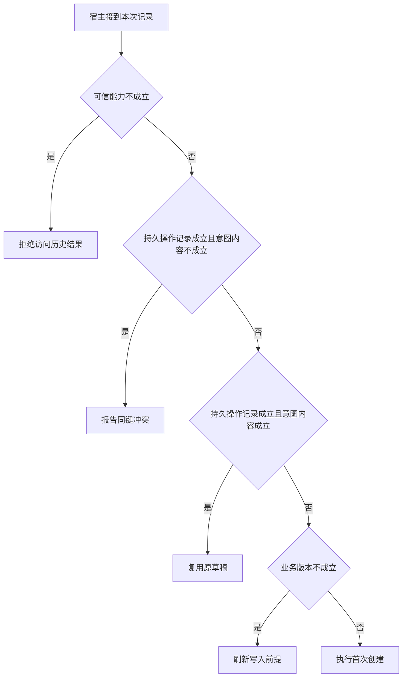

# 稳定操作键怎样区分重试与新请求

第一次草稿写入已提交，回应丢失。
第二次模型调用编号不同，但用户仍在等待同一份草稿。
记录操作键、规范化内容和结果 ID 才能恢复。直接用调用编号做唯一键会生成第二份。

本篇用一个封闭的教学决策器说明这一问题。输入是宿主收到的记录，不保证每个下游字段都已经获准使用。前置检查未成立时，下游即使带着缓存值，也不能拿来作业务断言。

## 先解决一个具体问题

**用户真的想再起草一次，怎么避免误去重？**

稳定键绑定的是一次业务意图，不能简化成案件和文本哈希。
重试复用原键，独立请求拿新键。同键异义显式冲突，才能区分恢复和新操作。


先取一个能走到「执行首次创建」的输入：宿主确认当前主体获准、本键尚无操作记录、同一键携带不同内容、资料版本仍适用。
把这四个条件代回后文的图，前面各个拦截分支都未满足，最终才有“本操作键尚不存在且可以提交”这个判断。
还原这个现场时要分别问：哪些位来自可信状态，哪些只是在接口中出现、尚未获得解释资格的字段。

## 先沿一次决策走到底



从上到下取第一条成立的出口。只改一个开关时，只有它之前的检查都未截断，该变化才可能到达真实动作。

“可信能力”的两种输入分别是“宿主确认当前主体获准”与“当前主体未获授权”。
权限取自可信入口或执行端，不由模型生成。

“持久操作记录”的两种输入分别是“已找到本键的操作记录”与“本键尚无操作记录”。
区分首次写入与回执丢失依赖可查的持久结果。

“意图内容”的两种输入分别是“内容与原操作键一致”与“同一键携带不同内容”。
同键异义要显式冲突，不能返回假成功。

“业务版本”的两种输入分别是“资料版本仍适用”与“观察所依据版本已过期”。
写入前应重新验证可能变化的业务前提。

## 最少需要哪几项观察

### 拒绝访问历史结果

查回已有草稿也需要授权。
在本节的全部组合中，有 8 种产生「拒绝访问历史结果」，这只是逻辑空间的计数，不能当作实际用户请求的比例。

只取得当前主体未获授权，已经足以要求宿主「拒绝访问历史结果」。
保持这些已知项，其余开关自由变化，仍有 8 种补全，判断没有翻转。

若删掉关于可信能力的证据，另一份允许的现场是宿主确认当前主体获准、本键尚无操作记录、同一键携带不同内容、观察所依据版本已过期，它会使宿主「刷新写入前提」。

### 报告同键冲突

相同业务键携带不同内容。
在本节的全部组合中，有 2 种产生「报告同键冲突」，这只是逻辑空间的计数，不能当作实际用户请求的比例。

只取得宿主确认当前主体获准、已找到本键的操作记录、同一键携带不同内容，已经足以要求宿主「报告同键冲突」。
保持这些已知项，其余开关自由变化，仍有 2 种补全，判断没有翻转。

若删掉关于可信能力的证据，另一份允许的现场是当前主体未获授权、已找到本键的操作记录、同一键携带不同内容、观察所依据版本已过期，它会使宿主「拒绝访问历史结果」。

若删掉关于持久操作记录的证据，另一份允许的现场是宿主确认当前主体获准、本键尚无操作记录、同一键携带不同内容、观察所依据版本已过期，它会使宿主「刷新写入前提」。

若删掉关于意图内容的证据，另一份允许的现场是宿主确认当前主体获准、已找到本键的操作记录、内容与原操作键一致、观察所依据版本已过期，它会使宿主「复用原草稿」。

### 复用原草稿

已有持久结果且内容一致。
在本节的全部组合中，有 2 种产生「复用原草稿」，这只是逻辑空间的计数，不能当作实际用户请求的比例。

只取得宿主确认当前主体获准、已找到本键的操作记录、内容与原操作键一致，已经足以要求宿主「复用原草稿」。

若删掉关于可信能力的证据，另一份允许的现场是当前主体未获授权、已找到本键的操作记录、内容与原操作键一致、观察所依据版本已过期，它会使宿主「拒绝访问历史结果」。

若删掉关于持久操作记录的证据，另一份允许的现场是宿主确认当前主体获准、本键尚无操作记录、内容与原操作键一致、观察所依据版本已过期，它会使宿主「刷新写入前提」。

若删掉关于意图内容的证据，另一份允许的现场是宿主确认当前主体获准、已找到本键的操作记录、同一键携带不同内容、观察所依据版本已过期，它会使宿主「报告同键冲突」。

### 刷新写入前提

首次提交必须针对当前材料。
在本节的全部组合中，有 2 种产生「刷新写入前提」，这只是逻辑空间的计数，不能当作实际用户请求的比例。

只取得宿主确认当前主体获准、本键尚无操作记录、观察所依据版本已过期，已经足以要求宿主「刷新写入前提」。

若删掉关于可信能力的证据，另一份允许的现场是当前主体未获授权、本键尚无操作记录、同一键携带不同内容、观察所依据版本已过期，它会使宿主「拒绝访问历史结果」。

若删掉关于持久操作记录的证据，另一份允许的现场是宿主确认当前主体获准、已找到本键的操作记录、同一键携带不同内容、观察所依据版本已过期，它会使宿主「报告同键冲突」。

若删掉关于业务版本的证据，另一份允许的现场是宿主确认当前主体获准、本键尚无操作记录、同一键携带不同内容、资料版本仍适用，它会使宿主「执行首次创建」。

### 执行首次创建

本操作键尚不存在且可以提交。
在本节的全部组合中，有 2 种产生「执行首次创建」，这只是逻辑空间的计数，不能当作实际用户请求的比例。

只取得宿主确认当前主体获准、本键尚无操作记录、资料版本仍适用，已经足以要求宿主「执行首次创建」。

若删掉关于可信能力的证据，另一份允许的现场是当前主体未获授权、本键尚无操作记录、同一键携带不同内容、资料版本仍适用，它会使宿主「拒绝访问历史结果」。

若删掉关于持久操作记录的证据，另一份允许的现场是宿主确认当前主体获准、已找到本键的操作记录、同一键携带不同内容、资料版本仍适用，它会使宿主「报告同键冲突」。

若删掉关于业务版本的证据，另一份允许的现场是宿主确认当前主体获准、本键尚无操作记录、同一键携带不同内容、观察所依据版本已过期，它会使宿主「刷新写入前提」。

## 以同一份契约解释截然不同的现场

<details>
<summary>展开推演与对应反例</summary>

下列样本按最先命中的业务分支排列。四位编码只作本篇页内定位，顺序与开头的四项输入一致。可以先猜下一动作，再展开相邻样本。

### 能够触发“拒绝访问历史结果”的现场

**样本 0000**

业务侧交来当前主体未获授权、本键尚无操作记录，执行侧还记录了同一键携带不同内容、观察所依据版本已过期。
把样本压成最短证明，保留当前主体未获授权就能支持「拒绝访问历史结果」。

在这份记录上，分别翻转「可信能力」中的任一项，其他项完全不变时，下一动作都会改变。

保持其余观察不动，单独切换「持久操作记录」、「意图内容」、「业务版本」仍得到「拒绝访问历史结果」，它们在这个现场不是决定性变量。

要从本例改走「刷新写入前提」，至少需要变动 1 项，一组最少改动是将当前主体未获授权换成宿主确认当前主体获准。

要从本例改走「执行首次创建」，至少需要变动 2 项，一组最少改动是将当前主体未获授权、观察所依据版本已过期换成宿主确认当前主体获准、资料版本仍适用。

要从本例改走「报告同键冲突」，至少需要变动 2 项，一组最少改动是将当前主体未获授权、本键尚无操作记录换成宿主确认当前主体获准、已找到本键的操作记录。

要从本例改走「复用原草稿」，至少需要变动 3 项，一组最少改动是将当前主体未获授权、本键尚无操作记录、同一键携带不同内容换成宿主确认当前主体获准、已找到本键的操作记录、内容与原操作键一致。

**样本 0001**

业务侧交来当前主体未获授权、本键尚无操作记录，执行侧还记录了同一键携带不同内容、资料版本仍适用。


要从本例改走「执行首次创建」，至少需要变动 1 项，一组最少改动是将当前主体未获授权换成宿主确认当前主体获准。

要从本例改走「刷新写入前提」，至少需要变动 2 项，一组最少改动是将当前主体未获授权、资料版本仍适用换成宿主确认当前主体获准、观察所依据版本已过期。


**样本 0010**

业务侧交来当前主体未获授权、本键尚无操作记录，执行侧还记录了内容与原操作键一致、观察所依据版本已过期。


要从本例改走「复用原草稿」，至少需要变动 2 项，一组最少改动是将当前主体未获授权、本键尚无操作记录换成宿主确认当前主体获准、已找到本键的操作记录。

要从本例改走「报告同键冲突」，至少需要变动 3 项，一组最少改动是将当前主体未获授权、本键尚无操作记录、内容与原操作键一致换成宿主确认当前主体获准、已找到本键的操作记录、同一键携带不同内容。

**样本 0011**

业务侧交来当前主体未获授权、本键尚无操作记录，执行侧还记录了内容与原操作键一致、资料版本仍适用。


**样本 0100**

业务侧交来当前主体未获授权、已找到本键的操作记录，执行侧还记录了同一键携带不同内容、观察所依据版本已过期。


要从本例改走「报告同键冲突」，至少需要变动 1 项，一组最少改动是将当前主体未获授权换成宿主确认当前主体获准。

要从本例改走「刷新写入前提」，至少需要变动 2 项，一组最少改动是将当前主体未获授权、已找到本键的操作记录换成宿主确认当前主体获准、本键尚无操作记录。

要从本例改走「复用原草稿」，至少需要变动 2 项，一组最少改动是将当前主体未获授权、同一键携带不同内容换成宿主确认当前主体获准、内容与原操作键一致。

要从本例改走「执行首次创建」，至少需要变动 3 项，一组最少改动是将当前主体未获授权、已找到本键的操作记录、观察所依据版本已过期换成宿主确认当前主体获准、本键尚无操作记录、资料版本仍适用。

**样本 0101**

业务侧交来当前主体未获授权、已找到本键的操作记录，执行侧还记录了同一键携带不同内容、资料版本仍适用。


要从本例改走「执行首次创建」，至少需要变动 2 项，一组最少改动是将当前主体未获授权、已找到本键的操作记录换成宿主确认当前主体获准、本键尚无操作记录。


要从本例改走「刷新写入前提」，至少需要变动 3 项，一组最少改动是将当前主体未获授权、已找到本键的操作记录、资料版本仍适用换成宿主确认当前主体获准、本键尚无操作记录、观察所依据版本已过期。

**样本 0110**

业务侧交来当前主体未获授权、已找到本键的操作记录，执行侧还记录了内容与原操作键一致、观察所依据版本已过期。


要从本例改走「复用原草稿」，至少需要变动 1 项，一组最少改动是将当前主体未获授权换成宿主确认当前主体获准。


要从本例改走「报告同键冲突」，至少需要变动 2 项，一组最少改动是将当前主体未获授权、内容与原操作键一致换成宿主确认当前主体获准、同一键携带不同内容。


**样本 0111**

业务侧交来当前主体未获授权、已找到本键的操作记录，执行侧还记录了内容与原操作键一致、资料版本仍适用。


### 能够触发“报告同键冲突”的现场

**样本 1100**

业务侧交来宿主确认当前主体获准、已找到本键的操作记录，执行侧还记录了同一键携带不同内容、观察所依据版本已过期。
把样本压成最短证明，保留宿主确认当前主体获准、已找到本键的操作记录、同一键携带不同内容就能支持「报告同键冲突」。

在这份记录上，分别翻转「可信能力」、「持久操作记录」、「意图内容」中的任一项，其他项完全不变时，下一动作都会改变。

保持其余观察不动，单独切换「业务版本」仍得到「报告同键冲突」，它们在这个现场不是决定性变量。

本例没走更靠前的「拒绝访问历史结果」，因为宿主确认当前主体获准与那个入口的必要条件不符。

要从本例改走「拒绝访问历史结果」，至少需要变动 1 项，一组最少改动是将宿主确认当前主体获准换成当前主体未获授权。

要从本例改走「刷新写入前提」，至少需要变动 1 项，一组最少改动是将已找到本键的操作记录换成本键尚无操作记录。

要从本例改走「复用原草稿」，至少需要变动 1 项，一组最少改动是将同一键携带不同内容换成内容与原操作键一致。

要从本例改走「执行首次创建」，至少需要变动 2 项，一组最少改动是将已找到本键的操作记录、观察所依据版本已过期换成本键尚无操作记录、资料版本仍适用。

**样本 1101**

业务侧交来宿主确认当前主体获准、已找到本键的操作记录，执行侧还记录了同一键携带不同内容、资料版本仍适用。


要从本例改走「执行首次创建」，至少需要变动 1 项，一组最少改动是将已找到本键的操作记录换成本键尚无操作记录。


要从本例改走「刷新写入前提」，至少需要变动 2 项，一组最少改动是将已找到本键的操作记录、资料版本仍适用换成本键尚无操作记录、观察所依据版本已过期。

### 能够触发“复用原草稿”的现场

**样本 1110**

业务侧交来宿主确认当前主体获准、已找到本键的操作记录，执行侧还记录了内容与原操作键一致、观察所依据版本已过期。
把样本压成最短证明，保留宿主确认当前主体获准、已找到本键的操作记录、内容与原操作键一致就能支持「复用原草稿」。


保持其余观察不动，单独切换「业务版本」仍得到「复用原草稿」，它们在这个现场不是决定性变量。


本例没走更靠前的「报告同键冲突」，因为内容与原操作键一致与那个入口的必要条件不符。


要从本例改走「报告同键冲突」，至少需要变动 1 项，一组最少改动是将内容与原操作键一致换成同一键携带不同内容。


**样本 1111**

业务侧交来宿主确认当前主体获准、已找到本键的操作记录，执行侧还记录了内容与原操作键一致、资料版本仍适用。


### 能够触发“刷新写入前提”的现场

**样本 1000**

业务侧交来宿主确认当前主体获准、本键尚无操作记录，执行侧还记录了同一键携带不同内容、观察所依据版本已过期。
把样本压成最短证明，保留宿主确认当前主体获准、本键尚无操作记录、观察所依据版本已过期就能支持「刷新写入前提」。

在这份记录上，分别翻转「可信能力」、「持久操作记录」、「业务版本」中的任一项，其他项完全不变时，下一动作都会改变。

保持其余观察不动，单独切换「意图内容」仍得到「刷新写入前提」，它们在这个现场不是决定性变量。


本例没走更靠前的「报告同键冲突」，因为本键尚无操作记录与那个入口的必要条件不符。

本例没走更靠前的「复用原草稿」，因为本键尚无操作记录、同一键携带不同内容与那个入口的必要条件不符。


要从本例改走「执行首次创建」，至少需要变动 1 项，一组最少改动是将观察所依据版本已过期换成资料版本仍适用。

要从本例改走「报告同键冲突」，至少需要变动 1 项，一组最少改动是将本键尚无操作记录换成已找到本键的操作记录。

要从本例改走「复用原草稿」，至少需要变动 2 项，一组最少改动是将本键尚无操作记录、同一键携带不同内容换成已找到本键的操作记录、内容与原操作键一致。

**样本 1010**

业务侧交来宿主确认当前主体获准、本键尚无操作记录，执行侧还记录了内容与原操作键一致、观察所依据版本已过期。


本例没走更靠前的「报告同键冲突」，因为本键尚无操作记录、内容与原操作键一致与那个入口的必要条件不符。

本例没走更靠前的「复用原草稿」，因为本键尚无操作记录与那个入口的必要条件不符。


要从本例改走「复用原草稿」，至少需要变动 1 项，一组最少改动是将本键尚无操作记录换成已找到本键的操作记录。

要从本例改走「报告同键冲突」，至少需要变动 2 项，一组最少改动是将本键尚无操作记录、内容与原操作键一致换成已找到本键的操作记录、同一键携带不同内容。

### 能够触发“执行首次创建”的现场

**样本 1001**

业务侧交来宿主确认当前主体获准、本键尚无操作记录，执行侧还记录了同一键携带不同内容、资料版本仍适用。
把样本压成最短证明，保留宿主确认当前主体获准、本键尚无操作记录、资料版本仍适用就能支持「执行首次创建」。


保持其余观察不动，单独切换「意图内容」仍得到「执行首次创建」，它们在这个现场不是决定性变量。


本例没走更靠前的「刷新写入前提」，因为资料版本仍适用与那个入口的必要条件不符。


要从本例改走「刷新写入前提」，至少需要变动 1 项，一组最少改动是将资料版本仍适用换成观察所依据版本已过期。


**样本 1011**

业务侧交来宿主确认当前主体获准、本键尚无操作记录，执行侧还记录了内容与原操作键一致、资料版本仍适用。


</details>

## 当你只能看见一半记录

<details>
<summary>展开推演与对应反例</summary>

这次隐藏两个字段，保留另两个。对每个可见现场，检查四种合法补全是否同意。如仍有歧义，选择能使最坏剩余候选动作最少的字段继续查。并列时采用本篇字段顺序。

### 只保留可信能力与持久操作记录

已知当前主体未获授权、本键尚无操作记录时，四种补全的动作分布为拒绝访问历史结果（4 种）。

就“拒绝访问历史结果”这个动作而言，在当前主体未获授权、本键尚无操作记录的前提下，另外两项观察不会推翻它。

已知当前主体未获授权、已找到本键的操作记录时，四种补全的动作分布为拒绝访问历史结果（4 种）。

就“拒绝访问历史结果”这个动作而言，在当前主体未获授权、已找到本键的操作记录的前提下，另外两项观察不会推翻它。

已知宿主确认当前主体获准、本键尚无操作记录时，四种补全的动作分布为刷新写入前提（2 种）、执行首次创建（2 种）。

在宿主确认当前主体获准、本键尚无操作记录这个现场补读「业务版本」，最坏还剩 1 种动作，计算时只衡量歧义，尚未扣读取代价。
若补来的观察为“观察所依据版本已过期”，范围缩成「刷新写入前提」。若为“资料版本仍适用”，则保留「执行首次创建」。

区分不了的两条执行可以具体写成 1000 与 1001：它们共享已展示字段，却分别需要「刷新写入前提」和「执行首次创建」。

已知宿主确认当前主体获准、已找到本键的操作记录时，四种补全的动作分布为报告同键冲突（2 种）、复用原草稿（2 种）。

在宿主确认当前主体获准、已找到本键的操作记录这个现场补读「意图内容」，最坏还剩 1 种动作，计算时只衡量歧义，尚未扣读取代价。
若补来的观察为“同一键携带不同内容”，范围缩成「报告同键冲突」。若为“内容与原操作键一致”，则保留「复用原草稿」。

区分不了的两条执行可以具体写成 1100 与 1110：它们共享已展示字段，却分别需要「报告同键冲突」和「复用原草稿」。

### 只保留可信能力与意图内容

已知当前主体未获授权、同一键携带不同内容时，四种补全的动作分布为拒绝访问历史结果（4 种）。

就“拒绝访问历史结果”这个动作而言，在当前主体未获授权、同一键携带不同内容的前提下，另外两项观察不会推翻它。

已知当前主体未获授权、内容与原操作键一致时，四种补全的动作分布为拒绝访问历史结果（4 种）。

就“拒绝访问历史结果”这个动作而言，在当前主体未获授权、内容与原操作键一致的前提下，另外两项观察不会推翻它。

已知宿主确认当前主体获准、同一键携带不同内容时，四种补全的动作分布为报告同键冲突（2 种）、刷新写入前提（1 种）、执行首次创建（1 种）。

在宿主确认当前主体获准、同一键携带不同内容这个现场补读「持久操作记录」，最坏还剩 2 种动作，计算时只衡量歧义，尚未扣读取代价。
若补来的观察为“本键尚无操作记录”，范围缩成「刷新写入前提」、「执行首次创建」。若为“已找到本键的操作记录”，则保留「报告同键冲突」。


已知宿主确认当前主体获准、内容与原操作键一致时，四种补全的动作分布为复用原草稿（2 种）、刷新写入前提（1 种）、执行首次创建（1 种）。

在宿主确认当前主体获准、内容与原操作键一致这个现场补读「持久操作记录」，最坏还剩 2 种动作，计算时只衡量歧义，尚未扣读取代价。
若补来的观察为“本键尚无操作记录”，范围缩成「刷新写入前提」、「执行首次创建」。若为“已找到本键的操作记录”，则保留「复用原草稿」。

区分不了的两条执行可以具体写成 1010 与 1011：它们共享已展示字段，却分别需要「刷新写入前提」和「执行首次创建」。

### 只保留持久操作记录与意图内容

已知本键尚无操作记录、同一键携带不同内容时，四种补全的动作分布为拒绝访问历史结果（2 种）、刷新写入前提（1 种）、执行首次创建（1 种）。

在本键尚无操作记录、同一键携带不同内容这个现场补读「可信能力」，最坏还剩 2 种动作，计算时只衡量歧义，尚未扣读取代价。
若补来的观察为“当前主体未获授权”，范围缩成「拒绝访问历史结果」。若为“宿主确认当前主体获准”，则保留「刷新写入前提」、「执行首次创建」。

区分不了的两条执行可以具体写成 0000 与 1000：它们共享已展示字段，却分别需要「拒绝访问历史结果」和「刷新写入前提」。

已知本键尚无操作记录、内容与原操作键一致时，四种补全的动作分布为拒绝访问历史结果（2 种）、刷新写入前提（1 种）、执行首次创建（1 种）。

在本键尚无操作记录、内容与原操作键一致这个现场补读「可信能力」，最坏还剩 2 种动作，计算时只衡量歧义，尚未扣读取代价。

区分不了的两条执行可以具体写成 0010 与 1010：它们共享已展示字段，却分别需要「拒绝访问历史结果」和「刷新写入前提」。

已知已找到本键的操作记录、同一键携带不同内容时，四种补全的动作分布为拒绝访问历史结果（2 种）、报告同键冲突（2 种）。

在已找到本键的操作记录、同一键携带不同内容这个现场补读「可信能力」，最坏还剩 1 种动作，计算时只衡量歧义，尚未扣读取代价。
若补来的观察为“当前主体未获授权”，范围缩成「拒绝访问历史结果」。若为“宿主确认当前主体获准”，则保留「报告同键冲突」。

区分不了的两条执行可以具体写成 0100 与 1100：它们共享已展示字段，却分别需要「拒绝访问历史结果」和「报告同键冲突」。

已知已找到本键的操作记录、内容与原操作键一致时，四种补全的动作分布为拒绝访问历史结果（2 种）、复用原草稿（2 种）。

在已找到本键的操作记录、内容与原操作键一致这个现场补读「可信能力」，最坏还剩 1 种动作，计算时只衡量歧义，尚未扣读取代价。
若补来的观察为“当前主体未获授权”，范围缩成「拒绝访问历史结果」。若为“宿主确认当前主体获准”，则保留「复用原草稿」。

区分不了的两条执行可以具体写成 0110 与 1110：它们共享已展示字段，却分别需要「拒绝访问历史结果」和「复用原草稿」。

### 只保留可信能力与业务版本

已知当前主体未获授权、观察所依据版本已过期时，四种补全的动作分布为拒绝访问历史结果（4 种）。

就“拒绝访问历史结果”这个动作而言，在当前主体未获授权、观察所依据版本已过期的前提下，另外两项观察不会推翻它。

已知当前主体未获授权、资料版本仍适用时，四种补全的动作分布为拒绝访问历史结果（4 种）。

就“拒绝访问历史结果”这个动作而言，在当前主体未获授权、资料版本仍适用的前提下，另外两项观察不会推翻它。

已知宿主确认当前主体获准、观察所依据版本已过期时，四种补全的动作分布为报告同键冲突（1 种）、复用原草稿（1 种）、刷新写入前提（2 种）。

在宿主确认当前主体获准、观察所依据版本已过期这个现场补读「持久操作记录」，最坏还剩 2 种动作，计算时只衡量歧义，尚未扣读取代价。
若补来的观察为“本键尚无操作记录”，范围缩成「刷新写入前提」。若为“已找到本键的操作记录”，则保留「报告同键冲突」、「复用原草稿」。

区分不了的两条执行可以具体写成 1000 与 1100：它们共享已展示字段，却分别需要「刷新写入前提」和「报告同键冲突」。

已知宿主确认当前主体获准、资料版本仍适用时，四种补全的动作分布为报告同键冲突（1 种）、复用原草稿（1 种）、执行首次创建（2 种）。

在宿主确认当前主体获准、资料版本仍适用这个现场补读「持久操作记录」，最坏还剩 2 种动作，计算时只衡量歧义，尚未扣读取代价。
若补来的观察为“本键尚无操作记录”，范围缩成「执行首次创建」。若为“已找到本键的操作记录”，则保留「报告同键冲突」、「复用原草稿」。

区分不了的两条执行可以具体写成 1001 与 1101：它们共享已展示字段，却分别需要「执行首次创建」和「报告同键冲突」。

### 只保留持久操作记录与业务版本

已知本键尚无操作记录、观察所依据版本已过期时，四种补全的动作分布为拒绝访问历史结果（2 种）、刷新写入前提（2 种）。

在本键尚无操作记录、观察所依据版本已过期这个现场补读「可信能力」，最坏还剩 1 种动作，计算时只衡量歧义，尚未扣读取代价。
若补来的观察为“当前主体未获授权”，范围缩成「拒绝访问历史结果」。若为“宿主确认当前主体获准”，则保留「刷新写入前提」。


已知本键尚无操作记录、资料版本仍适用时，四种补全的动作分布为拒绝访问历史结果（2 种）、执行首次创建（2 种）。

在本键尚无操作记录、资料版本仍适用这个现场补读「可信能力」，最坏还剩 1 种动作，计算时只衡量歧义，尚未扣读取代价。
若补来的观察为“当前主体未获授权”，范围缩成「拒绝访问历史结果」。若为“宿主确认当前主体获准”，则保留「执行首次创建」。

区分不了的两条执行可以具体写成 0001 与 1001：它们共享已展示字段，却分别需要「拒绝访问历史结果」和「执行首次创建」。

已知已找到本键的操作记录、观察所依据版本已过期时，四种补全的动作分布为拒绝访问历史结果（2 种）、报告同键冲突（1 种）、复用原草稿（1 种）。

在已找到本键的操作记录、观察所依据版本已过期这个现场补读「可信能力」，最坏还剩 2 种动作，计算时只衡量歧义，尚未扣读取代价。
若补来的观察为“当前主体未获授权”，范围缩成「拒绝访问历史结果」。若为“宿主确认当前主体获准”，则保留「报告同键冲突」、「复用原草稿」。


已知已找到本键的操作记录、资料版本仍适用时，四种补全的动作分布为拒绝访问历史结果（2 种）、报告同键冲突（1 种）、复用原草稿（1 种）。

在已找到本键的操作记录、资料版本仍适用这个现场补读「可信能力」，最坏还剩 2 种动作，计算时只衡量歧义，尚未扣读取代价。

区分不了的两条执行可以具体写成 0101 与 1101：它们共享已展示字段，却分别需要「拒绝访问历史结果」和「报告同键冲突」。

### 只保留意图内容与业务版本

已知同一键携带不同内容、观察所依据版本已过期时，四种补全的动作分布为拒绝访问历史结果（2 种）、报告同键冲突（1 种）、刷新写入前提（1 种）。

在同一键携带不同内容、观察所依据版本已过期这个现场补读「可信能力」，最坏还剩 2 种动作，计算时只衡量歧义，尚未扣读取代价。
若补来的观察为“当前主体未获授权”，范围缩成「拒绝访问历史结果」。若为“宿主确认当前主体获准”，则保留「刷新写入前提」、「报告同键冲突」。


已知同一键携带不同内容、资料版本仍适用时，四种补全的动作分布为拒绝访问历史结果（2 种）、报告同键冲突（1 种）、执行首次创建（1 种）。

在同一键携带不同内容、资料版本仍适用这个现场补读「可信能力」，最坏还剩 2 种动作，计算时只衡量歧义，尚未扣读取代价。
若补来的观察为“当前主体未获授权”，范围缩成「拒绝访问历史结果」。若为“宿主确认当前主体获准”，则保留「执行首次创建」、「报告同键冲突」。


已知内容与原操作键一致、观察所依据版本已过期时，四种补全的动作分布为拒绝访问历史结果（2 种）、复用原草稿（1 种）、刷新写入前提（1 种）。

在内容与原操作键一致、观察所依据版本已过期这个现场补读「可信能力」，最坏还剩 2 种动作，计算时只衡量歧义，尚未扣读取代价。
若补来的观察为“当前主体未获授权”，范围缩成「拒绝访问历史结果」。若为“宿主确认当前主体获准”，则保留「刷新写入前提」、「复用原草稿」。


已知内容与原操作键一致、资料版本仍适用时，四种补全的动作分布为拒绝访问历史结果（2 种）、复用原草稿（1 种）、执行首次创建（1 种）。

在内容与原操作键一致、资料版本仍适用这个现场补读「可信能力」，最坏还剩 2 种动作，计算时只衡量歧义，尚未扣读取代价。
若补来的观察为“当前主体未获授权”，范围缩成「拒绝访问历史结果」。若为“宿主确认当前主体获准”，则保留「执行首次创建」、「复用原草稿」。

区分不了的两条执行可以具体写成 0011 与 1011：它们共享已展示字段，却分别需要「拒绝访问历史结果」和「执行首次创建」。

</details>

## 单因素干预与边界测试

<details>
<summary>展开推演与对应反例</summary>

### 只改变可信能力

固定另外三个条件得到八对现场，从“当前主体未获授权”转为“宿主确认当前主体获准”时，8 对翻转动作，另外 0 对保持不变。

有 2 对现场沿「拒绝访问历史结果」变到「刷新写入前提」，可复现的一组受控背景为本键尚无操作记录、同一键携带不同内容、观察所依据版本已过期。

有 2 对现场沿「拒绝访问历史结果」变到「执行首次创建」，可复现的一组受控背景为本键尚无操作记录、同一键携带不同内容、资料版本仍适用。

有 2 对现场沿「拒绝访问历史结果」变到「报告同键冲突」，可复现的一组受控背景为已找到本键的操作记录、同一键携带不同内容、观察所依据版本已过期。

有 2 对现场沿「拒绝访问历史结果」变到「复用原草稿」，可复现的一组受控背景为已找到本键的操作记录、内容与原操作键一致、观察所依据版本已过期。

### 只改变持久操作记录

固定另外三个条件得到八对现场，从“本键尚无操作记录”转为“已找到本键的操作记录”时，4 对翻转动作，另外 4 对保持不变。

令当前主体未获授权、同一键携带不同内容、观察所依据版本已过期，持久操作记录的两个取值均得到「拒绝访问历史结果」。在八对中，共有 4 对表现为这一种稳定出口。

有 1 对现场沿「刷新写入前提」变到「报告同键冲突」，可复现的一组受控背景为宿主确认当前主体获准、同一键携带不同内容、观察所依据版本已过期。

有 1 对现场沿「执行首次创建」变到「报告同键冲突」，可复现的一组受控背景为宿主确认当前主体获准、同一键携带不同内容、资料版本仍适用。

有 1 对现场沿「刷新写入前提」变到「复用原草稿」，可复现的一组受控背景为宿主确认当前主体获准、内容与原操作键一致、观察所依据版本已过期。

有 1 对现场沿「执行首次创建」变到「复用原草稿」，可复现的一组受控背景为宿主确认当前主体获准、内容与原操作键一致、资料版本仍适用。

### 只改变意图内容

固定另外三个条件得到八对现场，从“同一键携带不同内容”转为“内容与原操作键一致”时，2 对翻转动作，另外 6 对保持不变。

令当前主体未获授权、本键尚无操作记录、观察所依据版本已过期，意图内容的两个取值均得到「拒绝访问历史结果」。在八对中，共有 4 对表现为这一种稳定出口。

令宿主确认当前主体获准、本键尚无操作记录、观察所依据版本已过期，意图内容的两个取值均得到「刷新写入前提」。在八对中，共有 1 对表现为这一种稳定出口。

令宿主确认当前主体获准、本键尚无操作记录、资料版本仍适用，意图内容的两个取值均得到「执行首次创建」。在八对中，共有 1 对表现为这一种稳定出口。

有 2 对现场沿「报告同键冲突」变到「复用原草稿」，可复现的一组受控背景为宿主确认当前主体获准、已找到本键的操作记录、观察所依据版本已过期。

### 只改变业务版本

固定另外三个条件得到八对现场，从“观察所依据版本已过期”转为“资料版本仍适用”时，2 对翻转动作，另外 6 对保持不变。

令当前主体未获授权、本键尚无操作记录、同一键携带不同内容，业务版本的两个取值均得到「拒绝访问历史结果」。在八对中，共有 4 对表现为这一种稳定出口。

有 2 对现场沿「刷新写入前提」变到「执行首次创建」，可复现的一组受控背景为宿主确认当前主体获准、本键尚无操作记录、同一键携带不同内容。

令宿主确认当前主体获准、已找到本键的操作记录、同一键携带不同内容，业务版本的两个取值均得到「报告同键冲突」。在八对中，共有 1 对表现为这一种稳定出口。

令宿主确认当前主体获准、已找到本键的操作记录、内容与原操作键一致，业务版本的两个取值均得到「复用原草稿」。在八对中，共有 1 对表现为这一种稳定出口。

</details>

## 哪些回归样本真能抓住实现错误

<details>
<summary>展开推演与对应反例</summary>

如果删除“拒绝访问历史结果”这个分支，在本篇 16 种输入里有 8 种会改走另一出口。

反例 0000 的完整记录为当前主体未获授权、本键尚无操作记录、同一键携带不同内容、观察所依据版本已过期。正确结果是「拒绝访问历史结果」，这个改坏的实现却给出「刷新写入前提」。

如果删除“报告同键冲突”这个分支，在本篇 16 种输入里有 2 种会改走另一出口。

反例 1100 的完整记录为宿主确认当前主体获准、已找到本键的操作记录、同一键携带不同内容、观察所依据版本已过期。正确结果是「报告同键冲突」，这个改坏的实现却给出「刷新写入前提」。

如果删除“复用原草稿”这个分支，在本篇 16 种输入里有 2 种会改走另一出口。

反例 1110 的完整记录为宿主确认当前主体获准、已找到本键的操作记录、内容与原操作键一致、观察所依据版本已过期。正确结果是「复用原草稿」，这个改坏的实现却给出「刷新写入前提」。

如果删除“刷新写入前提”这个分支，在本篇 16 种输入里有 2 种会改走另一出口。

反例 1000 的完整记录为宿主确认当前主体获准、本键尚无操作记录、同一键携带不同内容、观察所依据版本已过期。正确结果是「刷新写入前提」，这个改坏的实现却给出「执行首次创建」。

如果交换“拒绝访问历史结果”和“报告同键冲突”的判断次序，在本篇 16 种输入里有 2 种会改走另一出口。

反例 0100 的完整记录为当前主体未获授权、已找到本键的操作记录、同一键携带不同内容、观察所依据版本已过期。正确结果是「拒绝访问历史结果」，这个改坏的实现却给出「报告同键冲突」。

如果交换“报告同键冲突”和“复用原草稿”的判断次序，在本篇 16 种输入里有 0 种会改走另一出口。

对于“交换“报告同键冲突”和“复用原草稿”的判断次序”这项修改，在声明输入域内没有区分它的样本，不能宣称测试捕捉到了故障。

如果交换“复用原草稿”和“刷新写入前提”的判断次序，在本篇 16 种输入里有 1 种会改走另一出口。


补入样本 0100（当前主体未获授权、已找到本键的操作记录、同一键携带不同内容、观察所依据版本已过期）能新增检出「删除“拒绝访问历史结果”这个分支」、「交换“拒绝访问历史结果”和“报告同键冲突”的判断次序」。

补入样本 1110（宿主确认当前主体获准、已找到本键的操作记录、内容与原操作键一致、观察所依据版本已过期）能新增检出「删除“复用原草稿”这个分支」、「交换“复用原草稿”和“刷新写入前提”的判断次序」。

补入样本 1000（宿主确认当前主体获准、本键尚无操作记录、同一键携带不同内容、观察所依据版本已过期）能新增检出「删除“刷新写入前提”这个分支」。

补入样本 1100（宿主确认当前主体获准、已找到本键的操作记录、同一键携带不同内容、观察所依据版本已过期）能新增检出「删除“报告同键冲突”这个分支」。

这里每次选覆盖尚未捕获缺陷最多的样本，并不保证用例数全局最小。它给出的反例能作为 Java 单测输入。真实模型是否会自主产生这些提议，仍须单独评测。

</details>

## 把状态覆盖换成有抽样偏差的评测批次

<details>
<summary>展开推演与对应反例</summary>

前面的十六种记录各有一票。现在只改样本构成：对一个给定字段，把成立侧的每种记录各取三份、另一侧各取一份。这是人为配比的 32 份回放，不是线上频率估计。
将偏向成立与偏向不成立的两次批次对照，可以隔离分母变化。底层宿主和所有答案保持相同，比例仍可能移动。

### 改变“可信能力”的样本配比

只看「拒绝访问历史结果」，在宿主确认当前主体获准的八个不同输入中有 0 个命中，在当前主体未获授权的另八个输入中有 8 个命中。
把「可信能力」成立侧按三倍取样，「拒绝访问历史结果」占 8/32，反过来向未成立侧倾斜后占 24/32。
这次重加权使「拒绝访问历史结果」的占比相差 50 个百分点。若按两种不同的“可信能力”分布跑新旧版，不能把这项差异全部归功于实现。

只看「报告同键冲突」，在宿主确认当前主体获准的八个不同输入中有 2 个命中，在当前主体未获授权的另八个输入中有 0 个命中。
把「可信能力」成立侧按三倍取样，「报告同键冲突」占 6/32，反过来向未成立侧倾斜后占 2/32。
这次重加权使「报告同键冲突」的占比相差 12.5 个百分点。若按两种不同的“可信能力”分布跑新旧版，不能把这项差异全部归功于实现。

只看「复用原草稿」，在宿主确认当前主体获准的八个不同输入中有 2 个命中，在当前主体未获授权的另八个输入中有 0 个命中。
把「可信能力」成立侧按三倍取样，「复用原草稿」占 6/32，反过来向未成立侧倾斜后占 2/32。
这次重加权使「复用原草稿」的占比相差 12.5 个百分点。若按两种不同的“可信能力”分布跑新旧版，不能把这项差异全部归功于实现。

只看「刷新写入前提」，在宿主确认当前主体获准的八个不同输入中有 2 个命中，在当前主体未获授权的另八个输入中有 0 个命中。
把「可信能力」成立侧按三倍取样，「刷新写入前提」占 6/32，反过来向未成立侧倾斜后占 2/32。
这次重加权使「刷新写入前提」的占比相差 12.5 个百分点。若按两种不同的“可信能力”分布跑新旧版，不能把这项差异全部归功于实现。

只看「执行首次创建」，在宿主确认当前主体获准的八个不同输入中有 2 个命中，在当前主体未获授权的另八个输入中有 0 个命中。
把「可信能力」成立侧按三倍取样，「执行首次创建」占 6/32，反过来向未成立侧倾斜后占 2/32。
这次重加权使「执行首次创建」的占比相差 12.5 个百分点。若按两种不同的“可信能力”分布跑新旧版，不能把这项差异全部归功于实现。

### 改变“持久操作记录”的样本配比

只看「拒绝访问历史结果」，在已找到本键的操作记录的八个不同输入中有 4 个命中，在本键尚无操作记录的另八个输入中有 4 个命中。
把「持久操作记录」成立侧按三倍取样，「拒绝访问历史结果」占 16/32，反过来向未成立侧倾斜后占 16/32。
两批「拒绝访问历史结果」的边际比例相同，是因为这个出口在“持久操作记录”的两侧计数相等，这不能单独证明每一对现场都不受它影响。

只看「报告同键冲突」，在已找到本键的操作记录的八个不同输入中有 2 个命中，在本键尚无操作记录的另八个输入中有 0 个命中。
把「持久操作记录」成立侧按三倍取样，「报告同键冲突」占 6/32，反过来向未成立侧倾斜后占 2/32。
这次重加权使「报告同键冲突」的占比相差 12.5 个百分点。若按两种不同的“持久操作记录”分布跑新旧版，不能把这项差异全部归功于实现。

只看「复用原草稿」，在已找到本键的操作记录的八个不同输入中有 2 个命中，在本键尚无操作记录的另八个输入中有 0 个命中。
把「持久操作记录」成立侧按三倍取样，「复用原草稿」占 6/32，反过来向未成立侧倾斜后占 2/32。
这次重加权使「复用原草稿」的占比相差 12.5 个百分点。若按两种不同的“持久操作记录”分布跑新旧版，不能把这项差异全部归功于实现。

只看「刷新写入前提」，在已找到本键的操作记录的八个不同输入中有 0 个命中，在本键尚无操作记录的另八个输入中有 2 个命中。
把「持久操作记录」成立侧按三倍取样，「刷新写入前提」占 2/32，反过来向未成立侧倾斜后占 6/32。
这次重加权使「刷新写入前提」的占比相差 12.5 个百分点。若按两种不同的“持久操作记录”分布跑新旧版，不能把这项差异全部归功于实现。

只看「执行首次创建」，在已找到本键的操作记录的八个不同输入中有 0 个命中，在本键尚无操作记录的另八个输入中有 2 个命中。
把「持久操作记录」成立侧按三倍取样，「执行首次创建」占 2/32，反过来向未成立侧倾斜后占 6/32。
这次重加权使「执行首次创建」的占比相差 12.5 个百分点。若按两种不同的“持久操作记录”分布跑新旧版，不能把这项差异全部归功于实现。

### 改变“意图内容”的样本配比

只看「拒绝访问历史结果」，在内容与原操作键一致的八个不同输入中有 4 个命中，在同一键携带不同内容的另八个输入中有 4 个命中。
把「意图内容」成立侧按三倍取样，「拒绝访问历史结果」占 16/32，反过来向未成立侧倾斜后占 16/32。
两批「拒绝访问历史结果」的边际比例相同，是因为这个出口在“意图内容”的两侧计数相等，这不能单独证明每一对现场都不受它影响。

只看「报告同键冲突」，在内容与原操作键一致的八个不同输入中有 0 个命中，在同一键携带不同内容的另八个输入中有 2 个命中。
把「意图内容」成立侧按三倍取样，「报告同键冲突」占 2/32，反过来向未成立侧倾斜后占 6/32。
这次重加权使「报告同键冲突」的占比相差 12.5 个百分点。若按两种不同的“意图内容”分布跑新旧版，不能把这项差异全部归功于实现。

只看「复用原草稿」，在内容与原操作键一致的八个不同输入中有 2 个命中，在同一键携带不同内容的另八个输入中有 0 个命中。
把「意图内容」成立侧按三倍取样，「复用原草稿」占 6/32，反过来向未成立侧倾斜后占 2/32。
这次重加权使「复用原草稿」的占比相差 12.5 个百分点。若按两种不同的“意图内容”分布跑新旧版，不能把这项差异全部归功于实现。

只看「刷新写入前提」，在内容与原操作键一致的八个不同输入中有 1 个命中，在同一键携带不同内容的另八个输入中有 1 个命中。
把「意图内容」成立侧按三倍取样，「刷新写入前提」占 4/32，反过来向未成立侧倾斜后占 4/32。
两批「刷新写入前提」的边际比例相同，是因为这个出口在“意图内容”的两侧计数相等，这不能单独证明每一对现场都不受它影响。

只看「执行首次创建」，在内容与原操作键一致的八个不同输入中有 1 个命中，在同一键携带不同内容的另八个输入中有 1 个命中。
把「意图内容」成立侧按三倍取样，「执行首次创建」占 4/32，反过来向未成立侧倾斜后占 4/32。
两批「执行首次创建」的边际比例相同，是因为这个出口在“意图内容”的两侧计数相等，这不能单独证明每一对现场都不受它影响。

### 改变“业务版本”的样本配比

只看「拒绝访问历史结果」，在资料版本仍适用的八个不同输入中有 4 个命中，在观察所依据版本已过期的另八个输入中有 4 个命中。
把「业务版本」成立侧按三倍取样，「拒绝访问历史结果」占 16/32，反过来向未成立侧倾斜后占 16/32。
两批「拒绝访问历史结果」的边际比例相同，是因为这个出口在“业务版本”的两侧计数相等，这不能单独证明每一对现场都不受它影响。

只看「报告同键冲突」，在资料版本仍适用的八个不同输入中有 1 个命中，在观察所依据版本已过期的另八个输入中有 1 个命中。
把「业务版本」成立侧按三倍取样，「报告同键冲突」占 4/32，反过来向未成立侧倾斜后占 4/32。
两批「报告同键冲突」的边际比例相同，是因为这个出口在“业务版本”的两侧计数相等，这不能单独证明每一对现场都不受它影响。

只看「复用原草稿」，在资料版本仍适用的八个不同输入中有 1 个命中，在观察所依据版本已过期的另八个输入中有 1 个命中。
把「业务版本」成立侧按三倍取样，「复用原草稿」占 4/32，反过来向未成立侧倾斜后占 4/32。
两批「复用原草稿」的边际比例相同，是因为这个出口在“业务版本”的两侧计数相等，这不能单独证明每一对现场都不受它影响。

只看「刷新写入前提」，在资料版本仍适用的八个不同输入中有 0 个命中，在观察所依据版本已过期的另八个输入中有 2 个命中。
把「业务版本」成立侧按三倍取样，「刷新写入前提」占 2/32，反过来向未成立侧倾斜后占 6/32。
这次重加权使「刷新写入前提」的占比相差 12.5 个百分点。若按两种不同的“业务版本”分布跑新旧版，不能把这项差异全部归功于实现。

只看「执行首次创建」，在资料版本仍适用的八个不同输入中有 2 个命中，在观察所依据版本已过期的另八个输入中有 0 个命中。
把「业务版本」成立侧按三倍取样，「执行首次创建」占 6/32，反过来向未成立侧倾斜后占 2/32。
这次重加权使「执行首次创建」的占比相差 12.5 个百分点。若按两种不同的“业务版本”分布跑新旧版，不能把这项差异全部归功于实现。

</details>

## 只看终态，能逆推出多少原始事实

<details>
<summary>展开推演与对应反例</summary>

### 只保留“拒绝访问历史结果”这条结果时

在本节契约与完整输入域内，仅知「拒绝访问历史结果」就能倒推出当前主体未获授权，这一推断依赖版本未变且日志中的终态可信。

「拒绝访问历史结果」不能证明持久操作记录取哪一侧：0000 和 0100 有相同终态，却分别记为“本键尚无操作记录”和“已找到本键的操作记录”。

「拒绝访问历史结果」不能证明意图内容取哪一侧：0000 和 0010 有相同终态，却分别记为“同一键携带不同内容”和“内容与原操作键一致”。

「拒绝访问历史结果」不能证明业务版本取哪一侧：0000 和 0001 有相同终态，却分别记为“观察所依据版本已过期”和“资料版本仍适用”。

反查「拒绝访问历史结果」的诊断日志，优先保留能区分样本 0000 与 1000 的「可信能力」，否则很容易把邻近的「刷新写入前提」看成同一种故障。

### 只保留“报告同键冲突”这条结果时

在本节契约与完整输入域内，仅知「报告同键冲突」就能倒推出宿主确认当前主体获准，这一推断依赖版本未变且日志中的终态可信。

在本节契约与完整输入域内，仅知「报告同键冲突」就能倒推出已找到本键的操作记录，这一推断依赖版本未变且日志中的终态可信。

在本节契约与完整输入域内，仅知「报告同键冲突」就能倒推出同一键携带不同内容，这一推断依赖版本未变且日志中的终态可信。

「报告同键冲突」不能证明业务版本取哪一侧：1100 和 1101 有相同终态，却分别记为“观察所依据版本已过期”和“资料版本仍适用”。

反查「报告同键冲突」的诊断日志，优先保留能区分样本 1100 与 0100 的「可信能力」，否则很容易把邻近的「拒绝访问历史结果」看成同一种故障。

### 只保留“复用原草稿”这条结果时

在本节契约与完整输入域内，仅知「复用原草稿」就能倒推出宿主确认当前主体获准，这一推断依赖版本未变且日志中的终态可信。

在本节契约与完整输入域内，仅知「复用原草稿」就能倒推出已找到本键的操作记录，这一推断依赖版本未变且日志中的终态可信。

在本节契约与完整输入域内，仅知「复用原草稿」就能倒推出内容与原操作键一致，这一推断依赖版本未变且日志中的终态可信。

「复用原草稿」不能证明业务版本取哪一侧：1110 和 1111 有相同终态，却分别记为“观察所依据版本已过期”和“资料版本仍适用”。

反查「复用原草稿」的诊断日志，优先保留能区分样本 1110 与 0110 的「可信能力」，否则很容易把邻近的「拒绝访问历史结果」看成同一种故障。

### 只保留“刷新写入前提”这条结果时

在本节契约与完整输入域内，仅知「刷新写入前提」就能倒推出宿主确认当前主体获准，这一推断依赖版本未变且日志中的终态可信。

在本节契约与完整输入域内，仅知「刷新写入前提」就能倒推出本键尚无操作记录，这一推断依赖版本未变且日志中的终态可信。

「刷新写入前提」不能证明意图内容取哪一侧：1000 和 1010 有相同终态，却分别记为“同一键携带不同内容”和“内容与原操作键一致”。

在本节契约与完整输入域内，仅知「刷新写入前提」就能倒推出观察所依据版本已过期，这一推断依赖版本未变且日志中的终态可信。

反查「刷新写入前提」的诊断日志，优先保留能区分样本 1000 与 0000 的「可信能力」，否则很容易把邻近的「拒绝访问历史结果」看成同一种故障。

### 只保留“执行首次创建”这条结果时

在本节契约与完整输入域内，仅知「执行首次创建」就能倒推出宿主确认当前主体获准，这一推断依赖版本未变且日志中的终态可信。

在本节契约与完整输入域内，仅知「执行首次创建」就能倒推出本键尚无操作记录，这一推断依赖版本未变且日志中的终态可信。

「执行首次创建」不能证明意图内容取哪一侧：1001 和 1011 有相同终态，却分别记为“同一键携带不同内容”和“内容与原操作键一致”。

在本节契约与完整输入域内，仅知「执行首次创建」就能倒推出资料版本仍适用，这一推断依赖版本未变且日志中的终态可信。

反查「执行首次创建」的诊断日志，优先保留能区分样本 1001 与 0001 的「可信能力」，否则很容易把邻近的「拒绝访问历史结果」看成同一种故障。

</details>

## 面试复述与复算

面试题可以从“用户真的想再起草一次，怎么避免误去重？”起步。先给出本篇的触发条件和一条真实执行端可检查的证据，再用一个相邻反例限定结论的适用范围。

在仓库根目录执行下列命令可以重算本篇的一个输入。四位数字依次选择正文列出的四项条件，0 表示未成立或低档，1 表示成立或高档。
```powershell
node examples/reading-cases/replay.mjs 2 4 0101
```

[本周主文](../theory.md) · [配套实验](../lab.md) · [下一篇研读](05.md)
