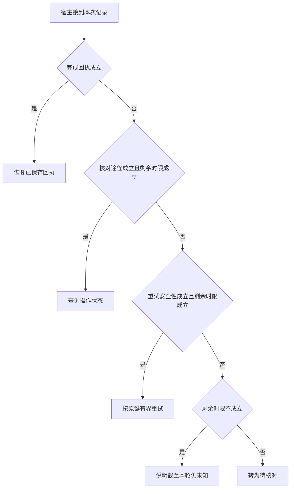

# 响应超时后的三种恢复方式

一次超时只说明调用者没有及时取得观察。
恢复器最好从持久记录出发，决定查状态、原键重放或待核对。
重新做一轮语言推理无法回答下游是否已经提交。

本篇用一个封闭的教学决策器说明这一问题。输入是宿主收到的记录，不保证每个下游字段都已经获准使用。前置检查未成立时，下游即使带着缓存值，也不能拿来作业务断言。

## 先解决一个具体问题

**下游超时，让模型重新挑工具就能恢复吗？**

重新选动作可能换掉业务键和目标。
先查同一意图的持久结果。无结果时才能结合下游契约决定幂等重试或人工核对。
工具信心再高也无法证明第一次未提交。


先取一个能走到「转为待核对」的输入：只有派发记录、没有可用的状态核对接口、无法安全重放该操作、截止前仍能完成下一动作。
把这四个条件代回后文的图，前面各个拦截分支都未满足，最终才有“缺乏可安全自动恢复的途径”这个判断。
还原这个现场时要分别问：哪些位来自可信状态，哪些只是在接口中出现、尚未获得解释资格的字段。

## 先沿一次决策走到底



从上到下取第一条成立的出口。只改一个开关时，只有它之前的检查都未截断，该变化才可能到达真实动作。

“完成回执”的两种输入分别是“已持久化完成结果”与“只有派发记录”。
断点恢复能否复用结果取决于检查点位置。

“核对途径”的两种输入分别是“下游支持按业务键查状态”与“没有可用的状态核对接口”。
外部写入不确定时，先判断能否核对。

“重试安全性”的两种输入分别是“支持有界安全重试”与“无法安全重放该操作”。
可靠性要看副作用和实际恢复协议。

“剩余时限”的两种输入分别是“截止前仍能完成下一动作”与“剩余时限不足”。
总时间应包含排队、动作和结果交付。

## 最少需要哪几项观察

### 恢复已保存回执

存在可查的完成凭证。
在本节的全部组合中，有 8 种产生「恢复已保存回执」，这只是逻辑空间的计数，不能当作实际用户请求的比例。

只取得已持久化完成结果，已经足以要求宿主「恢复已保存回执」。
保持这些已知项，其余开关自由变化，仍有 8 种补全，判断没有翻转。

若删掉关于完成回执的证据，另一份允许的现场是只有派发记录、没有可用的状态核对接口、无法安全重放该操作、剩余时限不足，它会使宿主「说明截至本轮仍未知」。

### 查询操作状态

时间允许时先用业务键核对。
在本节的全部组合中，有 2 种产生「查询操作状态」，这只是逻辑空间的计数，不能当作实际用户请求的比例。

只取得只有派发记录、下游支持按业务键查状态、截止前仍能完成下一动作，已经足以要求宿主「查询操作状态」。
保持这些已知项，其余开关自由变化，仍有 2 种补全，判断没有翻转。

若删掉关于完成回执的证据，另一份允许的现场是已持久化完成结果、下游支持按业务键查状态、无法安全重放该操作、截止前仍能完成下一动作，它会使宿主「恢复已保存回执」。

若删掉关于核对途径的证据，另一份允许的现场是只有派发记录、没有可用的状态核对接口、无法安全重放该操作、截止前仍能完成下一动作，它会使宿主「转为待核对」。

若删掉关于剩余时限的证据，另一份允许的现场是只有派发记录、下游支持按业务键查状态、无法安全重放该操作、剩余时限不足，它会使宿主「说明截至本轮仍未知」。

### 按原键有界重试

下游具有安全重放能力。
在本节的全部组合中，有 1 种产生「按原键有界重试」，这只是逻辑空间的计数，不能当作实际用户请求的比例。

只取得只有派发记录、没有可用的状态核对接口、支持有界安全重试、截止前仍能完成下一动作，已经足以要求宿主「按原键有界重试」。
保持这些已知项，其余开关自由变化，仍有 1 种补全，判断没有翻转。

若删掉关于完成回执的证据，另一份允许的现场是已持久化完成结果、没有可用的状态核对接口、支持有界安全重试、截止前仍能完成下一动作，它会使宿主「恢复已保存回执」。

若删掉关于核对途径的证据，另一份允许的现场是只有派发记录、下游支持按业务键查状态、支持有界安全重试、截止前仍能完成下一动作，它会使宿主「查询操作状态」。

若删掉关于重试安全性的证据，另一份允许的现场是只有派发记录、没有可用的状态核对接口、无法安全重放该操作、截止前仍能完成下一动作，它会使宿主「转为待核对」。

若删掉关于剩余时限的证据，另一份允许的现场是只有派发记录、没有可用的状态核对接口、支持有界安全重试、剩余时限不足，它会使宿主「说明截至本轮仍未知」。

### 说明截至本轮仍未知

已没有完整核对时间。
在本节的全部组合中，有 4 种产生「说明截至本轮仍未知」，这只是逻辑空间的计数，不能当作实际用户请求的比例。

只取得只有派发记录、剩余时限不足，已经足以要求宿主「说明截至本轮仍未知」。
保持这些已知项，其余开关自由变化，仍有 4 种补全，判断没有翻转。

若删掉关于完成回执的证据，另一份允许的现场是已持久化完成结果、没有可用的状态核对接口、无法安全重放该操作、剩余时限不足，它会使宿主「恢复已保存回执」。

若删掉关于剩余时限的证据，另一份允许的现场是只有派发记录、没有可用的状态核对接口、无法安全重放该操作、截止前仍能完成下一动作，它会使宿主「转为待核对」。

### 转为待核对

缺乏可安全自动恢复的途径。
在本节的全部组合中，有 1 种产生「转为待核对」，这只是逻辑空间的计数，不能当作实际用户请求的比例。

只取得只有派发记录、没有可用的状态核对接口、无法安全重放该操作、截止前仍能完成下一动作，已经足以要求宿主「转为待核对」。

若删掉关于完成回执的证据，另一份允许的现场是已持久化完成结果、没有可用的状态核对接口、无法安全重放该操作、截止前仍能完成下一动作，它会使宿主「恢复已保存回执」。

若删掉关于核对途径的证据，另一份允许的现场是只有派发记录、下游支持按业务键查状态、无法安全重放该操作、截止前仍能完成下一动作，它会使宿主「查询操作状态」。

若删掉关于重试安全性的证据，另一份允许的现场是只有派发记录、没有可用的状态核对接口、支持有界安全重试、截止前仍能完成下一动作，它会使宿主「按原键有界重试」。

若删掉关于剩余时限的证据，另一份允许的现场是只有派发记录、没有可用的状态核对接口、无法安全重放该操作、剩余时限不足，它会使宿主「说明截至本轮仍未知」。

## 以同一份契约解释截然不同的现场

<details>
<summary>展开推演与对应反例</summary>

下列样本按最先命中的业务分支排列。四位编码只作本篇页内定位，顺序与开头的四项输入一致。可以先猜下一动作，再展开相邻样本。

### 能够触发“恢复已保存回执”的现场

**样本 1000**

业务侧交来已持久化完成结果、没有可用的状态核对接口，执行侧还记录了无法安全重放该操作、剩余时限不足。
把样本压成最短证明，保留已持久化完成结果就能支持「恢复已保存回执」。

在这份记录上，分别翻转「完成回执」中的任一项，其他项完全不变时，下一动作都会改变。

保持其余观察不动，单独切换「核对途径」、「重试安全性」、「剩余时限」仍得到「恢复已保存回执」，它们在这个现场不是决定性变量。

要从本例改走「说明截至本轮仍未知」，至少需要变动 1 项，一组最少改动是将已持久化完成结果换成只有派发记录。

要从本例改走「转为待核对」，至少需要变动 2 项，一组最少改动是将已持久化完成结果、剩余时限不足换成只有派发记录、截止前仍能完成下一动作。

要从本例改走「按原键有界重试」，至少需要变动 3 项，一组最少改动是将已持久化完成结果、无法安全重放该操作、剩余时限不足换成只有派发记录、支持有界安全重试、截止前仍能完成下一动作。

要从本例改走「查询操作状态」，至少需要变动 3 项，一组最少改动是将已持久化完成结果、没有可用的状态核对接口、剩余时限不足换成只有派发记录、下游支持按业务键查状态、截止前仍能完成下一动作。

**样本 1001**

业务侧交来已持久化完成结果、没有可用的状态核对接口，执行侧还记录了无法安全重放该操作、截止前仍能完成下一动作。


要从本例改走「转为待核对」，至少需要变动 1 项，一组最少改动是将已持久化完成结果换成只有派发记录。

要从本例改走「说明截至本轮仍未知」，至少需要变动 2 项，一组最少改动是将已持久化完成结果、截止前仍能完成下一动作换成只有派发记录、剩余时限不足。

要从本例改走「按原键有界重试」，至少需要变动 2 项，一组最少改动是将已持久化完成结果、无法安全重放该操作换成只有派发记录、支持有界安全重试。

要从本例改走「查询操作状态」，至少需要变动 2 项，一组最少改动是将已持久化完成结果、没有可用的状态核对接口换成只有派发记录、下游支持按业务键查状态。

**样本 1010**

业务侧交来已持久化完成结果、没有可用的状态核对接口，执行侧还记录了支持有界安全重试、剩余时限不足。


要从本例改走「按原键有界重试」，至少需要变动 2 项，一组最少改动是将已持久化完成结果、剩余时限不足换成只有派发记录、截止前仍能完成下一动作。

要从本例改走「转为待核对」，至少需要变动 3 项，一组最少改动是将已持久化完成结果、支持有界安全重试、剩余时限不足换成只有派发记录、无法安全重放该操作、截止前仍能完成下一动作。


**样本 1011**

业务侧交来已持久化完成结果、没有可用的状态核对接口，执行侧还记录了支持有界安全重试、截止前仍能完成下一动作。


要从本例改走「按原键有界重试」，至少需要变动 1 项，一组最少改动是将已持久化完成结果换成只有派发记录。

要从本例改走「转为待核对」，至少需要变动 2 项，一组最少改动是将已持久化完成结果、支持有界安全重试换成只有派发记录、无法安全重放该操作。


**样本 1100**

业务侧交来已持久化完成结果、下游支持按业务键查状态，执行侧还记录了无法安全重放该操作、剩余时限不足。


要从本例改走「查询操作状态」，至少需要变动 2 项，一组最少改动是将已持久化完成结果、剩余时限不足换成只有派发记录、截止前仍能完成下一动作。

要从本例改走「转为待核对」，至少需要变动 3 项，一组最少改动是将已持久化完成结果、下游支持按业务键查状态、剩余时限不足换成只有派发记录、没有可用的状态核对接口、截止前仍能完成下一动作。

要从本例改走「按原键有界重试」，至少需要变动 4 项，一组最少改动是将已持久化完成结果、下游支持按业务键查状态、无法安全重放该操作、剩余时限不足换成只有派发记录、没有可用的状态核对接口、支持有界安全重试、截止前仍能完成下一动作。

**样本 1101**

业务侧交来已持久化完成结果、下游支持按业务键查状态，执行侧还记录了无法安全重放该操作、截止前仍能完成下一动作。


要从本例改走「查询操作状态」，至少需要变动 1 项，一组最少改动是将已持久化完成结果换成只有派发记录。

要从本例改走「转为待核对」，至少需要变动 2 项，一组最少改动是将已持久化完成结果、下游支持按业务键查状态换成只有派发记录、没有可用的状态核对接口。


要从本例改走「按原键有界重试」，至少需要变动 3 项，一组最少改动是将已持久化完成结果、下游支持按业务键查状态、无法安全重放该操作换成只有派发记录、没有可用的状态核对接口、支持有界安全重试。

**样本 1110**

业务侧交来已持久化完成结果、下游支持按业务键查状态，执行侧还记录了支持有界安全重试、剩余时限不足。


要从本例改走「按原键有界重试」，至少需要变动 3 项，一组最少改动是将已持久化完成结果、下游支持按业务键查状态、剩余时限不足换成只有派发记录、没有可用的状态核对接口、截止前仍能完成下一动作。

要从本例改走「转为待核对」，至少需要变动 4 项，一组最少改动是将已持久化完成结果、下游支持按业务键查状态、支持有界安全重试、剩余时限不足换成只有派发记录、没有可用的状态核对接口、无法安全重放该操作、截止前仍能完成下一动作。

**样本 1111**

业务侧交来已持久化完成结果、下游支持按业务键查状态，执行侧还记录了支持有界安全重试、截止前仍能完成下一动作。


要从本例改走「按原键有界重试」，至少需要变动 2 项，一组最少改动是将已持久化完成结果、下游支持按业务键查状态换成只有派发记录、没有可用的状态核对接口。


要从本例改走「转为待核对」，至少需要变动 3 项，一组最少改动是将已持久化完成结果、下游支持按业务键查状态、支持有界安全重试换成只有派发记录、没有可用的状态核对接口、无法安全重放该操作。

### 能够触发“查询操作状态”的现场

**样本 0101**

业务侧交来只有派发记录、下游支持按业务键查状态，执行侧还记录了无法安全重放该操作、截止前仍能完成下一动作。
把样本压成最短证明，保留只有派发记录、下游支持按业务键查状态、截止前仍能完成下一动作就能支持「查询操作状态」。

在这份记录上，分别翻转「完成回执」、「核对途径」、「剩余时限」中的任一项，其他项完全不变时，下一动作都会改变。

保持其余观察不动，单独切换「重试安全性」仍得到「查询操作状态」，它们在这个现场不是决定性变量。

本例没走更靠前的「恢复已保存回执」，因为只有派发记录与那个入口的必要条件不符。

要从本例改走「转为待核对」，至少需要变动 1 项，一组最少改动是将下游支持按业务键查状态换成没有可用的状态核对接口。

要从本例改走「说明截至本轮仍未知」，至少需要变动 1 项，一组最少改动是将截止前仍能完成下一动作换成剩余时限不足。

要从本例改走「恢复已保存回执」，至少需要变动 1 项，一组最少改动是将只有派发记录换成已持久化完成结果。

要从本例改走「按原键有界重试」，至少需要变动 2 项，一组最少改动是将下游支持按业务键查状态、无法安全重放该操作换成没有可用的状态核对接口、支持有界安全重试。

**样本 0111**

业务侧交来只有派发记录、下游支持按业务键查状态，执行侧还记录了支持有界安全重试、截止前仍能完成下一动作。


要从本例改走「按原键有界重试」，至少需要变动 1 项，一组最少改动是将下游支持按业务键查状态换成没有可用的状态核对接口。


要从本例改走「转为待核对」，至少需要变动 2 项，一组最少改动是将下游支持按业务键查状态、支持有界安全重试换成没有可用的状态核对接口、无法安全重放该操作。

### 能够触发“按原键有界重试”的现场

**样本 0011**

业务侧交来只有派发记录、没有可用的状态核对接口，执行侧还记录了支持有界安全重试、截止前仍能完成下一动作。
把样本压成最短证明，保留只有派发记录、没有可用的状态核对接口、支持有界安全重试、截止前仍能完成下一动作就能支持「按原键有界重试」。

在这份记录上，分别翻转「完成回执」、「核对途径」、「重试安全性」、「剩余时限」中的任一项，其他项完全不变时，下一动作都会改变。


本例没走更靠前的「查询操作状态」，因为没有可用的状态核对接口与那个入口的必要条件不符。

要从本例改走「转为待核对」，至少需要变动 1 项，一组最少改动是将支持有界安全重试换成无法安全重放该操作。


要从本例改走「查询操作状态」，至少需要变动 1 项，一组最少改动是将没有可用的状态核对接口换成下游支持按业务键查状态。


### 能够触发“说明截至本轮仍未知”的现场

**样本 0000**

业务侧交来只有派发记录、没有可用的状态核对接口，执行侧还记录了无法安全重放该操作、剩余时限不足。
把样本压成最短证明，保留只有派发记录、剩余时限不足就能支持「说明截至本轮仍未知」。

在这份记录上，分别翻转「完成回执」、「剩余时限」中的任一项，其他项完全不变时，下一动作都会改变。

保持其余观察不动，单独切换「核对途径」、「重试安全性」仍得到「说明截至本轮仍未知」，它们在这个现场不是决定性变量。


本例没走更靠前的「查询操作状态」，因为没有可用的状态核对接口、剩余时限不足与那个入口的必要条件不符。

本例没走更靠前的「按原键有界重试」，因为无法安全重放该操作、剩余时限不足与那个入口的必要条件不符。

要从本例改走「转为待核对」，至少需要变动 1 项，一组最少改动是将剩余时限不足换成截止前仍能完成下一动作。


要从本例改走「按原键有界重试」，至少需要变动 2 项，一组最少改动是将无法安全重放该操作、剩余时限不足换成支持有界安全重试、截止前仍能完成下一动作。

要从本例改走「查询操作状态」，至少需要变动 2 项，一组最少改动是将没有可用的状态核对接口、剩余时限不足换成下游支持按业务键查状态、截止前仍能完成下一动作。

**样本 0010**

业务侧交来只有派发记录、没有可用的状态核对接口，执行侧还记录了支持有界安全重试、剩余时限不足。


本例没走更靠前的「按原键有界重试」，因为剩余时限不足与那个入口的必要条件不符。

要从本例改走「按原键有界重试」，至少需要变动 1 项，一组最少改动是将剩余时限不足换成截止前仍能完成下一动作。


要从本例改走「转为待核对」，至少需要变动 2 项，一组最少改动是将支持有界安全重试、剩余时限不足换成无法安全重放该操作、截止前仍能完成下一动作。


**样本 0100**

业务侧交来只有派发记录、下游支持按业务键查状态，执行侧还记录了无法安全重放该操作、剩余时限不足。


本例没走更靠前的「查询操作状态」，因为剩余时限不足与那个入口的必要条件不符。


要从本例改走「查询操作状态」，至少需要变动 1 项，一组最少改动是将剩余时限不足换成截止前仍能完成下一动作。


要从本例改走「转为待核对」，至少需要变动 2 项，一组最少改动是将下游支持按业务键查状态、剩余时限不足换成没有可用的状态核对接口、截止前仍能完成下一动作。

要从本例改走「按原键有界重试」，至少需要变动 3 项，一组最少改动是将下游支持按业务键查状态、无法安全重放该操作、剩余时限不足换成没有可用的状态核对接口、支持有界安全重试、截止前仍能完成下一动作。

**样本 0110**

业务侧交来只有派发记录、下游支持按业务键查状态，执行侧还记录了支持有界安全重试、剩余时限不足。


要从本例改走「按原键有界重试」，至少需要变动 2 项，一组最少改动是将下游支持按业务键查状态、剩余时限不足换成没有可用的状态核对接口、截止前仍能完成下一动作。

要从本例改走「转为待核对」，至少需要变动 3 项，一组最少改动是将下游支持按业务键查状态、支持有界安全重试、剩余时限不足换成没有可用的状态核对接口、无法安全重放该操作、截止前仍能完成下一动作。

### 能够触发“转为待核对”的现场

**样本 0001**

业务侧交来只有派发记录、没有可用的状态核对接口，执行侧还记录了无法安全重放该操作、截止前仍能完成下一动作。
把样本压成最短证明，保留只有派发记录、没有可用的状态核对接口、无法安全重放该操作、截止前仍能完成下一动作就能支持「转为待核对」。


本例没走更靠前的「按原键有界重试」，因为无法安全重放该操作与那个入口的必要条件不符。

本例没走更靠前的「说明截至本轮仍未知」，因为截止前仍能完成下一动作与那个入口的必要条件不符。


要从本例改走「按原键有界重试」，至少需要变动 1 项，一组最少改动是将无法安全重放该操作换成支持有界安全重试。


</details>

## 当你只能看见一半记录

<details>
<summary>展开推演与对应反例</summary>

这次隐藏两个字段，保留另两个。对每个可见现场，检查四种合法补全是否同意。如仍有歧义，选择能使最坏剩余候选动作最少的字段继续查。并列时采用本篇字段顺序。

### 只保留完成回执与核对途径

已知只有派发记录、没有可用的状态核对接口时，四种补全的动作分布为按原键有界重试（1 种）、说明截至本轮仍未知（2 种）、转为待核对（1 种）。

在只有派发记录、没有可用的状态核对接口这个现场补读「重试安全性」，最坏还剩 2 种动作，计算时只衡量歧义，尚未扣读取代价。
若补来的观察为“无法安全重放该操作”，范围缩成「说明截至本轮仍未知」、「转为待核对」。若为“支持有界安全重试”，则保留「说明截至本轮仍未知」、「按原键有界重试」。

区分不了的两条执行可以具体写成 0000 与 0001：它们共享已展示字段，却分别需要「说明截至本轮仍未知」和「转为待核对」。

已知只有派发记录、下游支持按业务键查状态时，四种补全的动作分布为查询操作状态（2 种）、说明截至本轮仍未知（2 种）。

在只有派发记录、下游支持按业务键查状态这个现场补读「剩余时限」，最坏还剩 1 种动作，计算时只衡量歧义，尚未扣读取代价。
若补来的观察为“剩余时限不足”，范围缩成「说明截至本轮仍未知」。若为“截止前仍能完成下一动作”，则保留「查询操作状态」。

区分不了的两条执行可以具体写成 0100 与 0101：它们共享已展示字段，却分别需要「说明截至本轮仍未知」和「查询操作状态」。

已知已持久化完成结果、没有可用的状态核对接口时，四种补全的动作分布为恢复已保存回执（4 种）。

就“恢复已保存回执”这个动作而言，在已持久化完成结果、没有可用的状态核对接口的前提下，另外两项观察不会推翻它。

已知已持久化完成结果、下游支持按业务键查状态时，四种补全的动作分布为恢复已保存回执（4 种）。

就“恢复已保存回执”这个动作而言，在已持久化完成结果、下游支持按业务键查状态的前提下，另外两项观察不会推翻它。

### 只保留完成回执与重试安全性

已知只有派发记录、无法安全重放该操作时，四种补全的动作分布为查询操作状态（1 种）、说明截至本轮仍未知（2 种）、转为待核对（1 种）。

在只有派发记录、无法安全重放该操作这个现场补读「核对途径」，最坏还剩 2 种动作，计算时只衡量歧义，尚未扣读取代价。
若补来的观察为“没有可用的状态核对接口”，范围缩成「说明截至本轮仍未知」、「转为待核对」。若为“下游支持按业务键查状态”，则保留「说明截至本轮仍未知」、「查询操作状态」。


已知只有派发记录、支持有界安全重试时，四种补全的动作分布为查询操作状态（1 种）、按原键有界重试（1 种）、说明截至本轮仍未知（2 种）。

在只有派发记录、支持有界安全重试这个现场补读「核对途径」，最坏还剩 2 种动作，计算时只衡量歧义，尚未扣读取代价。
若补来的观察为“没有可用的状态核对接口”，范围缩成「说明截至本轮仍未知」、「按原键有界重试」。若为“下游支持按业务键查状态”，则保留「说明截至本轮仍未知」、「查询操作状态」。

区分不了的两条执行可以具体写成 0010 与 0011：它们共享已展示字段，却分别需要「说明截至本轮仍未知」和「按原键有界重试」。

已知已持久化完成结果、无法安全重放该操作时，四种补全的动作分布为恢复已保存回执（4 种）。

就“恢复已保存回执”这个动作而言，在已持久化完成结果、无法安全重放该操作的前提下，另外两项观察不会推翻它。

已知已持久化完成结果、支持有界安全重试时，四种补全的动作分布为恢复已保存回执（4 种）。

就“恢复已保存回执”这个动作而言，在已持久化完成结果、支持有界安全重试的前提下，另外两项观察不会推翻它。

### 只保留核对途径与重试安全性

已知没有可用的状态核对接口、无法安全重放该操作时，四种补全的动作分布为恢复已保存回执（2 种）、说明截至本轮仍未知（1 种）、转为待核对（1 种）。

在没有可用的状态核对接口、无法安全重放该操作这个现场补读「完成回执」，最坏还剩 2 种动作，计算时只衡量歧义，尚未扣读取代价。
若补来的观察为“只有派发记录”，范围缩成「说明截至本轮仍未知」、「转为待核对」。若为“已持久化完成结果”，则保留「恢复已保存回执」。


已知没有可用的状态核对接口、支持有界安全重试时，四种补全的动作分布为恢复已保存回执（2 种）、按原键有界重试（1 种）、说明截至本轮仍未知（1 种）。

在没有可用的状态核对接口、支持有界安全重试这个现场补读「完成回执」，最坏还剩 2 种动作，计算时只衡量歧义，尚未扣读取代价。
若补来的观察为“只有派发记录”，范围缩成「说明截至本轮仍未知」、「按原键有界重试」。若为“已持久化完成结果”，则保留「恢复已保存回执」。


已知下游支持按业务键查状态、无法安全重放该操作时，四种补全的动作分布为恢复已保存回执（2 种）、查询操作状态（1 种）、说明截至本轮仍未知（1 种）。

在下游支持按业务键查状态、无法安全重放该操作这个现场补读「完成回执」，最坏还剩 2 种动作，计算时只衡量歧义，尚未扣读取代价。
若补来的观察为“只有派发记录”，范围缩成「说明截至本轮仍未知」、「查询操作状态」。若为“已持久化完成结果”，则保留「恢复已保存回执」。


已知下游支持按业务键查状态、支持有界安全重试时，四种补全的动作分布为恢复已保存回执（2 种）、查询操作状态（1 种）、说明截至本轮仍未知（1 种）。

在下游支持按业务键查状态、支持有界安全重试这个现场补读「完成回执」，最坏还剩 2 种动作，计算时只衡量歧义，尚未扣读取代价。

区分不了的两条执行可以具体写成 0110 与 0111：它们共享已展示字段，却分别需要「说明截至本轮仍未知」和「查询操作状态」。

### 只保留完成回执与剩余时限

已知只有派发记录、剩余时限不足时，四种补全的动作分布为说明截至本轮仍未知（4 种）。

就“说明截至本轮仍未知”这个动作而言，在只有派发记录、剩余时限不足的前提下，另外两项观察不会推翻它。

已知只有派发记录、截止前仍能完成下一动作时，四种补全的动作分布为查询操作状态（2 种）、按原键有界重试（1 种）、转为待核对（1 种）。

在只有派发记录、截止前仍能完成下一动作这个现场补读「核对途径」，最坏还剩 2 种动作，计算时只衡量歧义，尚未扣读取代价。
若补来的观察为“没有可用的状态核对接口”，范围缩成「转为待核对」、「按原键有界重试」。若为“下游支持按业务键查状态”，则保留「查询操作状态」。

区分不了的两条执行可以具体写成 0001 与 0011：它们共享已展示字段，却分别需要「转为待核对」和「按原键有界重试」。

已知已持久化完成结果、剩余时限不足时，四种补全的动作分布为恢复已保存回执（4 种）。

就“恢复已保存回执”这个动作而言，在已持久化完成结果、剩余时限不足的前提下，另外两项观察不会推翻它。

已知已持久化完成结果、截止前仍能完成下一动作时，四种补全的动作分布为恢复已保存回执（4 种）。

就“恢复已保存回执”这个动作而言，在已持久化完成结果、截止前仍能完成下一动作的前提下，另外两项观察不会推翻它。

### 只保留核对途径与剩余时限

已知没有可用的状态核对接口、剩余时限不足时，四种补全的动作分布为恢复已保存回执（2 种）、说明截至本轮仍未知（2 种）。

在没有可用的状态核对接口、剩余时限不足这个现场补读「完成回执」，最坏还剩 1 种动作，计算时只衡量歧义，尚未扣读取代价。
若补来的观察为“只有派发记录”，范围缩成「说明截至本轮仍未知」。若为“已持久化完成结果”，则保留「恢复已保存回执」。

区分不了的两条执行可以具体写成 0000 与 1000：它们共享已展示字段，却分别需要「说明截至本轮仍未知」和「恢复已保存回执」。

已知没有可用的状态核对接口、截止前仍能完成下一动作时，四种补全的动作分布为恢复已保存回执（2 种）、按原键有界重试（1 种）、转为待核对（1 种）。

在没有可用的状态核对接口、截止前仍能完成下一动作这个现场补读「完成回执」，最坏还剩 2 种动作，计算时只衡量歧义，尚未扣读取代价。
若补来的观察为“只有派发记录”，范围缩成「转为待核对」、「按原键有界重试」。若为“已持久化完成结果”，则保留「恢复已保存回执」。


已知下游支持按业务键查状态、剩余时限不足时，四种补全的动作分布为恢复已保存回执（2 种）、说明截至本轮仍未知（2 种）。

在下游支持按业务键查状态、剩余时限不足这个现场补读「完成回执」，最坏还剩 1 种动作，计算时只衡量歧义，尚未扣读取代价。

区分不了的两条执行可以具体写成 0100 与 1100：它们共享已展示字段，却分别需要「说明截至本轮仍未知」和「恢复已保存回执」。

已知下游支持按业务键查状态、截止前仍能完成下一动作时，四种补全的动作分布为恢复已保存回执（2 种）、查询操作状态（2 种）。

在下游支持按业务键查状态、截止前仍能完成下一动作这个现场补读「完成回执」，最坏还剩 1 种动作，计算时只衡量歧义，尚未扣读取代价。
若补来的观察为“只有派发记录”，范围缩成「查询操作状态」。若为“已持久化完成结果”，则保留「恢复已保存回执」。

区分不了的两条执行可以具体写成 0101 与 1101：它们共享已展示字段，却分别需要「查询操作状态」和「恢复已保存回执」。

### 只保留重试安全性与剩余时限

已知无法安全重放该操作、剩余时限不足时，四种补全的动作分布为恢复已保存回执（2 种）、说明截至本轮仍未知（2 种）。

在无法安全重放该操作、剩余时限不足这个现场补读「完成回执」，最坏还剩 1 种动作，计算时只衡量歧义，尚未扣读取代价。


已知无法安全重放该操作、截止前仍能完成下一动作时，四种补全的动作分布为恢复已保存回执（2 种）、查询操作状态（1 种）、转为待核对（1 种）。

在无法安全重放该操作、截止前仍能完成下一动作这个现场补读「完成回执」，最坏还剩 2 种动作，计算时只衡量歧义，尚未扣读取代价。
若补来的观察为“只有派发记录”，范围缩成「转为待核对」、「查询操作状态」。若为“已持久化完成结果”，则保留「恢复已保存回执」。

区分不了的两条执行可以具体写成 0001 与 0101：它们共享已展示字段，却分别需要「转为待核对」和「查询操作状态」。

已知支持有界安全重试、剩余时限不足时，四种补全的动作分布为恢复已保存回执（2 种）、说明截至本轮仍未知（2 种）。

在支持有界安全重试、剩余时限不足这个现场补读「完成回执」，最坏还剩 1 种动作，计算时只衡量歧义，尚未扣读取代价。

区分不了的两条执行可以具体写成 0010 与 1010：它们共享已展示字段，却分别需要「说明截至本轮仍未知」和「恢复已保存回执」。

已知支持有界安全重试、截止前仍能完成下一动作时，四种补全的动作分布为恢复已保存回执（2 种）、查询操作状态（1 种）、按原键有界重试（1 种）。

在支持有界安全重试、截止前仍能完成下一动作这个现场补读「完成回执」，最坏还剩 2 种动作，计算时只衡量歧义，尚未扣读取代价。
若补来的观察为“只有派发记录”，范围缩成「按原键有界重试」、「查询操作状态」。若为“已持久化完成结果”，则保留「恢复已保存回执」。

区分不了的两条执行可以具体写成 0011 与 0111：它们共享已展示字段，却分别需要「按原键有界重试」和「查询操作状态」。

</details>

## 单因素干预与边界测试

<details>
<summary>展开推演与对应反例</summary>

### 只改变完成回执

固定另外三个条件得到八对现场，从“只有派发记录”转为“已持久化完成结果”时，8 对翻转动作，另外 0 对保持不变。

有 4 对现场沿「说明截至本轮仍未知」变到「恢复已保存回执」，可复现的一组受控背景为没有可用的状态核对接口、无法安全重放该操作、剩余时限不足。

有 1 对现场沿「转为待核对」变到「恢复已保存回执」，可复现的一组受控背景为没有可用的状态核对接口、无法安全重放该操作、截止前仍能完成下一动作。

有 1 对现场沿「按原键有界重试」变到「恢复已保存回执」，可复现的一组受控背景为没有可用的状态核对接口、支持有界安全重试、截止前仍能完成下一动作。

有 2 对现场沿「查询操作状态」变到「恢复已保存回执」，可复现的一组受控背景为下游支持按业务键查状态、无法安全重放该操作、截止前仍能完成下一动作。

### 只改变核对途径

固定另外三个条件得到八对现场，从“没有可用的状态核对接口”转为“下游支持按业务键查状态”时，2 对翻转动作，另外 6 对保持不变。

令只有派发记录、无法安全重放该操作、剩余时限不足，核对途径的两个取值均得到「说明截至本轮仍未知」。在八对中，共有 2 对表现为这一种稳定出口。

有 1 对现场沿「转为待核对」变到「查询操作状态」，可复现的一组受控背景为只有派发记录、无法安全重放该操作、截止前仍能完成下一动作。

有 1 对现场沿「按原键有界重试」变到「查询操作状态」，可复现的一组受控背景为只有派发记录、支持有界安全重试、截止前仍能完成下一动作。

令已持久化完成结果、无法安全重放该操作、剩余时限不足，核对途径的两个取值均得到「恢复已保存回执」。在八对中，共有 4 对表现为这一种稳定出口。

### 只改变重试安全性

固定另外三个条件得到八对现场，从“无法安全重放该操作”转为“支持有界安全重试”时，1 对翻转动作，另外 7 对保持不变。

令只有派发记录、没有可用的状态核对接口、剩余时限不足，重试安全性的两个取值均得到「说明截至本轮仍未知」。在八对中，共有 2 对表现为这一种稳定出口。

有 1 对现场沿「转为待核对」变到「按原键有界重试」，可复现的一组受控背景为只有派发记录、没有可用的状态核对接口、截止前仍能完成下一动作。

令只有派发记录、下游支持按业务键查状态、截止前仍能完成下一动作，重试安全性的两个取值均得到「查询操作状态」。在八对中，共有 1 对表现为这一种稳定出口。

令已持久化完成结果、没有可用的状态核对接口、剩余时限不足，重试安全性的两个取值均得到「恢复已保存回执」。在八对中，共有 4 对表现为这一种稳定出口。

### 只改变剩余时限

固定另外三个条件得到八对现场，从“剩余时限不足”转为“截止前仍能完成下一动作”时，4 对翻转动作，另外 4 对保持不变。

有 1 对现场沿「说明截至本轮仍未知」变到「转为待核对」，可复现的一组受控背景为只有派发记录、没有可用的状态核对接口、无法安全重放该操作。

有 1 对现场沿「说明截至本轮仍未知」变到「按原键有界重试」，可复现的一组受控背景为只有派发记录、没有可用的状态核对接口、支持有界安全重试。

有 2 对现场沿「说明截至本轮仍未知」变到「查询操作状态」，可复现的一组受控背景为只有派发记录、下游支持按业务键查状态、无法安全重放该操作。

令已持久化完成结果、没有可用的状态核对接口、无法安全重放该操作，剩余时限的两个取值均得到「恢复已保存回执」。在八对中，共有 4 对表现为这一种稳定出口。

</details>

## 哪些回归样本真能抓住实现错误

<details>
<summary>展开推演与对应反例</summary>

如果删除“恢复已保存回执”这个分支，在本篇 16 种输入里有 8 种会改走另一出口。

反例 1000 的完整记录为已持久化完成结果、没有可用的状态核对接口、无法安全重放该操作、剩余时限不足。正确结果是「恢复已保存回执」，这个改坏的实现却给出「说明截至本轮仍未知」。

如果删除“查询操作状态”这个分支，在本篇 16 种输入里有 2 种会改走另一出口。

反例 0101 的完整记录为只有派发记录、下游支持按业务键查状态、无法安全重放该操作、截止前仍能完成下一动作。正确结果是「查询操作状态」，这个改坏的实现却给出「转为待核对」。

如果删除“按原键有界重试”这个分支，在本篇 16 种输入里有 1 种会改走另一出口。

反例 0011 的完整记录为只有派发记录、没有可用的状态核对接口、支持有界安全重试、截止前仍能完成下一动作。正确结果是「按原键有界重试」，这个改坏的实现却给出「转为待核对」。

如果删除“说明截至本轮仍未知”这个分支，在本篇 16 种输入里有 4 种会改走另一出口。

反例 0000 的完整记录为只有派发记录、没有可用的状态核对接口、无法安全重放该操作、剩余时限不足。正确结果是「说明截至本轮仍未知」，这个改坏的实现却给出「转为待核对」。

如果交换“恢复已保存回执”和“查询操作状态”的判断次序，在本篇 16 种输入里有 2 种会改走另一出口。

反例 1101 的完整记录为已持久化完成结果、下游支持按业务键查状态、无法安全重放该操作、截止前仍能完成下一动作。正确结果是「恢复已保存回执」，这个改坏的实现却给出「查询操作状态」。

如果交换“查询操作状态”和“按原键有界重试”的判断次序，在本篇 16 种输入里有 1 种会改走另一出口。

反例 0111 的完整记录为只有派发记录、下游支持按业务键查状态、支持有界安全重试、截止前仍能完成下一动作。正确结果是「查询操作状态」，这个改坏的实现却给出「按原键有界重试」。

如果交换“按原键有界重试”和“说明截至本轮仍未知”的判断次序，在本篇 16 种输入里有 0 种会改走另一出口。

对于“交换“按原键有界重试”和“说明截至本轮仍未知”的判断次序”这项修改，在声明输入域内没有区分它的样本，不能宣称测试捕捉到了故障。

补入样本 0111（只有派发记录、下游支持按业务键查状态、支持有界安全重试、截止前仍能完成下一动作）能新增检出「删除“查询操作状态”这个分支」、「交换“查询操作状态”和“按原键有界重试”的判断次序」。

补入样本 1101（已持久化完成结果、下游支持按业务键查状态、无法安全重放该操作、截止前仍能完成下一动作）能新增检出「删除“恢复已保存回执”这个分支」、「交换“恢复已保存回执”和“查询操作状态”的判断次序」。

补入样本 0000（只有派发记录、没有可用的状态核对接口、无法安全重放该操作、剩余时限不足）能新增检出「删除“说明截至本轮仍未知”这个分支」。

补入样本 0011（只有派发记录、没有可用的状态核对接口、支持有界安全重试、截止前仍能完成下一动作）能新增检出「删除“按原键有界重试”这个分支」。

这里每次选覆盖尚未捕获缺陷最多的样本，并不保证用例数全局最小。它给出的反例能作为 Java 单测输入。真实模型是否会自主产生这些提议，仍须单独评测。

</details>

## 把状态覆盖换成有抽样偏差的评测批次

<details>
<summary>展开推演与对应反例</summary>

前面的十六种记录各有一票。现在只改样本构成：对一个给定字段，把成立侧的每种记录各取三份、另一侧各取一份。这是人为配比的 32 份回放，不是线上频率估计。
将偏向成立与偏向不成立的两次批次对照，可以隔离分母变化。底层宿主和所有答案保持相同，比例仍可能移动。

### 改变“完成回执”的样本配比

只看「恢复已保存回执」，在已持久化完成结果的八个不同输入中有 8 个命中，在只有派发记录的另八个输入中有 0 个命中。
把「完成回执」成立侧按三倍取样，「恢复已保存回执」占 24/32，反过来向未成立侧倾斜后占 8/32。
这次重加权使「恢复已保存回执」的占比相差 50 个百分点。若按两种不同的“完成回执”分布跑新旧版，不能把这项差异全部归功于实现。

只看「查询操作状态」，在已持久化完成结果的八个不同输入中有 0 个命中，在只有派发记录的另八个输入中有 2 个命中。
把「完成回执」成立侧按三倍取样，「查询操作状态」占 2/32，反过来向未成立侧倾斜后占 6/32。
这次重加权使「查询操作状态」的占比相差 12.5 个百分点。若按两种不同的“完成回执”分布跑新旧版，不能把这项差异全部归功于实现。

只看「按原键有界重试」，在已持久化完成结果的八个不同输入中有 0 个命中，在只有派发记录的另八个输入中有 1 个命中。
把「完成回执」成立侧按三倍取样，「按原键有界重试」占 1/32，反过来向未成立侧倾斜后占 3/32。
这次重加权使「按原键有界重试」的占比相差 6.25 个百分点。若按两种不同的“完成回执”分布跑新旧版，不能把这项差异全部归功于实现。

只看「说明截至本轮仍未知」，在已持久化完成结果的八个不同输入中有 0 个命中，在只有派发记录的另八个输入中有 4 个命中。
把「完成回执」成立侧按三倍取样，「说明截至本轮仍未知」占 4/32，反过来向未成立侧倾斜后占 12/32。
这次重加权使「说明截至本轮仍未知」的占比相差 25 个百分点。若按两种不同的“完成回执”分布跑新旧版，不能把这项差异全部归功于实现。

只看「转为待核对」，在已持久化完成结果的八个不同输入中有 0 个命中，在只有派发记录的另八个输入中有 1 个命中。
把「完成回执」成立侧按三倍取样，「转为待核对」占 1/32，反过来向未成立侧倾斜后占 3/32。
这次重加权使「转为待核对」的占比相差 6.25 个百分点。若按两种不同的“完成回执”分布跑新旧版，不能把这项差异全部归功于实现。

### 改变“核对途径”的样本配比

只看「恢复已保存回执」，在下游支持按业务键查状态的八个不同输入中有 4 个命中，在没有可用的状态核对接口的另八个输入中有 4 个命中。
把「核对途径」成立侧按三倍取样，「恢复已保存回执」占 16/32，反过来向未成立侧倾斜后占 16/32。
两批「恢复已保存回执」的边际比例相同，是因为这个出口在“核对途径”的两侧计数相等，这不能单独证明每一对现场都不受它影响。

只看「查询操作状态」，在下游支持按业务键查状态的八个不同输入中有 2 个命中，在没有可用的状态核对接口的另八个输入中有 0 个命中。
把「核对途径」成立侧按三倍取样，「查询操作状态」占 6/32，反过来向未成立侧倾斜后占 2/32。
这次重加权使「查询操作状态」的占比相差 12.5 个百分点。若按两种不同的“核对途径”分布跑新旧版，不能把这项差异全部归功于实现。

只看「按原键有界重试」，在下游支持按业务键查状态的八个不同输入中有 0 个命中，在没有可用的状态核对接口的另八个输入中有 1 个命中。
把「核对途径」成立侧按三倍取样，「按原键有界重试」占 1/32，反过来向未成立侧倾斜后占 3/32。
这次重加权使「按原键有界重试」的占比相差 6.25 个百分点。若按两种不同的“核对途径”分布跑新旧版，不能把这项差异全部归功于实现。

只看「说明截至本轮仍未知」，在下游支持按业务键查状态的八个不同输入中有 2 个命中，在没有可用的状态核对接口的另八个输入中有 2 个命中。
把「核对途径」成立侧按三倍取样，「说明截至本轮仍未知」占 8/32，反过来向未成立侧倾斜后占 8/32。
两批「说明截至本轮仍未知」的边际比例相同，是因为这个出口在“核对途径”的两侧计数相等，这不能单独证明每一对现场都不受它影响。

只看「转为待核对」，在下游支持按业务键查状态的八个不同输入中有 0 个命中，在没有可用的状态核对接口的另八个输入中有 1 个命中。
把「核对途径」成立侧按三倍取样，「转为待核对」占 1/32，反过来向未成立侧倾斜后占 3/32。
这次重加权使「转为待核对」的占比相差 6.25 个百分点。若按两种不同的“核对途径”分布跑新旧版，不能把这项差异全部归功于实现。

### 改变“重试安全性”的样本配比

只看「恢复已保存回执」，在支持有界安全重试的八个不同输入中有 4 个命中，在无法安全重放该操作的另八个输入中有 4 个命中。
把「重试安全性」成立侧按三倍取样，「恢复已保存回执」占 16/32，反过来向未成立侧倾斜后占 16/32。
两批「恢复已保存回执」的边际比例相同，是因为这个出口在“重试安全性”的两侧计数相等，这不能单独证明每一对现场都不受它影响。

只看「查询操作状态」，在支持有界安全重试的八个不同输入中有 1 个命中，在无法安全重放该操作的另八个输入中有 1 个命中。
把「重试安全性」成立侧按三倍取样，「查询操作状态」占 4/32，反过来向未成立侧倾斜后占 4/32。
两批「查询操作状态」的边际比例相同，是因为这个出口在“重试安全性”的两侧计数相等，这不能单独证明每一对现场都不受它影响。

只看「按原键有界重试」，在支持有界安全重试的八个不同输入中有 1 个命中，在无法安全重放该操作的另八个输入中有 0 个命中。
把「重试安全性」成立侧按三倍取样，「按原键有界重试」占 3/32，反过来向未成立侧倾斜后占 1/32。
这次重加权使「按原键有界重试」的占比相差 6.25 个百分点。若按两种不同的“重试安全性”分布跑新旧版，不能把这项差异全部归功于实现。

只看「说明截至本轮仍未知」，在支持有界安全重试的八个不同输入中有 2 个命中，在无法安全重放该操作的另八个输入中有 2 个命中。
把「重试安全性」成立侧按三倍取样，「说明截至本轮仍未知」占 8/32，反过来向未成立侧倾斜后占 8/32。
两批「说明截至本轮仍未知」的边际比例相同，是因为这个出口在“重试安全性”的两侧计数相等，这不能单独证明每一对现场都不受它影响。

只看「转为待核对」，在支持有界安全重试的八个不同输入中有 0 个命中，在无法安全重放该操作的另八个输入中有 1 个命中。
把「重试安全性」成立侧按三倍取样，「转为待核对」占 1/32，反过来向未成立侧倾斜后占 3/32。
这次重加权使「转为待核对」的占比相差 6.25 个百分点。若按两种不同的“重试安全性”分布跑新旧版，不能把这项差异全部归功于实现。

### 改变“剩余时限”的样本配比

只看「恢复已保存回执」，在截止前仍能完成下一动作的八个不同输入中有 4 个命中，在剩余时限不足的另八个输入中有 4 个命中。
把「剩余时限」成立侧按三倍取样，「恢复已保存回执」占 16/32，反过来向未成立侧倾斜后占 16/32。
两批「恢复已保存回执」的边际比例相同，是因为这个出口在“剩余时限”的两侧计数相等，这不能单独证明每一对现场都不受它影响。

只看「查询操作状态」，在截止前仍能完成下一动作的八个不同输入中有 2 个命中，在剩余时限不足的另八个输入中有 0 个命中。
把「剩余时限」成立侧按三倍取样，「查询操作状态」占 6/32，反过来向未成立侧倾斜后占 2/32。
这次重加权使「查询操作状态」的占比相差 12.5 个百分点。若按两种不同的“剩余时限”分布跑新旧版，不能把这项差异全部归功于实现。

只看「按原键有界重试」，在截止前仍能完成下一动作的八个不同输入中有 1 个命中，在剩余时限不足的另八个输入中有 0 个命中。
把「剩余时限」成立侧按三倍取样，「按原键有界重试」占 3/32，反过来向未成立侧倾斜后占 1/32。
这次重加权使「按原键有界重试」的占比相差 6.25 个百分点。若按两种不同的“剩余时限”分布跑新旧版，不能把这项差异全部归功于实现。

只看「说明截至本轮仍未知」，在截止前仍能完成下一动作的八个不同输入中有 0 个命中，在剩余时限不足的另八个输入中有 4 个命中。
把「剩余时限」成立侧按三倍取样，「说明截至本轮仍未知」占 4/32，反过来向未成立侧倾斜后占 12/32。
这次重加权使「说明截至本轮仍未知」的占比相差 25 个百分点。若按两种不同的“剩余时限”分布跑新旧版，不能把这项差异全部归功于实现。

只看「转为待核对」，在截止前仍能完成下一动作的八个不同输入中有 1 个命中，在剩余时限不足的另八个输入中有 0 个命中。
把「剩余时限」成立侧按三倍取样，「转为待核对」占 3/32，反过来向未成立侧倾斜后占 1/32。
这次重加权使「转为待核对」的占比相差 6.25 个百分点。若按两种不同的“剩余时限”分布跑新旧版，不能把这项差异全部归功于实现。

</details>

## 只看终态，能逆推出多少原始事实

<details>
<summary>展开推演与对应反例</summary>

### 只保留“恢复已保存回执”这条结果时

在本节契约与完整输入域内，仅知「恢复已保存回执」就能倒推出已持久化完成结果，这一推断依赖版本未变且日志中的终态可信。

「恢复已保存回执」不能证明核对途径取哪一侧：1000 和 1100 有相同终态，却分别记为“没有可用的状态核对接口”和“下游支持按业务键查状态”。

「恢复已保存回执」不能证明重试安全性取哪一侧：1000 和 1010 有相同终态，却分别记为“无法安全重放该操作”和“支持有界安全重试”。

「恢复已保存回执」不能证明剩余时限取哪一侧：1000 和 1001 有相同终态，却分别记为“剩余时限不足”和“截止前仍能完成下一动作”。

反查「恢复已保存回执」的诊断日志，优先保留能区分样本 1000 与 0000 的「完成回执」，否则很容易把邻近的「说明截至本轮仍未知」看成同一种故障。

### 只保留“查询操作状态”这条结果时

在本节契约与完整输入域内，仅知「查询操作状态」就能倒推出只有派发记录，这一推断依赖版本未变且日志中的终态可信。

在本节契约与完整输入域内，仅知「查询操作状态」就能倒推出下游支持按业务键查状态，这一推断依赖版本未变且日志中的终态可信。

「查询操作状态」不能证明重试安全性取哪一侧：0101 和 0111 有相同终态，却分别记为“无法安全重放该操作”和“支持有界安全重试”。

在本节契约与完整输入域内，仅知「查询操作状态」就能倒推出截止前仍能完成下一动作，这一推断依赖版本未变且日志中的终态可信。

反查「查询操作状态」的诊断日志，优先保留能区分样本 0101 与 0001 的「核对途径」，否则很容易把邻近的「转为待核对」看成同一种故障。

### 只保留“按原键有界重试”这条结果时

在本节契约与完整输入域内，仅知「按原键有界重试」就能倒推出只有派发记录，这一推断依赖版本未变且日志中的终态可信。

在本节契约与完整输入域内，仅知「按原键有界重试」就能倒推出没有可用的状态核对接口，这一推断依赖版本未变且日志中的终态可信。

在本节契约与完整输入域内，仅知「按原键有界重试」就能倒推出支持有界安全重试，这一推断依赖版本未变且日志中的终态可信。

在本节契约与完整输入域内，仅知「按原键有界重试」就能倒推出截止前仍能完成下一动作，这一推断依赖版本未变且日志中的终态可信。

反查「按原键有界重试」的诊断日志，优先保留能区分样本 0011 与 0001 的「重试安全性」，否则很容易把邻近的「转为待核对」看成同一种故障。

### 只保留“说明截至本轮仍未知”这条结果时

在本节契约与完整输入域内，仅知「说明截至本轮仍未知」就能倒推出只有派发记录，这一推断依赖版本未变且日志中的终态可信。

「说明截至本轮仍未知」不能证明核对途径取哪一侧：0000 和 0100 有相同终态，却分别记为“没有可用的状态核对接口”和“下游支持按业务键查状态”。

「说明截至本轮仍未知」不能证明重试安全性取哪一侧：0000 和 0010 有相同终态，却分别记为“无法安全重放该操作”和“支持有界安全重试”。

在本节契约与完整输入域内，仅知「说明截至本轮仍未知」就能倒推出剩余时限不足，这一推断依赖版本未变且日志中的终态可信。

反查「说明截至本轮仍未知」的诊断日志，优先保留能区分样本 0000 与 0001 的「剩余时限」，否则很容易把邻近的「转为待核对」看成同一种故障。

### 只保留“转为待核对”这条结果时

在本节契约与完整输入域内，仅知「转为待核对」就能倒推出只有派发记录，这一推断依赖版本未变且日志中的终态可信。

在本节契约与完整输入域内，仅知「转为待核对」就能倒推出没有可用的状态核对接口，这一推断依赖版本未变且日志中的终态可信。

在本节契约与完整输入域内，仅知「转为待核对」就能倒推出无法安全重放该操作，这一推断依赖版本未变且日志中的终态可信。

在本节契约与完整输入域内，仅知「转为待核对」就能倒推出截止前仍能完成下一动作，这一推断依赖版本未变且日志中的终态可信。

反查「转为待核对」的诊断日志，优先保留能区分样本 0001 与 0000 的「剩余时限」，否则很容易把邻近的「说明截至本轮仍未知」看成同一种故障。

</details>

## 面试复述与复算

面试题可以从“下游超时，让模型重新挑工具就能恢复吗？”起步。先给出本篇的触发条件和一条真实执行端可检查的证据，再用一个相邻反例限定结论的适用范围。

在仓库根目录执行下列命令可以重算本篇的一个输入。四位数字依次选择正文列出的四项条件，0 表示未成立或低档，1 表示成立或高档。
```powershell
node examples/reading-cases/replay.mjs 2 5 0101
```

[本周主文](../theory.md) · [配套实验](../lab.md) · [下一篇研读](06.md)
