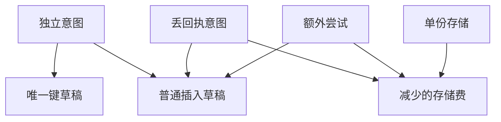

# 稳定操作键究竟减少了多少份草稿

发生响应丢失的意图会被重复尝试。
比较直接插入与按持久业务键写入，传输流量与实体数量不会同步减少。
重放均在幂等保留期内且内容相同，第一份写入已成功。跨服务发送另需验证。

## 先解决一个具体问题

**幂等之后为什么压力曲线仍有尖峰？**

存储层只保证不多写一份，重放仍经过网关、校验、连接池和索引查询。
草稿实体数和真实 HTTP 请求数应分别观测。两者同时减少需要额外机制。


先从具体的低档设定开始：独立意图取 20个、丢回执意图取 3个、额外尝试取 1次、单份存储取 2单位。
三个结果依次是普通插入草稿 23份、唯一键草稿 20份、减少的存储费 6单位。
先手算这个起点，读完后再把另一个输入切到高档，这样能知道数字变化时究竟改变了哪个假设。

## 先写清输入边界和三个观测量

用 a 表示独立意图，取 20个 或 50个，这两点是用于隔离因果影响的教学输入。

用 b 表示丢回执意图，取 3个 或 9个，这两点是用于隔离因果影响的教学输入。

用 c 表示额外尝试，取 1次 或 3次，这两点是用于隔离因果影响的教学输入。

用 d 表示单份存储，取 2单位 或 5单位，这两点是用于隔离因果影响的教学输入。

「普通插入草稿」的计算式为 `a+b*c`，按业务量展开是 `独立意图+丢回执意图×额外尝试`，输出单位为份。

「唯一键草稿」的计算式为 `a`，按业务量展开是 `独立意图`，输出单位为份。

「减少的存储费」的计算式为 `b*c*d`，按业务量展开是 `丢回执意图×额外尝试×单份存储`，输出单位为单位。

公式中 ceil 与 floor 分别向上、向下取整，% 在表达式中作取余，** 为乘方，三元条件按“条件 ? 成立值 : 其他值”读取。展示数值最多保留三位小数，比较和反推采用未舍入值。



图上的箭头表示该输入出现在计算式中。同一输入通向多个指标时，三个读数可能共同移动。分支、取整或相互抵消又会使某些边在具体样本上没有可见增量。

## 从输入按单位逐步算到可比较的结果

<details>
<summary>展开推演与对应反例</summary>

### 样本 0000：独立意图 20、丢回执意图 3

这一组设定为独立意图为 20个、丢回执意图为 3个、额外尝试为 1次、单份存储为 2单位。

代入「普通插入草稿」：`20+3*1`，得到 23份。

代入「唯一键草稿」：`20`，得到 20份。

代入「减少的存储费」：`3*1*2`，得到 6单位。

以「减少的存储费」作主读数时，本组单独切换丢回执意图的绝对变化最大或并列最大，读数会从 6单位 变为 18单位。

本组固定其余输入时，分别改变「独立意图」均不会改变 6单位 这个主读数，是否影响另一指标仍需另算。

对角样本 1111 的主读数为 135单位。它同时改了四项，差额不能充当任一单个因素的净收益。

### 样本 0001：独立意图 20、丢回执意图 3

这一组设定为独立意图为 20个、丢回执意图为 3个、额外尝试为 1次、单份存储为 5单位。


代入「减少的存储费」：`3*1*5`，得到 15单位。

以「减少的存储费」作主读数时，本组单独切换丢回执意图的绝对变化最大或并列最大，读数会从 15单位 变为 45单位。

本组固定其余输入时，分别改变「独立意图」均不会改变 15单位 这个主读数，是否影响另一指标仍需另算。

对角样本 1110 的主读数为 54单位。它同时改了四项，差额不能充当任一单个因素的净收益。

### 样本 0010：独立意图 20、丢回执意图 3

这一组设定为独立意图为 20个、丢回执意图为 3个、额外尝试为 3次、单份存储为 2单位。

代入「普通插入草稿」：`20+3*3`，得到 29份。


代入「减少的存储费」：`3*3*2`，得到 18单位。

以「减少的存储费」作主读数时，本组单独切换丢回执意图的绝对变化最大或并列最大，读数会从 18单位 变为 54单位。

本组固定其余输入时，分别改变「独立意图」均不会改变 18单位 这个主读数，是否影响另一指标仍需另算。

对角样本 1101 的主读数为 45单位。它同时改了四项，差额不能充当任一单个因素的净收益。

### 样本 0011：独立意图 20、丢回执意图 3

这一组设定为独立意图为 20个、丢回执意图为 3个、额外尝试为 3次、单份存储为 5单位。


代入「减少的存储费」：`3*3*5`，得到 45单位。

以「减少的存储费」作主读数时，本组单独切换丢回执意图的绝对变化最大或并列最大，读数会从 45单位 变为 135单位。

本组固定其余输入时，分别改变「独立意图」均不会改变 45单位 这个主读数，是否影响另一指标仍需另算。

对角样本 1100 的主读数为 18单位。它同时改了四项，差额不能充当任一单个因素的净收益。

### 样本 0100：独立意图 20、丢回执意图 9

这一组设定为独立意图为 20个、丢回执意图为 9个、额外尝试为 1次、单份存储为 2单位。

代入「普通插入草稿」：`20+9*1`，得到 29份。


代入「减少的存储费」：`9*1*2`，得到 18单位。

以「减少的存储费」作主读数时，本组单独切换额外尝试的绝对变化最大或并列最大，读数会从 18单位 变为 54单位。


对角样本 1011 的主读数为 45单位。它同时改了四项，差额不能充当任一单个因素的净收益。

### 样本 0101：独立意图 20、丢回执意图 9

这一组设定为独立意图为 20个、丢回执意图为 9个、额外尝试为 1次、单份存储为 5单位。


代入「减少的存储费」：`9*1*5`，得到 45单位。

以「减少的存储费」作主读数时，本组单独切换额外尝试的绝对变化最大或并列最大，读数会从 45单位 变为 135单位。


对角样本 1010 的主读数为 18单位。它同时改了四项，差额不能充当任一单个因素的净收益。

### 样本 0110：独立意图 20、丢回执意图 9

这一组设定为独立意图为 20个、丢回执意图为 9个、额外尝试为 3次、单份存储为 2单位。

代入「普通插入草稿」：`20+9*3`，得到 47份。


代入「减少的存储费」：`9*3*2`，得到 54单位。

以「减少的存储费」作主读数时，本组单独切换单份存储的绝对变化最大或并列最大，读数会从 54单位 变为 135单位。

本组固定其余输入时，分别改变「独立意图」均不会改变 54单位 这个主读数，是否影响另一指标仍需另算。

对角样本 1001 的主读数为 15单位。它同时改了四项，差额不能充当任一单个因素的净收益。

### 样本 0111：独立意图 20、丢回执意图 9

这一组设定为独立意图为 20个、丢回执意图为 9个、额外尝试为 3次、单份存储为 5单位。


代入「减少的存储费」：`9*3*5`，得到 135单位。

以「减少的存储费」作主读数时，本组单独切换丢回执意图的绝对变化最大或并列最大，读数会从 135单位 变为 45单位。

本组固定其余输入时，分别改变「独立意图」均不会改变 135单位 这个主读数，是否影响另一指标仍需另算。

对角样本 1000 的主读数为 6单位。它同时改了四项，差额不能充当任一单个因素的净收益。

### 样本 1000：独立意图 50、丢回执意图 3

这一组设定为独立意图为 50个、丢回执意图为 3个、额外尝试为 1次、单份存储为 2单位。

代入「普通插入草稿」：`50+3*1`，得到 53份。

代入「唯一键草稿」：`50`，得到 50份。


对角样本 0111 的主读数为 135单位。它同时改了四项，差额不能充当任一单个因素的净收益。

### 样本 1001：独立意图 50、丢回执意图 3

这一组设定为独立意图为 50个、丢回执意图为 3个、额外尝试为 1次、单份存储为 5单位。


对角样本 0110 的主读数为 54单位。它同时改了四项，差额不能充当任一单个因素的净收益。

### 样本 1010：独立意图 50、丢回执意图 3

这一组设定为独立意图为 50个、丢回执意图为 3个、额外尝试为 3次、单份存储为 2单位。

代入「普通插入草稿」：`50+3*3`，得到 59份。


对角样本 0101 的主读数为 45单位。它同时改了四项，差额不能充当任一单个因素的净收益。

### 样本 1011：独立意图 50、丢回执意图 3

这一组设定为独立意图为 50个、丢回执意图为 3个、额外尝试为 3次、单份存储为 5单位。


对角样本 0100 的主读数为 18单位。它同时改了四项，差额不能充当任一单个因素的净收益。

### 样本 1100：独立意图 50、丢回执意图 9

这一组设定为独立意图为 50个、丢回执意图为 9个、额外尝试为 1次、单份存储为 2单位。

代入「普通插入草稿」：`50+9*1`，得到 59份。


对角样本 0011 的主读数为 45单位。它同时改了四项，差额不能充当任一单个因素的净收益。

### 样本 1101：独立意图 50、丢回执意图 9

这一组设定为独立意图为 50个、丢回执意图为 9个、额外尝试为 1次、单份存储为 5单位。


对角样本 0010 的主读数为 18单位。它同时改了四项，差额不能充当任一单个因素的净收益。

### 样本 1110：独立意图 50、丢回执意图 9

这一组设定为独立意图为 50个、丢回执意图为 9个、额外尝试为 3次、单份存储为 2单位。

代入「普通插入草稿」：`50+9*3`，得到 77份。


对角样本 0001 的主读数为 15单位。它同时改了四项，差额不能充当任一单个因素的净收益。

### 样本 1111：独立意图 50、丢回执意图 9

这一组设定为独立意图为 50个、丢回执意图为 9个、额外尝试为 3次、单份存储为 5单位。


对角样本 0000 的主读数为 6单位。它同时改了四项，差额不能充当任一单个因素的净收益。

</details>

## 逐个干预：其余条件固定时，变化真的发生在哪里

<details>
<summary>展开推演与对应反例</summary>

### 只改变独立意图

固定丢回执意图为 3个、额外尝试为 1次、单份存储为 2单位，只把独立意图从 20个改到 50个。
这一对的普通插入草稿从 23份 变为 53份，唯一键草稿的差为 30份，减少的存储费的差为 0单位。

固定丢回执意图为 3个、额外尝试为 1次、单份存储为 5单位，只把独立意图从 20个改到 50个。

固定丢回执意图为 3个、额外尝试为 3次、单份存储为 2单位，只把独立意图从 20个改到 50个。
这一对的普通插入草稿从 29份 变为 59份，唯一键草稿的差为 30份，减少的存储费的差为 0单位。

固定丢回执意图为 3个、额外尝试为 3次、单份存储为 5单位，只把独立意图从 20个改到 50个。

固定丢回执意图为 9个、额外尝试为 1次、单份存储为 2单位，只把独立意图从 20个改到 50个。

固定丢回执意图为 9个、额外尝试为 1次、单份存储为 5单位，只把独立意图从 20个改到 50个。

固定丢回执意图为 9个、额外尝试为 3次、单份存储为 2单位，只把独立意图从 20个改到 50个。
这一对的普通插入草稿从 47份 变为 77份，唯一键草稿的差为 30份，减少的存储费的差为 0单位。

固定丢回执意图为 9个、额外尝试为 3次、单份存储为 5单位，只把独立意图从 20个改到 50个。

综合八组受控背景，独立意图升到较高设定时「普通插入草稿」的差值区间是 30份，共有 8 对出现可观察变化。

综合八组受控背景，独立意图升到较高设定时「唯一键草稿」的差值区间是 30份，共有 8 对出现可观察变化。

综合八组受控背景，独立意图升到较高设定时「减少的存储费」的差值区间是 0单位，共有 0 对出现可观察变化。

### 只改变丢回执意图

固定独立意图为 20个、额外尝试为 1次、单份存储为 2单位，只把丢回执意图从 3个改到 9个。
这一对的普通插入草稿从 23份 变为 29份，唯一键草稿的差为 0份，减少的存储费的差为 12单位。

固定独立意图为 20个、额外尝试为 1次、单份存储为 5单位，只把丢回执意图从 3个改到 9个。
这一对的普通插入草稿从 23份 变为 29份，唯一键草稿的差为 0份，减少的存储费的差为 30单位。

固定独立意图为 20个、额外尝试为 3次、单份存储为 2单位，只把丢回执意图从 3个改到 9个。
这一对的普通插入草稿从 29份 变为 47份，唯一键草稿的差为 0份，减少的存储费的差为 36单位。

固定独立意图为 20个、额外尝试为 3次、单份存储为 5单位，只把丢回执意图从 3个改到 9个。
这一对的普通插入草稿从 29份 变为 47份，唯一键草稿的差为 0份，减少的存储费的差为 90单位。

固定独立意图为 50个、额外尝试为 1次、单份存储为 2单位，只把丢回执意图从 3个改到 9个。
这一对的普通插入草稿从 53份 变为 59份，唯一键草稿的差为 0份，减少的存储费的差为 12单位。

固定独立意图为 50个、额外尝试为 1次、单份存储为 5单位，只把丢回执意图从 3个改到 9个。
这一对的普通插入草稿从 53份 变为 59份，唯一键草稿的差为 0份，减少的存储费的差为 30单位。

固定独立意图为 50个、额外尝试为 3次、单份存储为 2单位，只把丢回执意图从 3个改到 9个。
这一对的普通插入草稿从 59份 变为 77份，唯一键草稿的差为 0份，减少的存储费的差为 36单位。

固定独立意图为 50个、额外尝试为 3次、单份存储为 5单位，只把丢回执意图从 3个改到 9个。
这一对的普通插入草稿从 59份 变为 77份，唯一键草稿的差为 0份，减少的存储费的差为 90单位。

综合八组受控背景，丢回执意图升到较高设定时「普通插入草稿」的差值区间是 6份 至 18份，共有 8 对出现可观察变化。

综合八组受控背景，丢回执意图升到较高设定时「唯一键草稿」的差值区间是 0份，共有 0 对出现可观察变化。

综合八组受控背景，丢回执意图升到较高设定时「减少的存储费」的差值区间是 12单位 至 90单位，共有 8 对出现可观察变化。

### 只改变额外尝试

固定独立意图为 20个、丢回执意图为 3个、单份存储为 2单位，只把额外尝试从 1次改到 3次。

固定独立意图为 20个、丢回执意图为 3个、单份存储为 5单位，只把额外尝试从 1次改到 3次。

固定独立意图为 20个、丢回执意图为 9个、单份存储为 2单位，只把额外尝试从 1次改到 3次。

固定独立意图为 20个、丢回执意图为 9个、单份存储为 5单位，只把额外尝试从 1次改到 3次。

固定独立意图为 50个、丢回执意图为 3个、单份存储为 2单位，只把额外尝试从 1次改到 3次。

固定独立意图为 50个、丢回执意图为 3个、单份存储为 5单位，只把额外尝试从 1次改到 3次。

固定独立意图为 50个、丢回执意图为 9个、单份存储为 2单位，只把额外尝试从 1次改到 3次。

固定独立意图为 50个、丢回执意图为 9个、单份存储为 5单位，只把额外尝试从 1次改到 3次。

综合八组受控背景，额外尝试升到较高设定时「普通插入草稿」的差值区间是 6份 至 18份，共有 8 对出现可观察变化。

综合八组受控背景，额外尝试升到较高设定时「唯一键草稿」的差值区间是 0份，共有 0 对出现可观察变化。

综合八组受控背景，额外尝试升到较高设定时「减少的存储费」的差值区间是 12单位 至 90单位，共有 8 对出现可观察变化。

### 只改变单份存储

固定独立意图为 20个、丢回执意图为 3个、额外尝试为 1次，只把单份存储从 2单位改到 5单位。
这一对的普通插入草稿从 23份 变为 23份，唯一键草稿的差为 0份，减少的存储费的差为 9单位。

固定独立意图为 20个、丢回执意图为 3个、额外尝试为 3次，只把单份存储从 2单位改到 5单位。
这一对的普通插入草稿从 29份 变为 29份，唯一键草稿的差为 0份，减少的存储费的差为 27单位。

固定独立意图为 20个、丢回执意图为 9个、额外尝试为 1次，只把单份存储从 2单位改到 5单位。

固定独立意图为 20个、丢回执意图为 9个、额外尝试为 3次，只把单份存储从 2单位改到 5单位。
这一对的普通插入草稿从 47份 变为 47份，唯一键草稿的差为 0份，减少的存储费的差为 81单位。

固定独立意图为 50个、丢回执意图为 3个、额外尝试为 1次，只把单份存储从 2单位改到 5单位。
这一对的普通插入草稿从 53份 变为 53份，唯一键草稿的差为 0份，减少的存储费的差为 9单位。

固定独立意图为 50个、丢回执意图为 3个、额外尝试为 3次，只把单份存储从 2单位改到 5单位。
这一对的普通插入草稿从 59份 变为 59份，唯一键草稿的差为 0份，减少的存储费的差为 27单位。

固定独立意图为 50个、丢回执意图为 9个、额外尝试为 1次，只把单份存储从 2单位改到 5单位。

固定独立意图为 50个、丢回执意图为 9个、额外尝试为 3次，只把单份存储从 2单位改到 5单位。
这一对的普通插入草稿从 77份 变为 77份，唯一键草稿的差为 0份，减少的存储费的差为 81单位。

综合八组受控背景，单份存储升到较高设定时「普通插入草稿」的差值区间是 0份，共有 0 对出现可观察变化。

综合八组受控背景，单份存储升到较高设定时「唯一键草稿」的差值区间是 0份，共有 0 对出现可观察变化。

综合八组受控背景，单份存储升到较高设定时「减少的存储费」的差值区间是 9单位 至 81单位，共有 8 对出现可观察变化。

</details>

## 只拿到部分输入，结论还能缩小到多大范围

<details>
<summary>展开推演与对应反例</summary>

### 已知独立意图和丢回执意图

当独立意图为 20个、丢回执意图为 3个时，另两项有四种补全，主读数「减少的存储费」只能限定为 6单位 至 45单位。
这个条件下，取额外尝试为 1次、单份存储为 2单位可得到下界 6单位，取额外尝试为 3次、单份存储为 5单位可达到上界 45单位。

用同样可见的独立意图为 20个、丢回执意图为 3个去推「普通插入草稿」，能得到的范围为 23份 至 29份，不能把另一个指标的单位代入。

用同样可见的独立意图为 20个、丢回执意图为 3个去推「唯一键草稿」，能得到的范围为 20份，不能把另一个指标的单位代入。

若只许再问一项，按最坏区间宽度优先核对额外尝试，补得低档时为 6单位 至 15单位，高档时为 18单位 至 45单位。

当独立意图为 20个、丢回执意图为 9个时，另两项有四种补全，主读数「减少的存储费」只能限定为 18单位 至 135单位。
这个条件下，取额外尝试为 1次、单份存储为 2单位可得到下界 18单位，取额外尝试为 3次、单份存储为 5单位可达到上界 135单位。

用同样可见的独立意图为 20个、丢回执意图为 9个去推「普通插入草稿」，能得到的范围为 29份 至 47份，不能把另一个指标的单位代入。

用同样可见的独立意图为 20个、丢回执意图为 9个去推「唯一键草稿」，能得到的范围为 20份，不能把另一个指标的单位代入。

若只许再问一项，按最坏区间宽度优先核对额外尝试，补得低档时为 18单位 至 45单位，高档时为 54单位 至 135单位。

当独立意图为 50个、丢回执意图为 3个时，另两项有四种补全，主读数「减少的存储费」只能限定为 6单位 至 45单位。

用同样可见的独立意图为 50个、丢回执意图为 3个去推「普通插入草稿」，能得到的范围为 53份 至 59份，不能把另一个指标的单位代入。

用同样可见的独立意图为 50个、丢回执意图为 3个去推「唯一键草稿」，能得到的范围为 50份，不能把另一个指标的单位代入。


当独立意图为 50个、丢回执意图为 9个时，另两项有四种补全，主读数「减少的存储费」只能限定为 18单位 至 135单位。

用同样可见的独立意图为 50个、丢回执意图为 9个去推「普通插入草稿」，能得到的范围为 59份 至 77份，不能把另一个指标的单位代入。

用同样可见的独立意图为 50个、丢回执意图为 9个去推「唯一键草稿」，能得到的范围为 50份，不能把另一个指标的单位代入。


### 已知独立意图和额外尝试

当独立意图为 20个、额外尝试为 1次时，另两项有四种补全，主读数「减少的存储费」只能限定为 6单位 至 45单位。
这个条件下，取丢回执意图为 3个、单份存储为 2单位可得到下界 6单位，取丢回执意图为 9个、单份存储为 5单位可达到上界 45单位。

用同样可见的独立意图为 20个、额外尝试为 1次去推「普通插入草稿」，能得到的范围为 23份 至 29份，不能把另一个指标的单位代入。

用同样可见的独立意图为 20个、额外尝试为 1次去推「唯一键草稿」，能得到的范围为 20份，不能把另一个指标的单位代入。

若只许再问一项，按最坏区间宽度优先核对丢回执意图，补得低档时为 6单位 至 15单位，高档时为 18单位 至 45单位。

当独立意图为 20个、额外尝试为 3次时，另两项有四种补全，主读数「减少的存储费」只能限定为 18单位 至 135单位。
这个条件下，取丢回执意图为 3个、单份存储为 2单位可得到下界 18单位，取丢回执意图为 9个、单份存储为 5单位可达到上界 135单位。

用同样可见的独立意图为 20个、额外尝试为 3次去推「普通插入草稿」，能得到的范围为 29份 至 47份，不能把另一个指标的单位代入。

用同样可见的独立意图为 20个、额外尝试为 3次去推「唯一键草稿」，能得到的范围为 20份，不能把另一个指标的单位代入。

若只许再问一项，按最坏区间宽度优先核对丢回执意图，补得低档时为 18单位 至 45单位，高档时为 54单位 至 135单位。

当独立意图为 50个、额外尝试为 1次时，另两项有四种补全，主读数「减少的存储费」只能限定为 6单位 至 45单位。

用同样可见的独立意图为 50个、额外尝试为 1次去推「普通插入草稿」，能得到的范围为 53份 至 59份，不能把另一个指标的单位代入。

用同样可见的独立意图为 50个、额外尝试为 1次去推「唯一键草稿」，能得到的范围为 50份，不能把另一个指标的单位代入。


当独立意图为 50个、额外尝试为 3次时，另两项有四种补全，主读数「减少的存储费」只能限定为 18单位 至 135单位。

用同样可见的独立意图为 50个、额外尝试为 3次去推「普通插入草稿」，能得到的范围为 59份 至 77份，不能把另一个指标的单位代入。

用同样可见的独立意图为 50个、额外尝试为 3次去推「唯一键草稿」，能得到的范围为 50份，不能把另一个指标的单位代入。


### 已知丢回执意图和额外尝试

当丢回执意图为 3个、额外尝试为 1次时，另两项有四种补全，主读数「减少的存储费」只能限定为 6单位 至 15单位。
这个条件下，取独立意图为 20个、单份存储为 2单位可得到下界 6单位，取独立意图为 20个、单份存储为 5单位可达到上界 15单位。

用同样可见的丢回执意图为 3个、额外尝试为 1次去推「普通插入草稿」，能得到的范围为 23份 至 53份，不能把另一个指标的单位代入。

用同样可见的丢回执意图为 3个、额外尝试为 1次去推「唯一键草稿」，能得到的范围为 20份 至 50份，不能把另一个指标的单位代入。

若只许再问一项，按最坏区间宽度优先核对单份存储，补得低档时为 6单位，高档时为 15单位。

当丢回执意图为 3个、额外尝试为 3次时，另两项有四种补全，主读数「减少的存储费」只能限定为 18单位 至 45单位。
这个条件下，取独立意图为 20个、单份存储为 2单位可得到下界 18单位，取独立意图为 20个、单份存储为 5单位可达到上界 45单位。

用同样可见的丢回执意图为 3个、额外尝试为 3次去推「普通插入草稿」，能得到的范围为 29份 至 59份，不能把另一个指标的单位代入。

用同样可见的丢回执意图为 3个、额外尝试为 3次去推「唯一键草稿」，能得到的范围为 20份 至 50份，不能把另一个指标的单位代入。

若只许再问一项，按最坏区间宽度优先核对单份存储，补得低档时为 18单位，高档时为 45单位。

当丢回执意图为 9个、额外尝试为 1次时，另两项有四种补全，主读数「减少的存储费」只能限定为 18单位 至 45单位。

用同样可见的丢回执意图为 9个、额外尝试为 1次去推「普通插入草稿」，能得到的范围为 29份 至 59份，不能把另一个指标的单位代入。

用同样可见的丢回执意图为 9个、额外尝试为 1次去推「唯一键草稿」，能得到的范围为 20份 至 50份，不能把另一个指标的单位代入。


当丢回执意图为 9个、额外尝试为 3次时，另两项有四种补全，主读数「减少的存储费」只能限定为 54单位 至 135单位。
这个条件下，取独立意图为 20个、单份存储为 2单位可得到下界 54单位，取独立意图为 20个、单份存储为 5单位可达到上界 135单位。

用同样可见的丢回执意图为 9个、额外尝试为 3次去推「普通插入草稿」，能得到的范围为 47份 至 77份，不能把另一个指标的单位代入。

用同样可见的丢回执意图为 9个、额外尝试为 3次去推「唯一键草稿」，能得到的范围为 20份 至 50份，不能把另一个指标的单位代入。

若只许再问一项，按最坏区间宽度优先核对单份存储，补得低档时为 54单位，高档时为 135单位。

### 已知独立意图和单份存储

当独立意图为 20个、单份存储为 2单位时，另两项有四种补全，主读数「减少的存储费」只能限定为 6单位 至 54单位。
这个条件下，取丢回执意图为 3个、额外尝试为 1次可得到下界 6单位，取丢回执意图为 9个、额外尝试为 3次可达到上界 54单位。

用同样可见的独立意图为 20个、单份存储为 2单位去推「普通插入草稿」，能得到的范围为 23份 至 47份，不能把另一个指标的单位代入。

用同样可见的独立意图为 20个、单份存储为 2单位去推「唯一键草稿」，能得到的范围为 20份，不能把另一个指标的单位代入。

若只许再问一项，按最坏区间宽度优先核对丢回执意图，补得低档时为 6单位 至 18单位，高档时为 18单位 至 54单位。

当独立意图为 20个、单份存储为 5单位时，另两项有四种补全，主读数「减少的存储费」只能限定为 15单位 至 135单位。
这个条件下，取丢回执意图为 3个、额外尝试为 1次可得到下界 15单位，取丢回执意图为 9个、额外尝试为 3次可达到上界 135单位。

用同样可见的独立意图为 20个、单份存储为 5单位去推「普通插入草稿」，能得到的范围为 23份 至 47份，不能把另一个指标的单位代入。

用同样可见的独立意图为 20个、单份存储为 5单位去推「唯一键草稿」，能得到的范围为 20份，不能把另一个指标的单位代入。

若只许再问一项，按最坏区间宽度优先核对丢回执意图，补得低档时为 15单位 至 45单位，高档时为 45单位 至 135单位。

当独立意图为 50个、单份存储为 2单位时，另两项有四种补全，主读数「减少的存储费」只能限定为 6单位 至 54单位。

用同样可见的独立意图为 50个、单份存储为 2单位去推「普通插入草稿」，能得到的范围为 53份 至 77份，不能把另一个指标的单位代入。

用同样可见的独立意图为 50个、单份存储为 2单位去推「唯一键草稿」，能得到的范围为 50份，不能把另一个指标的单位代入。


当独立意图为 50个、单份存储为 5单位时，另两项有四种补全，主读数「减少的存储费」只能限定为 15单位 至 135单位。

用同样可见的独立意图为 50个、单份存储为 5单位去推「普通插入草稿」，能得到的范围为 53份 至 77份，不能把另一个指标的单位代入。

用同样可见的独立意图为 50个、单份存储为 5单位去推「唯一键草稿」，能得到的范围为 50份，不能把另一个指标的单位代入。


### 已知丢回执意图和单份存储

当丢回执意图为 3个、单份存储为 2单位时，另两项有四种补全，主读数「减少的存储费」只能限定为 6单位 至 18单位。
这个条件下，取独立意图为 20个、额外尝试为 1次可得到下界 6单位，取独立意图为 20个、额外尝试为 3次可达到上界 18单位。

用同样可见的丢回执意图为 3个、单份存储为 2单位去推「普通插入草稿」，能得到的范围为 23份 至 59份，不能把另一个指标的单位代入。

用同样可见的丢回执意图为 3个、单份存储为 2单位去推「唯一键草稿」，能得到的范围为 20份 至 50份，不能把另一个指标的单位代入。

若只许再问一项，按最坏区间宽度优先核对额外尝试，补得低档时为 6单位，高档时为 18单位。

当丢回执意图为 3个、单份存储为 5单位时，另两项有四种补全，主读数「减少的存储费」只能限定为 15单位 至 45单位。
这个条件下，取独立意图为 20个、额外尝试为 1次可得到下界 15单位，取独立意图为 20个、额外尝试为 3次可达到上界 45单位。

用同样可见的丢回执意图为 3个、单份存储为 5单位去推「普通插入草稿」，能得到的范围为 23份 至 59份，不能把另一个指标的单位代入。

用同样可见的丢回执意图为 3个、单份存储为 5单位去推「唯一键草稿」，能得到的范围为 20份 至 50份，不能把另一个指标的单位代入。

若只许再问一项，按最坏区间宽度优先核对额外尝试，补得低档时为 15单位，高档时为 45单位。

当丢回执意图为 9个、单份存储为 2单位时，另两项有四种补全，主读数「减少的存储费」只能限定为 18单位 至 54单位。
这个条件下，取独立意图为 20个、额外尝试为 1次可得到下界 18单位，取独立意图为 20个、额外尝试为 3次可达到上界 54单位。

用同样可见的丢回执意图为 9个、单份存储为 2单位去推「普通插入草稿」，能得到的范围为 29份 至 77份，不能把另一个指标的单位代入。

用同样可见的丢回执意图为 9个、单份存储为 2单位去推「唯一键草稿」，能得到的范围为 20份 至 50份，不能把另一个指标的单位代入。

若只许再问一项，按最坏区间宽度优先核对额外尝试，补得低档时为 18单位，高档时为 54单位。

当丢回执意图为 9个、单份存储为 5单位时，另两项有四种补全，主读数「减少的存储费」只能限定为 45单位 至 135单位。
这个条件下，取独立意图为 20个、额外尝试为 1次可得到下界 45单位，取独立意图为 20个、额外尝试为 3次可达到上界 135单位。

用同样可见的丢回执意图为 9个、单份存储为 5单位去推「普通插入草稿」，能得到的范围为 29份 至 77份，不能把另一个指标的单位代入。

用同样可见的丢回执意图为 9个、单份存储为 5单位去推「唯一键草稿」，能得到的范围为 20份 至 50份，不能把另一个指标的单位代入。

若只许再问一项，按最坏区间宽度优先核对额外尝试，补得低档时为 45单位，高档时为 135单位。

### 已知额外尝试和单份存储

当额外尝试为 1次、单份存储为 2单位时，另两项有四种补全，主读数「减少的存储费」只能限定为 6单位 至 18单位。
这个条件下，取独立意图为 20个、丢回执意图为 3个可得到下界 6单位，取独立意图为 20个、丢回执意图为 9个可达到上界 18单位。

用同样可见的额外尝试为 1次、单份存储为 2单位去推「普通插入草稿」，能得到的范围为 23份 至 59份，不能把另一个指标的单位代入。

用同样可见的额外尝试为 1次、单份存储为 2单位去推「唯一键草稿」，能得到的范围为 20份 至 50份，不能把另一个指标的单位代入。

若只许再问一项，按最坏区间宽度优先核对丢回执意图，补得低档时为 6单位，高档时为 18单位。

当额外尝试为 1次、单份存储为 5单位时，另两项有四种补全，主读数「减少的存储费」只能限定为 15单位 至 45单位。
这个条件下，取独立意图为 20个、丢回执意图为 3个可得到下界 15单位，取独立意图为 20个、丢回执意图为 9个可达到上界 45单位。

用同样可见的额外尝试为 1次、单份存储为 5单位去推「普通插入草稿」，能得到的范围为 23份 至 59份，不能把另一个指标的单位代入。

用同样可见的额外尝试为 1次、单份存储为 5单位去推「唯一键草稿」，能得到的范围为 20份 至 50份，不能把另一个指标的单位代入。

若只许再问一项，按最坏区间宽度优先核对丢回执意图，补得低档时为 15单位，高档时为 45单位。

当额外尝试为 3次、单份存储为 2单位时，另两项有四种补全，主读数「减少的存储费」只能限定为 18单位 至 54单位。
这个条件下，取独立意图为 20个、丢回执意图为 3个可得到下界 18单位，取独立意图为 20个、丢回执意图为 9个可达到上界 54单位。

用同样可见的额外尝试为 3次、单份存储为 2单位去推「普通插入草稿」，能得到的范围为 29份 至 77份，不能把另一个指标的单位代入。

用同样可见的额外尝试为 3次、单份存储为 2单位去推「唯一键草稿」，能得到的范围为 20份 至 50份，不能把另一个指标的单位代入。

若只许再问一项，按最坏区间宽度优先核对丢回执意图，补得低档时为 18单位，高档时为 54单位。

当额外尝试为 3次、单份存储为 5单位时，另两项有四种补全，主读数「减少的存储费」只能限定为 45单位 至 135单位。
这个条件下，取独立意图为 20个、丢回执意图为 3个可得到下界 45单位，取独立意图为 20个、丢回执意图为 9个可达到上界 135单位。

用同样可见的额外尝试为 3次、单份存储为 5单位去推「普通插入草稿」，能得到的范围为 29份 至 77份，不能把另一个指标的单位代入。

用同样可见的额外尝试为 3次、单份存储为 5单位去推「唯一键草稿」，能得到的范围为 20份 至 50份，不能把另一个指标的单位代入。

若只许再问一项，按最坏区间宽度优先核对丢回执意图，补得低档时为 45单位，高档时为 135单位。

</details>

## 反过来审查一份报表：能从结果还原哪些输入

<details>
<summary>展开推演与对应反例</summary>

### 仅保留“普通插入草稿”的读数

报表只写「普通插入草稿=23份」时，在本实验的离散取值中有 2 组输入与之相容。

对这个 23份 的「普通插入草稿」读数，所有相容样本都要求独立意图为 20个、丢回执意图为 3个、额外尝试为 1次。

只凭「普通插入草稿」的 23份 无法确定单份存储：0000 与 0001 的取值分别为 2 和 5单位。

报表只写「普通插入草稿=29份」时，在本实验的离散取值中有 4 组输入与之相容。

对这个 29份 的「普通插入草稿」读数，所有相容样本都要求独立意图为 20个。

只凭「普通插入草稿」的 29份 无法确定丢回执意图：0010 与 0100 的取值分别为 3 和 9个。

报表只写「普通插入草稿=47份」时，在本实验的离散取值中有 2 组输入与之相容。

对这个 47份 的「普通插入草稿」读数，所有相容样本都要求独立意图为 20个、丢回执意图为 9个、额外尝试为 3次。

只凭「普通插入草稿」的 47份 无法确定单份存储：0110 与 0111 的取值分别为 2 和 5单位。

报表只写「普通插入草稿=53份」时，在本实验的离散取值中有 2 组输入与之相容。

对这个 53份 的「普通插入草稿」读数，所有相容样本都要求独立意图为 50个、丢回执意图为 3个、额外尝试为 1次。

只凭「普通插入草稿」的 53份 无法确定单份存储：1000 与 1001 的取值分别为 2 和 5单位。

报表只写「普通插入草稿=59份」时，在本实验的离散取值中有 4 组输入与之相容。

对这个 59份 的「普通插入草稿」读数，所有相容样本都要求独立意图为 50个。

只凭「普通插入草稿」的 59份 无法确定丢回执意图：1010 与 1100 的取值分别为 3 和 9个。

报表只写「普通插入草稿=77份」时，在本实验的离散取值中有 2 组输入与之相容。

对这个 77份 的「普通插入草稿」读数，所有相容样本都要求独立意图为 50个、丢回执意图为 9个、额外尝试为 3次。

只凭「普通插入草稿」的 77份 无法确定单份存储：1110 与 1111 的取值分别为 2 和 5单位。

### 仅保留“唯一键草稿”的读数

报表只写「唯一键草稿=20份」时，在本实验的离散取值中有 8 组输入与之相容。

对这个 20份 的「唯一键草稿」读数，所有相容样本都要求独立意图为 20个。

只凭「唯一键草稿」的 20份 无法确定丢回执意图：0000 与 0100 的取值分别为 3 和 9个。

报表只写「唯一键草稿=50份」时，在本实验的离散取值中有 8 组输入与之相容。

对这个 50份 的「唯一键草稿」读数，所有相容样本都要求独立意图为 50个。

只凭「唯一键草稿」的 50份 无法确定丢回执意图：1000 与 1100 的取值分别为 3 和 9个。

### 仅保留“减少的存储费”的读数

报表只写「减少的存储费=6单位」时，在本实验的离散取值中有 2 组输入与之相容。

对这个 6单位 的「减少的存储费」读数，所有相容样本都要求丢回执意图为 3个、额外尝试为 1次、单份存储为 2单位。

只凭「减少的存储费」的 6单位 无法确定独立意图：0000 与 1000 的取值分别为 20 和 50个。

报表只写「减少的存储费=15单位」时，在本实验的离散取值中有 2 组输入与之相容。

对这个 15单位 的「减少的存储费」读数，所有相容样本都要求丢回执意图为 3个、额外尝试为 1次、单份存储为 5单位。

只凭「减少的存储费」的 15单位 无法确定独立意图：0001 与 1001 的取值分别为 20 和 50个。

报表只写「减少的存储费=18单位」时，在本实验的离散取值中有 4 组输入与之相容。

对这个 18单位 的「减少的存储费」读数，所有相容样本都要求单份存储为 2单位。

只凭「减少的存储费」的 18单位 无法确定独立意图：0010 与 1010 的取值分别为 20 和 50个。

报表只写「减少的存储费=45单位」时，在本实验的离散取值中有 4 组输入与之相容。

对这个 45单位 的「减少的存储费」读数，所有相容样本都要求单份存储为 5单位。

只凭「减少的存储费」的 45单位 无法确定独立意图：0011 与 1011 的取值分别为 20 和 50个。

报表只写「减少的存储费=54单位」时，在本实验的离散取值中有 2 组输入与之相容。

对这个 54单位 的「减少的存储费」读数，所有相容样本都要求丢回执意图为 9个、额外尝试为 3次、单份存储为 2单位。

只凭「减少的存储费」的 54单位 无法确定独立意图：0110 与 1110 的取值分别为 20 和 50个。

报表只写「减少的存储费=135单位」时，在本实验的离散取值中有 2 组输入与之相容。

对这个 135单位 的「减少的存储费」读数，所有相容样本都要求丢回执意图为 9个、额外尝试为 3次、单份存储为 5单位。

只凭「减少的存储费」的 135单位 无法确定独立意图：0111 与 1111 的取值分别为 20 和 50个。

</details>

## 给错误算法找反例，再给正确算法画使用边界

<details>
<summary>展开推演与对应反例</summary>

### 认为去重同时免掉第一次写入

把「减少的存储费」错写成 `(b*c+a)*d`，在 16 组教学输入中有 16 组会与参照计算不同。

对于独立意图为 20个、丢回执意图为 3个、额外尝试为 1次、单份存储为 2单位，这个错误口径得 46单位，参照式为 6单位，偏差为 40单位。

对于独立意图为 20个、丢回执意图为 3个、额外尝试为 1次、单份存储为 5单位，这个错误口径得 115单位，参照式为 15单位，偏差为 100单位。

对于独立意图为 20个、丢回执意图为 3个、额外尝试为 3次、单份存储为 2单位，这个错误口径得 58单位，参照式为 18单位，偏差为 40单位。

对于独立意图为 20个、丢回执意图为 3个、额外尝试为 3次、单份存储为 5单位，这个错误口径得 145单位，参照式为 45单位，偏差为 100单位。

对于独立意图为 20个、丢回执意图为 9个、额外尝试为 1次、单份存储为 2单位，这个错误口径得 58单位，参照式为 18单位，偏差为 40单位。

对于独立意图为 20个、丢回执意图为 9个、额外尝试为 1次、单份存储为 5单位，这个错误口径得 145单位，参照式为 45单位，偏差为 100单位。

对于独立意图为 20个、丢回执意图为 9个、额外尝试为 3次、单份存储为 2单位，这个错误口径得 94单位，参照式为 54单位，偏差为 40单位。

对于独立意图为 20个、丢回执意图为 9个、额外尝试为 3次、单份存储为 5单位，这个错误口径得 235单位，参照式为 135单位，偏差为 100单位。

对于独立意图为 50个、丢回执意图为 3个、额外尝试为 1次、单份存储为 2单位，这个错误口径得 106单位，参照式为 6单位，偏差为 100单位。

对于独立意图为 50个、丢回执意图为 3个、额外尝试为 1次、单份存储为 5单位，这个错误口径得 265单位，参照式为 15单位，偏差为 250单位。

对于独立意图为 50个、丢回执意图为 3个、额外尝试为 3次、单份存储为 2单位，这个错误口径得 118单位，参照式为 18单位，偏差为 100单位。

对于独立意图为 50个、丢回执意图为 3个、额外尝试为 3次、单份存储为 5单位，这个错误口径得 295单位，参照式为 45单位，偏差为 250单位。

对于独立意图为 50个、丢回执意图为 9个、额外尝试为 1次、单份存储为 2单位，这个错误口径得 118单位，参照式为 18单位，偏差为 100单位。

对于独立意图为 50个、丢回执意图为 9个、额外尝试为 1次、单份存储为 5单位，这个错误口径得 295单位，参照式为 45单位，偏差为 250单位。

对于独立意图为 50个、丢回执意图为 9个、额外尝试为 3次、单份存储为 2单位，这个错误口径得 154单位，参照式为 54单位，偏差为 100单位。

对于独立意图为 50个、丢回执意图为 9个、额外尝试为 3次、单份存储为 5单位，这个错误口径得 385单位，参照式为 135单位，偏差为 250单位。

### 把发生重放的意图都只算一次额外尝试

把「减少的存储费」错写成 `b*d`，在 16 组教学输入中有 8 组会与参照计算不同。

样本 0000 令错误式 `b*d` 恰好也给出 6单位，因此仅拿这次「减少的存储费」做回归发现不了该缺陷。

样本 0001 令错误式 `b*d` 恰好也给出 15单位，因此仅拿这次「减少的存储费」做回归发现不了该缺陷。

对于独立意图为 20个、丢回执意图为 3个、额外尝试为 3次、单份存储为 2单位，这个错误口径得 6单位，参照式为 18单位，偏差为 -12单位。

对于独立意图为 20个、丢回执意图为 3个、额外尝试为 3次、单份存储为 5单位，这个错误口径得 15单位，参照式为 45单位，偏差为 -30单位。

样本 0100 令错误式 `b*d` 恰好也给出 18单位，因此仅拿这次「减少的存储费」做回归发现不了该缺陷。

样本 0101 令错误式 `b*d` 恰好也给出 45单位，因此仅拿这次「减少的存储费」做回归发现不了该缺陷。

对于独立意图为 20个、丢回执意图为 9个、额外尝试为 3次、单份存储为 2单位，这个错误口径得 18单位，参照式为 54单位，偏差为 -36单位。

对于独立意图为 20个、丢回执意图为 9个、额外尝试为 3次、单份存储为 5单位，这个错误口径得 45单位，参照式为 135单位，偏差为 -90单位。

样本 1000 令错误式 `b*d` 恰好也给出 6单位，因此仅拿这次「减少的存储费」做回归发现不了该缺陷。

样本 1001 令错误式 `b*d` 恰好也给出 15单位，因此仅拿这次「减少的存储费」做回归发现不了该缺陷。

对于独立意图为 50个、丢回执意图为 3个、额外尝试为 3次、单份存储为 2单位，这个错误口径得 6单位，参照式为 18单位，偏差为 -12单位。

对于独立意图为 50个、丢回执意图为 3个、额外尝试为 3次、单份存储为 5单位，这个错误口径得 15单位，参照式为 45单位，偏差为 -30单位。

样本 1100 令错误式 `b*d` 恰好也给出 18单位，因此仅拿这次「减少的存储费」做回归发现不了该缺陷。

样本 1101 令错误式 `b*d` 恰好也给出 45单位，因此仅拿这次「减少的存储费」做回归发现不了该缺陷。

对于独立意图为 50个、丢回执意图为 9个、额外尝试为 3次、单份存储为 2单位，这个错误口径得 18单位，参照式为 54单位，偏差为 -36单位。

对于独立意图为 50个、丢回执意图为 9个、额外尝试为 3次、单份存储为 5单位，这个错误口径得 45单位，参照式为 135单位，偏差为 -90单位。

</details>

## 从教学算例回到可验证的工程结论

要把这些数写入项目说明，先用真实输入替换教学常数，列明样本分母、实际资源限制和观测边界，再验证公式所需前提。两点敏感性只描述这两个设定之间的差异。

## 面试复述与复算

面试题可以从“幂等之后为什么压力曲线仍有尖峰？”起步。先给出本篇的触发条件和一条真实执行端可检查的证据，再用一个相邻反例限定结论的适用范围。

在仓库根目录执行下列命令可以重算本篇的一个输入。四位数字依次选择正文列出的四项条件，0 表示未成立或低档，1 表示成立或高档。
```powershell
node examples/reading-cases/replay.mjs 2 6 0101
```

[本周主文](../theory.md) · [配套实验](../lab.md) · [下一篇研读](07.md)
