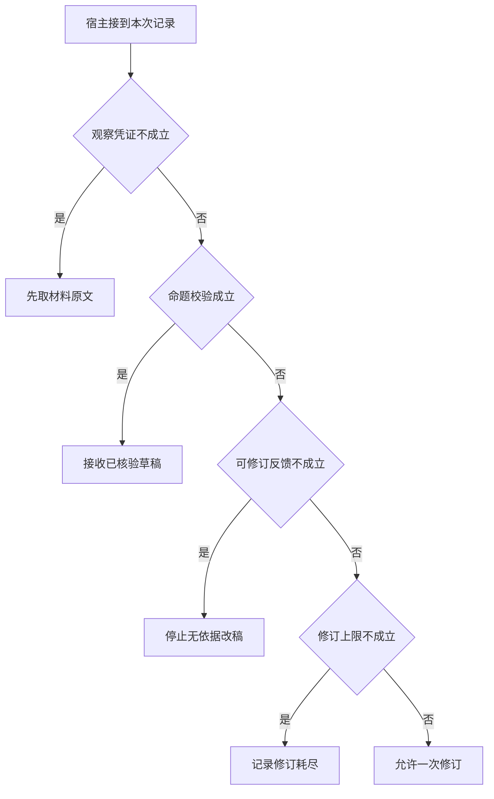

# 让一次 Reflection 带来新信息

生成者把缺材料写成了材料齐全。
评阅者若也只看旧摘要，两者可能一致地错。
把确定的集合差集交给检查器，并给修订设置一次上限，才能检验改稿到底解决了什么。

本篇用一个封闭的教学决策器说明这一问题。输入是宿主收到的记录，不保证每个下游字段都已经获准使用。前置检查未成立时，下游即使带着缓存值，也不能拿来作业务断言。

## 先解决一个具体问题

**一次反思什么时候能替代重新读取材料？**

候选仅有文案缺漏，已有事实完整时可以基于当前证据修订。
数据本身过期或不存在时，第二稿不会获得新材料，需回源或承认未知。


先取一个能走到「允许一次修订」的输入：已有本轮业务回执、候选与领域条件冲突、反馈给出独立可核实的错误、仍可修订一次。
把这四个条件代回后文的图，前面各个拦截分支都未满足，最终才有“反馈可验证且修正额度充足”这个判断。
还原这个现场时要分别问：哪些位来自可信状态，哪些只是在接口中出现、尚未获得解释资格的字段。

## 先沿一次决策走到底



从上到下取第一条成立的出口。只改一个开关时，只有它之前的检查都未截断，该变化才可能到达真实动作。

“观察凭证”的两种输入分别是“已有本轮业务回执”与“只有尚未执行的提议”。
模型的调用提议不能证明应用已取得新事实。

“命题校验”的两种输入分别是“候选通过业务断言”与“候选与领域条件冲突”。
有正确的引用编号仍可能推断出错误结论。

“可修订反馈”的两种输入分别是“反馈给出独立可核实的错误”与“反馈没有新依据”。
再次生成只有在能改正具体偏差时才有信息价值。

“修订上限”的两种输入分别是“仍可修订一次”与“修订轮数已用完”。
检查器与生成器互相调用也需要终止条件。

## 最少需要哪几项观察

### 先取材料原文

没有独立参照就不能判断候选。
在本节的全部组合中，有 8 种产生「先取材料原文」，这只是逻辑空间的计数，不能当作实际用户请求的比例。

只取得只有尚未执行的提议，已经足以要求宿主「先取材料原文」。
保持这些已知项，其余开关自由变化，仍有 8 种补全，判断没有翻转。

若删掉关于观察凭证的证据，另一份允许的现场是已有本轮业务回执、候选与领域条件冲突、反馈没有新依据、修订轮数已用完，它会使宿主「停止无依据改稿」。

### 接收已核验草稿

候选已经满足条件无需再生成。
在本节的全部组合中，有 4 种产生「接收已核验草稿」，这只是逻辑空间的计数，不能当作实际用户请求的比例。

只取得已有本轮业务回执、候选通过业务断言，已经足以要求宿主「接收已核验草稿」。
保持这些已知项，其余开关自由变化，仍有 4 种补全，判断没有翻转。

若删掉关于观察凭证的证据，另一份允许的现场是只有尚未执行的提议、候选通过业务断言、反馈没有新依据、修订轮数已用完，它会使宿主「先取材料原文」。

若删掉关于命题校验的证据，另一份允许的现场是已有本轮业务回执、候选与领域条件冲突、反馈没有新依据、修订轮数已用完，它会使宿主「停止无依据改稿」。

### 停止无依据改稿

反馈没有具体可纠正内容。
在本节的全部组合中，有 2 种产生「停止无依据改稿」，这只是逻辑空间的计数，不能当作实际用户请求的比例。

只取得已有本轮业务回执、候选与领域条件冲突、反馈没有新依据，已经足以要求宿主「停止无依据改稿」。
保持这些已知项，其余开关自由变化，仍有 2 种补全，判断没有翻转。

若删掉关于观察凭证的证据，另一份允许的现场是只有尚未执行的提议、候选与领域条件冲突、反馈没有新依据、修订轮数已用完，它会使宿主「先取材料原文」。

若删掉关于命题校验的证据，另一份允许的现场是已有本轮业务回执、候选通过业务断言、反馈没有新依据、修订轮数已用完，它会使宿主「接收已核验草稿」。

若删掉关于可修订反馈的证据，另一份允许的现场是已有本轮业务回执、候选与领域条件冲突、反馈给出独立可核实的错误、修订轮数已用完，它会使宿主「记录修订耗尽」。

### 记录修订耗尽

已达到允许的修正次数。
在本节的全部组合中，有 1 种产生「记录修订耗尽」，这只是逻辑空间的计数，不能当作实际用户请求的比例。

只取得已有本轮业务回执、候选与领域条件冲突、反馈给出独立可核实的错误、修订轮数已用完，已经足以要求宿主「记录修订耗尽」。
保持这些已知项，其余开关自由变化，仍有 1 种补全，判断没有翻转。

若删掉关于观察凭证的证据，另一份允许的现场是只有尚未执行的提议、候选与领域条件冲突、反馈给出独立可核实的错误、修订轮数已用完，它会使宿主「先取材料原文」。

若删掉关于命题校验的证据，另一份允许的现场是已有本轮业务回执、候选通过业务断言、反馈给出独立可核实的错误、修订轮数已用完，它会使宿主「接收已核验草稿」。

若删掉关于可修订反馈的证据，另一份允许的现场是已有本轮业务回执、候选与领域条件冲突、反馈没有新依据、修订轮数已用完，它会使宿主「停止无依据改稿」。

若删掉关于修订上限的证据，另一份允许的现场是已有本轮业务回执、候选与领域条件冲突、反馈给出独立可核实的错误、仍可修订一次，它会使宿主「允许一次修订」。

### 允许一次修订

反馈可验证且修正额度充足。
在本节的全部组合中，有 1 种产生「允许一次修订」，这只是逻辑空间的计数，不能当作实际用户请求的比例。

只取得已有本轮业务回执、候选与领域条件冲突、反馈给出独立可核实的错误、仍可修订一次，已经足以要求宿主「允许一次修订」。

若删掉关于观察凭证的证据，另一份允许的现场是只有尚未执行的提议、候选与领域条件冲突、反馈给出独立可核实的错误、仍可修订一次，它会使宿主「先取材料原文」。

若删掉关于命题校验的证据，另一份允许的现场是已有本轮业务回执、候选通过业务断言、反馈给出独立可核实的错误、仍可修订一次，它会使宿主「接收已核验草稿」。

若删掉关于可修订反馈的证据，另一份允许的现场是已有本轮业务回执、候选与领域条件冲突、反馈没有新依据、仍可修订一次，它会使宿主「停止无依据改稿」。

若删掉关于修订上限的证据，另一份允许的现场是已有本轮业务回执、候选与领域条件冲突、反馈给出独立可核实的错误、修订轮数已用完，它会使宿主「记录修订耗尽」。

## 以同一份契约解释截然不同的现场

<details>
<summary>展开推演与对应反例</summary>

下列样本按最先命中的业务分支排列。四位编码只作本篇页内定位，顺序与开头的四项输入一致。可以先猜下一动作，再展开相邻样本。

### 能够触发“先取材料原文”的现场

**样本 0000**

业务侧交来只有尚未执行的提议、候选与领域条件冲突，执行侧还记录了反馈没有新依据、修订轮数已用完。
把样本压成最短证明，保留只有尚未执行的提议就能支持「先取材料原文」。

在这份记录上，分别翻转「观察凭证」中的任一项，其他项完全不变时，下一动作都会改变。

保持其余观察不动，单独切换「命题校验」、「可修订反馈」、「修订上限」仍得到「先取材料原文」，它们在这个现场不是决定性变量。

要从本例改走「停止无依据改稿」，至少需要变动 1 项，一组最少改动是将只有尚未执行的提议换成已有本轮业务回执。

要从本例改走「记录修订耗尽」，至少需要变动 2 项，一组最少改动是将只有尚未执行的提议、反馈没有新依据换成已有本轮业务回执、反馈给出独立可核实的错误。

要从本例改走「接收已核验草稿」，至少需要变动 2 项，一组最少改动是将只有尚未执行的提议、候选与领域条件冲突换成已有本轮业务回执、候选通过业务断言。

要从本例改走「允许一次修订」，至少需要变动 3 项，一组最少改动是将只有尚未执行的提议、反馈没有新依据、修订轮数已用完换成已有本轮业务回执、反馈给出独立可核实的错误、仍可修订一次。

**样本 0001**

业务侧交来只有尚未执行的提议、候选与领域条件冲突，执行侧还记录了反馈没有新依据、仍可修订一次。


要从本例改走「允许一次修订」，至少需要变动 2 项，一组最少改动是将只有尚未执行的提议、反馈没有新依据换成已有本轮业务回执、反馈给出独立可核实的错误。


要从本例改走「记录修订耗尽」，至少需要变动 3 项，一组最少改动是将只有尚未执行的提议、反馈没有新依据、仍可修订一次换成已有本轮业务回执、反馈给出独立可核实的错误、修订轮数已用完。

**样本 0010**

业务侧交来只有尚未执行的提议、候选与领域条件冲突，执行侧还记录了反馈给出独立可核实的错误、修订轮数已用完。


要从本例改走「记录修订耗尽」，至少需要变动 1 项，一组最少改动是将只有尚未执行的提议换成已有本轮业务回执。

要从本例改走「停止无依据改稿」，至少需要变动 2 项，一组最少改动是将只有尚未执行的提议、反馈给出独立可核实的错误换成已有本轮业务回执、反馈没有新依据。

要从本例改走「允许一次修订」，至少需要变动 2 项，一组最少改动是将只有尚未执行的提议、修订轮数已用完换成已有本轮业务回执、仍可修订一次。


**样本 0011**

业务侧交来只有尚未执行的提议、候选与领域条件冲突，执行侧还记录了反馈给出独立可核实的错误、仍可修订一次。


要从本例改走「允许一次修订」，至少需要变动 1 项，一组最少改动是将只有尚未执行的提议换成已有本轮业务回执。


要从本例改走「记录修订耗尽」，至少需要变动 2 项，一组最少改动是将只有尚未执行的提议、仍可修订一次换成已有本轮业务回执、修订轮数已用完。


**样本 0100**

业务侧交来只有尚未执行的提议、候选通过业务断言，执行侧还记录了反馈没有新依据、修订轮数已用完。


要从本例改走「接收已核验草稿」，至少需要变动 1 项，一组最少改动是将只有尚未执行的提议换成已有本轮业务回执。

要从本例改走「停止无依据改稿」，至少需要变动 2 项，一组最少改动是将只有尚未执行的提议、候选通过业务断言换成已有本轮业务回执、候选与领域条件冲突。

要从本例改走「记录修订耗尽」，至少需要变动 3 项，一组最少改动是将只有尚未执行的提议、候选通过业务断言、反馈没有新依据换成已有本轮业务回执、候选与领域条件冲突、反馈给出独立可核实的错误。

要从本例改走「允许一次修订」，至少需要变动 4 项，一组最少改动是将只有尚未执行的提议、候选通过业务断言、反馈没有新依据、修订轮数已用完换成已有本轮业务回执、候选与领域条件冲突、反馈给出独立可核实的错误、仍可修订一次。

**样本 0101**

业务侧交来只有尚未执行的提议、候选通过业务断言，执行侧还记录了反馈没有新依据、仍可修订一次。


要从本例改走「允许一次修订」，至少需要变动 3 项，一组最少改动是将只有尚未执行的提议、候选通过业务断言、反馈没有新依据换成已有本轮业务回执、候选与领域条件冲突、反馈给出独立可核实的错误。

要从本例改走「记录修订耗尽」，至少需要变动 4 项，一组最少改动是将只有尚未执行的提议、候选通过业务断言、反馈没有新依据、仍可修订一次换成已有本轮业务回执、候选与领域条件冲突、反馈给出独立可核实的错误、修订轮数已用完。

**样本 0110**

业务侧交来只有尚未执行的提议、候选通过业务断言，执行侧还记录了反馈给出独立可核实的错误、修订轮数已用完。


要从本例改走「记录修订耗尽」，至少需要变动 2 项，一组最少改动是将只有尚未执行的提议、候选通过业务断言换成已有本轮业务回执、候选与领域条件冲突。

要从本例改走「停止无依据改稿」，至少需要变动 3 项，一组最少改动是将只有尚未执行的提议、候选通过业务断言、反馈给出独立可核实的错误换成已有本轮业务回执、候选与领域条件冲突、反馈没有新依据。

要从本例改走「允许一次修订」，至少需要变动 3 项，一组最少改动是将只有尚未执行的提议、候选通过业务断言、修订轮数已用完换成已有本轮业务回执、候选与领域条件冲突、仍可修订一次。

**样本 0111**

业务侧交来只有尚未执行的提议、候选通过业务断言，执行侧还记录了反馈给出独立可核实的错误、仍可修订一次。


要从本例改走「允许一次修订」，至少需要变动 2 项，一组最少改动是将只有尚未执行的提议、候选通过业务断言换成已有本轮业务回执、候选与领域条件冲突。


要从本例改走「记录修订耗尽」，至少需要变动 3 项，一组最少改动是将只有尚未执行的提议、候选通过业务断言、仍可修订一次换成已有本轮业务回执、候选与领域条件冲突、修订轮数已用完。

### 能够触发“接收已核验草稿”的现场

**样本 1100**

业务侧交来已有本轮业务回执、候选通过业务断言，执行侧还记录了反馈没有新依据、修订轮数已用完。
把样本压成最短证明，保留已有本轮业务回执、候选通过业务断言就能支持「接收已核验草稿」。

在这份记录上，分别翻转「观察凭证」、「命题校验」中的任一项，其他项完全不变时，下一动作都会改变。

保持其余观察不动，单独切换「可修订反馈」、「修订上限」仍得到「接收已核验草稿」，它们在这个现场不是决定性变量。

本例没走更靠前的「先取材料原文」，因为已有本轮业务回执与那个入口的必要条件不符。

要从本例改走「先取材料原文」，至少需要变动 1 项，一组最少改动是将已有本轮业务回执换成只有尚未执行的提议。

要从本例改走「停止无依据改稿」，至少需要变动 1 项，一组最少改动是将候选通过业务断言换成候选与领域条件冲突。

要从本例改走「记录修订耗尽」，至少需要变动 2 项，一组最少改动是将候选通过业务断言、反馈没有新依据换成候选与领域条件冲突、反馈给出独立可核实的错误。

要从本例改走「允许一次修订」，至少需要变动 3 项，一组最少改动是将候选通过业务断言、反馈没有新依据、修订轮数已用完换成候选与领域条件冲突、反馈给出独立可核实的错误、仍可修订一次。

**样本 1101**

业务侧交来已有本轮业务回执、候选通过业务断言，执行侧还记录了反馈没有新依据、仍可修订一次。


要从本例改走「允许一次修订」，至少需要变动 2 项，一组最少改动是将候选通过业务断言、反馈没有新依据换成候选与领域条件冲突、反馈给出独立可核实的错误。

要从本例改走「记录修订耗尽」，至少需要变动 3 项，一组最少改动是将候选通过业务断言、反馈没有新依据、仍可修订一次换成候选与领域条件冲突、反馈给出独立可核实的错误、修订轮数已用完。

**样本 1110**

业务侧交来已有本轮业务回执、候选通过业务断言，执行侧还记录了反馈给出独立可核实的错误、修订轮数已用完。


要从本例改走「记录修订耗尽」，至少需要变动 1 项，一组最少改动是将候选通过业务断言换成候选与领域条件冲突。

要从本例改走「停止无依据改稿」，至少需要变动 2 项，一组最少改动是将候选通过业务断言、反馈给出独立可核实的错误换成候选与领域条件冲突、反馈没有新依据。

要从本例改走「允许一次修订」，至少需要变动 2 项，一组最少改动是将候选通过业务断言、修订轮数已用完换成候选与领域条件冲突、仍可修订一次。

**样本 1111**

业务侧交来已有本轮业务回执、候选通过业务断言，执行侧还记录了反馈给出独立可核实的错误、仍可修订一次。


要从本例改走「允许一次修订」，至少需要变动 1 项，一组最少改动是将候选通过业务断言换成候选与领域条件冲突。


要从本例改走「记录修订耗尽」，至少需要变动 2 项，一组最少改动是将候选通过业务断言、仍可修订一次换成候选与领域条件冲突、修订轮数已用完。

### 能够触发“停止无依据改稿”的现场

**样本 1000**

业务侧交来已有本轮业务回执、候选与领域条件冲突，执行侧还记录了反馈没有新依据、修订轮数已用完。
把样本压成最短证明，保留已有本轮业务回执、候选与领域条件冲突、反馈没有新依据就能支持「停止无依据改稿」。

在这份记录上，分别翻转「观察凭证」、「命题校验」、「可修订反馈」中的任一项，其他项完全不变时，下一动作都会改变。

保持其余观察不动，单独切换「修订上限」仍得到「停止无依据改稿」，它们在这个现场不是决定性变量。


本例没走更靠前的「接收已核验草稿」，因为候选与领域条件冲突与那个入口的必要条件不符。


要从本例改走「记录修订耗尽」，至少需要变动 1 项，一组最少改动是将反馈没有新依据换成反馈给出独立可核实的错误。

要从本例改走「接收已核验草稿」，至少需要变动 1 项，一组最少改动是将候选与领域条件冲突换成候选通过业务断言。

要从本例改走「允许一次修订」，至少需要变动 2 项，一组最少改动是将反馈没有新依据、修订轮数已用完换成反馈给出独立可核实的错误、仍可修订一次。

**样本 1001**

业务侧交来已有本轮业务回执、候选与领域条件冲突，执行侧还记录了反馈没有新依据、仍可修订一次。


要从本例改走「允许一次修订」，至少需要变动 1 项，一组最少改动是将反馈没有新依据换成反馈给出独立可核实的错误。


要从本例改走「记录修订耗尽」，至少需要变动 2 项，一组最少改动是将反馈没有新依据、仍可修订一次换成反馈给出独立可核实的错误、修订轮数已用完。

### 能够触发“记录修订耗尽”的现场

**样本 1010**

业务侧交来已有本轮业务回执、候选与领域条件冲突，执行侧还记录了反馈给出独立可核实的错误、修订轮数已用完。
把样本压成最短证明，保留已有本轮业务回执、候选与领域条件冲突、反馈给出独立可核实的错误、修订轮数已用完就能支持「记录修订耗尽」。

在这份记录上，分别翻转「观察凭证」、「命题校验」、「可修订反馈」、「修订上限」中的任一项，其他项完全不变时，下一动作都会改变。


本例没走更靠前的「停止无依据改稿」，因为反馈给出独立可核实的错误与那个入口的必要条件不符。


要从本例改走「停止无依据改稿」，至少需要变动 1 项，一组最少改动是将反馈给出独立可核实的错误换成反馈没有新依据。

要从本例改走「允许一次修订」，至少需要变动 1 项，一组最少改动是将修订轮数已用完换成仍可修订一次。


### 能够触发“允许一次修订”的现场

**样本 1011**

业务侧交来已有本轮业务回执、候选与领域条件冲突，执行侧还记录了反馈给出独立可核实的错误、仍可修订一次。
把样本压成最短证明，保留已有本轮业务回执、候选与领域条件冲突、反馈给出独立可核实的错误、仍可修订一次就能支持「允许一次修订」。


本例没走更靠前的「记录修订耗尽」，因为仍可修订一次与那个入口的必要条件不符。


要从本例改走「记录修订耗尽」，至少需要变动 1 项，一组最少改动是将仍可修订一次换成修订轮数已用完。


</details>

## 当你只能看见一半记录

<details>
<summary>展开推演与对应反例</summary>

这次隐藏两个字段，保留另两个。对每个可见现场，检查四种合法补全是否同意。如仍有歧义，选择能使最坏剩余候选动作最少的字段继续查。并列时采用本篇字段顺序。

### 只保留观察凭证与命题校验

已知只有尚未执行的提议、候选与领域条件冲突时，四种补全的动作分布为先取材料原文（4 种）。

就“先取材料原文”这个动作而言，在只有尚未执行的提议、候选与领域条件冲突的前提下，另外两项观察不会推翻它。

已知只有尚未执行的提议、候选通过业务断言时，四种补全的动作分布为先取材料原文（4 种）。

就“先取材料原文”这个动作而言，在只有尚未执行的提议、候选通过业务断言的前提下，另外两项观察不会推翻它。

已知已有本轮业务回执、候选与领域条件冲突时，四种补全的动作分布为停止无依据改稿（2 种）、记录修订耗尽（1 种）、允许一次修订（1 种）。

在已有本轮业务回执、候选与领域条件冲突这个现场补读「可修订反馈」，最坏还剩 2 种动作，计算时只衡量歧义，尚未扣读取代价。
若补来的观察为“反馈没有新依据”，范围缩成「停止无依据改稿」。若为“反馈给出独立可核实的错误”，则保留「记录修订耗尽」、「允许一次修订」。

区分不了的两条执行可以具体写成 1000 与 1010：它们共享已展示字段，却分别需要「停止无依据改稿」和「记录修订耗尽」。

已知已有本轮业务回执、候选通过业务断言时，四种补全的动作分布为接收已核验草稿（4 种）。

就“接收已核验草稿”这个动作而言，在已有本轮业务回执、候选通过业务断言的前提下，另外两项观察不会推翻它。

### 只保留观察凭证与可修订反馈

已知只有尚未执行的提议、反馈没有新依据时，四种补全的动作分布为先取材料原文（4 种）。

就“先取材料原文”这个动作而言，在只有尚未执行的提议、反馈没有新依据的前提下，另外两项观察不会推翻它。

已知只有尚未执行的提议、反馈给出独立可核实的错误时，四种补全的动作分布为先取材料原文（4 种）。

就“先取材料原文”这个动作而言，在只有尚未执行的提议、反馈给出独立可核实的错误的前提下，另外两项观察不会推翻它。

已知已有本轮业务回执、反馈没有新依据时，四种补全的动作分布为接收已核验草稿（2 种）、停止无依据改稿（2 种）。

在已有本轮业务回执、反馈没有新依据这个现场补读「命题校验」，最坏还剩 1 种动作，计算时只衡量歧义，尚未扣读取代价。
若补来的观察为“候选与领域条件冲突”，范围缩成「停止无依据改稿」。若为“候选通过业务断言”，则保留「接收已核验草稿」。

区分不了的两条执行可以具体写成 1000 与 1100：它们共享已展示字段，却分别需要「停止无依据改稿」和「接收已核验草稿」。

已知已有本轮业务回执、反馈给出独立可核实的错误时，四种补全的动作分布为接收已核验草稿（2 种）、记录修订耗尽（1 种）、允许一次修订（1 种）。

在已有本轮业务回执、反馈给出独立可核实的错误这个现场补读「命题校验」，最坏还剩 2 种动作，计算时只衡量歧义，尚未扣读取代价。
若补来的观察为“候选与领域条件冲突”，范围缩成「记录修订耗尽」、「允许一次修订」。若为“候选通过业务断言”，则保留「接收已核验草稿」。

区分不了的两条执行可以具体写成 1010 与 1011：它们共享已展示字段，却分别需要「记录修订耗尽」和「允许一次修订」。

### 只保留命题校验与可修订反馈

已知候选与领域条件冲突、反馈没有新依据时，四种补全的动作分布为先取材料原文（2 种）、停止无依据改稿（2 种）。

在候选与领域条件冲突、反馈没有新依据这个现场补读「观察凭证」，最坏还剩 1 种动作，计算时只衡量歧义，尚未扣读取代价。
若补来的观察为“只有尚未执行的提议”，范围缩成「先取材料原文」。若为“已有本轮业务回执”，则保留「停止无依据改稿」。

区分不了的两条执行可以具体写成 0000 与 1000：它们共享已展示字段，却分别需要「先取材料原文」和「停止无依据改稿」。

已知候选与领域条件冲突、反馈给出独立可核实的错误时，四种补全的动作分布为先取材料原文（2 种）、记录修订耗尽（1 种）、允许一次修订（1 种）。

在候选与领域条件冲突、反馈给出独立可核实的错误这个现场补读「观察凭证」，最坏还剩 2 种动作，计算时只衡量歧义，尚未扣读取代价。
若补来的观察为“只有尚未执行的提议”，范围缩成「先取材料原文」。若为“已有本轮业务回执”，则保留「记录修订耗尽」、「允许一次修订」。

区分不了的两条执行可以具体写成 0010 与 1010：它们共享已展示字段，却分别需要「先取材料原文」和「记录修订耗尽」。

已知候选通过业务断言、反馈没有新依据时，四种补全的动作分布为先取材料原文（2 种）、接收已核验草稿（2 种）。

在候选通过业务断言、反馈没有新依据这个现场补读「观察凭证」，最坏还剩 1 种动作，计算时只衡量歧义，尚未扣读取代价。
若补来的观察为“只有尚未执行的提议”，范围缩成「先取材料原文」。若为“已有本轮业务回执”，则保留「接收已核验草稿」。

区分不了的两条执行可以具体写成 0100 与 1100：它们共享已展示字段，却分别需要「先取材料原文」和「接收已核验草稿」。

已知候选通过业务断言、反馈给出独立可核实的错误时，四种补全的动作分布为先取材料原文（2 种）、接收已核验草稿（2 种）。

在候选通过业务断言、反馈给出独立可核实的错误这个现场补读「观察凭证」，最坏还剩 1 种动作，计算时只衡量歧义，尚未扣读取代价。

区分不了的两条执行可以具体写成 0110 与 1110：它们共享已展示字段，却分别需要「先取材料原文」和「接收已核验草稿」。

### 只保留观察凭证与修订上限

已知只有尚未执行的提议、修订轮数已用完时，四种补全的动作分布为先取材料原文（4 种）。

就“先取材料原文”这个动作而言，在只有尚未执行的提议、修订轮数已用完的前提下，另外两项观察不会推翻它。

已知只有尚未执行的提议、仍可修订一次时，四种补全的动作分布为先取材料原文（4 种）。

就“先取材料原文”这个动作而言，在只有尚未执行的提议、仍可修订一次的前提下，另外两项观察不会推翻它。

已知已有本轮业务回执、修订轮数已用完时，四种补全的动作分布为接收已核验草稿（2 种）、停止无依据改稿（1 种）、记录修订耗尽（1 种）。

在已有本轮业务回执、修订轮数已用完这个现场补读「命题校验」，最坏还剩 2 种动作，计算时只衡量歧义，尚未扣读取代价。
若补来的观察为“候选与领域条件冲突”，范围缩成「停止无依据改稿」、「记录修订耗尽」。若为“候选通过业务断言”，则保留「接收已核验草稿」。


已知已有本轮业务回执、仍可修订一次时，四种补全的动作分布为接收已核验草稿（2 种）、停止无依据改稿（1 种）、允许一次修订（1 种）。

在已有本轮业务回执、仍可修订一次这个现场补读「命题校验」，最坏还剩 2 种动作，计算时只衡量歧义，尚未扣读取代价。
若补来的观察为“候选与领域条件冲突”，范围缩成「停止无依据改稿」、「允许一次修订」。若为“候选通过业务断言”，则保留「接收已核验草稿」。

区分不了的两条执行可以具体写成 1001 与 1011：它们共享已展示字段，却分别需要「停止无依据改稿」和「允许一次修订」。

### 只保留命题校验与修订上限

已知候选与领域条件冲突、修订轮数已用完时，四种补全的动作分布为先取材料原文（2 种）、停止无依据改稿（1 种）、记录修订耗尽（1 种）。

在候选与领域条件冲突、修订轮数已用完这个现场补读「观察凭证」，最坏还剩 2 种动作，计算时只衡量歧义，尚未扣读取代价。
若补来的观察为“只有尚未执行的提议”，范围缩成「先取材料原文」。若为“已有本轮业务回执”，则保留「停止无依据改稿」、「记录修订耗尽」。


已知候选与领域条件冲突、仍可修订一次时，四种补全的动作分布为先取材料原文（2 种）、停止无依据改稿（1 种）、允许一次修订（1 种）。

在候选与领域条件冲突、仍可修订一次这个现场补读「观察凭证」，最坏还剩 2 种动作，计算时只衡量歧义，尚未扣读取代价。
若补来的观察为“只有尚未执行的提议”，范围缩成「先取材料原文」。若为“已有本轮业务回执”，则保留「停止无依据改稿」、「允许一次修订」。

区分不了的两条执行可以具体写成 0001 与 1001：它们共享已展示字段，却分别需要「先取材料原文」和「停止无依据改稿」。

已知候选通过业务断言、修订轮数已用完时，四种补全的动作分布为先取材料原文（2 种）、接收已核验草稿（2 种）。

在候选通过业务断言、修订轮数已用完这个现场补读「观察凭证」，最坏还剩 1 种动作，计算时只衡量歧义，尚未扣读取代价。


已知候选通过业务断言、仍可修订一次时，四种补全的动作分布为先取材料原文（2 种）、接收已核验草稿（2 种）。

在候选通过业务断言、仍可修订一次这个现场补读「观察凭证」，最坏还剩 1 种动作，计算时只衡量歧义，尚未扣读取代价。

区分不了的两条执行可以具体写成 0101 与 1101：它们共享已展示字段，却分别需要「先取材料原文」和「接收已核验草稿」。

### 只保留可修订反馈与修订上限

已知反馈没有新依据、修订轮数已用完时，四种补全的动作分布为先取材料原文（2 种）、接收已核验草稿（1 种）、停止无依据改稿（1 种）。

在反馈没有新依据、修订轮数已用完这个现场补读「观察凭证」，最坏还剩 2 种动作，计算时只衡量歧义，尚未扣读取代价。
若补来的观察为“只有尚未执行的提议”，范围缩成「先取材料原文」。若为“已有本轮业务回执”，则保留「停止无依据改稿」、「接收已核验草稿」。


已知反馈没有新依据、仍可修订一次时，四种补全的动作分布为先取材料原文（2 种）、接收已核验草稿（1 种）、停止无依据改稿（1 种）。

在反馈没有新依据、仍可修订一次这个现场补读「观察凭证」，最坏还剩 2 种动作，计算时只衡量歧义，尚未扣读取代价。


已知反馈给出独立可核实的错误、修订轮数已用完时，四种补全的动作分布为先取材料原文（2 种）、接收已核验草稿（1 种）、记录修订耗尽（1 种）。

在反馈给出独立可核实的错误、修订轮数已用完这个现场补读「观察凭证」，最坏还剩 2 种动作，计算时只衡量歧义，尚未扣读取代价。
若补来的观察为“只有尚未执行的提议”，范围缩成「先取材料原文」。若为“已有本轮业务回执”，则保留「记录修订耗尽」、「接收已核验草稿」。


已知反馈给出独立可核实的错误、仍可修订一次时，四种补全的动作分布为先取材料原文（2 种）、接收已核验草稿（1 种）、允许一次修订（1 种）。

在反馈给出独立可核实的错误、仍可修订一次这个现场补读「观察凭证」，最坏还剩 2 种动作，计算时只衡量歧义，尚未扣读取代价。
若补来的观察为“只有尚未执行的提议”，范围缩成「先取材料原文」。若为“已有本轮业务回执”，则保留「允许一次修订」、「接收已核验草稿」。

区分不了的两条执行可以具体写成 0011 与 1011：它们共享已展示字段，却分别需要「先取材料原文」和「允许一次修订」。

</details>

## 单因素干预与边界测试

<details>
<summary>展开推演与对应反例</summary>

### 只改变观察凭证

固定另外三个条件得到八对现场，从“只有尚未执行的提议”转为“已有本轮业务回执”时，8 对翻转动作，另外 0 对保持不变。

有 2 对现场沿「先取材料原文」变到「停止无依据改稿」，可复现的一组受控背景为候选与领域条件冲突、反馈没有新依据、修订轮数已用完。

有 1 对现场沿「先取材料原文」变到「记录修订耗尽」，可复现的一组受控背景为候选与领域条件冲突、反馈给出独立可核实的错误、修订轮数已用完。

有 1 对现场沿「先取材料原文」变到「允许一次修订」，可复现的一组受控背景为候选与领域条件冲突、反馈给出独立可核实的错误、仍可修订一次。

有 4 对现场沿「先取材料原文」变到「接收已核验草稿」，可复现的一组受控背景为候选通过业务断言、反馈没有新依据、修订轮数已用完。

### 只改变命题校验

固定另外三个条件得到八对现场，从“候选与领域条件冲突”转为“候选通过业务断言”时，4 对翻转动作，另外 4 对保持不变。

令只有尚未执行的提议、反馈没有新依据、修订轮数已用完，命题校验的两个取值均得到「先取材料原文」。在八对中，共有 4 对表现为这一种稳定出口。

有 2 对现场沿「停止无依据改稿」变到「接收已核验草稿」，可复现的一组受控背景为已有本轮业务回执、反馈没有新依据、修订轮数已用完。

有 1 对现场沿「记录修订耗尽」变到「接收已核验草稿」，可复现的一组受控背景为已有本轮业务回执、反馈给出独立可核实的错误、修订轮数已用完。

有 1 对现场沿「允许一次修订」变到「接收已核验草稿」，可复现的一组受控背景为已有本轮业务回执、反馈给出独立可核实的错误、仍可修订一次。

### 只改变可修订反馈

固定另外三个条件得到八对现场，从“反馈没有新依据”转为“反馈给出独立可核实的错误”时，2 对翻转动作，另外 6 对保持不变。

令只有尚未执行的提议、候选与领域条件冲突、修订轮数已用完，可修订反馈的两个取值均得到「先取材料原文」。在八对中，共有 4 对表现为这一种稳定出口。

有 1 对现场沿「停止无依据改稿」变到「记录修订耗尽」，可复现的一组受控背景为已有本轮业务回执、候选与领域条件冲突、修订轮数已用完。

有 1 对现场沿「停止无依据改稿」变到「允许一次修订」，可复现的一组受控背景为已有本轮业务回执、候选与领域条件冲突、仍可修订一次。

令已有本轮业务回执、候选通过业务断言、修订轮数已用完，可修订反馈的两个取值均得到「接收已核验草稿」。在八对中，共有 2 对表现为这一种稳定出口。

### 只改变修订上限

固定另外三个条件得到八对现场，从“修订轮数已用完”转为“仍可修订一次”时，1 对翻转动作，另外 7 对保持不变。

令只有尚未执行的提议、候选与领域条件冲突、反馈没有新依据，修订上限的两个取值均得到「先取材料原文」。在八对中，共有 4 对表现为这一种稳定出口。

令已有本轮业务回执、候选与领域条件冲突、反馈没有新依据，修订上限的两个取值均得到「停止无依据改稿」。在八对中，共有 1 对表现为这一种稳定出口。

有 1 对现场沿「记录修订耗尽」变到「允许一次修订」，可复现的一组受控背景为已有本轮业务回执、候选与领域条件冲突、反馈给出独立可核实的错误。

令已有本轮业务回执、候选通过业务断言、反馈没有新依据，修订上限的两个取值均得到「接收已核验草稿」。在八对中，共有 2 对表现为这一种稳定出口。

</details>

## 哪些回归样本真能抓住实现错误

<details>
<summary>展开推演与对应反例</summary>

如果删除“先取材料原文”这个分支，在本篇 16 种输入里有 8 种会改走另一出口。

反例 0000 的完整记录为只有尚未执行的提议、候选与领域条件冲突、反馈没有新依据、修订轮数已用完。正确结果是「先取材料原文」，这个改坏的实现却给出「停止无依据改稿」。

如果删除“接收已核验草稿”这个分支，在本篇 16 种输入里有 4 种会改走另一出口。

反例 1100 的完整记录为已有本轮业务回执、候选通过业务断言、反馈没有新依据、修订轮数已用完。正确结果是「接收已核验草稿」，这个改坏的实现却给出「停止无依据改稿」。

如果删除“停止无依据改稿”这个分支，在本篇 16 种输入里有 2 种会改走另一出口。

反例 1000 的完整记录为已有本轮业务回执、候选与领域条件冲突、反馈没有新依据、修订轮数已用完。正确结果是「停止无依据改稿」，这个改坏的实现却给出「记录修订耗尽」。

如果删除“记录修订耗尽”这个分支，在本篇 16 种输入里有 1 种会改走另一出口。

反例 1010 的完整记录为已有本轮业务回执、候选与领域条件冲突、反馈给出独立可核实的错误、修订轮数已用完。正确结果是「记录修订耗尽」，这个改坏的实现却给出「允许一次修订」。

如果交换“先取材料原文”和“接收已核验草稿”的判断次序，在本篇 16 种输入里有 4 种会改走另一出口。

反例 0100 的完整记录为只有尚未执行的提议、候选通过业务断言、反馈没有新依据、修订轮数已用完。正确结果是「先取材料原文」，这个改坏的实现却给出「接收已核验草稿」。

如果交换“接收已核验草稿”和“停止无依据改稿”的判断次序，在本篇 16 种输入里有 2 种会改走另一出口。


如果交换“停止无依据改稿”和“记录修订耗尽”的判断次序，在本篇 16 种输入里有 1 种会改走另一出口。


补入样本 0100（只有尚未执行的提议、候选通过业务断言、反馈没有新依据、修订轮数已用完）能新增检出「删除“先取材料原文”这个分支」、「交换“先取材料原文”和“接收已核验草稿”的判断次序」。

补入样本 1000（已有本轮业务回执、候选与领域条件冲突、反馈没有新依据、修订轮数已用完）能新增检出「删除“停止无依据改稿”这个分支」、「交换“停止无依据改稿”和“记录修订耗尽”的判断次序」。

补入样本 1100（已有本轮业务回执、候选通过业务断言、反馈没有新依据、修订轮数已用完）能新增检出「删除“接收已核验草稿”这个分支」、「交换“接收已核验草稿”和“停止无依据改稿”的判断次序」。

补入样本 1010（已有本轮业务回执、候选与领域条件冲突、反馈给出独立可核实的错误、修订轮数已用完）能新增检出「删除“记录修订耗尽”这个分支」。

这里每次选覆盖尚未捕获缺陷最多的样本，并不保证用例数全局最小。它给出的反例能作为 Java 单测输入。真实模型是否会自主产生这些提议，仍须单独评测。

</details>

## 把状态覆盖换成有抽样偏差的评测批次

<details>
<summary>展开推演与对应反例</summary>

前面的十六种记录各有一票。现在只改样本构成：对一个给定字段，把成立侧的每种记录各取三份、另一侧各取一份。这是人为配比的 32 份回放，不是线上频率估计。
将偏向成立与偏向不成立的两次批次对照，可以隔离分母变化。底层宿主和所有答案保持相同，比例仍可能移动。

### 改变“观察凭证”的样本配比

只看「先取材料原文」，在已有本轮业务回执的八个不同输入中有 0 个命中，在只有尚未执行的提议的另八个输入中有 8 个命中。
把「观察凭证」成立侧按三倍取样，「先取材料原文」占 8/32，反过来向未成立侧倾斜后占 24/32。
这次重加权使「先取材料原文」的占比相差 50 个百分点。若按两种不同的“观察凭证”分布跑新旧版，不能把这项差异全部归功于实现。

只看「接收已核验草稿」，在已有本轮业务回执的八个不同输入中有 4 个命中，在只有尚未执行的提议的另八个输入中有 0 个命中。
把「观察凭证」成立侧按三倍取样，「接收已核验草稿」占 12/32，反过来向未成立侧倾斜后占 4/32。
这次重加权使「接收已核验草稿」的占比相差 25 个百分点。若按两种不同的“观察凭证”分布跑新旧版，不能把这项差异全部归功于实现。

只看「停止无依据改稿」，在已有本轮业务回执的八个不同输入中有 2 个命中，在只有尚未执行的提议的另八个输入中有 0 个命中。
把「观察凭证」成立侧按三倍取样，「停止无依据改稿」占 6/32，反过来向未成立侧倾斜后占 2/32。
这次重加权使「停止无依据改稿」的占比相差 12.5 个百分点。若按两种不同的“观察凭证”分布跑新旧版，不能把这项差异全部归功于实现。

只看「记录修订耗尽」，在已有本轮业务回执的八个不同输入中有 1 个命中，在只有尚未执行的提议的另八个输入中有 0 个命中。
把「观察凭证」成立侧按三倍取样，「记录修订耗尽」占 3/32，反过来向未成立侧倾斜后占 1/32。
这次重加权使「记录修订耗尽」的占比相差 6.25 个百分点。若按两种不同的“观察凭证”分布跑新旧版，不能把这项差异全部归功于实现。

只看「允许一次修订」，在已有本轮业务回执的八个不同输入中有 1 个命中，在只有尚未执行的提议的另八个输入中有 0 个命中。
把「观察凭证」成立侧按三倍取样，「允许一次修订」占 3/32，反过来向未成立侧倾斜后占 1/32。
这次重加权使「允许一次修订」的占比相差 6.25 个百分点。若按两种不同的“观察凭证”分布跑新旧版，不能把这项差异全部归功于实现。

### 改变“命题校验”的样本配比

只看「先取材料原文」，在候选通过业务断言的八个不同输入中有 4 个命中，在候选与领域条件冲突的另八个输入中有 4 个命中。
把「命题校验」成立侧按三倍取样，「先取材料原文」占 16/32，反过来向未成立侧倾斜后占 16/32。
两批「先取材料原文」的边际比例相同，是因为这个出口在“命题校验”的两侧计数相等，这不能单独证明每一对现场都不受它影响。

只看「接收已核验草稿」，在候选通过业务断言的八个不同输入中有 4 个命中，在候选与领域条件冲突的另八个输入中有 0 个命中。
把「命题校验」成立侧按三倍取样，「接收已核验草稿」占 12/32，反过来向未成立侧倾斜后占 4/32。
这次重加权使「接收已核验草稿」的占比相差 25 个百分点。若按两种不同的“命题校验”分布跑新旧版，不能把这项差异全部归功于实现。

只看「停止无依据改稿」，在候选通过业务断言的八个不同输入中有 0 个命中，在候选与领域条件冲突的另八个输入中有 2 个命中。
把「命题校验」成立侧按三倍取样，「停止无依据改稿」占 2/32，反过来向未成立侧倾斜后占 6/32。
这次重加权使「停止无依据改稿」的占比相差 12.5 个百分点。若按两种不同的“命题校验”分布跑新旧版，不能把这项差异全部归功于实现。

只看「记录修订耗尽」，在候选通过业务断言的八个不同输入中有 0 个命中，在候选与领域条件冲突的另八个输入中有 1 个命中。
把「命题校验」成立侧按三倍取样，「记录修订耗尽」占 1/32，反过来向未成立侧倾斜后占 3/32。
这次重加权使「记录修订耗尽」的占比相差 6.25 个百分点。若按两种不同的“命题校验”分布跑新旧版，不能把这项差异全部归功于实现。

只看「允许一次修订」，在候选通过业务断言的八个不同输入中有 0 个命中，在候选与领域条件冲突的另八个输入中有 1 个命中。
把「命题校验」成立侧按三倍取样，「允许一次修订」占 1/32，反过来向未成立侧倾斜后占 3/32。
这次重加权使「允许一次修订」的占比相差 6.25 个百分点。若按两种不同的“命题校验”分布跑新旧版，不能把这项差异全部归功于实现。

### 改变“可修订反馈”的样本配比

只看「先取材料原文」，在反馈给出独立可核实的错误的八个不同输入中有 4 个命中，在反馈没有新依据的另八个输入中有 4 个命中。
把「可修订反馈」成立侧按三倍取样，「先取材料原文」占 16/32，反过来向未成立侧倾斜后占 16/32。
两批「先取材料原文」的边际比例相同，是因为这个出口在“可修订反馈”的两侧计数相等，这不能单独证明每一对现场都不受它影响。

只看「接收已核验草稿」，在反馈给出独立可核实的错误的八个不同输入中有 2 个命中，在反馈没有新依据的另八个输入中有 2 个命中。
把「可修订反馈」成立侧按三倍取样，「接收已核验草稿」占 8/32，反过来向未成立侧倾斜后占 8/32。
两批「接收已核验草稿」的边际比例相同，是因为这个出口在“可修订反馈”的两侧计数相等，这不能单独证明每一对现场都不受它影响。

只看「停止无依据改稿」，在反馈给出独立可核实的错误的八个不同输入中有 0 个命中，在反馈没有新依据的另八个输入中有 2 个命中。
把「可修订反馈」成立侧按三倍取样，「停止无依据改稿」占 2/32，反过来向未成立侧倾斜后占 6/32。
这次重加权使「停止无依据改稿」的占比相差 12.5 个百分点。若按两种不同的“可修订反馈”分布跑新旧版，不能把这项差异全部归功于实现。

只看「记录修订耗尽」，在反馈给出独立可核实的错误的八个不同输入中有 1 个命中，在反馈没有新依据的另八个输入中有 0 个命中。
把「可修订反馈」成立侧按三倍取样，「记录修订耗尽」占 3/32，反过来向未成立侧倾斜后占 1/32。
这次重加权使「记录修订耗尽」的占比相差 6.25 个百分点。若按两种不同的“可修订反馈”分布跑新旧版，不能把这项差异全部归功于实现。

只看「允许一次修订」，在反馈给出独立可核实的错误的八个不同输入中有 1 个命中，在反馈没有新依据的另八个输入中有 0 个命中。
把「可修订反馈」成立侧按三倍取样，「允许一次修订」占 3/32，反过来向未成立侧倾斜后占 1/32。
这次重加权使「允许一次修订」的占比相差 6.25 个百分点。若按两种不同的“可修订反馈”分布跑新旧版，不能把这项差异全部归功于实现。

### 改变“修订上限”的样本配比

只看「先取材料原文」，在仍可修订一次的八个不同输入中有 4 个命中，在修订轮数已用完的另八个输入中有 4 个命中。
把「修订上限」成立侧按三倍取样，「先取材料原文」占 16/32，反过来向未成立侧倾斜后占 16/32。
两批「先取材料原文」的边际比例相同，是因为这个出口在“修订上限”的两侧计数相等，这不能单独证明每一对现场都不受它影响。

只看「接收已核验草稿」，在仍可修订一次的八个不同输入中有 2 个命中，在修订轮数已用完的另八个输入中有 2 个命中。
把「修订上限」成立侧按三倍取样，「接收已核验草稿」占 8/32，反过来向未成立侧倾斜后占 8/32。
两批「接收已核验草稿」的边际比例相同，是因为这个出口在“修订上限”的两侧计数相等，这不能单独证明每一对现场都不受它影响。

只看「停止无依据改稿」，在仍可修订一次的八个不同输入中有 1 个命中，在修订轮数已用完的另八个输入中有 1 个命中。
把「修订上限」成立侧按三倍取样，「停止无依据改稿」占 4/32，反过来向未成立侧倾斜后占 4/32。
两批「停止无依据改稿」的边际比例相同，是因为这个出口在“修订上限”的两侧计数相等，这不能单独证明每一对现场都不受它影响。

只看「记录修订耗尽」，在仍可修订一次的八个不同输入中有 0 个命中，在修订轮数已用完的另八个输入中有 1 个命中。
把「修订上限」成立侧按三倍取样，「记录修订耗尽」占 1/32，反过来向未成立侧倾斜后占 3/32。
这次重加权使「记录修订耗尽」的占比相差 6.25 个百分点。若按两种不同的“修订上限”分布跑新旧版，不能把这项差异全部归功于实现。

只看「允许一次修订」，在仍可修订一次的八个不同输入中有 1 个命中，在修订轮数已用完的另八个输入中有 0 个命中。
把「修订上限」成立侧按三倍取样，「允许一次修订」占 3/32，反过来向未成立侧倾斜后占 1/32。
这次重加权使「允许一次修订」的占比相差 6.25 个百分点。若按两种不同的“修订上限”分布跑新旧版，不能把这项差异全部归功于实现。

</details>

## 只看终态，能逆推出多少原始事实

<details>
<summary>展开推演与对应反例</summary>

### 只保留“先取材料原文”这条结果时

在本节契约与完整输入域内，仅知「先取材料原文」就能倒推出只有尚未执行的提议，这一推断依赖版本未变且日志中的终态可信。

「先取材料原文」不能证明命题校验取哪一侧：0000 和 0100 有相同终态，却分别记为“候选与领域条件冲突”和“候选通过业务断言”。

「先取材料原文」不能证明可修订反馈取哪一侧：0000 和 0010 有相同终态，却分别记为“反馈没有新依据”和“反馈给出独立可核实的错误”。

「先取材料原文」不能证明修订上限取哪一侧：0000 和 0001 有相同终态，却分别记为“修订轮数已用完”和“仍可修订一次”。

反查「先取材料原文」的诊断日志，优先保留能区分样本 0000 与 1000 的「观察凭证」，否则很容易把邻近的「停止无依据改稿」看成同一种故障。

### 只保留“接收已核验草稿”这条结果时

在本节契约与完整输入域内，仅知「接收已核验草稿」就能倒推出已有本轮业务回执，这一推断依赖版本未变且日志中的终态可信。

在本节契约与完整输入域内，仅知「接收已核验草稿」就能倒推出候选通过业务断言，这一推断依赖版本未变且日志中的终态可信。

「接收已核验草稿」不能证明可修订反馈取哪一侧：1100 和 1110 有相同终态，却分别记为“反馈没有新依据”和“反馈给出独立可核实的错误”。

「接收已核验草稿」不能证明修订上限取哪一侧：1100 和 1101 有相同终态，却分别记为“修订轮数已用完”和“仍可修订一次”。

反查「接收已核验草稿」的诊断日志，优先保留能区分样本 1100 与 0100 的「观察凭证」，否则很容易把邻近的「先取材料原文」看成同一种故障。

### 只保留“停止无依据改稿”这条结果时

在本节契约与完整输入域内，仅知「停止无依据改稿」就能倒推出已有本轮业务回执，这一推断依赖版本未变且日志中的终态可信。

在本节契约与完整输入域内，仅知「停止无依据改稿」就能倒推出候选与领域条件冲突，这一推断依赖版本未变且日志中的终态可信。

在本节契约与完整输入域内，仅知「停止无依据改稿」就能倒推出反馈没有新依据，这一推断依赖版本未变且日志中的终态可信。

「停止无依据改稿」不能证明修订上限取哪一侧：1000 和 1001 有相同终态，却分别记为“修订轮数已用完”和“仍可修订一次”。

反查「停止无依据改稿」的诊断日志，优先保留能区分样本 1000 与 0000 的「观察凭证」，否则很容易把邻近的「先取材料原文」看成同一种故障。

### 只保留“记录修订耗尽”这条结果时

在本节契约与完整输入域内，仅知「记录修订耗尽」就能倒推出已有本轮业务回执，这一推断依赖版本未变且日志中的终态可信。

在本节契约与完整输入域内，仅知「记录修订耗尽」就能倒推出候选与领域条件冲突，这一推断依赖版本未变且日志中的终态可信。

在本节契约与完整输入域内，仅知「记录修订耗尽」就能倒推出反馈给出独立可核实的错误，这一推断依赖版本未变且日志中的终态可信。

在本节契约与完整输入域内，仅知「记录修订耗尽」就能倒推出修订轮数已用完，这一推断依赖版本未变且日志中的终态可信。

反查「记录修订耗尽」的诊断日志，优先保留能区分样本 1010 与 0010 的「观察凭证」，否则很容易把邻近的「先取材料原文」看成同一种故障。

### 只保留“允许一次修订”这条结果时

在本节契约与完整输入域内，仅知「允许一次修订」就能倒推出已有本轮业务回执，这一推断依赖版本未变且日志中的终态可信。

在本节契约与完整输入域内，仅知「允许一次修订」就能倒推出候选与领域条件冲突，这一推断依赖版本未变且日志中的终态可信。

在本节契约与完整输入域内，仅知「允许一次修订」就能倒推出反馈给出独立可核实的错误，这一推断依赖版本未变且日志中的终态可信。

在本节契约与完整输入域内，仅知「允许一次修订」就能倒推出仍可修订一次，这一推断依赖版本未变且日志中的终态可信。

反查「允许一次修订」的诊断日志，优先保留能区分样本 1011 与 0011 的「观察凭证」，否则很容易把邻近的「先取材料原文」看成同一种故障。

</details>

## 面试复述与复算

面试题可以从“一次反思什么时候能替代重新读取材料？”起步。先给出本篇的触发条件和一条真实执行端可检查的证据，再用一个相邻反例限定结论的适用范围。

在仓库根目录执行下列命令可以重算本篇的一个输入。四位数字依次选择正文列出的四项条件，0 表示未成立或低档，1 表示成立或高档。
```powershell
node examples/reading-cases/replay.mjs 2 7 0101
```

[本周主文](../theory.md) · [配套实验](../lab.md)
