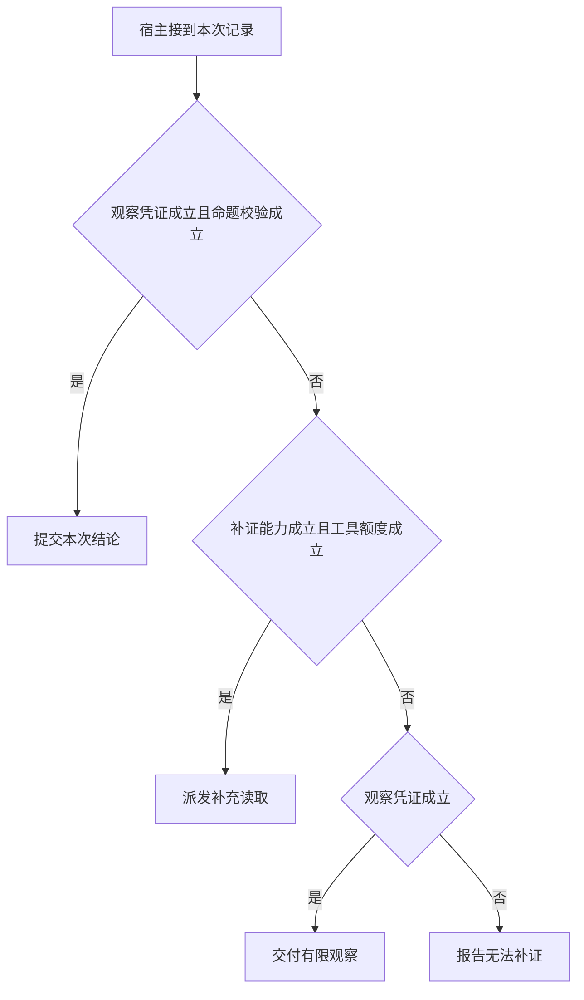

# 观察何时值得触发下一次模型调用

将相同用户请求的第一份工具结果从有效时段换成空缺。
若后续总是生成同一个肯定答复，就算程序里有 while 也未利用反馈。
本例把知识缺口和取得新知识的代价分开。

本篇用一个封闭的教学决策器说明这一问题。输入是宿主收到的记录，不保证每个下游字段都已经获准使用。前置检查未成立时，下游即使带着缓存值，也不能拿来作业务断言。

## 先解决一个具体问题

**程序写了 while，怎么证明它利用了观察？**

保留同一请求与第一步动作，把成功读取换成超时。
第二步若仍提交相同肯定断言，就没有满足反馈契约。
随后用真实模型与未见问法再测策略适应性。


先取一个能走到「报告无法补证」的输入：只有尚未执行的提议、候选与领域条件冲突、目前没有补证来源、下游尝试额度不足。
把这四个条件代回后文的图，前面各个拦截分支都未满足，最终才有“无证据也无可执行补查”这个判断。
还原这个现场时要分别问：哪些位来自可信状态，哪些只是在接口中出现、尚未获得解释资格的字段。

## 先沿一次决策走到底



从上到下取第一条成立的出口。只改一个开关时，只有它之前的检查都未截断，该变化才可能到达真实动作。

“观察凭证”的两种输入分别是“已有本轮业务回执”与“只有尚未执行的提议”。
模型的调用提议不能证明应用已取得新事实。

“命题校验”的两种输入分别是“候选通过业务断言”与“候选与领域条件冲突”。
有正确的引用编号仍可能推断出错误结论。

“补证能力”的两种输入分别是“有可区分解释的只读来源”与“目前没有补证来源”。
继续请求模型不能自行创造缺失的外部证据。

“工具额度”的两种输入分别是“可预留本次尝试额度”与“下游尝试额度不足”。
实际投递之前要核算重试或整批调用所需资源。

## 最少需要哪几项观察

### 提交本次结论

当前命题已有证据支持。
在本节的全部组合中，有 4 种产生「提交本次结论」，这只是逻辑空间的计数，不能当作实际用户请求的比例。

只取得已有本轮业务回执、候选通过业务断言，已经足以要求宿主「提交本次结论」。
保持这些已知项，其余开关自由变化，仍有 4 种补全，判断没有翻转。

若删掉关于观察凭证的证据，另一份允许的现场是只有尚未执行的提议、候选通过业务断言、目前没有补证来源、下游尝试额度不足，它会使宿主「报告无法补证」。

若删掉关于命题校验的证据，另一份允许的现场是已有本轮业务回执、候选与领域条件冲突、目前没有补证来源、下游尝试额度不足，它会使宿主「交付有限观察」。

### 派发补充读取

还存在有效信息来源和额度。
在本节的全部组合中，有 3 种产生「派发补充读取」，这只是逻辑空间的计数，不能当作实际用户请求的比例。

只取得只有尚未执行的提议、有可区分解释的只读来源、可预留本次尝试额度，已经足以要求宿主「派发补充读取」。
保持这些已知项，其余开关自由变化，仍有 2 种补全，判断没有翻转。

若删掉关于观察凭证的证据，另一份允许的现场是已有本轮业务回执、候选通过业务断言、有可区分解释的只读来源、可预留本次尝试额度，它会使宿主「提交本次结论」。

若删掉关于补证能力的证据，另一份允许的现场是只有尚未执行的提议、候选与领域条件冲突、目前没有补证来源、可预留本次尝试额度，它会使宿主「报告无法补证」。

若删掉关于工具额度的证据，另一份允许的现场是只有尚未执行的提议、候选与领域条件冲突、有可区分解释的只读来源、下游尝试额度不足，它会使宿主「报告无法补证」。

只取得候选与领域条件冲突、有可区分解释的只读来源、可预留本次尝试额度，已经足以要求宿主「派发补充读取」。

若删掉关于命题校验的证据，另一份允许的现场是已有本轮业务回执、候选通过业务断言、有可区分解释的只读来源、可预留本次尝试额度，它会使宿主「提交本次结论」。


### 交付有限观察

有事实但不足以证明完整结论。
在本节的全部组合中，有 3 种产生「交付有限观察」，这只是逻辑空间的计数，不能当作实际用户请求的比例。

只取得已有本轮业务回执、候选与领域条件冲突、目前没有补证来源，已经足以要求宿主「交付有限观察」。

若删掉关于观察凭证的证据，另一份允许的现场是只有尚未执行的提议、候选与领域条件冲突、目前没有补证来源、下游尝试额度不足，它会使宿主「报告无法补证」。

若删掉关于命题校验的证据，另一份允许的现场是已有本轮业务回执、候选通过业务断言、目前没有补证来源、下游尝试额度不足，它会使宿主「提交本次结论」。

若删掉关于补证能力的证据，另一份允许的现场是已有本轮业务回执、候选与领域条件冲突、有可区分解释的只读来源、可预留本次尝试额度，它会使宿主「派发补充读取」。

只取得已有本轮业务回执、候选与领域条件冲突、下游尝试额度不足，已经足以要求宿主「交付有限观察」。


若删掉关于工具额度的证据，另一份允许的现场是已有本轮业务回执、候选与领域条件冲突、有可区分解释的只读来源、可预留本次尝试额度，它会使宿主「派发补充读取」。

### 报告无法补证

无证据也无可执行补查。
在本节的全部组合中，有 6 种产生「报告无法补证」，这只是逻辑空间的计数，不能当作实际用户请求的比例。

只取得只有尚未执行的提议、目前没有补证来源，已经足以要求宿主「报告无法补证」。

若删掉关于观察凭证的证据，另一份允许的现场是已有本轮业务回执、候选与领域条件冲突、目前没有补证来源、下游尝试额度不足，它会使宿主「交付有限观察」。

若删掉关于补证能力的证据，另一份允许的现场是只有尚未执行的提议、候选与领域条件冲突、有可区分解释的只读来源、可预留本次尝试额度，它会使宿主「派发补充读取」。

只取得只有尚未执行的提议、下游尝试额度不足，已经足以要求宿主「报告无法补证」。


若删掉关于工具额度的证据，另一份允许的现场是只有尚未执行的提议、候选与领域条件冲突、有可区分解释的只读来源、可预留本次尝试额度，它会使宿主「派发补充读取」。

## 以同一份契约解释截然不同的现场

<details>
<summary>展开推演与对应反例</summary>

下列样本按最先命中的业务分支排列。四位编码只作本篇页内定位，顺序与开头的四项输入一致。可以先猜下一动作，再展开相邻样本。

### 能够触发“提交本次结论”的现场

**样本 1100**

业务侧交来已有本轮业务回执、候选通过业务断言，执行侧还记录了目前没有补证来源、下游尝试额度不足。
把样本压成最短证明，保留已有本轮业务回执、候选通过业务断言就能支持「提交本次结论」。

在这份记录上，分别翻转「观察凭证」、「命题校验」中的任一项，其他项完全不变时，下一动作都会改变。

保持其余观察不动，单独切换「补证能力」、「工具额度」仍得到「提交本次结论」，它们在这个现场不是决定性变量。

要从本例改走「报告无法补证」，至少需要变动 1 项，一组最少改动是将已有本轮业务回执换成只有尚未执行的提议。

要从本例改走「交付有限观察」，至少需要变动 1 项，一组最少改动是将候选通过业务断言换成候选与领域条件冲突。

要从本例改走「派发补充读取」，至少需要变动 3 项，一组最少改动是将已有本轮业务回执、目前没有补证来源、下游尝试额度不足换成只有尚未执行的提议、有可区分解释的只读来源、可预留本次尝试额度。

**样本 1101**

业务侧交来已有本轮业务回执、候选通过业务断言，执行侧还记录了目前没有补证来源、可预留本次尝试额度。


要从本例改走「派发补充读取」，至少需要变动 2 项，一组最少改动是将已有本轮业务回执、目前没有补证来源换成只有尚未执行的提议、有可区分解释的只读来源。

**样本 1110**

业务侧交来已有本轮业务回执、候选通过业务断言，执行侧还记录了有可区分解释的只读来源、下游尝试额度不足。


要从本例改走「派发补充读取」，至少需要变动 2 项，一组最少改动是将已有本轮业务回执、下游尝试额度不足换成只有尚未执行的提议、可预留本次尝试额度。

**样本 1111**

业务侧交来已有本轮业务回执、候选通过业务断言，执行侧还记录了有可区分解释的只读来源、可预留本次尝试额度。


要从本例改走「派发补充读取」，至少需要变动 1 项，一组最少改动是将已有本轮业务回执换成只有尚未执行的提议。

要从本例改走「报告无法补证」，至少需要变动 2 项，一组最少改动是将已有本轮业务回执、有可区分解释的只读来源换成只有尚未执行的提议、目前没有补证来源。

要从本例改走「交付有限观察」，至少需要变动 2 项，一组最少改动是将候选通过业务断言、有可区分解释的只读来源换成候选与领域条件冲突、目前没有补证来源。

### 能够触发“派发补充读取”的现场

**样本 0011**

业务侧交来只有尚未执行的提议、候选与领域条件冲突，执行侧还记录了有可区分解释的只读来源、可预留本次尝试额度。
把样本压成最短证明，保留只有尚未执行的提议、有可区分解释的只读来源、可预留本次尝试额度就能支持「派发补充读取」。

在这份记录上，分别翻转「补证能力」、「工具额度」中的任一项，其他项完全不变时，下一动作都会改变。

保持其余观察不动，单独切换「观察凭证」、「命题校验」仍得到「派发补充读取」，它们在这个现场不是决定性变量。

本例没走更靠前的「提交本次结论」，因为只有尚未执行的提议、候选与领域条件冲突与那个入口的必要条件不符。

要从本例改走「报告无法补证」，至少需要变动 1 项，一组最少改动是将有可区分解释的只读来源换成目前没有补证来源。

要从本例改走「交付有限观察」，至少需要变动 2 项，一组最少改动是将只有尚未执行的提议、有可区分解释的只读来源换成已有本轮业务回执、目前没有补证来源。

要从本例改走「提交本次结论」，至少需要变动 2 项，一组最少改动是将只有尚未执行的提议、候选与领域条件冲突换成已有本轮业务回执、候选通过业务断言。

**样本 0111**

业务侧交来只有尚未执行的提议、候选通过业务断言，执行侧还记录了有可区分解释的只读来源、可预留本次尝试额度。

在这份记录上，分别翻转「观察凭证」、「补证能力」、「工具额度」中的任一项，其他项完全不变时，下一动作都会改变。

保持其余观察不动，单独切换「命题校验」仍得到「派发补充读取」，它们在这个现场不是决定性变量。

本例没走更靠前的「提交本次结论」，因为只有尚未执行的提议与那个入口的必要条件不符。


要从本例改走「提交本次结论」，至少需要变动 1 项，一组最少改动是将只有尚未执行的提议换成已有本轮业务回执。

要从本例改走「交付有限观察」，至少需要变动 3 项，一组最少改动是将只有尚未执行的提议、候选通过业务断言、有可区分解释的只读来源换成已有本轮业务回执、候选与领域条件冲突、目前没有补证来源。

**样本 1011**

业务侧交来已有本轮业务回执、候选与领域条件冲突，执行侧还记录了有可区分解释的只读来源、可预留本次尝试额度。
把样本压成最短证明，保留候选与领域条件冲突、有可区分解释的只读来源、可预留本次尝试额度就能支持「派发补充读取」。

在这份记录上，分别翻转「命题校验」、「补证能力」、「工具额度」中的任一项，其他项完全不变时，下一动作都会改变。

保持其余观察不动，单独切换「观察凭证」仍得到「派发补充读取」，它们在这个现场不是决定性变量。

本例没走更靠前的「提交本次结论」，因为候选与领域条件冲突与那个入口的必要条件不符。

要从本例改走「交付有限观察」，至少需要变动 1 项，一组最少改动是将有可区分解释的只读来源换成目前没有补证来源。

要从本例改走「提交本次结论」，至少需要变动 1 项，一组最少改动是将候选与领域条件冲突换成候选通过业务断言。


### 能够触发“交付有限观察”的现场

**样本 1000**

业务侧交来已有本轮业务回执、候选与领域条件冲突，执行侧还记录了目前没有补证来源、下游尝试额度不足。
把样本压成最短证明，保留已有本轮业务回执、候选与领域条件冲突、目前没有补证来源就能支持「交付有限观察」。


保持其余观察不动，单独切换「补证能力」、「工具额度」仍得到「交付有限观察」，它们在这个现场不是决定性变量。


本例没走更靠前的「派发补充读取」，因为目前没有补证来源、下游尝试额度不足与那个入口的必要条件不符。


要从本例改走「派发补充读取」，至少需要变动 2 项，一组最少改动是将目前没有补证来源、下游尝试额度不足换成有可区分解释的只读来源、可预留本次尝试额度。

**样本 1001**

业务侧交来已有本轮业务回执、候选与领域条件冲突，执行侧还记录了目前没有补证来源、可预留本次尝试额度。

在这份记录上，分别翻转「观察凭证」、「命题校验」、「补证能力」中的任一项，其他项完全不变时，下一动作都会改变。

保持其余观察不动，单独切换「工具额度」仍得到「交付有限观察」，它们在这个现场不是决定性变量。


本例没走更靠前的「派发补充读取」，因为目前没有补证来源与那个入口的必要条件不符。


要从本例改走「派发补充读取」，至少需要变动 1 项，一组最少改动是将目前没有补证来源换成有可区分解释的只读来源。


**样本 1010**

业务侧交来已有本轮业务回执、候选与领域条件冲突，执行侧还记录了有可区分解释的只读来源、下游尝试额度不足。
把样本压成最短证明，保留已有本轮业务回执、候选与领域条件冲突、下游尝试额度不足就能支持「交付有限观察」。

在这份记录上，分别翻转「观察凭证」、「命题校验」、「工具额度」中的任一项，其他项完全不变时，下一动作都会改变。

保持其余观察不动，单独切换「补证能力」仍得到「交付有限观察」，它们在这个现场不是决定性变量。


本例没走更靠前的「派发补充读取」，因为下游尝试额度不足与那个入口的必要条件不符。


要从本例改走「派发补充读取」，至少需要变动 1 项，一组最少改动是将下游尝试额度不足换成可预留本次尝试额度。


### 能够触发“报告无法补证”的现场

**样本 0000**

业务侧交来只有尚未执行的提议、候选与领域条件冲突，执行侧还记录了目前没有补证来源、下游尝试额度不足。
把样本压成最短证明，保留只有尚未执行的提议、目前没有补证来源就能支持「报告无法补证」。

在这份记录上，分别翻转「观察凭证」中的任一项，其他项完全不变时，下一动作都会改变。

保持其余观察不动，单独切换「命题校验」、「补证能力」、「工具额度」仍得到「报告无法补证」，它们在这个现场不是决定性变量。


本例没走更靠前的「交付有限观察」，因为只有尚未执行的提议与那个入口的必要条件不符。

要从本例改走「交付有限观察」，至少需要变动 1 项，一组最少改动是将只有尚未执行的提议换成已有本轮业务回执。


**样本 0001**

业务侧交来只有尚未执行的提议、候选与领域条件冲突，执行侧还记录了目前没有补证来源、可预留本次尝试额度。

在这份记录上，分别翻转「观察凭证」、「补证能力」中的任一项，其他项完全不变时，下一动作都会改变。

保持其余观察不动，单独切换「命题校验」、「工具额度」仍得到「报告无法补证」，它们在这个现场不是决定性变量。


**样本 0010**

业务侧交来只有尚未执行的提议、候选与领域条件冲突，执行侧还记录了有可区分解释的只读来源、下游尝试额度不足。
把样本压成最短证明，保留只有尚未执行的提议、下游尝试额度不足就能支持「报告无法补证」。

在这份记录上，分别翻转「观察凭证」、「工具额度」中的任一项，其他项完全不变时，下一动作都会改变。

保持其余观察不动，单独切换「命题校验」、「补证能力」仍得到「报告无法补证」，它们在这个现场不是决定性变量。


**样本 0100**

业务侧交来只有尚未执行的提议、候选通过业务断言，执行侧还记录了目前没有补证来源、下游尝试额度不足。


要从本例改走「交付有限观察」，至少需要变动 2 项，一组最少改动是将只有尚未执行的提议、候选通过业务断言换成已有本轮业务回执、候选与领域条件冲突。

**样本 0101**

业务侧交来只有尚未执行的提议、候选通过业务断言，执行侧还记录了目前没有补证来源、可预留本次尝试额度。


**样本 0110**

业务侧交来只有尚未执行的提议、候选通过业务断言，执行侧还记录了有可区分解释的只读来源、下游尝试额度不足。


</details>

## 当你只能看见一半记录

<details>
<summary>展开推演与对应反例</summary>

这次隐藏两个字段，保留另两个。对每个可见现场，检查四种合法补全是否同意。如仍有歧义，选择能使最坏剩余候选动作最少的字段继续查。并列时采用本篇字段顺序。

### 只保留观察凭证与命题校验

已知只有尚未执行的提议、候选与领域条件冲突时，四种补全的动作分布为派发补充读取（1 种）、报告无法补证（3 种）。

在只有尚未执行的提议、候选与领域条件冲突这个现场补读「补证能力」，最坏还剩 2 种动作，计算时只衡量歧义，尚未扣读取代价。
若补来的观察为“目前没有补证来源”，范围缩成「报告无法补证」。若为“有可区分解释的只读来源”，则保留「报告无法补证」、「派发补充读取」。

区分不了的两条执行可以具体写成 0000 与 0011：它们共享已展示字段，却分别需要「报告无法补证」和「派发补充读取」。

已知只有尚未执行的提议、候选通过业务断言时，四种补全的动作分布为派发补充读取（1 种）、报告无法补证（3 种）。

在只有尚未执行的提议、候选通过业务断言这个现场补读「补证能力」，最坏还剩 2 种动作，计算时只衡量歧义，尚未扣读取代价。

区分不了的两条执行可以具体写成 0100 与 0111：它们共享已展示字段，却分别需要「报告无法补证」和「派发补充读取」。

已知已有本轮业务回执、候选与领域条件冲突时，四种补全的动作分布为派发补充读取（1 种）、交付有限观察（3 种）。

在已有本轮业务回执、候选与领域条件冲突这个现场补读「补证能力」，最坏还剩 2 种动作，计算时只衡量歧义，尚未扣读取代价。
若补来的观察为“目前没有补证来源”，范围缩成「交付有限观察」。若为“有可区分解释的只读来源”，则保留「交付有限观察」、「派发补充读取」。

区分不了的两条执行可以具体写成 1000 与 1011：它们共享已展示字段，却分别需要「交付有限观察」和「派发补充读取」。

已知已有本轮业务回执、候选通过业务断言时，四种补全的动作分布为提交本次结论（4 种）。

就“提交本次结论”这个动作而言，在已有本轮业务回执、候选通过业务断言的前提下，另外两项观察不会推翻它。

### 只保留观察凭证与补证能力

已知只有尚未执行的提议、目前没有补证来源时，四种补全的动作分布为报告无法补证（4 种）。

就“报告无法补证”这个动作而言，在只有尚未执行的提议、目前没有补证来源的前提下，另外两项观察不会推翻它。

已知只有尚未执行的提议、有可区分解释的只读来源时，四种补全的动作分布为派发补充读取（2 种）、报告无法补证（2 种）。

在只有尚未执行的提议、有可区分解释的只读来源这个现场补读「工具额度」，最坏还剩 1 种动作，计算时只衡量歧义，尚未扣读取代价。
若补来的观察为“下游尝试额度不足”，范围缩成「报告无法补证」。若为“可预留本次尝试额度”，则保留「派发补充读取」。

区分不了的两条执行可以具体写成 0010 与 0011：它们共享已展示字段，却分别需要「报告无法补证」和「派发补充读取」。

已知已有本轮业务回执、目前没有补证来源时，四种补全的动作分布为提交本次结论（2 种）、交付有限观察（2 种）。

在已有本轮业务回执、目前没有补证来源这个现场补读「命题校验」，最坏还剩 1 种动作，计算时只衡量歧义，尚未扣读取代价。
若补来的观察为“候选与领域条件冲突”，范围缩成「交付有限观察」。若为“候选通过业务断言”，则保留「提交本次结论」。

区分不了的两条执行可以具体写成 1000 与 1100：它们共享已展示字段，却分别需要「交付有限观察」和「提交本次结论」。

已知已有本轮业务回执、有可区分解释的只读来源时，四种补全的动作分布为提交本次结论（2 种）、派发补充读取（1 种）、交付有限观察（1 种）。

在已有本轮业务回执、有可区分解释的只读来源这个现场补读「命题校验」，最坏还剩 2 种动作，计算时只衡量歧义，尚未扣读取代价。
若补来的观察为“候选与领域条件冲突”，范围缩成「交付有限观察」、「派发补充读取」。若为“候选通过业务断言”，则保留「提交本次结论」。

区分不了的两条执行可以具体写成 1010 与 1011：它们共享已展示字段，却分别需要「交付有限观察」和「派发补充读取」。

### 只保留命题校验与补证能力

已知候选与领域条件冲突、目前没有补证来源时，四种补全的动作分布为交付有限观察（2 种）、报告无法补证（2 种）。

在候选与领域条件冲突、目前没有补证来源这个现场补读「观察凭证」，最坏还剩 1 种动作，计算时只衡量歧义，尚未扣读取代价。
若补来的观察为“只有尚未执行的提议”，范围缩成「报告无法补证」。若为“已有本轮业务回执”，则保留「交付有限观察」。

区分不了的两条执行可以具体写成 0000 与 1000：它们共享已展示字段，却分别需要「报告无法补证」和「交付有限观察」。

已知候选与领域条件冲突、有可区分解释的只读来源时，四种补全的动作分布为派发补充读取（2 种）、交付有限观察（1 种）、报告无法补证（1 种）。

在候选与领域条件冲突、有可区分解释的只读来源这个现场补读「观察凭证」，最坏还剩 2 种动作，计算时只衡量歧义，尚未扣读取代价。
若补来的观察为“只有尚未执行的提议”，范围缩成「报告无法补证」、「派发补充读取」。若为“已有本轮业务回执”，则保留「交付有限观察」、「派发补充读取」。


已知候选通过业务断言、目前没有补证来源时，四种补全的动作分布为提交本次结论（2 种）、报告无法补证（2 种）。

在候选通过业务断言、目前没有补证来源这个现场补读「观察凭证」，最坏还剩 1 种动作，计算时只衡量歧义，尚未扣读取代价。
若补来的观察为“只有尚未执行的提议”，范围缩成「报告无法补证」。若为“已有本轮业务回执”，则保留「提交本次结论」。

区分不了的两条执行可以具体写成 0100 与 1100：它们共享已展示字段，却分别需要「报告无法补证」和「提交本次结论」。

已知候选通过业务断言、有可区分解释的只读来源时，四种补全的动作分布为提交本次结论（2 种）、派发补充读取（1 种）、报告无法补证（1 种）。

在候选通过业务断言、有可区分解释的只读来源这个现场补读「观察凭证」，最坏还剩 2 种动作，计算时只衡量歧义，尚未扣读取代价。
若补来的观察为“只有尚未执行的提议”，范围缩成「报告无法补证」、「派发补充读取」。若为“已有本轮业务回执”，则保留「提交本次结论」。

区分不了的两条执行可以具体写成 0110 与 0111：它们共享已展示字段，却分别需要「报告无法补证」和「派发补充读取」。

### 只保留观察凭证与工具额度

已知只有尚未执行的提议、下游尝试额度不足时，四种补全的动作分布为报告无法补证（4 种）。

就“报告无法补证”这个动作而言，在只有尚未执行的提议、下游尝试额度不足的前提下，另外两项观察不会推翻它。

已知只有尚未执行的提议、可预留本次尝试额度时，四种补全的动作分布为派发补充读取（2 种）、报告无法补证（2 种）。

在只有尚未执行的提议、可预留本次尝试额度这个现场补读「补证能力」，最坏还剩 1 种动作，计算时只衡量歧义，尚未扣读取代价。
若补来的观察为“目前没有补证来源”，范围缩成「报告无法补证」。若为“有可区分解释的只读来源”，则保留「派发补充读取」。

区分不了的两条执行可以具体写成 0001 与 0011：它们共享已展示字段，却分别需要「报告无法补证」和「派发补充读取」。

已知已有本轮业务回执、下游尝试额度不足时，四种补全的动作分布为提交本次结论（2 种）、交付有限观察（2 种）。

在已有本轮业务回执、下游尝试额度不足这个现场补读「命题校验」，最坏还剩 1 种动作，计算时只衡量歧义，尚未扣读取代价。


已知已有本轮业务回执、可预留本次尝试额度时，四种补全的动作分布为提交本次结论（2 种）、派发补充读取（1 种）、交付有限观察（1 种）。

在已有本轮业务回执、可预留本次尝试额度这个现场补读「命题校验」，最坏还剩 2 种动作，计算时只衡量歧义，尚未扣读取代价。

区分不了的两条执行可以具体写成 1001 与 1011：它们共享已展示字段，却分别需要「交付有限观察」和「派发补充读取」。

### 只保留命题校验与工具额度

已知候选与领域条件冲突、下游尝试额度不足时，四种补全的动作分布为交付有限观察（2 种）、报告无法补证（2 种）。

在候选与领域条件冲突、下游尝试额度不足这个现场补读「观察凭证」，最坏还剩 1 种动作，计算时只衡量歧义，尚未扣读取代价。


已知候选与领域条件冲突、可预留本次尝试额度时，四种补全的动作分布为派发补充读取（2 种）、交付有限观察（1 种）、报告无法补证（1 种）。

在候选与领域条件冲突、可预留本次尝试额度这个现场补读「观察凭证」，最坏还剩 2 种动作，计算时只衡量歧义，尚未扣读取代价。


已知候选通过业务断言、下游尝试额度不足时，四种补全的动作分布为提交本次结论（2 种）、报告无法补证（2 种）。

在候选通过业务断言、下游尝试额度不足这个现场补读「观察凭证」，最坏还剩 1 种动作，计算时只衡量歧义，尚未扣读取代价。


已知候选通过业务断言、可预留本次尝试额度时，四种补全的动作分布为提交本次结论（2 种）、派发补充读取（1 种）、报告无法补证（1 种）。

在候选通过业务断言、可预留本次尝试额度这个现场补读「观察凭证」，最坏还剩 2 种动作，计算时只衡量歧义，尚未扣读取代价。

区分不了的两条执行可以具体写成 0101 与 0111：它们共享已展示字段，却分别需要「报告无法补证」和「派发补充读取」。

### 只保留补证能力与工具额度

已知目前没有补证来源、下游尝试额度不足时，四种补全的动作分布为提交本次结论（1 种）、交付有限观察（1 种）、报告无法补证（2 种）。

在目前没有补证来源、下游尝试额度不足这个现场补读「观察凭证」，最坏还剩 2 种动作，计算时只衡量歧义，尚未扣读取代价。
若补来的观察为“只有尚未执行的提议”，范围缩成「报告无法补证」。若为“已有本轮业务回执”，则保留「交付有限观察」、「提交本次结论」。


已知目前没有补证来源、可预留本次尝试额度时，四种补全的动作分布为提交本次结论（1 种）、交付有限观察（1 种）、报告无法补证（2 种）。

在目前没有补证来源、可预留本次尝试额度这个现场补读「观察凭证」，最坏还剩 2 种动作，计算时只衡量歧义，尚未扣读取代价。

区分不了的两条执行可以具体写成 0001 与 1001：它们共享已展示字段，却分别需要「报告无法补证」和「交付有限观察」。

已知有可区分解释的只读来源、下游尝试额度不足时，四种补全的动作分布为提交本次结论（1 种）、交付有限观察（1 种）、报告无法补证（2 种）。

在有可区分解释的只读来源、下游尝试额度不足这个现场补读「观察凭证」，最坏还剩 2 种动作，计算时只衡量歧义，尚未扣读取代价。

区分不了的两条执行可以具体写成 0010 与 1010：它们共享已展示字段，却分别需要「报告无法补证」和「交付有限观察」。

已知有可区分解释的只读来源、可预留本次尝试额度时，四种补全的动作分布为提交本次结论（1 种）、派发补充读取（3 种）。

在有可区分解释的只读来源、可预留本次尝试额度这个现场补读「观察凭证」，最坏还剩 2 种动作，计算时只衡量歧义，尚未扣读取代价。
若补来的观察为“只有尚未执行的提议”，范围缩成「派发补充读取」。若为“已有本轮业务回执”，则保留「派发补充读取」、「提交本次结论」。

区分不了的两条执行可以具体写成 0011 与 1111：它们共享已展示字段，却分别需要「派发补充读取」和「提交本次结论」。

</details>

## 单因素干预与边界测试

<details>
<summary>展开推演与对应反例</summary>

### 只改变观察凭证

固定另外三个条件得到八对现场，从“只有尚未执行的提议”转为“已有本轮业务回执”时，7 对翻转动作，另外 1 对保持不变。

有 3 对现场沿「报告无法补证」变到「交付有限观察」，可复现的一组受控背景为候选与领域条件冲突、目前没有补证来源、下游尝试额度不足。

令候选与领域条件冲突、有可区分解释的只读来源、可预留本次尝试额度，观察凭证的两个取值均得到「派发补充读取」。在八对中，共有 1 对表现为这一种稳定出口。

有 3 对现场沿「报告无法补证」变到「提交本次结论」，可复现的一组受控背景为候选通过业务断言、目前没有补证来源、下游尝试额度不足。

有 1 对现场沿「派发补充读取」变到「提交本次结论」，可复现的一组受控背景为候选通过业务断言、有可区分解释的只读来源、可预留本次尝试额度。

### 只改变命题校验

固定另外三个条件得到八对现场，从“候选与领域条件冲突”转为“候选通过业务断言”时，4 对翻转动作，另外 4 对保持不变。

令只有尚未执行的提议、目前没有补证来源、下游尝试额度不足，命题校验的两个取值均得到「报告无法补证」。在八对中，共有 3 对表现为这一种稳定出口。

令只有尚未执行的提议、有可区分解释的只读来源、可预留本次尝试额度，命题校验的两个取值均得到「派发补充读取」。在八对中，共有 1 对表现为这一种稳定出口。

有 3 对现场沿「交付有限观察」变到「提交本次结论」，可复现的一组受控背景为已有本轮业务回执、目前没有补证来源、下游尝试额度不足。

有 1 对现场沿「派发补充读取」变到「提交本次结论」，可复现的一组受控背景为已有本轮业务回执、有可区分解释的只读来源、可预留本次尝试额度。

### 只改变补证能力

固定另外三个条件得到八对现场，从“目前没有补证来源”转为“有可区分解释的只读来源”时，3 对翻转动作，另外 5 对保持不变。

令只有尚未执行的提议、候选与领域条件冲突、下游尝试额度不足，补证能力的两个取值均得到「报告无法补证」。在八对中，共有 2 对表现为这一种稳定出口。

有 2 对现场沿「报告无法补证」变到「派发补充读取」，可复现的一组受控背景为只有尚未执行的提议、候选与领域条件冲突、可预留本次尝试额度。

令已有本轮业务回执、候选与领域条件冲突、下游尝试额度不足，补证能力的两个取值均得到「交付有限观察」。在八对中，共有 1 对表现为这一种稳定出口。

有 1 对现场沿「交付有限观察」变到「派发补充读取」，可复现的一组受控背景为已有本轮业务回执、候选与领域条件冲突、可预留本次尝试额度。

令已有本轮业务回执、候选通过业务断言、下游尝试额度不足，补证能力的两个取值均得到「提交本次结论」。在八对中，共有 2 对表现为这一种稳定出口。

### 只改变工具额度

固定另外三个条件得到八对现场，从“下游尝试额度不足”转为“可预留本次尝试额度”时，3 对翻转动作，另外 5 对保持不变。

令只有尚未执行的提议、候选与领域条件冲突、目前没有补证来源，工具额度的两个取值均得到「报告无法补证」。在八对中，共有 2 对表现为这一种稳定出口。

有 2 对现场沿「报告无法补证」变到「派发补充读取」，可复现的一组受控背景为只有尚未执行的提议、候选与领域条件冲突、有可区分解释的只读来源。

令已有本轮业务回执、候选与领域条件冲突、目前没有补证来源，工具额度的两个取值均得到「交付有限观察」。在八对中，共有 1 对表现为这一种稳定出口。

有 1 对现场沿「交付有限观察」变到「派发补充读取」，可复现的一组受控背景为已有本轮业务回执、候选与领域条件冲突、有可区分解释的只读来源。

令已有本轮业务回执、候选通过业务断言、目前没有补证来源，工具额度的两个取值均得到「提交本次结论」。在八对中，共有 2 对表现为这一种稳定出口。

</details>

## 哪些回归样本真能抓住实现错误

<details>
<summary>展开推演与对应反例</summary>

如果删除“提交本次结论”这个分支，在本篇 16 种输入里有 4 种会改走另一出口。

反例 1100 的完整记录为已有本轮业务回执、候选通过业务断言、目前没有补证来源、下游尝试额度不足。正确结果是「提交本次结论」，这个改坏的实现却给出「交付有限观察」。

如果删除“派发补充读取”这个分支，在本篇 16 种输入里有 3 种会改走另一出口。

反例 0011 的完整记录为只有尚未执行的提议、候选与领域条件冲突、有可区分解释的只读来源、可预留本次尝试额度。正确结果是「派发补充读取」，这个改坏的实现却给出「报告无法补证」。

如果删除“交付有限观察”这个分支，在本篇 16 种输入里有 3 种会改走另一出口。

反例 1000 的完整记录为已有本轮业务回执、候选与领域条件冲突、目前没有补证来源、下游尝试额度不足。正确结果是「交付有限观察」，这个改坏的实现却给出「报告无法补证」。

如果交换“提交本次结论”和“派发补充读取”的判断次序，在本篇 16 种输入里有 1 种会改走另一出口。

反例 1111 的完整记录为已有本轮业务回执、候选通过业务断言、有可区分解释的只读来源、可预留本次尝试额度。正确结果是「提交本次结论」，这个改坏的实现却给出「派发补充读取」。

如果交换“派发补充读取”和“交付有限观察”的判断次序，在本篇 16 种输入里有 1 种会改走另一出口。

反例 1011 的完整记录为已有本轮业务回执、候选与领域条件冲突、有可区分解释的只读来源、可预留本次尝试额度。正确结果是「派发补充读取」，这个改坏的实现却给出「交付有限观察」。

补入样本 1011（已有本轮业务回执、候选与领域条件冲突、有可区分解释的只读来源、可预留本次尝试额度）能新增检出「删除“派发补充读取”这个分支」、「交换“派发补充读取”和“交付有限观察”的判断次序」。

补入样本 1111（已有本轮业务回执、候选通过业务断言、有可区分解释的只读来源、可预留本次尝试额度）能新增检出「删除“提交本次结论”这个分支」、「交换“提交本次结论”和“派发补充读取”的判断次序」。

补入样本 1000（已有本轮业务回执、候选与领域条件冲突、目前没有补证来源、下游尝试额度不足）能新增检出「删除“交付有限观察”这个分支」。

这里每次选覆盖尚未捕获缺陷最多的样本，并不保证用例数全局最小。它给出的反例能作为 Java 单测输入。真实模型是否会自主产生这些提议，仍须单独评测。

</details>

## 把状态覆盖换成有抽样偏差的评测批次

<details>
<summary>展开推演与对应反例</summary>

前面的十六种记录各有一票。现在只改样本构成：对一个给定字段，把成立侧的每种记录各取三份、另一侧各取一份。这是人为配比的 32 份回放，不是线上频率估计。
将偏向成立与偏向不成立的两次批次对照，可以隔离分母变化。底层宿主和所有答案保持相同，比例仍可能移动。

### 改变“观察凭证”的样本配比

只看「提交本次结论」，在已有本轮业务回执的八个不同输入中有 4 个命中，在只有尚未执行的提议的另八个输入中有 0 个命中。
把「观察凭证」成立侧按三倍取样，「提交本次结论」占 12/32，反过来向未成立侧倾斜后占 4/32。
这次重加权使「提交本次结论」的占比相差 25 个百分点。若按两种不同的“观察凭证”分布跑新旧版，不能把这项差异全部归功于实现。

只看「派发补充读取」，在已有本轮业务回执的八个不同输入中有 1 个命中，在只有尚未执行的提议的另八个输入中有 2 个命中。
把「观察凭证」成立侧按三倍取样，「派发补充读取」占 5/32，反过来向未成立侧倾斜后占 7/32。
这次重加权使「派发补充读取」的占比相差 6.25 个百分点。若按两种不同的“观察凭证”分布跑新旧版，不能把这项差异全部归功于实现。

只看「交付有限观察」，在已有本轮业务回执的八个不同输入中有 3 个命中，在只有尚未执行的提议的另八个输入中有 0 个命中。
把「观察凭证」成立侧按三倍取样，「交付有限观察」占 9/32，反过来向未成立侧倾斜后占 3/32。
这次重加权使「交付有限观察」的占比相差 18.75 个百分点。若按两种不同的“观察凭证”分布跑新旧版，不能把这项差异全部归功于实现。

只看「报告无法补证」，在已有本轮业务回执的八个不同输入中有 0 个命中，在只有尚未执行的提议的另八个输入中有 6 个命中。
把「观察凭证」成立侧按三倍取样，「报告无法补证」占 6/32，反过来向未成立侧倾斜后占 18/32。
这次重加权使「报告无法补证」的占比相差 37.5 个百分点。若按两种不同的“观察凭证”分布跑新旧版，不能把这项差异全部归功于实现。

### 改变“命题校验”的样本配比

只看「提交本次结论」，在候选通过业务断言的八个不同输入中有 4 个命中，在候选与领域条件冲突的另八个输入中有 0 个命中。
把「命题校验」成立侧按三倍取样，「提交本次结论」占 12/32，反过来向未成立侧倾斜后占 4/32。
这次重加权使「提交本次结论」的占比相差 25 个百分点。若按两种不同的“命题校验”分布跑新旧版，不能把这项差异全部归功于实现。

只看「派发补充读取」，在候选通过业务断言的八个不同输入中有 1 个命中，在候选与领域条件冲突的另八个输入中有 2 个命中。
把「命题校验」成立侧按三倍取样，「派发补充读取」占 5/32，反过来向未成立侧倾斜后占 7/32。
这次重加权使「派发补充读取」的占比相差 6.25 个百分点。若按两种不同的“命题校验”分布跑新旧版，不能把这项差异全部归功于实现。

只看「交付有限观察」，在候选通过业务断言的八个不同输入中有 0 个命中，在候选与领域条件冲突的另八个输入中有 3 个命中。
把「命题校验」成立侧按三倍取样，「交付有限观察」占 3/32，反过来向未成立侧倾斜后占 9/32。
这次重加权使「交付有限观察」的占比相差 18.75 个百分点。若按两种不同的“命题校验”分布跑新旧版，不能把这项差异全部归功于实现。

只看「报告无法补证」，在候选通过业务断言的八个不同输入中有 3 个命中，在候选与领域条件冲突的另八个输入中有 3 个命中。
把「命题校验」成立侧按三倍取样，「报告无法补证」占 12/32，反过来向未成立侧倾斜后占 12/32。
两批「报告无法补证」的边际比例相同，是因为这个出口在“命题校验”的两侧计数相等，这不能单独证明每一对现场都不受它影响。

### 改变“补证能力”的样本配比

只看「提交本次结论」，在有可区分解释的只读来源的八个不同输入中有 2 个命中，在目前没有补证来源的另八个输入中有 2 个命中。
把「补证能力」成立侧按三倍取样，「提交本次结论」占 8/32，反过来向未成立侧倾斜后占 8/32。
两批「提交本次结论」的边际比例相同，是因为这个出口在“补证能力”的两侧计数相等，这不能单独证明每一对现场都不受它影响。

只看「派发补充读取」，在有可区分解释的只读来源的八个不同输入中有 3 个命中，在目前没有补证来源的另八个输入中有 0 个命中。
把「补证能力」成立侧按三倍取样，「派发补充读取」占 9/32，反过来向未成立侧倾斜后占 3/32。
这次重加权使「派发补充读取」的占比相差 18.75 个百分点。若按两种不同的“补证能力”分布跑新旧版，不能把这项差异全部归功于实现。

只看「交付有限观察」，在有可区分解释的只读来源的八个不同输入中有 1 个命中，在目前没有补证来源的另八个输入中有 2 个命中。
把「补证能力」成立侧按三倍取样，「交付有限观察」占 5/32，反过来向未成立侧倾斜后占 7/32。
这次重加权使「交付有限观察」的占比相差 6.25 个百分点。若按两种不同的“补证能力”分布跑新旧版，不能把这项差异全部归功于实现。

只看「报告无法补证」，在有可区分解释的只读来源的八个不同输入中有 2 个命中，在目前没有补证来源的另八个输入中有 4 个命中。
把「补证能力」成立侧按三倍取样，「报告无法补证」占 10/32，反过来向未成立侧倾斜后占 14/32。
这次重加权使「报告无法补证」的占比相差 12.5 个百分点。若按两种不同的“补证能力”分布跑新旧版，不能把这项差异全部归功于实现。

### 改变“工具额度”的样本配比

只看「提交本次结论」，在可预留本次尝试额度的八个不同输入中有 2 个命中，在下游尝试额度不足的另八个输入中有 2 个命中。
把「工具额度」成立侧按三倍取样，「提交本次结论」占 8/32，反过来向未成立侧倾斜后占 8/32。
两批「提交本次结论」的边际比例相同，是因为这个出口在“工具额度”的两侧计数相等，这不能单独证明每一对现场都不受它影响。

只看「派发补充读取」，在可预留本次尝试额度的八个不同输入中有 3 个命中，在下游尝试额度不足的另八个输入中有 0 个命中。
把「工具额度」成立侧按三倍取样，「派发补充读取」占 9/32，反过来向未成立侧倾斜后占 3/32。
这次重加权使「派发补充读取」的占比相差 18.75 个百分点。若按两种不同的“工具额度”分布跑新旧版，不能把这项差异全部归功于实现。

只看「交付有限观察」，在可预留本次尝试额度的八个不同输入中有 1 个命中，在下游尝试额度不足的另八个输入中有 2 个命中。
把「工具额度」成立侧按三倍取样，「交付有限观察」占 5/32，反过来向未成立侧倾斜后占 7/32。
这次重加权使「交付有限观察」的占比相差 6.25 个百分点。若按两种不同的“工具额度”分布跑新旧版，不能把这项差异全部归功于实现。

只看「报告无法补证」，在可预留本次尝试额度的八个不同输入中有 2 个命中，在下游尝试额度不足的另八个输入中有 4 个命中。
把「工具额度」成立侧按三倍取样，「报告无法补证」占 10/32，反过来向未成立侧倾斜后占 14/32。
这次重加权使「报告无法补证」的占比相差 12.5 个百分点。若按两种不同的“工具额度”分布跑新旧版，不能把这项差异全部归功于实现。

</details>

## 只看终态，能逆推出多少原始事实

<details>
<summary>展开推演与对应反例</summary>

### 只保留“提交本次结论”这条结果时

在本节契约与完整输入域内，仅知「提交本次结论」就能倒推出已有本轮业务回执，这一推断依赖版本未变且日志中的终态可信。

在本节契约与完整输入域内，仅知「提交本次结论」就能倒推出候选通过业务断言，这一推断依赖版本未变且日志中的终态可信。

「提交本次结论」不能证明补证能力取哪一侧：1100 和 1110 有相同终态，却分别记为“目前没有补证来源”和“有可区分解释的只读来源”。

「提交本次结论」不能证明工具额度取哪一侧：1100 和 1101 有相同终态，却分别记为“下游尝试额度不足”和“可预留本次尝试额度”。

反查「提交本次结论」的诊断日志，优先保留能区分样本 1100 与 0100 的「观察凭证」，否则很容易把邻近的「报告无法补证」看成同一种故障。

### 只保留“派发补充读取”这条结果时

「派发补充读取」不能证明观察凭证取哪一侧：0011 和 1011 有相同终态，却分别记为“只有尚未执行的提议”和“已有本轮业务回执”。

「派发补充读取」不能证明命题校验取哪一侧：0011 和 0111 有相同终态，却分别记为“候选与领域条件冲突”和“候选通过业务断言”。

在本节契约与完整输入域内，仅知「派发补充读取」就能倒推出有可区分解释的只读来源，这一推断依赖版本未变且日志中的终态可信。

在本节契约与完整输入域内，仅知「派发补充读取」就能倒推出可预留本次尝试额度，这一推断依赖版本未变且日志中的终态可信。

反查「派发补充读取」的诊断日志，优先保留能区分样本 0011 与 0001 的「补证能力」，否则很容易把邻近的「报告无法补证」看成同一种故障。

### 只保留“交付有限观察”这条结果时

在本节契约与完整输入域内，仅知「交付有限观察」就能倒推出已有本轮业务回执，这一推断依赖版本未变且日志中的终态可信。

在本节契约与完整输入域内，仅知「交付有限观察」就能倒推出候选与领域条件冲突，这一推断依赖版本未变且日志中的终态可信。

「交付有限观察」不能证明补证能力取哪一侧：1000 和 1010 有相同终态，却分别记为“目前没有补证来源”和“有可区分解释的只读来源”。

「交付有限观察」不能证明工具额度取哪一侧：1000 和 1001 有相同终态，却分别记为“下游尝试额度不足”和“可预留本次尝试额度”。

反查「交付有限观察」的诊断日志，优先保留能区分样本 1000 与 0000 的「观察凭证」，否则很容易把邻近的「报告无法补证」看成同一种故障。

### 只保留“报告无法补证”这条结果时

在本节契约与完整输入域内，仅知「报告无法补证」就能倒推出只有尚未执行的提议，这一推断依赖版本未变且日志中的终态可信。

「报告无法补证」不能证明命题校验取哪一侧：0000 和 0100 有相同终态，却分别记为“候选与领域条件冲突”和“候选通过业务断言”。

「报告无法补证」不能证明补证能力取哪一侧：0000 和 0010 有相同终态，却分别记为“目前没有补证来源”和“有可区分解释的只读来源”。

「报告无法补证」不能证明工具额度取哪一侧：0000 和 0001 有相同终态，却分别记为“下游尝试额度不足”和“可预留本次尝试额度”。

反查「报告无法补证」的诊断日志，优先保留能区分样本 0001 与 0011 的「补证能力」，否则很容易把邻近的「派发补充读取」看成同一种故障。

</details>

## 面试复述与复算

面试题可以从“程序写了 while，怎么证明它利用了观察？”起步。先给出本篇的触发条件和一条真实执行端可检查的证据，再用一个相邻反例限定结论的适用范围。

在仓库根目录执行下列命令可以重算本篇的一个输入。四位数字依次选择正文列出的四项条件，0 表示未成立或低档，1 表示成立或高档。
```powershell
node examples/reading-cases/replay.mjs 3 1 0101
```

[本周主文](../theory.md) · [配套实验](../lab.md) · [下一篇研读](02.md)
