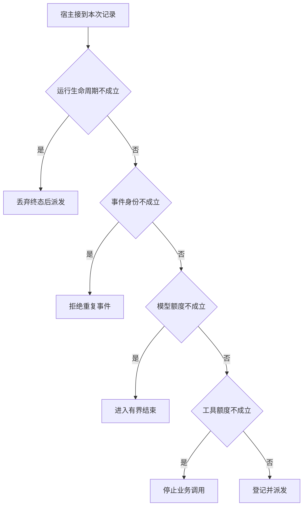

# 两种预算怎样共同使循环结束

一次错误提议会花掉模型推理，却可能没有真正调用工具。一次批量提议则可能消耗多个下游槽。
示例宿主为最后的结果整理预留推理轮，已结束的请求不能无限接受新动作。

本篇用一个封闭的教学决策器说明这一问题。输入是宿主收到的记录，不保证每个下游字段都已经获准使用。前置检查未成立时，下游即使带着缓存值，也不能拿来作业务断言。

## 先解决一个具体问题

**设置 maxToolCalls 能保证一定及时结束吗？**

非法提议可能一项工具都不执行却不断占用模型轮。
反过来，一个工具可能永不返回。
分别限制模型轮数、真实工具尝试和绝对时限，才覆盖这三类故障。


先取一个能走到「登记并派发」的输入：本轮尚在处理、保留下一轮决策额度、可预留本次尝试额度、本事件首次出现。
把这四个条件代回后文的图，前面各个拦截分支都未满足，最终才有“可预留必要的两类资源”这个判断。
还原这个现场时要分别问：哪些位来自可信状态，哪些只是在接口中出现、尚未获得解释资格的字段。

## 先沿一次决策走到底



从上到下取第一条成立的出口。只改一个开关时，只有它之前的检查都未截断，该变化才可能到达真实动作。

“运行生命周期”的两种输入分别是“本轮尚在处理”与“本轮已经终止”。
过期回执可归档，不能悄悄覆盖已交付的终态。

“模型额度”的两种输入分别是“保留下一轮决策额度”与“模型轮数已经耗尽”。
模型轮和工具尝试要分别扣账。

“工具额度”的两种输入分别是“可预留本次尝试额度”与“下游尝试额度不足”。
实际投递之前要核算重试或整批调用所需资源。

“事件身份”的两种输入分别是“本事件首次出现”与“该事件已经处理”。
重复投递与模型再次请求同一参数要分别处理。

## 最少需要哪几项观察

### 丢弃终态后派发

用户请求已经终止。
在本节的全部组合中，有 8 种产生「丢弃终态后派发」，这只是逻辑空间的计数，不能当作实际用户请求的比例。

只取得本轮已经终止，已经足以要求宿主「丢弃终态后派发」。
保持这些已知项，其余开关自由变化，仍有 8 种补全，判断没有翻转。

若删掉关于运行生命周期的证据，另一份允许的现场是本轮尚在处理、模型轮数已经耗尽、下游尝试额度不足、该事件已经处理，它会使宿主「拒绝重复事件」。

### 拒绝重复事件

已消费的消息不能再次触发外部操作。
在本节的全部组合中，有 4 种产生「拒绝重复事件」，这只是逻辑空间的计数，不能当作实际用户请求的比例。

只取得本轮尚在处理、该事件已经处理，已经足以要求宿主「拒绝重复事件」。
保持这些已知项，其余开关自由变化，仍有 4 种补全，判断没有翻转。

若删掉关于运行生命周期的证据，另一份允许的现场是本轮已经终止、模型轮数已经耗尽、下游尝试额度不足、该事件已经处理，它会使宿主「丢弃终态后派发」。

若删掉关于事件身份的证据，另一份允许的现场是本轮尚在处理、模型轮数已经耗尽、下游尝试额度不足、本事件首次出现，它会使宿主「进入有界结束」。

### 进入有界结束

新动作之后没有可用的整理轮。
在本节的全部组合中，有 2 种产生「进入有界结束」，这只是逻辑空间的计数，不能当作实际用户请求的比例。

只取得本轮尚在处理、模型轮数已经耗尽、本事件首次出现，已经足以要求宿主「进入有界结束」。
保持这些已知项，其余开关自由变化，仍有 2 种补全，判断没有翻转。

若删掉关于运行生命周期的证据，另一份允许的现场是本轮已经终止、模型轮数已经耗尽、下游尝试额度不足、本事件首次出现，它会使宿主「丢弃终态后派发」。

若删掉关于模型额度的证据，另一份允许的现场是本轮尚在处理、保留下一轮决策额度、下游尝试额度不足、本事件首次出现，它会使宿主「停止业务调用」。

若删掉关于事件身份的证据，另一份允许的现场是本轮尚在处理、模型轮数已经耗尽、下游尝试额度不足、该事件已经处理，它会使宿主「拒绝重复事件」。

### 停止业务调用

推理剩余不代表有真实工具额度。
在本节的全部组合中，有 1 种产生「停止业务调用」，这只是逻辑空间的计数，不能当作实际用户请求的比例。

只取得本轮尚在处理、保留下一轮决策额度、下游尝试额度不足、本事件首次出现，已经足以要求宿主「停止业务调用」。
保持这些已知项，其余开关自由变化，仍有 1 种补全，判断没有翻转。

若删掉关于运行生命周期的证据，另一份允许的现场是本轮已经终止、保留下一轮决策额度、下游尝试额度不足、本事件首次出现，它会使宿主「丢弃终态后派发」。

若删掉关于模型额度的证据，另一份允许的现场是本轮尚在处理、模型轮数已经耗尽、下游尝试额度不足、本事件首次出现，它会使宿主「进入有界结束」。

若删掉关于工具额度的证据，另一份允许的现场是本轮尚在处理、保留下一轮决策额度、可预留本次尝试额度、本事件首次出现，它会使宿主「登记并派发」。

若删掉关于事件身份的证据，另一份允许的现场是本轮尚在处理、保留下一轮决策额度、下游尝试额度不足、该事件已经处理，它会使宿主「拒绝重复事件」。

### 登记并派发

可预留必要的两类资源。
在本节的全部组合中，有 1 种产生「登记并派发」，这只是逻辑空间的计数，不能当作实际用户请求的比例。

只取得本轮尚在处理、保留下一轮决策额度、可预留本次尝试额度、本事件首次出现，已经足以要求宿主「登记并派发」。

若删掉关于运行生命周期的证据，另一份允许的现场是本轮已经终止、保留下一轮决策额度、可预留本次尝试额度、本事件首次出现，它会使宿主「丢弃终态后派发」。

若删掉关于模型额度的证据，另一份允许的现场是本轮尚在处理、模型轮数已经耗尽、可预留本次尝试额度、本事件首次出现，它会使宿主「进入有界结束」。

若删掉关于工具额度的证据，另一份允许的现场是本轮尚在处理、保留下一轮决策额度、下游尝试额度不足、本事件首次出现，它会使宿主「停止业务调用」。

若删掉关于事件身份的证据，另一份允许的现场是本轮尚在处理、保留下一轮决策额度、可预留本次尝试额度、该事件已经处理，它会使宿主「拒绝重复事件」。

## 以同一份契约解释截然不同的现场

<details>
<summary>展开推演与对应反例</summary>

下列样本按最先命中的业务分支排列。四位编码只作本篇页内定位，顺序与开头的四项输入一致。可以先猜下一动作，再展开相邻样本。

### 能够触发“丢弃终态后派发”的现场

**样本 0000**

业务侧交来本轮已经终止、模型轮数已经耗尽，执行侧还记录了下游尝试额度不足、该事件已经处理。
把样本压成最短证明，保留本轮已经终止就能支持「丢弃终态后派发」。

在这份记录上，分别翻转「运行生命周期」中的任一项，其他项完全不变时，下一动作都会改变。

保持其余观察不动，单独切换「模型额度」、「工具额度」、「事件身份」仍得到「丢弃终态后派发」，它们在这个现场不是决定性变量。

要从本例改走「拒绝重复事件」，至少需要变动 1 项，一组最少改动是将本轮已经终止换成本轮尚在处理。

要从本例改走「进入有界结束」，至少需要变动 2 项，一组最少改动是将本轮已经终止、该事件已经处理换成本轮尚在处理、本事件首次出现。

要从本例改走「停止业务调用」，至少需要变动 3 项，一组最少改动是将本轮已经终止、模型轮数已经耗尽、该事件已经处理换成本轮尚在处理、保留下一轮决策额度、本事件首次出现。

要从本例改走「登记并派发」，至少需要变动 4 项，一组最少改动是将本轮已经终止、模型轮数已经耗尽、下游尝试额度不足、该事件已经处理换成本轮尚在处理、保留下一轮决策额度、可预留本次尝试额度、本事件首次出现。

**样本 0001**

业务侧交来本轮已经终止、模型轮数已经耗尽，执行侧还记录了下游尝试额度不足、本事件首次出现。


要从本例改走「进入有界结束」，至少需要变动 1 项，一组最少改动是将本轮已经终止换成本轮尚在处理。

要从本例改走「拒绝重复事件」，至少需要变动 2 项，一组最少改动是将本轮已经终止、本事件首次出现换成本轮尚在处理、该事件已经处理。

要从本例改走「停止业务调用」，至少需要变动 2 项，一组最少改动是将本轮已经终止、模型轮数已经耗尽换成本轮尚在处理、保留下一轮决策额度。

要从本例改走「登记并派发」，至少需要变动 3 项，一组最少改动是将本轮已经终止、模型轮数已经耗尽、下游尝试额度不足换成本轮尚在处理、保留下一轮决策额度、可预留本次尝试额度。

**样本 0010**

业务侧交来本轮已经终止、模型轮数已经耗尽，执行侧还记录了可预留本次尝试额度、该事件已经处理。


要从本例改走「登记并派发」，至少需要变动 3 项，一组最少改动是将本轮已经终止、模型轮数已经耗尽、该事件已经处理换成本轮尚在处理、保留下一轮决策额度、本事件首次出现。

要从本例改走「停止业务调用」，至少需要变动 4 项，一组最少改动是将本轮已经终止、模型轮数已经耗尽、可预留本次尝试额度、该事件已经处理换成本轮尚在处理、保留下一轮决策额度、下游尝试额度不足、本事件首次出现。

**样本 0011**

业务侧交来本轮已经终止、模型轮数已经耗尽，执行侧还记录了可预留本次尝试额度、本事件首次出现。


要从本例改走「登记并派发」，至少需要变动 2 项，一组最少改动是将本轮已经终止、模型轮数已经耗尽换成本轮尚在处理、保留下一轮决策额度。

要从本例改走「停止业务调用」，至少需要变动 3 项，一组最少改动是将本轮已经终止、模型轮数已经耗尽、可预留本次尝试额度换成本轮尚在处理、保留下一轮决策额度、下游尝试额度不足。

**样本 0100**

业务侧交来本轮已经终止、保留下一轮决策额度，执行侧还记录了下游尝试额度不足、该事件已经处理。


要从本例改走「停止业务调用」，至少需要变动 2 项，一组最少改动是将本轮已经终止、该事件已经处理换成本轮尚在处理、本事件首次出现。

要从本例改走「进入有界结束」，至少需要变动 3 项，一组最少改动是将本轮已经终止、保留下一轮决策额度、该事件已经处理换成本轮尚在处理、模型轮数已经耗尽、本事件首次出现。

要从本例改走「登记并派发」，至少需要变动 3 项，一组最少改动是将本轮已经终止、下游尝试额度不足、该事件已经处理换成本轮尚在处理、可预留本次尝试额度、本事件首次出现。

**样本 0101**

业务侧交来本轮已经终止、保留下一轮决策额度，执行侧还记录了下游尝试额度不足、本事件首次出现。


要从本例改走「停止业务调用」，至少需要变动 1 项，一组最少改动是将本轮已经终止换成本轮尚在处理。

要从本例改走「进入有界结束」，至少需要变动 2 项，一组最少改动是将本轮已经终止、保留下一轮决策额度换成本轮尚在处理、模型轮数已经耗尽。


要从本例改走「登记并派发」，至少需要变动 2 项，一组最少改动是将本轮已经终止、下游尝试额度不足换成本轮尚在处理、可预留本次尝试额度。

**样本 0110**

业务侧交来本轮已经终止、保留下一轮决策额度，执行侧还记录了可预留本次尝试额度、该事件已经处理。


要从本例改走「登记并派发」，至少需要变动 2 项，一组最少改动是将本轮已经终止、该事件已经处理换成本轮尚在处理、本事件首次出现。


要从本例改走「停止业务调用」，至少需要变动 3 项，一组最少改动是将本轮已经终止、可预留本次尝试额度、该事件已经处理换成本轮尚在处理、下游尝试额度不足、本事件首次出现。

**样本 0111**

业务侧交来本轮已经终止、保留下一轮决策额度，执行侧还记录了可预留本次尝试额度、本事件首次出现。


要从本例改走「登记并派发」，至少需要变动 1 项，一组最少改动是将本轮已经终止换成本轮尚在处理。


要从本例改走「停止业务调用」，至少需要变动 2 项，一组最少改动是将本轮已经终止、可预留本次尝试额度换成本轮尚在处理、下游尝试额度不足。


### 能够触发“拒绝重复事件”的现场

**样本 1000**

业务侧交来本轮尚在处理、模型轮数已经耗尽，执行侧还记录了下游尝试额度不足、该事件已经处理。
把样本压成最短证明，保留本轮尚在处理、该事件已经处理就能支持「拒绝重复事件」。

在这份记录上，分别翻转「运行生命周期」、「事件身份」中的任一项，其他项完全不变时，下一动作都会改变。

保持其余观察不动，单独切换「模型额度」、「工具额度」仍得到「拒绝重复事件」，它们在这个现场不是决定性变量。

本例没走更靠前的「丢弃终态后派发」，因为本轮尚在处理与那个入口的必要条件不符。

要从本例改走「丢弃终态后派发」，至少需要变动 1 项，一组最少改动是将本轮尚在处理换成本轮已经终止。

要从本例改走「进入有界结束」，至少需要变动 1 项，一组最少改动是将该事件已经处理换成本事件首次出现。

要从本例改走「停止业务调用」，至少需要变动 2 项，一组最少改动是将模型轮数已经耗尽、该事件已经处理换成保留下一轮决策额度、本事件首次出现。

要从本例改走「登记并派发」，至少需要变动 3 项，一组最少改动是将模型轮数已经耗尽、下游尝试额度不足、该事件已经处理换成保留下一轮决策额度、可预留本次尝试额度、本事件首次出现。

**样本 1010**

业务侧交来本轮尚在处理、模型轮数已经耗尽，执行侧还记录了可预留本次尝试额度、该事件已经处理。


要从本例改走「登记并派发」，至少需要变动 2 项，一组最少改动是将模型轮数已经耗尽、该事件已经处理换成保留下一轮决策额度、本事件首次出现。

要从本例改走「停止业务调用」，至少需要变动 3 项，一组最少改动是将模型轮数已经耗尽、可预留本次尝试额度、该事件已经处理换成保留下一轮决策额度、下游尝试额度不足、本事件首次出现。

**样本 1100**

业务侧交来本轮尚在处理、保留下一轮决策额度，执行侧还记录了下游尝试额度不足、该事件已经处理。


要从本例改走「停止业务调用」，至少需要变动 1 项，一组最少改动是将该事件已经处理换成本事件首次出现。

要从本例改走「进入有界结束」，至少需要变动 2 项，一组最少改动是将保留下一轮决策额度、该事件已经处理换成模型轮数已经耗尽、本事件首次出现。

要从本例改走「登记并派发」，至少需要变动 2 项，一组最少改动是将下游尝试额度不足、该事件已经处理换成可预留本次尝试额度、本事件首次出现。

**样本 1110**

业务侧交来本轮尚在处理、保留下一轮决策额度，执行侧还记录了可预留本次尝试额度、该事件已经处理。


要从本例改走「登记并派发」，至少需要变动 1 项，一组最少改动是将该事件已经处理换成本事件首次出现。


要从本例改走「停止业务调用」，至少需要变动 2 项，一组最少改动是将可预留本次尝试额度、该事件已经处理换成下游尝试额度不足、本事件首次出现。

### 能够触发“进入有界结束”的现场

**样本 1001**

业务侧交来本轮尚在处理、模型轮数已经耗尽，执行侧还记录了下游尝试额度不足、本事件首次出现。
把样本压成最短证明，保留本轮尚在处理、模型轮数已经耗尽、本事件首次出现就能支持「进入有界结束」。

在这份记录上，分别翻转「运行生命周期」、「模型额度」、「事件身份」中的任一项，其他项完全不变时，下一动作都会改变。

保持其余观察不动，单独切换「工具额度」仍得到「进入有界结束」，它们在这个现场不是决定性变量。


本例没走更靠前的「拒绝重复事件」，因为本事件首次出现与那个入口的必要条件不符。


要从本例改走「拒绝重复事件」，至少需要变动 1 项，一组最少改动是将本事件首次出现换成该事件已经处理。

要从本例改走「停止业务调用」，至少需要变动 1 项，一组最少改动是将模型轮数已经耗尽换成保留下一轮决策额度。

要从本例改走「登记并派发」，至少需要变动 2 项，一组最少改动是将模型轮数已经耗尽、下游尝试额度不足换成保留下一轮决策额度、可预留本次尝试额度。

**样本 1011**

业务侧交来本轮尚在处理、模型轮数已经耗尽，执行侧还记录了可预留本次尝试额度、本事件首次出现。


要从本例改走「登记并派发」，至少需要变动 1 项，一组最少改动是将模型轮数已经耗尽换成保留下一轮决策额度。

要从本例改走「停止业务调用」，至少需要变动 2 项，一组最少改动是将模型轮数已经耗尽、可预留本次尝试额度换成保留下一轮决策额度、下游尝试额度不足。

### 能够触发“停止业务调用”的现场

**样本 1101**

业务侧交来本轮尚在处理、保留下一轮决策额度，执行侧还记录了下游尝试额度不足、本事件首次出现。
把样本压成最短证明，保留本轮尚在处理、保留下一轮决策额度、下游尝试额度不足、本事件首次出现就能支持「停止业务调用」。

在这份记录上，分别翻转「运行生命周期」、「模型额度」、「工具额度」、「事件身份」中的任一项，其他项完全不变时，下一动作都会改变。


本例没走更靠前的「进入有界结束」，因为保留下一轮决策额度与那个入口的必要条件不符。


要从本例改走「进入有界结束」，至少需要变动 1 项，一组最少改动是将保留下一轮决策额度换成模型轮数已经耗尽。


要从本例改走「登记并派发」，至少需要变动 1 项，一组最少改动是将下游尝试额度不足换成可预留本次尝试额度。

### 能够触发“登记并派发”的现场

**样本 1111**

业务侧交来本轮尚在处理、保留下一轮决策额度，执行侧还记录了可预留本次尝试额度、本事件首次出现。
把样本压成最短证明，保留本轮尚在处理、保留下一轮决策额度、可预留本次尝试额度、本事件首次出现就能支持「登记并派发」。


本例没走更靠前的「停止业务调用」，因为可预留本次尝试额度与那个入口的必要条件不符。


要从本例改走「停止业务调用」，至少需要变动 1 项，一组最少改动是将可预留本次尝试额度换成下游尝试额度不足。


</details>

## 当你只能看见一半记录

<details>
<summary>展开推演与对应反例</summary>

这次隐藏两个字段，保留另两个。对每个可见现场，检查四种合法补全是否同意。如仍有歧义，选择能使最坏剩余候选动作最少的字段继续查。并列时采用本篇字段顺序。

### 只保留运行生命周期与模型额度

已知本轮已经终止、模型轮数已经耗尽时，四种补全的动作分布为丢弃终态后派发（4 种）。

就“丢弃终态后派发”这个动作而言，在本轮已经终止、模型轮数已经耗尽的前提下，另外两项观察不会推翻它。

已知本轮已经终止、保留下一轮决策额度时，四种补全的动作分布为丢弃终态后派发（4 种）。

就“丢弃终态后派发”这个动作而言，在本轮已经终止、保留下一轮决策额度的前提下，另外两项观察不会推翻它。

已知本轮尚在处理、模型轮数已经耗尽时，四种补全的动作分布为拒绝重复事件（2 种）、进入有界结束（2 种）。

在本轮尚在处理、模型轮数已经耗尽这个现场补读「事件身份」，最坏还剩 1 种动作，计算时只衡量歧义，尚未扣读取代价。
若补来的观察为“该事件已经处理”，范围缩成「拒绝重复事件」。若为“本事件首次出现”，则保留「进入有界结束」。

区分不了的两条执行可以具体写成 1000 与 1001：它们共享已展示字段，却分别需要「拒绝重复事件」和「进入有界结束」。

已知本轮尚在处理、保留下一轮决策额度时，四种补全的动作分布为拒绝重复事件（2 种）、停止业务调用（1 种）、登记并派发（1 种）。

在本轮尚在处理、保留下一轮决策额度这个现场补读「工具额度」，最坏还剩 2 种动作，计算时只衡量歧义，尚未扣读取代价。
若补来的观察为“下游尝试额度不足”，范围缩成「拒绝重复事件」、「停止业务调用」。若为“可预留本次尝试额度”，则保留「拒绝重复事件」、「登记并派发」。

区分不了的两条执行可以具体写成 1100 与 1101：它们共享已展示字段，却分别需要「拒绝重复事件」和「停止业务调用」。

### 只保留运行生命周期与工具额度

已知本轮已经终止、下游尝试额度不足时，四种补全的动作分布为丢弃终态后派发（4 种）。

就“丢弃终态后派发”这个动作而言，在本轮已经终止、下游尝试额度不足的前提下，另外两项观察不会推翻它。

已知本轮已经终止、可预留本次尝试额度时，四种补全的动作分布为丢弃终态后派发（4 种）。

就“丢弃终态后派发”这个动作而言，在本轮已经终止、可预留本次尝试额度的前提下，另外两项观察不会推翻它。

已知本轮尚在处理、下游尝试额度不足时，四种补全的动作分布为拒绝重复事件（2 种）、进入有界结束（1 种）、停止业务调用（1 种）。

在本轮尚在处理、下游尝试额度不足这个现场补读「模型额度」，最坏还剩 2 种动作，计算时只衡量歧义，尚未扣读取代价。
若补来的观察为“模型轮数已经耗尽”，范围缩成「拒绝重复事件」、「进入有界结束」。若为“保留下一轮决策额度”，则保留「拒绝重复事件」、「停止业务调用」。


已知本轮尚在处理、可预留本次尝试额度时，四种补全的动作分布为拒绝重复事件（2 种）、进入有界结束（1 种）、登记并派发（1 种）。

在本轮尚在处理、可预留本次尝试额度这个现场补读「模型额度」，最坏还剩 2 种动作，计算时只衡量歧义，尚未扣读取代价。
若补来的观察为“模型轮数已经耗尽”，范围缩成「拒绝重复事件」、「进入有界结束」。若为“保留下一轮决策额度”，则保留「拒绝重复事件」、「登记并派发」。

区分不了的两条执行可以具体写成 1010 与 1011：它们共享已展示字段，却分别需要「拒绝重复事件」和「进入有界结束」。

### 只保留模型额度与工具额度

已知模型轮数已经耗尽、下游尝试额度不足时，四种补全的动作分布为丢弃终态后派发（2 种）、拒绝重复事件（1 种）、进入有界结束（1 种）。

在模型轮数已经耗尽、下游尝试额度不足这个现场补读「运行生命周期」，最坏还剩 2 种动作，计算时只衡量歧义，尚未扣读取代价。
若补来的观察为“本轮已经终止”，范围缩成「丢弃终态后派发」。若为“本轮尚在处理”，则保留「拒绝重复事件」、「进入有界结束」。

区分不了的两条执行可以具体写成 0000 与 1000：它们共享已展示字段，却分别需要「丢弃终态后派发」和「拒绝重复事件」。

已知模型轮数已经耗尽、可预留本次尝试额度时，四种补全的动作分布为丢弃终态后派发（2 种）、拒绝重复事件（1 种）、进入有界结束（1 种）。

在模型轮数已经耗尽、可预留本次尝试额度这个现场补读「运行生命周期」，最坏还剩 2 种动作，计算时只衡量歧义，尚未扣读取代价。

区分不了的两条执行可以具体写成 0010 与 1010：它们共享已展示字段，却分别需要「丢弃终态后派发」和「拒绝重复事件」。

已知保留下一轮决策额度、下游尝试额度不足时，四种补全的动作分布为丢弃终态后派发（2 种）、拒绝重复事件（1 种）、停止业务调用（1 种）。

在保留下一轮决策额度、下游尝试额度不足这个现场补读「运行生命周期」，最坏还剩 2 种动作，计算时只衡量歧义，尚未扣读取代价。
若补来的观察为“本轮已经终止”，范围缩成「丢弃终态后派发」。若为“本轮尚在处理”，则保留「拒绝重复事件」、「停止业务调用」。

区分不了的两条执行可以具体写成 0100 与 1100：它们共享已展示字段，却分别需要「丢弃终态后派发」和「拒绝重复事件」。

已知保留下一轮决策额度、可预留本次尝试额度时，四种补全的动作分布为丢弃终态后派发（2 种）、拒绝重复事件（1 种）、登记并派发（1 种）。

在保留下一轮决策额度、可预留本次尝试额度这个现场补读「运行生命周期」，最坏还剩 2 种动作，计算时只衡量歧义，尚未扣读取代价。
若补来的观察为“本轮已经终止”，范围缩成「丢弃终态后派发」。若为“本轮尚在处理”，则保留「拒绝重复事件」、「登记并派发」。

区分不了的两条执行可以具体写成 0110 与 1110：它们共享已展示字段，却分别需要「丢弃终态后派发」和「拒绝重复事件」。

### 只保留运行生命周期与事件身份

已知本轮已经终止、该事件已经处理时，四种补全的动作分布为丢弃终态后派发（4 种）。

就“丢弃终态后派发”这个动作而言，在本轮已经终止、该事件已经处理的前提下，另外两项观察不会推翻它。

已知本轮已经终止、本事件首次出现时，四种补全的动作分布为丢弃终态后派发（4 种）。

就“丢弃终态后派发”这个动作而言，在本轮已经终止、本事件首次出现的前提下，另外两项观察不会推翻它。

已知本轮尚在处理、该事件已经处理时，四种补全的动作分布为拒绝重复事件（4 种）。

就“拒绝重复事件”这个动作而言，在本轮尚在处理、该事件已经处理的前提下，另外两项观察不会推翻它。

已知本轮尚在处理、本事件首次出现时，四种补全的动作分布为进入有界结束（2 种）、停止业务调用（1 种）、登记并派发（1 种）。

在本轮尚在处理、本事件首次出现这个现场补读「模型额度」，最坏还剩 2 种动作，计算时只衡量歧义，尚未扣读取代价。
若补来的观察为“模型轮数已经耗尽”，范围缩成「进入有界结束」。若为“保留下一轮决策额度”，则保留「停止业务调用」、「登记并派发」。

区分不了的两条执行可以具体写成 1001 与 1101：它们共享已展示字段，却分别需要「进入有界结束」和「停止业务调用」。

### 只保留模型额度与事件身份

已知模型轮数已经耗尽、该事件已经处理时，四种补全的动作分布为丢弃终态后派发（2 种）、拒绝重复事件（2 种）。

在模型轮数已经耗尽、该事件已经处理这个现场补读「运行生命周期」，最坏还剩 1 种动作，计算时只衡量歧义，尚未扣读取代价。
若补来的观察为“本轮已经终止”，范围缩成「丢弃终态后派发」。若为“本轮尚在处理”，则保留「拒绝重复事件」。


已知模型轮数已经耗尽、本事件首次出现时，四种补全的动作分布为丢弃终态后派发（2 种）、进入有界结束（2 种）。

在模型轮数已经耗尽、本事件首次出现这个现场补读「运行生命周期」，最坏还剩 1 种动作，计算时只衡量歧义，尚未扣读取代价。
若补来的观察为“本轮已经终止”，范围缩成「丢弃终态后派发」。若为“本轮尚在处理”，则保留「进入有界结束」。

区分不了的两条执行可以具体写成 0001 与 1001：它们共享已展示字段，却分别需要「丢弃终态后派发」和「进入有界结束」。

已知保留下一轮决策额度、该事件已经处理时，四种补全的动作分布为丢弃终态后派发（2 种）、拒绝重复事件（2 种）。

在保留下一轮决策额度、该事件已经处理这个现场补读「运行生命周期」，最坏还剩 1 种动作，计算时只衡量歧义，尚未扣读取代价。


已知保留下一轮决策额度、本事件首次出现时，四种补全的动作分布为丢弃终态后派发（2 种）、停止业务调用（1 种）、登记并派发（1 种）。

在保留下一轮决策额度、本事件首次出现这个现场补读「运行生命周期」，最坏还剩 2 种动作，计算时只衡量歧义，尚未扣读取代价。
若补来的观察为“本轮已经终止”，范围缩成「丢弃终态后派发」。若为“本轮尚在处理”，则保留「停止业务调用」、「登记并派发」。

区分不了的两条执行可以具体写成 0101 与 1101：它们共享已展示字段，却分别需要「丢弃终态后派发」和「停止业务调用」。

### 只保留工具额度与事件身份

已知下游尝试额度不足、该事件已经处理时，四种补全的动作分布为丢弃终态后派发（2 种）、拒绝重复事件（2 种）。

在下游尝试额度不足、该事件已经处理这个现场补读「运行生命周期」，最坏还剩 1 种动作，计算时只衡量歧义，尚未扣读取代价。


已知下游尝试额度不足、本事件首次出现时，四种补全的动作分布为丢弃终态后派发（2 种）、进入有界结束（1 种）、停止业务调用（1 种）。

在下游尝试额度不足、本事件首次出现这个现场补读「运行生命周期」，最坏还剩 2 种动作，计算时只衡量歧义，尚未扣读取代价。
若补来的观察为“本轮已经终止”，范围缩成「丢弃终态后派发」。若为“本轮尚在处理”，则保留「进入有界结束」、「停止业务调用」。


已知可预留本次尝试额度、该事件已经处理时，四种补全的动作分布为丢弃终态后派发（2 种）、拒绝重复事件（2 种）。

在可预留本次尝试额度、该事件已经处理这个现场补读「运行生命周期」，最坏还剩 1 种动作，计算时只衡量歧义，尚未扣读取代价。


已知可预留本次尝试额度、本事件首次出现时，四种补全的动作分布为丢弃终态后派发（2 种）、进入有界结束（1 种）、登记并派发（1 种）。

在可预留本次尝试额度、本事件首次出现这个现场补读「运行生命周期」，最坏还剩 2 种动作，计算时只衡量歧义，尚未扣读取代价。
若补来的观察为“本轮已经终止”，范围缩成「丢弃终态后派发」。若为“本轮尚在处理”，则保留「进入有界结束」、「登记并派发」。

区分不了的两条执行可以具体写成 0011 与 1011：它们共享已展示字段，却分别需要「丢弃终态后派发」和「进入有界结束」。

</details>

## 单因素干预与边界测试

<details>
<summary>展开推演与对应反例</summary>

### 只改变运行生命周期

固定另外三个条件得到八对现场，从“本轮已经终止”转为“本轮尚在处理”时，8 对翻转动作，另外 0 对保持不变。

有 4 对现场沿「丢弃终态后派发」变到「拒绝重复事件」，可复现的一组受控背景为模型轮数已经耗尽、下游尝试额度不足、该事件已经处理。

有 2 对现场沿「丢弃终态后派发」变到「进入有界结束」，可复现的一组受控背景为模型轮数已经耗尽、下游尝试额度不足、本事件首次出现。

有 1 对现场沿「丢弃终态后派发」变到「停止业务调用」，可复现的一组受控背景为保留下一轮决策额度、下游尝试额度不足、本事件首次出现。

有 1 对现场沿「丢弃终态后派发」变到「登记并派发」，可复现的一组受控背景为保留下一轮决策额度、可预留本次尝试额度、本事件首次出现。

### 只改变模型额度

固定另外三个条件得到八对现场，从“模型轮数已经耗尽”转为“保留下一轮决策额度”时，2 对翻转动作，另外 6 对保持不变。

令本轮已经终止、下游尝试额度不足、该事件已经处理，模型额度的两个取值均得到「丢弃终态后派发」。在八对中，共有 4 对表现为这一种稳定出口。

令本轮尚在处理、下游尝试额度不足、该事件已经处理，模型额度的两个取值均得到「拒绝重复事件」。在八对中，共有 2 对表现为这一种稳定出口。

有 1 对现场沿「进入有界结束」变到「停止业务调用」，可复现的一组受控背景为本轮尚在处理、下游尝试额度不足、本事件首次出现。

有 1 对现场沿「进入有界结束」变到「登记并派发」，可复现的一组受控背景为本轮尚在处理、可预留本次尝试额度、本事件首次出现。

### 只改变工具额度

固定另外三个条件得到八对现场，从“下游尝试额度不足”转为“可预留本次尝试额度”时，1 对翻转动作，另外 7 对保持不变。

令本轮已经终止、模型轮数已经耗尽、该事件已经处理，工具额度的两个取值均得到「丢弃终态后派发」。在八对中，共有 4 对表现为这一种稳定出口。

令本轮尚在处理、模型轮数已经耗尽、该事件已经处理，工具额度的两个取值均得到「拒绝重复事件」。在八对中，共有 2 对表现为这一种稳定出口。

令本轮尚在处理、模型轮数已经耗尽、本事件首次出现，工具额度的两个取值均得到「进入有界结束」。在八对中，共有 1 对表现为这一种稳定出口。

有 1 对现场沿「停止业务调用」变到「登记并派发」，可复现的一组受控背景为本轮尚在处理、保留下一轮决策额度、本事件首次出现。

### 只改变事件身份

固定另外三个条件得到八对现场，从“该事件已经处理”转为“本事件首次出现”时，4 对翻转动作，另外 4 对保持不变。

令本轮已经终止、模型轮数已经耗尽、下游尝试额度不足，事件身份的两个取值均得到「丢弃终态后派发」。在八对中，共有 4 对表现为这一种稳定出口。

有 2 对现场沿「拒绝重复事件」变到「进入有界结束」，可复现的一组受控背景为本轮尚在处理、模型轮数已经耗尽、下游尝试额度不足。

有 1 对现场沿「拒绝重复事件」变到「停止业务调用」，可复现的一组受控背景为本轮尚在处理、保留下一轮决策额度、下游尝试额度不足。

有 1 对现场沿「拒绝重复事件」变到「登记并派发」，可复现的一组受控背景为本轮尚在处理、保留下一轮决策额度、可预留本次尝试额度。

</details>

## 哪些回归样本真能抓住实现错误

<details>
<summary>展开推演与对应反例</summary>

如果删除“丢弃终态后派发”这个分支，在本篇 16 种输入里有 8 种会改走另一出口。

反例 0000 的完整记录为本轮已经终止、模型轮数已经耗尽、下游尝试额度不足、该事件已经处理。正确结果是「丢弃终态后派发」，这个改坏的实现却给出「拒绝重复事件」。

如果删除“拒绝重复事件”这个分支，在本篇 16 种输入里有 4 种会改走另一出口。

反例 1000 的完整记录为本轮尚在处理、模型轮数已经耗尽、下游尝试额度不足、该事件已经处理。正确结果是「拒绝重复事件」，这个改坏的实现却给出「进入有界结束」。

如果删除“进入有界结束”这个分支，在本篇 16 种输入里有 2 种会改走另一出口。

反例 1001 的完整记录为本轮尚在处理、模型轮数已经耗尽、下游尝试额度不足、本事件首次出现。正确结果是「进入有界结束」，这个改坏的实现却给出「停止业务调用」。

如果删除“停止业务调用”这个分支，在本篇 16 种输入里有 1 种会改走另一出口。

反例 1101 的完整记录为本轮尚在处理、保留下一轮决策额度、下游尝试额度不足、本事件首次出现。正确结果是「停止业务调用」，这个改坏的实现却给出「登记并派发」。

如果交换“丢弃终态后派发”和“拒绝重复事件”的判断次序，在本篇 16 种输入里有 4 种会改走另一出口。


如果交换“拒绝重复事件”和“进入有界结束”的判断次序，在本篇 16 种输入里有 2 种会改走另一出口。


如果交换“进入有界结束”和“停止业务调用”的判断次序，在本篇 16 种输入里有 1 种会改走另一出口。


补入样本 0000（本轮已经终止、模型轮数已经耗尽、下游尝试额度不足、该事件已经处理）能新增检出「删除“丢弃终态后派发”这个分支」、「交换“丢弃终态后派发”和“拒绝重复事件”的判断次序」。

补入样本 1000（本轮尚在处理、模型轮数已经耗尽、下游尝试额度不足、该事件已经处理）能新增检出「删除“拒绝重复事件”这个分支」、「交换“拒绝重复事件”和“进入有界结束”的判断次序」。

补入样本 1001（本轮尚在处理、模型轮数已经耗尽、下游尝试额度不足、本事件首次出现）能新增检出「删除“进入有界结束”这个分支」、「交换“进入有界结束”和“停止业务调用”的判断次序」。

补入样本 1101（本轮尚在处理、保留下一轮决策额度、下游尝试额度不足、本事件首次出现）能新增检出「删除“停止业务调用”这个分支」。

这里每次选覆盖尚未捕获缺陷最多的样本，并不保证用例数全局最小。它给出的反例能作为 Java 单测输入。真实模型是否会自主产生这些提议，仍须单独评测。

</details>

## 把状态覆盖换成有抽样偏差的评测批次

<details>
<summary>展开推演与对应反例</summary>

前面的十六种记录各有一票。现在只改样本构成：对一个给定字段，把成立侧的每种记录各取三份、另一侧各取一份。这是人为配比的 32 份回放，不是线上频率估计。
将偏向成立与偏向不成立的两次批次对照，可以隔离分母变化。底层宿主和所有答案保持相同，比例仍可能移动。

### 改变“运行生命周期”的样本配比

只看「丢弃终态后派发」，在本轮尚在处理的八个不同输入中有 0 个命中，在本轮已经终止的另八个输入中有 8 个命中。
把「运行生命周期」成立侧按三倍取样，「丢弃终态后派发」占 8/32，反过来向未成立侧倾斜后占 24/32。
这次重加权使「丢弃终态后派发」的占比相差 50 个百分点。若按两种不同的“运行生命周期”分布跑新旧版，不能把这项差异全部归功于实现。

只看「拒绝重复事件」，在本轮尚在处理的八个不同输入中有 4 个命中，在本轮已经终止的另八个输入中有 0 个命中。
把「运行生命周期」成立侧按三倍取样，「拒绝重复事件」占 12/32，反过来向未成立侧倾斜后占 4/32。
这次重加权使「拒绝重复事件」的占比相差 25 个百分点。若按两种不同的“运行生命周期”分布跑新旧版，不能把这项差异全部归功于实现。

只看「进入有界结束」，在本轮尚在处理的八个不同输入中有 2 个命中，在本轮已经终止的另八个输入中有 0 个命中。
把「运行生命周期」成立侧按三倍取样，「进入有界结束」占 6/32，反过来向未成立侧倾斜后占 2/32。
这次重加权使「进入有界结束」的占比相差 12.5 个百分点。若按两种不同的“运行生命周期”分布跑新旧版，不能把这项差异全部归功于实现。

只看「停止业务调用」，在本轮尚在处理的八个不同输入中有 1 个命中，在本轮已经终止的另八个输入中有 0 个命中。
把「运行生命周期」成立侧按三倍取样，「停止业务调用」占 3/32，反过来向未成立侧倾斜后占 1/32。
这次重加权使「停止业务调用」的占比相差 6.25 个百分点。若按两种不同的“运行生命周期”分布跑新旧版，不能把这项差异全部归功于实现。

只看「登记并派发」，在本轮尚在处理的八个不同输入中有 1 个命中，在本轮已经终止的另八个输入中有 0 个命中。
把「运行生命周期」成立侧按三倍取样，「登记并派发」占 3/32，反过来向未成立侧倾斜后占 1/32。
这次重加权使「登记并派发」的占比相差 6.25 个百分点。若按两种不同的“运行生命周期”分布跑新旧版，不能把这项差异全部归功于实现。

### 改变“模型额度”的样本配比

只看「丢弃终态后派发」，在保留下一轮决策额度的八个不同输入中有 4 个命中，在模型轮数已经耗尽的另八个输入中有 4 个命中。
把「模型额度」成立侧按三倍取样，「丢弃终态后派发」占 16/32，反过来向未成立侧倾斜后占 16/32。
两批「丢弃终态后派发」的边际比例相同，是因为这个出口在“模型额度”的两侧计数相等，这不能单独证明每一对现场都不受它影响。

只看「拒绝重复事件」，在保留下一轮决策额度的八个不同输入中有 2 个命中，在模型轮数已经耗尽的另八个输入中有 2 个命中。
把「模型额度」成立侧按三倍取样，「拒绝重复事件」占 8/32，反过来向未成立侧倾斜后占 8/32。
两批「拒绝重复事件」的边际比例相同，是因为这个出口在“模型额度”的两侧计数相等，这不能单独证明每一对现场都不受它影响。

只看「进入有界结束」，在保留下一轮决策额度的八个不同输入中有 0 个命中，在模型轮数已经耗尽的另八个输入中有 2 个命中。
把「模型额度」成立侧按三倍取样，「进入有界结束」占 2/32，反过来向未成立侧倾斜后占 6/32。
这次重加权使「进入有界结束」的占比相差 12.5 个百分点。若按两种不同的“模型额度”分布跑新旧版，不能把这项差异全部归功于实现。

只看「停止业务调用」，在保留下一轮决策额度的八个不同输入中有 1 个命中，在模型轮数已经耗尽的另八个输入中有 0 个命中。
把「模型额度」成立侧按三倍取样，「停止业务调用」占 3/32，反过来向未成立侧倾斜后占 1/32。
这次重加权使「停止业务调用」的占比相差 6.25 个百分点。若按两种不同的“模型额度”分布跑新旧版，不能把这项差异全部归功于实现。

只看「登记并派发」，在保留下一轮决策额度的八个不同输入中有 1 个命中，在模型轮数已经耗尽的另八个输入中有 0 个命中。
把「模型额度」成立侧按三倍取样，「登记并派发」占 3/32，反过来向未成立侧倾斜后占 1/32。
这次重加权使「登记并派发」的占比相差 6.25 个百分点。若按两种不同的“模型额度”分布跑新旧版，不能把这项差异全部归功于实现。

### 改变“工具额度”的样本配比

只看「丢弃终态后派发」，在可预留本次尝试额度的八个不同输入中有 4 个命中，在下游尝试额度不足的另八个输入中有 4 个命中。
把「工具额度」成立侧按三倍取样，「丢弃终态后派发」占 16/32，反过来向未成立侧倾斜后占 16/32。
两批「丢弃终态后派发」的边际比例相同，是因为这个出口在“工具额度”的两侧计数相等，这不能单独证明每一对现场都不受它影响。

只看「拒绝重复事件」，在可预留本次尝试额度的八个不同输入中有 2 个命中，在下游尝试额度不足的另八个输入中有 2 个命中。
把「工具额度」成立侧按三倍取样，「拒绝重复事件」占 8/32，反过来向未成立侧倾斜后占 8/32。
两批「拒绝重复事件」的边际比例相同，是因为这个出口在“工具额度”的两侧计数相等，这不能单独证明每一对现场都不受它影响。

只看「进入有界结束」，在可预留本次尝试额度的八个不同输入中有 1 个命中，在下游尝试额度不足的另八个输入中有 1 个命中。
把「工具额度」成立侧按三倍取样，「进入有界结束」占 4/32，反过来向未成立侧倾斜后占 4/32。
两批「进入有界结束」的边际比例相同，是因为这个出口在“工具额度”的两侧计数相等，这不能单独证明每一对现场都不受它影响。

只看「停止业务调用」，在可预留本次尝试额度的八个不同输入中有 0 个命中，在下游尝试额度不足的另八个输入中有 1 个命中。
把「工具额度」成立侧按三倍取样，「停止业务调用」占 1/32，反过来向未成立侧倾斜后占 3/32。
这次重加权使「停止业务调用」的占比相差 6.25 个百分点。若按两种不同的“工具额度”分布跑新旧版，不能把这项差异全部归功于实现。

只看「登记并派发」，在可预留本次尝试额度的八个不同输入中有 1 个命中，在下游尝试额度不足的另八个输入中有 0 个命中。
把「工具额度」成立侧按三倍取样，「登记并派发」占 3/32，反过来向未成立侧倾斜后占 1/32。
这次重加权使「登记并派发」的占比相差 6.25 个百分点。若按两种不同的“工具额度”分布跑新旧版，不能把这项差异全部归功于实现。

### 改变“事件身份”的样本配比

只看「丢弃终态后派发」，在本事件首次出现的八个不同输入中有 4 个命中，在该事件已经处理的另八个输入中有 4 个命中。
把「事件身份」成立侧按三倍取样，「丢弃终态后派发」占 16/32，反过来向未成立侧倾斜后占 16/32。
两批「丢弃终态后派发」的边际比例相同，是因为这个出口在“事件身份”的两侧计数相等，这不能单独证明每一对现场都不受它影响。

只看「拒绝重复事件」，在本事件首次出现的八个不同输入中有 0 个命中，在该事件已经处理的另八个输入中有 4 个命中。
把「事件身份」成立侧按三倍取样，「拒绝重复事件」占 4/32，反过来向未成立侧倾斜后占 12/32。
这次重加权使「拒绝重复事件」的占比相差 25 个百分点。若按两种不同的“事件身份”分布跑新旧版，不能把这项差异全部归功于实现。

只看「进入有界结束」，在本事件首次出现的八个不同输入中有 2 个命中，在该事件已经处理的另八个输入中有 0 个命中。
把「事件身份」成立侧按三倍取样，「进入有界结束」占 6/32，反过来向未成立侧倾斜后占 2/32。
这次重加权使「进入有界结束」的占比相差 12.5 个百分点。若按两种不同的“事件身份”分布跑新旧版，不能把这项差异全部归功于实现。

只看「停止业务调用」，在本事件首次出现的八个不同输入中有 1 个命中，在该事件已经处理的另八个输入中有 0 个命中。
把「事件身份」成立侧按三倍取样，「停止业务调用」占 3/32，反过来向未成立侧倾斜后占 1/32。
这次重加权使「停止业务调用」的占比相差 6.25 个百分点。若按两种不同的“事件身份”分布跑新旧版，不能把这项差异全部归功于实现。

只看「登记并派发」，在本事件首次出现的八个不同输入中有 1 个命中，在该事件已经处理的另八个输入中有 0 个命中。
把「事件身份」成立侧按三倍取样，「登记并派发」占 3/32，反过来向未成立侧倾斜后占 1/32。
这次重加权使「登记并派发」的占比相差 6.25 个百分点。若按两种不同的“事件身份”分布跑新旧版，不能把这项差异全部归功于实现。

</details>

## 只看终态，能逆推出多少原始事实

<details>
<summary>展开推演与对应反例</summary>

### 只保留“丢弃终态后派发”这条结果时

在本节契约与完整输入域内，仅知「丢弃终态后派发」就能倒推出本轮已经终止，这一推断依赖版本未变且日志中的终态可信。

「丢弃终态后派发」不能证明模型额度取哪一侧：0000 和 0100 有相同终态，却分别记为“模型轮数已经耗尽”和“保留下一轮决策额度”。

「丢弃终态后派发」不能证明工具额度取哪一侧：0000 和 0010 有相同终态，却分别记为“下游尝试额度不足”和“可预留本次尝试额度”。

「丢弃终态后派发」不能证明事件身份取哪一侧：0000 和 0001 有相同终态，却分别记为“该事件已经处理”和“本事件首次出现”。

反查「丢弃终态后派发」的诊断日志，优先保留能区分样本 0000 与 1000 的「运行生命周期」，否则很容易把邻近的「拒绝重复事件」看成同一种故障。

### 只保留“拒绝重复事件”这条结果时

在本节契约与完整输入域内，仅知「拒绝重复事件」就能倒推出本轮尚在处理，这一推断依赖版本未变且日志中的终态可信。

「拒绝重复事件」不能证明模型额度取哪一侧：1000 和 1100 有相同终态，却分别记为“模型轮数已经耗尽”和“保留下一轮决策额度”。

「拒绝重复事件」不能证明工具额度取哪一侧：1000 和 1010 有相同终态，却分别记为“下游尝试额度不足”和“可预留本次尝试额度”。

在本节契约与完整输入域内，仅知「拒绝重复事件」就能倒推出该事件已经处理，这一推断依赖版本未变且日志中的终态可信。

反查「拒绝重复事件」的诊断日志，优先保留能区分样本 1000 与 0000 的「运行生命周期」，否则很容易把邻近的「丢弃终态后派发」看成同一种故障。

### 只保留“进入有界结束”这条结果时

在本节契约与完整输入域内，仅知「进入有界结束」就能倒推出本轮尚在处理，这一推断依赖版本未变且日志中的终态可信。

在本节契约与完整输入域内，仅知「进入有界结束」就能倒推出模型轮数已经耗尽，这一推断依赖版本未变且日志中的终态可信。

「进入有界结束」不能证明工具额度取哪一侧：1001 和 1011 有相同终态，却分别记为“下游尝试额度不足”和“可预留本次尝试额度”。

在本节契约与完整输入域内，仅知「进入有界结束」就能倒推出本事件首次出现，这一推断依赖版本未变且日志中的终态可信。

反查「进入有界结束」的诊断日志，优先保留能区分样本 1001 与 0001 的「运行生命周期」，否则很容易把邻近的「丢弃终态后派发」看成同一种故障。

### 只保留“停止业务调用”这条结果时

在本节契约与完整输入域内，仅知「停止业务调用」就能倒推出本轮尚在处理，这一推断依赖版本未变且日志中的终态可信。

在本节契约与完整输入域内，仅知「停止业务调用」就能倒推出保留下一轮决策额度，这一推断依赖版本未变且日志中的终态可信。

在本节契约与完整输入域内，仅知「停止业务调用」就能倒推出下游尝试额度不足，这一推断依赖版本未变且日志中的终态可信。

在本节契约与完整输入域内，仅知「停止业务调用」就能倒推出本事件首次出现，这一推断依赖版本未变且日志中的终态可信。

反查「停止业务调用」的诊断日志，优先保留能区分样本 1101 与 0101 的「运行生命周期」，否则很容易把邻近的「丢弃终态后派发」看成同一种故障。

### 只保留“登记并派发”这条结果时

在本节契约与完整输入域内，仅知「登记并派发」就能倒推出本轮尚在处理，这一推断依赖版本未变且日志中的终态可信。

在本节契约与完整输入域内，仅知「登记并派发」就能倒推出保留下一轮决策额度，这一推断依赖版本未变且日志中的终态可信。

在本节契约与完整输入域内，仅知「登记并派发」就能倒推出可预留本次尝试额度，这一推断依赖版本未变且日志中的终态可信。

在本节契约与完整输入域内，仅知「登记并派发」就能倒推出本事件首次出现，这一推断依赖版本未变且日志中的终态可信。

反查「登记并派发」的诊断日志，优先保留能区分样本 1111 与 0111 的「运行生命周期」，否则很容易把邻近的「丢弃终态后派发」看成同一种故障。

</details>

## 面试复述与复算

面试题可以从“设置 maxToolCalls 能保证一定及时结束吗？”起步。先给出本篇的触发条件和一条真实执行端可检查的证据，再用一个相邻反例限定结论的适用范围。

在仓库根目录执行下列命令可以重算本篇的一个输入。四位数字依次选择正文列出的四项条件，0 表示未成立或低档，1 表示成立或高档。
```powershell
node examples/reading-cases/replay.mjs 3 2 0101
```

[本周主文](../theory.md) · [配套实验](../lab.md) · [下一篇研读](03.md)
