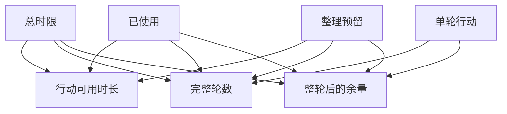

# 有限的截止时间能容纳几轮行动

先扣已经消耗的时间和最终输出预留，再看能否完整跑完一轮模型与工具。
所有计算在同一请求的单调时钟上进行。
工具和模型的次数上限在此算例足够大。
余量小于完整一轮时不能多派一次。

可用轮数为零时，例题允许用已经核实的事实做确定性退化，不假定又产生了一次模型推理。

## 先解决一个具体问题

**把每个工具超时配置成用户总时限为什么还会超？**

入口以来的推理、排队与退避已经消费预算，还必须给输出保留时间。
每次决定是否再查，要取剩余时限与单次上限中更紧的约束。


先从具体的低档设定开始：总时限取 800毫秒、已使用取 180毫秒、单轮行动取 190毫秒、整理预留取 100毫秒。
三个结果依次是行动可用时长 520毫秒、完整轮数 2轮、整轮后的余量 140毫秒。
先手算这个起点，读完后再把另一个输入切到高档，这样能知道数字变化时究竟改变了哪个假设。

## 先写清输入边界和三个观测量

用 a 表示总时限，取 800毫秒 或 1600毫秒，这两点是用于隔离因果影响的教学输入。

用 b 表示已使用，取 180毫秒 或 410毫秒，这两点是用于隔离因果影响的教学输入。

用 c 表示单轮行动，取 190毫秒 或 320毫秒，这两点是用于隔离因果影响的教学输入。

用 d 表示整理预留，取 100毫秒 或 250毫秒，这两点是用于隔离因果影响的教学输入。

「行动可用时长」的计算式为 `max(0,a-b-d)`，按业务量展开是 `max(0,总时限-已使用-整理预留)`，输出单位为毫秒。

「完整轮数」的计算式为 `floor(max(0,a-b-d)/c)`，按业务量展开是 `floor(max(0,总时限-已使用-整理预留)/单轮行动)`，输出单位为轮。

「整轮后的余量」的计算式为 `max(0,a-b-d)%c`，按业务量展开是 `max(0,总时限-已使用-整理预留)%单轮行动`，输出单位为毫秒。

公式中 ceil 与 floor 分别向上、向下取整，% 在表达式中作取余，** 为乘方，三元条件按“条件 ? 成立值 : 其他值”读取。展示数值最多保留三位小数，比较和反推采用未舍入值。



图上的箭头表示该输入出现在计算式中。同一输入通向多个指标时，三个读数可能共同移动。分支、取整或相互抵消又会使某些边在具体样本上没有可见增量。

## 从输入按单位逐步算到可比较的结果

<details>
<summary>展开推演与对应反例</summary>

### 样本 0000：总时限 800、已使用 180

这一组设定为总时限为 800毫秒、已使用为 180毫秒、单轮行动为 190毫秒、整理预留为 100毫秒。

代入「行动可用时长」：`max(0,800-180-100)`，得到 520毫秒。

代入「完整轮数」：`floor(max(0,800-180-100)/190)`，得到 2轮。

代入「整轮后的余量」：`max(0,800-180-100)%190`，得到 140毫秒。

以「完整轮数」作主读数时，本组单独切换总时限的绝对变化最大或并列最大，读数会从 2轮 变为 6轮。

对角样本 1111 的主读数为 2轮。它同时改了四项，差额不能充当任一单个因素的净收益。

### 样本 0001：总时限 800、已使用 180

这一组设定为总时限为 800毫秒、已使用为 180毫秒、单轮行动为 190毫秒、整理预留为 250毫秒。

代入「行动可用时长」：`max(0,800-180-250)`，得到 370毫秒。

代入「完整轮数」：`floor(max(0,800-180-250)/190)`，得到 1轮。

代入「整轮后的余量」：`max(0,800-180-250)%190`，得到 180毫秒。

以「完整轮数」作主读数时，本组单独切换总时限的绝对变化最大或并列最大，读数会从 1轮 变为 6轮。

本组固定其余输入时，分别改变「单轮行动」均不会改变 1轮 这个主读数，是否影响另一指标仍需另算。

对角样本 1110 的主读数为 3轮。它同时改了四项，差额不能充当任一单个因素的净收益。

### 样本 0010：总时限 800、已使用 180

这一组设定为总时限为 800毫秒、已使用为 180毫秒、单轮行动为 320毫秒、整理预留为 100毫秒。


代入「完整轮数」：`floor(max(0,800-180-100)/320)`，得到 1轮。

代入「整轮后的余量」：`max(0,800-180-100)%320`，得到 200毫秒。

以「完整轮数」作主读数时，本组单独切换总时限的绝对变化最大或并列最大，读数会从 1轮 变为 4轮。

本组固定其余输入时，分别改变「整理预留」均不会改变 1轮 这个主读数，是否影响另一指标仍需另算。

对角样本 1101 的主读数为 4轮。它同时改了四项，差额不能充当任一单个因素的净收益。

### 样本 0011：总时限 800、已使用 180

这一组设定为总时限为 800毫秒、已使用为 180毫秒、单轮行动为 320毫秒、整理预留为 250毫秒。


代入「完整轮数」：`floor(max(0,800-180-250)/320)`，得到 1轮。

代入「整轮后的余量」：`max(0,800-180-250)%320`，得到 50毫秒。

以「完整轮数」作主读数时，本组单独切换总时限的绝对变化最大或并列最大，读数会从 1轮 变为 3轮。

本组固定其余输入时，分别改变「单轮行动」、「整理预留」均不会改变 1轮 这个主读数，是否影响另一指标仍需另算。

对角样本 1100 的主读数为 5轮。它同时改了四项，差额不能充当任一单个因素的净收益。

### 样本 0100：总时限 800、已使用 410

这一组设定为总时限为 800毫秒、已使用为 410毫秒、单轮行动为 190毫秒、整理预留为 100毫秒。

代入「行动可用时长」：`max(0,800-410-100)`，得到 290毫秒。

代入「完整轮数」：`floor(max(0,800-410-100)/190)`，得到 1轮。

代入「整轮后的余量」：`max(0,800-410-100)%190`，得到 100毫秒。

以「完整轮数」作主读数时，本组单独切换总时限的绝对变化最大或并列最大，读数会从 1轮 变为 5轮。

对角样本 1011 的主读数为 3轮。它同时改了四项，差额不能充当任一单个因素的净收益。

### 样本 0101：总时限 800、已使用 410

这一组设定为总时限为 800毫秒、已使用为 410毫秒、单轮行动为 190毫秒、整理预留为 250毫秒。

代入「行动可用时长」：`max(0,800-410-250)`，得到 140毫秒。

代入「完整轮数」：`floor(max(0,800-410-250)/190)`，得到 0轮。

代入「整轮后的余量」：`max(0,800-410-250)%190`，得到 140毫秒。

以「完整轮数」作主读数时，本组单独切换总时限的绝对变化最大或并列最大，读数会从 0轮 变为 4轮。

本组固定其余输入时，分别改变「单轮行动」均不会改变 0轮 这个主读数，是否影响另一指标仍需另算。

对角样本 1010 的主读数为 4轮。它同时改了四项，差额不能充当任一单个因素的净收益。

### 样本 0110：总时限 800、已使用 410

这一组设定为总时限为 800毫秒、已使用为 410毫秒、单轮行动为 320毫秒、整理预留为 100毫秒。


代入「完整轮数」：`floor(max(0,800-410-100)/320)`，得到 0轮。

代入「整轮后的余量」：`max(0,800-410-100)%320`，得到 290毫秒。

以「完整轮数」作主读数时，本组单独切换总时限的绝对变化最大或并列最大，读数会从 0轮 变为 3轮。

本组固定其余输入时，分别改变「整理预留」均不会改变 0轮 这个主读数，是否影响另一指标仍需另算。

对角样本 1001 的主读数为 6轮。它同时改了四项，差额不能充当任一单个因素的净收益。

### 样本 0111：总时限 800、已使用 410

这一组设定为总时限为 800毫秒、已使用为 410毫秒、单轮行动为 320毫秒、整理预留为 250毫秒。


代入「完整轮数」：`floor(max(0,800-410-250)/320)`，得到 0轮。

代入「整轮后的余量」：`max(0,800-410-250)%320`，得到 140毫秒。

以「完整轮数」作主读数时，本组单独切换总时限的绝对变化最大或并列最大，读数会从 0轮 变为 2轮。

本组固定其余输入时，分别改变「单轮行动」、「整理预留」均不会改变 0轮 这个主读数，是否影响另一指标仍需另算。

对角样本 1000 的主读数为 6轮。它同时改了四项，差额不能充当任一单个因素的净收益。

### 样本 1000：总时限 1600、已使用 180

这一组设定为总时限为 1600毫秒、已使用为 180毫秒、单轮行动为 190毫秒、整理预留为 100毫秒。

代入「行动可用时长」：`max(0,1600-180-100)`，得到 1320毫秒。

代入「完整轮数」：`floor(max(0,1600-180-100)/190)`，得到 6轮。

代入「整轮后的余量」：`max(0,1600-180-100)%190`，得到 180毫秒。

以「完整轮数」作主读数时，本组单独切换总时限的绝对变化最大或并列最大，读数会从 6轮 变为 2轮。

本组固定其余输入时，分别改变「整理预留」均不会改变 6轮 这个主读数，是否影响另一指标仍需另算。

对角样本 0111 的主读数为 0轮。它同时改了四项，差额不能充当任一单个因素的净收益。

### 样本 1001：总时限 1600、已使用 180

这一组设定为总时限为 1600毫秒、已使用为 180毫秒、单轮行动为 190毫秒、整理预留为 250毫秒。

代入「行动可用时长」：`max(0,1600-180-250)`，得到 1170毫秒。

代入「完整轮数」：`floor(max(0,1600-180-250)/190)`，得到 6轮。

代入「整轮后的余量」：`max(0,1600-180-250)%190`，得到 30毫秒。

以「完整轮数」作主读数时，本组单独切换总时限的绝对变化最大或并列最大，读数会从 6轮 变为 1轮。


对角样本 0110 的主读数为 0轮。它同时改了四项，差额不能充当任一单个因素的净收益。

### 样本 1010：总时限 1600、已使用 180

这一组设定为总时限为 1600毫秒、已使用为 180毫秒、单轮行动为 320毫秒、整理预留为 100毫秒。


代入「完整轮数」：`floor(max(0,1600-180-100)/320)`，得到 4轮。

代入「整轮后的余量」：`max(0,1600-180-100)%320`，得到 40毫秒。

以「完整轮数」作主读数时，本组单独切换总时限的绝对变化最大或并列最大，读数会从 4轮 变为 1轮。

对角样本 0101 的主读数为 0轮。它同时改了四项，差额不能充当任一单个因素的净收益。

### 样本 1011：总时限 1600、已使用 180

这一组设定为总时限为 1600毫秒、已使用为 180毫秒、单轮行动为 320毫秒、整理预留为 250毫秒。


代入「完整轮数」：`floor(max(0,1600-180-250)/320)`，得到 3轮。

代入「整轮后的余量」：`max(0,1600-180-250)%320`，得到 210毫秒。

以「完整轮数」作主读数时，本组单独切换单轮行动的绝对变化最大或并列最大，读数会从 3轮 变为 6轮。

对角样本 0100 的主读数为 1轮。它同时改了四项，差额不能充当任一单个因素的净收益。

### 样本 1100：总时限 1600、已使用 410

这一组设定为总时限为 1600毫秒、已使用为 410毫秒、单轮行动为 190毫秒、整理预留为 100毫秒。

代入「行动可用时长」：`max(0,1600-410-100)`，得到 1090毫秒。

代入「完整轮数」：`floor(max(0,1600-410-100)/190)`，得到 5轮。

代入「整轮后的余量」：`max(0,1600-410-100)%190`，得到 140毫秒。

以「完整轮数」作主读数时，本组单独切换总时限的绝对变化最大或并列最大，读数会从 5轮 变为 1轮。

对角样本 0011 的主读数为 1轮。它同时改了四项，差额不能充当任一单个因素的净收益。

### 样本 1101：总时限 1600、已使用 410

这一组设定为总时限为 1600毫秒、已使用为 410毫秒、单轮行动为 190毫秒、整理预留为 250毫秒。

代入「行动可用时长」：`max(0,1600-410-250)`，得到 940毫秒。

代入「完整轮数」：`floor(max(0,1600-410-250)/190)`，得到 4轮。

代入「整轮后的余量」：`max(0,1600-410-250)%190`，得到 180毫秒。

以「完整轮数」作主读数时，本组单独切换总时限的绝对变化最大或并列最大，读数会从 4轮 变为 0轮。

对角样本 0010 的主读数为 1轮。它同时改了四项，差额不能充当任一单个因素的净收益。

### 样本 1110：总时限 1600、已使用 410

这一组设定为总时限为 1600毫秒、已使用为 410毫秒、单轮行动为 320毫秒、整理预留为 100毫秒。


代入「完整轮数」：`floor(max(0,1600-410-100)/320)`，得到 3轮。

代入「整轮后的余量」：`max(0,1600-410-100)%320`，得到 130毫秒。

以「完整轮数」作主读数时，本组单独切换总时限的绝对变化最大或并列最大，读数会从 3轮 变为 0轮。

对角样本 0001 的主读数为 1轮。它同时改了四项，差额不能充当任一单个因素的净收益。

### 样本 1111：总时限 1600、已使用 410

这一组设定为总时限为 1600毫秒、已使用为 410毫秒、单轮行动为 320毫秒、整理预留为 250毫秒。


代入「完整轮数」：`floor(max(0,1600-410-250)/320)`，得到 2轮。

代入「整轮后的余量」：`max(0,1600-410-250)%320`，得到 300毫秒。

以「完整轮数」作主读数时，本组单独切换总时限的绝对变化最大或并列最大，读数会从 2轮 变为 0轮。

对角样本 0000 的主读数为 2轮。它同时改了四项，差额不能充当任一单个因素的净收益。

</details>

## 逐个干预：其余条件固定时，变化真的发生在哪里

<details>
<summary>展开推演与对应反例</summary>

### 只改变总时限

固定已使用为 180毫秒、单轮行动为 190毫秒、整理预留为 100毫秒，只把总时限从 800毫秒改到 1600毫秒。
这一对的行动可用时长从 520毫秒 变为 1320毫秒，完整轮数的差为 4轮，整轮后的余量的差为 40毫秒。

固定已使用为 180毫秒、单轮行动为 190毫秒、整理预留为 250毫秒，只把总时限从 800毫秒改到 1600毫秒。
这一对的行动可用时长从 370毫秒 变为 1170毫秒，完整轮数的差为 5轮，整轮后的余量的差为 -150毫秒。

固定已使用为 180毫秒、单轮行动为 320毫秒、整理预留为 100毫秒，只把总时限从 800毫秒改到 1600毫秒。
这一对的行动可用时长从 520毫秒 变为 1320毫秒，完整轮数的差为 3轮，整轮后的余量的差为 -160毫秒。

固定已使用为 180毫秒、单轮行动为 320毫秒、整理预留为 250毫秒，只把总时限从 800毫秒改到 1600毫秒。
这一对的行动可用时长从 370毫秒 变为 1170毫秒，完整轮数的差为 2轮，整轮后的余量的差为 160毫秒。

固定已使用为 410毫秒、单轮行动为 190毫秒、整理预留为 100毫秒，只把总时限从 800毫秒改到 1600毫秒。
这一对的行动可用时长从 290毫秒 变为 1090毫秒，完整轮数的差为 4轮，整轮后的余量的差为 40毫秒。

固定已使用为 410毫秒、单轮行动为 190毫秒、整理预留为 250毫秒，只把总时限从 800毫秒改到 1600毫秒。
这一对的行动可用时长从 140毫秒 变为 940毫秒，完整轮数的差为 4轮，整轮后的余量的差为 40毫秒。

固定已使用为 410毫秒、单轮行动为 320毫秒、整理预留为 100毫秒，只把总时限从 800毫秒改到 1600毫秒。
这一对的行动可用时长从 290毫秒 变为 1090毫秒，完整轮数的差为 3轮，整轮后的余量的差为 -160毫秒。

固定已使用为 410毫秒、单轮行动为 320毫秒、整理预留为 250毫秒，只把总时限从 800毫秒改到 1600毫秒。
这一对的行动可用时长从 140毫秒 变为 940毫秒，完整轮数的差为 2轮，整轮后的余量的差为 160毫秒。

综合八组受控背景，总时限升到较高设定时「行动可用时长」的差值区间是 800毫秒，共有 8 对出现可观察变化。

综合八组受控背景，总时限升到较高设定时「完整轮数」的差值区间是 2轮 至 5轮，共有 8 对出现可观察变化。

综合八组受控背景，总时限升到较高设定时「整轮后的余量」的差值区间是 -160毫秒 至 160毫秒，共有 8 对出现可观察变化。

### 只改变已使用

固定总时限为 800毫秒、单轮行动为 190毫秒、整理预留为 100毫秒，只把已使用从 180毫秒改到 410毫秒。
这一对的行动可用时长从 520毫秒 变为 290毫秒，完整轮数的差为 -1轮，整轮后的余量的差为 -40毫秒。

固定总时限为 800毫秒、单轮行动为 190毫秒、整理预留为 250毫秒，只把已使用从 180毫秒改到 410毫秒。
这一对的行动可用时长从 370毫秒 变为 140毫秒，完整轮数的差为 -1轮，整轮后的余量的差为 -40毫秒。

固定总时限为 800毫秒、单轮行动为 320毫秒、整理预留为 100毫秒，只把已使用从 180毫秒改到 410毫秒。
这一对的行动可用时长从 520毫秒 变为 290毫秒，完整轮数的差为 -1轮，整轮后的余量的差为 90毫秒。

固定总时限为 800毫秒、单轮行动为 320毫秒、整理预留为 250毫秒，只把已使用从 180毫秒改到 410毫秒。
这一对的行动可用时长从 370毫秒 变为 140毫秒，完整轮数的差为 -1轮，整轮后的余量的差为 90毫秒。

固定总时限为 1600毫秒、单轮行动为 190毫秒、整理预留为 100毫秒，只把已使用从 180毫秒改到 410毫秒。
这一对的行动可用时长从 1320毫秒 变为 1090毫秒，完整轮数的差为 -1轮，整轮后的余量的差为 -40毫秒。

固定总时限为 1600毫秒、单轮行动为 190毫秒、整理预留为 250毫秒，只把已使用从 180毫秒改到 410毫秒。
这一对的行动可用时长从 1170毫秒 变为 940毫秒，完整轮数的差为 -2轮，整轮后的余量的差为 150毫秒。

固定总时限为 1600毫秒、单轮行动为 320毫秒、整理预留为 100毫秒，只把已使用从 180毫秒改到 410毫秒。
这一对的行动可用时长从 1320毫秒 变为 1090毫秒，完整轮数的差为 -1轮，整轮后的余量的差为 90毫秒。

固定总时限为 1600毫秒、单轮行动为 320毫秒、整理预留为 250毫秒，只把已使用从 180毫秒改到 410毫秒。
这一对的行动可用时长从 1170毫秒 变为 940毫秒，完整轮数的差为 -1轮，整轮后的余量的差为 90毫秒。

综合八组受控背景，已使用升到较高设定时「行动可用时长」的差值区间是 -230毫秒，共有 8 对出现可观察变化。

综合八组受控背景，已使用升到较高设定时「完整轮数」的差值区间是 -2轮 至 -1轮，共有 8 对出现可观察变化。

综合八组受控背景，已使用升到较高设定时「整轮后的余量」的差值区间是 -40毫秒 至 150毫秒，共有 8 对出现可观察变化。

### 只改变单轮行动

固定总时限为 800毫秒、已使用为 180毫秒、整理预留为 100毫秒，只把单轮行动从 190毫秒改到 320毫秒。
这一对的行动可用时长从 520毫秒 变为 520毫秒，完整轮数的差为 -1轮，整轮后的余量的差为 60毫秒。

固定总时限为 800毫秒、已使用为 180毫秒、整理预留为 250毫秒，只把单轮行动从 190毫秒改到 320毫秒。
这一对的行动可用时长从 370毫秒 变为 370毫秒，完整轮数的差为 0轮，整轮后的余量的差为 -130毫秒。

固定总时限为 800毫秒、已使用为 410毫秒、整理预留为 100毫秒，只把单轮行动从 190毫秒改到 320毫秒。
这一对的行动可用时长从 290毫秒 变为 290毫秒，完整轮数的差为 -1轮，整轮后的余量的差为 190毫秒。

固定总时限为 800毫秒、已使用为 410毫秒、整理预留为 250毫秒，只把单轮行动从 190毫秒改到 320毫秒。
这一对的行动可用时长从 140毫秒 变为 140毫秒，完整轮数的差为 0轮，整轮后的余量的差为 0毫秒。

固定总时限为 1600毫秒、已使用为 180毫秒、整理预留为 100毫秒，只把单轮行动从 190毫秒改到 320毫秒。
这一对的行动可用时长从 1320毫秒 变为 1320毫秒，完整轮数的差为 -2轮，整轮后的余量的差为 -140毫秒。

固定总时限为 1600毫秒、已使用为 180毫秒、整理预留为 250毫秒，只把单轮行动从 190毫秒改到 320毫秒。
这一对的行动可用时长从 1170毫秒 变为 1170毫秒，完整轮数的差为 -3轮，整轮后的余量的差为 180毫秒。

固定总时限为 1600毫秒、已使用为 410毫秒、整理预留为 100毫秒，只把单轮行动从 190毫秒改到 320毫秒。
这一对的行动可用时长从 1090毫秒 变为 1090毫秒，完整轮数的差为 -2轮，整轮后的余量的差为 -10毫秒。

固定总时限为 1600毫秒、已使用为 410毫秒、整理预留为 250毫秒，只把单轮行动从 190毫秒改到 320毫秒。
这一对的行动可用时长从 940毫秒 变为 940毫秒，完整轮数的差为 -2轮，整轮后的余量的差为 120毫秒。

综合八组受控背景，单轮行动升到较高设定时「行动可用时长」的差值区间是 0毫秒，共有 0 对出现可观察变化。

综合八组受控背景，单轮行动升到较高设定时「完整轮数」的差值区间是 -3轮 至 0轮，共有 6 对出现可观察变化。

综合八组受控背景，单轮行动升到较高设定时「整轮后的余量」的差值区间是 -140毫秒 至 190毫秒，共有 7 对出现可观察变化。

### 只改变整理预留

固定总时限为 800毫秒、已使用为 180毫秒、单轮行动为 190毫秒，只把整理预留从 100毫秒改到 250毫秒。
这一对的行动可用时长从 520毫秒 变为 370毫秒，完整轮数的差为 -1轮，整轮后的余量的差为 40毫秒。

固定总时限为 800毫秒、已使用为 180毫秒、单轮行动为 320毫秒，只把整理预留从 100毫秒改到 250毫秒。
这一对的行动可用时长从 520毫秒 变为 370毫秒，完整轮数的差为 0轮，整轮后的余量的差为 -150毫秒。

固定总时限为 800毫秒、已使用为 410毫秒、单轮行动为 190毫秒，只把整理预留从 100毫秒改到 250毫秒。
这一对的行动可用时长从 290毫秒 变为 140毫秒，完整轮数的差为 -1轮，整轮后的余量的差为 40毫秒。

固定总时限为 800毫秒、已使用为 410毫秒、单轮行动为 320毫秒，只把整理预留从 100毫秒改到 250毫秒。
这一对的行动可用时长从 290毫秒 变为 140毫秒，完整轮数的差为 0轮，整轮后的余量的差为 -150毫秒。

固定总时限为 1600毫秒、已使用为 180毫秒、单轮行动为 190毫秒，只把整理预留从 100毫秒改到 250毫秒。
这一对的行动可用时长从 1320毫秒 变为 1170毫秒，完整轮数的差为 0轮，整轮后的余量的差为 -150毫秒。

固定总时限为 1600毫秒、已使用为 180毫秒、单轮行动为 320毫秒，只把整理预留从 100毫秒改到 250毫秒。
这一对的行动可用时长从 1320毫秒 变为 1170毫秒，完整轮数的差为 -1轮，整轮后的余量的差为 170毫秒。

固定总时限为 1600毫秒、已使用为 410毫秒、单轮行动为 190毫秒，只把整理预留从 100毫秒改到 250毫秒。
这一对的行动可用时长从 1090毫秒 变为 940毫秒，完整轮数的差为 -1轮，整轮后的余量的差为 40毫秒。

固定总时限为 1600毫秒、已使用为 410毫秒、单轮行动为 320毫秒，只把整理预留从 100毫秒改到 250毫秒。
这一对的行动可用时长从 1090毫秒 变为 940毫秒，完整轮数的差为 -1轮，整轮后的余量的差为 170毫秒。

综合八组受控背景，整理预留升到较高设定时「行动可用时长」的差值区间是 -150毫秒，共有 8 对出现可观察变化。

综合八组受控背景，整理预留升到较高设定时「完整轮数」的差值区间是 -1轮 至 0轮，共有 5 对出现可观察变化。

综合八组受控背景，整理预留升到较高设定时「整轮后的余量」的差值区间是 -150毫秒 至 170毫秒，共有 8 对出现可观察变化。

</details>

## 只拿到部分输入，结论还能缩小到多大范围

<details>
<summary>展开推演与对应反例</summary>

### 已知总时限和已使用

当总时限为 800毫秒、已使用为 180毫秒时，另两项有四种补全，主读数「完整轮数」只能限定为 1轮 至 2轮。
这个条件下，取单轮行动为 190毫秒、整理预留为 250毫秒可得到下界 1轮，取单轮行动为 190毫秒、整理预留为 100毫秒可达到上界 2轮。

用同样可见的总时限为 800毫秒、已使用为 180毫秒去推「行动可用时长」，能得到的范围为 370毫秒 至 520毫秒，不能把另一个指标的单位代入。

用同样可见的总时限为 800毫秒、已使用为 180毫秒去推「整轮后的余量」，能得到的范围为 50毫秒 至 200毫秒，不能把另一个指标的单位代入。

若只许再问一项，按最坏区间宽度优先核对单轮行动，补得低档时为 1轮 至 2轮，高档时为 1轮。

当总时限为 800毫秒、已使用为 410毫秒时，另两项有四种补全，主读数「完整轮数」只能限定为 0轮 至 1轮。
这个条件下，取单轮行动为 190毫秒、整理预留为 250毫秒可得到下界 0轮，取单轮行动为 190毫秒、整理预留为 100毫秒可达到上界 1轮。

用同样可见的总时限为 800毫秒、已使用为 410毫秒去推「行动可用时长」，能得到的范围为 140毫秒 至 290毫秒，不能把另一个指标的单位代入。

用同样可见的总时限为 800毫秒、已使用为 410毫秒去推「整轮后的余量」，能得到的范围为 100毫秒 至 290毫秒，不能把另一个指标的单位代入。

若只许再问一项，按最坏区间宽度优先核对单轮行动，补得低档时为 0轮 至 1轮，高档时为 0轮。

当总时限为 1600毫秒、已使用为 180毫秒时，另两项有四种补全，主读数「完整轮数」只能限定为 3轮 至 6轮。
这个条件下，取单轮行动为 320毫秒、整理预留为 250毫秒可得到下界 3轮，取单轮行动为 190毫秒、整理预留为 100毫秒可达到上界 6轮。

用同样可见的总时限为 1600毫秒、已使用为 180毫秒去推「行动可用时长」，能得到的范围为 1170毫秒 至 1320毫秒，不能把另一个指标的单位代入。

用同样可见的总时限为 1600毫秒、已使用为 180毫秒去推「整轮后的余量」，能得到的范围为 30毫秒 至 210毫秒，不能把另一个指标的单位代入。

若只许再问一项，按最坏区间宽度优先核对单轮行动，补得低档时为 6轮，高档时为 3轮 至 4轮。

当总时限为 1600毫秒、已使用为 410毫秒时，另两项有四种补全，主读数「完整轮数」只能限定为 2轮 至 5轮。
这个条件下，取单轮行动为 320毫秒、整理预留为 250毫秒可得到下界 2轮，取单轮行动为 190毫秒、整理预留为 100毫秒可达到上界 5轮。

用同样可见的总时限为 1600毫秒、已使用为 410毫秒去推「行动可用时长」，能得到的范围为 940毫秒 至 1090毫秒，不能把另一个指标的单位代入。

用同样可见的总时限为 1600毫秒、已使用为 410毫秒去推「整轮后的余量」，能得到的范围为 130毫秒 至 300毫秒，不能把另一个指标的单位代入。

若只许再问一项，按最坏区间宽度优先核对单轮行动，补得低档时为 4轮 至 5轮，高档时为 2轮 至 3轮。

### 已知总时限和单轮行动

当总时限为 800毫秒、单轮行动为 190毫秒时，另两项有四种补全，主读数「完整轮数」只能限定为 0轮 至 2轮。
这个条件下，取已使用为 410毫秒、整理预留为 250毫秒可得到下界 0轮，取已使用为 180毫秒、整理预留为 100毫秒可达到上界 2轮。

用同样可见的总时限为 800毫秒、单轮行动为 190毫秒去推「行动可用时长」，能得到的范围为 140毫秒 至 520毫秒，不能把另一个指标的单位代入。

用同样可见的总时限为 800毫秒、单轮行动为 190毫秒去推「整轮后的余量」，能得到的范围为 100毫秒 至 180毫秒，不能把另一个指标的单位代入。

若只许再问一项，按最坏区间宽度优先核对已使用，补得低档时为 1轮 至 2轮，高档时为 0轮 至 1轮。

当总时限为 800毫秒、单轮行动为 320毫秒时，另两项有四种补全，主读数「完整轮数」只能限定为 0轮 至 1轮。
这个条件下，取已使用为 410毫秒、整理预留为 100毫秒可得到下界 0轮，取已使用为 180毫秒、整理预留为 100毫秒可达到上界 1轮。

用同样可见的总时限为 800毫秒、单轮行动为 320毫秒去推「行动可用时长」，能得到的范围为 140毫秒 至 520毫秒，不能把另一个指标的单位代入。

用同样可见的总时限为 800毫秒、单轮行动为 320毫秒去推「整轮后的余量」，能得到的范围为 50毫秒 至 290毫秒，不能把另一个指标的单位代入。

若只许再问一项，按最坏区间宽度优先核对已使用，补得低档时为 1轮，高档时为 0轮。

当总时限为 1600毫秒、单轮行动为 190毫秒时，另两项有四种补全，主读数「完整轮数」只能限定为 4轮 至 6轮。
这个条件下，取已使用为 410毫秒、整理预留为 250毫秒可得到下界 4轮，取已使用为 180毫秒、整理预留为 100毫秒可达到上界 6轮。

用同样可见的总时限为 1600毫秒、单轮行动为 190毫秒去推「行动可用时长」，能得到的范围为 940毫秒 至 1320毫秒，不能把另一个指标的单位代入。

用同样可见的总时限为 1600毫秒、单轮行动为 190毫秒去推「整轮后的余量」，能得到的范围为 30毫秒 至 180毫秒，不能把另一个指标的单位代入。

若只许再问一项，按最坏区间宽度优先核对已使用，补得低档时为 6轮，高档时为 4轮 至 5轮。

当总时限为 1600毫秒、单轮行动为 320毫秒时，另两项有四种补全，主读数「完整轮数」只能限定为 2轮 至 4轮。
这个条件下，取已使用为 410毫秒、整理预留为 250毫秒可得到下界 2轮，取已使用为 180毫秒、整理预留为 100毫秒可达到上界 4轮。

用同样可见的总时限为 1600毫秒、单轮行动为 320毫秒去推「行动可用时长」，能得到的范围为 940毫秒 至 1320毫秒，不能把另一个指标的单位代入。

用同样可见的总时限为 1600毫秒、单轮行动为 320毫秒去推「整轮后的余量」，能得到的范围为 40毫秒 至 300毫秒，不能把另一个指标的单位代入。

若只许再问一项，按最坏区间宽度优先核对已使用，补得低档时为 3轮 至 4轮，高档时为 2轮 至 3轮。

### 已知已使用和单轮行动

当已使用为 180毫秒、单轮行动为 190毫秒时，另两项有四种补全，主读数「完整轮数」只能限定为 1轮 至 6轮。
这个条件下，取总时限为 800毫秒、整理预留为 250毫秒可得到下界 1轮，取总时限为 1600毫秒、整理预留为 100毫秒可达到上界 6轮。

用同样可见的已使用为 180毫秒、单轮行动为 190毫秒去推「行动可用时长」，能得到的范围为 370毫秒 至 1320毫秒，不能把另一个指标的单位代入。

用同样可见的已使用为 180毫秒、单轮行动为 190毫秒去推「整轮后的余量」，能得到的范围为 30毫秒 至 180毫秒，不能把另一个指标的单位代入。

若只许再问一项，按最坏区间宽度优先核对总时限，补得低档时为 1轮 至 2轮，高档时为 6轮。

当已使用为 180毫秒、单轮行动为 320毫秒时，另两项有四种补全，主读数「完整轮数」只能限定为 1轮 至 4轮。
这个条件下，取总时限为 800毫秒、整理预留为 100毫秒可得到下界 1轮，取总时限为 1600毫秒、整理预留为 100毫秒可达到上界 4轮。

用同样可见的已使用为 180毫秒、单轮行动为 320毫秒去推「行动可用时长」，能得到的范围为 370毫秒 至 1320毫秒，不能把另一个指标的单位代入。

用同样可见的已使用为 180毫秒、单轮行动为 320毫秒去推「整轮后的余量」，能得到的范围为 40毫秒 至 210毫秒，不能把另一个指标的单位代入。

若只许再问一项，按最坏区间宽度优先核对总时限，补得低档时为 1轮，高档时为 3轮 至 4轮。

当已使用为 410毫秒、单轮行动为 190毫秒时，另两项有四种补全，主读数「完整轮数」只能限定为 0轮 至 5轮。
这个条件下，取总时限为 800毫秒、整理预留为 250毫秒可得到下界 0轮，取总时限为 1600毫秒、整理预留为 100毫秒可达到上界 5轮。

用同样可见的已使用为 410毫秒、单轮行动为 190毫秒去推「行动可用时长」，能得到的范围为 140毫秒 至 1090毫秒，不能把另一个指标的单位代入。

用同样可见的已使用为 410毫秒、单轮行动为 190毫秒去推「整轮后的余量」，能得到的范围为 100毫秒 至 180毫秒，不能把另一个指标的单位代入。

若只许再问一项，按最坏区间宽度优先核对总时限，补得低档时为 0轮 至 1轮，高档时为 4轮 至 5轮。

当已使用为 410毫秒、单轮行动为 320毫秒时，另两项有四种补全，主读数「完整轮数」只能限定为 0轮 至 3轮。
这个条件下，取总时限为 800毫秒、整理预留为 100毫秒可得到下界 0轮，取总时限为 1600毫秒、整理预留为 100毫秒可达到上界 3轮。

用同样可见的已使用为 410毫秒、单轮行动为 320毫秒去推「行动可用时长」，能得到的范围为 140毫秒 至 1090毫秒，不能把另一个指标的单位代入。

用同样可见的已使用为 410毫秒、单轮行动为 320毫秒去推「整轮后的余量」，能得到的范围为 130毫秒 至 300毫秒，不能把另一个指标的单位代入。

若只许再问一项，按最坏区间宽度优先核对总时限，补得低档时为 0轮，高档时为 2轮 至 3轮。

### 已知总时限和整理预留

当总时限为 800毫秒、整理预留为 100毫秒时，另两项有四种补全，主读数「完整轮数」只能限定为 0轮 至 2轮。
这个条件下，取已使用为 410毫秒、单轮行动为 320毫秒可得到下界 0轮，取已使用为 180毫秒、单轮行动为 190毫秒可达到上界 2轮。

用同样可见的总时限为 800毫秒、整理预留为 100毫秒去推「行动可用时长」，能得到的范围为 290毫秒 至 520毫秒，不能把另一个指标的单位代入。

用同样可见的总时限为 800毫秒、整理预留为 100毫秒去推「整轮后的余量」，能得到的范围为 100毫秒 至 290毫秒，不能把另一个指标的单位代入。


当总时限为 800毫秒、整理预留为 250毫秒时，另两项有四种补全，主读数「完整轮数」只能限定为 0轮 至 1轮。
这个条件下，取已使用为 410毫秒、单轮行动为 190毫秒可得到下界 0轮，取已使用为 180毫秒、单轮行动为 190毫秒可达到上界 1轮。

用同样可见的总时限为 800毫秒、整理预留为 250毫秒去推「行动可用时长」，能得到的范围为 140毫秒 至 370毫秒，不能把另一个指标的单位代入。

用同样可见的总时限为 800毫秒、整理预留为 250毫秒去推「整轮后的余量」，能得到的范围为 50毫秒 至 180毫秒，不能把另一个指标的单位代入。


当总时限为 1600毫秒、整理预留为 100毫秒时，另两项有四种补全，主读数「完整轮数」只能限定为 3轮 至 6轮。
这个条件下，取已使用为 410毫秒、单轮行动为 320毫秒可得到下界 3轮，取已使用为 180毫秒、单轮行动为 190毫秒可达到上界 6轮。

用同样可见的总时限为 1600毫秒、整理预留为 100毫秒去推「行动可用时长」，能得到的范围为 1090毫秒 至 1320毫秒，不能把另一个指标的单位代入。

用同样可见的总时限为 1600毫秒、整理预留为 100毫秒去推「整轮后的余量」，能得到的范围为 40毫秒 至 180毫秒，不能把另一个指标的单位代入。

若只许再问一项，按最坏区间宽度优先核对单轮行动，补得低档时为 5轮 至 6轮，高档时为 3轮 至 4轮。

当总时限为 1600毫秒、整理预留为 250毫秒时，另两项有四种补全，主读数「完整轮数」只能限定为 2轮 至 6轮。
这个条件下，取已使用为 410毫秒、单轮行动为 320毫秒可得到下界 2轮，取已使用为 180毫秒、单轮行动为 190毫秒可达到上界 6轮。

用同样可见的总时限为 1600毫秒、整理预留为 250毫秒去推「行动可用时长」，能得到的范围为 940毫秒 至 1170毫秒，不能把另一个指标的单位代入。

用同样可见的总时限为 1600毫秒、整理预留为 250毫秒去推「整轮后的余量」，能得到的范围为 30毫秒 至 300毫秒，不能把另一个指标的单位代入。

若只许再问一项，按最坏区间宽度优先核对单轮行动，补得低档时为 4轮 至 6轮，高档时为 2轮 至 3轮。

### 已知已使用和整理预留

当已使用为 180毫秒、整理预留为 100毫秒时，另两项有四种补全，主读数「完整轮数」只能限定为 1轮 至 6轮。
这个条件下，取总时限为 800毫秒、单轮行动为 320毫秒可得到下界 1轮，取总时限为 1600毫秒、单轮行动为 190毫秒可达到上界 6轮。

用同样可见的已使用为 180毫秒、整理预留为 100毫秒去推「行动可用时长」，能得到的范围为 520毫秒 至 1320毫秒，不能把另一个指标的单位代入。

用同样可见的已使用为 180毫秒、整理预留为 100毫秒去推「整轮后的余量」，能得到的范围为 40毫秒 至 200毫秒，不能把另一个指标的单位代入。

若只许再问一项，按最坏区间宽度优先核对总时限，补得低档时为 1轮 至 2轮，高档时为 4轮 至 6轮。

当已使用为 180毫秒、整理预留为 250毫秒时，另两项有四种补全，主读数「完整轮数」只能限定为 1轮 至 6轮。
这个条件下，取总时限为 800毫秒、单轮行动为 190毫秒可得到下界 1轮，取总时限为 1600毫秒、单轮行动为 190毫秒可达到上界 6轮。

用同样可见的已使用为 180毫秒、整理预留为 250毫秒去推「行动可用时长」，能得到的范围为 370毫秒 至 1170毫秒，不能把另一个指标的单位代入。

用同样可见的已使用为 180毫秒、整理预留为 250毫秒去推「整轮后的余量」，能得到的范围为 30毫秒 至 210毫秒，不能把另一个指标的单位代入。

若只许再问一项，按最坏区间宽度优先核对总时限，补得低档时为 1轮，高档时为 3轮 至 6轮。

当已使用为 410毫秒、整理预留为 100毫秒时，另两项有四种补全，主读数「完整轮数」只能限定为 0轮 至 5轮。
这个条件下，取总时限为 800毫秒、单轮行动为 320毫秒可得到下界 0轮，取总时限为 1600毫秒、单轮行动为 190毫秒可达到上界 5轮。

用同样可见的已使用为 410毫秒、整理预留为 100毫秒去推「行动可用时长」，能得到的范围为 290毫秒 至 1090毫秒，不能把另一个指标的单位代入。

用同样可见的已使用为 410毫秒、整理预留为 100毫秒去推「整轮后的余量」，能得到的范围为 100毫秒 至 290毫秒，不能把另一个指标的单位代入。

若只许再问一项，按最坏区间宽度优先核对总时限，补得低档时为 0轮 至 1轮，高档时为 3轮 至 5轮。

当已使用为 410毫秒、整理预留为 250毫秒时，另两项有四种补全，主读数「完整轮数」只能限定为 0轮 至 4轮。
这个条件下，取总时限为 800毫秒、单轮行动为 190毫秒可得到下界 0轮，取总时限为 1600毫秒、单轮行动为 190毫秒可达到上界 4轮。

用同样可见的已使用为 410毫秒、整理预留为 250毫秒去推「行动可用时长」，能得到的范围为 140毫秒 至 940毫秒，不能把另一个指标的单位代入。

用同样可见的已使用为 410毫秒、整理预留为 250毫秒去推「整轮后的余量」，能得到的范围为 140毫秒 至 300毫秒，不能把另一个指标的单位代入。

若只许再问一项，按最坏区间宽度优先核对总时限，补得低档时为 0轮，高档时为 2轮 至 4轮。

### 已知单轮行动和整理预留

当单轮行动为 190毫秒、整理预留为 100毫秒时，另两项有四种补全，主读数「完整轮数」只能限定为 1轮 至 6轮。
这个条件下，取总时限为 800毫秒、已使用为 410毫秒可得到下界 1轮，取总时限为 1600毫秒、已使用为 180毫秒可达到上界 6轮。

用同样可见的单轮行动为 190毫秒、整理预留为 100毫秒去推「行动可用时长」，能得到的范围为 290毫秒 至 1320毫秒，不能把另一个指标的单位代入。

用同样可见的单轮行动为 190毫秒、整理预留为 100毫秒去推「整轮后的余量」，能得到的范围为 100毫秒 至 180毫秒，不能把另一个指标的单位代入。

若只许再问一项，按最坏区间宽度优先核对总时限，补得低档时为 1轮 至 2轮，高档时为 5轮 至 6轮。

当单轮行动为 190毫秒、整理预留为 250毫秒时，另两项有四种补全，主读数「完整轮数」只能限定为 0轮 至 6轮。
这个条件下，取总时限为 800毫秒、已使用为 410毫秒可得到下界 0轮，取总时限为 1600毫秒、已使用为 180毫秒可达到上界 6轮。

用同样可见的单轮行动为 190毫秒、整理预留为 250毫秒去推「行动可用时长」，能得到的范围为 140毫秒 至 1170毫秒，不能把另一个指标的单位代入。

用同样可见的单轮行动为 190毫秒、整理预留为 250毫秒去推「整轮后的余量」，能得到的范围为 30毫秒 至 180毫秒，不能把另一个指标的单位代入。

若只许再问一项，按最坏区间宽度优先核对总时限，补得低档时为 0轮 至 1轮，高档时为 4轮 至 6轮。

当单轮行动为 320毫秒、整理预留为 100毫秒时，另两项有四种补全，主读数「完整轮数」只能限定为 0轮 至 4轮。
这个条件下，取总时限为 800毫秒、已使用为 410毫秒可得到下界 0轮，取总时限为 1600毫秒、已使用为 180毫秒可达到上界 4轮。

用同样可见的单轮行动为 320毫秒、整理预留为 100毫秒去推「行动可用时长」，能得到的范围为 290毫秒 至 1320毫秒，不能把另一个指标的单位代入。

用同样可见的单轮行动为 320毫秒、整理预留为 100毫秒去推「整轮后的余量」，能得到的范围为 40毫秒 至 290毫秒，不能把另一个指标的单位代入。

若只许再问一项，按最坏区间宽度优先核对总时限，补得低档时为 0轮 至 1轮，高档时为 3轮 至 4轮。

当单轮行动为 320毫秒、整理预留为 250毫秒时，另两项有四种补全，主读数「完整轮数」只能限定为 0轮 至 3轮。
这个条件下，取总时限为 800毫秒、已使用为 410毫秒可得到下界 0轮，取总时限为 1600毫秒、已使用为 180毫秒可达到上界 3轮。

用同样可见的单轮行动为 320毫秒、整理预留为 250毫秒去推「行动可用时长」，能得到的范围为 140毫秒 至 1170毫秒，不能把另一个指标的单位代入。

用同样可见的单轮行动为 320毫秒、整理预留为 250毫秒去推「整轮后的余量」，能得到的范围为 50毫秒 至 300毫秒，不能把另一个指标的单位代入。

若只许再问一项，按最坏区间宽度优先核对总时限，补得低档时为 0轮 至 1轮，高档时为 2轮 至 3轮。

</details>

## 反过来审查一份报表：能从结果还原哪些输入

<details>
<summary>展开推演与对应反例</summary>

### 仅保留“行动可用时长”的读数

报表只写「行动可用时长=520毫秒」时，在本实验的离散取值中有 2 组输入与之相容。

对这个 520毫秒 的「行动可用时长」读数，所有相容样本都要求总时限为 800毫秒、已使用为 180毫秒、整理预留为 100毫秒。

只凭「行动可用时长」的 520毫秒 无法确定单轮行动：0000 与 0010 的取值分别为 190 和 320毫秒。

报表只写「行动可用时长=370毫秒」时，在本实验的离散取值中有 2 组输入与之相容。

对这个 370毫秒 的「行动可用时长」读数，所有相容样本都要求总时限为 800毫秒、已使用为 180毫秒、整理预留为 250毫秒。

只凭「行动可用时长」的 370毫秒 无法确定单轮行动：0001 与 0011 的取值分别为 190 和 320毫秒。

报表只写「行动可用时长=290毫秒」时，在本实验的离散取值中有 2 组输入与之相容。

对这个 290毫秒 的「行动可用时长」读数，所有相容样本都要求总时限为 800毫秒、已使用为 410毫秒、整理预留为 100毫秒。

只凭「行动可用时长」的 290毫秒 无法确定单轮行动：0100 与 0110 的取值分别为 190 和 320毫秒。

报表只写「行动可用时长=140毫秒」时，在本实验的离散取值中有 2 组输入与之相容。

对这个 140毫秒 的「行动可用时长」读数，所有相容样本都要求总时限为 800毫秒、已使用为 410毫秒、整理预留为 250毫秒。

只凭「行动可用时长」的 140毫秒 无法确定单轮行动：0101 与 0111 的取值分别为 190 和 320毫秒。

报表只写「行动可用时长=1320毫秒」时，在本实验的离散取值中有 2 组输入与之相容。

对这个 1320毫秒 的「行动可用时长」读数，所有相容样本都要求总时限为 1600毫秒、已使用为 180毫秒、整理预留为 100毫秒。

只凭「行动可用时长」的 1320毫秒 无法确定单轮行动：1000 与 1010 的取值分别为 190 和 320毫秒。

报表只写「行动可用时长=1170毫秒」时，在本实验的离散取值中有 2 组输入与之相容。

对这个 1170毫秒 的「行动可用时长」读数，所有相容样本都要求总时限为 1600毫秒、已使用为 180毫秒、整理预留为 250毫秒。

只凭「行动可用时长」的 1170毫秒 无法确定单轮行动：1001 与 1011 的取值分别为 190 和 320毫秒。

报表只写「行动可用时长=1090毫秒」时，在本实验的离散取值中有 2 组输入与之相容。

对这个 1090毫秒 的「行动可用时长」读数，所有相容样本都要求总时限为 1600毫秒、已使用为 410毫秒、整理预留为 100毫秒。

只凭「行动可用时长」的 1090毫秒 无法确定单轮行动：1100 与 1110 的取值分别为 190 和 320毫秒。

报表只写「行动可用时长=940毫秒」时，在本实验的离散取值中有 2 组输入与之相容。

对这个 940毫秒 的「行动可用时长」读数，所有相容样本都要求总时限为 1600毫秒、已使用为 410毫秒、整理预留为 250毫秒。

只凭「行动可用时长」的 940毫秒 无法确定单轮行动：1101 与 1111 的取值分别为 190 和 320毫秒。

### 仅保留“完整轮数”的读数

报表只写「完整轮数=2轮」时，在本实验的离散取值中有 2 组输入与之相容。

只凭「完整轮数」的 2轮 无法确定总时限：0000 与 1111 的取值分别为 800 和 1600毫秒。

报表只写「完整轮数=1轮」时，在本实验的离散取值中有 4 组输入与之相容。

对这个 1轮 的「完整轮数」读数，所有相容样本都要求总时限为 800毫秒。

只凭「完整轮数」的 1轮 无法确定已使用：0001 与 0100 的取值分别为 180 和 410毫秒。

报表只写「完整轮数=0轮」时，在本实验的离散取值中有 3 组输入与之相容。

对这个 0轮 的「完整轮数」读数，所有相容样本都要求总时限为 800毫秒、已使用为 410毫秒。

只凭「完整轮数」的 0轮 无法确定单轮行动：0101 与 0110 的取值分别为 190 和 320毫秒。

报表只写「完整轮数=6轮」时，在本实验的离散取值中有 2 组输入与之相容。

对这个 6轮 的「完整轮数」读数，所有相容样本都要求总时限为 1600毫秒、已使用为 180毫秒、单轮行动为 190毫秒。

只凭「完整轮数」的 6轮 无法确定整理预留：1000 与 1001 的取值分别为 100 和 250毫秒。

报表只写「完整轮数=4轮」时，在本实验的离散取值中有 2 组输入与之相容。

对这个 4轮 的「完整轮数」读数，所有相容样本都要求总时限为 1600毫秒。

只凭「完整轮数」的 4轮 无法确定已使用：1010 与 1101 的取值分别为 180 和 410毫秒。

报表只写「完整轮数=3轮」时，在本实验的离散取值中有 2 组输入与之相容。

对这个 3轮 的「完整轮数」读数，所有相容样本都要求总时限为 1600毫秒、单轮行动为 320毫秒。

只凭「完整轮数」的 3轮 无法确定已使用：1011 与 1110 的取值分别为 180 和 410毫秒。

报表只写「完整轮数=5轮」时，在本实验的离散取值中有 1 组输入与之相容。

对这个 5轮 的「完整轮数」读数，所有相容样本都要求总时限为 1600毫秒、已使用为 410毫秒、单轮行动为 190毫秒、整理预留为 100毫秒。

### 仅保留“整轮后的余量”的读数

报表只写「整轮后的余量=140毫秒」时，在本实验的离散取值中有 4 组输入与之相容。

只凭「整轮后的余量」的 140毫秒 无法确定总时限：0000 与 1100 的取值分别为 800 和 1600毫秒。

报表只写「整轮后的余量=180毫秒」时，在本实验的离散取值中有 3 组输入与之相容。

对这个 180毫秒 的「整轮后的余量」读数，所有相容样本都要求单轮行动为 190毫秒。

只凭「整轮后的余量」的 180毫秒 无法确定总时限：0001 与 1000 的取值分别为 800 和 1600毫秒。

报表只写「整轮后的余量=200毫秒」时，在本实验的离散取值中有 1 组输入与之相容。

对这个 200毫秒 的「整轮后的余量」读数，所有相容样本都要求总时限为 800毫秒、已使用为 180毫秒、单轮行动为 320毫秒、整理预留为 100毫秒。

报表只写「整轮后的余量=50毫秒」时，在本实验的离散取值中有 1 组输入与之相容。

对这个 50毫秒 的「整轮后的余量」读数，所有相容样本都要求总时限为 800毫秒、已使用为 180毫秒、单轮行动为 320毫秒、整理预留为 250毫秒。

报表只写「整轮后的余量=100毫秒」时，在本实验的离散取值中有 1 组输入与之相容。

对这个 100毫秒 的「整轮后的余量」读数，所有相容样本都要求总时限为 800毫秒、已使用为 410毫秒、单轮行动为 190毫秒、整理预留为 100毫秒。

报表只写「整轮后的余量=290毫秒」时，在本实验的离散取值中有 1 组输入与之相容。

对这个 290毫秒 的「整轮后的余量」读数，所有相容样本都要求总时限为 800毫秒、已使用为 410毫秒、单轮行动为 320毫秒、整理预留为 100毫秒。

报表只写「整轮后的余量=30毫秒」时，在本实验的离散取值中有 1 组输入与之相容。

对这个 30毫秒 的「整轮后的余量」读数，所有相容样本都要求总时限为 1600毫秒、已使用为 180毫秒、单轮行动为 190毫秒、整理预留为 250毫秒。

报表只写「整轮后的余量=40毫秒」时，在本实验的离散取值中有 1 组输入与之相容。

对这个 40毫秒 的「整轮后的余量」读数，所有相容样本都要求总时限为 1600毫秒、已使用为 180毫秒、单轮行动为 320毫秒、整理预留为 100毫秒。

报表只写「整轮后的余量=210毫秒」时，在本实验的离散取值中有 1 组输入与之相容。

对这个 210毫秒 的「整轮后的余量」读数，所有相容样本都要求总时限为 1600毫秒、已使用为 180毫秒、单轮行动为 320毫秒、整理预留为 250毫秒。

报表只写「整轮后的余量=130毫秒」时，在本实验的离散取值中有 1 组输入与之相容。

对这个 130毫秒 的「整轮后的余量」读数，所有相容样本都要求总时限为 1600毫秒、已使用为 410毫秒、单轮行动为 320毫秒、整理预留为 100毫秒。

报表只写「整轮后的余量=300毫秒」时，在本实验的离散取值中有 1 组输入与之相容。

对这个 300毫秒 的「整轮后的余量」读数，所有相容样本都要求总时限为 1600毫秒、已使用为 410毫秒、单轮行动为 320毫秒、整理预留为 250毫秒。

</details>

## 给错误算法找反例，再给正确算法画使用边界

<details>
<summary>展开推演与对应反例</summary>

### 忘记从预算扣掉整理预留

把「完整轮数」错写成 `floor(max(0,a-b)/c)`，在 16 组教学输入中有 12 组会与参照计算不同。

对于总时限为 800毫秒、已使用为 180毫秒、单轮行动为 190毫秒、整理预留为 100毫秒，这个错误口径得 3轮，参照式为 2轮，偏差为 1轮。

对于总时限为 800毫秒、已使用为 180毫秒、单轮行动为 190毫秒、整理预留为 250毫秒，这个错误口径得 3轮，参照式为 1轮，偏差为 2轮。

样本 0010 令错误式 `floor(max(0,a-b)/c)` 恰好也给出 1轮，因此仅拿这次「完整轮数」做回归发现不了该缺陷。

样本 0011 令错误式 `floor(max(0,a-b)/c)` 恰好也给出 1轮，因此仅拿这次「完整轮数」做回归发现不了该缺陷。

对于总时限为 800毫秒、已使用为 410毫秒、单轮行动为 190毫秒、整理预留为 100毫秒，这个错误口径得 2轮，参照式为 1轮，偏差为 1轮。

对于总时限为 800毫秒、已使用为 410毫秒、单轮行动为 190毫秒、整理预留为 250毫秒，这个错误口径得 2轮，参照式为 0轮，偏差为 2轮。

对于总时限为 800毫秒、已使用为 410毫秒、单轮行动为 320毫秒、整理预留为 100毫秒，这个错误口径得 1轮，参照式为 0轮，偏差为 1轮。

对于总时限为 800毫秒、已使用为 410毫秒、单轮行动为 320毫秒、整理预留为 250毫秒，这个错误口径得 1轮，参照式为 0轮，偏差为 1轮。

对于总时限为 1600毫秒、已使用为 180毫秒、单轮行动为 190毫秒、整理预留为 100毫秒，这个错误口径得 7轮，参照式为 6轮，偏差为 1轮。

对于总时限为 1600毫秒、已使用为 180毫秒、单轮行动为 190毫秒、整理预留为 250毫秒，这个错误口径得 7轮，参照式为 6轮，偏差为 1轮。

样本 1010 令错误式 `floor(max(0,a-b)/c)` 恰好也给出 4轮，因此仅拿这次「完整轮数」做回归发现不了该缺陷。

对于总时限为 1600毫秒、已使用为 180毫秒、单轮行动为 320毫秒、整理预留为 250毫秒，这个错误口径得 4轮，参照式为 3轮，偏差为 1轮。

对于总时限为 1600毫秒、已使用为 410毫秒、单轮行动为 190毫秒、整理预留为 100毫秒，这个错误口径得 6轮，参照式为 5轮，偏差为 1轮。

对于总时限为 1600毫秒、已使用为 410毫秒、单轮行动为 190毫秒、整理预留为 250毫秒，这个错误口径得 6轮，参照式为 4轮，偏差为 2轮。

样本 1110 令错误式 `floor(max(0,a-b)/c)` 恰好也给出 3轮，因此仅拿这次「完整轮数」做回归发现不了该缺陷。

对于总时限为 1600毫秒、已使用为 410毫秒、单轮行动为 320毫秒、整理预留为 250毫秒，这个错误口径得 3轮，参照式为 2轮，偏差为 1轮。

### 向上取整多派半轮

把「完整轮数」错写成 `ceil(max(0,a-b-d)/c)`，在 16 组教学输入中有 16 组会与参照计算不同。


对于总时限为 800毫秒、已使用为 180毫秒、单轮行动为 190毫秒、整理预留为 250毫秒，这个错误口径得 2轮，参照式为 1轮，偏差为 1轮。

对于总时限为 800毫秒、已使用为 180毫秒、单轮行动为 320毫秒、整理预留为 100毫秒，这个错误口径得 2轮，参照式为 1轮，偏差为 1轮。

对于总时限为 800毫秒、已使用为 180毫秒、单轮行动为 320毫秒、整理预留为 250毫秒，这个错误口径得 2轮，参照式为 1轮，偏差为 1轮。


对于总时限为 800毫秒、已使用为 410毫秒、单轮行动为 190毫秒、整理预留为 250毫秒，这个错误口径得 1轮，参照式为 0轮，偏差为 1轮。


对于总时限为 1600毫秒、已使用为 180毫秒、单轮行动为 320毫秒、整理预留为 100毫秒，这个错误口径得 5轮，参照式为 4轮，偏差为 1轮。


对于总时限为 1600毫秒、已使用为 410毫秒、单轮行动为 190毫秒、整理预留为 250毫秒，这个错误口径得 5轮，参照式为 4轮，偏差为 1轮。

对于总时限为 1600毫秒、已使用为 410毫秒、单轮行动为 320毫秒、整理预留为 100毫秒，这个错误口径得 4轮，参照式为 3轮，偏差为 1轮。


</details>

## 从教学算例回到可验证的工程结论

要把这些数写入项目说明，先用真实输入替换教学常数，列明样本分母、实际资源限制和观测边界，再验证公式所需前提。两点敏感性只描述这两个设定之间的差异。

## 面试复述与复算

面试题可以从“把每个工具超时配置成用户总时限为什么还会超？”起步。先给出本篇的触发条件和一条真实执行端可检查的证据，再用一个相邻反例限定结论的适用范围。

在仓库根目录执行下列命令可以重算本篇的一个输入。四位数字依次选择正文列出的四项条件，0 表示未成立或低档，1 表示成立或高档。
```powershell
node examples/reading-cases/replay.mjs 3 3 0101
```

[本周主文](../theory.md) · [配套实验](../lab.md) · [下一篇研读](04.md)
