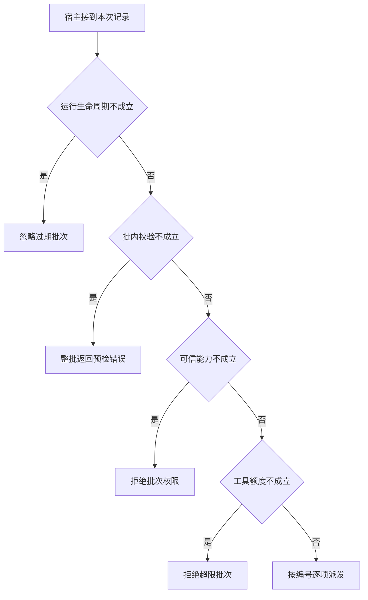

# 两个调用怎样作为一批发出去

批次里的两项检查各自能失败。
先执行第一个，等到第二个才发现它未获授权，会让“整批拒绝”变成实际执行一半。
要在真实派发前确定这次采用的事务语义。

本篇用一个封闭的教学决策器说明这一问题。输入是宿主收到的记录，不保证每个下游字段都已经获准使用。前置检查未成立时，下游即使带着缓存值，也不能拿来作业务断言。

## 先解决一个具体问题

**整批预检能保证外部事务全有或全无吗？**

它只能保证派发前发现的非法项不会导致执行一半。
投递之后某个下游仍可能独立失败，含写入的批次还需稳定键、补偿或明确的部分成功状态。


先取一个能走到「按编号逐项派发」的输入：批内动作均通过预检、宿主确认当前主体获准、可预留本次尝试额度、本轮尚在处理。
把这四个条件代回后文的图，前面各个拦截分支都未满足，最终才有“每个真实读取各有自己的关联”这个判断。
还原这个现场时要分别问：哪些位来自可信状态，哪些只是在接口中出现、尚未获得解释资格的字段。

## 先沿一次决策走到底



从上到下取第一条成立的出口。只改一个开关时，只有它之前的检查都未截断，该变化才可能到达真实动作。

“批内校验”的两种输入分别是“批内动作均通过预检”与“至少一项未通过预检”。
批量投递之前要决定是否允许部分执行。

“可信能力”的两种输入分别是“宿主确认当前主体获准”与“当前主体未获授权”。
权限取自可信入口或执行端，不由模型生成。

“工具额度”的两种输入分别是“可预留本次尝试额度”与“下游尝试额度不足”。
实际投递之前要核算重试或整批调用所需资源。

“运行生命周期”的两种输入分别是“本轮尚在处理”与“本轮已经终止”。
过期回执可归档，不能悄悄覆盖已交付的终态。

## 最少需要哪几项观察

### 忽略过期批次

已无活跃用户运行。
在本节的全部组合中，有 8 种产生「忽略过期批次」，这只是逻辑空间的计数，不能当作实际用户请求的比例。

只取得本轮已经终止，已经足以要求宿主「忽略过期批次」。
保持这些已知项，其余开关自由变化，仍有 8 种补全，判断没有翻转。

若删掉关于运行生命周期的证据，另一份允许的现场是至少一项未通过预检、当前主体未获授权、下游尝试额度不足、本轮尚在处理，它会使宿主「整批返回预检错误」。

### 整批返回预检错误

至少一个成员无法执行。
在本节的全部组合中，有 4 种产生「整批返回预检错误」，这只是逻辑空间的计数，不能当作实际用户请求的比例。

只取得至少一项未通过预检、本轮尚在处理，已经足以要求宿主「整批返回预检错误」。
保持这些已知项，其余开关自由变化，仍有 4 种补全，判断没有翻转。

若删掉关于批内校验的证据，另一份允许的现场是批内动作均通过预检、当前主体未获授权、下游尝试额度不足、本轮尚在处理，它会使宿主「拒绝批次权限」。

若删掉关于运行生命周期的证据，另一份允许的现场是至少一项未通过预检、当前主体未获授权、下游尝试额度不足、本轮已经终止，它会使宿主「忽略过期批次」。

### 拒绝批次权限

不能借用其他项的授权。
在本节的全部组合中，有 2 种产生「拒绝批次权限」，这只是逻辑空间的计数，不能当作实际用户请求的比例。

只取得批内动作均通过预检、当前主体未获授权、本轮尚在处理，已经足以要求宿主「拒绝批次权限」。
保持这些已知项，其余开关自由变化，仍有 2 种补全，判断没有翻转。

若删掉关于批内校验的证据，另一份允许的现场是至少一项未通过预检、当前主体未获授权、下游尝试额度不足、本轮尚在处理，它会使宿主「整批返回预检错误」。

若删掉关于可信能力的证据，另一份允许的现场是批内动作均通过预检、宿主确认当前主体获准、下游尝试额度不足、本轮尚在处理，它会使宿主「拒绝超限批次」。

若删掉关于运行生命周期的证据，另一份允许的现场是批内动作均通过预检、当前主体未获授权、下游尝试额度不足、本轮已经终止，它会使宿主「忽略过期批次」。

### 拒绝超限批次

工具位表示能预留整批所需额度。
在本节的全部组合中，有 1 种产生「拒绝超限批次」，这只是逻辑空间的计数，不能当作实际用户请求的比例。

只取得批内动作均通过预检、宿主确认当前主体获准、下游尝试额度不足、本轮尚在处理，已经足以要求宿主「拒绝超限批次」。
保持这些已知项，其余开关自由变化，仍有 1 种补全，判断没有翻转。

若删掉关于批内校验的证据，另一份允许的现场是至少一项未通过预检、宿主确认当前主体获准、下游尝试额度不足、本轮尚在处理，它会使宿主「整批返回预检错误」。

若删掉关于可信能力的证据，另一份允许的现场是批内动作均通过预检、当前主体未获授权、下游尝试额度不足、本轮尚在处理，它会使宿主「拒绝批次权限」。

若删掉关于工具额度的证据，另一份允许的现场是批内动作均通过预检、宿主确认当前主体获准、可预留本次尝试额度、本轮尚在处理，它会使宿主「按编号逐项派发」。

若删掉关于运行生命周期的证据，另一份允许的现场是批内动作均通过预检、宿主确认当前主体获准、下游尝试额度不足、本轮已经终止，它会使宿主「忽略过期批次」。

### 按编号逐项派发

每个真实读取各有自己的关联。
在本节的全部组合中，有 1 种产生「按编号逐项派发」，这只是逻辑空间的计数，不能当作实际用户请求的比例。

只取得批内动作均通过预检、宿主确认当前主体获准、可预留本次尝试额度、本轮尚在处理，已经足以要求宿主「按编号逐项派发」。

若删掉关于批内校验的证据，另一份允许的现场是至少一项未通过预检、宿主确认当前主体获准、可预留本次尝试额度、本轮尚在处理，它会使宿主「整批返回预检错误」。

若删掉关于可信能力的证据，另一份允许的现场是批内动作均通过预检、当前主体未获授权、可预留本次尝试额度、本轮尚在处理，它会使宿主「拒绝批次权限」。

若删掉关于工具额度的证据，另一份允许的现场是批内动作均通过预检、宿主确认当前主体获准、下游尝试额度不足、本轮尚在处理，它会使宿主「拒绝超限批次」。

若删掉关于运行生命周期的证据，另一份允许的现场是批内动作均通过预检、宿主确认当前主体获准、可预留本次尝试额度、本轮已经终止，它会使宿主「忽略过期批次」。

## 以同一份契约解释截然不同的现场

<details>
<summary>展开推演与对应反例</summary>

下列样本按最先命中的业务分支排列。四位编码只作本篇页内定位，顺序与开头的四项输入一致。可以先猜下一动作，再展开相邻样本。

### 能够触发“忽略过期批次”的现场

**样本 0000**

业务侧交来至少一项未通过预检、当前主体未获授权，执行侧还记录了下游尝试额度不足、本轮已经终止。
把样本压成最短证明，保留本轮已经终止就能支持「忽略过期批次」。

在这份记录上，分别翻转「运行生命周期」中的任一项，其他项完全不变时，下一动作都会改变。

保持其余观察不动，单独切换「批内校验」、「可信能力」、「工具额度」仍得到「忽略过期批次」，它们在这个现场不是决定性变量。

要从本例改走「整批返回预检错误」，至少需要变动 1 项，一组最少改动是将本轮已经终止换成本轮尚在处理。

要从本例改走「拒绝批次权限」，至少需要变动 2 项，一组最少改动是将至少一项未通过预检、本轮已经终止换成批内动作均通过预检、本轮尚在处理。

要从本例改走「拒绝超限批次」，至少需要变动 3 项，一组最少改动是将至少一项未通过预检、当前主体未获授权、本轮已经终止换成批内动作均通过预检、宿主确认当前主体获准、本轮尚在处理。

要从本例改走「按编号逐项派发」，至少需要变动 4 项，一组最少改动是将至少一项未通过预检、当前主体未获授权、下游尝试额度不足、本轮已经终止换成批内动作均通过预检、宿主确认当前主体获准、可预留本次尝试额度、本轮尚在处理。

**样本 0010**

业务侧交来至少一项未通过预检、当前主体未获授权，执行侧还记录了可预留本次尝试额度、本轮已经终止。


要从本例改走「按编号逐项派发」，至少需要变动 3 项，一组最少改动是将至少一项未通过预检、当前主体未获授权、本轮已经终止换成批内动作均通过预检、宿主确认当前主体获准、本轮尚在处理。

要从本例改走「拒绝超限批次」，至少需要变动 4 项，一组最少改动是将至少一项未通过预检、当前主体未获授权、可预留本次尝试额度、本轮已经终止换成批内动作均通过预检、宿主确认当前主体获准、下游尝试额度不足、本轮尚在处理。

**样本 0100**

业务侧交来至少一项未通过预检、宿主确认当前主体获准，执行侧还记录了下游尝试额度不足、本轮已经终止。


要从本例改走「拒绝超限批次」，至少需要变动 2 项，一组最少改动是将至少一项未通过预检、本轮已经终止换成批内动作均通过预检、本轮尚在处理。

要从本例改走「拒绝批次权限」，至少需要变动 3 项，一组最少改动是将至少一项未通过预检、宿主确认当前主体获准、本轮已经终止换成批内动作均通过预检、当前主体未获授权、本轮尚在处理。

要从本例改走「按编号逐项派发」，至少需要变动 3 项，一组最少改动是将至少一项未通过预检、下游尝试额度不足、本轮已经终止换成批内动作均通过预检、可预留本次尝试额度、本轮尚在处理。

**样本 0110**

业务侧交来至少一项未通过预检、宿主确认当前主体获准，执行侧还记录了可预留本次尝试额度、本轮已经终止。


要从本例改走「按编号逐项派发」，至少需要变动 2 项，一组最少改动是将至少一项未通过预检、本轮已经终止换成批内动作均通过预检、本轮尚在处理。


要从本例改走「拒绝超限批次」，至少需要变动 3 项，一组最少改动是将至少一项未通过预检、可预留本次尝试额度、本轮已经终止换成批内动作均通过预检、下游尝试额度不足、本轮尚在处理。

**样本 1000**

业务侧交来批内动作均通过预检、当前主体未获授权，执行侧还记录了下游尝试额度不足、本轮已经终止。


要从本例改走「拒绝批次权限」，至少需要变动 1 项，一组最少改动是将本轮已经终止换成本轮尚在处理。

要从本例改走「整批返回预检错误」，至少需要变动 2 项，一组最少改动是将批内动作均通过预检、本轮已经终止换成至少一项未通过预检、本轮尚在处理。

要从本例改走「拒绝超限批次」，至少需要变动 2 项，一组最少改动是将当前主体未获授权、本轮已经终止换成宿主确认当前主体获准、本轮尚在处理。

要从本例改走「按编号逐项派发」，至少需要变动 3 项，一组最少改动是将当前主体未获授权、下游尝试额度不足、本轮已经终止换成宿主确认当前主体获准、可预留本次尝试额度、本轮尚在处理。

**样本 1010**

业务侧交来批内动作均通过预检、当前主体未获授权，执行侧还记录了可预留本次尝试额度、本轮已经终止。


要从本例改走「按编号逐项派发」，至少需要变动 2 项，一组最少改动是将当前主体未获授权、本轮已经终止换成宿主确认当前主体获准、本轮尚在处理。

要从本例改走「拒绝超限批次」，至少需要变动 3 项，一组最少改动是将当前主体未获授权、可预留本次尝试额度、本轮已经终止换成宿主确认当前主体获准、下游尝试额度不足、本轮尚在处理。

**样本 1100**

业务侧交来批内动作均通过预检、宿主确认当前主体获准，执行侧还记录了下游尝试额度不足、本轮已经终止。


要从本例改走「拒绝超限批次」，至少需要变动 1 项，一组最少改动是将本轮已经终止换成本轮尚在处理。


要从本例改走「拒绝批次权限」，至少需要变动 2 项，一组最少改动是将宿主确认当前主体获准、本轮已经终止换成当前主体未获授权、本轮尚在处理。

要从本例改走「按编号逐项派发」，至少需要变动 2 项，一组最少改动是将下游尝试额度不足、本轮已经终止换成可预留本次尝试额度、本轮尚在处理。

**样本 1110**

业务侧交来批内动作均通过预检、宿主确认当前主体获准，执行侧还记录了可预留本次尝试额度、本轮已经终止。


要从本例改走「按编号逐项派发」，至少需要变动 1 项，一组最少改动是将本轮已经终止换成本轮尚在处理。


要从本例改走「拒绝超限批次」，至少需要变动 2 项，一组最少改动是将可预留本次尝试额度、本轮已经终止换成下游尝试额度不足、本轮尚在处理。

### 能够触发“整批返回预检错误”的现场

**样本 0001**

业务侧交来至少一项未通过预检、当前主体未获授权，执行侧还记录了下游尝试额度不足、本轮尚在处理。
把样本压成最短证明，保留至少一项未通过预检、本轮尚在处理就能支持「整批返回预检错误」。

在这份记录上，分别翻转「批内校验」、「运行生命周期」中的任一项，其他项完全不变时，下一动作都会改变。

保持其余观察不动，单独切换「可信能力」、「工具额度」仍得到「整批返回预检错误」，它们在这个现场不是决定性变量。

本例没走更靠前的「忽略过期批次」，因为本轮尚在处理与那个入口的必要条件不符。

要从本例改走「忽略过期批次」，至少需要变动 1 项，一组最少改动是将本轮尚在处理换成本轮已经终止。

要从本例改走「拒绝批次权限」，至少需要变动 1 项，一组最少改动是将至少一项未通过预检换成批内动作均通过预检。

要从本例改走「拒绝超限批次」，至少需要变动 2 项，一组最少改动是将至少一项未通过预检、当前主体未获授权换成批内动作均通过预检、宿主确认当前主体获准。

要从本例改走「按编号逐项派发」，至少需要变动 3 项，一组最少改动是将至少一项未通过预检、当前主体未获授权、下游尝试额度不足换成批内动作均通过预检、宿主确认当前主体获准、可预留本次尝试额度。

**样本 0011**

业务侧交来至少一项未通过预检、当前主体未获授权，执行侧还记录了可预留本次尝试额度、本轮尚在处理。


要从本例改走「按编号逐项派发」，至少需要变动 2 项，一组最少改动是将至少一项未通过预检、当前主体未获授权换成批内动作均通过预检、宿主确认当前主体获准。

要从本例改走「拒绝超限批次」，至少需要变动 3 项，一组最少改动是将至少一项未通过预检、当前主体未获授权、可预留本次尝试额度换成批内动作均通过预检、宿主确认当前主体获准、下游尝试额度不足。

**样本 0101**

业务侧交来至少一项未通过预检、宿主确认当前主体获准，执行侧还记录了下游尝试额度不足、本轮尚在处理。


要从本例改走「拒绝超限批次」，至少需要变动 1 项，一组最少改动是将至少一项未通过预检换成批内动作均通过预检。

要从本例改走「拒绝批次权限」，至少需要变动 2 项，一组最少改动是将至少一项未通过预检、宿主确认当前主体获准换成批内动作均通过预检、当前主体未获授权。

要从本例改走「按编号逐项派发」，至少需要变动 2 项，一组最少改动是将至少一项未通过预检、下游尝试额度不足换成批内动作均通过预检、可预留本次尝试额度。

**样本 0111**

业务侧交来至少一项未通过预检、宿主确认当前主体获准，执行侧还记录了可预留本次尝试额度、本轮尚在处理。


要从本例改走「按编号逐项派发」，至少需要变动 1 项，一组最少改动是将至少一项未通过预检换成批内动作均通过预检。


要从本例改走「拒绝超限批次」，至少需要变动 2 项，一组最少改动是将至少一项未通过预检、可预留本次尝试额度换成批内动作均通过预检、下游尝试额度不足。

### 能够触发“拒绝批次权限”的现场

**样本 1001**

业务侧交来批内动作均通过预检、当前主体未获授权，执行侧还记录了下游尝试额度不足、本轮尚在处理。
把样本压成最短证明，保留批内动作均通过预检、当前主体未获授权、本轮尚在处理就能支持「拒绝批次权限」。

在这份记录上，分别翻转「批内校验」、「可信能力」、「运行生命周期」中的任一项，其他项完全不变时，下一动作都会改变。

保持其余观察不动，单独切换「工具额度」仍得到「拒绝批次权限」，它们在这个现场不是决定性变量。


本例没走更靠前的「整批返回预检错误」，因为批内动作均通过预检与那个入口的必要条件不符。

要从本例改走「整批返回预检错误」，至少需要变动 1 项，一组最少改动是将批内动作均通过预检换成至少一项未通过预检。


要从本例改走「拒绝超限批次」，至少需要变动 1 项，一组最少改动是将当前主体未获授权换成宿主确认当前主体获准。

要从本例改走「按编号逐项派发」，至少需要变动 2 项，一组最少改动是将当前主体未获授权、下游尝试额度不足换成宿主确认当前主体获准、可预留本次尝试额度。

**样本 1011**

业务侧交来批内动作均通过预检、当前主体未获授权，执行侧还记录了可预留本次尝试额度、本轮尚在处理。


要从本例改走「按编号逐项派发」，至少需要变动 1 项，一组最少改动是将当前主体未获授权换成宿主确认当前主体获准。

要从本例改走「拒绝超限批次」，至少需要变动 2 项，一组最少改动是将当前主体未获授权、可预留本次尝试额度换成宿主确认当前主体获准、下游尝试额度不足。

### 能够触发“拒绝超限批次”的现场

**样本 1101**

业务侧交来批内动作均通过预检、宿主确认当前主体获准，执行侧还记录了下游尝试额度不足、本轮尚在处理。
把样本压成最短证明，保留批内动作均通过预检、宿主确认当前主体获准、下游尝试额度不足、本轮尚在处理就能支持「拒绝超限批次」。

在这份记录上，分别翻转「批内校验」、「可信能力」、「工具额度」、「运行生命周期」中的任一项，其他项完全不变时，下一动作都会改变。


本例没走更靠前的「拒绝批次权限」，因为宿主确认当前主体获准与那个入口的必要条件不符。


要从本例改走「拒绝批次权限」，至少需要变动 1 项，一组最少改动是将宿主确认当前主体获准换成当前主体未获授权。


要从本例改走「按编号逐项派发」，至少需要变动 1 项，一组最少改动是将下游尝试额度不足换成可预留本次尝试额度。

### 能够触发“按编号逐项派发”的现场

**样本 1111**

业务侧交来批内动作均通过预检、宿主确认当前主体获准，执行侧还记录了可预留本次尝试额度、本轮尚在处理。
把样本压成最短证明，保留批内动作均通过预检、宿主确认当前主体获准、可预留本次尝试额度、本轮尚在处理就能支持「按编号逐项派发」。


本例没走更靠前的「拒绝超限批次」，因为可预留本次尝试额度与那个入口的必要条件不符。


要从本例改走「拒绝超限批次」，至少需要变动 1 项，一组最少改动是将可预留本次尝试额度换成下游尝试额度不足。


</details>

## 当你只能看见一半记录

<details>
<summary>展开推演与对应反例</summary>

这次隐藏两个字段，保留另两个。对每个可见现场，检查四种合法补全是否同意。如仍有歧义，选择能使最坏剩余候选动作最少的字段继续查。并列时采用本篇字段顺序。

### 只保留批内校验与可信能力

已知至少一项未通过预检、当前主体未获授权时，四种补全的动作分布为忽略过期批次（2 种）、整批返回预检错误（2 种）。

在至少一项未通过预检、当前主体未获授权这个现场补读「运行生命周期」，最坏还剩 1 种动作，计算时只衡量歧义，尚未扣读取代价。
若补来的观察为“本轮已经终止”，范围缩成「忽略过期批次」。若为“本轮尚在处理”，则保留「整批返回预检错误」。

区分不了的两条执行可以具体写成 0000 与 0001：它们共享已展示字段，却分别需要「忽略过期批次」和「整批返回预检错误」。

已知至少一项未通过预检、宿主确认当前主体获准时，四种补全的动作分布为忽略过期批次（2 种）、整批返回预检错误（2 种）。

在至少一项未通过预检、宿主确认当前主体获准这个现场补读「运行生命周期」，最坏还剩 1 种动作，计算时只衡量歧义，尚未扣读取代价。

区分不了的两条执行可以具体写成 0100 与 0101：它们共享已展示字段，却分别需要「忽略过期批次」和「整批返回预检错误」。

已知批内动作均通过预检、当前主体未获授权时，四种补全的动作分布为忽略过期批次（2 种）、拒绝批次权限（2 种）。

在批内动作均通过预检、当前主体未获授权这个现场补读「运行生命周期」，最坏还剩 1 种动作，计算时只衡量歧义，尚未扣读取代价。
若补来的观察为“本轮已经终止”，范围缩成「忽略过期批次」。若为“本轮尚在处理”，则保留「拒绝批次权限」。

区分不了的两条执行可以具体写成 1000 与 1001：它们共享已展示字段，却分别需要「忽略过期批次」和「拒绝批次权限」。

已知批内动作均通过预检、宿主确认当前主体获准时，四种补全的动作分布为忽略过期批次（2 种）、拒绝超限批次（1 种）、按编号逐项派发（1 种）。

在批内动作均通过预检、宿主确认当前主体获准这个现场补读「工具额度」，最坏还剩 2 种动作，计算时只衡量歧义，尚未扣读取代价。
若补来的观察为“下游尝试额度不足”，范围缩成「忽略过期批次」、「拒绝超限批次」。若为“可预留本次尝试额度”，则保留「忽略过期批次」、「按编号逐项派发」。

区分不了的两条执行可以具体写成 1100 与 1101：它们共享已展示字段，却分别需要「忽略过期批次」和「拒绝超限批次」。

### 只保留批内校验与工具额度

已知至少一项未通过预检、下游尝试额度不足时，四种补全的动作分布为忽略过期批次（2 种）、整批返回预检错误（2 种）。

在至少一项未通过预检、下游尝试额度不足这个现场补读「运行生命周期」，最坏还剩 1 种动作，计算时只衡量歧义，尚未扣读取代价。


已知至少一项未通过预检、可预留本次尝试额度时，四种补全的动作分布为忽略过期批次（2 种）、整批返回预检错误（2 种）。

在至少一项未通过预检、可预留本次尝试额度这个现场补读「运行生命周期」，最坏还剩 1 种动作，计算时只衡量歧义，尚未扣读取代价。

区分不了的两条执行可以具体写成 0010 与 0011：它们共享已展示字段，却分别需要「忽略过期批次」和「整批返回预检错误」。

已知批内动作均通过预检、下游尝试额度不足时，四种补全的动作分布为忽略过期批次（2 种）、拒绝批次权限（1 种）、拒绝超限批次（1 种）。

在批内动作均通过预检、下游尝试额度不足这个现场补读「可信能力」，最坏还剩 2 种动作，计算时只衡量歧义，尚未扣读取代价。
若补来的观察为“当前主体未获授权”，范围缩成「忽略过期批次」、「拒绝批次权限」。若为“宿主确认当前主体获准”，则保留「忽略过期批次」、「拒绝超限批次」。


已知批内动作均通过预检、可预留本次尝试额度时，四种补全的动作分布为忽略过期批次（2 种）、拒绝批次权限（1 种）、按编号逐项派发（1 种）。

在批内动作均通过预检、可预留本次尝试额度这个现场补读「可信能力」，最坏还剩 2 种动作，计算时只衡量歧义，尚未扣读取代价。
若补来的观察为“当前主体未获授权”，范围缩成「忽略过期批次」、「拒绝批次权限」。若为“宿主确认当前主体获准”，则保留「忽略过期批次」、「按编号逐项派发」。

区分不了的两条执行可以具体写成 1010 与 1011：它们共享已展示字段，却分别需要「忽略过期批次」和「拒绝批次权限」。

### 只保留可信能力与工具额度

已知当前主体未获授权、下游尝试额度不足时，四种补全的动作分布为忽略过期批次（2 种）、整批返回预检错误（1 种）、拒绝批次权限（1 种）。

在当前主体未获授权、下游尝试额度不足这个现场补读「批内校验」，最坏还剩 2 种动作，计算时只衡量歧义，尚未扣读取代价。
若补来的观察为“至少一项未通过预检”，范围缩成「忽略过期批次」、「整批返回预检错误」。若为“批内动作均通过预检”，则保留「忽略过期批次」、「拒绝批次权限」。


已知当前主体未获授权、可预留本次尝试额度时，四种补全的动作分布为忽略过期批次（2 种）、整批返回预检错误（1 种）、拒绝批次权限（1 种）。

在当前主体未获授权、可预留本次尝试额度这个现场补读「批内校验」，最坏还剩 2 种动作，计算时只衡量歧义，尚未扣读取代价。


已知宿主确认当前主体获准、下游尝试额度不足时，四种补全的动作分布为忽略过期批次（2 种）、整批返回预检错误（1 种）、拒绝超限批次（1 种）。

在宿主确认当前主体获准、下游尝试额度不足这个现场补读「批内校验」，最坏还剩 2 种动作，计算时只衡量歧义，尚未扣读取代价。
若补来的观察为“至少一项未通过预检”，范围缩成「忽略过期批次」、「整批返回预检错误」。若为“批内动作均通过预检”，则保留「忽略过期批次」、「拒绝超限批次」。


已知宿主确认当前主体获准、可预留本次尝试额度时，四种补全的动作分布为忽略过期批次（2 种）、整批返回预检错误（1 种）、按编号逐项派发（1 种）。

在宿主确认当前主体获准、可预留本次尝试额度这个现场补读「批内校验」，最坏还剩 2 种动作，计算时只衡量歧义，尚未扣读取代价。
若补来的观察为“至少一项未通过预检”，范围缩成「忽略过期批次」、「整批返回预检错误」。若为“批内动作均通过预检”，则保留「忽略过期批次」、「按编号逐项派发」。

区分不了的两条执行可以具体写成 0110 与 0111：它们共享已展示字段，却分别需要「忽略过期批次」和「整批返回预检错误」。

### 只保留批内校验与运行生命周期

已知至少一项未通过预检、本轮已经终止时，四种补全的动作分布为忽略过期批次（4 种）。

就“忽略过期批次”这个动作而言，在至少一项未通过预检、本轮已经终止的前提下，另外两项观察不会推翻它。

已知至少一项未通过预检、本轮尚在处理时，四种补全的动作分布为整批返回预检错误（4 种）。

就“整批返回预检错误”这个动作而言，在至少一项未通过预检、本轮尚在处理的前提下，另外两项观察不会推翻它。

已知批内动作均通过预检、本轮已经终止时，四种补全的动作分布为忽略过期批次（4 种）。

就“忽略过期批次”这个动作而言，在批内动作均通过预检、本轮已经终止的前提下，另外两项观察不会推翻它。

已知批内动作均通过预检、本轮尚在处理时，四种补全的动作分布为拒绝批次权限（2 种）、拒绝超限批次（1 种）、按编号逐项派发（1 种）。

在批内动作均通过预检、本轮尚在处理这个现场补读「可信能力」，最坏还剩 2 种动作，计算时只衡量歧义，尚未扣读取代价。
若补来的观察为“当前主体未获授权”，范围缩成「拒绝批次权限」。若为“宿主确认当前主体获准”，则保留「拒绝超限批次」、「按编号逐项派发」。

区分不了的两条执行可以具体写成 1001 与 1101：它们共享已展示字段，却分别需要「拒绝批次权限」和「拒绝超限批次」。

### 只保留可信能力与运行生命周期

已知当前主体未获授权、本轮已经终止时，四种补全的动作分布为忽略过期批次（4 种）。

就“忽略过期批次”这个动作而言，在当前主体未获授权、本轮已经终止的前提下，另外两项观察不会推翻它。

已知当前主体未获授权、本轮尚在处理时，四种补全的动作分布为整批返回预检错误（2 种）、拒绝批次权限（2 种）。

在当前主体未获授权、本轮尚在处理这个现场补读「批内校验」，最坏还剩 1 种动作，计算时只衡量歧义，尚未扣读取代价。
若补来的观察为“至少一项未通过预检”，范围缩成「整批返回预检错误」。若为“批内动作均通过预检”，则保留「拒绝批次权限」。

区分不了的两条执行可以具体写成 0001 与 1001：它们共享已展示字段，却分别需要「整批返回预检错误」和「拒绝批次权限」。

已知宿主确认当前主体获准、本轮已经终止时，四种补全的动作分布为忽略过期批次（4 种）。

就“忽略过期批次”这个动作而言，在宿主确认当前主体获准、本轮已经终止的前提下，另外两项观察不会推翻它。

已知宿主确认当前主体获准、本轮尚在处理时，四种补全的动作分布为整批返回预检错误（2 种）、拒绝超限批次（1 种）、按编号逐项派发（1 种）。

在宿主确认当前主体获准、本轮尚在处理这个现场补读「批内校验」，最坏还剩 2 种动作，计算时只衡量歧义，尚未扣读取代价。
若补来的观察为“至少一项未通过预检”，范围缩成「整批返回预检错误」。若为“批内动作均通过预检”，则保留「拒绝超限批次」、「按编号逐项派发」。

区分不了的两条执行可以具体写成 0101 与 1101：它们共享已展示字段，却分别需要「整批返回预检错误」和「拒绝超限批次」。

### 只保留工具额度与运行生命周期

已知下游尝试额度不足、本轮已经终止时，四种补全的动作分布为忽略过期批次（4 种）。

就“忽略过期批次”这个动作而言，在下游尝试额度不足、本轮已经终止的前提下，另外两项观察不会推翻它。

已知下游尝试额度不足、本轮尚在处理时，四种补全的动作分布为整批返回预检错误（2 种）、拒绝批次权限（1 种）、拒绝超限批次（1 种）。

在下游尝试额度不足、本轮尚在处理这个现场补读「批内校验」，最坏还剩 2 种动作，计算时只衡量歧义，尚未扣读取代价。
若补来的观察为“至少一项未通过预检”，范围缩成「整批返回预检错误」。若为“批内动作均通过预检”，则保留「拒绝批次权限」、「拒绝超限批次」。


已知可预留本次尝试额度、本轮已经终止时，四种补全的动作分布为忽略过期批次（4 种）。

就“忽略过期批次”这个动作而言，在可预留本次尝试额度、本轮已经终止的前提下，另外两项观察不会推翻它。

已知可预留本次尝试额度、本轮尚在处理时，四种补全的动作分布为整批返回预检错误（2 种）、拒绝批次权限（1 种）、按编号逐项派发（1 种）。

在可预留本次尝试额度、本轮尚在处理这个现场补读「批内校验」，最坏还剩 2 种动作，计算时只衡量歧义，尚未扣读取代价。
若补来的观察为“至少一项未通过预检”，范围缩成「整批返回预检错误」。若为“批内动作均通过预检”，则保留「拒绝批次权限」、「按编号逐项派发」。

区分不了的两条执行可以具体写成 0011 与 1011：它们共享已展示字段，却分别需要「整批返回预检错误」和「拒绝批次权限」。

</details>

## 单因素干预与边界测试

<details>
<summary>展开推演与对应反例</summary>

### 只改变批内校验

固定另外三个条件得到八对现场，从“至少一项未通过预检”转为“批内动作均通过预检”时，4 对翻转动作，另外 4 对保持不变。

令当前主体未获授权、下游尝试额度不足、本轮已经终止，批内校验的两个取值均得到「忽略过期批次」。在八对中，共有 4 对表现为这一种稳定出口。

有 2 对现场沿「整批返回预检错误」变到「拒绝批次权限」，可复现的一组受控背景为当前主体未获授权、下游尝试额度不足、本轮尚在处理。

有 1 对现场沿「整批返回预检错误」变到「拒绝超限批次」，可复现的一组受控背景为宿主确认当前主体获准、下游尝试额度不足、本轮尚在处理。

有 1 对现场沿「整批返回预检错误」变到「按编号逐项派发」，可复现的一组受控背景为宿主确认当前主体获准、可预留本次尝试额度、本轮尚在处理。

### 只改变可信能力

固定另外三个条件得到八对现场，从“当前主体未获授权”转为“宿主确认当前主体获准”时，2 对翻转动作，另外 6 对保持不变。

令至少一项未通过预检、下游尝试额度不足、本轮已经终止，可信能力的两个取值均得到「忽略过期批次」。在八对中，共有 4 对表现为这一种稳定出口。

令至少一项未通过预检、下游尝试额度不足、本轮尚在处理，可信能力的两个取值均得到「整批返回预检错误」。在八对中，共有 2 对表现为这一种稳定出口。

有 1 对现场沿「拒绝批次权限」变到「拒绝超限批次」，可复现的一组受控背景为批内动作均通过预检、下游尝试额度不足、本轮尚在处理。

有 1 对现场沿「拒绝批次权限」变到「按编号逐项派发」，可复现的一组受控背景为批内动作均通过预检、可预留本次尝试额度、本轮尚在处理。

### 只改变工具额度

固定另外三个条件得到八对现场，从“下游尝试额度不足”转为“可预留本次尝试额度”时，1 对翻转动作，另外 7 对保持不变。

令至少一项未通过预检、当前主体未获授权、本轮已经终止，工具额度的两个取值均得到「忽略过期批次」。在八对中，共有 4 对表现为这一种稳定出口。

令至少一项未通过预检、当前主体未获授权、本轮尚在处理，工具额度的两个取值均得到「整批返回预检错误」。在八对中，共有 2 对表现为这一种稳定出口。

令批内动作均通过预检、当前主体未获授权、本轮尚在处理，工具额度的两个取值均得到「拒绝批次权限」。在八对中，共有 1 对表现为这一种稳定出口。

有 1 对现场沿「拒绝超限批次」变到「按编号逐项派发」，可复现的一组受控背景为批内动作均通过预检、宿主确认当前主体获准、本轮尚在处理。

### 只改变运行生命周期

固定另外三个条件得到八对现场，从“本轮已经终止”转为“本轮尚在处理”时，8 对翻转动作，另外 0 对保持不变。

有 4 对现场沿「忽略过期批次」变到「整批返回预检错误」，可复现的一组受控背景为至少一项未通过预检、当前主体未获授权、下游尝试额度不足。

有 2 对现场沿「忽略过期批次」变到「拒绝批次权限」，可复现的一组受控背景为批内动作均通过预检、当前主体未获授权、下游尝试额度不足。

有 1 对现场沿「忽略过期批次」变到「拒绝超限批次」，可复现的一组受控背景为批内动作均通过预检、宿主确认当前主体获准、下游尝试额度不足。

有 1 对现场沿「忽略过期批次」变到「按编号逐项派发」，可复现的一组受控背景为批内动作均通过预检、宿主确认当前主体获准、可预留本次尝试额度。

</details>

## 哪些回归样本真能抓住实现错误

<details>
<summary>展开推演与对应反例</summary>

如果删除“忽略过期批次”这个分支，在本篇 16 种输入里有 8 种会改走另一出口。

反例 0000 的完整记录为至少一项未通过预检、当前主体未获授权、下游尝试额度不足、本轮已经终止。正确结果是「忽略过期批次」，这个改坏的实现却给出「整批返回预检错误」。

如果删除“整批返回预检错误”这个分支，在本篇 16 种输入里有 4 种会改走另一出口。

反例 0001 的完整记录为至少一项未通过预检、当前主体未获授权、下游尝试额度不足、本轮尚在处理。正确结果是「整批返回预检错误」，这个改坏的实现却给出「拒绝批次权限」。

如果删除“拒绝批次权限”这个分支，在本篇 16 种输入里有 2 种会改走另一出口。

反例 1001 的完整记录为批内动作均通过预检、当前主体未获授权、下游尝试额度不足、本轮尚在处理。正确结果是「拒绝批次权限」，这个改坏的实现却给出「拒绝超限批次」。

如果删除“拒绝超限批次”这个分支，在本篇 16 种输入里有 1 种会改走另一出口。

反例 1101 的完整记录为批内动作均通过预检、宿主确认当前主体获准、下游尝试额度不足、本轮尚在处理。正确结果是「拒绝超限批次」，这个改坏的实现却给出「按编号逐项派发」。

如果交换“忽略过期批次”和“整批返回预检错误”的判断次序，在本篇 16 种输入里有 4 种会改走另一出口。


如果交换“整批返回预检错误”和“拒绝批次权限”的判断次序，在本篇 16 种输入里有 2 种会改走另一出口。


如果交换“拒绝批次权限”和“拒绝超限批次”的判断次序，在本篇 16 种输入里有 1 种会改走另一出口。


补入样本 0000（至少一项未通过预检、当前主体未获授权、下游尝试额度不足、本轮已经终止）能新增检出「删除“忽略过期批次”这个分支」、「交换“忽略过期批次”和“整批返回预检错误”的判断次序」。

补入样本 0001（至少一项未通过预检、当前主体未获授权、下游尝试额度不足、本轮尚在处理）能新增检出「删除“整批返回预检错误”这个分支」、「交换“整批返回预检错误”和“拒绝批次权限”的判断次序」。

补入样本 1001（批内动作均通过预检、当前主体未获授权、下游尝试额度不足、本轮尚在处理）能新增检出「删除“拒绝批次权限”这个分支」、「交换“拒绝批次权限”和“拒绝超限批次”的判断次序」。

补入样本 1101（批内动作均通过预检、宿主确认当前主体获准、下游尝试额度不足、本轮尚在处理）能新增检出「删除“拒绝超限批次”这个分支」。

这里每次选覆盖尚未捕获缺陷最多的样本，并不保证用例数全局最小。它给出的反例能作为 Java 单测输入。真实模型是否会自主产生这些提议，仍须单独评测。

</details>

## 把状态覆盖换成有抽样偏差的评测批次

<details>
<summary>展开推演与对应反例</summary>

前面的十六种记录各有一票。现在只改样本构成：对一个给定字段，把成立侧的每种记录各取三份、另一侧各取一份。这是人为配比的 32 份回放，不是线上频率估计。
将偏向成立与偏向不成立的两次批次对照，可以隔离分母变化。底层宿主和所有答案保持相同，比例仍可能移动。

### 改变“批内校验”的样本配比

只看「忽略过期批次」，在批内动作均通过预检的八个不同输入中有 4 个命中，在至少一项未通过预检的另八个输入中有 4 个命中。
把「批内校验」成立侧按三倍取样，「忽略过期批次」占 16/32，反过来向未成立侧倾斜后占 16/32。
两批「忽略过期批次」的边际比例相同，是因为这个出口在“批内校验”的两侧计数相等，这不能单独证明每一对现场都不受它影响。

只看「整批返回预检错误」，在批内动作均通过预检的八个不同输入中有 0 个命中，在至少一项未通过预检的另八个输入中有 4 个命中。
把「批内校验」成立侧按三倍取样，「整批返回预检错误」占 4/32，反过来向未成立侧倾斜后占 12/32。
这次重加权使「整批返回预检错误」的占比相差 25 个百分点。若按两种不同的“批内校验”分布跑新旧版，不能把这项差异全部归功于实现。

只看「拒绝批次权限」，在批内动作均通过预检的八个不同输入中有 2 个命中，在至少一项未通过预检的另八个输入中有 0 个命中。
把「批内校验」成立侧按三倍取样，「拒绝批次权限」占 6/32，反过来向未成立侧倾斜后占 2/32。
这次重加权使「拒绝批次权限」的占比相差 12.5 个百分点。若按两种不同的“批内校验”分布跑新旧版，不能把这项差异全部归功于实现。

只看「拒绝超限批次」，在批内动作均通过预检的八个不同输入中有 1 个命中，在至少一项未通过预检的另八个输入中有 0 个命中。
把「批内校验」成立侧按三倍取样，「拒绝超限批次」占 3/32，反过来向未成立侧倾斜后占 1/32。
这次重加权使「拒绝超限批次」的占比相差 6.25 个百分点。若按两种不同的“批内校验”分布跑新旧版，不能把这项差异全部归功于实现。

只看「按编号逐项派发」，在批内动作均通过预检的八个不同输入中有 1 个命中，在至少一项未通过预检的另八个输入中有 0 个命中。
把「批内校验」成立侧按三倍取样，「按编号逐项派发」占 3/32，反过来向未成立侧倾斜后占 1/32。
这次重加权使「按编号逐项派发」的占比相差 6.25 个百分点。若按两种不同的“批内校验”分布跑新旧版，不能把这项差异全部归功于实现。

### 改变“可信能力”的样本配比

只看「忽略过期批次」，在宿主确认当前主体获准的八个不同输入中有 4 个命中，在当前主体未获授权的另八个输入中有 4 个命中。
把「可信能力」成立侧按三倍取样，「忽略过期批次」占 16/32，反过来向未成立侧倾斜后占 16/32。
两批「忽略过期批次」的边际比例相同，是因为这个出口在“可信能力”的两侧计数相等，这不能单独证明每一对现场都不受它影响。

只看「整批返回预检错误」，在宿主确认当前主体获准的八个不同输入中有 2 个命中，在当前主体未获授权的另八个输入中有 2 个命中。
把「可信能力」成立侧按三倍取样，「整批返回预检错误」占 8/32，反过来向未成立侧倾斜后占 8/32。
两批「整批返回预检错误」的边际比例相同，是因为这个出口在“可信能力”的两侧计数相等，这不能单独证明每一对现场都不受它影响。

只看「拒绝批次权限」，在宿主确认当前主体获准的八个不同输入中有 0 个命中，在当前主体未获授权的另八个输入中有 2 个命中。
把「可信能力」成立侧按三倍取样，「拒绝批次权限」占 2/32，反过来向未成立侧倾斜后占 6/32。
这次重加权使「拒绝批次权限」的占比相差 12.5 个百分点。若按两种不同的“可信能力”分布跑新旧版，不能把这项差异全部归功于实现。

只看「拒绝超限批次」，在宿主确认当前主体获准的八个不同输入中有 1 个命中，在当前主体未获授权的另八个输入中有 0 个命中。
把「可信能力」成立侧按三倍取样，「拒绝超限批次」占 3/32，反过来向未成立侧倾斜后占 1/32。
这次重加权使「拒绝超限批次」的占比相差 6.25 个百分点。若按两种不同的“可信能力”分布跑新旧版，不能把这项差异全部归功于实现。

只看「按编号逐项派发」，在宿主确认当前主体获准的八个不同输入中有 1 个命中，在当前主体未获授权的另八个输入中有 0 个命中。
把「可信能力」成立侧按三倍取样，「按编号逐项派发」占 3/32，反过来向未成立侧倾斜后占 1/32。
这次重加权使「按编号逐项派发」的占比相差 6.25 个百分点。若按两种不同的“可信能力”分布跑新旧版，不能把这项差异全部归功于实现。

### 改变“工具额度”的样本配比

只看「忽略过期批次」，在可预留本次尝试额度的八个不同输入中有 4 个命中，在下游尝试额度不足的另八个输入中有 4 个命中。
把「工具额度」成立侧按三倍取样，「忽略过期批次」占 16/32，反过来向未成立侧倾斜后占 16/32。
两批「忽略过期批次」的边际比例相同，是因为这个出口在“工具额度”的两侧计数相等，这不能单独证明每一对现场都不受它影响。

只看「整批返回预检错误」，在可预留本次尝试额度的八个不同输入中有 2 个命中，在下游尝试额度不足的另八个输入中有 2 个命中。
把「工具额度」成立侧按三倍取样，「整批返回预检错误」占 8/32，反过来向未成立侧倾斜后占 8/32。
两批「整批返回预检错误」的边际比例相同，是因为这个出口在“工具额度”的两侧计数相等，这不能单独证明每一对现场都不受它影响。

只看「拒绝批次权限」，在可预留本次尝试额度的八个不同输入中有 1 个命中，在下游尝试额度不足的另八个输入中有 1 个命中。
把「工具额度」成立侧按三倍取样，「拒绝批次权限」占 4/32，反过来向未成立侧倾斜后占 4/32。
两批「拒绝批次权限」的边际比例相同，是因为这个出口在“工具额度”的两侧计数相等，这不能单独证明每一对现场都不受它影响。

只看「拒绝超限批次」，在可预留本次尝试额度的八个不同输入中有 0 个命中，在下游尝试额度不足的另八个输入中有 1 个命中。
把「工具额度」成立侧按三倍取样，「拒绝超限批次」占 1/32，反过来向未成立侧倾斜后占 3/32。
这次重加权使「拒绝超限批次」的占比相差 6.25 个百分点。若按两种不同的“工具额度”分布跑新旧版，不能把这项差异全部归功于实现。

只看「按编号逐项派发」，在可预留本次尝试额度的八个不同输入中有 1 个命中，在下游尝试额度不足的另八个输入中有 0 个命中。
把「工具额度」成立侧按三倍取样，「按编号逐项派发」占 3/32，反过来向未成立侧倾斜后占 1/32。
这次重加权使「按编号逐项派发」的占比相差 6.25 个百分点。若按两种不同的“工具额度”分布跑新旧版，不能把这项差异全部归功于实现。

### 改变“运行生命周期”的样本配比

只看「忽略过期批次」，在本轮尚在处理的八个不同输入中有 0 个命中，在本轮已经终止的另八个输入中有 8 个命中。
把「运行生命周期」成立侧按三倍取样，「忽略过期批次」占 8/32，反过来向未成立侧倾斜后占 24/32。
这次重加权使「忽略过期批次」的占比相差 50 个百分点。若按两种不同的“运行生命周期”分布跑新旧版，不能把这项差异全部归功于实现。

只看「整批返回预检错误」，在本轮尚在处理的八个不同输入中有 4 个命中，在本轮已经终止的另八个输入中有 0 个命中。
把「运行生命周期」成立侧按三倍取样，「整批返回预检错误」占 12/32，反过来向未成立侧倾斜后占 4/32。
这次重加权使「整批返回预检错误」的占比相差 25 个百分点。若按两种不同的“运行生命周期”分布跑新旧版，不能把这项差异全部归功于实现。

只看「拒绝批次权限」，在本轮尚在处理的八个不同输入中有 2 个命中，在本轮已经终止的另八个输入中有 0 个命中。
把「运行生命周期」成立侧按三倍取样，「拒绝批次权限」占 6/32，反过来向未成立侧倾斜后占 2/32。
这次重加权使「拒绝批次权限」的占比相差 12.5 个百分点。若按两种不同的“运行生命周期”分布跑新旧版，不能把这项差异全部归功于实现。

只看「拒绝超限批次」，在本轮尚在处理的八个不同输入中有 1 个命中，在本轮已经终止的另八个输入中有 0 个命中。
把「运行生命周期」成立侧按三倍取样，「拒绝超限批次」占 3/32，反过来向未成立侧倾斜后占 1/32。
这次重加权使「拒绝超限批次」的占比相差 6.25 个百分点。若按两种不同的“运行生命周期”分布跑新旧版，不能把这项差异全部归功于实现。

只看「按编号逐项派发」，在本轮尚在处理的八个不同输入中有 1 个命中，在本轮已经终止的另八个输入中有 0 个命中。
把「运行生命周期」成立侧按三倍取样，「按编号逐项派发」占 3/32，反过来向未成立侧倾斜后占 1/32。
这次重加权使「按编号逐项派发」的占比相差 6.25 个百分点。若按两种不同的“运行生命周期”分布跑新旧版，不能把这项差异全部归功于实现。

</details>

## 只看终态，能逆推出多少原始事实

<details>
<summary>展开推演与对应反例</summary>

### 只保留“忽略过期批次”这条结果时

「忽略过期批次」不能证明批内校验取哪一侧：0000 和 1000 有相同终态，却分别记为“至少一项未通过预检”和“批内动作均通过预检”。

「忽略过期批次」不能证明可信能力取哪一侧：0000 和 0100 有相同终态，却分别记为“当前主体未获授权”和“宿主确认当前主体获准”。

「忽略过期批次」不能证明工具额度取哪一侧：0000 和 0010 有相同终态，却分别记为“下游尝试额度不足”和“可预留本次尝试额度”。

在本节契约与完整输入域内，仅知「忽略过期批次」就能倒推出本轮已经终止，这一推断依赖版本未变且日志中的终态可信。

反查「忽略过期批次」的诊断日志，优先保留能区分样本 0000 与 0001 的「运行生命周期」，否则很容易把邻近的「整批返回预检错误」看成同一种故障。

### 只保留“整批返回预检错误”这条结果时

在本节契约与完整输入域内，仅知「整批返回预检错误」就能倒推出至少一项未通过预检，这一推断依赖版本未变且日志中的终态可信。

「整批返回预检错误」不能证明可信能力取哪一侧：0001 和 0101 有相同终态，却分别记为“当前主体未获授权”和“宿主确认当前主体获准”。

「整批返回预检错误」不能证明工具额度取哪一侧：0001 和 0011 有相同终态，却分别记为“下游尝试额度不足”和“可预留本次尝试额度”。

在本节契约与完整输入域内，仅知「整批返回预检错误」就能倒推出本轮尚在处理，这一推断依赖版本未变且日志中的终态可信。

反查「整批返回预检错误」的诊断日志，优先保留能区分样本 0001 与 0000 的「运行生命周期」，否则很容易把邻近的「忽略过期批次」看成同一种故障。

### 只保留“拒绝批次权限”这条结果时

在本节契约与完整输入域内，仅知「拒绝批次权限」就能倒推出批内动作均通过预检，这一推断依赖版本未变且日志中的终态可信。

在本节契约与完整输入域内，仅知「拒绝批次权限」就能倒推出当前主体未获授权，这一推断依赖版本未变且日志中的终态可信。

「拒绝批次权限」不能证明工具额度取哪一侧：1001 和 1011 有相同终态，却分别记为“下游尝试额度不足”和“可预留本次尝试额度”。

在本节契约与完整输入域内，仅知「拒绝批次权限」就能倒推出本轮尚在处理，这一推断依赖版本未变且日志中的终态可信。

反查「拒绝批次权限」的诊断日志，优先保留能区分样本 1001 与 0001 的「批内校验」，否则很容易把邻近的「整批返回预检错误」看成同一种故障。

### 只保留“拒绝超限批次”这条结果时

在本节契约与完整输入域内，仅知「拒绝超限批次」就能倒推出批内动作均通过预检，这一推断依赖版本未变且日志中的终态可信。

在本节契约与完整输入域内，仅知「拒绝超限批次」就能倒推出宿主确认当前主体获准，这一推断依赖版本未变且日志中的终态可信。

在本节契约与完整输入域内，仅知「拒绝超限批次」就能倒推出下游尝试额度不足，这一推断依赖版本未变且日志中的终态可信。

在本节契约与完整输入域内，仅知「拒绝超限批次」就能倒推出本轮尚在处理，这一推断依赖版本未变且日志中的终态可信。

反查「拒绝超限批次」的诊断日志，优先保留能区分样本 1101 与 0101 的「批内校验」，否则很容易把邻近的「整批返回预检错误」看成同一种故障。

### 只保留“按编号逐项派发”这条结果时

在本节契约与完整输入域内，仅知「按编号逐项派发」就能倒推出批内动作均通过预检，这一推断依赖版本未变且日志中的终态可信。

在本节契约与完整输入域内，仅知「按编号逐项派发」就能倒推出宿主确认当前主体获准，这一推断依赖版本未变且日志中的终态可信。

在本节契约与完整输入域内，仅知「按编号逐项派发」就能倒推出可预留本次尝试额度，这一推断依赖版本未变且日志中的终态可信。

在本节契约与完整输入域内，仅知「按编号逐项派发」就能倒推出本轮尚在处理，这一推断依赖版本未变且日志中的终态可信。

反查「按编号逐项派发」的诊断日志，优先保留能区分样本 1111 与 0111 的「批内校验」，否则很容易把邻近的「整批返回预检错误」看成同一种故障。

</details>

## 面试复述与复算

面试题可以从“整批预检能保证外部事务全有或全无吗？”起步。先给出本篇的触发条件和一条真实执行端可检查的证据，再用一个相邻反例限定结论的适用范围。

在仓库根目录执行下列命令可以重算本篇的一个输入。四位数字依次选择正文列出的四项条件，0 表示未成立或低档，1 表示成立或高档。
```powershell
node examples/reading-cases/replay.mjs 3 4 0101
```

[本周主文](../theory.md) · [配套实验](../lab.md) · [下一篇研读](05.md)
