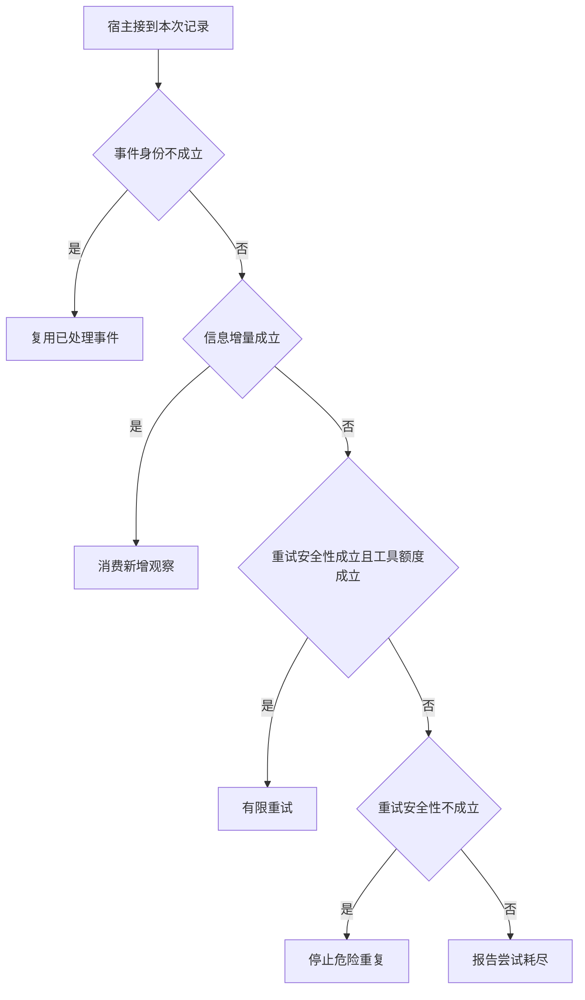

# 用已解条件检测空转

同一编号的回执被投递两次，与模型在读超时后生成一个新编号，不是同一故障。
先做消息去重，再检查上轮状态、数据版本和剩余预算，才有条件判断下一步有没有价值。

本篇用一个封闭的教学决策器说明这一问题。输入是宿主收到的记录，不保证每个下游字段都已经获准使用。前置检查未成立时，下游即使带着缓存值，也不能拿来作业务断言。

## 先解决一个具体问题

**同参数又来一次就是死循环吗？**

上一次读取固定版本已成功，重复读取通常没有新信息。
若上一次超时或用户刚更新资料，同参读取可能合理。
应记上次观察和版本，不只存参数哈希。


先取一个能走到「报告尝试耗尽」的输入：本事件首次出现、同版本同范围没有新增事实、支持有界安全重试、下游尝试额度不足。
把这四个条件代回后文的图，前面各个拦截分支都未满足，最终才有“本轮无新增也无下游余量”这个判断。
还原这个现场时要分别问：哪些位来自可信状态，哪些只是在接口中出现、尚未获得解释资格的字段。

## 先沿一次决策走到底



从上到下取第一条成立的出口。只改一个开关时，只有它之前的检查都未截断，该变化才可能到达真实动作。

“事件身份”的两种输入分别是“本事件首次出现”与“该事件已经处理”。
重复投递与模型再次请求同一参数要分别处理。

“信息增量”的两种输入分别是“本次增加了新信息”与“同版本同范围没有新增事实”。
换一个调用编号不自动代表任务有进展。

“重试安全性”的两种输入分别是“支持有界安全重试”与“无法安全重放该操作”。
可靠性要看副作用和实际恢复协议。

“工具额度”的两种输入分别是“可预留本次尝试额度”与“下游尝试额度不足”。
实际投递之前要核算重试或整批调用所需资源。

## 最少需要哪几项观察

### 复用已处理事件

重复投递不应制造第二次观察。
在本节的全部组合中，有 8 种产生「复用已处理事件」，这只是逻辑空间的计数，不能当作实际用户请求的比例。

只取得该事件已经处理，已经足以要求宿主「复用已处理事件」。
保持这些已知项，其余开关自由变化，仍有 8 种补全，判断没有翻转。

若删掉关于事件身份的证据，另一份允许的现场是本事件首次出现、同版本同范围没有新增事实、无法安全重放该操作、下游尝试额度不足，它会使宿主「停止危险重复」。

### 消费新增观察

该结果确实改变了任务状态。
在本节的全部组合中，有 4 种产生「消费新增观察」，这只是逻辑空间的计数，不能当作实际用户请求的比例。

只取得本事件首次出现、本次增加了新信息，已经足以要求宿主「消费新增观察」。
保持这些已知项，其余开关自由变化，仍有 4 种补全，判断没有翻转。

若删掉关于事件身份的证据，另一份允许的现场是该事件已经处理、本次增加了新信息、无法安全重放该操作、下游尝试额度不足，它会使宿主「复用已处理事件」。

若删掉关于信息增量的证据，另一份允许的现场是本事件首次出现、同版本同范围没有新增事实、无法安全重放该操作、下游尝试额度不足，它会使宿主「停止危险重复」。

### 有限重试

无进展时仍具备安全尝试条件。
在本节的全部组合中，有 1 种产生「有限重试」，这只是逻辑空间的计数，不能当作实际用户请求的比例。

只取得本事件首次出现、同版本同范围没有新增事实、支持有界安全重试、可预留本次尝试额度，已经足以要求宿主「有限重试」。
保持这些已知项，其余开关自由变化，仍有 1 种补全，判断没有翻转。

若删掉关于事件身份的证据，另一份允许的现场是该事件已经处理、同版本同范围没有新增事实、支持有界安全重试、可预留本次尝试额度，它会使宿主「复用已处理事件」。

若删掉关于信息增量的证据，另一份允许的现场是本事件首次出现、本次增加了新信息、支持有界安全重试、可预留本次尝试额度，它会使宿主「消费新增观察」。

若删掉关于重试安全性的证据，另一份允许的现场是本事件首次出现、同版本同范围没有新增事实、无法安全重放该操作、可预留本次尝试额度，它会使宿主「停止危险重复」。

若删掉关于工具额度的证据，另一份允许的现场是本事件首次出现、同版本同范围没有新增事实、支持有界安全重试、下游尝试额度不足，它会使宿主「报告尝试耗尽」。

### 停止危险重复

不可重放的动作不能换编号绕过。
在本节的全部组合中，有 2 种产生「停止危险重复」，这只是逻辑空间的计数，不能当作实际用户请求的比例。

只取得本事件首次出现、同版本同范围没有新增事实、无法安全重放该操作，已经足以要求宿主「停止危险重复」。
保持这些已知项，其余开关自由变化，仍有 2 种补全，判断没有翻转。

若删掉关于事件身份的证据，另一份允许的现场是该事件已经处理、同版本同范围没有新增事实、无法安全重放该操作、下游尝试额度不足，它会使宿主「复用已处理事件」。

若删掉关于信息增量的证据，另一份允许的现场是本事件首次出现、本次增加了新信息、无法安全重放该操作、下游尝试额度不足，它会使宿主「消费新增观察」。

若删掉关于重试安全性的证据，另一份允许的现场是本事件首次出现、同版本同范围没有新增事实、支持有界安全重试、下游尝试额度不足，它会使宿主「报告尝试耗尽」。

### 报告尝试耗尽

本轮无新增也无下游余量。
在本节的全部组合中，有 1 种产生「报告尝试耗尽」，这只是逻辑空间的计数，不能当作实际用户请求的比例。

只取得本事件首次出现、同版本同范围没有新增事实、支持有界安全重试、下游尝试额度不足，已经足以要求宿主「报告尝试耗尽」。

若删掉关于事件身份的证据，另一份允许的现场是该事件已经处理、同版本同范围没有新增事实、支持有界安全重试、下游尝试额度不足，它会使宿主「复用已处理事件」。

若删掉关于信息增量的证据，另一份允许的现场是本事件首次出现、本次增加了新信息、支持有界安全重试、下游尝试额度不足，它会使宿主「消费新增观察」。

若删掉关于重试安全性的证据，另一份允许的现场是本事件首次出现、同版本同范围没有新增事实、无法安全重放该操作、下游尝试额度不足，它会使宿主「停止危险重复」。

若删掉关于工具额度的证据，另一份允许的现场是本事件首次出现、同版本同范围没有新增事实、支持有界安全重试、可预留本次尝试额度，它会使宿主「有限重试」。

## 以同一份契约解释截然不同的现场

<details>
<summary>展开推演与对应反例</summary>

下列样本按最先命中的业务分支排列。四位编码只作本篇页内定位，顺序与开头的四项输入一致。可以先猜下一动作，再展开相邻样本。

### 能够触发“复用已处理事件”的现场

**样本 0000**

业务侧交来该事件已经处理、同版本同范围没有新增事实，执行侧还记录了无法安全重放该操作、下游尝试额度不足。
把样本压成最短证明，保留该事件已经处理就能支持「复用已处理事件」。

在这份记录上，分别翻转「事件身份」中的任一项，其他项完全不变时，下一动作都会改变。

保持其余观察不动，单独切换「信息增量」、「重试安全性」、「工具额度」仍得到「复用已处理事件」，它们在这个现场不是决定性变量。

要从本例改走「停止危险重复」，至少需要变动 1 项，一组最少改动是将该事件已经处理换成本事件首次出现。

要从本例改走「报告尝试耗尽」，至少需要变动 2 项，一组最少改动是将该事件已经处理、无法安全重放该操作换成本事件首次出现、支持有界安全重试。

要从本例改走「消费新增观察」，至少需要变动 2 项，一组最少改动是将该事件已经处理、同版本同范围没有新增事实换成本事件首次出现、本次增加了新信息。

要从本例改走「有限重试」，至少需要变动 3 项，一组最少改动是将该事件已经处理、无法安全重放该操作、下游尝试额度不足换成本事件首次出现、支持有界安全重试、可预留本次尝试额度。

**样本 0001**

业务侧交来该事件已经处理、同版本同范围没有新增事实，执行侧还记录了无法安全重放该操作、可预留本次尝试额度。


要从本例改走「有限重试」，至少需要变动 2 项，一组最少改动是将该事件已经处理、无法安全重放该操作换成本事件首次出现、支持有界安全重试。


要从本例改走「报告尝试耗尽」，至少需要变动 3 项，一组最少改动是将该事件已经处理、无法安全重放该操作、可预留本次尝试额度换成本事件首次出现、支持有界安全重试、下游尝试额度不足。

**样本 0010**

业务侧交来该事件已经处理、同版本同范围没有新增事实，执行侧还记录了支持有界安全重试、下游尝试额度不足。


要从本例改走「报告尝试耗尽」，至少需要变动 1 项，一组最少改动是将该事件已经处理换成本事件首次出现。

要从本例改走「停止危险重复」，至少需要变动 2 项，一组最少改动是将该事件已经处理、支持有界安全重试换成本事件首次出现、无法安全重放该操作。

要从本例改走「有限重试」，至少需要变动 2 项，一组最少改动是将该事件已经处理、下游尝试额度不足换成本事件首次出现、可预留本次尝试额度。


**样本 0011**

业务侧交来该事件已经处理、同版本同范围没有新增事实，执行侧还记录了支持有界安全重试、可预留本次尝试额度。


要从本例改走「有限重试」，至少需要变动 1 项，一组最少改动是将该事件已经处理换成本事件首次出现。


要从本例改走「报告尝试耗尽」，至少需要变动 2 项，一组最少改动是将该事件已经处理、可预留本次尝试额度换成本事件首次出现、下游尝试额度不足。


**样本 0100**

业务侧交来该事件已经处理、本次增加了新信息，执行侧还记录了无法安全重放该操作、下游尝试额度不足。


要从本例改走「消费新增观察」，至少需要变动 1 项，一组最少改动是将该事件已经处理换成本事件首次出现。

要从本例改走「停止危险重复」，至少需要变动 2 项，一组最少改动是将该事件已经处理、本次增加了新信息换成本事件首次出现、同版本同范围没有新增事实。

要从本例改走「报告尝试耗尽」，至少需要变动 3 项，一组最少改动是将该事件已经处理、本次增加了新信息、无法安全重放该操作换成本事件首次出现、同版本同范围没有新增事实、支持有界安全重试。

要从本例改走「有限重试」，至少需要变动 4 项，一组最少改动是将该事件已经处理、本次增加了新信息、无法安全重放该操作、下游尝试额度不足换成本事件首次出现、同版本同范围没有新增事实、支持有界安全重试、可预留本次尝试额度。

**样本 0101**

业务侧交来该事件已经处理、本次增加了新信息，执行侧还记录了无法安全重放该操作、可预留本次尝试额度。


要从本例改走「有限重试」，至少需要变动 3 项，一组最少改动是将该事件已经处理、本次增加了新信息、无法安全重放该操作换成本事件首次出现、同版本同范围没有新增事实、支持有界安全重试。

要从本例改走「报告尝试耗尽」，至少需要变动 4 项，一组最少改动是将该事件已经处理、本次增加了新信息、无法安全重放该操作、可预留本次尝试额度换成本事件首次出现、同版本同范围没有新增事实、支持有界安全重试、下游尝试额度不足。

**样本 0110**

业务侧交来该事件已经处理、本次增加了新信息，执行侧还记录了支持有界安全重试、下游尝试额度不足。


要从本例改走「报告尝试耗尽」，至少需要变动 2 项，一组最少改动是将该事件已经处理、本次增加了新信息换成本事件首次出现、同版本同范围没有新增事实。

要从本例改走「停止危险重复」，至少需要变动 3 项，一组最少改动是将该事件已经处理、本次增加了新信息、支持有界安全重试换成本事件首次出现、同版本同范围没有新增事实、无法安全重放该操作。

要从本例改走「有限重试」，至少需要变动 3 项，一组最少改动是将该事件已经处理、本次增加了新信息、下游尝试额度不足换成本事件首次出现、同版本同范围没有新增事实、可预留本次尝试额度。

**样本 0111**

业务侧交来该事件已经处理、本次增加了新信息，执行侧还记录了支持有界安全重试、可预留本次尝试额度。


要从本例改走「有限重试」，至少需要变动 2 项，一组最少改动是将该事件已经处理、本次增加了新信息换成本事件首次出现、同版本同范围没有新增事实。


要从本例改走「报告尝试耗尽」，至少需要变动 3 项，一组最少改动是将该事件已经处理、本次增加了新信息、可预留本次尝试额度换成本事件首次出现、同版本同范围没有新增事实、下游尝试额度不足。

### 能够触发“消费新增观察”的现场

**样本 1100**

业务侧交来本事件首次出现、本次增加了新信息，执行侧还记录了无法安全重放该操作、下游尝试额度不足。
把样本压成最短证明，保留本事件首次出现、本次增加了新信息就能支持「消费新增观察」。

在这份记录上，分别翻转「事件身份」、「信息增量」中的任一项，其他项完全不变时，下一动作都会改变。

保持其余观察不动，单独切换「重试安全性」、「工具额度」仍得到「消费新增观察」，它们在这个现场不是决定性变量。

本例没走更靠前的「复用已处理事件」，因为本事件首次出现与那个入口的必要条件不符。

要从本例改走「复用已处理事件」，至少需要变动 1 项，一组最少改动是将本事件首次出现换成该事件已经处理。

要从本例改走「停止危险重复」，至少需要变动 1 项，一组最少改动是将本次增加了新信息换成同版本同范围没有新增事实。

要从本例改走「报告尝试耗尽」，至少需要变动 2 项，一组最少改动是将本次增加了新信息、无法安全重放该操作换成同版本同范围没有新增事实、支持有界安全重试。

要从本例改走「有限重试」，至少需要变动 3 项，一组最少改动是将本次增加了新信息、无法安全重放该操作、下游尝试额度不足换成同版本同范围没有新增事实、支持有界安全重试、可预留本次尝试额度。

**样本 1101**

业务侧交来本事件首次出现、本次增加了新信息，执行侧还记录了无法安全重放该操作、可预留本次尝试额度。


要从本例改走「有限重试」，至少需要变动 2 项，一组最少改动是将本次增加了新信息、无法安全重放该操作换成同版本同范围没有新增事实、支持有界安全重试。

要从本例改走「报告尝试耗尽」，至少需要变动 3 项，一组最少改动是将本次增加了新信息、无法安全重放该操作、可预留本次尝试额度换成同版本同范围没有新增事实、支持有界安全重试、下游尝试额度不足。

**样本 1110**

业务侧交来本事件首次出现、本次增加了新信息，执行侧还记录了支持有界安全重试、下游尝试额度不足。


要从本例改走「报告尝试耗尽」，至少需要变动 1 项，一组最少改动是将本次增加了新信息换成同版本同范围没有新增事实。

要从本例改走「停止危险重复」，至少需要变动 2 项，一组最少改动是将本次增加了新信息、支持有界安全重试换成同版本同范围没有新增事实、无法安全重放该操作。

要从本例改走「有限重试」，至少需要变动 2 项，一组最少改动是将本次增加了新信息、下游尝试额度不足换成同版本同范围没有新增事实、可预留本次尝试额度。

**样本 1111**

业务侧交来本事件首次出现、本次增加了新信息，执行侧还记录了支持有界安全重试、可预留本次尝试额度。


要从本例改走「有限重试」，至少需要变动 1 项，一组最少改动是将本次增加了新信息换成同版本同范围没有新增事实。


要从本例改走「报告尝试耗尽」，至少需要变动 2 项，一组最少改动是将本次增加了新信息、可预留本次尝试额度换成同版本同范围没有新增事实、下游尝试额度不足。

### 能够触发“有限重试”的现场

**样本 1011**

业务侧交来本事件首次出现、同版本同范围没有新增事实，执行侧还记录了支持有界安全重试、可预留本次尝试额度。
把样本压成最短证明，保留本事件首次出现、同版本同范围没有新增事实、支持有界安全重试、可预留本次尝试额度就能支持「有限重试」。

在这份记录上，分别翻转「事件身份」、「信息增量」、「重试安全性」、「工具额度」中的任一项，其他项完全不变时，下一动作都会改变。


本例没走更靠前的「消费新增观察」，因为同版本同范围没有新增事实与那个入口的必要条件不符。


要从本例改走「停止危险重复」，至少需要变动 1 项，一组最少改动是将支持有界安全重试换成无法安全重放该操作。

要从本例改走「报告尝试耗尽」，至少需要变动 1 项，一组最少改动是将可预留本次尝试额度换成下游尝试额度不足。

要从本例改走「消费新增观察」，至少需要变动 1 项，一组最少改动是将同版本同范围没有新增事实换成本次增加了新信息。

### 能够触发“停止危险重复”的现场

**样本 1000**

业务侧交来本事件首次出现、同版本同范围没有新增事实，执行侧还记录了无法安全重放该操作、下游尝试额度不足。
把样本压成最短证明，保留本事件首次出现、同版本同范围没有新增事实、无法安全重放该操作就能支持「停止危险重复」。

在这份记录上，分别翻转「事件身份」、「信息增量」、「重试安全性」中的任一项，其他项完全不变时，下一动作都会改变。

保持其余观察不动，单独切换「工具额度」仍得到「停止危险重复」，它们在这个现场不是决定性变量。


本例没走更靠前的「有限重试」，因为无法安全重放该操作、下游尝试额度不足与那个入口的必要条件不符。


要从本例改走「报告尝试耗尽」，至少需要变动 1 项，一组最少改动是将无法安全重放该操作换成支持有界安全重试。


要从本例改走「有限重试」，至少需要变动 2 项，一组最少改动是将无法安全重放该操作、下游尝试额度不足换成支持有界安全重试、可预留本次尝试额度。

**样本 1001**

业务侧交来本事件首次出现、同版本同范围没有新增事实，执行侧还记录了无法安全重放该操作、可预留本次尝试额度。


本例没走更靠前的「有限重试」，因为无法安全重放该操作与那个入口的必要条件不符。


要从本例改走「有限重试」，至少需要变动 1 项，一组最少改动是将无法安全重放该操作换成支持有界安全重试。


要从本例改走「报告尝试耗尽」，至少需要变动 2 项，一组最少改动是将无法安全重放该操作、可预留本次尝试额度换成支持有界安全重试、下游尝试额度不足。

### 能够触发“报告尝试耗尽”的现场

**样本 1010**

业务侧交来本事件首次出现、同版本同范围没有新增事实，执行侧还记录了支持有界安全重试、下游尝试额度不足。
把样本压成最短证明，保留本事件首次出现、同版本同范围没有新增事实、支持有界安全重试、下游尝试额度不足就能支持「报告尝试耗尽」。


本例没走更靠前的「有限重试」，因为下游尝试额度不足与那个入口的必要条件不符。

本例没走更靠前的「停止危险重复」，因为支持有界安全重试与那个入口的必要条件不符。


要从本例改走「有限重试」，至少需要变动 1 项，一组最少改动是将下游尝试额度不足换成可预留本次尝试额度。


</details>

## 当你只能看见一半记录

<details>
<summary>展开推演与对应反例</summary>

这次隐藏两个字段，保留另两个。对每个可见现场，检查四种合法补全是否同意。如仍有歧义，选择能使最坏剩余候选动作最少的字段继续查。并列时采用本篇字段顺序。

### 只保留事件身份与信息增量

已知该事件已经处理、同版本同范围没有新增事实时，四种补全的动作分布为复用已处理事件（4 种）。

就“复用已处理事件”这个动作而言，在该事件已经处理、同版本同范围没有新增事实的前提下，另外两项观察不会推翻它。

已知该事件已经处理、本次增加了新信息时，四种补全的动作分布为复用已处理事件（4 种）。

就“复用已处理事件”这个动作而言，在该事件已经处理、本次增加了新信息的前提下，另外两项观察不会推翻它。

已知本事件首次出现、同版本同范围没有新增事实时，四种补全的动作分布为有限重试（1 种）、停止危险重复（2 种）、报告尝试耗尽（1 种）。

在本事件首次出现、同版本同范围没有新增事实这个现场补读「重试安全性」，最坏还剩 2 种动作，计算时只衡量歧义，尚未扣读取代价。
若补来的观察为“无法安全重放该操作”，范围缩成「停止危险重复」。若为“支持有界安全重试”，则保留「报告尝试耗尽」、「有限重试」。

区分不了的两条执行可以具体写成 1000 与 1010：它们共享已展示字段，却分别需要「停止危险重复」和「报告尝试耗尽」。

已知本事件首次出现、本次增加了新信息时，四种补全的动作分布为消费新增观察（4 种）。

就“消费新增观察”这个动作而言，在本事件首次出现、本次增加了新信息的前提下，另外两项观察不会推翻它。

### 只保留事件身份与重试安全性

已知该事件已经处理、无法安全重放该操作时，四种补全的动作分布为复用已处理事件（4 种）。

就“复用已处理事件”这个动作而言，在该事件已经处理、无法安全重放该操作的前提下，另外两项观察不会推翻它。

已知该事件已经处理、支持有界安全重试时，四种补全的动作分布为复用已处理事件（4 种）。

就“复用已处理事件”这个动作而言，在该事件已经处理、支持有界安全重试的前提下，另外两项观察不会推翻它。

已知本事件首次出现、无法安全重放该操作时，四种补全的动作分布为消费新增观察（2 种）、停止危险重复（2 种）。

在本事件首次出现、无法安全重放该操作这个现场补读「信息增量」，最坏还剩 1 种动作，计算时只衡量歧义，尚未扣读取代价。
若补来的观察为“同版本同范围没有新增事实”，范围缩成「停止危险重复」。若为“本次增加了新信息”，则保留「消费新增观察」。

区分不了的两条执行可以具体写成 1000 与 1100：它们共享已展示字段，却分别需要「停止危险重复」和「消费新增观察」。

已知本事件首次出现、支持有界安全重试时，四种补全的动作分布为消费新增观察（2 种）、有限重试（1 种）、报告尝试耗尽（1 种）。

在本事件首次出现、支持有界安全重试这个现场补读「信息增量」，最坏还剩 2 种动作，计算时只衡量歧义，尚未扣读取代价。
若补来的观察为“同版本同范围没有新增事实”，范围缩成「报告尝试耗尽」、「有限重试」。若为“本次增加了新信息”，则保留「消费新增观察」。

区分不了的两条执行可以具体写成 1010 与 1011：它们共享已展示字段，却分别需要「报告尝试耗尽」和「有限重试」。

### 只保留信息增量与重试安全性

已知同版本同范围没有新增事实、无法安全重放该操作时，四种补全的动作分布为复用已处理事件（2 种）、停止危险重复（2 种）。

在同版本同范围没有新增事实、无法安全重放该操作这个现场补读「事件身份」，最坏还剩 1 种动作，计算时只衡量歧义，尚未扣读取代价。
若补来的观察为“该事件已经处理”，范围缩成「复用已处理事件」。若为“本事件首次出现”，则保留「停止危险重复」。

区分不了的两条执行可以具体写成 0000 与 1000：它们共享已展示字段，却分别需要「复用已处理事件」和「停止危险重复」。

已知同版本同范围没有新增事实、支持有界安全重试时，四种补全的动作分布为复用已处理事件（2 种）、有限重试（1 种）、报告尝试耗尽（1 种）。

在同版本同范围没有新增事实、支持有界安全重试这个现场补读「事件身份」，最坏还剩 2 种动作，计算时只衡量歧义，尚未扣读取代价。
若补来的观察为“该事件已经处理”，范围缩成「复用已处理事件」。若为“本事件首次出现”，则保留「报告尝试耗尽」、「有限重试」。

区分不了的两条执行可以具体写成 0010 与 1010：它们共享已展示字段，却分别需要「复用已处理事件」和「报告尝试耗尽」。

已知本次增加了新信息、无法安全重放该操作时，四种补全的动作分布为复用已处理事件（2 种）、消费新增观察（2 种）。

在本次增加了新信息、无法安全重放该操作这个现场补读「事件身份」，最坏还剩 1 种动作，计算时只衡量歧义，尚未扣读取代价。
若补来的观察为“该事件已经处理”，范围缩成「复用已处理事件」。若为“本事件首次出现”，则保留「消费新增观察」。

区分不了的两条执行可以具体写成 0100 与 1100：它们共享已展示字段，却分别需要「复用已处理事件」和「消费新增观察」。

已知本次增加了新信息、支持有界安全重试时，四种补全的动作分布为复用已处理事件（2 种）、消费新增观察（2 种）。

在本次增加了新信息、支持有界安全重试这个现场补读「事件身份」，最坏还剩 1 种动作，计算时只衡量歧义，尚未扣读取代价。

区分不了的两条执行可以具体写成 0110 与 1110：它们共享已展示字段，却分别需要「复用已处理事件」和「消费新增观察」。

### 只保留事件身份与工具额度

已知该事件已经处理、下游尝试额度不足时，四种补全的动作分布为复用已处理事件（4 种）。

就“复用已处理事件”这个动作而言，在该事件已经处理、下游尝试额度不足的前提下，另外两项观察不会推翻它。

已知该事件已经处理、可预留本次尝试额度时，四种补全的动作分布为复用已处理事件（4 种）。

就“复用已处理事件”这个动作而言，在该事件已经处理、可预留本次尝试额度的前提下，另外两项观察不会推翻它。

已知本事件首次出现、下游尝试额度不足时，四种补全的动作分布为消费新增观察（2 种）、停止危险重复（1 种）、报告尝试耗尽（1 种）。

在本事件首次出现、下游尝试额度不足这个现场补读「信息增量」，最坏还剩 2 种动作，计算时只衡量歧义，尚未扣读取代价。
若补来的观察为“同版本同范围没有新增事实”，范围缩成「停止危险重复」、「报告尝试耗尽」。若为“本次增加了新信息”，则保留「消费新增观察」。


已知本事件首次出现、可预留本次尝试额度时，四种补全的动作分布为消费新增观察（2 种）、有限重试（1 种）、停止危险重复（1 种）。

在本事件首次出现、可预留本次尝试额度这个现场补读「信息增量」，最坏还剩 2 种动作，计算时只衡量歧义，尚未扣读取代价。
若补来的观察为“同版本同范围没有新增事实”，范围缩成「停止危险重复」、「有限重试」。若为“本次增加了新信息”，则保留「消费新增观察」。

区分不了的两条执行可以具体写成 1001 与 1011：它们共享已展示字段，却分别需要「停止危险重复」和「有限重试」。

### 只保留信息增量与工具额度

已知同版本同范围没有新增事实、下游尝试额度不足时，四种补全的动作分布为复用已处理事件（2 种）、停止危险重复（1 种）、报告尝试耗尽（1 种）。

在同版本同范围没有新增事实、下游尝试额度不足这个现场补读「事件身份」，最坏还剩 2 种动作，计算时只衡量歧义，尚未扣读取代价。
若补来的观察为“该事件已经处理”，范围缩成「复用已处理事件」。若为“本事件首次出现”，则保留「停止危险重复」、「报告尝试耗尽」。


已知同版本同范围没有新增事实、可预留本次尝试额度时，四种补全的动作分布为复用已处理事件（2 种）、有限重试（1 种）、停止危险重复（1 种）。

在同版本同范围没有新增事实、可预留本次尝试额度这个现场补读「事件身份」，最坏还剩 2 种动作，计算时只衡量歧义，尚未扣读取代价。
若补来的观察为“该事件已经处理”，范围缩成「复用已处理事件」。若为“本事件首次出现”，则保留「停止危险重复」、「有限重试」。

区分不了的两条执行可以具体写成 0001 与 1001：它们共享已展示字段，却分别需要「复用已处理事件」和「停止危险重复」。

已知本次增加了新信息、下游尝试额度不足时，四种补全的动作分布为复用已处理事件（2 种）、消费新增观察（2 种）。

在本次增加了新信息、下游尝试额度不足这个现场补读「事件身份」，最坏还剩 1 种动作，计算时只衡量歧义，尚未扣读取代价。


已知本次增加了新信息、可预留本次尝试额度时，四种补全的动作分布为复用已处理事件（2 种）、消费新增观察（2 种）。

在本次增加了新信息、可预留本次尝试额度这个现场补读「事件身份」，最坏还剩 1 种动作，计算时只衡量歧义，尚未扣读取代价。

区分不了的两条执行可以具体写成 0101 与 1101：它们共享已展示字段，却分别需要「复用已处理事件」和「消费新增观察」。

### 只保留重试安全性与工具额度

已知无法安全重放该操作、下游尝试额度不足时，四种补全的动作分布为复用已处理事件（2 种）、消费新增观察（1 种）、停止危险重复（1 种）。

在无法安全重放该操作、下游尝试额度不足这个现场补读「事件身份」，最坏还剩 2 种动作，计算时只衡量歧义，尚未扣读取代价。
若补来的观察为“该事件已经处理”，范围缩成「复用已处理事件」。若为“本事件首次出现”，则保留「停止危险重复」、「消费新增观察」。


已知无法安全重放该操作、可预留本次尝试额度时，四种补全的动作分布为复用已处理事件（2 种）、消费新增观察（1 种）、停止危险重复（1 种）。

在无法安全重放该操作、可预留本次尝试额度这个现场补读「事件身份」，最坏还剩 2 种动作，计算时只衡量歧义，尚未扣读取代价。


已知支持有界安全重试、下游尝试额度不足时，四种补全的动作分布为复用已处理事件（2 种）、消费新增观察（1 种）、报告尝试耗尽（1 种）。

在支持有界安全重试、下游尝试额度不足这个现场补读「事件身份」，最坏还剩 2 种动作，计算时只衡量歧义，尚未扣读取代价。
若补来的观察为“该事件已经处理”，范围缩成「复用已处理事件」。若为“本事件首次出现”，则保留「报告尝试耗尽」、「消费新增观察」。


已知支持有界安全重试、可预留本次尝试额度时，四种补全的动作分布为复用已处理事件（2 种）、消费新增观察（1 种）、有限重试（1 种）。

在支持有界安全重试、可预留本次尝试额度这个现场补读「事件身份」，最坏还剩 2 种动作，计算时只衡量歧义，尚未扣读取代价。
若补来的观察为“该事件已经处理”，范围缩成「复用已处理事件」。若为“本事件首次出现”，则保留「有限重试」、「消费新增观察」。

区分不了的两条执行可以具体写成 0011 与 1011：它们共享已展示字段，却分别需要「复用已处理事件」和「有限重试」。

</details>

## 单因素干预与边界测试

<details>
<summary>展开推演与对应反例</summary>

### 只改变事件身份

固定另外三个条件得到八对现场，从“该事件已经处理”转为“本事件首次出现”时，8 对翻转动作，另外 0 对保持不变。

有 2 对现场沿「复用已处理事件」变到「停止危险重复」，可复现的一组受控背景为同版本同范围没有新增事实、无法安全重放该操作、下游尝试额度不足。

有 1 对现场沿「复用已处理事件」变到「报告尝试耗尽」，可复现的一组受控背景为同版本同范围没有新增事实、支持有界安全重试、下游尝试额度不足。

有 1 对现场沿「复用已处理事件」变到「有限重试」，可复现的一组受控背景为同版本同范围没有新增事实、支持有界安全重试、可预留本次尝试额度。

有 4 对现场沿「复用已处理事件」变到「消费新增观察」，可复现的一组受控背景为本次增加了新信息、无法安全重放该操作、下游尝试额度不足。

### 只改变信息增量

固定另外三个条件得到八对现场，从“同版本同范围没有新增事实”转为“本次增加了新信息”时，4 对翻转动作，另外 4 对保持不变。

令该事件已经处理、无法安全重放该操作、下游尝试额度不足，信息增量的两个取值均得到「复用已处理事件」。在八对中，共有 4 对表现为这一种稳定出口。

有 2 对现场沿「停止危险重复」变到「消费新增观察」，可复现的一组受控背景为本事件首次出现、无法安全重放该操作、下游尝试额度不足。

有 1 对现场沿「报告尝试耗尽」变到「消费新增观察」，可复现的一组受控背景为本事件首次出现、支持有界安全重试、下游尝试额度不足。

有 1 对现场沿「有限重试」变到「消费新增观察」，可复现的一组受控背景为本事件首次出现、支持有界安全重试、可预留本次尝试额度。

### 只改变重试安全性

固定另外三个条件得到八对现场，从“无法安全重放该操作”转为“支持有界安全重试”时，2 对翻转动作，另外 6 对保持不变。

令该事件已经处理、同版本同范围没有新增事实、下游尝试额度不足，重试安全性的两个取值均得到「复用已处理事件」。在八对中，共有 4 对表现为这一种稳定出口。

有 1 对现场沿「停止危险重复」变到「报告尝试耗尽」，可复现的一组受控背景为本事件首次出现、同版本同范围没有新增事实、下游尝试额度不足。

有 1 对现场沿「停止危险重复」变到「有限重试」，可复现的一组受控背景为本事件首次出现、同版本同范围没有新增事实、可预留本次尝试额度。

令本事件首次出现、本次增加了新信息、下游尝试额度不足，重试安全性的两个取值均得到「消费新增观察」。在八对中，共有 2 对表现为这一种稳定出口。

### 只改变工具额度

固定另外三个条件得到八对现场，从“下游尝试额度不足”转为“可预留本次尝试额度”时，1 对翻转动作，另外 7 对保持不变。

令该事件已经处理、同版本同范围没有新增事实、无法安全重放该操作，工具额度的两个取值均得到「复用已处理事件」。在八对中，共有 4 对表现为这一种稳定出口。

令本事件首次出现、同版本同范围没有新增事实、无法安全重放该操作，工具额度的两个取值均得到「停止危险重复」。在八对中，共有 1 对表现为这一种稳定出口。

有 1 对现场沿「报告尝试耗尽」变到「有限重试」，可复现的一组受控背景为本事件首次出现、同版本同范围没有新增事实、支持有界安全重试。

令本事件首次出现、本次增加了新信息、无法安全重放该操作，工具额度的两个取值均得到「消费新增观察」。在八对中，共有 2 对表现为这一种稳定出口。

</details>

## 哪些回归样本真能抓住实现错误

<details>
<summary>展开推演与对应反例</summary>

如果删除“复用已处理事件”这个分支，在本篇 16 种输入里有 8 种会改走另一出口。

反例 0000 的完整记录为该事件已经处理、同版本同范围没有新增事实、无法安全重放该操作、下游尝试额度不足。正确结果是「复用已处理事件」，这个改坏的实现却给出「停止危险重复」。

如果删除“消费新增观察”这个分支，在本篇 16 种输入里有 4 种会改走另一出口。

反例 1100 的完整记录为本事件首次出现、本次增加了新信息、无法安全重放该操作、下游尝试额度不足。正确结果是「消费新增观察」，这个改坏的实现却给出「停止危险重复」。

如果删除“有限重试”这个分支，在本篇 16 种输入里有 1 种会改走另一出口。

反例 1011 的完整记录为本事件首次出现、同版本同范围没有新增事实、支持有界安全重试、可预留本次尝试额度。正确结果是「有限重试」，这个改坏的实现却给出「报告尝试耗尽」。

如果删除“停止危险重复”这个分支，在本篇 16 种输入里有 2 种会改走另一出口。

反例 1000 的完整记录为本事件首次出现、同版本同范围没有新增事实、无法安全重放该操作、下游尝试额度不足。正确结果是「停止危险重复」，这个改坏的实现却给出「报告尝试耗尽」。

如果交换“复用已处理事件”和“消费新增观察”的判断次序，在本篇 16 种输入里有 4 种会改走另一出口。

反例 0100 的完整记录为该事件已经处理、本次增加了新信息、无法安全重放该操作、下游尝试额度不足。正确结果是「复用已处理事件」，这个改坏的实现却给出「消费新增观察」。

如果交换“消费新增观察”和“有限重试”的判断次序，在本篇 16 种输入里有 1 种会改走另一出口。

反例 1111 的完整记录为本事件首次出现、本次增加了新信息、支持有界安全重试、可预留本次尝试额度。正确结果是「消费新增观察」，这个改坏的实现却给出「有限重试」。

如果交换“有限重试”和“停止危险重复”的判断次序，在本篇 16 种输入里有 0 种会改走另一出口。

对于“交换“有限重试”和“停止危险重复”的判断次序”这项修改，在声明输入域内没有区分它的样本，不能宣称测试捕捉到了故障。

补入样本 0100（该事件已经处理、本次增加了新信息、无法安全重放该操作、下游尝试额度不足）能新增检出「删除“复用已处理事件”这个分支」、「交换“复用已处理事件”和“消费新增观察”的判断次序」。

补入样本 1111（本事件首次出现、本次增加了新信息、支持有界安全重试、可预留本次尝试额度）能新增检出「删除“消费新增观察”这个分支」、「交换“消费新增观察”和“有限重试”的判断次序」。

补入样本 1000（本事件首次出现、同版本同范围没有新增事实、无法安全重放该操作、下游尝试额度不足）能新增检出「删除“停止危险重复”这个分支」。

补入样本 1011（本事件首次出现、同版本同范围没有新增事实、支持有界安全重试、可预留本次尝试额度）能新增检出「删除“有限重试”这个分支」。

这里每次选覆盖尚未捕获缺陷最多的样本，并不保证用例数全局最小。它给出的反例能作为 Java 单测输入。真实模型是否会自主产生这些提议，仍须单独评测。

</details>

## 把状态覆盖换成有抽样偏差的评测批次

<details>
<summary>展开推演与对应反例</summary>

前面的十六种记录各有一票。现在只改样本构成：对一个给定字段，把成立侧的每种记录各取三份、另一侧各取一份。这是人为配比的 32 份回放，不是线上频率估计。
将偏向成立与偏向不成立的两次批次对照，可以隔离分母变化。底层宿主和所有答案保持相同，比例仍可能移动。

### 改变“事件身份”的样本配比

只看「复用已处理事件」，在本事件首次出现的八个不同输入中有 0 个命中，在该事件已经处理的另八个输入中有 8 个命中。
把「事件身份」成立侧按三倍取样，「复用已处理事件」占 8/32，反过来向未成立侧倾斜后占 24/32。
这次重加权使「复用已处理事件」的占比相差 50 个百分点。若按两种不同的“事件身份”分布跑新旧版，不能把这项差异全部归功于实现。

只看「消费新增观察」，在本事件首次出现的八个不同输入中有 4 个命中，在该事件已经处理的另八个输入中有 0 个命中。
把「事件身份」成立侧按三倍取样，「消费新增观察」占 12/32，反过来向未成立侧倾斜后占 4/32。
这次重加权使「消费新增观察」的占比相差 25 个百分点。若按两种不同的“事件身份”分布跑新旧版，不能把这项差异全部归功于实现。

只看「有限重试」，在本事件首次出现的八个不同输入中有 1 个命中，在该事件已经处理的另八个输入中有 0 个命中。
把「事件身份」成立侧按三倍取样，「有限重试」占 3/32，反过来向未成立侧倾斜后占 1/32。
这次重加权使「有限重试」的占比相差 6.25 个百分点。若按两种不同的“事件身份”分布跑新旧版，不能把这项差异全部归功于实现。

只看「停止危险重复」，在本事件首次出现的八个不同输入中有 2 个命中，在该事件已经处理的另八个输入中有 0 个命中。
把「事件身份」成立侧按三倍取样，「停止危险重复」占 6/32，反过来向未成立侧倾斜后占 2/32。
这次重加权使「停止危险重复」的占比相差 12.5 个百分点。若按两种不同的“事件身份”分布跑新旧版，不能把这项差异全部归功于实现。

只看「报告尝试耗尽」，在本事件首次出现的八个不同输入中有 1 个命中，在该事件已经处理的另八个输入中有 0 个命中。
把「事件身份」成立侧按三倍取样，「报告尝试耗尽」占 3/32，反过来向未成立侧倾斜后占 1/32。
这次重加权使「报告尝试耗尽」的占比相差 6.25 个百分点。若按两种不同的“事件身份”分布跑新旧版，不能把这项差异全部归功于实现。

### 改变“信息增量”的样本配比

只看「复用已处理事件」，在本次增加了新信息的八个不同输入中有 4 个命中，在同版本同范围没有新增事实的另八个输入中有 4 个命中。
把「信息增量」成立侧按三倍取样，「复用已处理事件」占 16/32，反过来向未成立侧倾斜后占 16/32。
两批「复用已处理事件」的边际比例相同，是因为这个出口在“信息增量”的两侧计数相等，这不能单独证明每一对现场都不受它影响。

只看「消费新增观察」，在本次增加了新信息的八个不同输入中有 4 个命中，在同版本同范围没有新增事实的另八个输入中有 0 个命中。
把「信息增量」成立侧按三倍取样，「消费新增观察」占 12/32，反过来向未成立侧倾斜后占 4/32。
这次重加权使「消费新增观察」的占比相差 25 个百分点。若按两种不同的“信息增量”分布跑新旧版，不能把这项差异全部归功于实现。

只看「有限重试」，在本次增加了新信息的八个不同输入中有 0 个命中，在同版本同范围没有新增事实的另八个输入中有 1 个命中。
把「信息增量」成立侧按三倍取样，「有限重试」占 1/32，反过来向未成立侧倾斜后占 3/32。
这次重加权使「有限重试」的占比相差 6.25 个百分点。若按两种不同的“信息增量”分布跑新旧版，不能把这项差异全部归功于实现。

只看「停止危险重复」，在本次增加了新信息的八个不同输入中有 0 个命中，在同版本同范围没有新增事实的另八个输入中有 2 个命中。
把「信息增量」成立侧按三倍取样，「停止危险重复」占 2/32，反过来向未成立侧倾斜后占 6/32。
这次重加权使「停止危险重复」的占比相差 12.5 个百分点。若按两种不同的“信息增量”分布跑新旧版，不能把这项差异全部归功于实现。

只看「报告尝试耗尽」，在本次增加了新信息的八个不同输入中有 0 个命中，在同版本同范围没有新增事实的另八个输入中有 1 个命中。
把「信息增量」成立侧按三倍取样，「报告尝试耗尽」占 1/32，反过来向未成立侧倾斜后占 3/32。
这次重加权使「报告尝试耗尽」的占比相差 6.25 个百分点。若按两种不同的“信息增量”分布跑新旧版，不能把这项差异全部归功于实现。

### 改变“重试安全性”的样本配比

只看「复用已处理事件」，在支持有界安全重试的八个不同输入中有 4 个命中，在无法安全重放该操作的另八个输入中有 4 个命中。
把「重试安全性」成立侧按三倍取样，「复用已处理事件」占 16/32，反过来向未成立侧倾斜后占 16/32。
两批「复用已处理事件」的边际比例相同，是因为这个出口在“重试安全性”的两侧计数相等，这不能单独证明每一对现场都不受它影响。

只看「消费新增观察」，在支持有界安全重试的八个不同输入中有 2 个命中，在无法安全重放该操作的另八个输入中有 2 个命中。
把「重试安全性」成立侧按三倍取样，「消费新增观察」占 8/32，反过来向未成立侧倾斜后占 8/32。
两批「消费新增观察」的边际比例相同，是因为这个出口在“重试安全性”的两侧计数相等，这不能单独证明每一对现场都不受它影响。

只看「有限重试」，在支持有界安全重试的八个不同输入中有 1 个命中，在无法安全重放该操作的另八个输入中有 0 个命中。
把「重试安全性」成立侧按三倍取样，「有限重试」占 3/32，反过来向未成立侧倾斜后占 1/32。
这次重加权使「有限重试」的占比相差 6.25 个百分点。若按两种不同的“重试安全性”分布跑新旧版，不能把这项差异全部归功于实现。

只看「停止危险重复」，在支持有界安全重试的八个不同输入中有 0 个命中，在无法安全重放该操作的另八个输入中有 2 个命中。
把「重试安全性」成立侧按三倍取样，「停止危险重复」占 2/32，反过来向未成立侧倾斜后占 6/32。
这次重加权使「停止危险重复」的占比相差 12.5 个百分点。若按两种不同的“重试安全性”分布跑新旧版，不能把这项差异全部归功于实现。

只看「报告尝试耗尽」，在支持有界安全重试的八个不同输入中有 1 个命中，在无法安全重放该操作的另八个输入中有 0 个命中。
把「重试安全性」成立侧按三倍取样，「报告尝试耗尽」占 3/32，反过来向未成立侧倾斜后占 1/32。
这次重加权使「报告尝试耗尽」的占比相差 6.25 个百分点。若按两种不同的“重试安全性”分布跑新旧版，不能把这项差异全部归功于实现。

### 改变“工具额度”的样本配比

只看「复用已处理事件」，在可预留本次尝试额度的八个不同输入中有 4 个命中，在下游尝试额度不足的另八个输入中有 4 个命中。
把「工具额度」成立侧按三倍取样，「复用已处理事件」占 16/32，反过来向未成立侧倾斜后占 16/32。
两批「复用已处理事件」的边际比例相同，是因为这个出口在“工具额度”的两侧计数相等，这不能单独证明每一对现场都不受它影响。

只看「消费新增观察」，在可预留本次尝试额度的八个不同输入中有 2 个命中，在下游尝试额度不足的另八个输入中有 2 个命中。
把「工具额度」成立侧按三倍取样，「消费新增观察」占 8/32，反过来向未成立侧倾斜后占 8/32。
两批「消费新增观察」的边际比例相同，是因为这个出口在“工具额度”的两侧计数相等，这不能单独证明每一对现场都不受它影响。

只看「有限重试」，在可预留本次尝试额度的八个不同输入中有 1 个命中，在下游尝试额度不足的另八个输入中有 0 个命中。
把「工具额度」成立侧按三倍取样，「有限重试」占 3/32，反过来向未成立侧倾斜后占 1/32。
这次重加权使「有限重试」的占比相差 6.25 个百分点。若按两种不同的“工具额度”分布跑新旧版，不能把这项差异全部归功于实现。

只看「停止危险重复」，在可预留本次尝试额度的八个不同输入中有 1 个命中，在下游尝试额度不足的另八个输入中有 1 个命中。
把「工具额度」成立侧按三倍取样，「停止危险重复」占 4/32，反过来向未成立侧倾斜后占 4/32。
两批「停止危险重复」的边际比例相同，是因为这个出口在“工具额度”的两侧计数相等，这不能单独证明每一对现场都不受它影响。

只看「报告尝试耗尽」，在可预留本次尝试额度的八个不同输入中有 0 个命中，在下游尝试额度不足的另八个输入中有 1 个命中。
把「工具额度」成立侧按三倍取样，「报告尝试耗尽」占 1/32，反过来向未成立侧倾斜后占 3/32。
这次重加权使「报告尝试耗尽」的占比相差 6.25 个百分点。若按两种不同的“工具额度”分布跑新旧版，不能把这项差异全部归功于实现。

</details>

## 只看终态，能逆推出多少原始事实

<details>
<summary>展开推演与对应反例</summary>

### 只保留“复用已处理事件”这条结果时

在本节契约与完整输入域内，仅知「复用已处理事件」就能倒推出该事件已经处理，这一推断依赖版本未变且日志中的终态可信。

「复用已处理事件」不能证明信息增量取哪一侧：0000 和 0100 有相同终态，却分别记为“同版本同范围没有新增事实”和“本次增加了新信息”。

「复用已处理事件」不能证明重试安全性取哪一侧：0000 和 0010 有相同终态，却分别记为“无法安全重放该操作”和“支持有界安全重试”。

「复用已处理事件」不能证明工具额度取哪一侧：0000 和 0001 有相同终态，却分别记为“下游尝试额度不足”和“可预留本次尝试额度”。

反查「复用已处理事件」的诊断日志，优先保留能区分样本 0000 与 1000 的「事件身份」，否则很容易把邻近的「停止危险重复」看成同一种故障。

### 只保留“消费新增观察”这条结果时

在本节契约与完整输入域内，仅知「消费新增观察」就能倒推出本事件首次出现，这一推断依赖版本未变且日志中的终态可信。

在本节契约与完整输入域内，仅知「消费新增观察」就能倒推出本次增加了新信息，这一推断依赖版本未变且日志中的终态可信。

「消费新增观察」不能证明重试安全性取哪一侧：1100 和 1110 有相同终态，却分别记为“无法安全重放该操作”和“支持有界安全重试”。

「消费新增观察」不能证明工具额度取哪一侧：1100 和 1101 有相同终态，却分别记为“下游尝试额度不足”和“可预留本次尝试额度”。

反查「消费新增观察」的诊断日志，优先保留能区分样本 1100 与 0100 的「事件身份」，否则很容易把邻近的「复用已处理事件」看成同一种故障。

### 只保留“有限重试”这条结果时

在本节契约与完整输入域内，仅知「有限重试」就能倒推出本事件首次出现，这一推断依赖版本未变且日志中的终态可信。

在本节契约与完整输入域内，仅知「有限重试」就能倒推出同版本同范围没有新增事实，这一推断依赖版本未变且日志中的终态可信。

在本节契约与完整输入域内，仅知「有限重试」就能倒推出支持有界安全重试，这一推断依赖版本未变且日志中的终态可信。

在本节契约与完整输入域内，仅知「有限重试」就能倒推出可预留本次尝试额度，这一推断依赖版本未变且日志中的终态可信。

反查「有限重试」的诊断日志，优先保留能区分样本 1011 与 0011 的「事件身份」，否则很容易把邻近的「复用已处理事件」看成同一种故障。

### 只保留“停止危险重复”这条结果时

在本节契约与完整输入域内，仅知「停止危险重复」就能倒推出本事件首次出现，这一推断依赖版本未变且日志中的终态可信。

在本节契约与完整输入域内，仅知「停止危险重复」就能倒推出同版本同范围没有新增事实，这一推断依赖版本未变且日志中的终态可信。

在本节契约与完整输入域内，仅知「停止危险重复」就能倒推出无法安全重放该操作，这一推断依赖版本未变且日志中的终态可信。

「停止危险重复」不能证明工具额度取哪一侧：1000 和 1001 有相同终态，却分别记为“下游尝试额度不足”和“可预留本次尝试额度”。

反查「停止危险重复」的诊断日志，优先保留能区分样本 1000 与 0000 的「事件身份」，否则很容易把邻近的「复用已处理事件」看成同一种故障。

### 只保留“报告尝试耗尽”这条结果时

在本节契约与完整输入域内，仅知「报告尝试耗尽」就能倒推出本事件首次出现，这一推断依赖版本未变且日志中的终态可信。

在本节契约与完整输入域内，仅知「报告尝试耗尽」就能倒推出同版本同范围没有新增事实，这一推断依赖版本未变且日志中的终态可信。

在本节契约与完整输入域内，仅知「报告尝试耗尽」就能倒推出支持有界安全重试，这一推断依赖版本未变且日志中的终态可信。

在本节契约与完整输入域内，仅知「报告尝试耗尽」就能倒推出下游尝试额度不足，这一推断依赖版本未变且日志中的终态可信。

反查「报告尝试耗尽」的诊断日志，优先保留能区分样本 1010 与 0010 的「事件身份」，否则很容易把邻近的「复用已处理事件」看成同一种故障。

</details>

## 面试复述与复算

面试题可以从“同参数又来一次就是死循环吗？”起步。先给出本篇的触发条件和一条真实执行端可检查的证据，再用一个相邻反例限定结论的适用范围。

在仓库根目录执行下列命令可以重算本篇的一个输入。四位数字依次选择正文列出的四项条件，0 表示未成立或低档，1 表示成立或高档。
```powershell
node examples/reading-cases/replay.mjs 3 5 0101
```

[本周主文](../theory.md) · [配套实验](../lab.md) · [下一篇研读](06.md)
