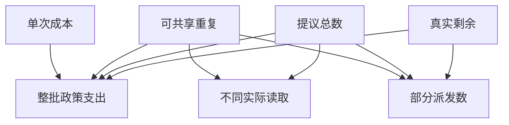

# 同一批读取，整批拒绝还是部分执行

不同模型调用编号可以请求相同的只读对象。
先按主体、参数及版本确认哪些结果可共享，再比较两种预算政策。
部分派发必须列未执行对象。整批预检只决定是否派发，不能许诺下游业务原子性。

## 先解决一个具体问题

**两项读取共享一个结果，要给模型回几个观察？**

业务层可只执行一次真正的读取，但模型层仍要按原提议逐个关联结果。
共享必须限定同对象、同权限和同版本，避免把节省调用变成数据串线。


先从具体的低档设定开始：真实剩余取 2次、提议总数取 4项、可共享重复取 0项、单次成本取 3单位。
三个结果依次是不同实际读取 4项、整批政策支出 0单位、部分派发数 2次。
先手算这个起点，读完后再把另一个输入切到高档，这样能知道数字变化时究竟改变了哪个假设。

## 先写清输入边界和三个观测量

用 a 表示真实剩余，取 2次 或 5次，这两点是用于隔离因果影响的教学输入。

用 b 表示提议总数，取 4项 或 6项，这两点是用于隔离因果影响的教学输入。

用 c 表示可共享重复，取 0项 或 2项，这两点是用于隔离因果影响的教学输入。

用 d 表示单次成本，取 3单位 或 8单位，这两点是用于隔离因果影响的教学输入。

「不同实际读取」的计算式为 `b-c`，按业务量展开是 `提议总数-可共享重复`，输出单位为项。

「整批政策支出」的计算式为 `(b-c<=a?b-c:0)*d`，按业务量展开是 `(提议总数-可共享重复<=真实剩余?提议总数-可共享重复:0)×单次成本`，输出单位为单位。

「部分派发数」的计算式为 `min(a,b-c)`，按业务量展开是 `min(真实剩余,提议总数-可共享重复)`，输出单位为次。

公式中 ceil 与 floor 分别向上、向下取整，% 在表达式中作取余，** 为乘方，三元条件按“条件 ? 成立值 : 其他值”读取。展示数值最多保留三位小数，比较和反推采用未舍入值。



图上的箭头表示该输入出现在计算式中。同一输入通向多个指标时，三个读数可能共同移动。分支、取整或相互抵消又会使某些边在具体样本上没有可见增量。

## 从输入按单位逐步算到可比较的结果

<details>
<summary>展开推演与对应反例</summary>

### 样本 0000：真实剩余 2、提议总数 4

这一组设定为真实剩余为 2次、提议总数为 4项、可共享重复为 0项、单次成本为 3单位。

代入「不同实际读取」：`4-0`，得到 4项。

代入「整批政策支出」：`(4-0<=2?4-0:0)*3`，得到 0单位。

代入「部分派发数」：`min(2,4-0)`，得到 2次。

以「整批政策支出」作主读数时，本组单独切换真实剩余的绝对变化最大或并列最大，读数会从 0单位 变为 12单位。

本组固定其余输入时，分别改变「提议总数」、「单次成本」均不会改变 0单位 这个主读数，是否影响另一指标仍需另算。

对角样本 1111 的主读数为 32单位。它同时改了四项，差额不能充当任一单个因素的净收益。

### 样本 0001：真实剩余 2、提议总数 4

这一组设定为真实剩余为 2次、提议总数为 4项、可共享重复为 0项、单次成本为 8单位。


代入「整批政策支出」：`(4-0<=2?4-0:0)*8`，得到 0单位。


以「整批政策支出」作主读数时，本组单独切换真实剩余的绝对变化最大或并列最大，读数会从 0单位 变为 32单位。


对角样本 1110 的主读数为 12单位。它同时改了四项，差额不能充当任一单个因素的净收益。

### 样本 0010：真实剩余 2、提议总数 4

这一组设定为真实剩余为 2次、提议总数为 4项、可共享重复为 2项、单次成本为 3单位。

代入「不同实际读取」：`4-2`，得到 2项。

代入「整批政策支出」：`(4-2<=2?4-2:0)*3`，得到 6单位。

代入「部分派发数」：`min(2,4-2)`，得到 2次。

以「整批政策支出」作主读数时，本组单独切换单次成本的绝对变化最大或并列最大，读数会从 6单位 变为 16单位。

本组固定其余输入时，分别改变「真实剩余」均不会改变 6单位 这个主读数，是否影响另一指标仍需另算。

对角样本 1101 的主读数为 0单位。它同时改了四项，差额不能充当任一单个因素的净收益。

### 样本 0011：真实剩余 2、提议总数 4

这一组设定为真实剩余为 2次、提议总数为 4项、可共享重复为 2项、单次成本为 8单位。


代入「整批政策支出」：`(4-2<=2?4-2:0)*8`，得到 16单位。


以「整批政策支出」作主读数时，本组单独切换提议总数的绝对变化最大或并列最大，读数会从 16单位 变为 0单位。

本组固定其余输入时，分别改变「真实剩余」均不会改变 16单位 这个主读数，是否影响另一指标仍需另算。

对角样本 1100 的主读数为 0单位。它同时改了四项，差额不能充当任一单个因素的净收益。

### 样本 0100：真实剩余 2、提议总数 6

这一组设定为真实剩余为 2次、提议总数为 6项、可共享重复为 0项、单次成本为 3单位。

代入「不同实际读取」：`6-0`，得到 6项。

代入「整批政策支出」：`(6-0<=2?6-0:0)*3`，得到 0单位。

代入「部分派发数」：`min(2,6-0)`，得到 2次。

以「整批政策支出」作主读数时，本组单独切换真实剩余的绝对变化最大或并列最大，读数会从 0单位 变为 0单位。

本组固定其余输入时，分别改变「真实剩余」、「提议总数」、「可共享重复」、「单次成本」均不会改变 0单位 这个主读数，是否影响另一指标仍需另算。

对角样本 1011 的主读数为 16单位。它同时改了四项，差额不能充当任一单个因素的净收益。

### 样本 0101：真实剩余 2、提议总数 6

这一组设定为真实剩余为 2次、提议总数为 6项、可共享重复为 0项、单次成本为 8单位。


代入「整批政策支出」：`(6-0<=2?6-0:0)*8`，得到 0单位。


对角样本 1010 的主读数为 6单位。它同时改了四项，差额不能充当任一单个因素的净收益。

### 样本 0110：真实剩余 2、提议总数 6

这一组设定为真实剩余为 2次、提议总数为 6项、可共享重复为 2项、单次成本为 3单位。

代入「不同实际读取」：`6-2`，得到 4项。

代入「整批政策支出」：`(6-2<=2?6-2:0)*3`，得到 0单位。

代入「部分派发数」：`min(2,6-2)`，得到 2次。


本组固定其余输入时，分别改变「可共享重复」、「单次成本」均不会改变 0单位 这个主读数，是否影响另一指标仍需另算。

对角样本 1001 的主读数为 32单位。它同时改了四项，差额不能充当任一单个因素的净收益。

### 样本 0111：真实剩余 2、提议总数 6

这一组设定为真实剩余为 2次、提议总数为 6项、可共享重复为 2项、单次成本为 8单位。


代入「整批政策支出」：`(6-2<=2?6-2:0)*8`，得到 0单位。


对角样本 1000 的主读数为 12单位。它同时改了四项，差额不能充当任一单个因素的净收益。

### 样本 1000：真实剩余 5、提议总数 4

这一组设定为真实剩余为 5次、提议总数为 4项、可共享重复为 0项、单次成本为 3单位。


代入「整批政策支出」：`(4-0<=5?4-0:0)*3`，得到 12单位。

代入「部分派发数」：`min(5,4-0)`，得到 4次。

以「整批政策支出」作主读数时，本组单独切换单次成本的绝对变化最大或并列最大，读数会从 12单位 变为 32单位。

对角样本 0111 的主读数为 0单位。它同时改了四项，差额不能充当任一单个因素的净收益。

### 样本 1001：真实剩余 5、提议总数 4

这一组设定为真实剩余为 5次、提议总数为 4项、可共享重复为 0项、单次成本为 8单位。


代入「整批政策支出」：`(4-0<=5?4-0:0)*8`，得到 32单位。


以「整批政策支出」作主读数时，本组单独切换真实剩余的绝对变化最大或并列最大，读数会从 32单位 变为 0单位。

对角样本 0110 的主读数为 0单位。它同时改了四项，差额不能充当任一单个因素的净收益。

### 样本 1010：真实剩余 5、提议总数 4

这一组设定为真实剩余为 5次、提议总数为 4项、可共享重复为 2项、单次成本为 3单位。


代入「整批政策支出」：`(4-2<=5?4-2:0)*3`，得到 6单位。

代入「部分派发数」：`min(5,4-2)`，得到 2次。


对角样本 0101 的主读数为 0单位。它同时改了四项，差额不能充当任一单个因素的净收益。

### 样本 1011：真实剩余 5、提议总数 4

这一组设定为真实剩余为 5次、提议总数为 4项、可共享重复为 2项、单次成本为 8单位。


代入「整批政策支出」：`(4-2<=5?4-2:0)*8`，得到 16单位。


以「整批政策支出」作主读数时，本组单独切换提议总数的绝对变化最大或并列最大，读数会从 16单位 变为 32单位。


对角样本 0100 的主读数为 0单位。它同时改了四项，差额不能充当任一单个因素的净收益。

### 样本 1100：真实剩余 5、提议总数 6

这一组设定为真实剩余为 5次、提议总数为 6项、可共享重复为 0项、单次成本为 3单位。


代入「整批政策支出」：`(6-0<=5?6-0:0)*3`，得到 0单位。

代入「部分派发数」：`min(5,6-0)`，得到 5次。

以「整批政策支出」作主读数时，本组单独切换提议总数的绝对变化最大或并列最大，读数会从 0单位 变为 12单位。

本组固定其余输入时，分别改变「真实剩余」、「单次成本」均不会改变 0单位 这个主读数，是否影响另一指标仍需另算。

对角样本 0011 的主读数为 16单位。它同时改了四项，差额不能充当任一单个因素的净收益。

### 样本 1101：真实剩余 5、提议总数 6

这一组设定为真实剩余为 5次、提议总数为 6项、可共享重复为 0项、单次成本为 8单位。


代入「整批政策支出」：`(6-0<=5?6-0:0)*8`，得到 0单位。


以「整批政策支出」作主读数时，本组单独切换提议总数的绝对变化最大或并列最大，读数会从 0单位 变为 32单位。


对角样本 0010 的主读数为 6单位。它同时改了四项，差额不能充当任一单个因素的净收益。

### 样本 1110：真实剩余 5、提议总数 6

这一组设定为真实剩余为 5次、提议总数为 6项、可共享重复为 2项、单次成本为 3单位。


代入「整批政策支出」：`(6-2<=5?6-2:0)*3`，得到 12单位。

代入「部分派发数」：`min(5,6-2)`，得到 4次。


对角样本 0001 的主读数为 0单位。它同时改了四项，差额不能充当任一单个因素的净收益。

### 样本 1111：真实剩余 5、提议总数 6

这一组设定为真实剩余为 5次、提议总数为 6项、可共享重复为 2项、单次成本为 8单位。


代入「整批政策支出」：`(6-2<=5?6-2:0)*8`，得到 32单位。


对角样本 0000 的主读数为 0单位。它同时改了四项，差额不能充当任一单个因素的净收益。

</details>

## 逐个干预：其余条件固定时，变化真的发生在哪里

<details>
<summary>展开推演与对应反例</summary>

### 只改变真实剩余

固定提议总数为 4项、可共享重复为 0项、单次成本为 3单位，只把真实剩余从 2次改到 5次。
这一对的不同实际读取从 4项 变为 4项，整批政策支出的差为 12单位，部分派发数的差为 2次。

固定提议总数为 4项、可共享重复为 0项、单次成本为 8单位，只把真实剩余从 2次改到 5次。
这一对的不同实际读取从 4项 变为 4项，整批政策支出的差为 32单位，部分派发数的差为 2次。

固定提议总数为 4项、可共享重复为 2项、单次成本为 3单位，只把真实剩余从 2次改到 5次。
这一对的不同实际读取从 2项 变为 2项，整批政策支出的差为 0单位，部分派发数的差为 0次。

固定提议总数为 4项、可共享重复为 2项、单次成本为 8单位，只把真实剩余从 2次改到 5次。

固定提议总数为 6项、可共享重复为 0项、单次成本为 3单位，只把真实剩余从 2次改到 5次。
这一对的不同实际读取从 6项 变为 6项，整批政策支出的差为 0单位，部分派发数的差为 3次。

固定提议总数为 6项、可共享重复为 0项、单次成本为 8单位，只把真实剩余从 2次改到 5次。

固定提议总数为 6项、可共享重复为 2项、单次成本为 3单位，只把真实剩余从 2次改到 5次。

固定提议总数为 6项、可共享重复为 2项、单次成本为 8单位，只把真实剩余从 2次改到 5次。

综合八组受控背景，真实剩余升到较高设定时「不同实际读取」的差值区间是 0项，共有 0 对出现可观察变化。

综合八组受控背景，真实剩余升到较高设定时「整批政策支出」的差值区间是 0单位 至 32单位，共有 4 对出现可观察变化。

综合八组受控背景，真实剩余升到较高设定时「部分派发数」的差值区间是 0次 至 3次，共有 6 对出现可观察变化。

### 只改变提议总数

固定真实剩余为 2次、可共享重复为 0项、单次成本为 3单位，只把提议总数从 4项改到 6项。
这一对的不同实际读取从 4项 变为 6项，整批政策支出的差为 0单位，部分派发数的差为 0次。

固定真实剩余为 2次、可共享重复为 0项、单次成本为 8单位，只把提议总数从 4项改到 6项。

固定真实剩余为 2次、可共享重复为 2项、单次成本为 3单位，只把提议总数从 4项改到 6项。
这一对的不同实际读取从 2项 变为 4项，整批政策支出的差为 -6单位，部分派发数的差为 0次。

固定真实剩余为 2次、可共享重复为 2项、单次成本为 8单位，只把提议总数从 4项改到 6项。
这一对的不同实际读取从 2项 变为 4项，整批政策支出的差为 -16单位，部分派发数的差为 0次。

固定真实剩余为 5次、可共享重复为 0项、单次成本为 3单位，只把提议总数从 4项改到 6项。
这一对的不同实际读取从 4项 变为 6项，整批政策支出的差为 -12单位，部分派发数的差为 1次。

固定真实剩余为 5次、可共享重复为 0项、单次成本为 8单位，只把提议总数从 4项改到 6项。
这一对的不同实际读取从 4项 变为 6项，整批政策支出的差为 -32单位，部分派发数的差为 1次。

固定真实剩余为 5次、可共享重复为 2项、单次成本为 3单位，只把提议总数从 4项改到 6项。
这一对的不同实际读取从 2项 变为 4项，整批政策支出的差为 6单位，部分派发数的差为 2次。

固定真实剩余为 5次、可共享重复为 2项、单次成本为 8单位，只把提议总数从 4项改到 6项。
这一对的不同实际读取从 2项 变为 4项，整批政策支出的差为 16单位，部分派发数的差为 2次。

综合八组受控背景，提议总数升到较高设定时「不同实际读取」的差值区间是 2项，共有 8 对出现可观察变化。

综合八组受控背景，提议总数升到较高设定时「整批政策支出」的差值区间是 -32单位 至 16单位，共有 6 对出现可观察变化。

综合八组受控背景，提议总数升到较高设定时「部分派发数」的差值区间是 0次 至 2次，共有 4 对出现可观察变化。

### 只改变可共享重复

固定真实剩余为 2次、提议总数为 4项、单次成本为 3单位，只把可共享重复从 0项改到 2项。
这一对的不同实际读取从 4项 变为 2项，整批政策支出的差为 6单位，部分派发数的差为 0次。

固定真实剩余为 2次、提议总数为 4项、单次成本为 8单位，只把可共享重复从 0项改到 2项。
这一对的不同实际读取从 4项 变为 2项，整批政策支出的差为 16单位，部分派发数的差为 0次。

固定真实剩余为 2次、提议总数为 6项、单次成本为 3单位，只把可共享重复从 0项改到 2项。
这一对的不同实际读取从 6项 变为 4项，整批政策支出的差为 0单位，部分派发数的差为 0次。

固定真实剩余为 2次、提议总数为 6项、单次成本为 8单位，只把可共享重复从 0项改到 2项。

固定真实剩余为 5次、提议总数为 4项、单次成本为 3单位，只把可共享重复从 0项改到 2项。
这一对的不同实际读取从 4项 变为 2项，整批政策支出的差为 -6单位，部分派发数的差为 -2次。

固定真实剩余为 5次、提议总数为 4项、单次成本为 8单位，只把可共享重复从 0项改到 2项。
这一对的不同实际读取从 4项 变为 2项，整批政策支出的差为 -16单位，部分派发数的差为 -2次。

固定真实剩余为 5次、提议总数为 6项、单次成本为 3单位，只把可共享重复从 0项改到 2项。
这一对的不同实际读取从 6项 变为 4项，整批政策支出的差为 12单位，部分派发数的差为 -1次。

固定真实剩余为 5次、提议总数为 6项、单次成本为 8单位，只把可共享重复从 0项改到 2项。
这一对的不同实际读取从 6项 变为 4项，整批政策支出的差为 32单位，部分派发数的差为 -1次。

综合八组受控背景，可共享重复升到较高设定时「不同实际读取」的差值区间是 -2项，共有 8 对出现可观察变化。

综合八组受控背景，可共享重复升到较高设定时「整批政策支出」的差值区间是 -16单位 至 32单位，共有 6 对出现可观察变化。

综合八组受控背景，可共享重复升到较高设定时「部分派发数」的差值区间是 -2次 至 0次，共有 4 对出现可观察变化。

### 只改变单次成本

固定真实剩余为 2次、提议总数为 4项、可共享重复为 0项，只把单次成本从 3单位改到 8单位。
这一对的不同实际读取从 4项 变为 4项，整批政策支出的差为 0单位，部分派发数的差为 0次。

固定真实剩余为 2次、提议总数为 4项、可共享重复为 2项，只把单次成本从 3单位改到 8单位。
这一对的不同实际读取从 2项 变为 2项，整批政策支出的差为 10单位，部分派发数的差为 0次。

固定真实剩余为 2次、提议总数为 6项、可共享重复为 0项，只把单次成本从 3单位改到 8单位。
这一对的不同实际读取从 6项 变为 6项，整批政策支出的差为 0单位，部分派发数的差为 0次。

固定真实剩余为 2次、提议总数为 6项、可共享重复为 2项，只把单次成本从 3单位改到 8单位。

固定真实剩余为 5次、提议总数为 4项、可共享重复为 0项，只把单次成本从 3单位改到 8单位。
这一对的不同实际读取从 4项 变为 4项，整批政策支出的差为 20单位，部分派发数的差为 0次。

固定真实剩余为 5次、提议总数为 4项、可共享重复为 2项，只把单次成本从 3单位改到 8单位。

固定真实剩余为 5次、提议总数为 6项、可共享重复为 0项，只把单次成本从 3单位改到 8单位。

固定真实剩余为 5次、提议总数为 6项、可共享重复为 2项，只把单次成本从 3单位改到 8单位。

综合八组受控背景，单次成本升到较高设定时「不同实际读取」的差值区间是 0项，共有 0 对出现可观察变化。

综合八组受控背景，单次成本升到较高设定时「整批政策支出」的差值区间是 0单位 至 20单位，共有 4 对出现可观察变化。

综合八组受控背景，单次成本升到较高设定时「部分派发数」的差值区间是 0次，共有 0 对出现可观察变化。

</details>

## 只拿到部分输入，结论还能缩小到多大范围

<details>
<summary>展开推演与对应反例</summary>

### 已知真实剩余和提议总数

当真实剩余为 2次、提议总数为 4项时，另两项有四种补全，主读数「整批政策支出」只能限定为 0单位 至 16单位。
这个条件下，取可共享重复为 0项、单次成本为 3单位可得到下界 0单位，取可共享重复为 2项、单次成本为 8单位可达到上界 16单位。

用同样可见的真实剩余为 2次、提议总数为 4项去推「不同实际读取」，能得到的范围为 2项 至 4项，不能把另一个指标的单位代入。

用同样可见的真实剩余为 2次、提议总数为 4项去推「部分派发数」，能得到的范围为 2次，不能把另一个指标的单位代入。

若只许再问一项，按最坏区间宽度优先核对可共享重复，补得低档时为 0单位，高档时为 6单位 至 16单位。

当真实剩余为 2次、提议总数为 6项时，另两项有四种补全，主读数「整批政策支出」只能限定为 0单位。
这个条件下，取可共享重复为 0项、单次成本为 3单位可得到下界 0单位，取可共享重复为 0项、单次成本为 3单位可达到上界 0单位。

用同样可见的真实剩余为 2次、提议总数为 6项去推「不同实际读取」，能得到的范围为 4项 至 6项，不能把另一个指标的单位代入。

用同样可见的真实剩余为 2次、提议总数为 6项去推「部分派发数」，能得到的范围为 2次，不能把另一个指标的单位代入。

当真实剩余为 5次、提议总数为 4项时，另两项有四种补全，主读数「整批政策支出」只能限定为 6单位 至 32单位。
这个条件下，取可共享重复为 2项、单次成本为 3单位可得到下界 6单位，取可共享重复为 0项、单次成本为 8单位可达到上界 32单位。

用同样可见的真实剩余为 5次、提议总数为 4项去推「不同实际读取」，能得到的范围为 2项 至 4项，不能把另一个指标的单位代入。

用同样可见的真实剩余为 5次、提议总数为 4项去推「部分派发数」，能得到的范围为 2次 至 4次，不能把另一个指标的单位代入。

若只许再问一项，按最坏区间宽度优先核对单次成本，补得低档时为 6单位 至 12单位，高档时为 16单位 至 32单位。

当真实剩余为 5次、提议总数为 6项时，另两项有四种补全，主读数「整批政策支出」只能限定为 0单位 至 32单位。
这个条件下，取可共享重复为 0项、单次成本为 3单位可得到下界 0单位，取可共享重复为 2项、单次成本为 8单位可达到上界 32单位。

用同样可见的真实剩余为 5次、提议总数为 6项去推「不同实际读取」，能得到的范围为 4项 至 6项，不能把另一个指标的单位代入。

用同样可见的真实剩余为 5次、提议总数为 6项去推「部分派发数」，能得到的范围为 4次 至 5次，不能把另一个指标的单位代入。

若只许再问一项，按最坏区间宽度优先核对可共享重复，补得低档时为 0单位，高档时为 12单位 至 32单位。

### 已知真实剩余和可共享重复

当真实剩余为 2次、可共享重复为 0项时，另两项有四种补全，主读数「整批政策支出」只能限定为 0单位。
这个条件下，取提议总数为 4项、单次成本为 3单位可得到下界 0单位，取提议总数为 4项、单次成本为 3单位可达到上界 0单位。

用同样可见的真实剩余为 2次、可共享重复为 0项去推「不同实际读取」，能得到的范围为 4项 至 6项，不能把另一个指标的单位代入。

用同样可见的真实剩余为 2次、可共享重复为 0项去推「部分派发数」，能得到的范围为 2次，不能把另一个指标的单位代入。

当真实剩余为 2次、可共享重复为 2项时，另两项有四种补全，主读数「整批政策支出」只能限定为 0单位 至 16单位。
这个条件下，取提议总数为 6项、单次成本为 3单位可得到下界 0单位，取提议总数为 4项、单次成本为 8单位可达到上界 16单位。

用同样可见的真实剩余为 2次、可共享重复为 2项去推「不同实际读取」，能得到的范围为 2项 至 4项，不能把另一个指标的单位代入。

用同样可见的真实剩余为 2次、可共享重复为 2项去推「部分派发数」，能得到的范围为 2次，不能把另一个指标的单位代入。

若只许再问一项，按最坏区间宽度优先核对提议总数，补得低档时为 6单位 至 16单位，高档时为 0单位。

当真实剩余为 5次、可共享重复为 0项时，另两项有四种补全，主读数「整批政策支出」只能限定为 0单位 至 32单位。
这个条件下，取提议总数为 6项、单次成本为 3单位可得到下界 0单位，取提议总数为 4项、单次成本为 8单位可达到上界 32单位。

用同样可见的真实剩余为 5次、可共享重复为 0项去推「不同实际读取」，能得到的范围为 4项 至 6项，不能把另一个指标的单位代入。

用同样可见的真实剩余为 5次、可共享重复为 0项去推「部分派发数」，能得到的范围为 4次 至 5次，不能把另一个指标的单位代入。

若只许再问一项，按最坏区间宽度优先核对提议总数，补得低档时为 12单位 至 32单位，高档时为 0单位。

当真实剩余为 5次、可共享重复为 2项时，另两项有四种补全，主读数「整批政策支出」只能限定为 6单位 至 32单位。
这个条件下，取提议总数为 4项、单次成本为 3单位可得到下界 6单位，取提议总数为 6项、单次成本为 8单位可达到上界 32单位。

用同样可见的真实剩余为 5次、可共享重复为 2项去推「不同实际读取」，能得到的范围为 2项 至 4项，不能把另一个指标的单位代入。

用同样可见的真实剩余为 5次、可共享重复为 2项去推「部分派发数」，能得到的范围为 2次 至 4次，不能把另一个指标的单位代入。


### 已知提议总数和可共享重复

当提议总数为 4项、可共享重复为 0项时，另两项有四种补全，主读数「整批政策支出」只能限定为 0单位 至 32单位。
这个条件下，取真实剩余为 2次、单次成本为 3单位可得到下界 0单位，取真实剩余为 5次、单次成本为 8单位可达到上界 32单位。

用同样可见的提议总数为 4项、可共享重复为 0项去推「不同实际读取」，能得到的范围为 4项，不能把另一个指标的单位代入。

用同样可见的提议总数为 4项、可共享重复为 0项去推「部分派发数」，能得到的范围为 2次 至 4次，不能把另一个指标的单位代入。

若只许再问一项，按最坏区间宽度优先核对真实剩余，补得低档时为 0单位，高档时为 12单位 至 32单位。

当提议总数为 4项、可共享重复为 2项时，另两项有四种补全，主读数「整批政策支出」只能限定为 6单位 至 16单位。
这个条件下，取真实剩余为 2次、单次成本为 3单位可得到下界 6单位，取真实剩余为 2次、单次成本为 8单位可达到上界 16单位。

用同样可见的提议总数为 4项、可共享重复为 2项去推「不同实际读取」，能得到的范围为 2项，不能把另一个指标的单位代入。

用同样可见的提议总数为 4项、可共享重复为 2项去推「部分派发数」，能得到的范围为 2次，不能把另一个指标的单位代入。

若只许再问一项，按最坏区间宽度优先核对单次成本，补得低档时为 6单位，高档时为 16单位。

当提议总数为 6项、可共享重复为 0项时，另两项有四种补全，主读数「整批政策支出」只能限定为 0单位。
这个条件下，取真实剩余为 2次、单次成本为 3单位可得到下界 0单位，取真实剩余为 2次、单次成本为 3单位可达到上界 0单位。

用同样可见的提议总数为 6项、可共享重复为 0项去推「不同实际读取」，能得到的范围为 6项，不能把另一个指标的单位代入。

用同样可见的提议总数为 6项、可共享重复为 0项去推「部分派发数」，能得到的范围为 2次 至 5次，不能把另一个指标的单位代入。

当提议总数为 6项、可共享重复为 2项时，另两项有四种补全，主读数「整批政策支出」只能限定为 0单位 至 32单位。

用同样可见的提议总数为 6项、可共享重复为 2项去推「不同实际读取」，能得到的范围为 4项，不能把另一个指标的单位代入。

用同样可见的提议总数为 6项、可共享重复为 2项去推「部分派发数」，能得到的范围为 2次 至 4次，不能把另一个指标的单位代入。


### 已知真实剩余和单次成本

当真实剩余为 2次、单次成本为 3单位时，另两项有四种补全，主读数「整批政策支出」只能限定为 0单位 至 6单位。
这个条件下，取提议总数为 4项、可共享重复为 0项可得到下界 0单位，取提议总数为 4项、可共享重复为 2项可达到上界 6单位。

用同样可见的真实剩余为 2次、单次成本为 3单位去推「不同实际读取」，能得到的范围为 2项 至 6项，不能把另一个指标的单位代入。

用同样可见的真实剩余为 2次、单次成本为 3单位去推「部分派发数」，能得到的范围为 2次，不能把另一个指标的单位代入。

若只许再问一项，按最坏区间宽度优先核对提议总数，补得低档时为 0单位 至 6单位，高档时为 0单位。

当真实剩余为 2次、单次成本为 8单位时，另两项有四种补全，主读数「整批政策支出」只能限定为 0单位 至 16单位。
这个条件下，取提议总数为 4项、可共享重复为 0项可得到下界 0单位，取提议总数为 4项、可共享重复为 2项可达到上界 16单位。

用同样可见的真实剩余为 2次、单次成本为 8单位去推「不同实际读取」，能得到的范围为 2项 至 6项，不能把另一个指标的单位代入。

用同样可见的真实剩余为 2次、单次成本为 8单位去推「部分派发数」，能得到的范围为 2次，不能把另一个指标的单位代入。

若只许再问一项，按最坏区间宽度优先核对提议总数，补得低档时为 0单位 至 16单位，高档时为 0单位。

当真实剩余为 5次、单次成本为 3单位时，另两项有四种补全，主读数「整批政策支出」只能限定为 0单位 至 12单位。
这个条件下，取提议总数为 6项、可共享重复为 0项可得到下界 0单位，取提议总数为 4项、可共享重复为 0项可达到上界 12单位。

用同样可见的真实剩余为 5次、单次成本为 3单位去推「不同实际读取」，能得到的范围为 2项 至 6项，不能把另一个指标的单位代入。

用同样可见的真实剩余为 5次、单次成本为 3单位去推「部分派发数」，能得到的范围为 2次 至 5次，不能把另一个指标的单位代入。

若只许再问一项，按最坏区间宽度优先核对提议总数，补得低档时为 6单位 至 12单位，高档时为 0单位 至 12单位。

当真实剩余为 5次、单次成本为 8单位时，另两项有四种补全，主读数「整批政策支出」只能限定为 0单位 至 32单位。
这个条件下，取提议总数为 6项、可共享重复为 0项可得到下界 0单位，取提议总数为 4项、可共享重复为 0项可达到上界 32单位。

用同样可见的真实剩余为 5次、单次成本为 8单位去推「不同实际读取」，能得到的范围为 2项 至 6项，不能把另一个指标的单位代入。

用同样可见的真实剩余为 5次、单次成本为 8单位去推「部分派发数」，能得到的范围为 2次 至 5次，不能把另一个指标的单位代入。

若只许再问一项，按最坏区间宽度优先核对提议总数，补得低档时为 16单位 至 32单位，高档时为 0单位 至 32单位。

### 已知提议总数和单次成本

当提议总数为 4项、单次成本为 3单位时，另两项有四种补全，主读数「整批政策支出」只能限定为 0单位 至 12单位。
这个条件下，取真实剩余为 2次、可共享重复为 0项可得到下界 0单位，取真实剩余为 5次、可共享重复为 0项可达到上界 12单位。

用同样可见的提议总数为 4项、单次成本为 3单位去推「不同实际读取」，能得到的范围为 2项 至 4项，不能把另一个指标的单位代入。

用同样可见的提议总数为 4项、单次成本为 3单位去推「部分派发数」，能得到的范围为 2次 至 4次，不能把另一个指标的单位代入。

若只许再问一项，按最坏区间宽度优先核对真实剩余，补得低档时为 0单位 至 6单位，高档时为 6单位 至 12单位。

当提议总数为 4项、单次成本为 8单位时，另两项有四种补全，主读数「整批政策支出」只能限定为 0单位 至 32单位。
这个条件下，取真实剩余为 2次、可共享重复为 0项可得到下界 0单位，取真实剩余为 5次、可共享重复为 0项可达到上界 32单位。

用同样可见的提议总数为 4项、单次成本为 8单位去推「不同实际读取」，能得到的范围为 2项 至 4项，不能把另一个指标的单位代入。

用同样可见的提议总数为 4项、单次成本为 8单位去推「部分派发数」，能得到的范围为 2次 至 4次，不能把另一个指标的单位代入。

若只许再问一项，按最坏区间宽度优先核对真实剩余，补得低档时为 0单位 至 16单位，高档时为 16单位 至 32单位。

当提议总数为 6项、单次成本为 3单位时，另两项有四种补全，主读数「整批政策支出」只能限定为 0单位 至 12单位。
这个条件下，取真实剩余为 2次、可共享重复为 0项可得到下界 0单位，取真实剩余为 5次、可共享重复为 2项可达到上界 12单位。

用同样可见的提议总数为 6项、单次成本为 3单位去推「不同实际读取」，能得到的范围为 4项 至 6项，不能把另一个指标的单位代入。

用同样可见的提议总数为 6项、单次成本为 3单位去推「部分派发数」，能得到的范围为 2次 至 5次，不能把另一个指标的单位代入。

若只许再问一项，按最坏区间宽度优先核对真实剩余，补得低档时为 0单位，高档时为 0单位 至 12单位。

当提议总数为 6项、单次成本为 8单位时，另两项有四种补全，主读数「整批政策支出」只能限定为 0单位 至 32单位。
这个条件下，取真实剩余为 2次、可共享重复为 0项可得到下界 0单位，取真实剩余为 5次、可共享重复为 2项可达到上界 32单位。

用同样可见的提议总数为 6项、单次成本为 8单位去推「不同实际读取」，能得到的范围为 4项 至 6项，不能把另一个指标的单位代入。

用同样可见的提议总数为 6项、单次成本为 8单位去推「部分派发数」，能得到的范围为 2次 至 5次，不能把另一个指标的单位代入。

若只许再问一项，按最坏区间宽度优先核对真实剩余，补得低档时为 0单位，高档时为 0单位 至 32单位。

### 已知可共享重复和单次成本

当可共享重复为 0项、单次成本为 3单位时，另两项有四种补全，主读数「整批政策支出」只能限定为 0单位 至 12单位。
这个条件下，取真实剩余为 2次、提议总数为 4项可得到下界 0单位，取真实剩余为 5次、提议总数为 4项可达到上界 12单位。

用同样可见的可共享重复为 0项、单次成本为 3单位去推「不同实际读取」，能得到的范围为 4项 至 6项，不能把另一个指标的单位代入。

用同样可见的可共享重复为 0项、单次成本为 3单位去推「部分派发数」，能得到的范围为 2次 至 5次，不能把另一个指标的单位代入。


当可共享重复为 0项、单次成本为 8单位时，另两项有四种补全，主读数「整批政策支出」只能限定为 0单位 至 32单位。
这个条件下，取真实剩余为 2次、提议总数为 4项可得到下界 0单位，取真实剩余为 5次、提议总数为 4项可达到上界 32单位。

用同样可见的可共享重复为 0项、单次成本为 8单位去推「不同实际读取」，能得到的范围为 4项 至 6项，不能把另一个指标的单位代入。

用同样可见的可共享重复为 0项、单次成本为 8单位去推「部分派发数」，能得到的范围为 2次 至 5次，不能把另一个指标的单位代入。


当可共享重复为 2项、单次成本为 3单位时，另两项有四种补全，主读数「整批政策支出」只能限定为 0单位 至 12单位。
这个条件下，取真实剩余为 2次、提议总数为 6项可得到下界 0单位，取真实剩余为 5次、提议总数为 6项可达到上界 12单位。

用同样可见的可共享重复为 2项、单次成本为 3单位去推「不同实际读取」，能得到的范围为 2项 至 4项，不能把另一个指标的单位代入。

用同样可见的可共享重复为 2项、单次成本为 3单位去推「部分派发数」，能得到的范围为 2次 至 4次，不能把另一个指标的单位代入。


当可共享重复为 2项、单次成本为 8单位时，另两项有四种补全，主读数「整批政策支出」只能限定为 0单位 至 32单位。
这个条件下，取真实剩余为 2次、提议总数为 6项可得到下界 0单位，取真实剩余为 5次、提议总数为 6项可达到上界 32单位。

用同样可见的可共享重复为 2项、单次成本为 8单位去推「不同实际读取」，能得到的范围为 2项 至 4项，不能把另一个指标的单位代入。

用同样可见的可共享重复为 2项、单次成本为 8单位去推「部分派发数」，能得到的范围为 2次 至 4次，不能把另一个指标的单位代入。


</details>

## 反过来审查一份报表：能从结果还原哪些输入

<details>
<summary>展开推演与对应反例</summary>

### 仅保留“不同实际读取”的读数

报表只写「不同实际读取=4项」时，在本实验的离散取值中有 8 组输入与之相容。

只凭「不同实际读取」的 4项 无法确定真实剩余：0000 与 1000 的取值分别为 2 和 5次。

报表只写「不同实际读取=2项」时，在本实验的离散取值中有 4 组输入与之相容。

对这个 2项 的「不同实际读取」读数，所有相容样本都要求提议总数为 4项、可共享重复为 2项。

只凭「不同实际读取」的 2项 无法确定真实剩余：0010 与 1010 的取值分别为 2 和 5次。

报表只写「不同实际读取=6项」时，在本实验的离散取值中有 4 组输入与之相容。

对这个 6项 的「不同实际读取」读数，所有相容样本都要求提议总数为 6项、可共享重复为 0项。

只凭「不同实际读取」的 6项 无法确定真实剩余：0100 与 1100 的取值分别为 2 和 5次。

### 仅保留“整批政策支出”的读数

报表只写「整批政策支出=0单位」时，在本实验的离散取值中有 8 组输入与之相容。

只凭「整批政策支出」的 0单位 无法确定真实剩余：0000 与 1100 的取值分别为 2 和 5次。

报表只写「整批政策支出=6单位」时，在本实验的离散取值中有 2 组输入与之相容。

对这个 6单位 的「整批政策支出」读数，所有相容样本都要求提议总数为 4项、可共享重复为 2项、单次成本为 3单位。

只凭「整批政策支出」的 6单位 无法确定真实剩余：0010 与 1010 的取值分别为 2 和 5次。

报表只写「整批政策支出=16单位」时，在本实验的离散取值中有 2 组输入与之相容。

对这个 16单位 的「整批政策支出」读数，所有相容样本都要求提议总数为 4项、可共享重复为 2项、单次成本为 8单位。

只凭「整批政策支出」的 16单位 无法确定真实剩余：0011 与 1011 的取值分别为 2 和 5次。

报表只写「整批政策支出=12单位」时，在本实验的离散取值中有 2 组输入与之相容。

对这个 12单位 的「整批政策支出」读数，所有相容样本都要求真实剩余为 5次、单次成本为 3单位。

只凭「整批政策支出」的 12单位 无法确定提议总数：1000 与 1110 的取值分别为 4 和 6项。

报表只写「整批政策支出=32单位」时，在本实验的离散取值中有 2 组输入与之相容。

对这个 32单位 的「整批政策支出」读数，所有相容样本都要求真实剩余为 5次、单次成本为 8单位。

只凭「整批政策支出」的 32单位 无法确定提议总数：1001 与 1111 的取值分别为 4 和 6项。

### 仅保留“部分派发数”的读数

报表只写「部分派发数=2次」时，在本实验的离散取值中有 10 组输入与之相容。

只凭「部分派发数」的 2次 无法确定真实剩余：0000 与 1010 的取值分别为 2 和 5次。

报表只写「部分派发数=4次」时，在本实验的离散取值中有 4 组输入与之相容。

对这个 4次 的「部分派发数」读数，所有相容样本都要求真实剩余为 5次。

只凭「部分派发数」的 4次 无法确定提议总数：1000 与 1110 的取值分别为 4 和 6项。

报表只写「部分派发数=5次」时，在本实验的离散取值中有 2 组输入与之相容。

对这个 5次 的「部分派发数」读数，所有相容样本都要求真实剩余为 5次、提议总数为 6项、可共享重复为 0项。

只凭「部分派发数」的 5次 无法确定单次成本：1100 与 1101 的取值分别为 3 和 8单位。

</details>

## 给错误算法找反例，再给正确算法画使用边界

<details>
<summary>展开推演与对应反例</summary>

### 把整批拒绝误计为已经执行

把「整批政策支出」错写成 `d*(b-c)`，在 16 组教学输入中有 8 组会与参照计算不同。

对于真实剩余为 2次、提议总数为 4项、可共享重复为 0项、单次成本为 3单位，这个错误口径得 12单位，参照式为 0单位，偏差为 12单位。

对于真实剩余为 2次、提议总数为 4项、可共享重复为 0项、单次成本为 8单位，这个错误口径得 32单位，参照式为 0单位，偏差为 32单位。

样本 0010 令错误式 `d*(b-c)` 恰好也给出 6单位，因此仅拿这次「整批政策支出」做回归发现不了该缺陷。

样本 0011 令错误式 `d*(b-c)` 恰好也给出 16单位，因此仅拿这次「整批政策支出」做回归发现不了该缺陷。

对于真实剩余为 2次、提议总数为 6项、可共享重复为 0项、单次成本为 3单位，这个错误口径得 18单位，参照式为 0单位，偏差为 18单位。

对于真实剩余为 2次、提议总数为 6项、可共享重复为 0项、单次成本为 8单位，这个错误口径得 48单位，参照式为 0单位，偏差为 48单位。

对于真实剩余为 2次、提议总数为 6项、可共享重复为 2项、单次成本为 3单位，这个错误口径得 12单位，参照式为 0单位，偏差为 12单位。

对于真实剩余为 2次、提议总数为 6项、可共享重复为 2项、单次成本为 8单位，这个错误口径得 32单位，参照式为 0单位，偏差为 32单位。

样本 1000 令错误式 `d*(b-c)` 恰好也给出 12单位，因此仅拿这次「整批政策支出」做回归发现不了该缺陷。

样本 1001 令错误式 `d*(b-c)` 恰好也给出 32单位，因此仅拿这次「整批政策支出」做回归发现不了该缺陷。

样本 1010 令错误式 `d*(b-c)` 恰好也给出 6单位，因此仅拿这次「整批政策支出」做回归发现不了该缺陷。

样本 1011 令错误式 `d*(b-c)` 恰好也给出 16单位，因此仅拿这次「整批政策支出」做回归发现不了该缺陷。

对于真实剩余为 5次、提议总数为 6项、可共享重复为 0项、单次成本为 3单位，这个错误口径得 18单位，参照式为 0单位，偏差为 18单位。

对于真实剩余为 5次、提议总数为 6项、可共享重复为 0项、单次成本为 8单位，这个错误口径得 48单位，参照式为 0单位，偏差为 48单位。

样本 1110 令错误式 `d*(b-c)` 恰好也给出 12单位，因此仅拿这次「整批政策支出」做回归发现不了该缺陷。

样本 1111 令错误式 `d*(b-c)` 恰好也给出 32单位，因此仅拿这次「整批政策支出」做回归发现不了该缺陷。

### 按模型提议总数核额度

把「整批政策支出」错写成 `(b<=a?b:0)*d`，在 16 组教学输入中有 6 组会与参照计算不同。

样本 0000 令错误式 `(b<=a?b:0)*d` 恰好也给出 0单位，因此仅拿这次「整批政策支出」做回归发现不了该缺陷。

样本 0001 令错误式 `(b<=a?b:0)*d` 恰好也给出 0单位，因此仅拿这次「整批政策支出」做回归发现不了该缺陷。

对于真实剩余为 2次、提议总数为 4项、可共享重复为 2项、单次成本为 3单位，这个错误口径得 0单位，参照式为 6单位，偏差为 -6单位。

对于真实剩余为 2次、提议总数为 4项、可共享重复为 2项、单次成本为 8单位，这个错误口径得 0单位，参照式为 16单位，偏差为 -16单位。

样本 0100 令错误式 `(b<=a?b:0)*d` 恰好也给出 0单位，因此仅拿这次「整批政策支出」做回归发现不了该缺陷。

样本 0101 令错误式 `(b<=a?b:0)*d` 恰好也给出 0单位，因此仅拿这次「整批政策支出」做回归发现不了该缺陷。

样本 0110 令错误式 `(b<=a?b:0)*d` 恰好也给出 0单位，因此仅拿这次「整批政策支出」做回归发现不了该缺陷。

样本 0111 令错误式 `(b<=a?b:0)*d` 恰好也给出 0单位，因此仅拿这次「整批政策支出」做回归发现不了该缺陷。

样本 1000 令错误式 `(b<=a?b:0)*d` 恰好也给出 12单位，因此仅拿这次「整批政策支出」做回归发现不了该缺陷。

样本 1001 令错误式 `(b<=a?b:0)*d` 恰好也给出 32单位，因此仅拿这次「整批政策支出」做回归发现不了该缺陷。

对于真实剩余为 5次、提议总数为 4项、可共享重复为 2项、单次成本为 3单位，这个错误口径得 12单位，参照式为 6单位，偏差为 6单位。

对于真实剩余为 5次、提议总数为 4项、可共享重复为 2项、单次成本为 8单位，这个错误口径得 32单位，参照式为 16单位，偏差为 16单位。

样本 1100 令错误式 `(b<=a?b:0)*d` 恰好也给出 0单位，因此仅拿这次「整批政策支出」做回归发现不了该缺陷。

样本 1101 令错误式 `(b<=a?b:0)*d` 恰好也给出 0单位，因此仅拿这次「整批政策支出」做回归发现不了该缺陷。

对于真实剩余为 5次、提议总数为 6项、可共享重复为 2项、单次成本为 3单位，这个错误口径得 0单位，参照式为 12单位，偏差为 -12单位。

对于真实剩余为 5次、提议总数为 6项、可共享重复为 2项、单次成本为 8单位，这个错误口径得 0单位，参照式为 32单位，偏差为 -32单位。

</details>

## 从教学算例回到可验证的工程结论

要把这些数写入项目说明，先用真实输入替换教学常数，列明样本分母、实际资源限制和观测边界，再验证公式所需前提。两点敏感性只描述这两个设定之间的差异。

## 面试复述与复算

面试题可以从“两项读取共享一个结果，要给模型回几个观察？”起步。先给出本篇的触发条件和一条真实执行端可检查的证据，再用一个相邻反例限定结论的适用范围。

在仓库根目录执行下列命令可以重算本篇的一个输入。四位数字依次选择正文列出的四项条件，0 表示未成立或低档，1 表示成立或高档。
```powershell
node examples/reading-cases/replay.mjs 3 6 0101
```

[本周主文](../theory.md) · [配套实验](../lab.md) · [下一篇研读](07.md)
