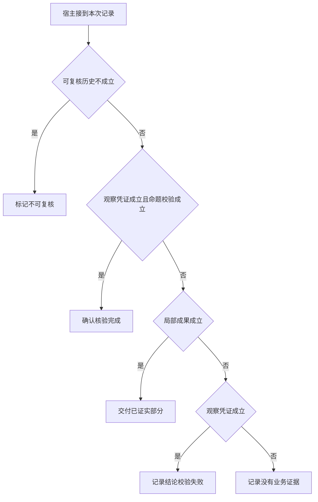

# 终止理由怎样从证据重建

用户看到同一句“未完成”，工程原因可能是没有回执、模型误读或达到预算。
让程序保留已知事实和未解条件，再将终态映射成能说明用户下一步的文本。

本篇用一个封闭的教学决策器说明这一问题。输入是宿主收到的记录，不保证每个下游字段都已经获准使用。前置检查未成立时，下游即使带着缓存值，也不能拿来作业务断言。

## 先解决一个具体问题

**宿主拒绝了错误提议，这条用户任务得几分？**

保护机制通过与用户任务完成可以得到不同结论。
用户是否仍获得足够事实、系统是否需要追问，应另设评分条件。一个 REJECTED 本身不足以给端到端打分。


先取一个能走到「记录没有业务证据」的输入：关键事件均可追溯、只有尚未执行的提议、候选与领域条件冲突、还没有已核实的局部事实。
把这四个条件代回后文的图，前面各个拦截分支都未满足，最终才有“结束事件不足以证明取得事实”这个判断。
还原这个现场时要分别问：哪些位来自可信状态，哪些只是在接口中出现、尚未获得解释资格的字段。

## 先沿一次决策走到底



从上到下取第一条成立的出口。只改一个开关时，只有它之前的检查都未截断，该变化才可能到达真实动作。

“可复核历史”的两种输入分别是“关键事件均可追溯”与“关键事件记录缺失”。
看不见的事件不能被解释为从未发生。

“观察凭证”的两种输入分别是“已有本轮业务回执”与“只有尚未执行的提议”。
模型的调用提议不能证明应用已取得新事实。

“命题校验”的两种输入分别是“候选通过业务断言”与“候选与领域条件冲突”。
有正确的引用编号仍可能推断出错误结论。

“局部成果”的两种输入分别是“已取得可交付的局部事实”与“还没有已核实的局部事实”。
部分完成需要实际观察，不能用进度话术代替。

## 最少需要哪几项观察

### 标记不可复核

缺少区分原因所需的关键记录。
在本节的全部组合中，有 8 种产生「标记不可复核」，这只是逻辑空间的计数，不能当作实际用户请求的比例。

只取得关键事件记录缺失，已经足以要求宿主「标记不可复核」。
保持这些已知项，其余开关自由变化，仍有 8 种补全，判断没有翻转。

若删掉关于可复核历史的证据，另一份允许的现场是关键事件均可追溯、只有尚未执行的提议、候选与领域条件冲突、还没有已核实的局部事实，它会使宿主「记录没有业务证据」。

### 确认核验完成

当前观察支持提交的命题。
在本节的全部组合中，有 2 种产生「确认核验完成」，这只是逻辑空间的计数，不能当作实际用户请求的比例。

只取得关键事件均可追溯、已有本轮业务回执、候选通过业务断言，已经足以要求宿主「确认核验完成」。
保持这些已知项，其余开关自由变化，仍有 2 种补全，判断没有翻转。

若删掉关于可复核历史的证据，另一份允许的现场是关键事件记录缺失、已有本轮业务回执、候选通过业务断言、还没有已核实的局部事实，它会使宿主「标记不可复核」。

若删掉关于观察凭证的证据，另一份允许的现场是关键事件均可追溯、只有尚未执行的提议、候选通过业务断言、还没有已核实的局部事实，它会使宿主「记录没有业务证据」。

若删掉关于命题校验的证据，另一份允许的现场是关键事件均可追溯、已有本轮业务回执、候选与领域条件冲突、还没有已核实的局部事实，它会使宿主「记录结论校验失败」。

### 交付已证实部分

完整目标未成立但已有可用子项。
在本节的全部组合中，有 3 种产生「交付已证实部分」，这只是逻辑空间的计数，不能当作实际用户请求的比例。

只取得关键事件均可追溯、只有尚未执行的提议、已取得可交付的局部事实，已经足以要求宿主「交付已证实部分」。

若删掉关于可复核历史的证据，另一份允许的现场是关键事件记录缺失、只有尚未执行的提议、候选与领域条件冲突、已取得可交付的局部事实，它会使宿主「标记不可复核」。

若删掉关于观察凭证的证据，另一份允许的现场是关键事件均可追溯、已有本轮业务回执、候选通过业务断言、已取得可交付的局部事实，它会使宿主「确认核验完成」。

若删掉关于局部成果的证据，另一份允许的现场是关键事件均可追溯、只有尚未执行的提议、候选与领域条件冲突、还没有已核实的局部事实，它会使宿主「记录没有业务证据」。

只取得关键事件均可追溯、候选与领域条件冲突、已取得可交付的局部事实，已经足以要求宿主「交付已证实部分」。


若删掉关于命题校验的证据，另一份允许的现场是关键事件均可追溯、已有本轮业务回执、候选通过业务断言、已取得可交付的局部事实，它会使宿主「确认核验完成」。


### 记录结论校验失败

有观察而候选未通过。
在本节的全部组合中，有 1 种产生「记录结论校验失败」，这只是逻辑空间的计数，不能当作实际用户请求的比例。

只取得关键事件均可追溯、已有本轮业务回执、候选与领域条件冲突、还没有已核实的局部事实，已经足以要求宿主「记录结论校验失败」。
保持这些已知项，其余开关自由变化，仍有 1 种补全，判断没有翻转。

若删掉关于可复核历史的证据，另一份允许的现场是关键事件记录缺失、已有本轮业务回执、候选与领域条件冲突、还没有已核实的局部事实，它会使宿主「标记不可复核」。

若删掉关于观察凭证的证据，另一份允许的现场是关键事件均可追溯、只有尚未执行的提议、候选与领域条件冲突、还没有已核实的局部事实，它会使宿主「记录没有业务证据」。

若删掉关于命题校验的证据，另一份允许的现场是关键事件均可追溯、已有本轮业务回执、候选通过业务断言、还没有已核实的局部事实，它会使宿主「确认核验完成」。

若删掉关于局部成果的证据，另一份允许的现场是关键事件均可追溯、已有本轮业务回执、候选与领域条件冲突、已取得可交付的局部事实，它会使宿主「交付已证实部分」。

### 记录没有业务证据

结束事件不足以证明取得事实。
在本节的全部组合中，有 2 种产生「记录没有业务证据」，这只是逻辑空间的计数，不能当作实际用户请求的比例。

只取得关键事件均可追溯、只有尚未执行的提议、还没有已核实的局部事实，已经足以要求宿主「记录没有业务证据」。

若删掉关于可复核历史的证据，另一份允许的现场是关键事件记录缺失、只有尚未执行的提议、候选与领域条件冲突、还没有已核实的局部事实，它会使宿主「标记不可复核」。

若删掉关于观察凭证的证据，另一份允许的现场是关键事件均可追溯、已有本轮业务回执、候选与领域条件冲突、还没有已核实的局部事实，它会使宿主「记录结论校验失败」。

若删掉关于局部成果的证据，另一份允许的现场是关键事件均可追溯、只有尚未执行的提议、候选与领域条件冲突、已取得可交付的局部事实，它会使宿主「交付已证实部分」。

## 以同一份契约解释截然不同的现场

<details>
<summary>展开推演与对应反例</summary>

下列样本按最先命中的业务分支排列。四位编码只作本篇页内定位，顺序与开头的四项输入一致。可以先猜下一动作，再展开相邻样本。

### 能够触发“标记不可复核”的现场

**样本 0000**

业务侧交来关键事件记录缺失、只有尚未执行的提议，执行侧还记录了候选与领域条件冲突、还没有已核实的局部事实。
把样本压成最短证明，保留关键事件记录缺失就能支持「标记不可复核」。

在这份记录上，分别翻转「可复核历史」中的任一项，其他项完全不变时，下一动作都会改变。

保持其余观察不动，单独切换「观察凭证」、「命题校验」、「局部成果」仍得到「标记不可复核」，它们在这个现场不是决定性变量。

要从本例改走「记录没有业务证据」，至少需要变动 1 项，一组最少改动是将关键事件记录缺失换成关键事件均可追溯。

要从本例改走「交付已证实部分」，至少需要变动 2 项，一组最少改动是将关键事件记录缺失、还没有已核实的局部事实换成关键事件均可追溯、已取得可交付的局部事实。

要从本例改走「记录结论校验失败」，至少需要变动 2 项，一组最少改动是将关键事件记录缺失、只有尚未执行的提议换成关键事件均可追溯、已有本轮业务回执。

要从本例改走「确认核验完成」，至少需要变动 3 项，一组最少改动是将关键事件记录缺失、只有尚未执行的提议、候选与领域条件冲突换成关键事件均可追溯、已有本轮业务回执、候选通过业务断言。

**样本 0001**

业务侧交来关键事件记录缺失、只有尚未执行的提议，执行侧还记录了候选与领域条件冲突、已取得可交付的局部事实。


要从本例改走「交付已证实部分」，至少需要变动 1 项，一组最少改动是将关键事件记录缺失换成关键事件均可追溯。

要从本例改走「记录没有业务证据」，至少需要变动 2 项，一组最少改动是将关键事件记录缺失、已取得可交付的局部事实换成关键事件均可追溯、还没有已核实的局部事实。

要从本例改走「记录结论校验失败」，至少需要变动 3 项，一组最少改动是将关键事件记录缺失、只有尚未执行的提议、已取得可交付的局部事实换成关键事件均可追溯、已有本轮业务回执、还没有已核实的局部事实。


**样本 0010**

业务侧交来关键事件记录缺失、只有尚未执行的提议，执行侧还记录了候选通过业务断言、还没有已核实的局部事实。


要从本例改走「确认核验完成」，至少需要变动 2 项，一组最少改动是将关键事件记录缺失、只有尚未执行的提议换成关键事件均可追溯、已有本轮业务回执。

要从本例改走「记录结论校验失败」，至少需要变动 3 项，一组最少改动是将关键事件记录缺失、只有尚未执行的提议、候选通过业务断言换成关键事件均可追溯、已有本轮业务回执、候选与领域条件冲突。

**样本 0011**

业务侧交来关键事件记录缺失、只有尚未执行的提议，执行侧还记录了候选通过业务断言、已取得可交付的局部事实。


要从本例改走「记录结论校验失败」，至少需要变动 4 项，一组最少改动是将关键事件记录缺失、只有尚未执行的提议、候选通过业务断言、已取得可交付的局部事实换成关键事件均可追溯、已有本轮业务回执、候选与领域条件冲突、还没有已核实的局部事实。

**样本 0100**

业务侧交来关键事件记录缺失、已有本轮业务回执，执行侧还记录了候选与领域条件冲突、还没有已核实的局部事实。


要从本例改走「记录结论校验失败」，至少需要变动 1 项，一组最少改动是将关键事件记录缺失换成关键事件均可追溯。

要从本例改走「记录没有业务证据」，至少需要变动 2 项，一组最少改动是将关键事件记录缺失、已有本轮业务回执换成关键事件均可追溯、只有尚未执行的提议。


要从本例改走「确认核验完成」，至少需要变动 2 项，一组最少改动是将关键事件记录缺失、候选与领域条件冲突换成关键事件均可追溯、候选通过业务断言。

**样本 0101**

业务侧交来关键事件记录缺失、已有本轮业务回执，执行侧还记录了候选与领域条件冲突、已取得可交付的局部事实。


要从本例改走「记录结论校验失败」，至少需要变动 2 项，一组最少改动是将关键事件记录缺失、已取得可交付的局部事实换成关键事件均可追溯、还没有已核实的局部事实。


要从本例改走「记录没有业务证据」，至少需要变动 3 项，一组最少改动是将关键事件记录缺失、已有本轮业务回执、已取得可交付的局部事实换成关键事件均可追溯、只有尚未执行的提议、还没有已核实的局部事实。

**样本 0110**

业务侧交来关键事件记录缺失、已有本轮业务回执，执行侧还记录了候选通过业务断言、还没有已核实的局部事实。


要从本例改走「确认核验完成」，至少需要变动 1 项，一组最少改动是将关键事件记录缺失换成关键事件均可追溯。


要从本例改走「记录结论校验失败」，至少需要变动 2 项，一组最少改动是将关键事件记录缺失、候选通过业务断言换成关键事件均可追溯、候选与领域条件冲突。

要从本例改走「交付已证实部分」，至少需要变动 3 项，一组最少改动是将关键事件记录缺失、已有本轮业务回执、还没有已核实的局部事实换成关键事件均可追溯、只有尚未执行的提议、已取得可交付的局部事实。

**样本 0111**

业务侧交来关键事件记录缺失、已有本轮业务回执，执行侧还记录了候选通过业务断言、已取得可交付的局部事实。


要从本例改走「交付已证实部分」，至少需要变动 2 项，一组最少改动是将关键事件记录缺失、已有本轮业务回执换成关键事件均可追溯、只有尚未执行的提议。


要从本例改走「记录结论校验失败」，至少需要变动 3 项，一组最少改动是将关键事件记录缺失、候选通过业务断言、已取得可交付的局部事实换成关键事件均可追溯、候选与领域条件冲突、还没有已核实的局部事实。

### 能够触发“确认核验完成”的现场

**样本 1110**

业务侧交来关键事件均可追溯、已有本轮业务回执，执行侧还记录了候选通过业务断言、还没有已核实的局部事实。
把样本压成最短证明，保留关键事件均可追溯、已有本轮业务回执、候选通过业务断言就能支持「确认核验完成」。

在这份记录上，分别翻转「可复核历史」、「观察凭证」、「命题校验」中的任一项，其他项完全不变时，下一动作都会改变。

保持其余观察不动，单独切换「局部成果」仍得到「确认核验完成」，它们在这个现场不是决定性变量。

本例没走更靠前的「标记不可复核」，因为关键事件均可追溯与那个入口的必要条件不符。

要从本例改走「标记不可复核」，至少需要变动 1 项，一组最少改动是将关键事件均可追溯换成关键事件记录缺失。

要从本例改走「记录没有业务证据」，至少需要变动 1 项，一组最少改动是将已有本轮业务回执换成只有尚未执行的提议。

要从本例改走「记录结论校验失败」，至少需要变动 1 项，一组最少改动是将候选通过业务断言换成候选与领域条件冲突。

要从本例改走「交付已证实部分」，至少需要变动 2 项，一组最少改动是将已有本轮业务回执、还没有已核实的局部事实换成只有尚未执行的提议、已取得可交付的局部事实。

**样本 1111**

业务侧交来关键事件均可追溯、已有本轮业务回执，执行侧还记录了候选通过业务断言、已取得可交付的局部事实。


要从本例改走「交付已证实部分」，至少需要变动 1 项，一组最少改动是将已有本轮业务回执换成只有尚未执行的提议。

要从本例改走「记录没有业务证据」，至少需要变动 2 项，一组最少改动是将已有本轮业务回执、已取得可交付的局部事实换成只有尚未执行的提议、还没有已核实的局部事实。

要从本例改走「记录结论校验失败」，至少需要变动 2 项，一组最少改动是将候选通过业务断言、已取得可交付的局部事实换成候选与领域条件冲突、还没有已核实的局部事实。

### 能够触发“交付已证实部分”的现场

**样本 1001**

业务侧交来关键事件均可追溯、只有尚未执行的提议，执行侧还记录了候选与领域条件冲突、已取得可交付的局部事实。
把样本压成最短证明，保留关键事件均可追溯、只有尚未执行的提议、已取得可交付的局部事实就能支持「交付已证实部分」。

在这份记录上，分别翻转「可复核历史」、「局部成果」中的任一项，其他项完全不变时，下一动作都会改变。

保持其余观察不动，单独切换「观察凭证」、「命题校验」仍得到「交付已证实部分」，它们在这个现场不是决定性变量。


本例没走更靠前的「确认核验完成」，因为只有尚未执行的提议、候选与领域条件冲突与那个入口的必要条件不符。


要从本例改走「记录没有业务证据」，至少需要变动 1 项，一组最少改动是将已取得可交付的局部事实换成还没有已核实的局部事实。

要从本例改走「记录结论校验失败」，至少需要变动 2 项，一组最少改动是将只有尚未执行的提议、已取得可交付的局部事实换成已有本轮业务回执、还没有已核实的局部事实。

要从本例改走「确认核验完成」，至少需要变动 2 项，一组最少改动是将只有尚未执行的提议、候选与领域条件冲突换成已有本轮业务回执、候选通过业务断言。

**样本 1011**

业务侧交来关键事件均可追溯、只有尚未执行的提议，执行侧还记录了候选通过业务断言、已取得可交付的局部事实。

在这份记录上，分别翻转「可复核历史」、「观察凭证」、「局部成果」中的任一项，其他项完全不变时，下一动作都会改变。

保持其余观察不动，单独切换「命题校验」仍得到「交付已证实部分」，它们在这个现场不是决定性变量。


本例没走更靠前的「确认核验完成」，因为只有尚未执行的提议与那个入口的必要条件不符。


要从本例改走「确认核验完成」，至少需要变动 1 项，一组最少改动是将只有尚未执行的提议换成已有本轮业务回执。

要从本例改走「记录结论校验失败」，至少需要变动 3 项，一组最少改动是将只有尚未执行的提议、候选通过业务断言、已取得可交付的局部事实换成已有本轮业务回执、候选与领域条件冲突、还没有已核实的局部事实。

**样本 1101**

业务侧交来关键事件均可追溯、已有本轮业务回执，执行侧还记录了候选与领域条件冲突、已取得可交付的局部事实。
把样本压成最短证明，保留关键事件均可追溯、候选与领域条件冲突、已取得可交付的局部事实就能支持「交付已证实部分」。

在这份记录上，分别翻转「可复核历史」、「命题校验」、「局部成果」中的任一项，其他项完全不变时，下一动作都会改变。

保持其余观察不动，单独切换「观察凭证」仍得到「交付已证实部分」，它们在这个现场不是决定性变量。


本例没走更靠前的「确认核验完成」，因为候选与领域条件冲突与那个入口的必要条件不符。


要从本例改走「记录结论校验失败」，至少需要变动 1 项，一组最少改动是将已取得可交付的局部事实换成还没有已核实的局部事实。

要从本例改走「确认核验完成」，至少需要变动 1 项，一组最少改动是将候选与领域条件冲突换成候选通过业务断言。


### 能够触发“记录结论校验失败”的现场

**样本 1100**

业务侧交来关键事件均可追溯、已有本轮业务回执，执行侧还记录了候选与领域条件冲突、还没有已核实的局部事实。
把样本压成最短证明，保留关键事件均可追溯、已有本轮业务回执、候选与领域条件冲突、还没有已核实的局部事实就能支持「记录结论校验失败」。

在这份记录上，分别翻转「可复核历史」、「观察凭证」、「命题校验」、「局部成果」中的任一项，其他项完全不变时，下一动作都会改变。


本例没走更靠前的「交付已证实部分」，因为还没有已核实的局部事实与那个入口的必要条件不符。


要从本例改走「交付已证实部分」，至少需要变动 1 项，一组最少改动是将还没有已核实的局部事实换成已取得可交付的局部事实。


### 能够触发“记录没有业务证据”的现场

**样本 1000**

业务侧交来关键事件均可追溯、只有尚未执行的提议，执行侧还记录了候选与领域条件冲突、还没有已核实的局部事实。
把样本压成最短证明，保留关键事件均可追溯、只有尚未执行的提议、还没有已核实的局部事实就能支持「记录没有业务证据」。


保持其余观察不动，单独切换「命题校验」仍得到「记录没有业务证据」，它们在这个现场不是决定性变量。


本例没走更靠前的「记录结论校验失败」，因为只有尚未执行的提议与那个入口的必要条件不符。


要从本例改走「记录结论校验失败」，至少需要变动 1 项，一组最少改动是将只有尚未执行的提议换成已有本轮业务回执。


**样本 1010**

业务侧交来关键事件均可追溯、只有尚未执行的提议，执行侧还记录了候选通过业务断言、还没有已核实的局部事实。


要从本例改走「记录结论校验失败」，至少需要变动 2 项，一组最少改动是将只有尚未执行的提议、候选通过业务断言换成已有本轮业务回执、候选与领域条件冲突。

</details>

## 当你只能看见一半记录

<details>
<summary>展开推演与对应反例</summary>

这次隐藏两个字段，保留另两个。对每个可见现场，检查四种合法补全是否同意。如仍有歧义，选择能使最坏剩余候选动作最少的字段继续查。并列时采用本篇字段顺序。

### 只保留可复核历史与观察凭证

已知关键事件记录缺失、只有尚未执行的提议时，四种补全的动作分布为标记不可复核（4 种）。

就“标记不可复核”这个动作而言，在关键事件记录缺失、只有尚未执行的提议的前提下，另外两项观察不会推翻它。

已知关键事件记录缺失、已有本轮业务回执时，四种补全的动作分布为标记不可复核（4 种）。

就“标记不可复核”这个动作而言，在关键事件记录缺失、已有本轮业务回执的前提下，另外两项观察不会推翻它。

已知关键事件均可追溯、只有尚未执行的提议时，四种补全的动作分布为交付已证实部分（2 种）、记录没有业务证据（2 种）。

在关键事件均可追溯、只有尚未执行的提议这个现场补读「局部成果」，最坏还剩 1 种动作，计算时只衡量歧义，尚未扣读取代价。
若补来的观察为“还没有已核实的局部事实”，范围缩成「记录没有业务证据」。若为“已取得可交付的局部事实”，则保留「交付已证实部分」。

区分不了的两条执行可以具体写成 1000 与 1001：它们共享已展示字段，却分别需要「记录没有业务证据」和「交付已证实部分」。

已知关键事件均可追溯、已有本轮业务回执时，四种补全的动作分布为确认核验完成（2 种）、交付已证实部分（1 种）、记录结论校验失败（1 种）。

在关键事件均可追溯、已有本轮业务回执这个现场补读「命题校验」，最坏还剩 2 种动作，计算时只衡量歧义，尚未扣读取代价。
若补来的观察为“候选与领域条件冲突”，范围缩成「记录结论校验失败」、「交付已证实部分」。若为“候选通过业务断言”，则保留「确认核验完成」。

区分不了的两条执行可以具体写成 1100 与 1101：它们共享已展示字段，却分别需要「记录结论校验失败」和「交付已证实部分」。

### 只保留可复核历史与命题校验

已知关键事件记录缺失、候选与领域条件冲突时，四种补全的动作分布为标记不可复核（4 种）。

就“标记不可复核”这个动作而言，在关键事件记录缺失、候选与领域条件冲突的前提下，另外两项观察不会推翻它。

已知关键事件记录缺失、候选通过业务断言时，四种补全的动作分布为标记不可复核（4 种）。

就“标记不可复核”这个动作而言，在关键事件记录缺失、候选通过业务断言的前提下，另外两项观察不会推翻它。

已知关键事件均可追溯、候选与领域条件冲突时，四种补全的动作分布为交付已证实部分（2 种）、记录结论校验失败（1 种）、记录没有业务证据（1 种）。

在关键事件均可追溯、候选与领域条件冲突这个现场补读「观察凭证」，最坏还剩 2 种动作，计算时只衡量歧义，尚未扣读取代价。
若补来的观察为“只有尚未执行的提议”，范围缩成「记录没有业务证据」、「交付已证实部分」。若为“已有本轮业务回执”，则保留「记录结论校验失败」、「交付已证实部分」。


已知关键事件均可追溯、候选通过业务断言时，四种补全的动作分布为确认核验完成（2 种）、交付已证实部分（1 种）、记录没有业务证据（1 种）。

在关键事件均可追溯、候选通过业务断言这个现场补读「观察凭证」，最坏还剩 2 种动作，计算时只衡量歧义，尚未扣读取代价。
若补来的观察为“只有尚未执行的提议”，范围缩成「记录没有业务证据」、「交付已证实部分」。若为“已有本轮业务回执”，则保留「确认核验完成」。

区分不了的两条执行可以具体写成 1010 与 1011：它们共享已展示字段，却分别需要「记录没有业务证据」和「交付已证实部分」。

### 只保留观察凭证与命题校验

已知只有尚未执行的提议、候选与领域条件冲突时，四种补全的动作分布为标记不可复核（2 种）、交付已证实部分（1 种）、记录没有业务证据（1 种）。

在只有尚未执行的提议、候选与领域条件冲突这个现场补读「可复核历史」，最坏还剩 2 种动作，计算时只衡量歧义，尚未扣读取代价。
若补来的观察为“关键事件记录缺失”，范围缩成「标记不可复核」。若为“关键事件均可追溯”，则保留「记录没有业务证据」、「交付已证实部分」。

区分不了的两条执行可以具体写成 0000 与 1000：它们共享已展示字段，却分别需要「标记不可复核」和「记录没有业务证据」。

已知只有尚未执行的提议、候选通过业务断言时，四种补全的动作分布为标记不可复核（2 种）、交付已证实部分（1 种）、记录没有业务证据（1 种）。

在只有尚未执行的提议、候选通过业务断言这个现场补读「可复核历史」，最坏还剩 2 种动作，计算时只衡量歧义，尚未扣读取代价。

区分不了的两条执行可以具体写成 0010 与 1010：它们共享已展示字段，却分别需要「标记不可复核」和「记录没有业务证据」。

已知已有本轮业务回执、候选与领域条件冲突时，四种补全的动作分布为标记不可复核（2 种）、交付已证实部分（1 种）、记录结论校验失败（1 种）。

在已有本轮业务回执、候选与领域条件冲突这个现场补读「可复核历史」，最坏还剩 2 种动作，计算时只衡量歧义，尚未扣读取代价。
若补来的观察为“关键事件记录缺失”，范围缩成「标记不可复核」。若为“关键事件均可追溯”，则保留「记录结论校验失败」、「交付已证实部分」。

区分不了的两条执行可以具体写成 0100 与 1100：它们共享已展示字段，却分别需要「标记不可复核」和「记录结论校验失败」。

已知已有本轮业务回执、候选通过业务断言时，四种补全的动作分布为标记不可复核（2 种）、确认核验完成（2 种）。

在已有本轮业务回执、候选通过业务断言这个现场补读「可复核历史」，最坏还剩 1 种动作，计算时只衡量歧义，尚未扣读取代价。
若补来的观察为“关键事件记录缺失”，范围缩成「标记不可复核」。若为“关键事件均可追溯”，则保留「确认核验完成」。

区分不了的两条执行可以具体写成 0110 与 1110：它们共享已展示字段，却分别需要「标记不可复核」和「确认核验完成」。

### 只保留可复核历史与局部成果

已知关键事件记录缺失、还没有已核实的局部事实时，四种补全的动作分布为标记不可复核（4 种）。

就“标记不可复核”这个动作而言，在关键事件记录缺失、还没有已核实的局部事实的前提下，另外两项观察不会推翻它。

已知关键事件记录缺失、已取得可交付的局部事实时，四种补全的动作分布为标记不可复核（4 种）。

就“标记不可复核”这个动作而言，在关键事件记录缺失、已取得可交付的局部事实的前提下，另外两项观察不会推翻它。

已知关键事件均可追溯、还没有已核实的局部事实时，四种补全的动作分布为确认核验完成（1 种）、记录结论校验失败（1 种）、记录没有业务证据（2 种）。

在关键事件均可追溯、还没有已核实的局部事实这个现场补读「观察凭证」，最坏还剩 2 种动作，计算时只衡量歧义，尚未扣读取代价。
若补来的观察为“只有尚未执行的提议”，范围缩成「记录没有业务证据」。若为“已有本轮业务回执”，则保留「记录结论校验失败」、「确认核验完成」。

区分不了的两条执行可以具体写成 1000 与 1100：它们共享已展示字段，却分别需要「记录没有业务证据」和「记录结论校验失败」。

已知关键事件均可追溯、已取得可交付的局部事实时，四种补全的动作分布为确认核验完成（1 种）、交付已证实部分（3 种）。

在关键事件均可追溯、已取得可交付的局部事实这个现场补读「观察凭证」，最坏还剩 2 种动作，计算时只衡量歧义，尚未扣读取代价。
若补来的观察为“只有尚未执行的提议”，范围缩成「交付已证实部分」。若为“已有本轮业务回执”，则保留「交付已证实部分」、「确认核验完成」。

区分不了的两条执行可以具体写成 1001 与 1111：它们共享已展示字段，却分别需要「交付已证实部分」和「确认核验完成」。

### 只保留观察凭证与局部成果

已知只有尚未执行的提议、还没有已核实的局部事实时，四种补全的动作分布为标记不可复核（2 种）、记录没有业务证据（2 种）。

在只有尚未执行的提议、还没有已核实的局部事实这个现场补读「可复核历史」，最坏还剩 1 种动作，计算时只衡量歧义，尚未扣读取代价。
若补来的观察为“关键事件记录缺失”，范围缩成「标记不可复核」。若为“关键事件均可追溯”，则保留「记录没有业务证据」。


已知只有尚未执行的提议、已取得可交付的局部事实时，四种补全的动作分布为标记不可复核（2 种）、交付已证实部分（2 种）。

在只有尚未执行的提议、已取得可交付的局部事实这个现场补读「可复核历史」，最坏还剩 1 种动作，计算时只衡量歧义，尚未扣读取代价。
若补来的观察为“关键事件记录缺失”，范围缩成「标记不可复核」。若为“关键事件均可追溯”，则保留「交付已证实部分」。

区分不了的两条执行可以具体写成 0001 与 1001：它们共享已展示字段，却分别需要「标记不可复核」和「交付已证实部分」。

已知已有本轮业务回执、还没有已核实的局部事实时，四种补全的动作分布为标记不可复核（2 种）、确认核验完成（1 种）、记录结论校验失败（1 种）。

在已有本轮业务回执、还没有已核实的局部事实这个现场补读「可复核历史」，最坏还剩 2 种动作，计算时只衡量歧义，尚未扣读取代价。
若补来的观察为“关键事件记录缺失”，范围缩成「标记不可复核」。若为“关键事件均可追溯”，则保留「记录结论校验失败」、「确认核验完成」。


已知已有本轮业务回执、已取得可交付的局部事实时，四种补全的动作分布为标记不可复核（2 种）、确认核验完成（1 种）、交付已证实部分（1 种）。

在已有本轮业务回执、已取得可交付的局部事实这个现场补读「可复核历史」，最坏还剩 2 种动作，计算时只衡量歧义，尚未扣读取代价。
若补来的观察为“关键事件记录缺失”，范围缩成「标记不可复核」。若为“关键事件均可追溯”，则保留「交付已证实部分」、「确认核验完成」。

区分不了的两条执行可以具体写成 0101 与 1101：它们共享已展示字段，却分别需要「标记不可复核」和「交付已证实部分」。

### 只保留命题校验与局部成果

已知候选与领域条件冲突、还没有已核实的局部事实时，四种补全的动作分布为标记不可复核（2 种）、记录结论校验失败（1 种）、记录没有业务证据（1 种）。

在候选与领域条件冲突、还没有已核实的局部事实这个现场补读「可复核历史」，最坏还剩 2 种动作，计算时只衡量歧义，尚未扣读取代价。
若补来的观察为“关键事件记录缺失”，范围缩成「标记不可复核」。若为“关键事件均可追溯”，则保留「记录没有业务证据」、「记录结论校验失败」。


已知候选与领域条件冲突、已取得可交付的局部事实时，四种补全的动作分布为标记不可复核（2 种）、交付已证实部分（2 种）。

在候选与领域条件冲突、已取得可交付的局部事实这个现场补读「可复核历史」，最坏还剩 1 种动作，计算时只衡量歧义，尚未扣读取代价。


已知候选通过业务断言、还没有已核实的局部事实时，四种补全的动作分布为标记不可复核（2 种）、确认核验完成（1 种）、记录没有业务证据（1 种）。

在候选通过业务断言、还没有已核实的局部事实这个现场补读「可复核历史」，最坏还剩 2 种动作，计算时只衡量歧义，尚未扣读取代价。
若补来的观察为“关键事件记录缺失”，范围缩成「标记不可复核」。若为“关键事件均可追溯”，则保留「记录没有业务证据」、「确认核验完成」。


已知候选通过业务断言、已取得可交付的局部事实时，四种补全的动作分布为标记不可复核（2 种）、确认核验完成（1 种）、交付已证实部分（1 种）。

在候选通过业务断言、已取得可交付的局部事实这个现场补读「可复核历史」，最坏还剩 2 种动作，计算时只衡量歧义，尚未扣读取代价。

区分不了的两条执行可以具体写成 0011 与 1011：它们共享已展示字段，却分别需要「标记不可复核」和「交付已证实部分」。

</details>

## 单因素干预与边界测试

<details>
<summary>展开推演与对应反例</summary>

### 只改变可复核历史

固定另外三个条件得到八对现场，从“关键事件记录缺失”转为“关键事件均可追溯”时，8 对翻转动作，另外 0 对保持不变。

有 2 对现场沿「标记不可复核」变到「记录没有业务证据」，可复现的一组受控背景为只有尚未执行的提议、候选与领域条件冲突、还没有已核实的局部事实。

有 3 对现场沿「标记不可复核」变到「交付已证实部分」，可复现的一组受控背景为只有尚未执行的提议、候选与领域条件冲突、已取得可交付的局部事实。

有 1 对现场沿「标记不可复核」变到「记录结论校验失败」，可复现的一组受控背景为已有本轮业务回执、候选与领域条件冲突、还没有已核实的局部事实。

有 2 对现场沿「标记不可复核」变到「确认核验完成」，可复现的一组受控背景为已有本轮业务回执、候选通过业务断言、还没有已核实的局部事实。

### 只改变观察凭证

固定另外三个条件得到八对现场，从“只有尚未执行的提议”转为“已有本轮业务回执”时，3 对翻转动作，另外 5 对保持不变。

令关键事件记录缺失、候选与领域条件冲突、还没有已核实的局部事实，观察凭证的两个取值均得到「标记不可复核」。在八对中，共有 4 对表现为这一种稳定出口。

有 1 对现场沿「记录没有业务证据」变到「记录结论校验失败」，可复现的一组受控背景为关键事件均可追溯、候选与领域条件冲突、还没有已核实的局部事实。

令关键事件均可追溯、候选与领域条件冲突、已取得可交付的局部事实，观察凭证的两个取值均得到「交付已证实部分」。在八对中，共有 1 对表现为这一种稳定出口。

有 1 对现场沿「记录没有业务证据」变到「确认核验完成」，可复现的一组受控背景为关键事件均可追溯、候选通过业务断言、还没有已核实的局部事实。

有 1 对现场沿「交付已证实部分」变到「确认核验完成」，可复现的一组受控背景为关键事件均可追溯、候选通过业务断言、已取得可交付的局部事实。

### 只改变命题校验

固定另外三个条件得到八对现场，从“候选与领域条件冲突”转为“候选通过业务断言”时，2 对翻转动作，另外 6 对保持不变。

令关键事件记录缺失、只有尚未执行的提议、还没有已核实的局部事实，命题校验的两个取值均得到「标记不可复核」。在八对中，共有 4 对表现为这一种稳定出口。

令关键事件均可追溯、只有尚未执行的提议、还没有已核实的局部事实，命题校验的两个取值均得到「记录没有业务证据」。在八对中，共有 1 对表现为这一种稳定出口。

令关键事件均可追溯、只有尚未执行的提议、已取得可交付的局部事实，命题校验的两个取值均得到「交付已证实部分」。在八对中，共有 1 对表现为这一种稳定出口。

有 1 对现场沿「记录结论校验失败」变到「确认核验完成」，可复现的一组受控背景为关键事件均可追溯、已有本轮业务回执、还没有已核实的局部事实。

有 1 对现场沿「交付已证实部分」变到「确认核验完成」，可复现的一组受控背景为关键事件均可追溯、已有本轮业务回执、已取得可交付的局部事实。

### 只改变局部成果

固定另外三个条件得到八对现场，从“还没有已核实的局部事实”转为“已取得可交付的局部事实”时，3 对翻转动作，另外 5 对保持不变。

令关键事件记录缺失、只有尚未执行的提议、候选与领域条件冲突，局部成果的两个取值均得到「标记不可复核」。在八对中，共有 4 对表现为这一种稳定出口。

有 2 对现场沿「记录没有业务证据」变到「交付已证实部分」，可复现的一组受控背景为关键事件均可追溯、只有尚未执行的提议、候选与领域条件冲突。

有 1 对现场沿「记录结论校验失败」变到「交付已证实部分」，可复现的一组受控背景为关键事件均可追溯、已有本轮业务回执、候选与领域条件冲突。

令关键事件均可追溯、已有本轮业务回执、候选通过业务断言，局部成果的两个取值均得到「确认核验完成」。在八对中，共有 1 对表现为这一种稳定出口。

</details>

## 哪些回归样本真能抓住实现错误

<details>
<summary>展开推演与对应反例</summary>

如果删除“标记不可复核”这个分支，在本篇 16 种输入里有 8 种会改走另一出口。

反例 0000 的完整记录为关键事件记录缺失、只有尚未执行的提议、候选与领域条件冲突、还没有已核实的局部事实。正确结果是「标记不可复核」，这个改坏的实现却给出「记录没有业务证据」。

如果删除“确认核验完成”这个分支，在本篇 16 种输入里有 2 种会改走另一出口。

反例 1110 的完整记录为关键事件均可追溯、已有本轮业务回执、候选通过业务断言、还没有已核实的局部事实。正确结果是「确认核验完成」，这个改坏的实现却给出「记录结论校验失败」。

如果删除“交付已证实部分”这个分支，在本篇 16 种输入里有 3 种会改走另一出口。

反例 1001 的完整记录为关键事件均可追溯、只有尚未执行的提议、候选与领域条件冲突、已取得可交付的局部事实。正确结果是「交付已证实部分」，这个改坏的实现却给出「记录没有业务证据」。

如果删除“记录结论校验失败”这个分支，在本篇 16 种输入里有 1 种会改走另一出口。

反例 1100 的完整记录为关键事件均可追溯、已有本轮业务回执、候选与领域条件冲突、还没有已核实的局部事实。正确结果是「记录结论校验失败」，这个改坏的实现却给出「记录没有业务证据」。

如果交换“标记不可复核”和“确认核验完成”的判断次序，在本篇 16 种输入里有 2 种会改走另一出口。

反例 0110 的完整记录为关键事件记录缺失、已有本轮业务回执、候选通过业务断言、还没有已核实的局部事实。正确结果是「标记不可复核」，这个改坏的实现却给出「确认核验完成」。

如果交换“确认核验完成”和“交付已证实部分”的判断次序，在本篇 16 种输入里有 1 种会改走另一出口。

反例 1111 的完整记录为关键事件均可追溯、已有本轮业务回执、候选通过业务断言、已取得可交付的局部事实。正确结果是「确认核验完成」，这个改坏的实现却给出「交付已证实部分」。

如果交换“交付已证实部分”和“记录结论校验失败”的判断次序，在本篇 16 种输入里有 1 种会改走另一出口。

反例 1101 的完整记录为关键事件均可追溯、已有本轮业务回执、候选与领域条件冲突、已取得可交付的局部事实。正确结果是「交付已证实部分」，这个改坏的实现却给出「记录结论校验失败」。

补入样本 0110（关键事件记录缺失、已有本轮业务回执、候选通过业务断言、还没有已核实的局部事实）能新增检出「删除“标记不可复核”这个分支」、「交换“标记不可复核”和“确认核验完成”的判断次序」。

补入样本 1101（关键事件均可追溯、已有本轮业务回执、候选与领域条件冲突、已取得可交付的局部事实）能新增检出「删除“交付已证实部分”这个分支」、「交换“交付已证实部分”和“记录结论校验失败”的判断次序」。

补入样本 1111（关键事件均可追溯、已有本轮业务回执、候选通过业务断言、已取得可交付的局部事实）能新增检出「删除“确认核验完成”这个分支」、「交换“确认核验完成”和“交付已证实部分”的判断次序」。

补入样本 1100（关键事件均可追溯、已有本轮业务回执、候选与领域条件冲突、还没有已核实的局部事实）能新增检出「删除“记录结论校验失败”这个分支」。

这里每次选覆盖尚未捕获缺陷最多的样本，并不保证用例数全局最小。它给出的反例能作为 Java 单测输入。真实模型是否会自主产生这些提议，仍须单独评测。

</details>

## 把状态覆盖换成有抽样偏差的评测批次

<details>
<summary>展开推演与对应反例</summary>

前面的十六种记录各有一票。现在只改样本构成：对一个给定字段，把成立侧的每种记录各取三份、另一侧各取一份。这是人为配比的 32 份回放，不是线上频率估计。
将偏向成立与偏向不成立的两次批次对照，可以隔离分母变化。底层宿主和所有答案保持相同，比例仍可能移动。

### 改变“可复核历史”的样本配比

只看「标记不可复核」，在关键事件均可追溯的八个不同输入中有 0 个命中，在关键事件记录缺失的另八个输入中有 8 个命中。
把「可复核历史」成立侧按三倍取样，「标记不可复核」占 8/32，反过来向未成立侧倾斜后占 24/32。
这次重加权使「标记不可复核」的占比相差 50 个百分点。若按两种不同的“可复核历史”分布跑新旧版，不能把这项差异全部归功于实现。

只看「确认核验完成」，在关键事件均可追溯的八个不同输入中有 2 个命中，在关键事件记录缺失的另八个输入中有 0 个命中。
把「可复核历史」成立侧按三倍取样，「确认核验完成」占 6/32，反过来向未成立侧倾斜后占 2/32。
这次重加权使「确认核验完成」的占比相差 12.5 个百分点。若按两种不同的“可复核历史”分布跑新旧版，不能把这项差异全部归功于实现。

只看「交付已证实部分」，在关键事件均可追溯的八个不同输入中有 3 个命中，在关键事件记录缺失的另八个输入中有 0 个命中。
把「可复核历史」成立侧按三倍取样，「交付已证实部分」占 9/32，反过来向未成立侧倾斜后占 3/32。
这次重加权使「交付已证实部分」的占比相差 18.75 个百分点。若按两种不同的“可复核历史”分布跑新旧版，不能把这项差异全部归功于实现。

只看「记录结论校验失败」，在关键事件均可追溯的八个不同输入中有 1 个命中，在关键事件记录缺失的另八个输入中有 0 个命中。
把「可复核历史」成立侧按三倍取样，「记录结论校验失败」占 3/32，反过来向未成立侧倾斜后占 1/32。
这次重加权使「记录结论校验失败」的占比相差 6.25 个百分点。若按两种不同的“可复核历史”分布跑新旧版，不能把这项差异全部归功于实现。

只看「记录没有业务证据」，在关键事件均可追溯的八个不同输入中有 2 个命中，在关键事件记录缺失的另八个输入中有 0 个命中。
把「可复核历史」成立侧按三倍取样，「记录没有业务证据」占 6/32，反过来向未成立侧倾斜后占 2/32。
这次重加权使「记录没有业务证据」的占比相差 12.5 个百分点。若按两种不同的“可复核历史”分布跑新旧版，不能把这项差异全部归功于实现。

### 改变“观察凭证”的样本配比

只看「标记不可复核」，在已有本轮业务回执的八个不同输入中有 4 个命中，在只有尚未执行的提议的另八个输入中有 4 个命中。
把「观察凭证」成立侧按三倍取样，「标记不可复核」占 16/32，反过来向未成立侧倾斜后占 16/32。
两批「标记不可复核」的边际比例相同，是因为这个出口在“观察凭证”的两侧计数相等，这不能单独证明每一对现场都不受它影响。

只看「确认核验完成」，在已有本轮业务回执的八个不同输入中有 2 个命中，在只有尚未执行的提议的另八个输入中有 0 个命中。
把「观察凭证」成立侧按三倍取样，「确认核验完成」占 6/32，反过来向未成立侧倾斜后占 2/32。
这次重加权使「确认核验完成」的占比相差 12.5 个百分点。若按两种不同的“观察凭证”分布跑新旧版，不能把这项差异全部归功于实现。

只看「交付已证实部分」，在已有本轮业务回执的八个不同输入中有 1 个命中，在只有尚未执行的提议的另八个输入中有 2 个命中。
把「观察凭证」成立侧按三倍取样，「交付已证实部分」占 5/32，反过来向未成立侧倾斜后占 7/32。
这次重加权使「交付已证实部分」的占比相差 6.25 个百分点。若按两种不同的“观察凭证”分布跑新旧版，不能把这项差异全部归功于实现。

只看「记录结论校验失败」，在已有本轮业务回执的八个不同输入中有 1 个命中，在只有尚未执行的提议的另八个输入中有 0 个命中。
把「观察凭证」成立侧按三倍取样，「记录结论校验失败」占 3/32，反过来向未成立侧倾斜后占 1/32。
这次重加权使「记录结论校验失败」的占比相差 6.25 个百分点。若按两种不同的“观察凭证”分布跑新旧版，不能把这项差异全部归功于实现。

只看「记录没有业务证据」，在已有本轮业务回执的八个不同输入中有 0 个命中，在只有尚未执行的提议的另八个输入中有 2 个命中。
把「观察凭证」成立侧按三倍取样，「记录没有业务证据」占 2/32，反过来向未成立侧倾斜后占 6/32。
这次重加权使「记录没有业务证据」的占比相差 12.5 个百分点。若按两种不同的“观察凭证”分布跑新旧版，不能把这项差异全部归功于实现。

### 改变“命题校验”的样本配比

只看「标记不可复核」，在候选通过业务断言的八个不同输入中有 4 个命中，在候选与领域条件冲突的另八个输入中有 4 个命中。
把「命题校验」成立侧按三倍取样，「标记不可复核」占 16/32，反过来向未成立侧倾斜后占 16/32。
两批「标记不可复核」的边际比例相同，是因为这个出口在“命题校验”的两侧计数相等，这不能单独证明每一对现场都不受它影响。

只看「确认核验完成」，在候选通过业务断言的八个不同输入中有 2 个命中，在候选与领域条件冲突的另八个输入中有 0 个命中。
把「命题校验」成立侧按三倍取样，「确认核验完成」占 6/32，反过来向未成立侧倾斜后占 2/32。
这次重加权使「确认核验完成」的占比相差 12.5 个百分点。若按两种不同的“命题校验”分布跑新旧版，不能把这项差异全部归功于实现。

只看「交付已证实部分」，在候选通过业务断言的八个不同输入中有 1 个命中，在候选与领域条件冲突的另八个输入中有 2 个命中。
把「命题校验」成立侧按三倍取样，「交付已证实部分」占 5/32，反过来向未成立侧倾斜后占 7/32。
这次重加权使「交付已证实部分」的占比相差 6.25 个百分点。若按两种不同的“命题校验”分布跑新旧版，不能把这项差异全部归功于实现。

只看「记录结论校验失败」，在候选通过业务断言的八个不同输入中有 0 个命中，在候选与领域条件冲突的另八个输入中有 1 个命中。
把「命题校验」成立侧按三倍取样，「记录结论校验失败」占 1/32，反过来向未成立侧倾斜后占 3/32。
这次重加权使「记录结论校验失败」的占比相差 6.25 个百分点。若按两种不同的“命题校验”分布跑新旧版，不能把这项差异全部归功于实现。

只看「记录没有业务证据」，在候选通过业务断言的八个不同输入中有 1 个命中，在候选与领域条件冲突的另八个输入中有 1 个命中。
把「命题校验」成立侧按三倍取样，「记录没有业务证据」占 4/32，反过来向未成立侧倾斜后占 4/32。
两批「记录没有业务证据」的边际比例相同，是因为这个出口在“命题校验”的两侧计数相等，这不能单独证明每一对现场都不受它影响。

### 改变“局部成果”的样本配比

只看「标记不可复核」，在已取得可交付的局部事实的八个不同输入中有 4 个命中，在还没有已核实的局部事实的另八个输入中有 4 个命中。
把「局部成果」成立侧按三倍取样，「标记不可复核」占 16/32，反过来向未成立侧倾斜后占 16/32。
两批「标记不可复核」的边际比例相同，是因为这个出口在“局部成果”的两侧计数相等，这不能单独证明每一对现场都不受它影响。

只看「确认核验完成」，在已取得可交付的局部事实的八个不同输入中有 1 个命中，在还没有已核实的局部事实的另八个输入中有 1 个命中。
把「局部成果」成立侧按三倍取样，「确认核验完成」占 4/32，反过来向未成立侧倾斜后占 4/32。
两批「确认核验完成」的边际比例相同，是因为这个出口在“局部成果”的两侧计数相等，这不能单独证明每一对现场都不受它影响。

只看「交付已证实部分」，在已取得可交付的局部事实的八个不同输入中有 3 个命中，在还没有已核实的局部事实的另八个输入中有 0 个命中。
把「局部成果」成立侧按三倍取样，「交付已证实部分」占 9/32，反过来向未成立侧倾斜后占 3/32。
这次重加权使「交付已证实部分」的占比相差 18.75 个百分点。若按两种不同的“局部成果”分布跑新旧版，不能把这项差异全部归功于实现。

只看「记录结论校验失败」，在已取得可交付的局部事实的八个不同输入中有 0 个命中，在还没有已核实的局部事实的另八个输入中有 1 个命中。
把「局部成果」成立侧按三倍取样，「记录结论校验失败」占 1/32，反过来向未成立侧倾斜后占 3/32。
这次重加权使「记录结论校验失败」的占比相差 6.25 个百分点。若按两种不同的“局部成果”分布跑新旧版，不能把这项差异全部归功于实现。

只看「记录没有业务证据」，在已取得可交付的局部事实的八个不同输入中有 0 个命中，在还没有已核实的局部事实的另八个输入中有 2 个命中。
把「局部成果」成立侧按三倍取样，「记录没有业务证据」占 2/32，反过来向未成立侧倾斜后占 6/32。
这次重加权使「记录没有业务证据」的占比相差 12.5 个百分点。若按两种不同的“局部成果”分布跑新旧版，不能把这项差异全部归功于实现。

</details>

## 只看终态，能逆推出多少原始事实

<details>
<summary>展开推演与对应反例</summary>

### 只保留“标记不可复核”这条结果时

在本节契约与完整输入域内，仅知「标记不可复核」就能倒推出关键事件记录缺失，这一推断依赖版本未变且日志中的终态可信。

「标记不可复核」不能证明观察凭证取哪一侧：0000 和 0100 有相同终态，却分别记为“只有尚未执行的提议”和“已有本轮业务回执”。

「标记不可复核」不能证明命题校验取哪一侧：0000 和 0010 有相同终态，却分别记为“候选与领域条件冲突”和“候选通过业务断言”。

「标记不可复核」不能证明局部成果取哪一侧：0000 和 0001 有相同终态，却分别记为“还没有已核实的局部事实”和“已取得可交付的局部事实”。

反查「标记不可复核」的诊断日志，优先保留能区分样本 0000 与 1000 的「可复核历史」，否则很容易把邻近的「记录没有业务证据」看成同一种故障。

### 只保留“确认核验完成”这条结果时

在本节契约与完整输入域内，仅知「确认核验完成」就能倒推出关键事件均可追溯，这一推断依赖版本未变且日志中的终态可信。

在本节契约与完整输入域内，仅知「确认核验完成」就能倒推出已有本轮业务回执，这一推断依赖版本未变且日志中的终态可信。

在本节契约与完整输入域内，仅知「确认核验完成」就能倒推出候选通过业务断言，这一推断依赖版本未变且日志中的终态可信。

「确认核验完成」不能证明局部成果取哪一侧：1110 和 1111 有相同终态，却分别记为“还没有已核实的局部事实”和“已取得可交付的局部事实”。

反查「确认核验完成」的诊断日志，优先保留能区分样本 1110 与 0110 的「可复核历史」，否则很容易把邻近的「标记不可复核」看成同一种故障。

### 只保留“交付已证实部分”这条结果时

在本节契约与完整输入域内，仅知「交付已证实部分」就能倒推出关键事件均可追溯，这一推断依赖版本未变且日志中的终态可信。

「交付已证实部分」不能证明观察凭证取哪一侧：1001 和 1101 有相同终态，却分别记为“只有尚未执行的提议”和“已有本轮业务回执”。

「交付已证实部分」不能证明命题校验取哪一侧：1001 和 1011 有相同终态，却分别记为“候选与领域条件冲突”和“候选通过业务断言”。

在本节契约与完整输入域内，仅知「交付已证实部分」就能倒推出已取得可交付的局部事实，这一推断依赖版本未变且日志中的终态可信。

反查「交付已证实部分」的诊断日志，优先保留能区分样本 1001 与 0001 的「可复核历史」，否则很容易把邻近的「标记不可复核」看成同一种故障。

### 只保留“记录结论校验失败”这条结果时

在本节契约与完整输入域内，仅知「记录结论校验失败」就能倒推出关键事件均可追溯，这一推断依赖版本未变且日志中的终态可信。

在本节契约与完整输入域内，仅知「记录结论校验失败」就能倒推出已有本轮业务回执，这一推断依赖版本未变且日志中的终态可信。

在本节契约与完整输入域内，仅知「记录结论校验失败」就能倒推出候选与领域条件冲突，这一推断依赖版本未变且日志中的终态可信。

在本节契约与完整输入域内，仅知「记录结论校验失败」就能倒推出还没有已核实的局部事实，这一推断依赖版本未变且日志中的终态可信。

反查「记录结论校验失败」的诊断日志，优先保留能区分样本 1100 与 0100 的「可复核历史」，否则很容易把邻近的「标记不可复核」看成同一种故障。

### 只保留“记录没有业务证据”这条结果时

在本节契约与完整输入域内，仅知「记录没有业务证据」就能倒推出关键事件均可追溯，这一推断依赖版本未变且日志中的终态可信。

在本节契约与完整输入域内，仅知「记录没有业务证据」就能倒推出只有尚未执行的提议，这一推断依赖版本未变且日志中的终态可信。

「记录没有业务证据」不能证明命题校验取哪一侧：1000 和 1010 有相同终态，却分别记为“候选与领域条件冲突”和“候选通过业务断言”。

在本节契约与完整输入域内，仅知「记录没有业务证据」就能倒推出还没有已核实的局部事实，这一推断依赖版本未变且日志中的终态可信。

反查「记录没有业务证据」的诊断日志，优先保留能区分样本 1000 与 0000 的「可复核历史」，否则很容易把邻近的「标记不可复核」看成同一种故障。

</details>

## 面试复述与复算

面试题可以从“宿主拒绝了错误提议，这条用户任务得几分？”起步。先给出本篇的触发条件和一条真实执行端可检查的证据，再用一个相邻反例限定结论的适用范围。

在仓库根目录执行下列命令可以重算本篇的一个输入。四位数字依次选择正文列出的四项条件，0 表示未成立或低档，1 表示成立或高档。
```powershell
node examples/reading-cases/replay.mjs 3 7 0101
```

[本周主文](../theory.md) · [配套实验](../lab.md)
