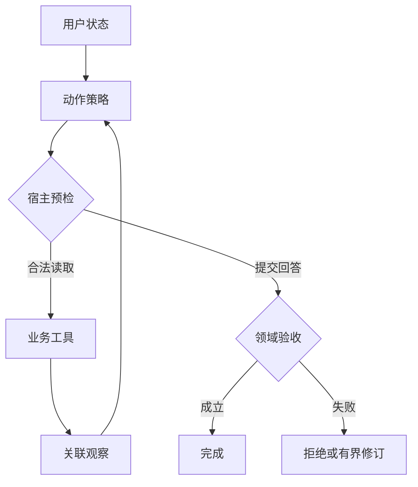
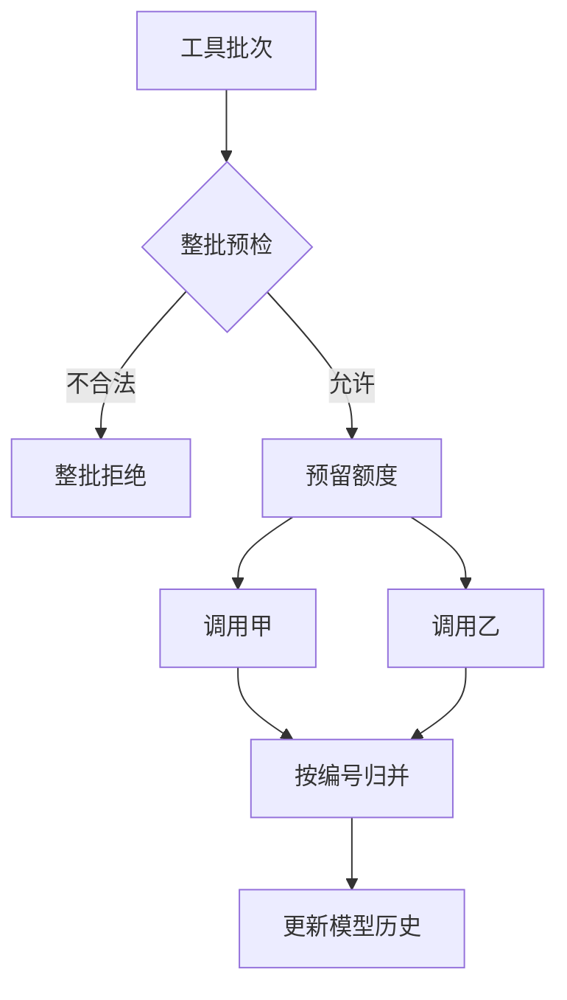
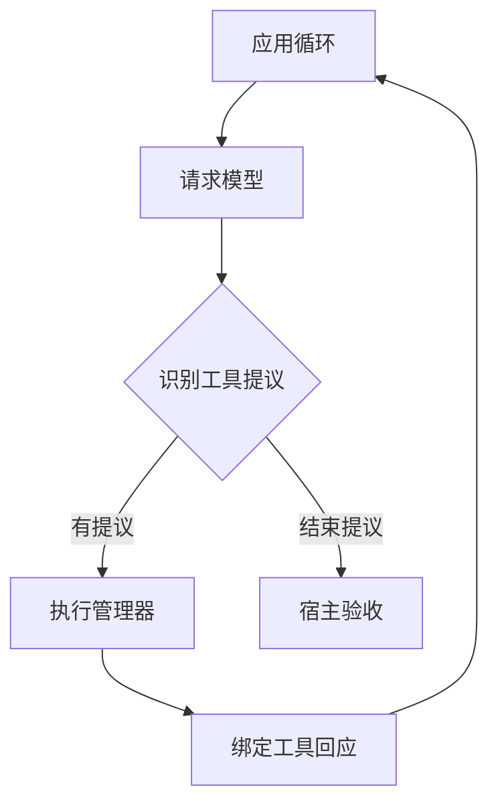
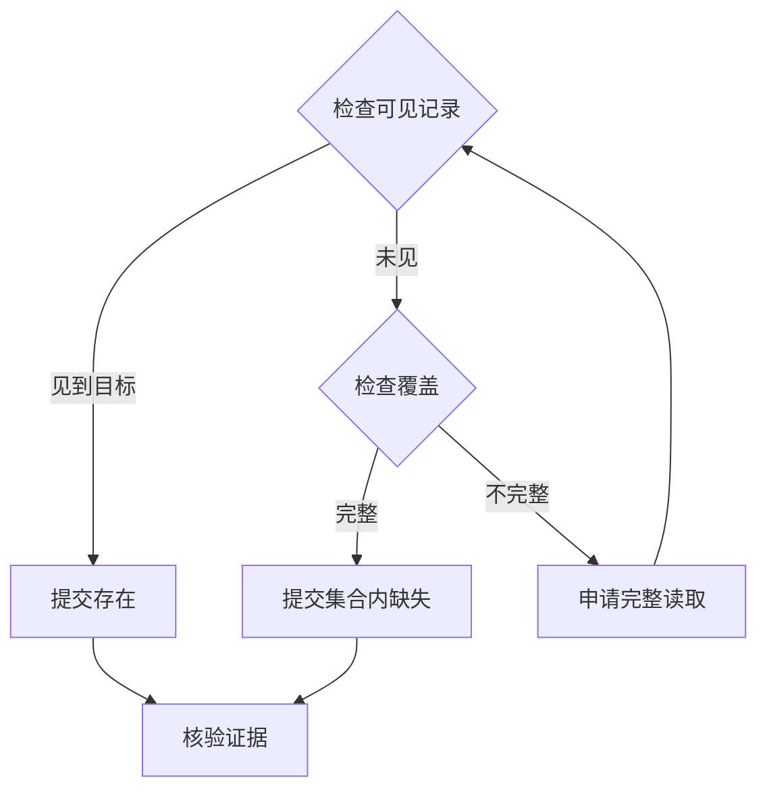

# 第 3 章　ReAct 与有界执行循环：让观察决定下一步，也让程序保证结束

本周读法：先连续阅读机制正文，再按需要进入下面七篇。每篇开头可以直接读案例与流程图，展开部分专门用于手算边界、追问或复算不同输入。场馆资料沿用公开快照，诊断和预审的故障输入为教学模拟。

- [观察何时值得触发下一次模型调用](readings/01.md)
- [两种预算怎样共同使循环结束](readings/02.md)
- [有限的截止时间能容纳几轮行动](readings/03.md)（定量推演）
- [两个调用怎样作为一批发出去](readings/04.md)
- [用已解条件检测空转](readings/05.md)
- [同一批读取，整批拒绝还是部分执行](readings/06.md)（定量推演）
- [终止理由怎样从证据重建](readings/07.md)

假设两条执行轨迹的第一步完全相同，都请求了时段工具。如果返回一张适用的卡，下一步可以结案；如果只返回“对象不明确”，下一步应追问；如果是传输超时，可能重试或降级。现在把返回值互换，但让后面的动作保持原样。系统会在至少一个场景里做错。这就是引入观察反馈的理由：一个动作值不值得做，取决于到目前为止知道什么，以及接下来想满足哪条条件。

## 从策略函数推导 ReAct

设执行历史为 H，当前可行动作集合为 A，模型策略根据用户目标、H 和 A 提出动作 a。宿主验证并执行 a，得到观察 o，再构造新历史 H′。如果新历史不包含 o，不论模型调用多少次，它都缺少改变判断所需的新事实。反过来，若 o 已足以让确定性规则完成任务，宿主也可以结束，不必为“体现智能”再加一轮模型。ReAct 论文把推理与行动交错组织；生产应用可以采用“动作—外部观察—再决策”的机制，用可观察的工具轨迹分析系统，无须获取模型私有推理文本。[ReAct 原论文](https://arxiv.org/abs/2210.03629)

**观察如何真正改变下一动作**




判断一个设计是否利用了这种反馈，可以做**反事实测试**。固定初始目标、工具定义和第一轮提议，只将工具结果由 FOUND 改成 TIMEOUT。若第二轮仍无条件提交同一个肯定结论，就没有正确利用观察。即使程序确实写了 `while`，甚至日志也有两次模型请求，仍不满足任务要求。反过来，写死的错误分支也能通过这一个测试。要支持“模型在不同措辞和意外观察下会选择合适行动”，还需真实模型在独立变式上的结果。这两个命题的证据不同。

| 当前已知 | 新事件 | 状态更新 | 允许的后继 |
| --- | --- | --- | --- |
| 已知地点，没见时间 | 模型生成合法读取 | 锁定调用 ID，预留一次工具额度 | 执行工具或返回失败 |
| 调用 c1 在途 | 回执属于 c1，返回 FOUND | 标记 c1 完成，保存来源、对象、时段 | 结案或继续查其他缺项 |
| 调用 c1 在途 | 收到未知 c9 的回执 | 隔离迟到或串线回执 | 等待 c1 或按截止时间降级 |
| 已见时段、无余座来源 | 申请“确定还有座位” | 判为不受支持的命题 | 拒绝、修订一次或部分完成 |

## 安全性与终止性要分别证明

“不会越权写草稿”是一项安全性要求：任何一条已执行轨迹都不该出现禁做动作。“最终会完成、暂停或明确失败”是一项关于终止的要求。只限制可用工具可以保护第一项，却可能让模型一直请求一个被拒的动作；只限制最大轮数可以使循环结束，却不能阻止第一轮越权。评审设计时，先给每项要求找出一条最短反例，再问由哪段代码排除它。

从初始预算举例。设还可请求模型 2 次、尝试工具 1 次，当前已知地点，未知时段。第一轮模型请求读表，轮数剩 1；宿主将尝试额度从 1 变 0，工具返回 FOUND。第二轮模型可以用最后一轮申请结束，宿主验证后 DONE。若它再次要求读表，无工具额度，终止并保留已知事实。若第一轮只返回语法错误且允许修订，这也已用掉一次模型推理；若这类错误不计轮数，模型可无穷次输出错误而无一次实际工具调用。

有限轮数需要配合真实时间。若唯一一次 RPC 永久阻塞，轮数证明不了用户会在有限时间内得到答复。把总截止时刻从入口传到模型调用、工具与等待队列，每次算剩余时间，并为汇总保留开销。对已经超过截止的回执要有政策：它可以进入审计，不能让用户已收到的终态被悄悄重写。第 1 周示例覆盖的是有界动作数与脚本故障；服务级截止与并发属于扩展设计，不能从示例跑通推出已部署这些保障。

## 一次模型输出多项调用时，先想清关联与原子性

假设同一轮提议 `c7=查花园街` 和 `c8=查薄扶林`。薄扶林先返回。用返回顺序拼列表会把薄扶林的时段贴给花园街；用调用 ID 关联，并逐项保留对象 ID 与来源，才不依赖顺序。若第二项参数非法，先执行第一项再校验第二项会留下一半工作的事实。对只读批次可以定义“整批预校验，允许按项返回业务错误”；对含副作用的批次，还要明确部分成功、补偿和幂等。批量发送不是数据库事务，不能向用户保证全有或全无。

**批次预检、并发派发和按编号归并**




同一个 c7 的回执重复到达，是已经发生的观察被投递了两次。新调用 c9 使用和 c7 相同的参数，是模型提出了新的执行意图。它可能是对超时的合理重试，也可能是在成功后原地打转。判断后者须查看上一回执、数据版本、参数含义以及剩余预算。仅对参数做哈希会错杀合法的重新核验；仅对调用 ID 去重又拦不住换 ID 的空转。可以记录一个“未解条件集合”，连续几次动作既不产生新观察也不减少缺项，就给一次修订机会或退出。这是防无进展机制，其阈值应依任务分布调试。

## 谁持有循环，谁拥有工具

在固定版本 Spring AI 的工具管理器里，可沿一条责任链读代码：从本轮模型响应取出请求，分派具体工具，再把执行结果组成后续历史。调用它的上层可以选择是否发起下一次模型请求。在 LangGraph 中，ToolNode 能作为图上的执行节点，图的边和共享状态决定后继路径。两者都能承载工具调用，差别在于“下一步由哪一层表达”。若自己写外层 while，又让内层框架自动跑完全部工具往返，外层记录的一个 step 就可能对应多次真实模型调用，次数统计和限额都会失真。接框架前先关闭或看清其中一层自动循环，再核对谁在计量请求。[Spring AI 固定版本](https://github.com/spring-projects/spring-ai/blob/9993102c830c132b88cb6857c0cdf41a22747432/spring-ai-model/src/main/java/org/springframework/ai/model/tool/DefaultToolCallingManager.java) · [LangGraph ToolNode 固定版本](https://github.com/langchain-ai/langgraph/blob/e5e37b5d70dbfd93c7006bd90a658c6179a95946/libs/prebuilt/langgraph/prebuilt/tool_node.py)

**框架管理一次工具批次，外层决定是否再次推理**




普通只读流程恢复时，可以先重建历史，再决定未完成工具是否重试。但如果回放过程会重新执行所有历史 action，就从“重放已知事件”变成了“再次产生副作用”。将状态更新写成纯函数 `reduce(state,event)`，将执行外部工具留给单独的执行器，能使同一组事件重建同一份状态。事件里应区分提议、已派发、观察和已接受终态。只有提议时没有任何执行事实；只有派发而无回执时，外部状态仍未知。

## 可在 JDK 17 独立运行的最小诊断循环

下面的完整例题只研究一个变量：第一次检查能否看见完整范围。把代码存为 `TraceLesson.java`，执行 `java TraceLesson.java full` 和 `java TraceLesson.java slice`。两个输入共享同一套决策规则、工具和宿主，观察不同就会走出不同轨迹。这里用确定性策略充当模型替身，这能复现控制机制；考察真实模型选工具时应替换策略边界。

**小型诊断程序的两种证据路径**




```java
import java.util.ArrayList;
import java.util.List;

class TraceLesson {
    enum Action { INSPECT_PAGE, INSPECT_FULL, REPORT_ABSENT, REPORT_PRESENT }
    record Observation(boolean complete, boolean found) {}

    static Action decide(List<Observation> history) {
        if (history.isEmpty()) return Action.INSPECT_PAGE;
        Observation latest = history.get(history.size() - 1);
        if (latest.found()) return Action.REPORT_PRESENT;
        if (latest.complete()) return Action.REPORT_ABSENT;
        return Action.INSPECT_FULL;
    }

    static Observation execute(Action action, boolean full) {
        // Two simulated worlds: a complete empty result, or a truncated page hiding P7.
        if (action == Action.INSPECT_PAGE) return new Observation(full, false);
        if (action == Action.INSPECT_FULL) return new Observation(true, !full);
        throw new IllegalArgumentException("not a read action");
    }

    public static void main(String[] args) {
        if (args.length != 1 || !(args[0].equals("full") || args[0].equals("slice")))
            throw new IllegalArgumentException("use full or slice");
        boolean full = args[0].equals("full");
        List<Observation> history = new ArrayList<>();
        int attempts = 0;
        for (int turn = 1; turn <= 4; turn++) {
            Action next = decide(List.copyOf(history));
            System.out.println("turn=" + turn + " action=" + next);
            if (next == Action.REPORT_PRESENT || next == Action.REPORT_ABSENT) {
                boolean supported = next == Action.REPORT_PRESENT
                        ? history.stream().anyMatch(Observation::found)
                        : history.stream().anyMatch(o -> o.complete() && !o.found());
                System.out.println(supported ? "DONE" : "REJECTED");
                return;
            }
            if (attempts >= 2) break;
            attempts++;
            Observation observation = execute(next, full);
            history.add(observation);
            System.out.println("observed=" + observation);
        }
        System.out.println("LIMIT");
    }
}
```

先预测两个动作序列。full 第一次拿到的是完整范围未见目标，第二轮可报告该集合内缺失。slice 第一次只看一页，第二轮需读取完整集合；发现目标后，第三轮才报告存在。请注意“集合内缺失”并不等于“召回模型失效”，示例没有能力确认后者。再把 `decide` 的末行故意换成 `return Action.REPORT_ABSENT;`，运行 slice，应该出现 REJECTED。**同一个策略错误被宿主拦住**，才是双方职责分开的直接证据。

这个最小验证器成立有严格前提：同一运行只有一个目标、一个固定数据版本，两个工具观察的是同一个逻辑集合。推广到可换目标、跨阶段或跨版本的诊断时，每条观察必须带对象、阶段和版本，核对命题时也要匹配它们。如果来自旧版本的“完整且未见”可以和新版本的“已经出现”一起算，`anyMatch` 会同时支持互相冲突的结论。面试中能指出这段小程序何时失效，比把它翻译成另一个 Agent 框架更重要。

## 固定版本源码的三个落点

熟悉 Spring 的读者可以把框架里的管理器当作一次调用批次的适配器。固定版本 `DefaultToolCallingManager` 的 `doExecuteToolCalls` 在约 229 行取出模型消息，在 233 行把提议交给具体工具执行，在 242 行构造下一轮使用的历史。阅读时把断点设在这三个事件上：看到第一处不意味着读过数据；第二处有结果才算获得观察；第三处之后，后续模型调用才有机会用到观察。即使工具调用成功，若外层把旧 Prompt 又原样发了一遍，模型仍会表现得像“从没查过”。[Spring AI 对应方法](https://github.com/spring-projects/spring-ai/blob/9993102c830c132b88cb6857c0cdf41a22747432/spring-ai-model/src/main/java/org/springframework/ai/model/tool/DefaultToolCallingManager.java#L215-L248)

再看固定版本 LangGraph 同步路径，ToolNode 使用执行器把这一批 tool calls 交给 `_run_one`，后者可进入 `_execute_tool_sync`。这解释了为什么图节点的一次执行可能包含多次真实工具操作。若每个操作都要预留预算，就在发给执行器前完成批次校验；若每个结果都要对应模型请求，就在汇总时按调用 ID 配对。不能因为监控只看到一个 node span 就把它计作一次业务工具。两者解决相似的“调用与回传”问题，一个以对话工具管理为入口，一个以图节点为入口。[LangGraph 同步分派](https://github.com/langchain-ai/langgraph/blob/e5e37b5d70dbfd93c7006bd90a658c6179a95946/libs/prebuilt/langgraph/prebuilt/tool_node.py#L829-L834) · [单调用处理](https://github.com/langchain-ai/langgraph/blob/e5e37b5d70dbfd93c7006bd90a658c6179a95946/libs/prebuilt/langgraph/prebuilt/tool_node.py#L1031-L1068)

## 面试推演：把“模型会自己想办法”换成可验证的设计

**给定题。** 一次用户查询最多两次下游尝试。模型一次请求三个并行工具，其中两个相同，第三个合法独立。先讲预算口径：本次按实际工具尝试数计；先按稳定参数及前提识别能否共享同一个只读结果，再校验整个批次。若定义为不合并且整批拒绝，三项都不得被发送。若定义为共享相同读取，必须让两个调用 ID 都收到与自身相关的响应，且不能把一次共享读扩展到不同用户权限或快照版本。两种政策都可讨论，必须能从轨迹核对实际执行数和未执行项。

**追问。** “模型上一次调用错了，为什么不每次都让它反思？”若错误是可修正参数，返回简短结构化原因并限一次修订有用；若预算已尽、权限不符或没有实时来源，重复推理无法增加权限与事实。比较“给一次反馈”和“直接结束”时，要在同一组真实任务上记录修正成功数、额外模型轮、尾延迟以及是否引入错误写入。至此你解释的是一个有边界的反馈系统，面试官可以沿任一条失败轨迹继续追问。

[配套实验](lab.md) · [按天练习](daily.md) · [下一篇](../week-04/theory.md) · [返回文章目录](../../README.md)
