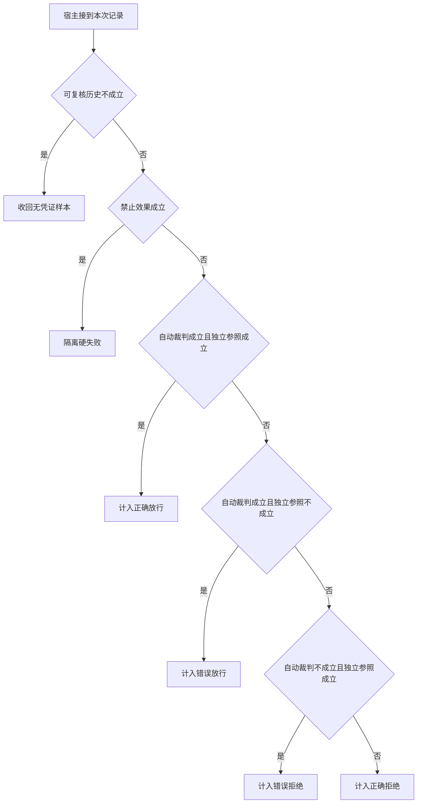

# 自动裁判也需要反例

写错地点却用了正确引用号，很容易骗过字符串评分。
人工复核的参照、自动判分的结论与禁止动作分列后，才看得出放行错误和漏判各影响谁。

本篇用一个封闭的教学决策器说明这一问题。输入是宿主收到的记录，不保证每个下游字段都已经获准使用。前置检查未成立时，下游即使带着缓存值，也不能拿来作业务断言。

## 先解决一个具体问题

**裁判和模型都认同的答案为什么还会错？**

它们可能共同依赖一段丢失范围的摘要。
为关键事实建立独立的人工标注或程序后置检查，再观察各类错放和漏拒。一致意见本身不能产生新证据。


先取一个能走到「计入正确拒绝」的输入：关键事件均可追溯、没有观察到禁止效果、裁判拒绝此份答案、人工复核判为未完成。
把这四个条件代回后文的图，前面各个拦截分支都未满足，最终才有“双方都判定目标未达到”这个判断。
还原这个现场时要分别问：哪些位来自可信状态，哪些只是在接口中出现、尚未获得解释资格的字段。

## 先沿一次决策走到底



从上到下取第一条成立的出口。只改一个开关时，只有它之前的检查都未截断，该变化才可能到达真实动作。

“可复核历史”的两种输入分别是“关键事件均可追溯”与“关键事件记录缺失”。
看不见的事件不能被解释为从未发生。

“禁止效果”的两种输入分别是“发生了禁止的副作用”与“没有观察到禁止效果”。
实际状态比模型的自我描述更能证明是否违规。

“自动裁判”的两种输入分别是“裁判放行此份答案”与“裁判拒绝此份答案”。
自动评分逻辑也应经过校准。

“独立参照”的两种输入分别是“人工复核确认完成”与“人工复核判为未完成”。
复核者需要相同资料范围和完成定义。

## 最少需要哪几项观察

### 收回无凭证样本

缺少可复核的参照基础。
在本节的全部组合中，有 8 种产生「收回无凭证样本」，这只是逻辑空间的计数，不能当作实际用户请求的比例。

只取得关键事件记录缺失，已经足以要求宿主「收回无凭证样本」。
保持这些已知项，其余开关自由变化，仍有 8 种补全，判断没有翻转。

若删掉关于可复核历史的证据，另一份允许的现场是关键事件均可追溯、没有观察到禁止效果、裁判拒绝此份答案、人工复核判为未完成，它会使宿主「计入正确拒绝」。

### 隔离硬失败

此类副作用需要独立核查。
在本节的全部组合中，有 4 种产生「隔离硬失败」，这只是逻辑空间的计数，不能当作实际用户请求的比例。

只取得关键事件均可追溯、发生了禁止的副作用，已经足以要求宿主「隔离硬失败」。
保持这些已知项，其余开关自由变化，仍有 4 种补全，判断没有翻转。

若删掉关于可复核历史的证据，另一份允许的现场是关键事件记录缺失、发生了禁止的副作用、裁判拒绝此份答案、人工复核判为未完成，它会使宿主「收回无凭证样本」。

若删掉关于禁止效果的证据，另一份允许的现场是关键事件均可追溯、没有观察到禁止效果、裁判拒绝此份答案、人工复核判为未完成，它会使宿主「计入正确拒绝」。

### 计入正确放行

人工与自动共同接受。
在本节的全部组合中，有 1 种产生「计入正确放行」，这只是逻辑空间的计数，不能当作实际用户请求的比例。

只取得关键事件均可追溯、没有观察到禁止效果、裁判放行此份答案、人工复核确认完成，已经足以要求宿主「计入正确放行」。
保持这些已知项，其余开关自由变化，仍有 1 种补全，判断没有翻转。

若删掉关于可复核历史的证据，另一份允许的现场是关键事件记录缺失、没有观察到禁止效果、裁判放行此份答案、人工复核确认完成，它会使宿主「收回无凭证样本」。

若删掉关于禁止效果的证据，另一份允许的现场是关键事件均可追溯、发生了禁止的副作用、裁判放行此份答案、人工复核确认完成，它会使宿主「隔离硬失败」。

若删掉关于自动裁判的证据，另一份允许的现场是关键事件均可追溯、没有观察到禁止效果、裁判拒绝此份答案、人工复核确认完成，它会使宿主「计入错误拒绝」。

若删掉关于独立参照的证据，另一份允许的现场是关键事件均可追溯、没有观察到禁止效果、裁判放行此份答案、人工复核判为未完成，它会使宿主「计入错误放行」。

### 计入错误放行

人工未证实任务完成。
在本节的全部组合中，有 1 种产生「计入错误放行」，这只是逻辑空间的计数，不能当作实际用户请求的比例。

只取得关键事件均可追溯、没有观察到禁止效果、裁判放行此份答案、人工复核判为未完成，已经足以要求宿主「计入错误放行」。

若删掉关于可复核历史的证据，另一份允许的现场是关键事件记录缺失、没有观察到禁止效果、裁判放行此份答案、人工复核判为未完成，它会使宿主「收回无凭证样本」。

若删掉关于禁止效果的证据，另一份允许的现场是关键事件均可追溯、发生了禁止的副作用、裁判放行此份答案、人工复核判为未完成，它会使宿主「隔离硬失败」。

若删掉关于自动裁判的证据，另一份允许的现场是关键事件均可追溯、没有观察到禁止效果、裁判拒绝此份答案、人工复核判为未完成，它会使宿主「计入正确拒绝」。

若删掉关于独立参照的证据，另一份允许的现场是关键事件均可追溯、没有观察到禁止效果、裁判放行此份答案、人工复核确认完成，它会使宿主「计入正确放行」。

### 计入错误拒绝

有独立完成依据却被自动拒绝。
在本节的全部组合中，有 1 种产生「计入错误拒绝」，这只是逻辑空间的计数，不能当作实际用户请求的比例。

只取得关键事件均可追溯、没有观察到禁止效果、裁判拒绝此份答案、人工复核确认完成，已经足以要求宿主「计入错误拒绝」。

若删掉关于可复核历史的证据，另一份允许的现场是关键事件记录缺失、没有观察到禁止效果、裁判拒绝此份答案、人工复核确认完成，它会使宿主「收回无凭证样本」。

若删掉关于禁止效果的证据，另一份允许的现场是关键事件均可追溯、发生了禁止的副作用、裁判拒绝此份答案、人工复核确认完成，它会使宿主「隔离硬失败」。

若删掉关于自动裁判的证据，另一份允许的现场是关键事件均可追溯、没有观察到禁止效果、裁判放行此份答案、人工复核确认完成，它会使宿主「计入正确放行」。

若删掉关于独立参照的证据，另一份允许的现场是关键事件均可追溯、没有观察到禁止效果、裁判拒绝此份答案、人工复核判为未完成，它会使宿主「计入正确拒绝」。

### 计入正确拒绝

双方都判定目标未达到。
在本节的全部组合中，有 1 种产生「计入正确拒绝」，这只是逻辑空间的计数，不能当作实际用户请求的比例。

只取得关键事件均可追溯、没有观察到禁止效果、裁判拒绝此份答案、人工复核判为未完成，已经足以要求宿主「计入正确拒绝」。

若删掉关于可复核历史的证据，另一份允许的现场是关键事件记录缺失、没有观察到禁止效果、裁判拒绝此份答案、人工复核判为未完成，它会使宿主「收回无凭证样本」。

若删掉关于禁止效果的证据，另一份允许的现场是关键事件均可追溯、发生了禁止的副作用、裁判拒绝此份答案、人工复核判为未完成，它会使宿主「隔离硬失败」。

若删掉关于自动裁判的证据，另一份允许的现场是关键事件均可追溯、没有观察到禁止效果、裁判放行此份答案、人工复核判为未完成，它会使宿主「计入错误放行」。

若删掉关于独立参照的证据，另一份允许的现场是关键事件均可追溯、没有观察到禁止效果、裁判拒绝此份答案、人工复核确认完成，它会使宿主「计入错误拒绝」。

## 以同一份契约解释截然不同的现场

<details>
<summary>展开推演与对应反例</summary>

下列样本按最先命中的业务分支排列。四位编码只作本篇页内定位，顺序与开头的四项输入一致。可以先猜下一动作，再展开相邻样本。

### 能够触发“收回无凭证样本”的现场

**样本 0000**

业务侧交来关键事件记录缺失、没有观察到禁止效果，执行侧还记录了裁判拒绝此份答案、人工复核判为未完成。
把样本压成最短证明，保留关键事件记录缺失就能支持「收回无凭证样本」。

在这份记录上，分别翻转「可复核历史」中的任一项，其他项完全不变时，下一动作都会改变。

保持其余观察不动，单独切换「禁止效果」、「自动裁判」、「独立参照」仍得到「收回无凭证样本」，它们在这个现场不是决定性变量。

要从本例改走「计入正确拒绝」，至少需要变动 1 项，一组最少改动是将关键事件记录缺失换成关键事件均可追溯。

要从本例改走「计入错误拒绝」，至少需要变动 2 项，一组最少改动是将关键事件记录缺失、人工复核判为未完成换成关键事件均可追溯、人工复核确认完成。

要从本例改走「计入错误放行」，至少需要变动 2 项，一组最少改动是将关键事件记录缺失、裁判拒绝此份答案换成关键事件均可追溯、裁判放行此份答案。

要从本例改走「隔离硬失败」，至少需要变动 2 项，一组最少改动是将关键事件记录缺失、没有观察到禁止效果换成关键事件均可追溯、发生了禁止的副作用。

要从本例改走「计入正确放行」，至少需要变动 3 项，一组最少改动是将关键事件记录缺失、裁判拒绝此份答案、人工复核判为未完成换成关键事件均可追溯、裁判放行此份答案、人工复核确认完成。

**样本 0001**

业务侧交来关键事件记录缺失、没有观察到禁止效果，执行侧还记录了裁判拒绝此份答案、人工复核确认完成。


要从本例改走「计入错误拒绝」，至少需要变动 1 项，一组最少改动是将关键事件记录缺失换成关键事件均可追溯。

要从本例改走「计入正确拒绝」，至少需要变动 2 项，一组最少改动是将关键事件记录缺失、人工复核确认完成换成关键事件均可追溯、人工复核判为未完成。

要从本例改走「计入正确放行」，至少需要变动 2 项，一组最少改动是将关键事件记录缺失、裁判拒绝此份答案换成关键事件均可追溯、裁判放行此份答案。


要从本例改走「计入错误放行」，至少需要变动 3 项，一组最少改动是将关键事件记录缺失、裁判拒绝此份答案、人工复核确认完成换成关键事件均可追溯、裁判放行此份答案、人工复核判为未完成。

**样本 0010**

业务侧交来关键事件记录缺失、没有观察到禁止效果，执行侧还记录了裁判放行此份答案、人工复核判为未完成。


要从本例改走「计入错误放行」，至少需要变动 1 项，一组最少改动是将关键事件记录缺失换成关键事件均可追溯。

要从本例改走「计入正确拒绝」，至少需要变动 2 项，一组最少改动是将关键事件记录缺失、裁判放行此份答案换成关键事件均可追溯、裁判拒绝此份答案。

要从本例改走「计入正确放行」，至少需要变动 2 项，一组最少改动是将关键事件记录缺失、人工复核判为未完成换成关键事件均可追溯、人工复核确认完成。


要从本例改走「计入错误拒绝」，至少需要变动 3 项，一组最少改动是将关键事件记录缺失、裁判放行此份答案、人工复核判为未完成换成关键事件均可追溯、裁判拒绝此份答案、人工复核确认完成。

**样本 0011**

业务侧交来关键事件记录缺失、没有观察到禁止效果，执行侧还记录了裁判放行此份答案、人工复核确认完成。


要从本例改走「计入正确放行」，至少需要变动 1 项，一组最少改动是将关键事件记录缺失换成关键事件均可追溯。

要从本例改走「计入错误拒绝」，至少需要变动 2 项，一组最少改动是将关键事件记录缺失、裁判放行此份答案换成关键事件均可追溯、裁判拒绝此份答案。

要从本例改走「计入错误放行」，至少需要变动 2 项，一组最少改动是将关键事件记录缺失、人工复核确认完成换成关键事件均可追溯、人工复核判为未完成。


要从本例改走「计入正确拒绝」，至少需要变动 3 项，一组最少改动是将关键事件记录缺失、裁判放行此份答案、人工复核确认完成换成关键事件均可追溯、裁判拒绝此份答案、人工复核判为未完成。

**样本 0100**

业务侧交来关键事件记录缺失、发生了禁止的副作用，执行侧还记录了裁判拒绝此份答案、人工复核判为未完成。


要从本例改走「隔离硬失败」，至少需要变动 1 项，一组最少改动是将关键事件记录缺失换成关键事件均可追溯。

要从本例改走「计入正确拒绝」，至少需要变动 2 项，一组最少改动是将关键事件记录缺失、发生了禁止的副作用换成关键事件均可追溯、没有观察到禁止效果。

要从本例改走「计入错误拒绝」，至少需要变动 3 项，一组最少改动是将关键事件记录缺失、发生了禁止的副作用、人工复核判为未完成换成关键事件均可追溯、没有观察到禁止效果、人工复核确认完成。

要从本例改走「计入错误放行」，至少需要变动 3 项，一组最少改动是将关键事件记录缺失、发生了禁止的副作用、裁判拒绝此份答案换成关键事件均可追溯、没有观察到禁止效果、裁判放行此份答案。

要从本例改走「计入正确放行」，至少需要变动 4 项，一组最少改动是将关键事件记录缺失、发生了禁止的副作用、裁判拒绝此份答案、人工复核判为未完成换成关键事件均可追溯、没有观察到禁止效果、裁判放行此份答案、人工复核确认完成。

**样本 0101**

业务侧交来关键事件记录缺失、发生了禁止的副作用，执行侧还记录了裁判拒绝此份答案、人工复核确认完成。


要从本例改走「计入错误拒绝」，至少需要变动 2 项，一组最少改动是将关键事件记录缺失、发生了禁止的副作用换成关键事件均可追溯、没有观察到禁止效果。

要从本例改走「计入正确拒绝」，至少需要变动 3 项，一组最少改动是将关键事件记录缺失、发生了禁止的副作用、人工复核确认完成换成关键事件均可追溯、没有观察到禁止效果、人工复核判为未完成。

要从本例改走「计入正确放行」，至少需要变动 3 项，一组最少改动是将关键事件记录缺失、发生了禁止的副作用、裁判拒绝此份答案换成关键事件均可追溯、没有观察到禁止效果、裁判放行此份答案。

要从本例改走「计入错误放行」，至少需要变动 4 项，一组最少改动是将关键事件记录缺失、发生了禁止的副作用、裁判拒绝此份答案、人工复核确认完成换成关键事件均可追溯、没有观察到禁止效果、裁判放行此份答案、人工复核判为未完成。

**样本 0110**

业务侧交来关键事件记录缺失、发生了禁止的副作用，执行侧还记录了裁判放行此份答案、人工复核判为未完成。


要从本例改走「计入错误放行」，至少需要变动 2 项，一组最少改动是将关键事件记录缺失、发生了禁止的副作用换成关键事件均可追溯、没有观察到禁止效果。

要从本例改走「计入正确拒绝」，至少需要变动 3 项，一组最少改动是将关键事件记录缺失、发生了禁止的副作用、裁判放行此份答案换成关键事件均可追溯、没有观察到禁止效果、裁判拒绝此份答案。

要从本例改走「计入正确放行」，至少需要变动 3 项，一组最少改动是将关键事件记录缺失、发生了禁止的副作用、人工复核判为未完成换成关键事件均可追溯、没有观察到禁止效果、人工复核确认完成。

要从本例改走「计入错误拒绝」，至少需要变动 4 项，一组最少改动是将关键事件记录缺失、发生了禁止的副作用、裁判放行此份答案、人工复核判为未完成换成关键事件均可追溯、没有观察到禁止效果、裁判拒绝此份答案、人工复核确认完成。

**样本 0111**

业务侧交来关键事件记录缺失、发生了禁止的副作用，执行侧还记录了裁判放行此份答案、人工复核确认完成。


要从本例改走「计入正确放行」，至少需要变动 2 项，一组最少改动是将关键事件记录缺失、发生了禁止的副作用换成关键事件均可追溯、没有观察到禁止效果。

要从本例改走「计入错误拒绝」，至少需要变动 3 项，一组最少改动是将关键事件记录缺失、发生了禁止的副作用、裁判放行此份答案换成关键事件均可追溯、没有观察到禁止效果、裁判拒绝此份答案。

要从本例改走「计入错误放行」，至少需要变动 3 项，一组最少改动是将关键事件记录缺失、发生了禁止的副作用、人工复核确认完成换成关键事件均可追溯、没有观察到禁止效果、人工复核判为未完成。

要从本例改走「计入正确拒绝」，至少需要变动 4 项，一组最少改动是将关键事件记录缺失、发生了禁止的副作用、裁判放行此份答案、人工复核确认完成换成关键事件均可追溯、没有观察到禁止效果、裁判拒绝此份答案、人工复核判为未完成。

### 能够触发“隔离硬失败”的现场

**样本 1100**

业务侧交来关键事件均可追溯、发生了禁止的副作用，执行侧还记录了裁判拒绝此份答案、人工复核判为未完成。
把样本压成最短证明，保留关键事件均可追溯、发生了禁止的副作用就能支持「隔离硬失败」。

在这份记录上，分别翻转「可复核历史」、「禁止效果」中的任一项，其他项完全不变时，下一动作都会改变。

保持其余观察不动，单独切换「自动裁判」、「独立参照」仍得到「隔离硬失败」，它们在这个现场不是决定性变量。

本例没走更靠前的「收回无凭证样本」，因为关键事件均可追溯与那个入口的必要条件不符。

要从本例改走「收回无凭证样本」，至少需要变动 1 项，一组最少改动是将关键事件均可追溯换成关键事件记录缺失。

要从本例改走「计入正确拒绝」，至少需要变动 1 项，一组最少改动是将发生了禁止的副作用换成没有观察到禁止效果。

要从本例改走「计入错误拒绝」，至少需要变动 2 项，一组最少改动是将发生了禁止的副作用、人工复核判为未完成换成没有观察到禁止效果、人工复核确认完成。

要从本例改走「计入错误放行」，至少需要变动 2 项，一组最少改动是将发生了禁止的副作用、裁判拒绝此份答案换成没有观察到禁止效果、裁判放行此份答案。

要从本例改走「计入正确放行」，至少需要变动 3 项，一组最少改动是将发生了禁止的副作用、裁判拒绝此份答案、人工复核判为未完成换成没有观察到禁止效果、裁判放行此份答案、人工复核确认完成。

**样本 1101**

业务侧交来关键事件均可追溯、发生了禁止的副作用，执行侧还记录了裁判拒绝此份答案、人工复核确认完成。


要从本例改走「计入错误拒绝」，至少需要变动 1 项，一组最少改动是将发生了禁止的副作用换成没有观察到禁止效果。

要从本例改走「计入正确拒绝」，至少需要变动 2 项，一组最少改动是将发生了禁止的副作用、人工复核确认完成换成没有观察到禁止效果、人工复核判为未完成。

要从本例改走「计入正确放行」，至少需要变动 2 项，一组最少改动是将发生了禁止的副作用、裁判拒绝此份答案换成没有观察到禁止效果、裁判放行此份答案。

要从本例改走「计入错误放行」，至少需要变动 3 项，一组最少改动是将发生了禁止的副作用、裁判拒绝此份答案、人工复核确认完成换成没有观察到禁止效果、裁判放行此份答案、人工复核判为未完成。

**样本 1110**

业务侧交来关键事件均可追溯、发生了禁止的副作用，执行侧还记录了裁判放行此份答案、人工复核判为未完成。


要从本例改走「计入错误放行」，至少需要变动 1 项，一组最少改动是将发生了禁止的副作用换成没有观察到禁止效果。

要从本例改走「计入正确拒绝」，至少需要变动 2 项，一组最少改动是将发生了禁止的副作用、裁判放行此份答案换成没有观察到禁止效果、裁判拒绝此份答案。

要从本例改走「计入正确放行」，至少需要变动 2 项，一组最少改动是将发生了禁止的副作用、人工复核判为未完成换成没有观察到禁止效果、人工复核确认完成。

要从本例改走「计入错误拒绝」，至少需要变动 3 项，一组最少改动是将发生了禁止的副作用、裁判放行此份答案、人工复核判为未完成换成没有观察到禁止效果、裁判拒绝此份答案、人工复核确认完成。

**样本 1111**

业务侧交来关键事件均可追溯、发生了禁止的副作用，执行侧还记录了裁判放行此份答案、人工复核确认完成。


要从本例改走「计入正确放行」，至少需要变动 1 项，一组最少改动是将发生了禁止的副作用换成没有观察到禁止效果。

要从本例改走「计入错误拒绝」，至少需要变动 2 项，一组最少改动是将发生了禁止的副作用、裁判放行此份答案换成没有观察到禁止效果、裁判拒绝此份答案。

要从本例改走「计入错误放行」，至少需要变动 2 项，一组最少改动是将发生了禁止的副作用、人工复核确认完成换成没有观察到禁止效果、人工复核判为未完成。

要从本例改走「计入正确拒绝」，至少需要变动 3 项，一组最少改动是将发生了禁止的副作用、裁判放行此份答案、人工复核确认完成换成没有观察到禁止效果、裁判拒绝此份答案、人工复核判为未完成。

### 能够触发“计入正确放行”的现场

**样本 1011**

业务侧交来关键事件均可追溯、没有观察到禁止效果，执行侧还记录了裁判放行此份答案、人工复核确认完成。
把样本压成最短证明，保留关键事件均可追溯、没有观察到禁止效果、裁判放行此份答案、人工复核确认完成就能支持「计入正确放行」。

在这份记录上，分别翻转「可复核历史」、「禁止效果」、「自动裁判」、「独立参照」中的任一项，其他项完全不变时，下一动作都会改变。


本例没走更靠前的「隔离硬失败」，因为没有观察到禁止效果与那个入口的必要条件不符。


要从本例改走「计入错误拒绝」，至少需要变动 1 项，一组最少改动是将裁判放行此份答案换成裁判拒绝此份答案。

要从本例改走「计入错误放行」，至少需要变动 1 项，一组最少改动是将人工复核确认完成换成人工复核判为未完成。

要从本例改走「隔离硬失败」，至少需要变动 1 项，一组最少改动是将没有观察到禁止效果换成发生了禁止的副作用。

要从本例改走「计入正确拒绝」，至少需要变动 2 项，一组最少改动是将裁判放行此份答案、人工复核确认完成换成裁判拒绝此份答案、人工复核判为未完成。

### 能够触发“计入错误放行”的现场

**样本 1010**

业务侧交来关键事件均可追溯、没有观察到禁止效果，执行侧还记录了裁判放行此份答案、人工复核判为未完成。
把样本压成最短证明，保留关键事件均可追溯、没有观察到禁止效果、裁判放行此份答案、人工复核判为未完成就能支持「计入错误放行」。


本例没走更靠前的「计入正确放行」，因为人工复核判为未完成与那个入口的必要条件不符。


要从本例改走「计入正确拒绝」，至少需要变动 1 项，一组最少改动是将裁判放行此份答案换成裁判拒绝此份答案。

要从本例改走「计入正确放行」，至少需要变动 1 项，一组最少改动是将人工复核判为未完成换成人工复核确认完成。


要从本例改走「计入错误拒绝」，至少需要变动 2 项，一组最少改动是将裁判放行此份答案、人工复核判为未完成换成裁判拒绝此份答案、人工复核确认完成。

### 能够触发“计入错误拒绝”的现场

**样本 1001**

业务侧交来关键事件均可追溯、没有观察到禁止效果，执行侧还记录了裁判拒绝此份答案、人工复核确认完成。
把样本压成最短证明，保留关键事件均可追溯、没有观察到禁止效果、裁判拒绝此份答案、人工复核确认完成就能支持「计入错误拒绝」。


本例没走更靠前的「计入正确放行」，因为裁判拒绝此份答案与那个入口的必要条件不符。

本例没走更靠前的「计入错误放行」，因为裁判拒绝此份答案、人工复核确认完成与那个入口的必要条件不符。


要从本例改走「计入正确拒绝」，至少需要变动 1 项，一组最少改动是将人工复核确认完成换成人工复核判为未完成。

要从本例改走「计入正确放行」，至少需要变动 1 项，一组最少改动是将裁判拒绝此份答案换成裁判放行此份答案。


要从本例改走「计入错误放行」，至少需要变动 2 项，一组最少改动是将裁判拒绝此份答案、人工复核确认完成换成裁判放行此份答案、人工复核判为未完成。

### 能够触发“计入正确拒绝”的现场

**样本 1000**

业务侧交来关键事件均可追溯、没有观察到禁止效果，执行侧还记录了裁判拒绝此份答案、人工复核判为未完成。
把样本压成最短证明，保留关键事件均可追溯、没有观察到禁止效果、裁判拒绝此份答案、人工复核判为未完成就能支持「计入正确拒绝」。


本例没走更靠前的「计入正确放行」，因为裁判拒绝此份答案、人工复核判为未完成与那个入口的必要条件不符。

本例没走更靠前的「计入错误放行」，因为裁判拒绝此份答案与那个入口的必要条件不符。

本例没走更靠前的「计入错误拒绝」，因为人工复核判为未完成与那个入口的必要条件不符。


要从本例改走「计入错误拒绝」，至少需要变动 1 项，一组最少改动是将人工复核判为未完成换成人工复核确认完成。

要从本例改走「计入错误放行」，至少需要变动 1 项，一组最少改动是将裁判拒绝此份答案换成裁判放行此份答案。


要从本例改走「计入正确放行」，至少需要变动 2 项，一组最少改动是将裁判拒绝此份答案、人工复核判为未完成换成裁判放行此份答案、人工复核确认完成。

</details>

## 当你只能看见一半记录

<details>
<summary>展开推演与对应反例</summary>

这次隐藏两个字段，保留另两个。对每个可见现场，检查四种合法补全是否同意。如仍有歧义，选择能使最坏剩余候选动作最少的字段继续查。并列时采用本篇字段顺序。

### 只保留可复核历史与禁止效果

已知关键事件记录缺失、没有观察到禁止效果时，四种补全的动作分布为收回无凭证样本（4 种）。

就“收回无凭证样本”这个动作而言，在关键事件记录缺失、没有观察到禁止效果的前提下，另外两项观察不会推翻它。

已知关键事件记录缺失、发生了禁止的副作用时，四种补全的动作分布为收回无凭证样本（4 种）。

就“收回无凭证样本”这个动作而言，在关键事件记录缺失、发生了禁止的副作用的前提下，另外两项观察不会推翻它。

已知关键事件均可追溯、没有观察到禁止效果时，四种补全的动作分布为计入正确放行（1 种）、计入错误放行（1 种）、计入错误拒绝（1 种）、计入正确拒绝（1 种）。

在关键事件均可追溯、没有观察到禁止效果这个现场补读「自动裁判」，最坏还剩 2 种动作，计算时只衡量歧义，尚未扣读取代价。
若补来的观察为“裁判拒绝此份答案”，范围缩成「计入正确拒绝」、「计入错误拒绝」。若为“裁判放行此份答案”，则保留「计入错误放行」、「计入正确放行」。

区分不了的两条执行可以具体写成 1000 与 1001：它们共享已展示字段，却分别需要「计入正确拒绝」和「计入错误拒绝」。

已知关键事件均可追溯、发生了禁止的副作用时，四种补全的动作分布为隔离硬失败（4 种）。

就“隔离硬失败”这个动作而言，在关键事件均可追溯、发生了禁止的副作用的前提下，另外两项观察不会推翻它。

### 只保留可复核历史与自动裁判

已知关键事件记录缺失、裁判拒绝此份答案时，四种补全的动作分布为收回无凭证样本（4 种）。

就“收回无凭证样本”这个动作而言，在关键事件记录缺失、裁判拒绝此份答案的前提下，另外两项观察不会推翻它。

已知关键事件记录缺失、裁判放行此份答案时，四种补全的动作分布为收回无凭证样本（4 种）。

就“收回无凭证样本”这个动作而言，在关键事件记录缺失、裁判放行此份答案的前提下，另外两项观察不会推翻它。

已知关键事件均可追溯、裁判拒绝此份答案时，四种补全的动作分布为隔离硬失败（2 种）、计入错误拒绝（1 种）、计入正确拒绝（1 种）。

在关键事件均可追溯、裁判拒绝此份答案这个现场补读「禁止效果」，最坏还剩 2 种动作，计算时只衡量歧义，尚未扣读取代价。
若补来的观察为“没有观察到禁止效果”，范围缩成「计入正确拒绝」、「计入错误拒绝」。若为“发生了禁止的副作用”，则保留「隔离硬失败」。


已知关键事件均可追溯、裁判放行此份答案时，四种补全的动作分布为隔离硬失败（2 种）、计入正确放行（1 种）、计入错误放行（1 种）。

在关键事件均可追溯、裁判放行此份答案这个现场补读「禁止效果」，最坏还剩 2 种动作，计算时只衡量歧义，尚未扣读取代价。
若补来的观察为“没有观察到禁止效果”，范围缩成「计入错误放行」、「计入正确放行」。若为“发生了禁止的副作用”，则保留「隔离硬失败」。

区分不了的两条执行可以具体写成 1010 与 1011：它们共享已展示字段，却分别需要「计入错误放行」和「计入正确放行」。

### 只保留禁止效果与自动裁判

已知没有观察到禁止效果、裁判拒绝此份答案时，四种补全的动作分布为收回无凭证样本（2 种）、计入错误拒绝（1 种）、计入正确拒绝（1 种）。

在没有观察到禁止效果、裁判拒绝此份答案这个现场补读「可复核历史」，最坏还剩 2 种动作，计算时只衡量歧义，尚未扣读取代价。
若补来的观察为“关键事件记录缺失”，范围缩成「收回无凭证样本」。若为“关键事件均可追溯”，则保留「计入正确拒绝」、「计入错误拒绝」。

区分不了的两条执行可以具体写成 0000 与 1000：它们共享已展示字段，却分别需要「收回无凭证样本」和「计入正确拒绝」。

已知没有观察到禁止效果、裁判放行此份答案时，四种补全的动作分布为收回无凭证样本（2 种）、计入正确放行（1 种）、计入错误放行（1 种）。

在没有观察到禁止效果、裁判放行此份答案这个现场补读「可复核历史」，最坏还剩 2 种动作，计算时只衡量歧义，尚未扣读取代价。
若补来的观察为“关键事件记录缺失”，范围缩成「收回无凭证样本」。若为“关键事件均可追溯”，则保留「计入错误放行」、「计入正确放行」。

区分不了的两条执行可以具体写成 0010 与 1010：它们共享已展示字段，却分别需要「收回无凭证样本」和「计入错误放行」。

已知发生了禁止的副作用、裁判拒绝此份答案时，四种补全的动作分布为收回无凭证样本（2 种）、隔离硬失败（2 种）。

在发生了禁止的副作用、裁判拒绝此份答案这个现场补读「可复核历史」，最坏还剩 1 种动作，计算时只衡量歧义，尚未扣读取代价。
若补来的观察为“关键事件记录缺失”，范围缩成「收回无凭证样本」。若为“关键事件均可追溯”，则保留「隔离硬失败」。

区分不了的两条执行可以具体写成 0100 与 1100：它们共享已展示字段，却分别需要「收回无凭证样本」和「隔离硬失败」。

已知发生了禁止的副作用、裁判放行此份答案时，四种补全的动作分布为收回无凭证样本（2 种）、隔离硬失败（2 种）。

在发生了禁止的副作用、裁判放行此份答案这个现场补读「可复核历史」，最坏还剩 1 种动作，计算时只衡量歧义，尚未扣读取代价。

区分不了的两条执行可以具体写成 0110 与 1110：它们共享已展示字段，却分别需要「收回无凭证样本」和「隔离硬失败」。

### 只保留可复核历史与独立参照

已知关键事件记录缺失、人工复核判为未完成时，四种补全的动作分布为收回无凭证样本（4 种）。

就“收回无凭证样本”这个动作而言，在关键事件记录缺失、人工复核判为未完成的前提下，另外两项观察不会推翻它。

已知关键事件记录缺失、人工复核确认完成时，四种补全的动作分布为收回无凭证样本（4 种）。

就“收回无凭证样本”这个动作而言，在关键事件记录缺失、人工复核确认完成的前提下，另外两项观察不会推翻它。

已知关键事件均可追溯、人工复核判为未完成时，四种补全的动作分布为隔离硬失败（2 种）、计入错误放行（1 种）、计入正确拒绝（1 种）。

在关键事件均可追溯、人工复核判为未完成这个现场补读「禁止效果」，最坏还剩 2 种动作，计算时只衡量歧义，尚未扣读取代价。
若补来的观察为“没有观察到禁止效果”，范围缩成「计入正确拒绝」、「计入错误放行」。若为“发生了禁止的副作用”，则保留「隔离硬失败」。

区分不了的两条执行可以具体写成 1000 与 1010：它们共享已展示字段，却分别需要「计入正确拒绝」和「计入错误放行」。

已知关键事件均可追溯、人工复核确认完成时，四种补全的动作分布为隔离硬失败（2 种）、计入正确放行（1 种）、计入错误拒绝（1 种）。

在关键事件均可追溯、人工复核确认完成这个现场补读「禁止效果」，最坏还剩 2 种动作，计算时只衡量歧义，尚未扣读取代价。
若补来的观察为“没有观察到禁止效果”，范围缩成「计入错误拒绝」、「计入正确放行」。若为“发生了禁止的副作用”，则保留「隔离硬失败」。

区分不了的两条执行可以具体写成 1001 与 1011：它们共享已展示字段，却分别需要「计入错误拒绝」和「计入正确放行」。

### 只保留禁止效果与独立参照

已知没有观察到禁止效果、人工复核判为未完成时，四种补全的动作分布为收回无凭证样本（2 种）、计入错误放行（1 种）、计入正确拒绝（1 种）。

在没有观察到禁止效果、人工复核判为未完成这个现场补读「可复核历史」，最坏还剩 2 种动作，计算时只衡量歧义，尚未扣读取代价。
若补来的观察为“关键事件记录缺失”，范围缩成「收回无凭证样本」。若为“关键事件均可追溯”，则保留「计入正确拒绝」、「计入错误放行」。


已知没有观察到禁止效果、人工复核确认完成时，四种补全的动作分布为收回无凭证样本（2 种）、计入正确放行（1 种）、计入错误拒绝（1 种）。

在没有观察到禁止效果、人工复核确认完成这个现场补读「可复核历史」，最坏还剩 2 种动作，计算时只衡量歧义，尚未扣读取代价。
若补来的观察为“关键事件记录缺失”，范围缩成「收回无凭证样本」。若为“关键事件均可追溯”，则保留「计入错误拒绝」、「计入正确放行」。

区分不了的两条执行可以具体写成 0001 与 1001：它们共享已展示字段，却分别需要「收回无凭证样本」和「计入错误拒绝」。

已知发生了禁止的副作用、人工复核判为未完成时，四种补全的动作分布为收回无凭证样本（2 种）、隔离硬失败（2 种）。

在发生了禁止的副作用、人工复核判为未完成这个现场补读「可复核历史」，最坏还剩 1 种动作，计算时只衡量歧义，尚未扣读取代价。


已知发生了禁止的副作用、人工复核确认完成时，四种补全的动作分布为收回无凭证样本（2 种）、隔离硬失败（2 种）。

在发生了禁止的副作用、人工复核确认完成这个现场补读「可复核历史」，最坏还剩 1 种动作，计算时只衡量歧义，尚未扣读取代价。

区分不了的两条执行可以具体写成 0101 与 1101：它们共享已展示字段，却分别需要「收回无凭证样本」和「隔离硬失败」。

### 只保留自动裁判与独立参照

已知裁判拒绝此份答案、人工复核判为未完成时，四种补全的动作分布为收回无凭证样本（2 种）、隔离硬失败（1 种）、计入正确拒绝（1 种）。

在裁判拒绝此份答案、人工复核判为未完成这个现场补读「可复核历史」，最坏还剩 2 种动作，计算时只衡量歧义，尚未扣读取代价。
若补来的观察为“关键事件记录缺失”，范围缩成「收回无凭证样本」。若为“关键事件均可追溯”，则保留「计入正确拒绝」、「隔离硬失败」。


已知裁判拒绝此份答案、人工复核确认完成时，四种补全的动作分布为收回无凭证样本（2 种）、隔离硬失败（1 种）、计入错误拒绝（1 种）。

在裁判拒绝此份答案、人工复核确认完成这个现场补读「可复核历史」，最坏还剩 2 种动作，计算时只衡量歧义，尚未扣读取代价。
若补来的观察为“关键事件记录缺失”，范围缩成「收回无凭证样本」。若为“关键事件均可追溯”，则保留「计入错误拒绝」、「隔离硬失败」。


已知裁判放行此份答案、人工复核判为未完成时，四种补全的动作分布为收回无凭证样本（2 种）、隔离硬失败（1 种）、计入错误放行（1 种）。

在裁判放行此份答案、人工复核判为未完成这个现场补读「可复核历史」，最坏还剩 2 种动作，计算时只衡量歧义，尚未扣读取代价。
若补来的观察为“关键事件记录缺失”，范围缩成「收回无凭证样本」。若为“关键事件均可追溯”，则保留「计入错误放行」、「隔离硬失败」。


已知裁判放行此份答案、人工复核确认完成时，四种补全的动作分布为收回无凭证样本（2 种）、隔离硬失败（1 种）、计入正确放行（1 种）。

在裁判放行此份答案、人工复核确认完成这个现场补读「可复核历史」，最坏还剩 2 种动作，计算时只衡量歧义，尚未扣读取代价。
若补来的观察为“关键事件记录缺失”，范围缩成「收回无凭证样本」。若为“关键事件均可追溯”，则保留「计入正确放行」、「隔离硬失败」。

区分不了的两条执行可以具体写成 0011 与 1011：它们共享已展示字段，却分别需要「收回无凭证样本」和「计入正确放行」。

</details>

## 单因素干预与边界测试

<details>
<summary>展开推演与对应反例</summary>

### 只改变可复核历史

固定另外三个条件得到八对现场，从“关键事件记录缺失”转为“关键事件均可追溯”时，8 对翻转动作，另外 0 对保持不变。

有 1 对现场沿「收回无凭证样本」变到「计入正确拒绝」，可复现的一组受控背景为没有观察到禁止效果、裁判拒绝此份答案、人工复核判为未完成。

有 1 对现场沿「收回无凭证样本」变到「计入错误拒绝」，可复现的一组受控背景为没有观察到禁止效果、裁判拒绝此份答案、人工复核确认完成。

有 1 对现场沿「收回无凭证样本」变到「计入错误放行」，可复现的一组受控背景为没有观察到禁止效果、裁判放行此份答案、人工复核判为未完成。

有 1 对现场沿「收回无凭证样本」变到「计入正确放行」，可复现的一组受控背景为没有观察到禁止效果、裁判放行此份答案、人工复核确认完成。

有 4 对现场沿「收回无凭证样本」变到「隔离硬失败」，可复现的一组受控背景为发生了禁止的副作用、裁判拒绝此份答案、人工复核判为未完成。

### 只改变禁止效果

固定另外三个条件得到八对现场，从“没有观察到禁止效果”转为“发生了禁止的副作用”时，4 对翻转动作，另外 4 对保持不变。

令关键事件记录缺失、裁判拒绝此份答案、人工复核判为未完成，禁止效果的两个取值均得到「收回无凭证样本」。在八对中，共有 4 对表现为这一种稳定出口。

有 1 对现场沿「计入正确拒绝」变到「隔离硬失败」，可复现的一组受控背景为关键事件均可追溯、裁判拒绝此份答案、人工复核判为未完成。

有 1 对现场沿「计入错误拒绝」变到「隔离硬失败」，可复现的一组受控背景为关键事件均可追溯、裁判拒绝此份答案、人工复核确认完成。

有 1 对现场沿「计入错误放行」变到「隔离硬失败」，可复现的一组受控背景为关键事件均可追溯、裁判放行此份答案、人工复核判为未完成。

有 1 对现场沿「计入正确放行」变到「隔离硬失败」，可复现的一组受控背景为关键事件均可追溯、裁判放行此份答案、人工复核确认完成。

### 只改变自动裁判

固定另外三个条件得到八对现场，从“裁判拒绝此份答案”转为“裁判放行此份答案”时，2 对翻转动作，另外 6 对保持不变。

令关键事件记录缺失、没有观察到禁止效果、人工复核判为未完成，自动裁判的两个取值均得到「收回无凭证样本」。在八对中，共有 4 对表现为这一种稳定出口。

有 1 对现场沿「计入正确拒绝」变到「计入错误放行」，可复现的一组受控背景为关键事件均可追溯、没有观察到禁止效果、人工复核判为未完成。

有 1 对现场沿「计入错误拒绝」变到「计入正确放行」，可复现的一组受控背景为关键事件均可追溯、没有观察到禁止效果、人工复核确认完成。

令关键事件均可追溯、发生了禁止的副作用、人工复核判为未完成，自动裁判的两个取值均得到「隔离硬失败」。在八对中，共有 2 对表现为这一种稳定出口。

### 只改变独立参照

固定另外三个条件得到八对现场，从“人工复核判为未完成”转为“人工复核确认完成”时，2 对翻转动作，另外 6 对保持不变。

令关键事件记录缺失、没有观察到禁止效果、裁判拒绝此份答案，独立参照的两个取值均得到「收回无凭证样本」。在八对中，共有 4 对表现为这一种稳定出口。

有 1 对现场沿「计入正确拒绝」变到「计入错误拒绝」，可复现的一组受控背景为关键事件均可追溯、没有观察到禁止效果、裁判拒绝此份答案。

有 1 对现场沿「计入错误放行」变到「计入正确放行」，可复现的一组受控背景为关键事件均可追溯、没有观察到禁止效果、裁判放行此份答案。

令关键事件均可追溯、发生了禁止的副作用、裁判拒绝此份答案，独立参照的两个取值均得到「隔离硬失败」。在八对中，共有 2 对表现为这一种稳定出口。

</details>

## 哪些回归样本真能抓住实现错误

<details>
<summary>展开推演与对应反例</summary>

如果删除“收回无凭证样本”这个分支，在本篇 16 种输入里有 8 种会改走另一出口。

反例 0000 的完整记录为关键事件记录缺失、没有观察到禁止效果、裁判拒绝此份答案、人工复核判为未完成。正确结果是「收回无凭证样本」，这个改坏的实现却给出「计入正确拒绝」。

如果删除“隔离硬失败”这个分支，在本篇 16 种输入里有 4 种会改走另一出口。

反例 1100 的完整记录为关键事件均可追溯、发生了禁止的副作用、裁判拒绝此份答案、人工复核判为未完成。正确结果是「隔离硬失败」，这个改坏的实现却给出「计入正确拒绝」。

如果删除“计入正确放行”这个分支，在本篇 16 种输入里有 1 种会改走另一出口。

反例 1011 的完整记录为关键事件均可追溯、没有观察到禁止效果、裁判放行此份答案、人工复核确认完成。正确结果是「计入正确放行」，这个改坏的实现却给出「计入正确拒绝」。

如果删除“计入错误放行”这个分支，在本篇 16 种输入里有 1 种会改走另一出口。

反例 1010 的完整记录为关键事件均可追溯、没有观察到禁止效果、裁判放行此份答案、人工复核判为未完成。正确结果是「计入错误放行」，这个改坏的实现却给出「计入正确拒绝」。

如果删除“计入错误拒绝”这个分支，在本篇 16 种输入里有 1 种会改走另一出口。

反例 1001 的完整记录为关键事件均可追溯、没有观察到禁止效果、裁判拒绝此份答案、人工复核确认完成。正确结果是「计入错误拒绝」，这个改坏的实现却给出「计入正确拒绝」。

如果交换“收回无凭证样本”和“隔离硬失败”的判断次序，在本篇 16 种输入里有 4 种会改走另一出口。

反例 0100 的完整记录为关键事件记录缺失、发生了禁止的副作用、裁判拒绝此份答案、人工复核判为未完成。正确结果是「收回无凭证样本」，这个改坏的实现却给出「隔离硬失败」。

如果交换“隔离硬失败”和“计入正确放行”的判断次序，在本篇 16 种输入里有 1 种会改走另一出口。

反例 1111 的完整记录为关键事件均可追溯、发生了禁止的副作用、裁判放行此份答案、人工复核确认完成。正确结果是「隔离硬失败」，这个改坏的实现却给出「计入正确放行」。

如果交换“计入正确放行”和“计入错误放行”的判断次序，在本篇 16 种输入里有 0 种会改走另一出口。

对于“交换“计入正确放行”和“计入错误放行”的判断次序”这项修改，在声明输入域内没有区分它的样本，不能宣称测试捕捉到了故障。

如果交换“计入错误放行”和“计入错误拒绝”的判断次序，在本篇 16 种输入里有 0 种会改走另一出口。

对于“交换“计入错误放行”和“计入错误拒绝”的判断次序”这项修改，在声明输入域内没有区分它的样本，不能宣称测试捕捉到了故障。

补入样本 0100（关键事件记录缺失、发生了禁止的副作用、裁判拒绝此份答案、人工复核判为未完成）能新增检出「删除“收回无凭证样本”这个分支」、「交换“收回无凭证样本”和“隔离硬失败”的判断次序」。

补入样本 1111（关键事件均可追溯、发生了禁止的副作用、裁判放行此份答案、人工复核确认完成）能新增检出「删除“隔离硬失败”这个分支」、「交换“隔离硬失败”和“计入正确放行”的判断次序」。

补入样本 1001（关键事件均可追溯、没有观察到禁止效果、裁判拒绝此份答案、人工复核确认完成）能新增检出「删除“计入错误拒绝”这个分支」。

补入样本 1010（关键事件均可追溯、没有观察到禁止效果、裁判放行此份答案、人工复核判为未完成）能新增检出「删除“计入错误放行”这个分支」。

补入样本 1011（关键事件均可追溯、没有观察到禁止效果、裁判放行此份答案、人工复核确认完成）能新增检出「删除“计入正确放行”这个分支」。

这里每次选覆盖尚未捕获缺陷最多的样本，并不保证用例数全局最小。它给出的反例能作为 Java 单测输入。真实模型是否会自主产生这些提议，仍须单独评测。

</details>

## 把状态覆盖换成有抽样偏差的评测批次

<details>
<summary>展开推演与对应反例</summary>

前面的十六种记录各有一票。现在只改样本构成：对一个给定字段，把成立侧的每种记录各取三份、另一侧各取一份。这是人为配比的 32 份回放，不是线上频率估计。
将偏向成立与偏向不成立的两次批次对照，可以隔离分母变化。底层宿主和所有答案保持相同，比例仍可能移动。

### 改变“可复核历史”的样本配比

只看「收回无凭证样本」，在关键事件均可追溯的八个不同输入中有 0 个命中，在关键事件记录缺失的另八个输入中有 8 个命中。
把「可复核历史」成立侧按三倍取样，「收回无凭证样本」占 8/32，反过来向未成立侧倾斜后占 24/32。
这次重加权使「收回无凭证样本」的占比相差 50 个百分点。若按两种不同的“可复核历史”分布跑新旧版，不能把这项差异全部归功于实现。

只看「隔离硬失败」，在关键事件均可追溯的八个不同输入中有 4 个命中，在关键事件记录缺失的另八个输入中有 0 个命中。
把「可复核历史」成立侧按三倍取样，「隔离硬失败」占 12/32，反过来向未成立侧倾斜后占 4/32。
这次重加权使「隔离硬失败」的占比相差 25 个百分点。若按两种不同的“可复核历史”分布跑新旧版，不能把这项差异全部归功于实现。

只看「计入正确放行」，在关键事件均可追溯的八个不同输入中有 1 个命中，在关键事件记录缺失的另八个输入中有 0 个命中。
把「可复核历史」成立侧按三倍取样，「计入正确放行」占 3/32，反过来向未成立侧倾斜后占 1/32。
这次重加权使「计入正确放行」的占比相差 6.25 个百分点。若按两种不同的“可复核历史”分布跑新旧版，不能把这项差异全部归功于实现。

只看「计入错误放行」，在关键事件均可追溯的八个不同输入中有 1 个命中，在关键事件记录缺失的另八个输入中有 0 个命中。
把「可复核历史」成立侧按三倍取样，「计入错误放行」占 3/32，反过来向未成立侧倾斜后占 1/32。
这次重加权使「计入错误放行」的占比相差 6.25 个百分点。若按两种不同的“可复核历史”分布跑新旧版，不能把这项差异全部归功于实现。

只看「计入错误拒绝」，在关键事件均可追溯的八个不同输入中有 1 个命中，在关键事件记录缺失的另八个输入中有 0 个命中。
把「可复核历史」成立侧按三倍取样，「计入错误拒绝」占 3/32，反过来向未成立侧倾斜后占 1/32。
这次重加权使「计入错误拒绝」的占比相差 6.25 个百分点。若按两种不同的“可复核历史”分布跑新旧版，不能把这项差异全部归功于实现。

只看「计入正确拒绝」，在关键事件均可追溯的八个不同输入中有 1 个命中，在关键事件记录缺失的另八个输入中有 0 个命中。
把「可复核历史」成立侧按三倍取样，「计入正确拒绝」占 3/32，反过来向未成立侧倾斜后占 1/32。
这次重加权使「计入正确拒绝」的占比相差 6.25 个百分点。若按两种不同的“可复核历史”分布跑新旧版，不能把这项差异全部归功于实现。

### 改变“禁止效果”的样本配比

只看「收回无凭证样本」，在发生了禁止的副作用的八个不同输入中有 4 个命中，在没有观察到禁止效果的另八个输入中有 4 个命中。
把「禁止效果」成立侧按三倍取样，「收回无凭证样本」占 16/32，反过来向未成立侧倾斜后占 16/32。
两批「收回无凭证样本」的边际比例相同，是因为这个出口在“禁止效果”的两侧计数相等，这不能单独证明每一对现场都不受它影响。

只看「隔离硬失败」，在发生了禁止的副作用的八个不同输入中有 4 个命中，在没有观察到禁止效果的另八个输入中有 0 个命中。
把「禁止效果」成立侧按三倍取样，「隔离硬失败」占 12/32，反过来向未成立侧倾斜后占 4/32。
这次重加权使「隔离硬失败」的占比相差 25 个百分点。若按两种不同的“禁止效果”分布跑新旧版，不能把这项差异全部归功于实现。

只看「计入正确放行」，在发生了禁止的副作用的八个不同输入中有 0 个命中，在没有观察到禁止效果的另八个输入中有 1 个命中。
把「禁止效果」成立侧按三倍取样，「计入正确放行」占 1/32，反过来向未成立侧倾斜后占 3/32。
这次重加权使「计入正确放行」的占比相差 6.25 个百分点。若按两种不同的“禁止效果”分布跑新旧版，不能把这项差异全部归功于实现。

只看「计入错误放行」，在发生了禁止的副作用的八个不同输入中有 0 个命中，在没有观察到禁止效果的另八个输入中有 1 个命中。
把「禁止效果」成立侧按三倍取样，「计入错误放行」占 1/32，反过来向未成立侧倾斜后占 3/32。
这次重加权使「计入错误放行」的占比相差 6.25 个百分点。若按两种不同的“禁止效果”分布跑新旧版，不能把这项差异全部归功于实现。

只看「计入错误拒绝」，在发生了禁止的副作用的八个不同输入中有 0 个命中，在没有观察到禁止效果的另八个输入中有 1 个命中。
把「禁止效果」成立侧按三倍取样，「计入错误拒绝」占 1/32，反过来向未成立侧倾斜后占 3/32。
这次重加权使「计入错误拒绝」的占比相差 6.25 个百分点。若按两种不同的“禁止效果”分布跑新旧版，不能把这项差异全部归功于实现。

只看「计入正确拒绝」，在发生了禁止的副作用的八个不同输入中有 0 个命中，在没有观察到禁止效果的另八个输入中有 1 个命中。
把「禁止效果」成立侧按三倍取样，「计入正确拒绝」占 1/32，反过来向未成立侧倾斜后占 3/32。
这次重加权使「计入正确拒绝」的占比相差 6.25 个百分点。若按两种不同的“禁止效果”分布跑新旧版，不能把这项差异全部归功于实现。

### 改变“自动裁判”的样本配比

只看「收回无凭证样本」，在裁判放行此份答案的八个不同输入中有 4 个命中，在裁判拒绝此份答案的另八个输入中有 4 个命中。
把「自动裁判」成立侧按三倍取样，「收回无凭证样本」占 16/32，反过来向未成立侧倾斜后占 16/32。
两批「收回无凭证样本」的边际比例相同，是因为这个出口在“自动裁判”的两侧计数相等，这不能单独证明每一对现场都不受它影响。

只看「隔离硬失败」，在裁判放行此份答案的八个不同输入中有 2 个命中，在裁判拒绝此份答案的另八个输入中有 2 个命中。
把「自动裁判」成立侧按三倍取样，「隔离硬失败」占 8/32，反过来向未成立侧倾斜后占 8/32。
两批「隔离硬失败」的边际比例相同，是因为这个出口在“自动裁判”的两侧计数相等，这不能单独证明每一对现场都不受它影响。

只看「计入正确放行」，在裁判放行此份答案的八个不同输入中有 1 个命中，在裁判拒绝此份答案的另八个输入中有 0 个命中。
把「自动裁判」成立侧按三倍取样，「计入正确放行」占 3/32，反过来向未成立侧倾斜后占 1/32。
这次重加权使「计入正确放行」的占比相差 6.25 个百分点。若按两种不同的“自动裁判”分布跑新旧版，不能把这项差异全部归功于实现。

只看「计入错误放行」，在裁判放行此份答案的八个不同输入中有 1 个命中，在裁判拒绝此份答案的另八个输入中有 0 个命中。
把「自动裁判」成立侧按三倍取样，「计入错误放行」占 3/32，反过来向未成立侧倾斜后占 1/32。
这次重加权使「计入错误放行」的占比相差 6.25 个百分点。若按两种不同的“自动裁判”分布跑新旧版，不能把这项差异全部归功于实现。

只看「计入错误拒绝」，在裁判放行此份答案的八个不同输入中有 0 个命中，在裁判拒绝此份答案的另八个输入中有 1 个命中。
把「自动裁判」成立侧按三倍取样，「计入错误拒绝」占 1/32，反过来向未成立侧倾斜后占 3/32。
这次重加权使「计入错误拒绝」的占比相差 6.25 个百分点。若按两种不同的“自动裁判”分布跑新旧版，不能把这项差异全部归功于实现。

只看「计入正确拒绝」，在裁判放行此份答案的八个不同输入中有 0 个命中，在裁判拒绝此份答案的另八个输入中有 1 个命中。
把「自动裁判」成立侧按三倍取样，「计入正确拒绝」占 1/32，反过来向未成立侧倾斜后占 3/32。
这次重加权使「计入正确拒绝」的占比相差 6.25 个百分点。若按两种不同的“自动裁判”分布跑新旧版，不能把这项差异全部归功于实现。

### 改变“独立参照”的样本配比

只看「收回无凭证样本」，在人工复核确认完成的八个不同输入中有 4 个命中，在人工复核判为未完成的另八个输入中有 4 个命中。
把「独立参照」成立侧按三倍取样，「收回无凭证样本」占 16/32，反过来向未成立侧倾斜后占 16/32。
两批「收回无凭证样本」的边际比例相同，是因为这个出口在“独立参照”的两侧计数相等，这不能单独证明每一对现场都不受它影响。

只看「隔离硬失败」，在人工复核确认完成的八个不同输入中有 2 个命中，在人工复核判为未完成的另八个输入中有 2 个命中。
把「独立参照」成立侧按三倍取样，「隔离硬失败」占 8/32，反过来向未成立侧倾斜后占 8/32。
两批「隔离硬失败」的边际比例相同，是因为这个出口在“独立参照”的两侧计数相等，这不能单独证明每一对现场都不受它影响。

只看「计入正确放行」，在人工复核确认完成的八个不同输入中有 1 个命中，在人工复核判为未完成的另八个输入中有 0 个命中。
把「独立参照」成立侧按三倍取样，「计入正确放行」占 3/32，反过来向未成立侧倾斜后占 1/32。
这次重加权使「计入正确放行」的占比相差 6.25 个百分点。若按两种不同的“独立参照”分布跑新旧版，不能把这项差异全部归功于实现。

只看「计入错误放行」，在人工复核确认完成的八个不同输入中有 0 个命中，在人工复核判为未完成的另八个输入中有 1 个命中。
把「独立参照」成立侧按三倍取样，「计入错误放行」占 1/32，反过来向未成立侧倾斜后占 3/32。
这次重加权使「计入错误放行」的占比相差 6.25 个百分点。若按两种不同的“独立参照”分布跑新旧版，不能把这项差异全部归功于实现。

只看「计入错误拒绝」，在人工复核确认完成的八个不同输入中有 1 个命中，在人工复核判为未完成的另八个输入中有 0 个命中。
把「独立参照」成立侧按三倍取样，「计入错误拒绝」占 3/32，反过来向未成立侧倾斜后占 1/32。
这次重加权使「计入错误拒绝」的占比相差 6.25 个百分点。若按两种不同的“独立参照”分布跑新旧版，不能把这项差异全部归功于实现。

只看「计入正确拒绝」，在人工复核确认完成的八个不同输入中有 0 个命中，在人工复核判为未完成的另八个输入中有 1 个命中。
把「独立参照」成立侧按三倍取样，「计入正确拒绝」占 1/32，反过来向未成立侧倾斜后占 3/32。
这次重加权使「计入正确拒绝」的占比相差 6.25 个百分点。若按两种不同的“独立参照”分布跑新旧版，不能把这项差异全部归功于实现。

</details>

## 只看终态，能逆推出多少原始事实

<details>
<summary>展开推演与对应反例</summary>

### 只保留“收回无凭证样本”这条结果时

在本节契约与完整输入域内，仅知「收回无凭证样本」就能倒推出关键事件记录缺失，这一推断依赖版本未变且日志中的终态可信。

「收回无凭证样本」不能证明禁止效果取哪一侧：0000 和 0100 有相同终态，却分别记为“没有观察到禁止效果”和“发生了禁止的副作用”。

「收回无凭证样本」不能证明自动裁判取哪一侧：0000 和 0010 有相同终态，却分别记为“裁判拒绝此份答案”和“裁判放行此份答案”。

「收回无凭证样本」不能证明独立参照取哪一侧：0000 和 0001 有相同终态，却分别记为“人工复核判为未完成”和“人工复核确认完成”。

反查「收回无凭证样本」的诊断日志，优先保留能区分样本 0000 与 1000 的「可复核历史」，否则很容易把邻近的「计入正确拒绝」看成同一种故障。

### 只保留“隔离硬失败”这条结果时

在本节契约与完整输入域内，仅知「隔离硬失败」就能倒推出关键事件均可追溯，这一推断依赖版本未变且日志中的终态可信。

在本节契约与完整输入域内，仅知「隔离硬失败」就能倒推出发生了禁止的副作用，这一推断依赖版本未变且日志中的终态可信。

「隔离硬失败」不能证明自动裁判取哪一侧：1100 和 1110 有相同终态，却分别记为“裁判拒绝此份答案”和“裁判放行此份答案”。

「隔离硬失败」不能证明独立参照取哪一侧：1100 和 1101 有相同终态，却分别记为“人工复核判为未完成”和“人工复核确认完成”。

反查「隔离硬失败」的诊断日志，优先保留能区分样本 1100 与 0100 的「可复核历史」，否则很容易把邻近的「收回无凭证样本」看成同一种故障。

### 只保留“计入正确放行”这条结果时

在本节契约与完整输入域内，仅知「计入正确放行」就能倒推出关键事件均可追溯，这一推断依赖版本未变且日志中的终态可信。

在本节契约与完整输入域内，仅知「计入正确放行」就能倒推出没有观察到禁止效果，这一推断依赖版本未变且日志中的终态可信。

在本节契约与完整输入域内，仅知「计入正确放行」就能倒推出裁判放行此份答案，这一推断依赖版本未变且日志中的终态可信。

在本节契约与完整输入域内，仅知「计入正确放行」就能倒推出人工复核确认完成，这一推断依赖版本未变且日志中的终态可信。

反查「计入正确放行」的诊断日志，优先保留能区分样本 1011 与 0011 的「可复核历史」，否则很容易把邻近的「收回无凭证样本」看成同一种故障。

### 只保留“计入错误放行”这条结果时

在本节契约与完整输入域内，仅知「计入错误放行」就能倒推出关键事件均可追溯，这一推断依赖版本未变且日志中的终态可信。

在本节契约与完整输入域内，仅知「计入错误放行」就能倒推出没有观察到禁止效果，这一推断依赖版本未变且日志中的终态可信。

在本节契约与完整输入域内，仅知「计入错误放行」就能倒推出裁判放行此份答案，这一推断依赖版本未变且日志中的终态可信。

在本节契约与完整输入域内，仅知「计入错误放行」就能倒推出人工复核判为未完成，这一推断依赖版本未变且日志中的终态可信。

反查「计入错误放行」的诊断日志，优先保留能区分样本 1010 与 0010 的「可复核历史」，否则很容易把邻近的「收回无凭证样本」看成同一种故障。

### 只保留“计入错误拒绝”这条结果时

在本节契约与完整输入域内，仅知「计入错误拒绝」就能倒推出关键事件均可追溯，这一推断依赖版本未变且日志中的终态可信。

在本节契约与完整输入域内，仅知「计入错误拒绝」就能倒推出没有观察到禁止效果，这一推断依赖版本未变且日志中的终态可信。

在本节契约与完整输入域内，仅知「计入错误拒绝」就能倒推出裁判拒绝此份答案，这一推断依赖版本未变且日志中的终态可信。

在本节契约与完整输入域内，仅知「计入错误拒绝」就能倒推出人工复核确认完成，这一推断依赖版本未变且日志中的终态可信。

反查「计入错误拒绝」的诊断日志，优先保留能区分样本 1001 与 0001 的「可复核历史」，否则很容易把邻近的「收回无凭证样本」看成同一种故障。

### 只保留“计入正确拒绝”这条结果时

在本节契约与完整输入域内，仅知「计入正确拒绝」就能倒推出关键事件均可追溯，这一推断依赖版本未变且日志中的终态可信。

在本节契约与完整输入域内，仅知「计入正确拒绝」就能倒推出没有观察到禁止效果，这一推断依赖版本未变且日志中的终态可信。

在本节契约与完整输入域内，仅知「计入正确拒绝」就能倒推出裁判拒绝此份答案，这一推断依赖版本未变且日志中的终态可信。

在本节契约与完整输入域内，仅知「计入正确拒绝」就能倒推出人工复核判为未完成，这一推断依赖版本未变且日志中的终态可信。

反查「计入正确拒绝」的诊断日志，优先保留能区分样本 1000 与 0000 的「可复核历史」，否则很容易把邻近的「收回无凭证样本」看成同一种故障。

</details>

## 面试复述与复算

面试题可以从“裁判和模型都认同的答案为什么还会错？”起步。先给出本篇的触发条件和一条真实执行端可检查的证据，再用一个相邻反例限定结论的适用范围。

在仓库根目录执行下列命令可以重算本篇的一个输入。四位数字依次选择正文列出的四项条件，0 表示未成立或低档，1 表示成立或高档。
```powershell
node examples/reading-cases/replay.mjs 4 2 0101
```

[本周主文](../theory.md) · [配套实验](../lab.md) · [下一篇研读](03.md)
