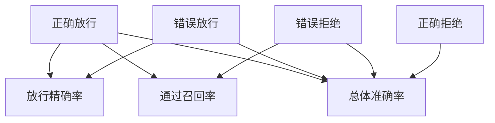

# 由四格表校准工具裁判

人工复核提供参照，程序负责放行。
三种比率各采用不同分母。增加容易识别的失败样本可能美化总分，却没减少一次错误放行。
样本互斥且全部有人工判定。越权等硬约束需另报发生次数。

## 先解决一个具体问题

**整体准确率变高，而错误放行数没降，原因可能是什么？**

增加许多容易判断的失败样本，正确拒绝变多即可抬高总分。
若风险来自越权错放，就要看错放数、放行精确率以及对应任务分母，不能用总分代替。


先从具体的低档设定开始：正确放行取 8份、错误放行取 1份、错误拒绝取 2份、正确拒绝取 12份。
三个结果依次是放行精确率 88.889%、通过召回率 80%、总体准确率 86.957%。
先手算这个起点，读完后再把另一个输入切到高档，这样能知道数字变化时究竟改变了哪个假设。

## 先写清输入边界和三个观测量

用 a 表示正确放行，取 8份 或 20份，这两点是用于隔离因果影响的教学输入。

用 b 表示错误放行，取 1份 或 5份，这两点是用于隔离因果影响的教学输入。

用 c 表示错误拒绝，取 2份 或 7份，这两点是用于隔离因果影响的教学输入。

用 d 表示正确拒绝，取 12份 或 35份，这两点是用于隔离因果影响的教学输入。

「放行精确率」的计算式为 `100*a/(a+b)`，按业务量展开是 `100×正确放行/(正确放行+错误放行)`，输出单位为%。

「通过召回率」的计算式为 `100*a/(a+c)`，按业务量展开是 `100×正确放行/(正确放行+错误拒绝)`，输出单位为%。

「总体准确率」的计算式为 `100*(a+d)/(a+b+c+d)`，按业务量展开是 `100×(正确放行+正确拒绝)/(正确放行+错误放行+错误拒绝+正确拒绝)`，输出单位为%。

公式中 ceil 与 floor 分别向上、向下取整，% 在表达式中作取余，** 为乘方，三元条件按“条件 ? 成立值 : 其他值”读取。展示数值最多保留三位小数，比较和反推采用未舍入值。



图上的箭头表示该输入出现在计算式中。同一输入通向多个指标时，三个读数可能共同移动。分支、取整或相互抵消又会使某些边在具体样本上没有可见增量。

## 从输入按单位逐步算到可比较的结果

<details>
<summary>展开推演与对应反例</summary>

### 样本 0000：正确放行 8、错误放行 1

这一组设定为正确放行为 8份、错误放行为 1份、错误拒绝为 2份、正确拒绝为 12份。

代入「放行精确率」：`100*8/(8+1)`，得到 88.889%。

代入「通过召回率」：`100*8/(8+2)`，得到 80%。

代入「总体准确率」：`100*(8+12)/(8+1+2+12)`，得到 86.957%。

以「放行精确率」作主读数时，本组单独切换错误放行的绝对变化最大或并列最大，读数会从 88.889% 变为 61.538%。

本组固定其余输入时，分别改变「错误拒绝」、「正确拒绝」均不会改变 88.889% 这个主读数，是否影响另一指标仍需另算。

对角样本 1111 的主读数为 80%。它同时改了四项，差额不能充当任一单个因素的净收益。

### 样本 0001：正确放行 8、错误放行 1

这一组设定为正确放行为 8份、错误放行为 1份、错误拒绝为 2份、正确拒绝为 35份。

代入「放行精确率」：`100*8/(8+1)`，得到 88.889%。

代入「通过召回率」：`100*8/(8+2)`，得到 80%。

代入「总体准确率」：`100*(8+35)/(8+1+2+35)`，得到 93.478%。


对角样本 1110 的主读数为 80%。它同时改了四项，差额不能充当任一单个因素的净收益。

### 样本 0010：正确放行 8、错误放行 1

这一组设定为正确放行为 8份、错误放行为 1份、错误拒绝为 7份、正确拒绝为 12份。

代入「放行精确率」：`100*8/(8+1)`，得到 88.889%。

代入「通过召回率」：`100*8/(8+7)`，得到 53.333%。

代入「总体准确率」：`100*(8+12)/(8+1+7+12)`，得到 71.429%。


对角样本 1101 的主读数为 80%。它同时改了四项，差额不能充当任一单个因素的净收益。

### 样本 0011：正确放行 8、错误放行 1

这一组设定为正确放行为 8份、错误放行为 1份、错误拒绝为 7份、正确拒绝为 35份。

代入「放行精确率」：`100*8/(8+1)`，得到 88.889%。

代入「通过召回率」：`100*8/(8+7)`，得到 53.333%。

代入「总体准确率」：`100*(8+35)/(8+1+7+35)`，得到 84.314%。


对角样本 1100 的主读数为 80%。它同时改了四项，差额不能充当任一单个因素的净收益。

### 样本 0100：正确放行 8、错误放行 5

这一组设定为正确放行为 8份、错误放行为 5份、错误拒绝为 2份、正确拒绝为 12份。

代入「放行精确率」：`100*8/(8+5)`，得到 61.538%。

代入「通过召回率」：`100*8/(8+2)`，得到 80%。

代入「总体准确率」：`100*(8+12)/(8+5+2+12)`，得到 74.074%。

以「放行精确率」作主读数时，本组单独切换错误放行的绝对变化最大或并列最大，读数会从 61.538% 变为 88.889%。

本组固定其余输入时，分别改变「错误拒绝」、「正确拒绝」均不会改变 61.538% 这个主读数，是否影响另一指标仍需另算。

对角样本 1011 的主读数为 95.238%。它同时改了四项，差额不能充当任一单个因素的净收益。

### 样本 0101：正确放行 8、错误放行 5

这一组设定为正确放行为 8份、错误放行为 5份、错误拒绝为 2份、正确拒绝为 35份。

代入「放行精确率」：`100*8/(8+5)`，得到 61.538%。

代入「通过召回率」：`100*8/(8+2)`，得到 80%。

代入「总体准确率」：`100*(8+35)/(8+5+2+35)`，得到 86%。


对角样本 1010 的主读数为 95.238%。它同时改了四项，差额不能充当任一单个因素的净收益。

### 样本 0110：正确放行 8、错误放行 5

这一组设定为正确放行为 8份、错误放行为 5份、错误拒绝为 7份、正确拒绝为 12份。

代入「放行精确率」：`100*8/(8+5)`，得到 61.538%。

代入「通过召回率」：`100*8/(8+7)`，得到 53.333%。

代入「总体准确率」：`100*(8+12)/(8+5+7+12)`，得到 62.5%。


对角样本 1001 的主读数为 95.238%。它同时改了四项，差额不能充当任一单个因素的净收益。

### 样本 0111：正确放行 8、错误放行 5

这一组设定为正确放行为 8份、错误放行为 5份、错误拒绝为 7份、正确拒绝为 35份。

代入「放行精确率」：`100*8/(8+5)`，得到 61.538%。

代入「通过召回率」：`100*8/(8+7)`，得到 53.333%。

代入「总体准确率」：`100*(8+35)/(8+5+7+35)`，得到 78.182%。


对角样本 1000 的主读数为 95.238%。它同时改了四项，差额不能充当任一单个因素的净收益。

### 样本 1000：正确放行 20、错误放行 1

这一组设定为正确放行为 20份、错误放行为 1份、错误拒绝为 2份、正确拒绝为 12份。

代入「放行精确率」：`100*20/(20+1)`，得到 95.238%。

代入「通过召回率」：`100*20/(20+2)`，得到 90.909%。

代入「总体准确率」：`100*(20+12)/(20+1+2+12)`，得到 91.429%。

以「放行精确率」作主读数时，本组单独切换错误放行的绝对变化最大或并列最大，读数会从 95.238% 变为 80%。

本组固定其余输入时，分别改变「错误拒绝」、「正确拒绝」均不会改变 95.238% 这个主读数，是否影响另一指标仍需另算。

对角样本 0111 的主读数为 61.538%。它同时改了四项，差额不能充当任一单个因素的净收益。

### 样本 1001：正确放行 20、错误放行 1

这一组设定为正确放行为 20份、错误放行为 1份、错误拒绝为 2份、正确拒绝为 35份。

代入「放行精确率」：`100*20/(20+1)`，得到 95.238%。

代入「通过召回率」：`100*20/(20+2)`，得到 90.909%。

代入「总体准确率」：`100*(20+35)/(20+1+2+35)`，得到 94.828%。


对角样本 0110 的主读数为 61.538%。它同时改了四项，差额不能充当任一单个因素的净收益。

### 样本 1010：正确放行 20、错误放行 1

这一组设定为正确放行为 20份、错误放行为 1份、错误拒绝为 7份、正确拒绝为 12份。

代入「放行精确率」：`100*20/(20+1)`，得到 95.238%。

代入「通过召回率」：`100*20/(20+7)`，得到 74.074%。

代入「总体准确率」：`100*(20+12)/(20+1+7+12)`，得到 80%。


对角样本 0101 的主读数为 61.538%。它同时改了四项，差额不能充当任一单个因素的净收益。

### 样本 1011：正确放行 20、错误放行 1

这一组设定为正确放行为 20份、错误放行为 1份、错误拒绝为 7份、正确拒绝为 35份。

代入「放行精确率」：`100*20/(20+1)`，得到 95.238%。

代入「通过召回率」：`100*20/(20+7)`，得到 74.074%。

代入「总体准确率」：`100*(20+35)/(20+1+7+35)`，得到 87.302%。


对角样本 0100 的主读数为 61.538%。它同时改了四项，差额不能充当任一单个因素的净收益。

### 样本 1100：正确放行 20、错误放行 5

这一组设定为正确放行为 20份、错误放行为 5份、错误拒绝为 2份、正确拒绝为 12份。

代入「放行精确率」：`100*20/(20+5)`，得到 80%。

代入「通过召回率」：`100*20/(20+2)`，得到 90.909%。

代入「总体准确率」：`100*(20+12)/(20+5+2+12)`，得到 82.051%。

以「放行精确率」作主读数时，本组单独切换正确放行的绝对变化最大或并列最大，读数会从 80% 变为 61.538%。

本组固定其余输入时，分别改变「错误拒绝」、「正确拒绝」均不会改变 80% 这个主读数，是否影响另一指标仍需另算。

对角样本 0011 的主读数为 88.889%。它同时改了四项，差额不能充当任一单个因素的净收益。

### 样本 1101：正确放行 20、错误放行 5

这一组设定为正确放行为 20份、错误放行为 5份、错误拒绝为 2份、正确拒绝为 35份。

代入「放行精确率」：`100*20/(20+5)`，得到 80%。

代入「通过召回率」：`100*20/(20+2)`，得到 90.909%。

代入「总体准确率」：`100*(20+35)/(20+5+2+35)`，得到 88.71%。


对角样本 0010 的主读数为 88.889%。它同时改了四项，差额不能充当任一单个因素的净收益。

### 样本 1110：正确放行 20、错误放行 5

这一组设定为正确放行为 20份、错误放行为 5份、错误拒绝为 7份、正确拒绝为 12份。

代入「放行精确率」：`100*20/(20+5)`，得到 80%。

代入「通过召回率」：`100*20/(20+7)`，得到 74.074%。

代入「总体准确率」：`100*(20+12)/(20+5+7+12)`，得到 72.727%。


对角样本 0001 的主读数为 88.889%。它同时改了四项，差额不能充当任一单个因素的净收益。

### 样本 1111：正确放行 20、错误放行 5

这一组设定为正确放行为 20份、错误放行为 5份、错误拒绝为 7份、正确拒绝为 35份。

代入「放行精确率」：`100*20/(20+5)`，得到 80%。

代入「通过召回率」：`100*20/(20+7)`，得到 74.074%。

代入「总体准确率」：`100*(20+35)/(20+5+7+35)`，得到 82.09%。


对角样本 0000 的主读数为 88.889%。它同时改了四项，差额不能充当任一单个因素的净收益。

</details>

## 逐个干预：其余条件固定时，变化真的发生在哪里

<details>
<summary>展开推演与对应反例</summary>

### 只改变正确放行

固定错误放行为 1份、错误拒绝为 2份、正确拒绝为 12份，只把正确放行从 8份改到 20份。
这一对的放行精确率从 88.889% 变为 95.238%，通过召回率的差为 10.909%，总体准确率的差为 4.472%。

固定错误放行为 1份、错误拒绝为 2份、正确拒绝为 35份，只把正确放行从 8份改到 20份。
这一对的放行精确率从 88.889% 变为 95.238%，通过召回率的差为 10.909%，总体准确率的差为 1.349%。

固定错误放行为 1份、错误拒绝为 7份、正确拒绝为 12份，只把正确放行从 8份改到 20份。
这一对的放行精确率从 88.889% 变为 95.238%，通过召回率的差为 20.741%，总体准确率的差为 8.571%。

固定错误放行为 1份、错误拒绝为 7份、正确拒绝为 35份，只把正确放行从 8份改到 20份。
这一对的放行精确率从 88.889% 变为 95.238%，通过召回率的差为 20.741%，总体准确率的差为 2.988%。

固定错误放行为 5份、错误拒绝为 2份、正确拒绝为 12份，只把正确放行从 8份改到 20份。
这一对的放行精确率从 61.538% 变为 80%，通过召回率的差为 10.909%，总体准确率的差为 7.977%。

固定错误放行为 5份、错误拒绝为 2份、正确拒绝为 35份，只把正确放行从 8份改到 20份。
这一对的放行精确率从 61.538% 变为 80%，通过召回率的差为 10.909%，总体准确率的差为 2.71%。

固定错误放行为 5份、错误拒绝为 7份、正确拒绝为 12份，只把正确放行从 8份改到 20份。
这一对的放行精确率从 61.538% 变为 80%，通过召回率的差为 20.741%，总体准确率的差为 10.227%。

固定错误放行为 5份、错误拒绝为 7份、正确拒绝为 35份，只把正确放行从 8份改到 20份。
这一对的放行精确率从 61.538% 变为 80%，通过召回率的差为 20.741%，总体准确率的差为 3.908%。

综合八组受控背景，正确放行升到较高设定时「放行精确率」的差值区间是 6.349% 至 18.462%，共有 8 对出现可观察变化。

综合八组受控背景，正确放行升到较高设定时「通过召回率」的差值区间是 10.909% 至 20.741%，共有 8 对出现可观察变化。

综合八组受控背景，正确放行升到较高设定时「总体准确率」的差值区间是 1.349% 至 10.227%，共有 8 对出现可观察变化。

### 只改变错误放行

固定正确放行为 8份、错误拒绝为 2份、正确拒绝为 12份，只把错误放行从 1份改到 5份。
这一对的放行精确率从 88.889% 变为 61.538%，通过召回率的差为 0%，总体准确率的差为 -12.882%。

固定正确放行为 8份、错误拒绝为 2份、正确拒绝为 35份，只把错误放行从 1份改到 5份。
这一对的放行精确率从 88.889% 变为 61.538%，通过召回率的差为 0%，总体准确率的差为 -7.478%。

固定正确放行为 8份、错误拒绝为 7份、正确拒绝为 12份，只把错误放行从 1份改到 5份。
这一对的放行精确率从 88.889% 变为 61.538%，通过召回率的差为 0%，总体准确率的差为 -8.929%。

固定正确放行为 8份、错误拒绝为 7份、正确拒绝为 35份，只把错误放行从 1份改到 5份。
这一对的放行精确率从 88.889% 变为 61.538%，通过召回率的差为 0%，总体准确率的差为 -6.132%。

固定正确放行为 20份、错误拒绝为 2份、正确拒绝为 12份，只把错误放行从 1份改到 5份。
这一对的放行精确率从 95.238% 变为 80%，通过召回率的差为 0%，总体准确率的差为 -9.377%。

固定正确放行为 20份、错误拒绝为 2份、正确拒绝为 35份，只把错误放行从 1份改到 5份。
这一对的放行精确率从 95.238% 变为 80%，通过召回率的差为 0%，总体准确率的差为 -6.118%。

固定正确放行为 20份、错误拒绝为 7份、正确拒绝为 12份，只把错误放行从 1份改到 5份。
这一对的放行精确率从 95.238% 变为 80%，通过召回率的差为 0%，总体准确率的差为 -7.273%。

固定正确放行为 20份、错误拒绝为 7份、正确拒绝为 35份，只把错误放行从 1份改到 5份。
这一对的放行精确率从 95.238% 变为 80%，通过召回率的差为 0%，总体准确率的差为 -5.212%。

综合八组受控背景，错误放行升到较高设定时「放行精确率」的差值区间是 -27.35% 至 -15.238%，共有 8 对出现可观察变化。

综合八组受控背景，错误放行升到较高设定时「通过召回率」的差值区间是 0%，共有 0 对出现可观察变化。

综合八组受控背景，错误放行升到较高设定时「总体准确率」的差值区间是 -12.882% 至 -5.212%，共有 8 对出现可观察变化。

### 只改变错误拒绝

固定正确放行为 8份、错误放行为 1份、正确拒绝为 12份，只把错误拒绝从 2份改到 7份。
这一对的放行精确率从 88.889% 变为 88.889%，通过召回率的差为 -26.667%，总体准确率的差为 -15.528%。

固定正确放行为 8份、错误放行为 1份、正确拒绝为 35份，只把错误拒绝从 2份改到 7份。
这一对的放行精确率从 88.889% 变为 88.889%，通过召回率的差为 -26.667%，总体准确率的差为 -9.165%。

固定正确放行为 8份、错误放行为 5份、正确拒绝为 12份，只把错误拒绝从 2份改到 7份。
这一对的放行精确率从 61.538% 变为 61.538%，通过召回率的差为 -26.667%，总体准确率的差为 -11.574%。

固定正确放行为 8份、错误放行为 5份、正确拒绝为 35份，只把错误拒绝从 2份改到 7份。
这一对的放行精确率从 61.538% 变为 61.538%，通过召回率的差为 -26.667%，总体准确率的差为 -7.818%。

固定正确放行为 20份、错误放行为 1份、正确拒绝为 12份，只把错误拒绝从 2份改到 7份。
这一对的放行精确率从 95.238% 变为 95.238%，通过召回率的差为 -16.835%，总体准确率的差为 -11.429%。

固定正确放行为 20份、错误放行为 1份、正确拒绝为 35份，只把错误拒绝从 2份改到 7份。
这一对的放行精确率从 95.238% 变为 95.238%，通过召回率的差为 -16.835%，总体准确率的差为 -7.526%。

固定正确放行为 20份、错误放行为 5份、正确拒绝为 12份，只把错误拒绝从 2份改到 7份。
这一对的放行精确率从 80% 变为 80%，通过召回率的差为 -16.835%，总体准确率的差为 -9.324%。

固定正确放行为 20份、错误放行为 5份、正确拒绝为 35份，只把错误拒绝从 2份改到 7份。
这一对的放行精确率从 80% 变为 80%，通过召回率的差为 -16.835%，总体准确率的差为 -6.62%。

综合八组受控背景，错误拒绝升到较高设定时「放行精确率」的差值区间是 0%，共有 0 对出现可观察变化。

综合八组受控背景，错误拒绝升到较高设定时「通过召回率」的差值区间是 -26.667% 至 -16.835%，共有 8 对出现可观察变化。

综合八组受控背景，错误拒绝升到较高设定时「总体准确率」的差值区间是 -15.528% 至 -6.62%，共有 8 对出现可观察变化。

### 只改变正确拒绝

固定正确放行为 8份、错误放行为 1份、错误拒绝为 2份，只把正确拒绝从 12份改到 35份。
这一对的放行精确率从 88.889% 变为 88.889%，通过召回率的差为 0%，总体准确率的差为 6.522%。

固定正确放行为 8份、错误放行为 1份、错误拒绝为 7份，只把正确拒绝从 12份改到 35份。
这一对的放行精确率从 88.889% 变为 88.889%，通过召回率的差为 0%，总体准确率的差为 12.885%。

固定正确放行为 8份、错误放行为 5份、错误拒绝为 2份，只把正确拒绝从 12份改到 35份。
这一对的放行精确率从 61.538% 变为 61.538%，通过召回率的差为 0%，总体准确率的差为 11.926%。

固定正确放行为 8份、错误放行为 5份、错误拒绝为 7份，只把正确拒绝从 12份改到 35份。
这一对的放行精确率从 61.538% 变为 61.538%，通过召回率的差为 0%，总体准确率的差为 15.682%。

固定正确放行为 20份、错误放行为 1份、错误拒绝为 2份，只把正确拒绝从 12份改到 35份。
这一对的放行精确率从 95.238% 变为 95.238%，通过召回率的差为 0%，总体准确率的差为 3.399%。

固定正确放行为 20份、错误放行为 1份、错误拒绝为 7份，只把正确拒绝从 12份改到 35份。
这一对的放行精确率从 95.238% 变为 95.238%，通过召回率的差为 0%，总体准确率的差为 7.302%。

固定正确放行为 20份、错误放行为 5份、错误拒绝为 2份，只把正确拒绝从 12份改到 35份。
这一对的放行精确率从 80% 变为 80%，通过召回率的差为 0%，总体准确率的差为 6.658%。

固定正确放行为 20份、错误放行为 5份、错误拒绝为 7份，只把正确拒绝从 12份改到 35份。
这一对的放行精确率从 80% 变为 80%，通过召回率的差为 0%，总体准确率的差为 9.362%。

综合八组受控背景，正确拒绝升到较高设定时「放行精确率」的差值区间是 0%，共有 0 对出现可观察变化。

综合八组受控背景，正确拒绝升到较高设定时「通过召回率」的差值区间是 0%，共有 0 对出现可观察变化。

综合八组受控背景，正确拒绝升到较高设定时「总体准确率」的差值区间是 3.399% 至 15.682%，共有 8 对出现可观察变化。

</details>

## 只拿到部分输入，结论还能缩小到多大范围

<details>
<summary>展开推演与对应反例</summary>

### 已知正确放行和错误放行

当正确放行为 8份、错误放行为 1份时，另两项有四种补全，主读数「放行精确率」只能限定为 88.889%。
这个条件下，取错误拒绝为 2份、正确拒绝为 12份可得到下界 88.889%，取错误拒绝为 2份、正确拒绝为 12份可达到上界 88.889%。

用同样可见的正确放行为 8份、错误放行为 1份去推「通过召回率」，能得到的范围为 53.333% 至 80%，不能把另一个指标的单位代入。

用同样可见的正确放行为 8份、错误放行为 1份去推「总体准确率」，能得到的范围为 71.429% 至 93.478%，不能把另一个指标的单位代入。

当正确放行为 8份、错误放行为 5份时，另两项有四种补全，主读数「放行精确率」只能限定为 61.538%。
这个条件下，取错误拒绝为 2份、正确拒绝为 12份可得到下界 61.538%，取错误拒绝为 2份、正确拒绝为 12份可达到上界 61.538%。

用同样可见的正确放行为 8份、错误放行为 5份去推「通过召回率」，能得到的范围为 53.333% 至 80%，不能把另一个指标的单位代入。

用同样可见的正确放行为 8份、错误放行为 5份去推「总体准确率」，能得到的范围为 62.5% 至 86%，不能把另一个指标的单位代入。

当正确放行为 20份、错误放行为 1份时，另两项有四种补全，主读数「放行精确率」只能限定为 95.238%。
这个条件下，取错误拒绝为 2份、正确拒绝为 12份可得到下界 95.238%，取错误拒绝为 2份、正确拒绝为 12份可达到上界 95.238%。

用同样可见的正确放行为 20份、错误放行为 1份去推「通过召回率」，能得到的范围为 74.074% 至 90.909%，不能把另一个指标的单位代入。

用同样可见的正确放行为 20份、错误放行为 1份去推「总体准确率」，能得到的范围为 80% 至 94.828%，不能把另一个指标的单位代入。

当正确放行为 20份、错误放行为 5份时，另两项有四种补全，主读数「放行精确率」只能限定为 80%。
这个条件下，取错误拒绝为 2份、正确拒绝为 12份可得到下界 80%，取错误拒绝为 2份、正确拒绝为 12份可达到上界 80%。

用同样可见的正确放行为 20份、错误放行为 5份去推「通过召回率」，能得到的范围为 74.074% 至 90.909%，不能把另一个指标的单位代入。

用同样可见的正确放行为 20份、错误放行为 5份去推「总体准确率」，能得到的范围为 72.727% 至 88.71%，不能把另一个指标的单位代入。

### 已知正确放行和错误拒绝

当正确放行为 8份、错误拒绝为 2份时，另两项有四种补全，主读数「放行精确率」只能限定为 61.538% 至 88.889%。
这个条件下，取错误放行为 5份、正确拒绝为 12份可得到下界 61.538%，取错误放行为 1份、正确拒绝为 12份可达到上界 88.889%。

用同样可见的正确放行为 8份、错误拒绝为 2份去推「通过召回率」，能得到的范围为 80%，不能把另一个指标的单位代入。

用同样可见的正确放行为 8份、错误拒绝为 2份去推「总体准确率」，能得到的范围为 74.074% 至 93.478%，不能把另一个指标的单位代入。

若只许再问一项，按最坏区间宽度优先核对错误放行，补得低档时为 88.889%，高档时为 61.538%。

当正确放行为 8份、错误拒绝为 7份时，另两项有四种补全，主读数「放行精确率」只能限定为 61.538% 至 88.889%。

用同样可见的正确放行为 8份、错误拒绝为 7份去推「通过召回率」，能得到的范围为 53.333%，不能把另一个指标的单位代入。

用同样可见的正确放行为 8份、错误拒绝为 7份去推「总体准确率」，能得到的范围为 62.5% 至 84.314%，不能把另一个指标的单位代入。


当正确放行为 20份、错误拒绝为 2份时，另两项有四种补全，主读数「放行精确率」只能限定为 80% 至 95.238%。
这个条件下，取错误放行为 5份、正确拒绝为 12份可得到下界 80%，取错误放行为 1份、正确拒绝为 12份可达到上界 95.238%。

用同样可见的正确放行为 20份、错误拒绝为 2份去推「通过召回率」，能得到的范围为 90.909%，不能把另一个指标的单位代入。

用同样可见的正确放行为 20份、错误拒绝为 2份去推「总体准确率」，能得到的范围为 82.051% 至 94.828%，不能把另一个指标的单位代入。

若只许再问一项，按最坏区间宽度优先核对错误放行，补得低档时为 95.238%，高档时为 80%。

当正确放行为 20份、错误拒绝为 7份时，另两项有四种补全，主读数「放行精确率」只能限定为 80% 至 95.238%。

用同样可见的正确放行为 20份、错误拒绝为 7份去推「通过召回率」，能得到的范围为 74.074%，不能把另一个指标的单位代入。

用同样可见的正确放行为 20份、错误拒绝为 7份去推「总体准确率」，能得到的范围为 72.727% 至 87.302%，不能把另一个指标的单位代入。


### 已知错误放行和错误拒绝

当错误放行为 1份、错误拒绝为 2份时，另两项有四种补全，主读数「放行精确率」只能限定为 88.889% 至 95.238%。
这个条件下，取正确放行为 8份、正确拒绝为 12份可得到下界 88.889%，取正确放行为 20份、正确拒绝为 12份可达到上界 95.238%。

用同样可见的错误放行为 1份、错误拒绝为 2份去推「通过召回率」，能得到的范围为 80% 至 90.909%，不能把另一个指标的单位代入。

用同样可见的错误放行为 1份、错误拒绝为 2份去推「总体准确率」，能得到的范围为 86.957% 至 94.828%，不能把另一个指标的单位代入。

若只许再问一项，按最坏区间宽度优先核对正确放行，补得低档时为 88.889%，高档时为 95.238%。

当错误放行为 1份、错误拒绝为 7份时，另两项有四种补全，主读数「放行精确率」只能限定为 88.889% 至 95.238%。

用同样可见的错误放行为 1份、错误拒绝为 7份去推「通过召回率」，能得到的范围为 53.333% 至 74.074%，不能把另一个指标的单位代入。

用同样可见的错误放行为 1份、错误拒绝为 7份去推「总体准确率」，能得到的范围为 71.429% 至 87.302%，不能把另一个指标的单位代入。


当错误放行为 5份、错误拒绝为 2份时，另两项有四种补全，主读数「放行精确率」只能限定为 61.538% 至 80%。
这个条件下，取正确放行为 8份、正确拒绝为 12份可得到下界 61.538%，取正确放行为 20份、正确拒绝为 12份可达到上界 80%。

用同样可见的错误放行为 5份、错误拒绝为 2份去推「通过召回率」，能得到的范围为 80% 至 90.909%，不能把另一个指标的单位代入。

用同样可见的错误放行为 5份、错误拒绝为 2份去推「总体准确率」，能得到的范围为 74.074% 至 88.71%，不能把另一个指标的单位代入。

若只许再问一项，按最坏区间宽度优先核对正确放行，补得低档时为 61.538%，高档时为 80%。

当错误放行为 5份、错误拒绝为 7份时，另两项有四种补全，主读数「放行精确率」只能限定为 61.538% 至 80%。

用同样可见的错误放行为 5份、错误拒绝为 7份去推「通过召回率」，能得到的范围为 53.333% 至 74.074%，不能把另一个指标的单位代入。

用同样可见的错误放行为 5份、错误拒绝为 7份去推「总体准确率」，能得到的范围为 62.5% 至 82.09%，不能把另一个指标的单位代入。


### 已知正确放行和正确拒绝

当正确放行为 8份、正确拒绝为 12份时，另两项有四种补全，主读数「放行精确率」只能限定为 61.538% 至 88.889%。
这个条件下，取错误放行为 5份、错误拒绝为 2份可得到下界 61.538%，取错误放行为 1份、错误拒绝为 2份可达到上界 88.889%。

用同样可见的正确放行为 8份、正确拒绝为 12份去推「通过召回率」，能得到的范围为 53.333% 至 80%，不能把另一个指标的单位代入。

用同样可见的正确放行为 8份、正确拒绝为 12份去推「总体准确率」，能得到的范围为 62.5% 至 86.957%，不能把另一个指标的单位代入。


当正确放行为 8份、正确拒绝为 35份时，另两项有四种补全，主读数「放行精确率」只能限定为 61.538% 至 88.889%。

用同样可见的正确放行为 8份、正确拒绝为 35份去推「通过召回率」，能得到的范围为 53.333% 至 80%，不能把另一个指标的单位代入。

用同样可见的正确放行为 8份、正确拒绝为 35份去推「总体准确率」，能得到的范围为 78.182% 至 93.478%，不能把另一个指标的单位代入。


当正确放行为 20份、正确拒绝为 12份时，另两项有四种补全，主读数「放行精确率」只能限定为 80% 至 95.238%。
这个条件下，取错误放行为 5份、错误拒绝为 2份可得到下界 80%，取错误放行为 1份、错误拒绝为 2份可达到上界 95.238%。

用同样可见的正确放行为 20份、正确拒绝为 12份去推「通过召回率」，能得到的范围为 74.074% 至 90.909%，不能把另一个指标的单位代入。

用同样可见的正确放行为 20份、正确拒绝为 12份去推「总体准确率」，能得到的范围为 72.727% 至 91.429%，不能把另一个指标的单位代入。


当正确放行为 20份、正确拒绝为 35份时，另两项有四种补全，主读数「放行精确率」只能限定为 80% 至 95.238%。

用同样可见的正确放行为 20份、正确拒绝为 35份去推「通过召回率」，能得到的范围为 74.074% 至 90.909%，不能把另一个指标的单位代入。

用同样可见的正确放行为 20份、正确拒绝为 35份去推「总体准确率」，能得到的范围为 82.09% 至 94.828%，不能把另一个指标的单位代入。


### 已知错误放行和正确拒绝

当错误放行为 1份、正确拒绝为 12份时，另两项有四种补全，主读数「放行精确率」只能限定为 88.889% 至 95.238%。
这个条件下，取正确放行为 8份、错误拒绝为 2份可得到下界 88.889%，取正确放行为 20份、错误拒绝为 2份可达到上界 95.238%。

用同样可见的错误放行为 1份、正确拒绝为 12份去推「通过召回率」，能得到的范围为 53.333% 至 90.909%，不能把另一个指标的单位代入。

用同样可见的错误放行为 1份、正确拒绝为 12份去推「总体准确率」，能得到的范围为 71.429% 至 91.429%，不能把另一个指标的单位代入。


当错误放行为 1份、正确拒绝为 35份时，另两项有四种补全，主读数「放行精确率」只能限定为 88.889% 至 95.238%。

用同样可见的错误放行为 1份、正确拒绝为 35份去推「通过召回率」，能得到的范围为 53.333% 至 90.909%，不能把另一个指标的单位代入。

用同样可见的错误放行为 1份、正确拒绝为 35份去推「总体准确率」，能得到的范围为 84.314% 至 94.828%，不能把另一个指标的单位代入。


当错误放行为 5份、正确拒绝为 12份时，另两项有四种补全，主读数「放行精确率」只能限定为 61.538% 至 80%。
这个条件下，取正确放行为 8份、错误拒绝为 2份可得到下界 61.538%，取正确放行为 20份、错误拒绝为 2份可达到上界 80%。

用同样可见的错误放行为 5份、正确拒绝为 12份去推「通过召回率」，能得到的范围为 53.333% 至 90.909%，不能把另一个指标的单位代入。

用同样可见的错误放行为 5份、正确拒绝为 12份去推「总体准确率」，能得到的范围为 62.5% 至 82.051%，不能把另一个指标的单位代入。


当错误放行为 5份、正确拒绝为 35份时，另两项有四种补全，主读数「放行精确率」只能限定为 61.538% 至 80%。

用同样可见的错误放行为 5份、正确拒绝为 35份去推「通过召回率」，能得到的范围为 53.333% 至 90.909%，不能把另一个指标的单位代入。

用同样可见的错误放行为 5份、正确拒绝为 35份去推「总体准确率」，能得到的范围为 78.182% 至 88.71%，不能把另一个指标的单位代入。


### 已知错误拒绝和正确拒绝

当错误拒绝为 2份、正确拒绝为 12份时，另两项有四种补全，主读数「放行精确率」只能限定为 61.538% 至 95.238%。
这个条件下，取正确放行为 8份、错误放行为 5份可得到下界 61.538%，取正确放行为 20份、错误放行为 1份可达到上界 95.238%。

用同样可见的错误拒绝为 2份、正确拒绝为 12份去推「通过召回率」，能得到的范围为 80% 至 90.909%，不能把另一个指标的单位代入。

用同样可见的错误拒绝为 2份、正确拒绝为 12份去推「总体准确率」，能得到的范围为 74.074% 至 91.429%，不能把另一个指标的单位代入。

若只许再问一项，按最坏区间宽度优先核对错误放行，补得低档时为 88.889% 至 95.238%，高档时为 61.538% 至 80%。

当错误拒绝为 2份、正确拒绝为 35份时，另两项有四种补全，主读数「放行精确率」只能限定为 61.538% 至 95.238%。

用同样可见的错误拒绝为 2份、正确拒绝为 35份去推「通过召回率」，能得到的范围为 80% 至 90.909%，不能把另一个指标的单位代入。

用同样可见的错误拒绝为 2份、正确拒绝为 35份去推「总体准确率」，能得到的范围为 86% 至 94.828%，不能把另一个指标的单位代入。


当错误拒绝为 7份、正确拒绝为 12份时，另两项有四种补全，主读数「放行精确率」只能限定为 61.538% 至 95.238%。

用同样可见的错误拒绝为 7份、正确拒绝为 12份去推「通过召回率」，能得到的范围为 53.333% 至 74.074%，不能把另一个指标的单位代入。

用同样可见的错误拒绝为 7份、正确拒绝为 12份去推「总体准确率」，能得到的范围为 62.5% 至 80%，不能把另一个指标的单位代入。


当错误拒绝为 7份、正确拒绝为 35份时，另两项有四种补全，主读数「放行精确率」只能限定为 61.538% 至 95.238%。

用同样可见的错误拒绝为 7份、正确拒绝为 35份去推「通过召回率」，能得到的范围为 53.333% 至 74.074%，不能把另一个指标的单位代入。

用同样可见的错误拒绝为 7份、正确拒绝为 35份去推「总体准确率」，能得到的范围为 78.182% 至 87.302%，不能把另一个指标的单位代入。


</details>

## 反过来审查一份报表：能从结果还原哪些输入

<details>
<summary>展开推演与对应反例</summary>

### 仅保留“放行精确率”的读数

报表只写「放行精确率=88.889%」时，在本实验的离散取值中有 4 组输入与之相容。

对这个 88.889% 的「放行精确率」读数，所有相容样本都要求正确放行为 8份、错误放行为 1份。

只凭「放行精确率」的 88.889% 无法确定错误拒绝：0000 与 0010 的取值分别为 2 和 7份。

报表只写「放行精确率=61.538%」时，在本实验的离散取值中有 4 组输入与之相容。

对这个 61.538% 的「放行精确率」读数，所有相容样本都要求正确放行为 8份、错误放行为 5份。

只凭「放行精确率」的 61.538% 无法确定错误拒绝：0100 与 0110 的取值分别为 2 和 7份。

报表只写「放行精确率=95.238%」时，在本实验的离散取值中有 4 组输入与之相容。

对这个 95.238% 的「放行精确率」读数，所有相容样本都要求正确放行为 20份、错误放行为 1份。

只凭「放行精确率」的 95.238% 无法确定错误拒绝：1000 与 1010 的取值分别为 2 和 7份。

报表只写「放行精确率=80%」时，在本实验的离散取值中有 4 组输入与之相容。

对这个 80% 的「放行精确率」读数，所有相容样本都要求正确放行为 20份、错误放行为 5份。

只凭「放行精确率」的 80% 无法确定错误拒绝：1100 与 1110 的取值分别为 2 和 7份。

### 仅保留“通过召回率”的读数

报表只写「通过召回率=80%」时，在本实验的离散取值中有 4 组输入与之相容。

对这个 80% 的「通过召回率」读数，所有相容样本都要求正确放行为 8份、错误拒绝为 2份。

只凭「通过召回率」的 80% 无法确定错误放行：0000 与 0100 的取值分别为 1 和 5份。

报表只写「通过召回率=53.333%」时，在本实验的离散取值中有 4 组输入与之相容。

对这个 53.333% 的「通过召回率」读数，所有相容样本都要求正确放行为 8份、错误拒绝为 7份。

只凭「通过召回率」的 53.333% 无法确定错误放行：0010 与 0110 的取值分别为 1 和 5份。

报表只写「通过召回率=90.909%」时，在本实验的离散取值中有 4 组输入与之相容。

对这个 90.909% 的「通过召回率」读数，所有相容样本都要求正确放行为 20份、错误拒绝为 2份。

只凭「通过召回率」的 90.909% 无法确定错误放行：1000 与 1100 的取值分别为 1 和 5份。

报表只写「通过召回率=74.074%」时，在本实验的离散取值中有 4 组输入与之相容。

对这个 74.074% 的「通过召回率」读数，所有相容样本都要求正确放行为 20份、错误拒绝为 7份。

只凭「通过召回率」的 74.074% 无法确定错误放行：1010 与 1110 的取值分别为 1 和 5份。

### 仅保留“总体准确率”的读数

报表只写「总体准确率=86.957%」时，在本实验的离散取值中有 1 组输入与之相容。

对这个 86.957% 的「总体准确率」读数，所有相容样本都要求正确放行为 8份、错误放行为 1份、错误拒绝为 2份、正确拒绝为 12份。

报表只写「总体准确率=93.478%」时，在本实验的离散取值中有 1 组输入与之相容。

对这个 93.478% 的「总体准确率」读数，所有相容样本都要求正确放行为 8份、错误放行为 1份、错误拒绝为 2份、正确拒绝为 35份。

报表只写「总体准确率=71.429%」时，在本实验的离散取值中有 1 组输入与之相容。

对这个 71.429% 的「总体准确率」读数，所有相容样本都要求正确放行为 8份、错误放行为 1份、错误拒绝为 7份、正确拒绝为 12份。

报表只写「总体准确率=84.314%」时，在本实验的离散取值中有 1 组输入与之相容。

对这个 84.314% 的「总体准确率」读数，所有相容样本都要求正确放行为 8份、错误放行为 1份、错误拒绝为 7份、正确拒绝为 35份。

报表只写「总体准确率=74.074%」时，在本实验的离散取值中有 1 组输入与之相容。

对这个 74.074% 的「总体准确率」读数，所有相容样本都要求正确放行为 8份、错误放行为 5份、错误拒绝为 2份、正确拒绝为 12份。

报表只写「总体准确率=86%」时，在本实验的离散取值中有 1 组输入与之相容。

对这个 86% 的「总体准确率」读数，所有相容样本都要求正确放行为 8份、错误放行为 5份、错误拒绝为 2份、正确拒绝为 35份。

报表只写「总体准确率=62.5%」时，在本实验的离散取值中有 1 组输入与之相容。

对这个 62.5% 的「总体准确率」读数，所有相容样本都要求正确放行为 8份、错误放行为 5份、错误拒绝为 7份、正确拒绝为 12份。

报表只写「总体准确率=78.182%」时，在本实验的离散取值中有 1 组输入与之相容。

对这个 78.182% 的「总体准确率」读数，所有相容样本都要求正确放行为 8份、错误放行为 5份、错误拒绝为 7份、正确拒绝为 35份。

报表只写「总体准确率=91.429%」时，在本实验的离散取值中有 1 组输入与之相容。

对这个 91.429% 的「总体准确率」读数，所有相容样本都要求正确放行为 20份、错误放行为 1份、错误拒绝为 2份、正确拒绝为 12份。

报表只写「总体准确率=94.828%」时，在本实验的离散取值中有 1 组输入与之相容。

对这个 94.828% 的「总体准确率」读数，所有相容样本都要求正确放行为 20份、错误放行为 1份、错误拒绝为 2份、正确拒绝为 35份。

报表只写「总体准确率=80%」时，在本实验的离散取值中有 1 组输入与之相容。

对这个 80% 的「总体准确率」读数，所有相容样本都要求正确放行为 20份、错误放行为 1份、错误拒绝为 7份、正确拒绝为 12份。

报表只写「总体准确率=87.302%」时，在本实验的离散取值中有 1 组输入与之相容。

对这个 87.302% 的「总体准确率」读数，所有相容样本都要求正确放行为 20份、错误放行为 1份、错误拒绝为 7份、正确拒绝为 35份。

报表只写「总体准确率=82.051%」时，在本实验的离散取值中有 1 组输入与之相容。

对这个 82.051% 的「总体准确率」读数，所有相容样本都要求正确放行为 20份、错误放行为 5份、错误拒绝为 2份、正确拒绝为 12份。

报表只写「总体准确率=88.71%」时，在本实验的离散取值中有 1 组输入与之相容。

对这个 88.71% 的「总体准确率」读数，所有相容样本都要求正确放行为 20份、错误放行为 5份、错误拒绝为 2份、正确拒绝为 35份。

报表只写「总体准确率=72.727%」时，在本实验的离散取值中有 1 组输入与之相容。

对这个 72.727% 的「总体准确率」读数，所有相容样本都要求正确放行为 20份、错误放行为 5份、错误拒绝为 7份、正确拒绝为 12份。

报表只写「总体准确率=82.09%」时，在本实验的离散取值中有 1 组输入与之相容。

对这个 82.09% 的「总体准确率」读数，所有相容样本都要求正确放行为 20份、错误放行为 5份、错误拒绝为 7份、正确拒绝为 35份。

</details>

## 给错误算法找反例，再给正确算法画使用边界

<details>
<summary>展开推演与对应反例</summary>

### 用正确放行除全部试验

把「放行精确率」错写成 `100*a/(a+b+c+d)`，在 16 组教学输入中有 16 组会与参照计算不同。

对于正确放行为 8份、错误放行为 1份、错误拒绝为 2份、正确拒绝为 12份，这个错误口径得 34.783%，参照式为 88.889%，偏差为 -54.106%。

对于正确放行为 8份、错误放行为 1份、错误拒绝为 2份、正确拒绝为 35份，这个错误口径得 17.391%，参照式为 88.889%，偏差为 -71.498%。

对于正确放行为 8份、错误放行为 1份、错误拒绝为 7份、正确拒绝为 12份，这个错误口径得 28.571%，参照式为 88.889%，偏差为 -60.317%。

对于正确放行为 8份、错误放行为 1份、错误拒绝为 7份、正确拒绝为 35份，这个错误口径得 15.686%，参照式为 88.889%，偏差为 -73.203%。

对于正确放行为 8份、错误放行为 5份、错误拒绝为 2份、正确拒绝为 12份，这个错误口径得 29.63%，参照式为 61.538%，偏差为 -31.909%。

对于正确放行为 8份、错误放行为 5份、错误拒绝为 2份、正确拒绝为 35份，这个错误口径得 16%，参照式为 61.538%，偏差为 -45.538%。

对于正确放行为 8份、错误放行为 5份、错误拒绝为 7份、正确拒绝为 12份，这个错误口径得 25%，参照式为 61.538%，偏差为 -36.538%。

对于正确放行为 8份、错误放行为 5份、错误拒绝为 7份、正确拒绝为 35份，这个错误口径得 14.545%，参照式为 61.538%，偏差为 -46.993%。

对于正确放行为 20份、错误放行为 1份、错误拒绝为 2份、正确拒绝为 12份，这个错误口径得 57.143%，参照式为 95.238%，偏差为 -38.095%。

对于正确放行为 20份、错误放行为 1份、错误拒绝为 2份、正确拒绝为 35份，这个错误口径得 34.483%，参照式为 95.238%，偏差为 -60.755%。

对于正确放行为 20份、错误放行为 1份、错误拒绝为 7份、正确拒绝为 12份，这个错误口径得 50%，参照式为 95.238%，偏差为 -45.238%。

对于正确放行为 20份、错误放行为 1份、错误拒绝为 7份、正确拒绝为 35份，这个错误口径得 31.746%，参照式为 95.238%，偏差为 -63.492%。

对于正确放行为 20份、错误放行为 5份、错误拒绝为 2份、正确拒绝为 12份，这个错误口径得 51.282%，参照式为 80%，偏差为 -28.718%。

对于正确放行为 20份、错误放行为 5份、错误拒绝为 2份、正确拒绝为 35份，这个错误口径得 32.258%，参照式为 80%，偏差为 -47.742%。

对于正确放行为 20份、错误放行为 5份、错误拒绝为 7份、正确拒绝为 12份，这个错误口径得 45.455%，参照式为 80%，偏差为 -34.545%。

对于正确放行为 20份、错误放行为 5份、错误拒绝为 7份、正确拒绝为 35份，这个错误口径得 29.851%，参照式为 80%，偏差为 -50.149%。

### 把召回率误报成精确率

把「放行精确率」错写成 `100*a/(a+c)`，在 16 组教学输入中有 16 组会与参照计算不同。

对于正确放行为 8份、错误放行为 1份、错误拒绝为 2份、正确拒绝为 12份，这个错误口径得 80%，参照式为 88.889%，偏差为 -8.889%。

对于正确放行为 8份、错误放行为 1份、错误拒绝为 2份、正确拒绝为 35份，这个错误口径得 80%，参照式为 88.889%，偏差为 -8.889%。

对于正确放行为 8份、错误放行为 1份、错误拒绝为 7份、正确拒绝为 12份，这个错误口径得 53.333%，参照式为 88.889%，偏差为 -35.556%。

对于正确放行为 8份、错误放行为 1份、错误拒绝为 7份、正确拒绝为 35份，这个错误口径得 53.333%，参照式为 88.889%，偏差为 -35.556%。

对于正确放行为 8份、错误放行为 5份、错误拒绝为 2份、正确拒绝为 12份，这个错误口径得 80%，参照式为 61.538%，偏差为 18.462%。

对于正确放行为 8份、错误放行为 5份、错误拒绝为 2份、正确拒绝为 35份，这个错误口径得 80%，参照式为 61.538%，偏差为 18.462%。

对于正确放行为 8份、错误放行为 5份、错误拒绝为 7份、正确拒绝为 12份，这个错误口径得 53.333%，参照式为 61.538%，偏差为 -8.205%。

对于正确放行为 8份、错误放行为 5份、错误拒绝为 7份、正确拒绝为 35份，这个错误口径得 53.333%，参照式为 61.538%，偏差为 -8.205%。

对于正确放行为 20份、错误放行为 1份、错误拒绝为 2份、正确拒绝为 12份，这个错误口径得 90.909%，参照式为 95.238%，偏差为 -4.329%。

对于正确放行为 20份、错误放行为 1份、错误拒绝为 2份、正确拒绝为 35份，这个错误口径得 90.909%，参照式为 95.238%，偏差为 -4.329%。

对于正确放行为 20份、错误放行为 1份、错误拒绝为 7份、正确拒绝为 12份，这个错误口径得 74.074%，参照式为 95.238%，偏差为 -21.164%。

对于正确放行为 20份、错误放行为 1份、错误拒绝为 7份、正确拒绝为 35份，这个错误口径得 74.074%，参照式为 95.238%，偏差为 -21.164%。

对于正确放行为 20份、错误放行为 5份、错误拒绝为 2份、正确拒绝为 12份，这个错误口径得 90.909%，参照式为 80%，偏差为 10.909%。

对于正确放行为 20份、错误放行为 5份、错误拒绝为 2份、正确拒绝为 35份，这个错误口径得 90.909%，参照式为 80%，偏差为 10.909%。

对于正确放行为 20份、错误放行为 5份、错误拒绝为 7份、正确拒绝为 12份，这个错误口径得 74.074%，参照式为 80%，偏差为 -5.926%。

对于正确放行为 20份、错误放行为 5份、错误拒绝为 7份、正确拒绝为 35份，这个错误口径得 74.074%，参照式为 80%，偏差为 -5.926%。

</details>

## 从教学算例回到可验证的工程结论

要把这些数写入项目说明，先用真实输入替换教学常数，列明样本分母、实际资源限制和观测边界，再验证公式所需前提。两点敏感性只描述这两个设定之间的差异。

## 面试复述与复算

面试题可以从“整体准确率变高，而错误放行数没降，原因可能是什么？”起步。先给出本篇的触发条件和一条真实执行端可检查的证据，再用一个相邻反例限定结论的适用范围。

在仓库根目录执行下列命令可以重算本篇的一个输入。四位数字依次选择正文列出的四项条件，0 表示未成立或低档，1 表示成立或高档。
```powershell
node examples/reading-cases/replay.mjs 4 3 0101
```

[本周主文](../theory.md) · [配套实验](../lab.md) · [下一篇研读](04.md)
