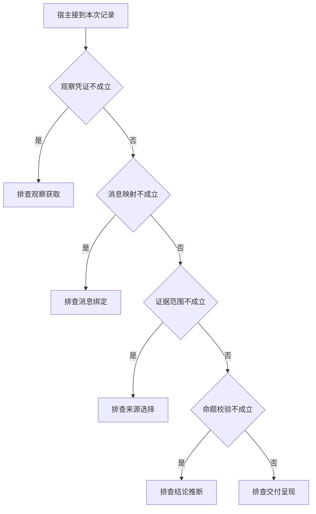

# 从最终错答回到最早分歧

两条轨迹最后都显示 REJECTED。
先找实际观察和消息关联，再检查对象范围与推断，能够避免把保护器按预期阻止错误误报为保护器故障。

本篇用一个封闭的教学决策器说明这一问题。输入是宿主收到的记录，不保证每个下游字段都已经获准使用。前置检查未成立时，下游即使带着缓存值，也不能拿来作业务断言。

## 先解决一个具体问题

**一条工具服务日志写了 FOUND，就能证明模型看见过吗？**

不能。
回执可能在消息组装时被过滤、关联错轮或因输入过长被截断。
检查第二次请求的实际消息，才能区分宿主没有送达和模型收到后误读。


先取一个能走到「排查交付呈现」的输入：已有本轮业务回执、回执属于待处理调用、资料属于目标服务、候选通过业务断言。
把这四个条件代回后文的图，前面各个拦截分支都未满足，最终才有“上述四个关口在本题均通过”这个判断。
还原这个现场时要分别问：哪些位来自可信状态，哪些只是在接口中出现、尚未获得解释资格的字段。

## 先沿一次决策走到底



从上到下取第一条成立的出口。只改一个开关时，只有它之前的检查都未截断，该变化才可能到达真实动作。

“观察凭证”的两种输入分别是“已有本轮业务回执”与“只有尚未执行的提议”。
模型的调用提议不能证明应用已取得新事实。

“消息映射”的两种输入分别是“回执属于待处理调用”与“无法对应本次调用”。
仅凭返回顺序归并可能将另一请求的观察放进历史。

“证据范围”的两种输入分别是“资料属于目标服务”与“资料来自另一服务区域”。
同楼地点也可能服务不同，引用要绑定业务对象。

“命题校验”的两种输入分别是“候选通过业务断言”与“候选与领域条件冲突”。
有正确的引用编号仍可能推断出错误结论。

## 最少需要哪几项观察

### 排查观察获取

未见样本所需的有效回执。
在本节的全部组合中，有 8 种产生「排查观察获取」，这只是逻辑空间的计数，不能当作实际用户请求的比例。

只取得只有尚未执行的提议，已经足以要求宿主「排查观察获取」。
保持这些已知项，其余开关自由变化，仍有 8 种补全，判断没有翻转。

若删掉关于观察凭证的证据，另一份允许的现场是已有本轮业务回执、无法对应本次调用、资料来自另一服务区域、候选与领域条件冲突，它会使宿主「排查消息绑定」。

### 排查消息绑定

返回未归到对应动作。
在本节的全部组合中，有 4 种产生「排查消息绑定」，这只是逻辑空间的计数，不能当作实际用户请求的比例。

只取得已有本轮业务回执、无法对应本次调用，已经足以要求宿主「排查消息绑定」。
保持这些已知项，其余开关自由变化，仍有 4 种补全，判断没有翻转。

若删掉关于观察凭证的证据，另一份允许的现场是只有尚未执行的提议、无法对应本次调用、资料来自另一服务区域、候选与领域条件冲突，它会使宿主「排查观察获取」。

若删掉关于消息映射的证据，另一份允许的现场是已有本轮业务回执、回执属于待处理调用、资料来自另一服务区域、候选与领域条件冲突，它会使宿主「排查来源选择」。

### 排查来源选择

选取了无关对象的事实。
在本节的全部组合中，有 2 种产生「排查来源选择」，这只是逻辑空间的计数，不能当作实际用户请求的比例。

只取得已有本轮业务回执、回执属于待处理调用、资料来自另一服务区域，已经足以要求宿主「排查来源选择」。
保持这些已知项，其余开关自由变化，仍有 2 种补全，判断没有翻转。

若删掉关于观察凭证的证据，另一份允许的现场是只有尚未执行的提议、回执属于待处理调用、资料来自另一服务区域、候选与领域条件冲突，它会使宿主「排查观察获取」。

若删掉关于消息映射的证据，另一份允许的现场是已有本轮业务回执、无法对应本次调用、资料来自另一服务区域、候选与领域条件冲突，它会使宿主「排查消息绑定」。

若删掉关于证据范围的证据，另一份允许的现场是已有本轮业务回执、回执属于待处理调用、资料属于目标服务、候选与领域条件冲突，它会使宿主「排查结论推断」。

### 排查结论推断

输入证据有效但判断与之矛盾。
在本节的全部组合中，有 1 种产生「排查结论推断」，这只是逻辑空间的计数，不能当作实际用户请求的比例。

只取得已有本轮业务回执、回执属于待处理调用、资料属于目标服务、候选与领域条件冲突，已经足以要求宿主「排查结论推断」。
保持这些已知项，其余开关自由变化，仍有 1 种补全，判断没有翻转。

若删掉关于观察凭证的证据，另一份允许的现场是只有尚未执行的提议、回执属于待处理调用、资料属于目标服务、候选与领域条件冲突，它会使宿主「排查观察获取」。

若删掉关于消息映射的证据，另一份允许的现场是已有本轮业务回执、无法对应本次调用、资料属于目标服务、候选与领域条件冲突，它会使宿主「排查消息绑定」。

若删掉关于证据范围的证据，另一份允许的现场是已有本轮业务回执、回执属于待处理调用、资料来自另一服务区域、候选与领域条件冲突，它会使宿主「排查来源选择」。

若删掉关于命题校验的证据，另一份允许的现场是已有本轮业务回执、回执属于待处理调用、资料属于目标服务、候选通过业务断言，它会使宿主「排查交付呈现」。

### 排查交付呈现

上述四个关口在本题均通过。
在本节的全部组合中，有 1 种产生「排查交付呈现」，这只是逻辑空间的计数，不能当作实际用户请求的比例。

只取得已有本轮业务回执、回执属于待处理调用、资料属于目标服务、候选通过业务断言，已经足以要求宿主「排查交付呈现」。

若删掉关于观察凭证的证据，另一份允许的现场是只有尚未执行的提议、回执属于待处理调用、资料属于目标服务、候选通过业务断言，它会使宿主「排查观察获取」。

若删掉关于消息映射的证据，另一份允许的现场是已有本轮业务回执、无法对应本次调用、资料属于目标服务、候选通过业务断言，它会使宿主「排查消息绑定」。

若删掉关于证据范围的证据，另一份允许的现场是已有本轮业务回执、回执属于待处理调用、资料来自另一服务区域、候选通过业务断言，它会使宿主「排查来源选择」。

若删掉关于命题校验的证据，另一份允许的现场是已有本轮业务回执、回执属于待处理调用、资料属于目标服务、候选与领域条件冲突，它会使宿主「排查结论推断」。

## 以同一份契约解释截然不同的现场

<details>
<summary>展开推演与对应反例</summary>

下列样本按最先命中的业务分支排列。四位编码只作本篇页内定位，顺序与开头的四项输入一致。可以先猜下一动作，再展开相邻样本。

### 能够触发“排查观察获取”的现场

**样本 0000**

业务侧交来只有尚未执行的提议、无法对应本次调用，执行侧还记录了资料来自另一服务区域、候选与领域条件冲突。
把样本压成最短证明，保留只有尚未执行的提议就能支持「排查观察获取」。

在这份记录上，分别翻转「观察凭证」中的任一项，其他项完全不变时，下一动作都会改变。

保持其余观察不动，单独切换「消息映射」、「证据范围」、「命题校验」仍得到「排查观察获取」，它们在这个现场不是决定性变量。

要从本例改走「排查消息绑定」，至少需要变动 1 项，一组最少改动是将只有尚未执行的提议换成已有本轮业务回执。

要从本例改走「排查来源选择」，至少需要变动 2 项，一组最少改动是将只有尚未执行的提议、无法对应本次调用换成已有本轮业务回执、回执属于待处理调用。

要从本例改走「排查结论推断」，至少需要变动 3 项，一组最少改动是将只有尚未执行的提议、无法对应本次调用、资料来自另一服务区域换成已有本轮业务回执、回执属于待处理调用、资料属于目标服务。

要从本例改走「排查交付呈现」，至少需要变动 4 项，一组最少改动是将只有尚未执行的提议、无法对应本次调用、资料来自另一服务区域、候选与领域条件冲突换成已有本轮业务回执、回执属于待处理调用、资料属于目标服务、候选通过业务断言。

**样本 0001**

业务侧交来只有尚未执行的提议、无法对应本次调用，执行侧还记录了资料来自另一服务区域、候选通过业务断言。


要从本例改走「排查交付呈现」，至少需要变动 3 项，一组最少改动是将只有尚未执行的提议、无法对应本次调用、资料来自另一服务区域换成已有本轮业务回执、回执属于待处理调用、资料属于目标服务。

要从本例改走「排查结论推断」，至少需要变动 4 项，一组最少改动是将只有尚未执行的提议、无法对应本次调用、资料来自另一服务区域、候选通过业务断言换成已有本轮业务回执、回执属于待处理调用、资料属于目标服务、候选与领域条件冲突。

**样本 0010**

业务侧交来只有尚未执行的提议、无法对应本次调用，执行侧还记录了资料属于目标服务、候选与领域条件冲突。


要从本例改走「排查结论推断」，至少需要变动 2 项，一组最少改动是将只有尚未执行的提议、无法对应本次调用换成已有本轮业务回执、回执属于待处理调用。

要从本例改走「排查来源选择」，至少需要变动 3 项，一组最少改动是将只有尚未执行的提议、无法对应本次调用、资料属于目标服务换成已有本轮业务回执、回执属于待处理调用、资料来自另一服务区域。

要从本例改走「排查交付呈现」，至少需要变动 3 项，一组最少改动是将只有尚未执行的提议、无法对应本次调用、候选与领域条件冲突换成已有本轮业务回执、回执属于待处理调用、候选通过业务断言。

**样本 0011**

业务侧交来只有尚未执行的提议、无法对应本次调用，执行侧还记录了资料属于目标服务、候选通过业务断言。


要从本例改走「排查交付呈现」，至少需要变动 2 项，一组最少改动是将只有尚未执行的提议、无法对应本次调用换成已有本轮业务回执、回执属于待处理调用。


要从本例改走「排查结论推断」，至少需要变动 3 项，一组最少改动是将只有尚未执行的提议、无法对应本次调用、候选通过业务断言换成已有本轮业务回执、回执属于待处理调用、候选与领域条件冲突。

**样本 0100**

业务侧交来只有尚未执行的提议、回执属于待处理调用，执行侧还记录了资料来自另一服务区域、候选与领域条件冲突。


要从本例改走「排查来源选择」，至少需要变动 1 项，一组最少改动是将只有尚未执行的提议换成已有本轮业务回执。

要从本例改走「排查消息绑定」，至少需要变动 2 项，一组最少改动是将只有尚未执行的提议、回执属于待处理调用换成已有本轮业务回执、无法对应本次调用。

要从本例改走「排查结论推断」，至少需要变动 2 项，一组最少改动是将只有尚未执行的提议、资料来自另一服务区域换成已有本轮业务回执、资料属于目标服务。

要从本例改走「排查交付呈现」，至少需要变动 3 项，一组最少改动是将只有尚未执行的提议、资料来自另一服务区域、候选与领域条件冲突换成已有本轮业务回执、资料属于目标服务、候选通过业务断言。

**样本 0101**

业务侧交来只有尚未执行的提议、回执属于待处理调用，执行侧还记录了资料来自另一服务区域、候选通过业务断言。


要从本例改走「排查交付呈现」，至少需要变动 2 项，一组最少改动是将只有尚未执行的提议、资料来自另一服务区域换成已有本轮业务回执、资料属于目标服务。

要从本例改走「排查结论推断」，至少需要变动 3 项，一组最少改动是将只有尚未执行的提议、资料来自另一服务区域、候选通过业务断言换成已有本轮业务回执、资料属于目标服务、候选与领域条件冲突。

**样本 0110**

业务侧交来只有尚未执行的提议、回执属于待处理调用，执行侧还记录了资料属于目标服务、候选与领域条件冲突。


要从本例改走「排查结论推断」，至少需要变动 1 项，一组最少改动是将只有尚未执行的提议换成已有本轮业务回执。


要从本例改走「排查来源选择」，至少需要变动 2 项，一组最少改动是将只有尚未执行的提议、资料属于目标服务换成已有本轮业务回执、资料来自另一服务区域。

要从本例改走「排查交付呈现」，至少需要变动 2 项，一组最少改动是将只有尚未执行的提议、候选与领域条件冲突换成已有本轮业务回执、候选通过业务断言。

**样本 0111**

业务侧交来只有尚未执行的提议、回执属于待处理调用，执行侧还记录了资料属于目标服务、候选通过业务断言。


要从本例改走「排查交付呈现」，至少需要变动 1 项，一组最少改动是将只有尚未执行的提议换成已有本轮业务回执。


要从本例改走「排查结论推断」，至少需要变动 2 项，一组最少改动是将只有尚未执行的提议、候选通过业务断言换成已有本轮业务回执、候选与领域条件冲突。

### 能够触发“排查消息绑定”的现场

**样本 1000**

业务侧交来已有本轮业务回执、无法对应本次调用，执行侧还记录了资料来自另一服务区域、候选与领域条件冲突。
把样本压成最短证明，保留已有本轮业务回执、无法对应本次调用就能支持「排查消息绑定」。

在这份记录上，分别翻转「观察凭证」、「消息映射」中的任一项，其他项完全不变时，下一动作都会改变。

保持其余观察不动，单独切换「证据范围」、「命题校验」仍得到「排查消息绑定」，它们在这个现场不是决定性变量。

本例没走更靠前的「排查观察获取」，因为已有本轮业务回执与那个入口的必要条件不符。

要从本例改走「排查观察获取」，至少需要变动 1 项，一组最少改动是将已有本轮业务回执换成只有尚未执行的提议。

要从本例改走「排查来源选择」，至少需要变动 1 项，一组最少改动是将无法对应本次调用换成回执属于待处理调用。

要从本例改走「排查结论推断」，至少需要变动 2 项，一组最少改动是将无法对应本次调用、资料来自另一服务区域换成回执属于待处理调用、资料属于目标服务。

要从本例改走「排查交付呈现」，至少需要变动 3 项，一组最少改动是将无法对应本次调用、资料来自另一服务区域、候选与领域条件冲突换成回执属于待处理调用、资料属于目标服务、候选通过业务断言。

**样本 1001**

业务侧交来已有本轮业务回执、无法对应本次调用，执行侧还记录了资料来自另一服务区域、候选通过业务断言。


要从本例改走「排查交付呈现」，至少需要变动 2 项，一组最少改动是将无法对应本次调用、资料来自另一服务区域换成回执属于待处理调用、资料属于目标服务。

要从本例改走「排查结论推断」，至少需要变动 3 项，一组最少改动是将无法对应本次调用、资料来自另一服务区域、候选通过业务断言换成回执属于待处理调用、资料属于目标服务、候选与领域条件冲突。

**样本 1010**

业务侧交来已有本轮业务回执、无法对应本次调用，执行侧还记录了资料属于目标服务、候选与领域条件冲突。


要从本例改走「排查结论推断」，至少需要变动 1 项，一组最少改动是将无法对应本次调用换成回执属于待处理调用。

要从本例改走「排查来源选择」，至少需要变动 2 项，一组最少改动是将无法对应本次调用、资料属于目标服务换成回执属于待处理调用、资料来自另一服务区域。

要从本例改走「排查交付呈现」，至少需要变动 2 项，一组最少改动是将无法对应本次调用、候选与领域条件冲突换成回执属于待处理调用、候选通过业务断言。

**样本 1011**

业务侧交来已有本轮业务回执、无法对应本次调用，执行侧还记录了资料属于目标服务、候选通过业务断言。


要从本例改走「排查交付呈现」，至少需要变动 1 项，一组最少改动是将无法对应本次调用换成回执属于待处理调用。


要从本例改走「排查结论推断」，至少需要变动 2 项，一组最少改动是将无法对应本次调用、候选通过业务断言换成回执属于待处理调用、候选与领域条件冲突。

### 能够触发“排查来源选择”的现场

**样本 1100**

业务侧交来已有本轮业务回执、回执属于待处理调用，执行侧还记录了资料来自另一服务区域、候选与领域条件冲突。
把样本压成最短证明，保留已有本轮业务回执、回执属于待处理调用、资料来自另一服务区域就能支持「排查来源选择」。

在这份记录上，分别翻转「观察凭证」、「消息映射」、「证据范围」中的任一项，其他项完全不变时，下一动作都会改变。

保持其余观察不动，单独切换「命题校验」仍得到「排查来源选择」，它们在这个现场不是决定性变量。


本例没走更靠前的「排查消息绑定」，因为回执属于待处理调用与那个入口的必要条件不符。


要从本例改走「排查消息绑定」，至少需要变动 1 项，一组最少改动是将回执属于待处理调用换成无法对应本次调用。

要从本例改走「排查结论推断」，至少需要变动 1 项，一组最少改动是将资料来自另一服务区域换成资料属于目标服务。

要从本例改走「排查交付呈现」，至少需要变动 2 项，一组最少改动是将资料来自另一服务区域、候选与领域条件冲突换成资料属于目标服务、候选通过业务断言。

**样本 1101**

业务侧交来已有本轮业务回执、回执属于待处理调用，执行侧还记录了资料来自另一服务区域、候选通过业务断言。


要从本例改走「排查交付呈现」，至少需要变动 1 项，一组最少改动是将资料来自另一服务区域换成资料属于目标服务。

要从本例改走「排查结论推断」，至少需要变动 2 项，一组最少改动是将资料来自另一服务区域、候选通过业务断言换成资料属于目标服务、候选与领域条件冲突。

### 能够触发“排查结论推断”的现场

**样本 1110**

业务侧交来已有本轮业务回执、回执属于待处理调用，执行侧还记录了资料属于目标服务、候选与领域条件冲突。
把样本压成最短证明，保留已有本轮业务回执、回执属于待处理调用、资料属于目标服务、候选与领域条件冲突就能支持「排查结论推断」。

在这份记录上，分别翻转「观察凭证」、「消息映射」、「证据范围」、「命题校验」中的任一项，其他项完全不变时，下一动作都会改变。


本例没走更靠前的「排查来源选择」，因为资料属于目标服务与那个入口的必要条件不符。


要从本例改走「排查来源选择」，至少需要变动 1 项，一组最少改动是将资料属于目标服务换成资料来自另一服务区域。

要从本例改走「排查交付呈现」，至少需要变动 1 项，一组最少改动是将候选与领域条件冲突换成候选通过业务断言。

### 能够触发“排查交付呈现”的现场

**样本 1111**

业务侧交来已有本轮业务回执、回执属于待处理调用，执行侧还记录了资料属于目标服务、候选通过业务断言。
把样本压成最短证明，保留已有本轮业务回执、回执属于待处理调用、资料属于目标服务、候选通过业务断言就能支持「排查交付呈现」。


本例没走更靠前的「排查结论推断」，因为候选通过业务断言与那个入口的必要条件不符。


要从本例改走「排查结论推断」，至少需要变动 1 项，一组最少改动是将候选通过业务断言换成候选与领域条件冲突。

</details>

## 当你只能看见一半记录

<details>
<summary>展开推演与对应反例</summary>

这次隐藏两个字段，保留另两个。对每个可见现场，检查四种合法补全是否同意。如仍有歧义，选择能使最坏剩余候选动作最少的字段继续查。并列时采用本篇字段顺序。

### 只保留观察凭证与消息映射

已知只有尚未执行的提议、无法对应本次调用时，四种补全的动作分布为排查观察获取（4 种）。

就“排查观察获取”这个动作而言，在只有尚未执行的提议、无法对应本次调用的前提下，另外两项观察不会推翻它。

已知只有尚未执行的提议、回执属于待处理调用时，四种补全的动作分布为排查观察获取（4 种）。

就“排查观察获取”这个动作而言，在只有尚未执行的提议、回执属于待处理调用的前提下，另外两项观察不会推翻它。

已知已有本轮业务回执、无法对应本次调用时，四种补全的动作分布为排查消息绑定（4 种）。

就“排查消息绑定”这个动作而言，在已有本轮业务回执、无法对应本次调用的前提下，另外两项观察不会推翻它。

已知已有本轮业务回执、回执属于待处理调用时，四种补全的动作分布为排查来源选择（2 种）、排查结论推断（1 种）、排查交付呈现（1 种）。

在已有本轮业务回执、回执属于待处理调用这个现场补读「证据范围」，最坏还剩 2 种动作，计算时只衡量歧义，尚未扣读取代价。
若补来的观察为“资料来自另一服务区域”，范围缩成「排查来源选择」。若为“资料属于目标服务”，则保留「排查结论推断」、「排查交付呈现」。

区分不了的两条执行可以具体写成 1100 与 1110：它们共享已展示字段，却分别需要「排查来源选择」和「排查结论推断」。

### 只保留观察凭证与证据范围

已知只有尚未执行的提议、资料来自另一服务区域时，四种补全的动作分布为排查观察获取（4 种）。

就“排查观察获取”这个动作而言，在只有尚未执行的提议、资料来自另一服务区域的前提下，另外两项观察不会推翻它。

已知只有尚未执行的提议、资料属于目标服务时，四种补全的动作分布为排查观察获取（4 种）。

就“排查观察获取”这个动作而言，在只有尚未执行的提议、资料属于目标服务的前提下，另外两项观察不会推翻它。

已知已有本轮业务回执、资料来自另一服务区域时，四种补全的动作分布为排查消息绑定（2 种）、排查来源选择（2 种）。

在已有本轮业务回执、资料来自另一服务区域这个现场补读「消息映射」，最坏还剩 1 种动作，计算时只衡量歧义，尚未扣读取代价。
若补来的观察为“无法对应本次调用”，范围缩成「排查消息绑定」。若为“回执属于待处理调用”，则保留「排查来源选择」。

区分不了的两条执行可以具体写成 1000 与 1100：它们共享已展示字段，却分别需要「排查消息绑定」和「排查来源选择」。

已知已有本轮业务回执、资料属于目标服务时，四种补全的动作分布为排查消息绑定（2 种）、排查结论推断（1 种）、排查交付呈现（1 种）。

在已有本轮业务回执、资料属于目标服务这个现场补读「消息映射」，最坏还剩 2 种动作，计算时只衡量歧义，尚未扣读取代价。
若补来的观察为“无法对应本次调用”，范围缩成「排查消息绑定」。若为“回执属于待处理调用”，则保留「排查结论推断」、「排查交付呈现」。

区分不了的两条执行可以具体写成 1010 与 1110：它们共享已展示字段，却分别需要「排查消息绑定」和「排查结论推断」。

### 只保留消息映射与证据范围

已知无法对应本次调用、资料来自另一服务区域时，四种补全的动作分布为排查观察获取（2 种）、排查消息绑定（2 种）。

在无法对应本次调用、资料来自另一服务区域这个现场补读「观察凭证」，最坏还剩 1 种动作，计算时只衡量歧义，尚未扣读取代价。
若补来的观察为“只有尚未执行的提议”，范围缩成「排查观察获取」。若为“已有本轮业务回执”，则保留「排查消息绑定」。

区分不了的两条执行可以具体写成 0000 与 1000：它们共享已展示字段，却分别需要「排查观察获取」和「排查消息绑定」。

已知无法对应本次调用、资料属于目标服务时，四种补全的动作分布为排查观察获取（2 种）、排查消息绑定（2 种）。

在无法对应本次调用、资料属于目标服务这个现场补读「观察凭证」，最坏还剩 1 种动作，计算时只衡量歧义，尚未扣读取代价。

区分不了的两条执行可以具体写成 0010 与 1010：它们共享已展示字段，却分别需要「排查观察获取」和「排查消息绑定」。

已知回执属于待处理调用、资料来自另一服务区域时，四种补全的动作分布为排查观察获取（2 种）、排查来源选择（2 种）。

在回执属于待处理调用、资料来自另一服务区域这个现场补读「观察凭证」，最坏还剩 1 种动作，计算时只衡量歧义，尚未扣读取代价。
若补来的观察为“只有尚未执行的提议”，范围缩成「排查观察获取」。若为“已有本轮业务回执”，则保留「排查来源选择」。

区分不了的两条执行可以具体写成 0100 与 1100：它们共享已展示字段，却分别需要「排查观察获取」和「排查来源选择」。

已知回执属于待处理调用、资料属于目标服务时，四种补全的动作分布为排查观察获取（2 种）、排查结论推断（1 种）、排查交付呈现（1 种）。

在回执属于待处理调用、资料属于目标服务这个现场补读「观察凭证」，最坏还剩 2 种动作，计算时只衡量歧义，尚未扣读取代价。
若补来的观察为“只有尚未执行的提议”，范围缩成「排查观察获取」。若为“已有本轮业务回执”，则保留「排查结论推断」、「排查交付呈现」。

区分不了的两条执行可以具体写成 0110 与 1110：它们共享已展示字段，却分别需要「排查观察获取」和「排查结论推断」。

### 只保留观察凭证与命题校验

已知只有尚未执行的提议、候选与领域条件冲突时，四种补全的动作分布为排查观察获取（4 种）。

就“排查观察获取”这个动作而言，在只有尚未执行的提议、候选与领域条件冲突的前提下，另外两项观察不会推翻它。

已知只有尚未执行的提议、候选通过业务断言时，四种补全的动作分布为排查观察获取（4 种）。

就“排查观察获取”这个动作而言，在只有尚未执行的提议、候选通过业务断言的前提下，另外两项观察不会推翻它。

已知已有本轮业务回执、候选与领域条件冲突时，四种补全的动作分布为排查消息绑定（2 种）、排查来源选择（1 种）、排查结论推断（1 种）。

在已有本轮业务回执、候选与领域条件冲突这个现场补读「消息映射」，最坏还剩 2 种动作，计算时只衡量歧义，尚未扣读取代价。
若补来的观察为“无法对应本次调用”，范围缩成「排查消息绑定」。若为“回执属于待处理调用”，则保留「排查来源选择」、「排查结论推断」。


已知已有本轮业务回执、候选通过业务断言时，四种补全的动作分布为排查消息绑定（2 种）、排查来源选择（1 种）、排查交付呈现（1 种）。

在已有本轮业务回执、候选通过业务断言这个现场补读「消息映射」，最坏还剩 2 种动作，计算时只衡量歧义，尚未扣读取代价。
若补来的观察为“无法对应本次调用”，范围缩成「排查消息绑定」。若为“回执属于待处理调用”，则保留「排查来源选择」、「排查交付呈现」。

区分不了的两条执行可以具体写成 1001 与 1101：它们共享已展示字段，却分别需要「排查消息绑定」和「排查来源选择」。

### 只保留消息映射与命题校验

已知无法对应本次调用、候选与领域条件冲突时，四种补全的动作分布为排查观察获取（2 种）、排查消息绑定（2 种）。

在无法对应本次调用、候选与领域条件冲突这个现场补读「观察凭证」，最坏还剩 1 种动作，计算时只衡量歧义，尚未扣读取代价。


已知无法对应本次调用、候选通过业务断言时，四种补全的动作分布为排查观察获取（2 种）、排查消息绑定（2 种）。

在无法对应本次调用、候选通过业务断言这个现场补读「观察凭证」，最坏还剩 1 种动作，计算时只衡量歧义，尚未扣读取代价。

区分不了的两条执行可以具体写成 0001 与 1001：它们共享已展示字段，却分别需要「排查观察获取」和「排查消息绑定」。

已知回执属于待处理调用、候选与领域条件冲突时，四种补全的动作分布为排查观察获取（2 种）、排查来源选择（1 种）、排查结论推断（1 种）。

在回执属于待处理调用、候选与领域条件冲突这个现场补读「观察凭证」，最坏还剩 2 种动作，计算时只衡量歧义，尚未扣读取代价。
若补来的观察为“只有尚未执行的提议”，范围缩成「排查观察获取」。若为“已有本轮业务回执”，则保留「排查来源选择」、「排查结论推断」。


已知回执属于待处理调用、候选通过业务断言时，四种补全的动作分布为排查观察获取（2 种）、排查来源选择（1 种）、排查交付呈现（1 种）。

在回执属于待处理调用、候选通过业务断言这个现场补读「观察凭证」，最坏还剩 2 种动作，计算时只衡量歧义，尚未扣读取代价。
若补来的观察为“只有尚未执行的提议”，范围缩成「排查观察获取」。若为“已有本轮业务回执”，则保留「排查来源选择」、「排查交付呈现」。

区分不了的两条执行可以具体写成 0101 与 1101：它们共享已展示字段，却分别需要「排查观察获取」和「排查来源选择」。

### 只保留证据范围与命题校验

已知资料来自另一服务区域、候选与领域条件冲突时，四种补全的动作分布为排查观察获取（2 种）、排查消息绑定（1 种）、排查来源选择（1 种）。

在资料来自另一服务区域、候选与领域条件冲突这个现场补读「观察凭证」，最坏还剩 2 种动作，计算时只衡量歧义，尚未扣读取代价。
若补来的观察为“只有尚未执行的提议”，范围缩成「排查观察获取」。若为“已有本轮业务回执”，则保留「排查消息绑定」、「排查来源选择」。


已知资料来自另一服务区域、候选通过业务断言时，四种补全的动作分布为排查观察获取（2 种）、排查消息绑定（1 种）、排查来源选择（1 种）。

在资料来自另一服务区域、候选通过业务断言这个现场补读「观察凭证」，最坏还剩 2 种动作，计算时只衡量歧义，尚未扣读取代价。


已知资料属于目标服务、候选与领域条件冲突时，四种补全的动作分布为排查观察获取（2 种）、排查消息绑定（1 种）、排查结论推断（1 种）。

在资料属于目标服务、候选与领域条件冲突这个现场补读「观察凭证」，最坏还剩 2 种动作，计算时只衡量歧义，尚未扣读取代价。
若补来的观察为“只有尚未执行的提议”，范围缩成「排查观察获取」。若为“已有本轮业务回执”，则保留「排查消息绑定」、「排查结论推断」。


已知资料属于目标服务、候选通过业务断言时，四种补全的动作分布为排查观察获取（2 种）、排查消息绑定（1 种）、排查交付呈现（1 种）。

在资料属于目标服务、候选通过业务断言这个现场补读「观察凭证」，最坏还剩 2 种动作，计算时只衡量歧义，尚未扣读取代价。
若补来的观察为“只有尚未执行的提议”，范围缩成「排查观察获取」。若为“已有本轮业务回执”，则保留「排查消息绑定」、「排查交付呈现」。

区分不了的两条执行可以具体写成 0011 与 1011：它们共享已展示字段，却分别需要「排查观察获取」和「排查消息绑定」。

</details>

## 单因素干预与边界测试

<details>
<summary>展开推演与对应反例</summary>

### 只改变观察凭证

固定另外三个条件得到八对现场，从“只有尚未执行的提议”转为“已有本轮业务回执”时，8 对翻转动作，另外 0 对保持不变。

有 4 对现场沿「排查观察获取」变到「排查消息绑定」，可复现的一组受控背景为无法对应本次调用、资料来自另一服务区域、候选与领域条件冲突。

有 2 对现场沿「排查观察获取」变到「排查来源选择」，可复现的一组受控背景为回执属于待处理调用、资料来自另一服务区域、候选与领域条件冲突。

有 1 对现场沿「排查观察获取」变到「排查结论推断」，可复现的一组受控背景为回执属于待处理调用、资料属于目标服务、候选与领域条件冲突。

有 1 对现场沿「排查观察获取」变到「排查交付呈现」，可复现的一组受控背景为回执属于待处理调用、资料属于目标服务、候选通过业务断言。

### 只改变消息映射

固定另外三个条件得到八对现场，从“无法对应本次调用”转为“回执属于待处理调用”时，4 对翻转动作，另外 4 对保持不变。

令只有尚未执行的提议、资料来自另一服务区域、候选与领域条件冲突，消息映射的两个取值均得到「排查观察获取」。在八对中，共有 4 对表现为这一种稳定出口。

有 2 对现场沿「排查消息绑定」变到「排查来源选择」，可复现的一组受控背景为已有本轮业务回执、资料来自另一服务区域、候选与领域条件冲突。

有 1 对现场沿「排查消息绑定」变到「排查结论推断」，可复现的一组受控背景为已有本轮业务回执、资料属于目标服务、候选与领域条件冲突。

有 1 对现场沿「排查消息绑定」变到「排查交付呈现」，可复现的一组受控背景为已有本轮业务回执、资料属于目标服务、候选通过业务断言。

### 只改变证据范围

固定另外三个条件得到八对现场，从“资料来自另一服务区域”转为“资料属于目标服务”时，2 对翻转动作，另外 6 对保持不变。

令只有尚未执行的提议、无法对应本次调用、候选与领域条件冲突，证据范围的两个取值均得到「排查观察获取」。在八对中，共有 4 对表现为这一种稳定出口。

令已有本轮业务回执、无法对应本次调用、候选与领域条件冲突，证据范围的两个取值均得到「排查消息绑定」。在八对中，共有 2 对表现为这一种稳定出口。

有 1 对现场沿「排查来源选择」变到「排查结论推断」，可复现的一组受控背景为已有本轮业务回执、回执属于待处理调用、候选与领域条件冲突。

有 1 对现场沿「排查来源选择」变到「排查交付呈现」，可复现的一组受控背景为已有本轮业务回执、回执属于待处理调用、候选通过业务断言。

### 只改变命题校验

固定另外三个条件得到八对现场，从“候选与领域条件冲突”转为“候选通过业务断言”时，1 对翻转动作，另外 7 对保持不变。

令只有尚未执行的提议、无法对应本次调用、资料来自另一服务区域，命题校验的两个取值均得到「排查观察获取」。在八对中，共有 4 对表现为这一种稳定出口。

令已有本轮业务回执、无法对应本次调用、资料来自另一服务区域，命题校验的两个取值均得到「排查消息绑定」。在八对中，共有 2 对表现为这一种稳定出口。

令已有本轮业务回执、回执属于待处理调用、资料来自另一服务区域，命题校验的两个取值均得到「排查来源选择」。在八对中，共有 1 对表现为这一种稳定出口。

有 1 对现场沿「排查结论推断」变到「排查交付呈现」，可复现的一组受控背景为已有本轮业务回执、回执属于待处理调用、资料属于目标服务。

</details>

## 哪些回归样本真能抓住实现错误

<details>
<summary>展开推演与对应反例</summary>

如果删除“排查观察获取”这个分支，在本篇 16 种输入里有 8 种会改走另一出口。

反例 0000 的完整记录为只有尚未执行的提议、无法对应本次调用、资料来自另一服务区域、候选与领域条件冲突。正确结果是「排查观察获取」，这个改坏的实现却给出「排查消息绑定」。

如果删除“排查消息绑定”这个分支，在本篇 16 种输入里有 4 种会改走另一出口。

反例 1000 的完整记录为已有本轮业务回执、无法对应本次调用、资料来自另一服务区域、候选与领域条件冲突。正确结果是「排查消息绑定」，这个改坏的实现却给出「排查来源选择」。

如果删除“排查来源选择”这个分支，在本篇 16 种输入里有 2 种会改走另一出口。

反例 1100 的完整记录为已有本轮业务回执、回执属于待处理调用、资料来自另一服务区域、候选与领域条件冲突。正确结果是「排查来源选择」，这个改坏的实现却给出「排查结论推断」。

如果删除“排查结论推断”这个分支，在本篇 16 种输入里有 1 种会改走另一出口。

反例 1110 的完整记录为已有本轮业务回执、回执属于待处理调用、资料属于目标服务、候选与领域条件冲突。正确结果是「排查结论推断」，这个改坏的实现却给出「排查交付呈现」。

如果交换“排查观察获取”和“排查消息绑定”的判断次序，在本篇 16 种输入里有 4 种会改走另一出口。


如果交换“排查消息绑定”和“排查来源选择”的判断次序，在本篇 16 种输入里有 2 种会改走另一出口。


如果交换“排查来源选择”和“排查结论推断”的判断次序，在本篇 16 种输入里有 1 种会改走另一出口。


补入样本 0000（只有尚未执行的提议、无法对应本次调用、资料来自另一服务区域、候选与领域条件冲突）能新增检出「删除“排查观察获取”这个分支」、「交换“排查观察获取”和“排查消息绑定”的判断次序」。

补入样本 1000（已有本轮业务回执、无法对应本次调用、资料来自另一服务区域、候选与领域条件冲突）能新增检出「删除“排查消息绑定”这个分支」、「交换“排查消息绑定”和“排查来源选择”的判断次序」。

补入样本 1100（已有本轮业务回执、回执属于待处理调用、资料来自另一服务区域、候选与领域条件冲突）能新增检出「删除“排查来源选择”这个分支」、「交换“排查来源选择”和“排查结论推断”的判断次序」。

补入样本 1110（已有本轮业务回执、回执属于待处理调用、资料属于目标服务、候选与领域条件冲突）能新增检出「删除“排查结论推断”这个分支」。

这里每次选覆盖尚未捕获缺陷最多的样本，并不保证用例数全局最小。它给出的反例能作为 Java 单测输入。真实模型是否会自主产生这些提议，仍须单独评测。

</details>

## 把状态覆盖换成有抽样偏差的评测批次

<details>
<summary>展开推演与对应反例</summary>

前面的十六种记录各有一票。现在只改样本构成：对一个给定字段，把成立侧的每种记录各取三份、另一侧各取一份。这是人为配比的 32 份回放，不是线上频率估计。
将偏向成立与偏向不成立的两次批次对照，可以隔离分母变化。底层宿主和所有答案保持相同，比例仍可能移动。

### 改变“观察凭证”的样本配比

只看「排查观察获取」，在已有本轮业务回执的八个不同输入中有 0 个命中，在只有尚未执行的提议的另八个输入中有 8 个命中。
把「观察凭证」成立侧按三倍取样，「排查观察获取」占 8/32，反过来向未成立侧倾斜后占 24/32。
这次重加权使「排查观察获取」的占比相差 50 个百分点。若按两种不同的“观察凭证”分布跑新旧版，不能把这项差异全部归功于实现。

只看「排查消息绑定」，在已有本轮业务回执的八个不同输入中有 4 个命中，在只有尚未执行的提议的另八个输入中有 0 个命中。
把「观察凭证」成立侧按三倍取样，「排查消息绑定」占 12/32，反过来向未成立侧倾斜后占 4/32。
这次重加权使「排查消息绑定」的占比相差 25 个百分点。若按两种不同的“观察凭证”分布跑新旧版，不能把这项差异全部归功于实现。

只看「排查来源选择」，在已有本轮业务回执的八个不同输入中有 2 个命中，在只有尚未执行的提议的另八个输入中有 0 个命中。
把「观察凭证」成立侧按三倍取样，「排查来源选择」占 6/32，反过来向未成立侧倾斜后占 2/32。
这次重加权使「排查来源选择」的占比相差 12.5 个百分点。若按两种不同的“观察凭证”分布跑新旧版，不能把这项差异全部归功于实现。

只看「排查结论推断」，在已有本轮业务回执的八个不同输入中有 1 个命中，在只有尚未执行的提议的另八个输入中有 0 个命中。
把「观察凭证」成立侧按三倍取样，「排查结论推断」占 3/32，反过来向未成立侧倾斜后占 1/32。
这次重加权使「排查结论推断」的占比相差 6.25 个百分点。若按两种不同的“观察凭证”分布跑新旧版，不能把这项差异全部归功于实现。

只看「排查交付呈现」，在已有本轮业务回执的八个不同输入中有 1 个命中，在只有尚未执行的提议的另八个输入中有 0 个命中。
把「观察凭证」成立侧按三倍取样，「排查交付呈现」占 3/32，反过来向未成立侧倾斜后占 1/32。
这次重加权使「排查交付呈现」的占比相差 6.25 个百分点。若按两种不同的“观察凭证”分布跑新旧版，不能把这项差异全部归功于实现。

### 改变“消息映射”的样本配比

只看「排查观察获取」，在回执属于待处理调用的八个不同输入中有 4 个命中，在无法对应本次调用的另八个输入中有 4 个命中。
把「消息映射」成立侧按三倍取样，「排查观察获取」占 16/32，反过来向未成立侧倾斜后占 16/32。
两批「排查观察获取」的边际比例相同，是因为这个出口在“消息映射”的两侧计数相等，这不能单独证明每一对现场都不受它影响。

只看「排查消息绑定」，在回执属于待处理调用的八个不同输入中有 0 个命中，在无法对应本次调用的另八个输入中有 4 个命中。
把「消息映射」成立侧按三倍取样，「排查消息绑定」占 4/32，反过来向未成立侧倾斜后占 12/32。
这次重加权使「排查消息绑定」的占比相差 25 个百分点。若按两种不同的“消息映射”分布跑新旧版，不能把这项差异全部归功于实现。

只看「排查来源选择」，在回执属于待处理调用的八个不同输入中有 2 个命中，在无法对应本次调用的另八个输入中有 0 个命中。
把「消息映射」成立侧按三倍取样，「排查来源选择」占 6/32，反过来向未成立侧倾斜后占 2/32。
这次重加权使「排查来源选择」的占比相差 12.5 个百分点。若按两种不同的“消息映射”分布跑新旧版，不能把这项差异全部归功于实现。

只看「排查结论推断」，在回执属于待处理调用的八个不同输入中有 1 个命中，在无法对应本次调用的另八个输入中有 0 个命中。
把「消息映射」成立侧按三倍取样，「排查结论推断」占 3/32，反过来向未成立侧倾斜后占 1/32。
这次重加权使「排查结论推断」的占比相差 6.25 个百分点。若按两种不同的“消息映射”分布跑新旧版，不能把这项差异全部归功于实现。

只看「排查交付呈现」，在回执属于待处理调用的八个不同输入中有 1 个命中，在无法对应本次调用的另八个输入中有 0 个命中。
把「消息映射」成立侧按三倍取样，「排查交付呈现」占 3/32，反过来向未成立侧倾斜后占 1/32。
这次重加权使「排查交付呈现」的占比相差 6.25 个百分点。若按两种不同的“消息映射”分布跑新旧版，不能把这项差异全部归功于实现。

### 改变“证据范围”的样本配比

只看「排查观察获取」，在资料属于目标服务的八个不同输入中有 4 个命中，在资料来自另一服务区域的另八个输入中有 4 个命中。
把「证据范围」成立侧按三倍取样，「排查观察获取」占 16/32，反过来向未成立侧倾斜后占 16/32。
两批「排查观察获取」的边际比例相同，是因为这个出口在“证据范围”的两侧计数相等，这不能单独证明每一对现场都不受它影响。

只看「排查消息绑定」，在资料属于目标服务的八个不同输入中有 2 个命中，在资料来自另一服务区域的另八个输入中有 2 个命中。
把「证据范围」成立侧按三倍取样，「排查消息绑定」占 8/32，反过来向未成立侧倾斜后占 8/32。
两批「排查消息绑定」的边际比例相同，是因为这个出口在“证据范围”的两侧计数相等，这不能单独证明每一对现场都不受它影响。

只看「排查来源选择」，在资料属于目标服务的八个不同输入中有 0 个命中，在资料来自另一服务区域的另八个输入中有 2 个命中。
把「证据范围」成立侧按三倍取样，「排查来源选择」占 2/32，反过来向未成立侧倾斜后占 6/32。
这次重加权使「排查来源选择」的占比相差 12.5 个百分点。若按两种不同的“证据范围”分布跑新旧版，不能把这项差异全部归功于实现。

只看「排查结论推断」，在资料属于目标服务的八个不同输入中有 1 个命中，在资料来自另一服务区域的另八个输入中有 0 个命中。
把「证据范围」成立侧按三倍取样，「排查结论推断」占 3/32，反过来向未成立侧倾斜后占 1/32。
这次重加权使「排查结论推断」的占比相差 6.25 个百分点。若按两种不同的“证据范围”分布跑新旧版，不能把这项差异全部归功于实现。

只看「排查交付呈现」，在资料属于目标服务的八个不同输入中有 1 个命中，在资料来自另一服务区域的另八个输入中有 0 个命中。
把「证据范围」成立侧按三倍取样，「排查交付呈现」占 3/32，反过来向未成立侧倾斜后占 1/32。
这次重加权使「排查交付呈现」的占比相差 6.25 个百分点。若按两种不同的“证据范围”分布跑新旧版，不能把这项差异全部归功于实现。

### 改变“命题校验”的样本配比

只看「排查观察获取」，在候选通过业务断言的八个不同输入中有 4 个命中，在候选与领域条件冲突的另八个输入中有 4 个命中。
把「命题校验」成立侧按三倍取样，「排查观察获取」占 16/32，反过来向未成立侧倾斜后占 16/32。
两批「排查观察获取」的边际比例相同，是因为这个出口在“命题校验”的两侧计数相等，这不能单独证明每一对现场都不受它影响。

只看「排查消息绑定」，在候选通过业务断言的八个不同输入中有 2 个命中，在候选与领域条件冲突的另八个输入中有 2 个命中。
把「命题校验」成立侧按三倍取样，「排查消息绑定」占 8/32，反过来向未成立侧倾斜后占 8/32。
两批「排查消息绑定」的边际比例相同，是因为这个出口在“命题校验”的两侧计数相等，这不能单独证明每一对现场都不受它影响。

只看「排查来源选择」，在候选通过业务断言的八个不同输入中有 1 个命中，在候选与领域条件冲突的另八个输入中有 1 个命中。
把「命题校验」成立侧按三倍取样，「排查来源选择」占 4/32，反过来向未成立侧倾斜后占 4/32。
两批「排查来源选择」的边际比例相同，是因为这个出口在“命题校验”的两侧计数相等，这不能单独证明每一对现场都不受它影响。

只看「排查结论推断」，在候选通过业务断言的八个不同输入中有 0 个命中，在候选与领域条件冲突的另八个输入中有 1 个命中。
把「命题校验」成立侧按三倍取样，「排查结论推断」占 1/32，反过来向未成立侧倾斜后占 3/32。
这次重加权使「排查结论推断」的占比相差 6.25 个百分点。若按两种不同的“命题校验”分布跑新旧版，不能把这项差异全部归功于实现。

只看「排查交付呈现」，在候选通过业务断言的八个不同输入中有 1 个命中，在候选与领域条件冲突的另八个输入中有 0 个命中。
把「命题校验」成立侧按三倍取样，「排查交付呈现」占 3/32，反过来向未成立侧倾斜后占 1/32。
这次重加权使「排查交付呈现」的占比相差 6.25 个百分点。若按两种不同的“命题校验”分布跑新旧版，不能把这项差异全部归功于实现。

</details>

## 只看终态，能逆推出多少原始事实

<details>
<summary>展开推演与对应反例</summary>

### 只保留“排查观察获取”这条结果时

在本节契约与完整输入域内，仅知「排查观察获取」就能倒推出只有尚未执行的提议，这一推断依赖版本未变且日志中的终态可信。

「排查观察获取」不能证明消息映射取哪一侧：0000 和 0100 有相同终态，却分别记为“无法对应本次调用”和“回执属于待处理调用”。

「排查观察获取」不能证明证据范围取哪一侧：0000 和 0010 有相同终态，却分别记为“资料来自另一服务区域”和“资料属于目标服务”。

「排查观察获取」不能证明命题校验取哪一侧：0000 和 0001 有相同终态，却分别记为“候选与领域条件冲突”和“候选通过业务断言”。

反查「排查观察获取」的诊断日志，优先保留能区分样本 0000 与 1000 的「观察凭证」，否则很容易把邻近的「排查消息绑定」看成同一种故障。

### 只保留“排查消息绑定”这条结果时

在本节契约与完整输入域内，仅知「排查消息绑定」就能倒推出已有本轮业务回执，这一推断依赖版本未变且日志中的终态可信。

在本节契约与完整输入域内，仅知「排查消息绑定」就能倒推出无法对应本次调用，这一推断依赖版本未变且日志中的终态可信。

「排查消息绑定」不能证明证据范围取哪一侧：1000 和 1010 有相同终态，却分别记为“资料来自另一服务区域”和“资料属于目标服务”。

「排查消息绑定」不能证明命题校验取哪一侧：1000 和 1001 有相同终态，却分别记为“候选与领域条件冲突”和“候选通过业务断言”。

反查「排查消息绑定」的诊断日志，优先保留能区分样本 1000 与 0000 的「观察凭证」，否则很容易把邻近的「排查观察获取」看成同一种故障。

### 只保留“排查来源选择”这条结果时

在本节契约与完整输入域内，仅知「排查来源选择」就能倒推出已有本轮业务回执，这一推断依赖版本未变且日志中的终态可信。

在本节契约与完整输入域内，仅知「排查来源选择」就能倒推出回执属于待处理调用，这一推断依赖版本未变且日志中的终态可信。

在本节契约与完整输入域内，仅知「排查来源选择」就能倒推出资料来自另一服务区域，这一推断依赖版本未变且日志中的终态可信。

「排查来源选择」不能证明命题校验取哪一侧：1100 和 1101 有相同终态，却分别记为“候选与领域条件冲突”和“候选通过业务断言”。

反查「排查来源选择」的诊断日志，优先保留能区分样本 1100 与 0100 的「观察凭证」，否则很容易把邻近的「排查观察获取」看成同一种故障。

### 只保留“排查结论推断”这条结果时

在本节契约与完整输入域内，仅知「排查结论推断」就能倒推出已有本轮业务回执，这一推断依赖版本未变且日志中的终态可信。

在本节契约与完整输入域内，仅知「排查结论推断」就能倒推出回执属于待处理调用，这一推断依赖版本未变且日志中的终态可信。

在本节契约与完整输入域内，仅知「排查结论推断」就能倒推出资料属于目标服务，这一推断依赖版本未变且日志中的终态可信。

在本节契约与完整输入域内，仅知「排查结论推断」就能倒推出候选与领域条件冲突，这一推断依赖版本未变且日志中的终态可信。

反查「排查结论推断」的诊断日志，优先保留能区分样本 1110 与 0110 的「观察凭证」，否则很容易把邻近的「排查观察获取」看成同一种故障。

### 只保留“排查交付呈现”这条结果时

在本节契约与完整输入域内，仅知「排查交付呈现」就能倒推出已有本轮业务回执，这一推断依赖版本未变且日志中的终态可信。

在本节契约与完整输入域内，仅知「排查交付呈现」就能倒推出回执属于待处理调用，这一推断依赖版本未变且日志中的终态可信。

在本节契约与完整输入域内，仅知「排查交付呈现」就能倒推出资料属于目标服务，这一推断依赖版本未变且日志中的终态可信。

在本节契约与完整输入域内，仅知「排查交付呈现」就能倒推出候选通过业务断言，这一推断依赖版本未变且日志中的终态可信。

反查「排查交付呈现」的诊断日志，优先保留能区分样本 1111 与 0111 的「观察凭证」，否则很容易把邻近的「排查观察获取」看成同一种故障。

</details>

## 面试复述与复算

面试题可以从“一条工具服务日志写了 FOUND，就能证明模型看见过吗？”起步。先给出本篇的触发条件和一条真实执行端可检查的证据，再用一个相邻反例限定结论的适用范围。

在仓库根目录执行下列命令可以重算本篇的一个输入。四位数字依次选择正文列出的四项条件，0 表示未成立或低档，1 表示成立或高档。
```powershell
node examples/reading-cases/replay.mjs 4 5 0101
```

[本周主文](../theory.md) · [配套实验](../lab.md) · [下一篇研读](06.md)
