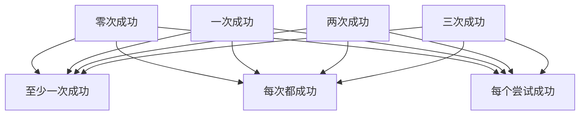

# 三次重跑怎样算出三种成绩

每道题跑三次，根据成功次数分成四组。
直接从计数推导至少一次通过、全部通过及每次尝试通过，不假定三次运行相互独立。
按成功次数分组无法反推出首次通过率。
业务有副作用时每次试验应独立还原夹具。

## 先解决一个具体问题

**从三次成功两次，能推出首次通过吗？**

只能确定成功两次。
两个成功出现在前两次还是后两次，任务级择优指标相同，而首次体验不同。
应保留有序试验号、终态和初始状态。


先从具体的低档设定开始：零次成功取 1题、一次成功取 2题、两次成功取 1题、三次成功取 3题。
三个结果依次是至少一次成功 85.714%、每次都成功 42.857%、每个尝试成功 61.905%。
先手算这个起点，读完后再把另一个输入切到高档，这样能知道数字变化时究竟改变了哪个假设。

## 先写清输入边界和三个观测量

用 a 表示零次成功，取 1题 或 4题，这两点是用于隔离因果影响的教学输入。

用 b 表示一次成功，取 2题 或 6题，这两点是用于隔离因果影响的教学输入。

用 c 表示两次成功，取 1题 或 5题，这两点是用于隔离因果影响的教学输入。

用 d 表示三次成功，取 3题 或 8题，这两点是用于隔离因果影响的教学输入。

「至少一次成功」的计算式为 `100*(b+c+d)/(a+b+c+d)`，按业务量展开是 `100×(一次成功+两次成功+三次成功)/(零次成功+一次成功+两次成功+三次成功)`，输出单位为%。

「每次都成功」的计算式为 `100*d/(a+b+c+d)`，按业务量展开是 `100×三次成功/(零次成功+一次成功+两次成功+三次成功)`，输出单位为%。

「每个尝试成功」的计算式为 `100*(b+2*c+3*d)/(3*(a+b+c+d))`，按业务量展开是 `100×(一次成功+2×两次成功+3×三次成功)/(3×(零次成功+一次成功+两次成功+三次成功))`，输出单位为%。

公式中 ceil 与 floor 分别向上、向下取整，% 在表达式中作取余，** 为乘方，三元条件按“条件 ? 成立值 : 其他值”读取。展示数值最多保留三位小数，比较和反推采用未舍入值。



图上的箭头表示该输入出现在计算式中。同一输入通向多个指标时，三个读数可能共同移动。分支、取整或相互抵消又会使某些边在具体样本上没有可见增量。

## 从输入按单位逐步算到可比较的结果

<details>
<summary>展开推演与对应反例</summary>

### 样本 0000：零次成功 1、一次成功 2

这一组设定为零次成功为 1题、一次成功为 2题、两次成功为 1题、三次成功为 3题。

代入「至少一次成功」：`100*(2+1+3)/(1+2+1+3)`，得到 85.714%。

代入「每次都成功」：`100*3/(1+2+1+3)`，得到 42.857%。

代入「每个尝试成功」：`100*(2+2*1+3*3)/(3*(1+2+1+3))`，得到 61.905%。

以「每次都成功」作主读数时，本组单独切换三次成功的绝对变化最大或并列最大，读数会从 42.857% 变为 66.667%。

对角样本 1111 的主读数为 34.783%。它同时改了四项，差额不能充当任一单个因素的净收益。

### 样本 0001：零次成功 1、一次成功 2

这一组设定为零次成功为 1题、一次成功为 2题、两次成功为 1题、三次成功为 8题。

代入「至少一次成功」：`100*(2+1+8)/(1+2+1+8)`，得到 91.667%。

代入「每次都成功」：`100*8/(1+2+1+8)`，得到 66.667%。

代入「每个尝试成功」：`100*(2+2*1+3*8)/(3*(1+2+1+8))`，得到 77.778%。

以「每次都成功」作主读数时，本组单独切换三次成功的绝对变化最大或并列最大，读数会从 66.667% 变为 42.857%。

对角样本 1110 的主读数为 16.667%。它同时改了四项，差额不能充当任一单个因素的净收益。

### 样本 0010：零次成功 1、一次成功 2

这一组设定为零次成功为 1题、一次成功为 2题、两次成功为 5题、三次成功为 3题。

代入「至少一次成功」：`100*(2+5+3)/(1+2+5+3)`，得到 90.909%。

代入「每次都成功」：`100*3/(1+2+5+3)`，得到 27.273%。

代入「每个尝试成功」：`100*(2+2*5+3*3)/(3*(1+2+5+3))`，得到 63.636%。

以「每次都成功」作主读数时，本组单独切换三次成功的绝对变化最大或并列最大，读数会从 27.273% 变为 50%。

对角样本 1101 的主读数为 42.105%。它同时改了四项，差额不能充当任一单个因素的净收益。

### 样本 0011：零次成功 1、一次成功 2

这一组设定为零次成功为 1题、一次成功为 2题、两次成功为 5题、三次成功为 8题。

代入「至少一次成功」：`100*(2+5+8)/(1+2+5+8)`，得到 93.75%。

代入「每次都成功」：`100*8/(1+2+5+8)`，得到 50%。

代入「每个尝试成功」：`100*(2+2*5+3*8)/(3*(1+2+5+8))`，得到 75%。

以「每次都成功」作主读数时，本组单独切换三次成功的绝对变化最大或并列最大，读数会从 50% 变为 27.273%。

对角样本 1100 的主读数为 21.429%。它同时改了四项，差额不能充当任一单个因素的净收益。

### 样本 0100：零次成功 1、一次成功 6

这一组设定为零次成功为 1题、一次成功为 6题、两次成功为 1题、三次成功为 3题。

代入「至少一次成功」：`100*(6+1+3)/(1+6+1+3)`，得到 90.909%。

代入「每次都成功」：`100*3/(1+6+1+3)`，得到 27.273%。

代入「每个尝试成功」：`100*(6+2*1+3*3)/(3*(1+6+1+3))`，得到 51.515%。


对角样本 1011 的主读数为 42.105%。它同时改了四项，差额不能充当任一单个因素的净收益。

### 样本 0101：零次成功 1、一次成功 6

这一组设定为零次成功为 1题、一次成功为 6题、两次成功为 1题、三次成功为 8题。

代入「至少一次成功」：`100*(6+1+8)/(1+6+1+8)`，得到 93.75%。

代入「每次都成功」：`100*8/(1+6+1+8)`，得到 50%。

代入「每个尝试成功」：`100*(6+2*1+3*8)/(3*(1+6+1+8))`，得到 66.667%。


对角样本 1010 的主读数为 21.429%。它同时改了四项，差额不能充当任一单个因素的净收益。

### 样本 0110：零次成功 1、一次成功 6

这一组设定为零次成功为 1题、一次成功为 6题、两次成功为 5题、三次成功为 3题。

代入「至少一次成功」：`100*(6+5+3)/(1+6+5+3)`，得到 93.333%。

代入「每次都成功」：`100*3/(1+6+5+3)`，得到 20%。

代入「每个尝试成功」：`100*(6+2*5+3*3)/(3*(1+6+5+3))`，得到 55.556%。

以「每次都成功」作主读数时，本组单独切换三次成功的绝对变化最大或并列最大，读数会从 20% 变为 40%。

对角样本 1001 的主读数为 53.333%。它同时改了四项，差额不能充当任一单个因素的净收益。

### 样本 0111：零次成功 1、一次成功 6

这一组设定为零次成功为 1题、一次成功为 6题、两次成功为 5题、三次成功为 8题。

代入「至少一次成功」：`100*(6+5+8)/(1+6+5+8)`，得到 95%。

代入「每次都成功」：`100*8/(1+6+5+8)`，得到 40%。

代入「每个尝试成功」：`100*(6+2*5+3*8)/(3*(1+6+5+8))`，得到 66.667%。

以「每次都成功」作主读数时，本组单独切换三次成功的绝对变化最大或并列最大，读数会从 40% 变为 20%。

对角样本 1000 的主读数为 30%。它同时改了四项，差额不能充当任一单个因素的净收益。

### 样本 1000：零次成功 4、一次成功 2

这一组设定为零次成功为 4题、一次成功为 2题、两次成功为 1题、三次成功为 3题。

代入「至少一次成功」：`100*(2+1+3)/(4+2+1+3)`，得到 60%。

代入「每次都成功」：`100*3/(4+2+1+3)`，得到 30%。

代入「每个尝试成功」：`100*(2+2*1+3*3)/(3*(4+2+1+3))`，得到 43.333%。

以「每次都成功」作主读数时，本组单独切换三次成功的绝对变化最大或并列最大，读数会从 30% 变为 53.333%。

对角样本 0111 的主读数为 40%。它同时改了四项，差额不能充当任一单个因素的净收益。

### 样本 1001：零次成功 4、一次成功 2

这一组设定为零次成功为 4题、一次成功为 2题、两次成功为 1题、三次成功为 8题。

代入「至少一次成功」：`100*(2+1+8)/(4+2+1+8)`，得到 73.333%。

代入「每次都成功」：`100*8/(4+2+1+8)`，得到 53.333%。

代入「每个尝试成功」：`100*(2+2*1+3*8)/(3*(4+2+1+8))`，得到 62.222%。

以「每次都成功」作主读数时，本组单独切换三次成功的绝对变化最大或并列最大，读数会从 53.333% 变为 30%。

对角样本 0110 的主读数为 20%。它同时改了四项，差额不能充当任一单个因素的净收益。

### 样本 1010：零次成功 4、一次成功 2

这一组设定为零次成功为 4题、一次成功为 2题、两次成功为 5题、三次成功为 3题。

代入「至少一次成功」：`100*(2+5+3)/(4+2+5+3)`，得到 71.429%。

代入「每次都成功」：`100*3/(4+2+5+3)`，得到 21.429%。

代入「每个尝试成功」：`100*(2+2*5+3*3)/(3*(4+2+5+3))`，得到 50%。

以「每次都成功」作主读数时，本组单独切换三次成功的绝对变化最大或并列最大，读数会从 21.429% 变为 42.105%。

对角样本 0101 的主读数为 50%。它同时改了四项，差额不能充当任一单个因素的净收益。

### 样本 1011：零次成功 4、一次成功 2

这一组设定为零次成功为 4题、一次成功为 2题、两次成功为 5题、三次成功为 8题。

代入「至少一次成功」：`100*(2+5+8)/(4+2+5+8)`，得到 78.947%。

代入「每次都成功」：`100*8/(4+2+5+8)`，得到 42.105%。

代入「每个尝试成功」：`100*(2+2*5+3*8)/(3*(4+2+5+8))`，得到 63.158%。

以「每次都成功」作主读数时，本组单独切换三次成功的绝对变化最大或并列最大，读数会从 42.105% 变为 21.429%。

对角样本 0100 的主读数为 27.273%。它同时改了四项，差额不能充当任一单个因素的净收益。

### 样本 1100：零次成功 4、一次成功 6

这一组设定为零次成功为 4题、一次成功为 6题、两次成功为 1题、三次成功为 3题。

代入「至少一次成功」：`100*(6+1+3)/(4+6+1+3)`，得到 71.429%。

代入「每次都成功」：`100*3/(4+6+1+3)`，得到 21.429%。

代入「每个尝试成功」：`100*(6+2*1+3*3)/(3*(4+6+1+3))`，得到 40.476%。


对角样本 0011 的主读数为 50%。它同时改了四项，差额不能充当任一单个因素的净收益。

### 样本 1101：零次成功 4、一次成功 6

这一组设定为零次成功为 4题、一次成功为 6题、两次成功为 1题、三次成功为 8题。

代入「至少一次成功」：`100*(6+1+8)/(4+6+1+8)`，得到 78.947%。

代入「每次都成功」：`100*8/(4+6+1+8)`，得到 42.105%。

代入「每个尝试成功」：`100*(6+2*1+3*8)/(3*(4+6+1+8))`，得到 56.14%。


对角样本 0010 的主读数为 27.273%。它同时改了四项，差额不能充当任一单个因素的净收益。

### 样本 1110：零次成功 4、一次成功 6

这一组设定为零次成功为 4题、一次成功为 6题、两次成功为 5题、三次成功为 3题。

代入「至少一次成功」：`100*(6+5+3)/(4+6+5+3)`，得到 77.778%。

代入「每次都成功」：`100*3/(4+6+5+3)`，得到 16.667%。

代入「每个尝试成功」：`100*(6+2*5+3*3)/(3*(4+6+5+3))`，得到 46.296%。

以「每次都成功」作主读数时，本组单独切换三次成功的绝对变化最大或并列最大，读数会从 16.667% 变为 34.783%。

对角样本 0001 的主读数为 66.667%。它同时改了四项，差额不能充当任一单个因素的净收益。

### 样本 1111：零次成功 4、一次成功 6

这一组设定为零次成功为 4题、一次成功为 6题、两次成功为 5题、三次成功为 8题。

代入「至少一次成功」：`100*(6+5+8)/(4+6+5+8)`，得到 82.609%。

代入「每次都成功」：`100*8/(4+6+5+8)`，得到 34.783%。

代入「每个尝试成功」：`100*(6+2*5+3*8)/(3*(4+6+5+8))`，得到 57.971%。

以「每次都成功」作主读数时，本组单独切换三次成功的绝对变化最大或并列最大，读数会从 34.783% 变为 16.667%。

对角样本 0000 的主读数为 42.857%。它同时改了四项，差额不能充当任一单个因素的净收益。

</details>

## 逐个干预：其余条件固定时，变化真的发生在哪里

<details>
<summary>展开推演与对应反例</summary>

### 只改变零次成功

固定一次成功为 2题、两次成功为 1题、三次成功为 3题，只把零次成功从 1题改到 4题。
这一对的至少一次成功从 85.714% 变为 60%，每次都成功的差为 -12.857%，每个尝试成功的差为 -18.571%。

固定一次成功为 2题、两次成功为 1题、三次成功为 8题，只把零次成功从 1题改到 4题。
这一对的至少一次成功从 91.667% 变为 73.333%，每次都成功的差为 -13.333%，每个尝试成功的差为 -15.556%。

固定一次成功为 2题、两次成功为 5题、三次成功为 3题，只把零次成功从 1题改到 4题。
这一对的至少一次成功从 90.909% 变为 71.429%，每次都成功的差为 -5.844%，每个尝试成功的差为 -13.636%。

固定一次成功为 2题、两次成功为 5题、三次成功为 8题，只把零次成功从 1题改到 4题。
这一对的至少一次成功从 93.75% 变为 78.947%，每次都成功的差为 -7.895%，每个尝试成功的差为 -11.842%。

固定一次成功为 6题、两次成功为 1题、三次成功为 3题，只把零次成功从 1题改到 4题。
这一对的至少一次成功从 90.909% 变为 71.429%，每次都成功的差为 -5.844%，每个尝试成功的差为 -11.039%。

固定一次成功为 6题、两次成功为 1题、三次成功为 8题，只把零次成功从 1题改到 4题。
这一对的至少一次成功从 93.75% 变为 78.947%，每次都成功的差为 -7.895%，每个尝试成功的差为 -10.526%。

固定一次成功为 6题、两次成功为 5题、三次成功为 3题，只把零次成功从 1题改到 4题。
这一对的至少一次成功从 93.333% 变为 77.778%，每次都成功的差为 -3.333%，每个尝试成功的差为 -9.259%。

固定一次成功为 6题、两次成功为 5题、三次成功为 8题，只把零次成功从 1题改到 4题。
这一对的至少一次成功从 95% 变为 82.609%，每次都成功的差为 -5.217%，每个尝试成功的差为 -8.696%。

综合八组受控背景，零次成功升到较高设定时「至少一次成功」的差值区间是 -25.714% 至 -12.391%，共有 8 对出现可观察变化。

综合八组受控背景，零次成功升到较高设定时「每次都成功」的差值区间是 -13.333% 至 -3.333%，共有 8 对出现可观察变化。

综合八组受控背景，零次成功升到较高设定时「每个尝试成功」的差值区间是 -18.571% 至 -8.696%，共有 8 对出现可观察变化。

### 只改变一次成功

固定零次成功为 1题、两次成功为 1题、三次成功为 3题，只把一次成功从 2题改到 6题。
这一对的至少一次成功从 85.714% 变为 90.909%，每次都成功的差为 -15.584%，每个尝试成功的差为 -10.39%。

固定零次成功为 1题、两次成功为 1题、三次成功为 8题，只把一次成功从 2题改到 6题。
这一对的至少一次成功从 91.667% 变为 93.75%，每次都成功的差为 -16.667%，每个尝试成功的差为 -11.111%。

固定零次成功为 1题、两次成功为 5题、三次成功为 3题，只把一次成功从 2题改到 6题。
这一对的至少一次成功从 90.909% 变为 93.333%，每次都成功的差为 -7.273%，每个尝试成功的差为 -8.081%。

固定零次成功为 1题、两次成功为 5题、三次成功为 8题，只把一次成功从 2题改到 6题。
这一对的至少一次成功从 93.75% 变为 95%，每次都成功的差为 -10%，每个尝试成功的差为 -8.333%。

固定零次成功为 4题、两次成功为 1题、三次成功为 3题，只把一次成功从 2题改到 6题。
这一对的至少一次成功从 60% 变为 71.429%，每次都成功的差为 -8.571%，每个尝试成功的差为 -2.857%。

固定零次成功为 4题、两次成功为 1题、三次成功为 8题，只把一次成功从 2题改到 6题。
这一对的至少一次成功从 73.333% 变为 78.947%，每次都成功的差为 -11.228%，每个尝试成功的差为 -6.082%。

固定零次成功为 4题、两次成功为 5题、三次成功为 3题，只把一次成功从 2题改到 6题。
这一对的至少一次成功从 71.429% 变为 77.778%，每次都成功的差为 -4.762%，每个尝试成功的差为 -3.704%。

固定零次成功为 4题、两次成功为 5题、三次成功为 8题，只把一次成功从 2题改到 6题。
这一对的至少一次成功从 78.947% 变为 82.609%，每次都成功的差为 -7.323%，每个尝试成功的差为 -5.187%。

综合八组受控背景，一次成功升到较高设定时「至少一次成功」的差值区间是 1.25% 至 11.429%，共有 8 对出现可观察变化。

综合八组受控背景，一次成功升到较高设定时「每次都成功」的差值区间是 -16.667% 至 -4.762%，共有 8 对出现可观察变化。

综合八组受控背景，一次成功升到较高设定时「每个尝试成功」的差值区间是 -11.111% 至 -2.857%，共有 8 对出现可观察变化。

### 只改变两次成功

固定零次成功为 1题、一次成功为 2题、三次成功为 3题，只把两次成功从 1题改到 5题。
这一对的至少一次成功从 85.714% 变为 90.909%，每次都成功的差为 -15.584%，每个尝试成功的差为 1.732%。

固定零次成功为 1题、一次成功为 2题、三次成功为 8题，只把两次成功从 1题改到 5题。
这一对的至少一次成功从 91.667% 变为 93.75%，每次都成功的差为 -16.667%，每个尝试成功的差为 -2.778%。

固定零次成功为 1题、一次成功为 6题、三次成功为 3题，只把两次成功从 1题改到 5题。
这一对的至少一次成功从 90.909% 变为 93.333%，每次都成功的差为 -7.273%，每个尝试成功的差为 4.04%。

固定零次成功为 1题、一次成功为 6题、三次成功为 8题，只把两次成功从 1题改到 5题。
这一对的至少一次成功从 93.75% 变为 95%，每次都成功的差为 -10%，每个尝试成功的差为 0%。

固定零次成功为 4题、一次成功为 2题、三次成功为 3题，只把两次成功从 1题改到 5题。
这一对的至少一次成功从 60% 变为 71.429%，每次都成功的差为 -8.571%，每个尝试成功的差为 6.667%。

固定零次成功为 4题、一次成功为 2题、三次成功为 8题，只把两次成功从 1题改到 5题。
这一对的至少一次成功从 73.333% 变为 78.947%，每次都成功的差为 -11.228%，每个尝试成功的差为 0.936%。

固定零次成功为 4题、一次成功为 6题、三次成功为 3题，只把两次成功从 1题改到 5题。
这一对的至少一次成功从 71.429% 变为 77.778%，每次都成功的差为 -4.762%，每个尝试成功的差为 5.82%。

固定零次成功为 4题、一次成功为 6题、三次成功为 8题，只把两次成功从 1题改到 5题。
这一对的至少一次成功从 78.947% 变为 82.609%，每次都成功的差为 -7.323%，每个尝试成功的差为 1.831%。

综合八组受控背景，两次成功升到较高设定时「至少一次成功」的差值区间是 1.25% 至 11.429%，共有 8 对出现可观察变化。

综合八组受控背景，两次成功升到较高设定时「每次都成功」的差值区间是 -16.667% 至 -4.762%，共有 8 对出现可观察变化。

综合八组受控背景，两次成功升到较高设定时「每个尝试成功」的差值区间是 -2.778% 至 6.667%，共有 7 对出现可观察变化。

### 只改变三次成功

固定零次成功为 1题、一次成功为 2题、两次成功为 1题，只把三次成功从 3题改到 8题。
这一对的至少一次成功从 85.714% 变为 91.667%，每次都成功的差为 23.81%，每个尝试成功的差为 15.873%。

固定零次成功为 1题、一次成功为 2题、两次成功为 5题，只把三次成功从 3题改到 8题。
这一对的至少一次成功从 90.909% 变为 93.75%，每次都成功的差为 22.727%，每个尝试成功的差为 11.364%。

固定零次成功为 1题、一次成功为 6题、两次成功为 1题，只把三次成功从 3题改到 8题。
这一对的至少一次成功从 90.909% 变为 93.75%，每次都成功的差为 22.727%，每个尝试成功的差为 15.152%。

固定零次成功为 1题、一次成功为 6题、两次成功为 5题，只把三次成功从 3题改到 8题。
这一对的至少一次成功从 93.333% 变为 95%，每次都成功的差为 20%，每个尝试成功的差为 11.111%。

固定零次成功为 4题、一次成功为 2题、两次成功为 1题，只把三次成功从 3题改到 8题。
这一对的至少一次成功从 60% 变为 73.333%，每次都成功的差为 23.333%，每个尝试成功的差为 18.889%。

固定零次成功为 4题、一次成功为 2题、两次成功为 5题，只把三次成功从 3题改到 8题。
这一对的至少一次成功从 71.429% 变为 78.947%，每次都成功的差为 20.677%，每个尝试成功的差为 13.158%。

固定零次成功为 4题、一次成功为 6题、两次成功为 1题，只把三次成功从 3题改到 8题。
这一对的至少一次成功从 71.429% 变为 78.947%，每次都成功的差为 20.677%，每个尝试成功的差为 15.664%。

固定零次成功为 4题、一次成功为 6题、两次成功为 5题，只把三次成功从 3题改到 8题。
这一对的至少一次成功从 77.778% 变为 82.609%，每次都成功的差为 18.116%，每个尝试成功的差为 11.675%。

综合八组受控背景，三次成功升到较高设定时「至少一次成功」的差值区间是 1.667% 至 13.333%，共有 8 对出现可观察变化。

综合八组受控背景，三次成功升到较高设定时「每次都成功」的差值区间是 18.116% 至 23.81%，共有 8 对出现可观察变化。

综合八组受控背景，三次成功升到较高设定时「每个尝试成功」的差值区间是 11.111% 至 18.889%，共有 8 对出现可观察变化。

</details>

## 只拿到部分输入，结论还能缩小到多大范围

<details>
<summary>展开推演与对应反例</summary>

### 已知零次成功和一次成功

当零次成功为 1题、一次成功为 2题时，另两项有四种补全，主读数「每次都成功」只能限定为 27.273% 至 66.667%。
这个条件下，取两次成功为 5题、三次成功为 3题可得到下界 27.273%，取两次成功为 1题、三次成功为 8题可达到上界 66.667%。

用同样可见的零次成功为 1题、一次成功为 2题去推「至少一次成功」，能得到的范围为 85.714% 至 93.75%，不能把另一个指标的单位代入。

用同样可见的零次成功为 1题、一次成功为 2题去推「每个尝试成功」，能得到的范围为 61.905% 至 77.778%，不能把另一个指标的单位代入。

若只许再问一项，按最坏区间宽度优先核对三次成功，补得低档时为 27.273% 至 42.857%，高档时为 50% 至 66.667%。

当零次成功为 1题、一次成功为 6题时，另两项有四种补全，主读数「每次都成功」只能限定为 20% 至 50%。
这个条件下，取两次成功为 5题、三次成功为 3题可得到下界 20%，取两次成功为 1题、三次成功为 8题可达到上界 50%。

用同样可见的零次成功为 1题、一次成功为 6题去推「至少一次成功」，能得到的范围为 90.909% 至 95%，不能把另一个指标的单位代入。

用同样可见的零次成功为 1题、一次成功为 6题去推「每个尝试成功」，能得到的范围为 51.515% 至 66.667%，不能把另一个指标的单位代入。

若只许再问一项，按最坏区间宽度优先核对三次成功，补得低档时为 20% 至 27.273%，高档时为 40% 至 50%。

当零次成功为 4题、一次成功为 2题时，另两项有四种补全，主读数「每次都成功」只能限定为 21.429% 至 53.333%。
这个条件下，取两次成功为 5题、三次成功为 3题可得到下界 21.429%，取两次成功为 1题、三次成功为 8题可达到上界 53.333%。

用同样可见的零次成功为 4题、一次成功为 2题去推「至少一次成功」，能得到的范围为 60% 至 78.947%，不能把另一个指标的单位代入。

用同样可见的零次成功为 4题、一次成功为 2题去推「每个尝试成功」，能得到的范围为 43.333% 至 63.158%，不能把另一个指标的单位代入。

若只许再问一项，按最坏区间宽度优先核对三次成功，补得低档时为 21.429% 至 30%，高档时为 42.105% 至 53.333%。

当零次成功为 4题、一次成功为 6题时，另两项有四种补全，主读数「每次都成功」只能限定为 16.667% 至 42.105%。
这个条件下，取两次成功为 5题、三次成功为 3题可得到下界 16.667%，取两次成功为 1题、三次成功为 8题可达到上界 42.105%。

用同样可见的零次成功为 4题、一次成功为 6题去推「至少一次成功」，能得到的范围为 71.429% 至 82.609%，不能把另一个指标的单位代入。

用同样可见的零次成功为 4题、一次成功为 6题去推「每个尝试成功」，能得到的范围为 40.476% 至 57.971%，不能把另一个指标的单位代入。

若只许再问一项，按最坏区间宽度优先核对三次成功，补得低档时为 16.667% 至 21.429%，高档时为 34.783% 至 42.105%。

### 已知零次成功和两次成功

当零次成功为 1题、两次成功为 1题时，另两项有四种补全，主读数「每次都成功」只能限定为 27.273% 至 66.667%。
这个条件下，取一次成功为 6题、三次成功为 3题可得到下界 27.273%，取一次成功为 2题、三次成功为 8题可达到上界 66.667%。

用同样可见的零次成功为 1题、两次成功为 1题去推「至少一次成功」，能得到的范围为 85.714% 至 93.75%，不能把另一个指标的单位代入。

用同样可见的零次成功为 1题、两次成功为 1题去推「每个尝试成功」，能得到的范围为 51.515% 至 77.778%，不能把另一个指标的单位代入。


当零次成功为 1题、两次成功为 5题时，另两项有四种补全，主读数「每次都成功」只能限定为 20% 至 50%。
这个条件下，取一次成功为 6题、三次成功为 3题可得到下界 20%，取一次成功为 2题、三次成功为 8题可达到上界 50%。

用同样可见的零次成功为 1题、两次成功为 5题去推「至少一次成功」，能得到的范围为 90.909% 至 95%，不能把另一个指标的单位代入。

用同样可见的零次成功为 1题、两次成功为 5题去推「每个尝试成功」，能得到的范围为 55.556% 至 75%，不能把另一个指标的单位代入。


当零次成功为 4题、两次成功为 1题时，另两项有四种补全，主读数「每次都成功」只能限定为 21.429% 至 53.333%。
这个条件下，取一次成功为 6题、三次成功为 3题可得到下界 21.429%，取一次成功为 2题、三次成功为 8题可达到上界 53.333%。

用同样可见的零次成功为 4题、两次成功为 1题去推「至少一次成功」，能得到的范围为 60% 至 78.947%，不能把另一个指标的单位代入。

用同样可见的零次成功为 4题、两次成功为 1题去推「每个尝试成功」，能得到的范围为 40.476% 至 62.222%，不能把另一个指标的单位代入。


当零次成功为 4题、两次成功为 5题时，另两项有四种补全，主读数「每次都成功」只能限定为 16.667% 至 42.105%。
这个条件下，取一次成功为 6题、三次成功为 3题可得到下界 16.667%，取一次成功为 2题、三次成功为 8题可达到上界 42.105%。

用同样可见的零次成功为 4题、两次成功为 5题去推「至少一次成功」，能得到的范围为 71.429% 至 82.609%，不能把另一个指标的单位代入。

用同样可见的零次成功为 4题、两次成功为 5题去推「每个尝试成功」，能得到的范围为 46.296% 至 63.158%，不能把另一个指标的单位代入。


### 已知一次成功和两次成功

当一次成功为 2题、两次成功为 1题时，另两项有四种补全，主读数「每次都成功」只能限定为 30% 至 66.667%。
这个条件下，取零次成功为 4题、三次成功为 3题可得到下界 30%，取零次成功为 1题、三次成功为 8题可达到上界 66.667%。

用同样可见的一次成功为 2题、两次成功为 1题去推「至少一次成功」，能得到的范围为 60% 至 91.667%，不能把另一个指标的单位代入。

用同样可见的一次成功为 2题、两次成功为 1题去推「每个尝试成功」，能得到的范围为 43.333% 至 77.778%，不能把另一个指标的单位代入。

若只许再问一项，按最坏区间宽度优先核对三次成功，补得低档时为 30% 至 42.857%，高档时为 53.333% 至 66.667%。

当一次成功为 2题、两次成功为 5题时，另两项有四种补全，主读数「每次都成功」只能限定为 21.429% 至 50%。
这个条件下，取零次成功为 4题、三次成功为 3题可得到下界 21.429%，取零次成功为 1题、三次成功为 8题可达到上界 50%。

用同样可见的一次成功为 2题、两次成功为 5题去推「至少一次成功」，能得到的范围为 71.429% 至 93.75%，不能把另一个指标的单位代入。

用同样可见的一次成功为 2题、两次成功为 5题去推「每个尝试成功」，能得到的范围为 50% 至 75%，不能把另一个指标的单位代入。

若只许再问一项，按最坏区间宽度优先核对三次成功，补得低档时为 21.429% 至 27.273%，高档时为 42.105% 至 50%。

当一次成功为 6题、两次成功为 1题时，另两项有四种补全，主读数「每次都成功」只能限定为 21.429% 至 50%。

用同样可见的一次成功为 6题、两次成功为 1题去推「至少一次成功」，能得到的范围为 71.429% 至 93.75%，不能把另一个指标的单位代入。

用同样可见的一次成功为 6题、两次成功为 1题去推「每个尝试成功」，能得到的范围为 40.476% 至 66.667%，不能把另一个指标的单位代入。


当一次成功为 6题、两次成功为 5题时，另两项有四种补全，主读数「每次都成功」只能限定为 16.667% 至 40%。
这个条件下，取零次成功为 4题、三次成功为 3题可得到下界 16.667%，取零次成功为 1题、三次成功为 8题可达到上界 40%。

用同样可见的一次成功为 6题、两次成功为 5题去推「至少一次成功」，能得到的范围为 77.778% 至 95%，不能把另一个指标的单位代入。

用同样可见的一次成功为 6题、两次成功为 5题去推「每个尝试成功」，能得到的范围为 46.296% 至 66.667%，不能把另一个指标的单位代入。

若只许再问一项，按最坏区间宽度优先核对三次成功，补得低档时为 16.667% 至 20%，高档时为 34.783% 至 40%。

### 已知零次成功和三次成功

当零次成功为 1题、三次成功为 3题时，另两项有四种补全，主读数「每次都成功」只能限定为 20% 至 42.857%。
这个条件下，取一次成功为 6题、两次成功为 5题可得到下界 20%，取一次成功为 2题、两次成功为 1题可达到上界 42.857%。

用同样可见的零次成功为 1题、三次成功为 3题去推「至少一次成功」，能得到的范围为 85.714% 至 93.333%，不能把另一个指标的单位代入。

用同样可见的零次成功为 1题、三次成功为 3题去推「每个尝试成功」，能得到的范围为 51.515% 至 63.636%，不能把另一个指标的单位代入。

若只许再问一项，按最坏区间宽度优先核对一次成功，补得低档时为 27.273% 至 42.857%，高档时为 20% 至 27.273%。

当零次成功为 1题、三次成功为 8题时，另两项有四种补全，主读数「每次都成功」只能限定为 40% 至 66.667%。
这个条件下，取一次成功为 6题、两次成功为 5题可得到下界 40%，取一次成功为 2题、两次成功为 1题可达到上界 66.667%。

用同样可见的零次成功为 1题、三次成功为 8题去推「至少一次成功」，能得到的范围为 91.667% 至 95%，不能把另一个指标的单位代入。

用同样可见的零次成功为 1题、三次成功为 8题去推「每个尝试成功」，能得到的范围为 66.667% 至 77.778%，不能把另一个指标的单位代入。

若只许再问一项，按最坏区间宽度优先核对一次成功，补得低档时为 50% 至 66.667%，高档时为 40% 至 50%。

当零次成功为 4题、三次成功为 3题时，另两项有四种补全，主读数「每次都成功」只能限定为 16.667% 至 30%。
这个条件下，取一次成功为 6题、两次成功为 5题可得到下界 16.667%，取一次成功为 2题、两次成功为 1题可达到上界 30%。

用同样可见的零次成功为 4题、三次成功为 3题去推「至少一次成功」，能得到的范围为 60% 至 77.778%，不能把另一个指标的单位代入。

用同样可见的零次成功为 4题、三次成功为 3题去推「每个尝试成功」，能得到的范围为 40.476% 至 50%，不能把另一个指标的单位代入。

若只许再问一项，按最坏区间宽度优先核对一次成功，补得低档时为 21.429% 至 30%，高档时为 16.667% 至 21.429%。

当零次成功为 4题、三次成功为 8题时，另两项有四种补全，主读数「每次都成功」只能限定为 34.783% 至 53.333%。
这个条件下，取一次成功为 6题、两次成功为 5题可得到下界 34.783%，取一次成功为 2题、两次成功为 1题可达到上界 53.333%。

用同样可见的零次成功为 4题、三次成功为 8题去推「至少一次成功」，能得到的范围为 73.333% 至 82.609%，不能把另一个指标的单位代入。

用同样可见的零次成功为 4题、三次成功为 8题去推「每个尝试成功」，能得到的范围为 56.14% 至 63.158%，不能把另一个指标的单位代入。

若只许再问一项，按最坏区间宽度优先核对一次成功，补得低档时为 42.105% 至 53.333%，高档时为 34.783% 至 42.105%。

### 已知一次成功和三次成功

当一次成功为 2题、三次成功为 3题时，另两项有四种补全，主读数「每次都成功」只能限定为 21.429% 至 42.857%。
这个条件下，取零次成功为 4题、两次成功为 5题可得到下界 21.429%，取零次成功为 1题、两次成功为 1题可达到上界 42.857%。

用同样可见的一次成功为 2题、三次成功为 3题去推「至少一次成功」，能得到的范围为 60% 至 90.909%，不能把另一个指标的单位代入。

用同样可见的一次成功为 2题、三次成功为 3题去推「每个尝试成功」，能得到的范围为 43.333% 至 63.636%，不能把另一个指标的单位代入。

若只许再问一项，按最坏区间宽度优先核对两次成功，补得低档时为 30% 至 42.857%，高档时为 21.429% 至 27.273%。

当一次成功为 2题、三次成功为 8题时，另两项有四种补全，主读数「每次都成功」只能限定为 42.105% 至 66.667%。
这个条件下，取零次成功为 4题、两次成功为 5题可得到下界 42.105%，取零次成功为 1题、两次成功为 1题可达到上界 66.667%。

用同样可见的一次成功为 2题、三次成功为 8题去推「至少一次成功」，能得到的范围为 73.333% 至 93.75%，不能把另一个指标的单位代入。

用同样可见的一次成功为 2题、三次成功为 8题去推「每个尝试成功」，能得到的范围为 62.222% 至 77.778%，不能把另一个指标的单位代入。

若只许再问一项，按最坏区间宽度优先核对两次成功，补得低档时为 53.333% 至 66.667%，高档时为 42.105% 至 50%。

当一次成功为 6题、三次成功为 3题时，另两项有四种补全，主读数「每次都成功」只能限定为 16.667% 至 27.273%。
这个条件下，取零次成功为 4题、两次成功为 5题可得到下界 16.667%，取零次成功为 1题、两次成功为 1题可达到上界 27.273%。

用同样可见的一次成功为 6题、三次成功为 3题去推「至少一次成功」，能得到的范围为 71.429% 至 93.333%，不能把另一个指标的单位代入。

用同样可见的一次成功为 6题、三次成功为 3题去推「每个尝试成功」，能得到的范围为 40.476% 至 55.556%，不能把另一个指标的单位代入。

若只许再问一项，按最坏区间宽度优先核对两次成功，补得低档时为 21.429% 至 27.273%，高档时为 16.667% 至 20%。

当一次成功为 6题、三次成功为 8题时，另两项有四种补全，主读数「每次都成功」只能限定为 34.783% 至 50%。
这个条件下，取零次成功为 4题、两次成功为 5题可得到下界 34.783%，取零次成功为 1题、两次成功为 1题可达到上界 50%。

用同样可见的一次成功为 6题、三次成功为 8题去推「至少一次成功」，能得到的范围为 78.947% 至 95%，不能把另一个指标的单位代入。

用同样可见的一次成功为 6题、三次成功为 8题去推「每个尝试成功」，能得到的范围为 56.14% 至 66.667%，不能把另一个指标的单位代入。

若只许再问一项，按最坏区间宽度优先核对两次成功，补得低档时为 42.105% 至 50%，高档时为 34.783% 至 40%。

### 已知两次成功和三次成功

当两次成功为 1题、三次成功为 3题时，另两项有四种补全，主读数「每次都成功」只能限定为 21.429% 至 42.857%。
这个条件下，取零次成功为 4题、一次成功为 6题可得到下界 21.429%，取零次成功为 1题、一次成功为 2题可达到上界 42.857%。

用同样可见的两次成功为 1题、三次成功为 3题去推「至少一次成功」，能得到的范围为 60% 至 90.909%，不能把另一个指标的单位代入。

用同样可见的两次成功为 1题、三次成功为 3题去推「每个尝试成功」，能得到的范围为 40.476% 至 61.905%，不能把另一个指标的单位代入。

若只许再问一项，按最坏区间宽度优先核对一次成功，补得低档时为 30% 至 42.857%，高档时为 21.429% 至 27.273%。

当两次成功为 1题、三次成功为 8题时，另两项有四种补全，主读数「每次都成功」只能限定为 42.105% 至 66.667%。
这个条件下，取零次成功为 4题、一次成功为 6题可得到下界 42.105%，取零次成功为 1题、一次成功为 2题可达到上界 66.667%。

用同样可见的两次成功为 1题、三次成功为 8题去推「至少一次成功」，能得到的范围为 73.333% 至 93.75%，不能把另一个指标的单位代入。

用同样可见的两次成功为 1题、三次成功为 8题去推「每个尝试成功」，能得到的范围为 56.14% 至 77.778%，不能把另一个指标的单位代入。

若只许再问一项，按最坏区间宽度优先核对一次成功，补得低档时为 53.333% 至 66.667%，高档时为 42.105% 至 50%。

当两次成功为 5题、三次成功为 3题时，另两项有四种补全，主读数「每次都成功」只能限定为 16.667% 至 27.273%。
这个条件下，取零次成功为 4题、一次成功为 6题可得到下界 16.667%，取零次成功为 1题、一次成功为 2题可达到上界 27.273%。

用同样可见的两次成功为 5题、三次成功为 3题去推「至少一次成功」，能得到的范围为 71.429% 至 93.333%，不能把另一个指标的单位代入。

用同样可见的两次成功为 5题、三次成功为 3题去推「每个尝试成功」，能得到的范围为 46.296% 至 63.636%，不能把另一个指标的单位代入。

若只许再问一项，按最坏区间宽度优先核对一次成功，补得低档时为 21.429% 至 27.273%，高档时为 16.667% 至 20%。

当两次成功为 5题、三次成功为 8题时，另两项有四种补全，主读数「每次都成功」只能限定为 34.783% 至 50%。
这个条件下，取零次成功为 4题、一次成功为 6题可得到下界 34.783%，取零次成功为 1题、一次成功为 2题可达到上界 50%。

用同样可见的两次成功为 5题、三次成功为 8题去推「至少一次成功」，能得到的范围为 78.947% 至 95%，不能把另一个指标的单位代入。

用同样可见的两次成功为 5题、三次成功为 8题去推「每个尝试成功」，能得到的范围为 57.971% 至 75%，不能把另一个指标的单位代入。

若只许再问一项，按最坏区间宽度优先核对一次成功，补得低档时为 42.105% 至 50%，高档时为 34.783% 至 40%。

</details>

## 反过来审查一份报表：能从结果还原哪些输入

<details>
<summary>展开推演与对应反例</summary>

### 仅保留“至少一次成功”的读数

报表只写「至少一次成功=85.714%」时，在本实验的离散取值中有 1 组输入与之相容。

对这个 85.714% 的「至少一次成功」读数，所有相容样本都要求零次成功为 1题、一次成功为 2题、两次成功为 1题、三次成功为 3题。

报表只写「至少一次成功=91.667%」时，在本实验的离散取值中有 1 组输入与之相容。

对这个 91.667% 的「至少一次成功」读数，所有相容样本都要求零次成功为 1题、一次成功为 2题、两次成功为 1题、三次成功为 8题。

报表只写「至少一次成功=90.909%」时，在本实验的离散取值中有 2 组输入与之相容。

对这个 90.909% 的「至少一次成功」读数，所有相容样本都要求零次成功为 1题、三次成功为 3题。

只凭「至少一次成功」的 90.909% 无法确定一次成功：0010 与 0100 的取值分别为 2 和 6题。

报表只写「至少一次成功=93.75%」时，在本实验的离散取值中有 2 组输入与之相容。

对这个 93.75% 的「至少一次成功」读数，所有相容样本都要求零次成功为 1题、三次成功为 8题。

只凭「至少一次成功」的 93.75% 无法确定一次成功：0011 与 0101 的取值分别为 2 和 6题。

报表只写「至少一次成功=93.333%」时，在本实验的离散取值中有 1 组输入与之相容。

对这个 93.333% 的「至少一次成功」读数，所有相容样本都要求零次成功为 1题、一次成功为 6题、两次成功为 5题、三次成功为 3题。

报表只写「至少一次成功=95%」时，在本实验的离散取值中有 1 组输入与之相容。

对这个 95% 的「至少一次成功」读数，所有相容样本都要求零次成功为 1题、一次成功为 6题、两次成功为 5题、三次成功为 8题。

报表只写「至少一次成功=60%」时，在本实验的离散取值中有 1 组输入与之相容。

对这个 60% 的「至少一次成功」读数，所有相容样本都要求零次成功为 4题、一次成功为 2题、两次成功为 1题、三次成功为 3题。

报表只写「至少一次成功=73.333%」时，在本实验的离散取值中有 1 组输入与之相容。

对这个 73.333% 的「至少一次成功」读数，所有相容样本都要求零次成功为 4题、一次成功为 2题、两次成功为 1题、三次成功为 8题。

报表只写「至少一次成功=71.429%」时，在本实验的离散取值中有 2 组输入与之相容。

对这个 71.429% 的「至少一次成功」读数，所有相容样本都要求零次成功为 4题、三次成功为 3题。

只凭「至少一次成功」的 71.429% 无法确定一次成功：1010 与 1100 的取值分别为 2 和 6题。

报表只写「至少一次成功=78.947%」时，在本实验的离散取值中有 2 组输入与之相容。

对这个 78.947% 的「至少一次成功」读数，所有相容样本都要求零次成功为 4题、三次成功为 8题。

只凭「至少一次成功」的 78.947% 无法确定一次成功：1011 与 1101 的取值分别为 2 和 6题。

报表只写「至少一次成功=77.778%」时，在本实验的离散取值中有 1 组输入与之相容。

对这个 77.778% 的「至少一次成功」读数，所有相容样本都要求零次成功为 4题、一次成功为 6题、两次成功为 5题、三次成功为 3题。

报表只写「至少一次成功=82.609%」时，在本实验的离散取值中有 1 组输入与之相容。

对这个 82.609% 的「至少一次成功」读数，所有相容样本都要求零次成功为 4题、一次成功为 6题、两次成功为 5题、三次成功为 8题。

### 仅保留“每次都成功”的读数

报表只写「每次都成功=42.857%」时，在本实验的离散取值中有 1 组输入与之相容。

对这个 42.857% 的「每次都成功」读数，所有相容样本都要求零次成功为 1题、一次成功为 2题、两次成功为 1题、三次成功为 3题。

报表只写「每次都成功=66.667%」时，在本实验的离散取值中有 1 组输入与之相容。

对这个 66.667% 的「每次都成功」读数，所有相容样本都要求零次成功为 1题、一次成功为 2题、两次成功为 1题、三次成功为 8题。

报表只写「每次都成功=27.273%」时，在本实验的离散取值中有 2 组输入与之相容。

对这个 27.273% 的「每次都成功」读数，所有相容样本都要求零次成功为 1题、三次成功为 3题。

只凭「每次都成功」的 27.273% 无法确定一次成功：0010 与 0100 的取值分别为 2 和 6题。

报表只写「每次都成功=50%」时，在本实验的离散取值中有 2 组输入与之相容。

对这个 50% 的「每次都成功」读数，所有相容样本都要求零次成功为 1题、三次成功为 8题。

只凭「每次都成功」的 50% 无法确定一次成功：0011 与 0101 的取值分别为 2 和 6题。

报表只写「每次都成功=20%」时，在本实验的离散取值中有 1 组输入与之相容。

对这个 20% 的「每次都成功」读数，所有相容样本都要求零次成功为 1题、一次成功为 6题、两次成功为 5题、三次成功为 3题。

报表只写「每次都成功=40%」时，在本实验的离散取值中有 1 组输入与之相容。

对这个 40% 的「每次都成功」读数，所有相容样本都要求零次成功为 1题、一次成功为 6题、两次成功为 5题、三次成功为 8题。

报表只写「每次都成功=30%」时，在本实验的离散取值中有 1 组输入与之相容。

对这个 30% 的「每次都成功」读数，所有相容样本都要求零次成功为 4题、一次成功为 2题、两次成功为 1题、三次成功为 3题。

报表只写「每次都成功=53.333%」时，在本实验的离散取值中有 1 组输入与之相容。

对这个 53.333% 的「每次都成功」读数，所有相容样本都要求零次成功为 4题、一次成功为 2题、两次成功为 1题、三次成功为 8题。

报表只写「每次都成功=21.429%」时，在本实验的离散取值中有 2 组输入与之相容。

对这个 21.429% 的「每次都成功」读数，所有相容样本都要求零次成功为 4题、三次成功为 3题。

只凭「每次都成功」的 21.429% 无法确定一次成功：1010 与 1100 的取值分别为 2 和 6题。

报表只写「每次都成功=42.105%」时，在本实验的离散取值中有 2 组输入与之相容。

对这个 42.105% 的「每次都成功」读数，所有相容样本都要求零次成功为 4题、三次成功为 8题。

只凭「每次都成功」的 42.105% 无法确定一次成功：1011 与 1101 的取值分别为 2 和 6题。

报表只写「每次都成功=16.667%」时，在本实验的离散取值中有 1 组输入与之相容。

对这个 16.667% 的「每次都成功」读数，所有相容样本都要求零次成功为 4题、一次成功为 6题、两次成功为 5题、三次成功为 3题。

报表只写「每次都成功=34.783%」时，在本实验的离散取值中有 1 组输入与之相容。

对这个 34.783% 的「每次都成功」读数，所有相容样本都要求零次成功为 4题、一次成功为 6题、两次成功为 5题、三次成功为 8题。

### 仅保留“每个尝试成功”的读数

报表只写「每个尝试成功=61.905%」时，在本实验的离散取值中有 1 组输入与之相容。

对这个 61.905% 的「每个尝试成功」读数，所有相容样本都要求零次成功为 1题、一次成功为 2题、两次成功为 1题、三次成功为 3题。

报表只写「每个尝试成功=77.778%」时，在本实验的离散取值中有 1 组输入与之相容。

对这个 77.778% 的「每个尝试成功」读数，所有相容样本都要求零次成功为 1题、一次成功为 2题、两次成功为 1题、三次成功为 8题。

报表只写「每个尝试成功=63.636%」时，在本实验的离散取值中有 1 组输入与之相容。

对这个 63.636% 的「每个尝试成功」读数，所有相容样本都要求零次成功为 1题、一次成功为 2题、两次成功为 5题、三次成功为 3题。

报表只写「每个尝试成功=75%」时，在本实验的离散取值中有 1 组输入与之相容。

对这个 75% 的「每个尝试成功」读数，所有相容样本都要求零次成功为 1题、一次成功为 2题、两次成功为 5题、三次成功为 8题。

报表只写「每个尝试成功=51.515%」时，在本实验的离散取值中有 1 组输入与之相容。

对这个 51.515% 的「每个尝试成功」读数，所有相容样本都要求零次成功为 1题、一次成功为 6题、两次成功为 1题、三次成功为 3题。

报表只写「每个尝试成功=66.667%」时，在本实验的离散取值中有 2 组输入与之相容。

对这个 66.667% 的「每个尝试成功」读数，所有相容样本都要求零次成功为 1题、一次成功为 6题、三次成功为 8题。

只凭「每个尝试成功」的 66.667% 无法确定两次成功：0101 与 0111 的取值分别为 1 和 5题。

报表只写「每个尝试成功=55.556%」时，在本实验的离散取值中有 1 组输入与之相容。

对这个 55.556% 的「每个尝试成功」读数，所有相容样本都要求零次成功为 1题、一次成功为 6题、两次成功为 5题、三次成功为 3题。

报表只写「每个尝试成功=43.333%」时，在本实验的离散取值中有 1 组输入与之相容。

对这个 43.333% 的「每个尝试成功」读数，所有相容样本都要求零次成功为 4题、一次成功为 2题、两次成功为 1题、三次成功为 3题。

报表只写「每个尝试成功=62.222%」时，在本实验的离散取值中有 1 组输入与之相容。

对这个 62.222% 的「每个尝试成功」读数，所有相容样本都要求零次成功为 4题、一次成功为 2题、两次成功为 1题、三次成功为 8题。

报表只写「每个尝试成功=50%」时，在本实验的离散取值中有 1 组输入与之相容。

对这个 50% 的「每个尝试成功」读数，所有相容样本都要求零次成功为 4题、一次成功为 2题、两次成功为 5题、三次成功为 3题。

报表只写「每个尝试成功=63.158%」时，在本实验的离散取值中有 1 组输入与之相容。

对这个 63.158% 的「每个尝试成功」读数，所有相容样本都要求零次成功为 4题、一次成功为 2题、两次成功为 5题、三次成功为 8题。

报表只写「每个尝试成功=40.476%」时，在本实验的离散取值中有 1 组输入与之相容。

对这个 40.476% 的「每个尝试成功」读数，所有相容样本都要求零次成功为 4题、一次成功为 6题、两次成功为 1题、三次成功为 3题。

报表只写「每个尝试成功=56.14%」时，在本实验的离散取值中有 1 组输入与之相容。

对这个 56.14% 的「每个尝试成功」读数，所有相容样本都要求零次成功为 4题、一次成功为 6题、两次成功为 1题、三次成功为 8题。

报表只写「每个尝试成功=46.296%」时，在本实验的离散取值中有 1 组输入与之相容。

对这个 46.296% 的「每个尝试成功」读数，所有相容样本都要求零次成功为 4题、一次成功为 6题、两次成功为 5题、三次成功为 3题。

报表只写「每个尝试成功=57.971%」时，在本实验的离散取值中有 1 组输入与之相容。

对这个 57.971% 的「每个尝试成功」读数，所有相容样本都要求零次成功为 4题、一次成功为 6题、两次成功为 5题、三次成功为 8题。

</details>

## 给错误算法找反例，再给正确算法画使用边界

<details>
<summary>展开推演与对应反例</summary>

### 把择优通过率当作稳定率

把「每次都成功」错写成 `100*(b+c+d)/(a+b+c+d)`，在 16 组教学输入中有 16 组会与参照计算不同。

对于零次成功为 1题、一次成功为 2题、两次成功为 1题、三次成功为 3题，这个错误口径得 85.714%，参照式为 42.857%，偏差为 42.857%。

对于零次成功为 1题、一次成功为 2题、两次成功为 1题、三次成功为 8题，这个错误口径得 91.667%，参照式为 66.667%，偏差为 25%。

对于零次成功为 1题、一次成功为 2题、两次成功为 5题、三次成功为 3题，这个错误口径得 90.909%，参照式为 27.273%，偏差为 63.636%。

对于零次成功为 1题、一次成功为 2题、两次成功为 5题、三次成功为 8题，这个错误口径得 93.75%，参照式为 50%，偏差为 43.75%。

对于零次成功为 1题、一次成功为 6题、两次成功为 1题、三次成功为 3题，这个错误口径得 90.909%，参照式为 27.273%，偏差为 63.636%。

对于零次成功为 1题、一次成功为 6题、两次成功为 1题、三次成功为 8题，这个错误口径得 93.75%，参照式为 50%，偏差为 43.75%。

对于零次成功为 1题、一次成功为 6题、两次成功为 5题、三次成功为 3题，这个错误口径得 93.333%，参照式为 20%，偏差为 73.333%。

对于零次成功为 1题、一次成功为 6题、两次成功为 5题、三次成功为 8题，这个错误口径得 95%，参照式为 40%，偏差为 55%。

对于零次成功为 4题、一次成功为 2题、两次成功为 1题、三次成功为 3题，这个错误口径得 60%，参照式为 30%，偏差为 30%。

对于零次成功为 4题、一次成功为 2题、两次成功为 1题、三次成功为 8题，这个错误口径得 73.333%，参照式为 53.333%，偏差为 20%。

对于零次成功为 4题、一次成功为 2题、两次成功为 5题、三次成功为 3题，这个错误口径得 71.429%，参照式为 21.429%，偏差为 50%。

对于零次成功为 4题、一次成功为 2题、两次成功为 5题、三次成功为 8题，这个错误口径得 78.947%，参照式为 42.105%，偏差为 36.842%。

对于零次成功为 4题、一次成功为 6题、两次成功为 1题、三次成功为 3题，这个错误口径得 71.429%，参照式为 21.429%，偏差为 50%。

对于零次成功为 4题、一次成功为 6题、两次成功为 1题、三次成功为 8题，这个错误口径得 78.947%，参照式为 42.105%，偏差为 36.842%。

对于零次成功为 4题、一次成功为 6题、两次成功为 5题、三次成功为 3题，这个错误口径得 77.778%，参照式为 16.667%，偏差为 61.111%。

对于零次成功为 4题、一次成功为 6题、两次成功为 5题、三次成功为 8题，这个错误口径得 82.609%，参照式为 34.783%，偏差为 47.826%。

### 使用尝试级通过率代替任务级全过

把「每次都成功」错写成 `100*(b+2*c+3*d)/(3*(a+b+c+d))`，在 16 组教学输入中有 16 组会与参照计算不同。

对于零次成功为 1题、一次成功为 2题、两次成功为 1题、三次成功为 3题，这个错误口径得 61.905%，参照式为 42.857%，偏差为 19.048%。

对于零次成功为 1题、一次成功为 2题、两次成功为 1题、三次成功为 8题，这个错误口径得 77.778%，参照式为 66.667%，偏差为 11.111%。

对于零次成功为 1题、一次成功为 2题、两次成功为 5题、三次成功为 3题，这个错误口径得 63.636%，参照式为 27.273%，偏差为 36.364%。

对于零次成功为 1题、一次成功为 2题、两次成功为 5题、三次成功为 8题，这个错误口径得 75%，参照式为 50%，偏差为 25%。

对于零次成功为 1题、一次成功为 6题、两次成功为 1题、三次成功为 3题，这个错误口径得 51.515%，参照式为 27.273%，偏差为 24.242%。

对于零次成功为 1题、一次成功为 6题、两次成功为 1题、三次成功为 8题，这个错误口径得 66.667%，参照式为 50%，偏差为 16.667%。

对于零次成功为 1题、一次成功为 6题、两次成功为 5题、三次成功为 3题，这个错误口径得 55.556%，参照式为 20%，偏差为 35.556%。

对于零次成功为 1题、一次成功为 6题、两次成功为 5题、三次成功为 8题，这个错误口径得 66.667%，参照式为 40%，偏差为 26.667%。

对于零次成功为 4题、一次成功为 2题、两次成功为 1题、三次成功为 3题，这个错误口径得 43.333%，参照式为 30%，偏差为 13.333%。

对于零次成功为 4题、一次成功为 2题、两次成功为 1题、三次成功为 8题，这个错误口径得 62.222%，参照式为 53.333%，偏差为 8.889%。

对于零次成功为 4题、一次成功为 2题、两次成功为 5题、三次成功为 3题，这个错误口径得 50%，参照式为 21.429%，偏差为 28.571%。

对于零次成功为 4题、一次成功为 2题、两次成功为 5题、三次成功为 8题，这个错误口径得 63.158%，参照式为 42.105%，偏差为 21.053%。

对于零次成功为 4题、一次成功为 6题、两次成功为 1题、三次成功为 3题，这个错误口径得 40.476%，参照式为 21.429%，偏差为 19.048%。

对于零次成功为 4题、一次成功为 6题、两次成功为 1题、三次成功为 8题，这个错误口径得 56.14%，参照式为 42.105%，偏差为 14.035%。

对于零次成功为 4题、一次成功为 6题、两次成功为 5题、三次成功为 3题，这个错误口径得 46.296%，参照式为 16.667%，偏差为 29.63%。

对于零次成功为 4题、一次成功为 6题、两次成功为 5题、三次成功为 8题，这个错误口径得 57.971%，参照式为 34.783%，偏差为 23.188%。

</details>

## 从教学算例回到可验证的工程结论

要把这些数写入项目说明，先用真实输入替换教学常数，列明样本分母、实际资源限制和观测边界，再验证公式所需前提。两点敏感性只描述这两个设定之间的差异。

## 面试复述与复算

面试题可以从“从三次成功两次，能推出首次通过吗？”起步。先给出本篇的触发条件和一条真实执行端可检查的证据，再用一个相邻反例限定结论的适用范围。

在仓库根目录执行下列命令可以重算本篇的一个输入。四位数字依次选择正文列出的四项条件，0 表示未成立或低档，1 表示成立或高档。
```powershell
node examples/reading-cases/replay.mjs 4 6 0101
```

[本周主文](../theory.md) · [配套实验](../lab.md) · [下一篇研读](07.md)
