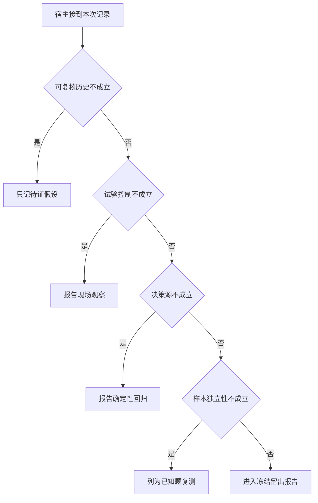

# 一项成绩可以写进面试作品吗

把一条演示变成可以复核的主张，要说明任务族、输入状态、真实模型或脚本、实际结果。
一次成功可以证明这次行为发生过，但不能直接代表未见输入的稳定性。

本篇用一个封闭的教学决策器说明这一问题。输入是宿主收到的记录，不保证每个下游字段都已经获准使用。前置检查未成立时，下游即使带着缓存值，也不能拿来作业务断言。

## 先解决一个具体问题

**已经看过答案的困难题还值得保留吗？**

它很适合做故障回归，修复之后还应持续运行。
但它已经影响设计，不能冒充第一次遇到的题。新泛化主张需要另取独立任务族。


先取一个能走到「进入冻结留出报告」的输入：任务族从未用于调试、关键事件均可追溯、其余关键条件已经冻结、真实模型提出动作。
把这四个条件代回后文的图，前面各个拦截分支都未满足，最终才有“可追溯的真实运行满足独立条件”这个判断。
还原这个现场时要分别问：哪些位来自可信状态，哪些只是在接口中出现、尚未获得解释资格的字段。

## 先沿一次决策走到底



从上到下取第一条成立的出口。只改一个开关时，只有它之前的检查都未截断，该变化才可能到达真实动作。

“样本独立性”的两种输入分别是“任务族从未用于调试”与“同一任务族已经参与调整”。
留出任务与开发回归承担不同的评价职责。

“可复核历史”的两种输入分别是“关键事件均可追溯”与“关键事件记录缺失”。
看不见的事件不能被解释为从未发生。

“试验控制”的两种输入分别是“其余关键条件已经冻结”与“环境或资料随版本变化”。
孤立机制归因要保持其他条件可比。

“决策源”的两种输入分别是“真实模型提出动作”与“脚本重放固定动作”。
回放能验证宿主分支，不直接验证真实选工具质量。

## 最少需要哪几项观察

### 只记待证假设

该现象缺少原始记录。
在本节的全部组合中，有 8 种产生「只记待证假设」，这只是逻辑空间的计数，不能当作实际用户请求的比例。

只取得关键事件记录缺失，已经足以要求宿主「只记待证假设」。
保持这些已知项，其余开关自由变化，仍有 8 种补全，判断没有翻转。

若删掉关于可复核历史的证据，另一份允许的现场是同一任务族已经参与调整、关键事件均可追溯、环境或资料随版本变化、脚本重放固定动作，它会使宿主「报告现场观察」。

### 报告现场观察

环境变化限制可归因程度。
在本节的全部组合中，有 4 种产生「报告现场观察」，这只是逻辑空间的计数，不能当作实际用户请求的比例。

只取得关键事件均可追溯、环境或资料随版本变化，已经足以要求宿主「报告现场观察」。
保持这些已知项，其余开关自由变化，仍有 4 种补全，判断没有翻转。

若删掉关于可复核历史的证据，另一份允许的现场是同一任务族已经参与调整、关键事件记录缺失、环境或资料随版本变化、脚本重放固定动作，它会使宿主「只记待证假设」。

若删掉关于试验控制的证据，另一份允许的现场是同一任务族已经参与调整、关键事件均可追溯、其余关键条件已经冻结、脚本重放固定动作，它会使宿主「报告确定性回归」。

### 报告确定性回归

脚本仅证明宿主行为。
在本节的全部组合中，有 2 种产生「报告确定性回归」，这只是逻辑空间的计数，不能当作实际用户请求的比例。

只取得关键事件均可追溯、其余关键条件已经冻结、脚本重放固定动作，已经足以要求宿主「报告确定性回归」。
保持这些已知项，其余开关自由变化，仍有 2 种补全，判断没有翻转。

若删掉关于可复核历史的证据，另一份允许的现场是同一任务族已经参与调整、关键事件记录缺失、其余关键条件已经冻结、脚本重放固定动作，它会使宿主「只记待证假设」。

若删掉关于试验控制的证据，另一份允许的现场是同一任务族已经参与调整、关键事件均可追溯、环境或资料随版本变化、脚本重放固定动作，它会使宿主「报告现场观察」。

若删掉关于决策源的证据，另一份允许的现场是同一任务族已经参与调整、关键事件均可追溯、其余关键条件已经冻结、真实模型提出动作，它会使宿主「列为已知题复测」。

### 列为已知题复测

接触过答案的样本不能冒充首次留出。
在本节的全部组合中，有 1 种产生「列为已知题复测」，这只是逻辑空间的计数，不能当作实际用户请求的比例。

只取得同一任务族已经参与调整、关键事件均可追溯、其余关键条件已经冻结、真实模型提出动作，已经足以要求宿主「列为已知题复测」。
保持这些已知项，其余开关自由变化，仍有 1 种补全，判断没有翻转。

若删掉关于样本独立性的证据，另一份允许的现场是任务族从未用于调试、关键事件均可追溯、其余关键条件已经冻结、真实模型提出动作，它会使宿主「进入冻结留出报告」。

若删掉关于可复核历史的证据，另一份允许的现场是同一任务族已经参与调整、关键事件记录缺失、其余关键条件已经冻结、真实模型提出动作，它会使宿主「只记待证假设」。

若删掉关于试验控制的证据，另一份允许的现场是同一任务族已经参与调整、关键事件均可追溯、环境或资料随版本变化、真实模型提出动作，它会使宿主「报告现场观察」。

若删掉关于决策源的证据，另一份允许的现场是同一任务族已经参与调整、关键事件均可追溯、其余关键条件已经冻结、脚本重放固定动作，它会使宿主「报告确定性回归」。

### 进入冻结留出报告

可追溯的真实运行满足独立条件。
在本节的全部组合中，有 1 种产生「进入冻结留出报告」，这只是逻辑空间的计数，不能当作实际用户请求的比例。

只取得任务族从未用于调试、关键事件均可追溯、其余关键条件已经冻结、真实模型提出动作，已经足以要求宿主「进入冻结留出报告」。

若删掉关于样本独立性的证据，另一份允许的现场是同一任务族已经参与调整、关键事件均可追溯、其余关键条件已经冻结、真实模型提出动作，它会使宿主「列为已知题复测」。

若删掉关于可复核历史的证据，另一份允许的现场是任务族从未用于调试、关键事件记录缺失、其余关键条件已经冻结、真实模型提出动作，它会使宿主「只记待证假设」。

若删掉关于试验控制的证据，另一份允许的现场是任务族从未用于调试、关键事件均可追溯、环境或资料随版本变化、真实模型提出动作，它会使宿主「报告现场观察」。

若删掉关于决策源的证据，另一份允许的现场是任务族从未用于调试、关键事件均可追溯、其余关键条件已经冻结、脚本重放固定动作，它会使宿主「报告确定性回归」。

## 以同一份契约解释截然不同的现场

<details>
<summary>展开推演与对应反例</summary>

下列样本按最先命中的业务分支排列。四位编码只作本篇页内定位，顺序与开头的四项输入一致。可以先猜下一动作，再展开相邻样本。

### 能够触发“只记待证假设”的现场

**样本 0000**

业务侧交来同一任务族已经参与调整、关键事件记录缺失，执行侧还记录了环境或资料随版本变化、脚本重放固定动作。
把样本压成最短证明，保留关键事件记录缺失就能支持「只记待证假设」。

在这份记录上，分别翻转「可复核历史」中的任一项，其他项完全不变时，下一动作都会改变。

保持其余观察不动，单独切换「样本独立性」、「试验控制」、「决策源」仍得到「只记待证假设」，它们在这个现场不是决定性变量。

要从本例改走「报告现场观察」，至少需要变动 1 项，一组最少改动是将关键事件记录缺失换成关键事件均可追溯。

要从本例改走「报告确定性回归」，至少需要变动 2 项，一组最少改动是将关键事件记录缺失、环境或资料随版本变化换成关键事件均可追溯、其余关键条件已经冻结。

要从本例改走「列为已知题复测」，至少需要变动 3 项，一组最少改动是将关键事件记录缺失、环境或资料随版本变化、脚本重放固定动作换成关键事件均可追溯、其余关键条件已经冻结、真实模型提出动作。

要从本例改走「进入冻结留出报告」，至少需要变动 4 项，一组最少改动是将同一任务族已经参与调整、关键事件记录缺失、环境或资料随版本变化、脚本重放固定动作换成任务族从未用于调试、关键事件均可追溯、其余关键条件已经冻结、真实模型提出动作。

**样本 0001**

业务侧交来同一任务族已经参与调整、关键事件记录缺失，执行侧还记录了环境或资料随版本变化、真实模型提出动作。


要从本例改走「列为已知题复测」，至少需要变动 2 项，一组最少改动是将关键事件记录缺失、环境或资料随版本变化换成关键事件均可追溯、其余关键条件已经冻结。

要从本例改走「报告确定性回归」，至少需要变动 3 项，一组最少改动是将关键事件记录缺失、环境或资料随版本变化、真实模型提出动作换成关键事件均可追溯、其余关键条件已经冻结、脚本重放固定动作。

要从本例改走「进入冻结留出报告」，至少需要变动 3 项，一组最少改动是将同一任务族已经参与调整、关键事件记录缺失、环境或资料随版本变化换成任务族从未用于调试、关键事件均可追溯、其余关键条件已经冻结。

**样本 0010**

业务侧交来同一任务族已经参与调整、关键事件记录缺失，执行侧还记录了其余关键条件已经冻结、脚本重放固定动作。


要从本例改走「报告确定性回归」，至少需要变动 1 项，一组最少改动是将关键事件记录缺失换成关键事件均可追溯。

要从本例改走「报告现场观察」，至少需要变动 2 项，一组最少改动是将关键事件记录缺失、其余关键条件已经冻结换成关键事件均可追溯、环境或资料随版本变化。

要从本例改走「列为已知题复测」，至少需要变动 2 项，一组最少改动是将关键事件记录缺失、脚本重放固定动作换成关键事件均可追溯、真实模型提出动作。

要从本例改走「进入冻结留出报告」，至少需要变动 3 项，一组最少改动是将同一任务族已经参与调整、关键事件记录缺失、脚本重放固定动作换成任务族从未用于调试、关键事件均可追溯、真实模型提出动作。

**样本 0011**

业务侧交来同一任务族已经参与调整、关键事件记录缺失，执行侧还记录了其余关键条件已经冻结、真实模型提出动作。


要从本例改走「列为已知题复测」，至少需要变动 1 项，一组最少改动是将关键事件记录缺失换成关键事件均可追溯。


要从本例改走「报告确定性回归」，至少需要变动 2 项，一组最少改动是将关键事件记录缺失、真实模型提出动作换成关键事件均可追溯、脚本重放固定动作。

要从本例改走「进入冻结留出报告」，至少需要变动 2 项，一组最少改动是将同一任务族已经参与调整、关键事件记录缺失换成任务族从未用于调试、关键事件均可追溯。

**样本 1000**

业务侧交来任务族从未用于调试、关键事件记录缺失，执行侧还记录了环境或资料随版本变化、脚本重放固定动作。


要从本例改走「进入冻结留出报告」，至少需要变动 3 项，一组最少改动是将关键事件记录缺失、环境或资料随版本变化、脚本重放固定动作换成关键事件均可追溯、其余关键条件已经冻结、真实模型提出动作。

要从本例改走「列为已知题复测」，至少需要变动 4 项，一组最少改动是将任务族从未用于调试、关键事件记录缺失、环境或资料随版本变化、脚本重放固定动作换成同一任务族已经参与调整、关键事件均可追溯、其余关键条件已经冻结、真实模型提出动作。

**样本 1001**

业务侧交来任务族从未用于调试、关键事件记录缺失，执行侧还记录了环境或资料随版本变化、真实模型提出动作。


要从本例改走「进入冻结留出报告」，至少需要变动 2 项，一组最少改动是将关键事件记录缺失、环境或资料随版本变化换成关键事件均可追溯、其余关键条件已经冻结。

要从本例改走「列为已知题复测」，至少需要变动 3 项，一组最少改动是将任务族从未用于调试、关键事件记录缺失、环境或资料随版本变化换成同一任务族已经参与调整、关键事件均可追溯、其余关键条件已经冻结。


**样本 1010**

业务侧交来任务族从未用于调试、关键事件记录缺失，执行侧还记录了其余关键条件已经冻结、脚本重放固定动作。


要从本例改走「进入冻结留出报告」，至少需要变动 2 项，一组最少改动是将关键事件记录缺失、脚本重放固定动作换成关键事件均可追溯、真实模型提出动作。

要从本例改走「列为已知题复测」，至少需要变动 3 项，一组最少改动是将任务族从未用于调试、关键事件记录缺失、脚本重放固定动作换成同一任务族已经参与调整、关键事件均可追溯、真实模型提出动作。

**样本 1011**

业务侧交来任务族从未用于调试、关键事件记录缺失，执行侧还记录了其余关键条件已经冻结、真实模型提出动作。


要从本例改走「进入冻结留出报告」，至少需要变动 1 项，一组最少改动是将关键事件记录缺失换成关键事件均可追溯。

要从本例改走「列为已知题复测」，至少需要变动 2 项，一组最少改动是将任务族从未用于调试、关键事件记录缺失换成同一任务族已经参与调整、关键事件均可追溯。


### 能够触发“报告现场观察”的现场

**样本 0100**

业务侧交来同一任务族已经参与调整、关键事件均可追溯，执行侧还记录了环境或资料随版本变化、脚本重放固定动作。
把样本压成最短证明，保留关键事件均可追溯、环境或资料随版本变化就能支持「报告现场观察」。

在这份记录上，分别翻转「可复核历史」、「试验控制」中的任一项，其他项完全不变时，下一动作都会改变。

保持其余观察不动，单独切换「样本独立性」、「决策源」仍得到「报告现场观察」，它们在这个现场不是决定性变量。

本例没走更靠前的「只记待证假设」，因为关键事件均可追溯与那个入口的必要条件不符。

要从本例改走「只记待证假设」，至少需要变动 1 项，一组最少改动是将关键事件均可追溯换成关键事件记录缺失。

要从本例改走「报告确定性回归」，至少需要变动 1 项，一组最少改动是将环境或资料随版本变化换成其余关键条件已经冻结。

要从本例改走「列为已知题复测」，至少需要变动 2 项，一组最少改动是将环境或资料随版本变化、脚本重放固定动作换成其余关键条件已经冻结、真实模型提出动作。

要从本例改走「进入冻结留出报告」，至少需要变动 3 项，一组最少改动是将同一任务族已经参与调整、环境或资料随版本变化、脚本重放固定动作换成任务族从未用于调试、其余关键条件已经冻结、真实模型提出动作。

**样本 0101**

业务侧交来同一任务族已经参与调整、关键事件均可追溯，执行侧还记录了环境或资料随版本变化、真实模型提出动作。


要从本例改走「列为已知题复测」，至少需要变动 1 项，一组最少改动是将环境或资料随版本变化换成其余关键条件已经冻结。

要从本例改走「报告确定性回归」，至少需要变动 2 项，一组最少改动是将环境或资料随版本变化、真实模型提出动作换成其余关键条件已经冻结、脚本重放固定动作。

要从本例改走「进入冻结留出报告」，至少需要变动 2 项，一组最少改动是将同一任务族已经参与调整、环境或资料随版本变化换成任务族从未用于调试、其余关键条件已经冻结。

**样本 1100**

业务侧交来任务族从未用于调试、关键事件均可追溯，执行侧还记录了环境或资料随版本变化、脚本重放固定动作。


要从本例改走「进入冻结留出报告」，至少需要变动 2 项，一组最少改动是将环境或资料随版本变化、脚本重放固定动作换成其余关键条件已经冻结、真实模型提出动作。

要从本例改走「列为已知题复测」，至少需要变动 3 项，一组最少改动是将任务族从未用于调试、环境或资料随版本变化、脚本重放固定动作换成同一任务族已经参与调整、其余关键条件已经冻结、真实模型提出动作。

**样本 1101**

业务侧交来任务族从未用于调试、关键事件均可追溯，执行侧还记录了环境或资料随版本变化、真实模型提出动作。


要从本例改走「进入冻结留出报告」，至少需要变动 1 项，一组最少改动是将环境或资料随版本变化换成其余关键条件已经冻结。

要从本例改走「列为已知题复测」，至少需要变动 2 项，一组最少改动是将任务族从未用于调试、环境或资料随版本变化换成同一任务族已经参与调整、其余关键条件已经冻结。


### 能够触发“报告确定性回归”的现场

**样本 0110**

业务侧交来同一任务族已经参与调整、关键事件均可追溯，执行侧还记录了其余关键条件已经冻结、脚本重放固定动作。
把样本压成最短证明，保留关键事件均可追溯、其余关键条件已经冻结、脚本重放固定动作就能支持「报告确定性回归」。

在这份记录上，分别翻转「可复核历史」、「试验控制」、「决策源」中的任一项，其他项完全不变时，下一动作都会改变。

保持其余观察不动，单独切换「样本独立性」仍得到「报告确定性回归」，它们在这个现场不是决定性变量。


本例没走更靠前的「报告现场观察」，因为其余关键条件已经冻结与那个入口的必要条件不符。


要从本例改走「报告现场观察」，至少需要变动 1 项，一组最少改动是将其余关键条件已经冻结换成环境或资料随版本变化。

要从本例改走「列为已知题复测」，至少需要变动 1 项，一组最少改动是将脚本重放固定动作换成真实模型提出动作。

要从本例改走「进入冻结留出报告」，至少需要变动 2 项，一组最少改动是将同一任务族已经参与调整、脚本重放固定动作换成任务族从未用于调试、真实模型提出动作。

**样本 1110**

业务侧交来任务族从未用于调试、关键事件均可追溯，执行侧还记录了其余关键条件已经冻结、脚本重放固定动作。


要从本例改走「进入冻结留出报告」，至少需要变动 1 项，一组最少改动是将脚本重放固定动作换成真实模型提出动作。

要从本例改走「列为已知题复测」，至少需要变动 2 项，一组最少改动是将任务族从未用于调试、脚本重放固定动作换成同一任务族已经参与调整、真实模型提出动作。

### 能够触发“列为已知题复测”的现场

**样本 0111**

业务侧交来同一任务族已经参与调整、关键事件均可追溯，执行侧还记录了其余关键条件已经冻结、真实模型提出动作。
把样本压成最短证明，保留同一任务族已经参与调整、关键事件均可追溯、其余关键条件已经冻结、真实模型提出动作就能支持「列为已知题复测」。

在这份记录上，分别翻转「样本独立性」、「可复核历史」、「试验控制」、「决策源」中的任一项，其他项完全不变时，下一动作都会改变。


本例没走更靠前的「报告确定性回归」，因为真实模型提出动作与那个入口的必要条件不符。


要从本例改走「报告确定性回归」，至少需要变动 1 项，一组最少改动是将真实模型提出动作换成脚本重放固定动作。

要从本例改走「进入冻结留出报告」，至少需要变动 1 项，一组最少改动是将同一任务族已经参与调整换成任务族从未用于调试。

### 能够触发“进入冻结留出报告”的现场

**样本 1111**

业务侧交来任务族从未用于调试、关键事件均可追溯，执行侧还记录了其余关键条件已经冻结、真实模型提出动作。
把样本压成最短证明，保留任务族从未用于调试、关键事件均可追溯、其余关键条件已经冻结、真实模型提出动作就能支持「进入冻结留出报告」。


本例没走更靠前的「列为已知题复测」，因为任务族从未用于调试与那个入口的必要条件不符。

要从本例改走「列为已知题复测」，至少需要变动 1 项，一组最少改动是将任务族从未用于调试换成同一任务族已经参与调整。


</details>

## 当你只能看见一半记录

<details>
<summary>展开推演与对应反例</summary>

这次隐藏两个字段，保留另两个。对每个可见现场，检查四种合法补全是否同意。如仍有歧义，选择能使最坏剩余候选动作最少的字段继续查。并列时采用本篇字段顺序。

### 只保留样本独立性与可复核历史

已知同一任务族已经参与调整、关键事件记录缺失时，四种补全的动作分布为只记待证假设（4 种）。

就“只记待证假设”这个动作而言，在同一任务族已经参与调整、关键事件记录缺失的前提下，另外两项观察不会推翻它。

已知同一任务族已经参与调整、关键事件均可追溯时，四种补全的动作分布为报告现场观察（2 种）、报告确定性回归（1 种）、列为已知题复测（1 种）。

在同一任务族已经参与调整、关键事件均可追溯这个现场补读「试验控制」，最坏还剩 2 种动作，计算时只衡量歧义，尚未扣读取代价。
若补来的观察为“环境或资料随版本变化”，范围缩成「报告现场观察」。若为“其余关键条件已经冻结”，则保留「报告确定性回归」、「列为已知题复测」。

区分不了的两条执行可以具体写成 0100 与 0110：它们共享已展示字段，却分别需要「报告现场观察」和「报告确定性回归」。

已知任务族从未用于调试、关键事件记录缺失时，四种补全的动作分布为只记待证假设（4 种）。

就“只记待证假设”这个动作而言，在任务族从未用于调试、关键事件记录缺失的前提下，另外两项观察不会推翻它。

已知任务族从未用于调试、关键事件均可追溯时，四种补全的动作分布为报告现场观察（2 种）、报告确定性回归（1 种）、进入冻结留出报告（1 种）。

在任务族从未用于调试、关键事件均可追溯这个现场补读「试验控制」，最坏还剩 2 种动作，计算时只衡量歧义，尚未扣读取代价。
若补来的观察为“环境或资料随版本变化”，范围缩成「报告现场观察」。若为“其余关键条件已经冻结”，则保留「报告确定性回归」、「进入冻结留出报告」。

区分不了的两条执行可以具体写成 1100 与 1110：它们共享已展示字段，却分别需要「报告现场观察」和「报告确定性回归」。

### 只保留样本独立性与试验控制

已知同一任务族已经参与调整、环境或资料随版本变化时，四种补全的动作分布为只记待证假设（2 种）、报告现场观察（2 种）。

在同一任务族已经参与调整、环境或资料随版本变化这个现场补读「可复核历史」，最坏还剩 1 种动作，计算时只衡量歧义，尚未扣读取代价。
若补来的观察为“关键事件记录缺失”，范围缩成「只记待证假设」。若为“关键事件均可追溯”，则保留「报告现场观察」。

区分不了的两条执行可以具体写成 0000 与 0100：它们共享已展示字段，却分别需要「只记待证假设」和「报告现场观察」。

已知同一任务族已经参与调整、其余关键条件已经冻结时，四种补全的动作分布为只记待证假设（2 种）、报告确定性回归（1 种）、列为已知题复测（1 种）。

在同一任务族已经参与调整、其余关键条件已经冻结这个现场补读「可复核历史」，最坏还剩 2 种动作，计算时只衡量歧义，尚未扣读取代价。
若补来的观察为“关键事件记录缺失”，范围缩成「只记待证假设」。若为“关键事件均可追溯”，则保留「报告确定性回归」、「列为已知题复测」。

区分不了的两条执行可以具体写成 0010 与 0110：它们共享已展示字段，却分别需要「只记待证假设」和「报告确定性回归」。

已知任务族从未用于调试、环境或资料随版本变化时，四种补全的动作分布为只记待证假设（2 种）、报告现场观察（2 种）。

在任务族从未用于调试、环境或资料随版本变化这个现场补读「可复核历史」，最坏还剩 1 种动作，计算时只衡量歧义，尚未扣读取代价。

区分不了的两条执行可以具体写成 1000 与 1100：它们共享已展示字段，却分别需要「只记待证假设」和「报告现场观察」。

已知任务族从未用于调试、其余关键条件已经冻结时，四种补全的动作分布为只记待证假设（2 种）、报告确定性回归（1 种）、进入冻结留出报告（1 种）。

在任务族从未用于调试、其余关键条件已经冻结这个现场补读「可复核历史」，最坏还剩 2 种动作，计算时只衡量歧义，尚未扣读取代价。
若补来的观察为“关键事件记录缺失”，范围缩成「只记待证假设」。若为“关键事件均可追溯”，则保留「报告确定性回归」、「进入冻结留出报告」。

区分不了的两条执行可以具体写成 1010 与 1110：它们共享已展示字段，却分别需要「只记待证假设」和「报告确定性回归」。

### 只保留可复核历史与试验控制

已知关键事件记录缺失、环境或资料随版本变化时，四种补全的动作分布为只记待证假设（4 种）。

就“只记待证假设”这个动作而言，在关键事件记录缺失、环境或资料随版本变化的前提下，另外两项观察不会推翻它。

已知关键事件记录缺失、其余关键条件已经冻结时，四种补全的动作分布为只记待证假设（4 种）。

就“只记待证假设”这个动作而言，在关键事件记录缺失、其余关键条件已经冻结的前提下，另外两项观察不会推翻它。

已知关键事件均可追溯、环境或资料随版本变化时，四种补全的动作分布为报告现场观察（4 种）。

就“报告现场观察”这个动作而言，在关键事件均可追溯、环境或资料随版本变化的前提下，另外两项观察不会推翻它。

已知关键事件均可追溯、其余关键条件已经冻结时，四种补全的动作分布为报告确定性回归（2 种）、列为已知题复测（1 种）、进入冻结留出报告（1 种）。

在关键事件均可追溯、其余关键条件已经冻结这个现场补读「样本独立性」，最坏还剩 2 种动作，计算时只衡量歧义，尚未扣读取代价。
若补来的观察为“同一任务族已经参与调整”，范围缩成「报告确定性回归」、「列为已知题复测」。若为“任务族从未用于调试”，则保留「报告确定性回归」、「进入冻结留出报告」。

区分不了的两条执行可以具体写成 0110 与 0111：它们共享已展示字段，却分别需要「报告确定性回归」和「列为已知题复测」。

### 只保留样本独立性与决策源

已知同一任务族已经参与调整、脚本重放固定动作时，四种补全的动作分布为只记待证假设（2 种）、报告现场观察（1 种）、报告确定性回归（1 种）。

在同一任务族已经参与调整、脚本重放固定动作这个现场补读「可复核历史」，最坏还剩 2 种动作，计算时只衡量歧义，尚未扣读取代价。
若补来的观察为“关键事件记录缺失”，范围缩成「只记待证假设」。若为“关键事件均可追溯”，则保留「报告现场观察」、「报告确定性回归」。


已知同一任务族已经参与调整、真实模型提出动作时，四种补全的动作分布为只记待证假设（2 种）、报告现场观察（1 种）、列为已知题复测（1 种）。

在同一任务族已经参与调整、真实模型提出动作这个现场补读「可复核历史」，最坏还剩 2 种动作，计算时只衡量歧义，尚未扣读取代价。
若补来的观察为“关键事件记录缺失”，范围缩成「只记待证假设」。若为“关键事件均可追溯”，则保留「报告现场观察」、「列为已知题复测」。

区分不了的两条执行可以具体写成 0001 与 0101：它们共享已展示字段，却分别需要「只记待证假设」和「报告现场观察」。

已知任务族从未用于调试、脚本重放固定动作时，四种补全的动作分布为只记待证假设（2 种）、报告现场观察（1 种）、报告确定性回归（1 种）。

在任务族从未用于调试、脚本重放固定动作这个现场补读「可复核历史」，最坏还剩 2 种动作，计算时只衡量歧义，尚未扣读取代价。


已知任务族从未用于调试、真实模型提出动作时，四种补全的动作分布为只记待证假设（2 种）、报告现场观察（1 种）、进入冻结留出报告（1 种）。

在任务族从未用于调试、真实模型提出动作这个现场补读「可复核历史」，最坏还剩 2 种动作，计算时只衡量歧义，尚未扣读取代价。
若补来的观察为“关键事件记录缺失”，范围缩成「只记待证假设」。若为“关键事件均可追溯”，则保留「报告现场观察」、「进入冻结留出报告」。

区分不了的两条执行可以具体写成 1001 与 1101：它们共享已展示字段，却分别需要「只记待证假设」和「报告现场观察」。

### 只保留可复核历史与决策源

已知关键事件记录缺失、脚本重放固定动作时，四种补全的动作分布为只记待证假设（4 种）。

就“只记待证假设”这个动作而言，在关键事件记录缺失、脚本重放固定动作的前提下，另外两项观察不会推翻它。

已知关键事件记录缺失、真实模型提出动作时，四种补全的动作分布为只记待证假设（4 种）。

就“只记待证假设”这个动作而言，在关键事件记录缺失、真实模型提出动作的前提下，另外两项观察不会推翻它。

已知关键事件均可追溯、脚本重放固定动作时，四种补全的动作分布为报告现场观察（2 种）、报告确定性回归（2 种）。

在关键事件均可追溯、脚本重放固定动作这个现场补读「试验控制」，最坏还剩 1 种动作，计算时只衡量歧义，尚未扣读取代价。
若补来的观察为“环境或资料随版本变化”，范围缩成「报告现场观察」。若为“其余关键条件已经冻结”，则保留「报告确定性回归」。


已知关键事件均可追溯、真实模型提出动作时，四种补全的动作分布为报告现场观察（2 种）、列为已知题复测（1 种）、进入冻结留出报告（1 种）。

在关键事件均可追溯、真实模型提出动作这个现场补读「样本独立性」，最坏还剩 2 种动作，计算时只衡量歧义，尚未扣读取代价。
若补来的观察为“同一任务族已经参与调整”，范围缩成「报告现场观察」、「列为已知题复测」。若为“任务族从未用于调试”，则保留「报告现场观察」、「进入冻结留出报告」。

区分不了的两条执行可以具体写成 0101 与 0111：它们共享已展示字段，却分别需要「报告现场观察」和「列为已知题复测」。

### 只保留试验控制与决策源

已知环境或资料随版本变化、脚本重放固定动作时，四种补全的动作分布为只记待证假设（2 种）、报告现场观察（2 种）。

在环境或资料随版本变化、脚本重放固定动作这个现场补读「可复核历史」，最坏还剩 1 种动作，计算时只衡量歧义，尚未扣读取代价。


已知环境或资料随版本变化、真实模型提出动作时，四种补全的动作分布为只记待证假设（2 种）、报告现场观察（2 种）。

在环境或资料随版本变化、真实模型提出动作这个现场补读「可复核历史」，最坏还剩 1 种动作，计算时只衡量歧义，尚未扣读取代价。


已知其余关键条件已经冻结、脚本重放固定动作时，四种补全的动作分布为只记待证假设（2 种）、报告确定性回归（2 种）。

在其余关键条件已经冻结、脚本重放固定动作这个现场补读「可复核历史」，最坏还剩 1 种动作，计算时只衡量歧义，尚未扣读取代价。
若补来的观察为“关键事件记录缺失”，范围缩成「只记待证假设」。若为“关键事件均可追溯”，则保留「报告确定性回归」。


已知其余关键条件已经冻结、真实模型提出动作时，四种补全的动作分布为只记待证假设（2 种）、列为已知题复测（1 种）、进入冻结留出报告（1 种）。

在其余关键条件已经冻结、真实模型提出动作这个现场补读「样本独立性」，最坏还剩 2 种动作，计算时只衡量歧义，尚未扣读取代价。
若补来的观察为“同一任务族已经参与调整”，范围缩成「只记待证假设」、「列为已知题复测」。若为“任务族从未用于调试”，则保留「只记待证假设」、「进入冻结留出报告」。

区分不了的两条执行可以具体写成 0011 与 0111：它们共享已展示字段，却分别需要「只记待证假设」和「列为已知题复测」。

</details>

## 单因素干预与边界测试

<details>
<summary>展开推演与对应反例</summary>

### 只改变样本独立性

固定另外三个条件得到八对现场，从“同一任务族已经参与调整”转为“任务族从未用于调试”时，1 对翻转动作，另外 7 对保持不变。

令关键事件记录缺失、环境或资料随版本变化、脚本重放固定动作，样本独立性的两个取值均得到「只记待证假设」。在八对中，共有 4 对表现为这一种稳定出口。

令关键事件均可追溯、环境或资料随版本变化、脚本重放固定动作，样本独立性的两个取值均得到「报告现场观察」。在八对中，共有 2 对表现为这一种稳定出口。

令关键事件均可追溯、其余关键条件已经冻结、脚本重放固定动作，样本独立性的两个取值均得到「报告确定性回归」。在八对中，共有 1 对表现为这一种稳定出口。

有 1 对现场沿「列为已知题复测」变到「进入冻结留出报告」，可复现的一组受控背景为关键事件均可追溯、其余关键条件已经冻结、真实模型提出动作。

### 只改变可复核历史

固定另外三个条件得到八对现场，从“关键事件记录缺失”转为“关键事件均可追溯”时，8 对翻转动作，另外 0 对保持不变。

有 4 对现场沿「只记待证假设」变到「报告现场观察」，可复现的一组受控背景为同一任务族已经参与调整、环境或资料随版本变化、脚本重放固定动作。

有 2 对现场沿「只记待证假设」变到「报告确定性回归」，可复现的一组受控背景为同一任务族已经参与调整、其余关键条件已经冻结、脚本重放固定动作。

有 1 对现场沿「只记待证假设」变到「列为已知题复测」，可复现的一组受控背景为同一任务族已经参与调整、其余关键条件已经冻结、真实模型提出动作。

有 1 对现场沿「只记待证假设」变到「进入冻结留出报告」，可复现的一组受控背景为任务族从未用于调试、其余关键条件已经冻结、真实模型提出动作。

### 只改变试验控制

固定另外三个条件得到八对现场，从“环境或资料随版本变化”转为“其余关键条件已经冻结”时，4 对翻转动作，另外 4 对保持不变。

令同一任务族已经参与调整、关键事件记录缺失、脚本重放固定动作，试验控制的两个取值均得到「只记待证假设」。在八对中，共有 4 对表现为这一种稳定出口。

有 2 对现场沿「报告现场观察」变到「报告确定性回归」，可复现的一组受控背景为同一任务族已经参与调整、关键事件均可追溯、脚本重放固定动作。

有 1 对现场沿「报告现场观察」变到「列为已知题复测」，可复现的一组受控背景为同一任务族已经参与调整、关键事件均可追溯、真实模型提出动作。

有 1 对现场沿「报告现场观察」变到「进入冻结留出报告」，可复现的一组受控背景为任务族从未用于调试、关键事件均可追溯、真实模型提出动作。

### 只改变决策源

固定另外三个条件得到八对现场，从“脚本重放固定动作”转为“真实模型提出动作”时，2 对翻转动作，另外 6 对保持不变。

令同一任务族已经参与调整、关键事件记录缺失、环境或资料随版本变化，决策源的两个取值均得到「只记待证假设」。在八对中，共有 4 对表现为这一种稳定出口。

令同一任务族已经参与调整、关键事件均可追溯、环境或资料随版本变化，决策源的两个取值均得到「报告现场观察」。在八对中，共有 2 对表现为这一种稳定出口。

有 1 对现场沿「报告确定性回归」变到「列为已知题复测」，可复现的一组受控背景为同一任务族已经参与调整、关键事件均可追溯、其余关键条件已经冻结。

有 1 对现场沿「报告确定性回归」变到「进入冻结留出报告」，可复现的一组受控背景为任务族从未用于调试、关键事件均可追溯、其余关键条件已经冻结。

</details>

## 哪些回归样本真能抓住实现错误

<details>
<summary>展开推演与对应反例</summary>

如果删除“只记待证假设”这个分支，在本篇 16 种输入里有 8 种会改走另一出口。

反例 0000 的完整记录为同一任务族已经参与调整、关键事件记录缺失、环境或资料随版本变化、脚本重放固定动作。正确结果是「只记待证假设」，这个改坏的实现却给出「报告现场观察」。

如果删除“报告现场观察”这个分支，在本篇 16 种输入里有 4 种会改走另一出口。

反例 0100 的完整记录为同一任务族已经参与调整、关键事件均可追溯、环境或资料随版本变化、脚本重放固定动作。正确结果是「报告现场观察」，这个改坏的实现却给出「报告确定性回归」。

如果删除“报告确定性回归”这个分支，在本篇 16 种输入里有 2 种会改走另一出口。

反例 0110 的完整记录为同一任务族已经参与调整、关键事件均可追溯、其余关键条件已经冻结、脚本重放固定动作。正确结果是「报告确定性回归」，这个改坏的实现却给出「列为已知题复测」。

如果删除“列为已知题复测”这个分支，在本篇 16 种输入里有 1 种会改走另一出口。

反例 0111 的完整记录为同一任务族已经参与调整、关键事件均可追溯、其余关键条件已经冻结、真实模型提出动作。正确结果是「列为已知题复测」，这个改坏的实现却给出「进入冻结留出报告」。

如果交换“只记待证假设”和“报告现场观察”的判断次序，在本篇 16 种输入里有 4 种会改走另一出口。


如果交换“报告现场观察”和“报告确定性回归”的判断次序，在本篇 16 种输入里有 2 种会改走另一出口。


如果交换“报告确定性回归”和“列为已知题复测”的判断次序，在本篇 16 种输入里有 1 种会改走另一出口。


补入样本 0000（同一任务族已经参与调整、关键事件记录缺失、环境或资料随版本变化、脚本重放固定动作）能新增检出「删除“只记待证假设”这个分支」、「交换“只记待证假设”和“报告现场观察”的判断次序」。

补入样本 0100（同一任务族已经参与调整、关键事件均可追溯、环境或资料随版本变化、脚本重放固定动作）能新增检出「删除“报告现场观察”这个分支」、「交换“报告现场观察”和“报告确定性回归”的判断次序」。

补入样本 0110（同一任务族已经参与调整、关键事件均可追溯、其余关键条件已经冻结、脚本重放固定动作）能新增检出「删除“报告确定性回归”这个分支」、「交换“报告确定性回归”和“列为已知题复测”的判断次序」。

补入样本 0111（同一任务族已经参与调整、关键事件均可追溯、其余关键条件已经冻结、真实模型提出动作）能新增检出「删除“列为已知题复测”这个分支」。

这里每次选覆盖尚未捕获缺陷最多的样本，并不保证用例数全局最小。它给出的反例能作为 Java 单测输入。真实模型是否会自主产生这些提议，仍须单独评测。

</details>

## 把状态覆盖换成有抽样偏差的评测批次

<details>
<summary>展开推演与对应反例</summary>

前面的十六种记录各有一票。现在只改样本构成：对一个给定字段，把成立侧的每种记录各取三份、另一侧各取一份。这是人为配比的 32 份回放，不是线上频率估计。
将偏向成立与偏向不成立的两次批次对照，可以隔离分母变化。底层宿主和所有答案保持相同，比例仍可能移动。

### 改变“样本独立性”的样本配比

只看「只记待证假设」，在任务族从未用于调试的八个不同输入中有 4 个命中，在同一任务族已经参与调整的另八个输入中有 4 个命中。
把「样本独立性」成立侧按三倍取样，「只记待证假设」占 16/32，反过来向未成立侧倾斜后占 16/32。
两批「只记待证假设」的边际比例相同，是因为这个出口在“样本独立性”的两侧计数相等，这不能单独证明每一对现场都不受它影响。

只看「报告现场观察」，在任务族从未用于调试的八个不同输入中有 2 个命中，在同一任务族已经参与调整的另八个输入中有 2 个命中。
把「样本独立性」成立侧按三倍取样，「报告现场观察」占 8/32，反过来向未成立侧倾斜后占 8/32。
两批「报告现场观察」的边际比例相同，是因为这个出口在“样本独立性”的两侧计数相等，这不能单独证明每一对现场都不受它影响。

只看「报告确定性回归」，在任务族从未用于调试的八个不同输入中有 1 个命中，在同一任务族已经参与调整的另八个输入中有 1 个命中。
把「样本独立性」成立侧按三倍取样，「报告确定性回归」占 4/32，反过来向未成立侧倾斜后占 4/32。
两批「报告确定性回归」的边际比例相同，是因为这个出口在“样本独立性”的两侧计数相等，这不能单独证明每一对现场都不受它影响。

只看「列为已知题复测」，在任务族从未用于调试的八个不同输入中有 0 个命中，在同一任务族已经参与调整的另八个输入中有 1 个命中。
把「样本独立性」成立侧按三倍取样，「列为已知题复测」占 1/32，反过来向未成立侧倾斜后占 3/32。
这次重加权使「列为已知题复测」的占比相差 6.25 个百分点。若按两种不同的“样本独立性”分布跑新旧版，不能把这项差异全部归功于实现。

只看「进入冻结留出报告」，在任务族从未用于调试的八个不同输入中有 1 个命中，在同一任务族已经参与调整的另八个输入中有 0 个命中。
把「样本独立性」成立侧按三倍取样，「进入冻结留出报告」占 3/32，反过来向未成立侧倾斜后占 1/32。
这次重加权使「进入冻结留出报告」的占比相差 6.25 个百分点。若按两种不同的“样本独立性”分布跑新旧版，不能把这项差异全部归功于实现。

### 改变“可复核历史”的样本配比

只看「只记待证假设」，在关键事件均可追溯的八个不同输入中有 0 个命中，在关键事件记录缺失的另八个输入中有 8 个命中。
把「可复核历史」成立侧按三倍取样，「只记待证假设」占 8/32，反过来向未成立侧倾斜后占 24/32。
这次重加权使「只记待证假设」的占比相差 50 个百分点。若按两种不同的“可复核历史”分布跑新旧版，不能把这项差异全部归功于实现。

只看「报告现场观察」，在关键事件均可追溯的八个不同输入中有 4 个命中，在关键事件记录缺失的另八个输入中有 0 个命中。
把「可复核历史」成立侧按三倍取样，「报告现场观察」占 12/32，反过来向未成立侧倾斜后占 4/32。
这次重加权使「报告现场观察」的占比相差 25 个百分点。若按两种不同的“可复核历史”分布跑新旧版，不能把这项差异全部归功于实现。

只看「报告确定性回归」，在关键事件均可追溯的八个不同输入中有 2 个命中，在关键事件记录缺失的另八个输入中有 0 个命中。
把「可复核历史」成立侧按三倍取样，「报告确定性回归」占 6/32，反过来向未成立侧倾斜后占 2/32。
这次重加权使「报告确定性回归」的占比相差 12.5 个百分点。若按两种不同的“可复核历史”分布跑新旧版，不能把这项差异全部归功于实现。

只看「列为已知题复测」，在关键事件均可追溯的八个不同输入中有 1 个命中，在关键事件记录缺失的另八个输入中有 0 个命中。
把「可复核历史」成立侧按三倍取样，「列为已知题复测」占 3/32，反过来向未成立侧倾斜后占 1/32。
这次重加权使「列为已知题复测」的占比相差 6.25 个百分点。若按两种不同的“可复核历史”分布跑新旧版，不能把这项差异全部归功于实现。

只看「进入冻结留出报告」，在关键事件均可追溯的八个不同输入中有 1 个命中，在关键事件记录缺失的另八个输入中有 0 个命中。
把「可复核历史」成立侧按三倍取样，「进入冻结留出报告」占 3/32，反过来向未成立侧倾斜后占 1/32。
这次重加权使「进入冻结留出报告」的占比相差 6.25 个百分点。若按两种不同的“可复核历史”分布跑新旧版，不能把这项差异全部归功于实现。

### 改变“试验控制”的样本配比

只看「只记待证假设」，在其余关键条件已经冻结的八个不同输入中有 4 个命中，在环境或资料随版本变化的另八个输入中有 4 个命中。
把「试验控制」成立侧按三倍取样，「只记待证假设」占 16/32，反过来向未成立侧倾斜后占 16/32。
两批「只记待证假设」的边际比例相同，是因为这个出口在“试验控制”的两侧计数相等，这不能单独证明每一对现场都不受它影响。

只看「报告现场观察」，在其余关键条件已经冻结的八个不同输入中有 0 个命中，在环境或资料随版本变化的另八个输入中有 4 个命中。
把「试验控制」成立侧按三倍取样，「报告现场观察」占 4/32，反过来向未成立侧倾斜后占 12/32。
这次重加权使「报告现场观察」的占比相差 25 个百分点。若按两种不同的“试验控制”分布跑新旧版，不能把这项差异全部归功于实现。

只看「报告确定性回归」，在其余关键条件已经冻结的八个不同输入中有 2 个命中，在环境或资料随版本变化的另八个输入中有 0 个命中。
把「试验控制」成立侧按三倍取样，「报告确定性回归」占 6/32，反过来向未成立侧倾斜后占 2/32。
这次重加权使「报告确定性回归」的占比相差 12.5 个百分点。若按两种不同的“试验控制”分布跑新旧版，不能把这项差异全部归功于实现。

只看「列为已知题复测」，在其余关键条件已经冻结的八个不同输入中有 1 个命中，在环境或资料随版本变化的另八个输入中有 0 个命中。
把「试验控制」成立侧按三倍取样，「列为已知题复测」占 3/32，反过来向未成立侧倾斜后占 1/32。
这次重加权使「列为已知题复测」的占比相差 6.25 个百分点。若按两种不同的“试验控制”分布跑新旧版，不能把这项差异全部归功于实现。

只看「进入冻结留出报告」，在其余关键条件已经冻结的八个不同输入中有 1 个命中，在环境或资料随版本变化的另八个输入中有 0 个命中。
把「试验控制」成立侧按三倍取样，「进入冻结留出报告」占 3/32，反过来向未成立侧倾斜后占 1/32。
这次重加权使「进入冻结留出报告」的占比相差 6.25 个百分点。若按两种不同的“试验控制”分布跑新旧版，不能把这项差异全部归功于实现。

### 改变“决策源”的样本配比

只看「只记待证假设」，在真实模型提出动作的八个不同输入中有 4 个命中，在脚本重放固定动作的另八个输入中有 4 个命中。
把「决策源」成立侧按三倍取样，「只记待证假设」占 16/32，反过来向未成立侧倾斜后占 16/32。
两批「只记待证假设」的边际比例相同，是因为这个出口在“决策源”的两侧计数相等，这不能单独证明每一对现场都不受它影响。

只看「报告现场观察」，在真实模型提出动作的八个不同输入中有 2 个命中，在脚本重放固定动作的另八个输入中有 2 个命中。
把「决策源」成立侧按三倍取样，「报告现场观察」占 8/32，反过来向未成立侧倾斜后占 8/32。
两批「报告现场观察」的边际比例相同，是因为这个出口在“决策源”的两侧计数相等，这不能单独证明每一对现场都不受它影响。

只看「报告确定性回归」，在真实模型提出动作的八个不同输入中有 0 个命中，在脚本重放固定动作的另八个输入中有 2 个命中。
把「决策源」成立侧按三倍取样，「报告确定性回归」占 2/32，反过来向未成立侧倾斜后占 6/32。
这次重加权使「报告确定性回归」的占比相差 12.5 个百分点。若按两种不同的“决策源”分布跑新旧版，不能把这项差异全部归功于实现。

只看「列为已知题复测」，在真实模型提出动作的八个不同输入中有 1 个命中，在脚本重放固定动作的另八个输入中有 0 个命中。
把「决策源」成立侧按三倍取样，「列为已知题复测」占 3/32，反过来向未成立侧倾斜后占 1/32。
这次重加权使「列为已知题复测」的占比相差 6.25 个百分点。若按两种不同的“决策源”分布跑新旧版，不能把这项差异全部归功于实现。

只看「进入冻结留出报告」，在真实模型提出动作的八个不同输入中有 1 个命中，在脚本重放固定动作的另八个输入中有 0 个命中。
把「决策源」成立侧按三倍取样，「进入冻结留出报告」占 3/32，反过来向未成立侧倾斜后占 1/32。
这次重加权使「进入冻结留出报告」的占比相差 6.25 个百分点。若按两种不同的“决策源”分布跑新旧版，不能把这项差异全部归功于实现。

</details>

## 只看终态，能逆推出多少原始事实

<details>
<summary>展开推演与对应反例</summary>

### 只保留“只记待证假设”这条结果时

「只记待证假设」不能证明样本独立性取哪一侧：0000 和 1000 有相同终态，却分别记为“同一任务族已经参与调整”和“任务族从未用于调试”。

在本节契约与完整输入域内，仅知「只记待证假设」就能倒推出关键事件记录缺失，这一推断依赖版本未变且日志中的终态可信。

「只记待证假设」不能证明试验控制取哪一侧：0000 和 0010 有相同终态，却分别记为“环境或资料随版本变化”和“其余关键条件已经冻结”。

「只记待证假设」不能证明决策源取哪一侧：0000 和 0001 有相同终态，却分别记为“脚本重放固定动作”和“真实模型提出动作”。

反查「只记待证假设」的诊断日志，优先保留能区分样本 0000 与 0100 的「可复核历史」，否则很容易把邻近的「报告现场观察」看成同一种故障。

### 只保留“报告现场观察”这条结果时

「报告现场观察」不能证明样本独立性取哪一侧：0100 和 1100 有相同终态，却分别记为“同一任务族已经参与调整”和“任务族从未用于调试”。

在本节契约与完整输入域内，仅知「报告现场观察」就能倒推出关键事件均可追溯，这一推断依赖版本未变且日志中的终态可信。

在本节契约与完整输入域内，仅知「报告现场观察」就能倒推出环境或资料随版本变化，这一推断依赖版本未变且日志中的终态可信。

「报告现场观察」不能证明决策源取哪一侧：0100 和 0101 有相同终态，却分别记为“脚本重放固定动作”和“真实模型提出动作”。

反查「报告现场观察」的诊断日志，优先保留能区分样本 0100 与 0000 的「可复核历史」，否则很容易把邻近的「只记待证假设」看成同一种故障。

### 只保留“报告确定性回归”这条结果时

「报告确定性回归」不能证明样本独立性取哪一侧：0110 和 1110 有相同终态，却分别记为“同一任务族已经参与调整”和“任务族从未用于调试”。

在本节契约与完整输入域内，仅知「报告确定性回归」就能倒推出关键事件均可追溯，这一推断依赖版本未变且日志中的终态可信。

在本节契约与完整输入域内，仅知「报告确定性回归」就能倒推出其余关键条件已经冻结，这一推断依赖版本未变且日志中的终态可信。

在本节契约与完整输入域内，仅知「报告确定性回归」就能倒推出脚本重放固定动作，这一推断依赖版本未变且日志中的终态可信。

反查「报告确定性回归」的诊断日志，优先保留能区分样本 0110 与 0010 的「可复核历史」，否则很容易把邻近的「只记待证假设」看成同一种故障。

### 只保留“列为已知题复测”这条结果时

在本节契约与完整输入域内，仅知「列为已知题复测」就能倒推出同一任务族已经参与调整，这一推断依赖版本未变且日志中的终态可信。

在本节契约与完整输入域内，仅知「列为已知题复测」就能倒推出关键事件均可追溯，这一推断依赖版本未变且日志中的终态可信。

在本节契约与完整输入域内，仅知「列为已知题复测」就能倒推出其余关键条件已经冻结，这一推断依赖版本未变且日志中的终态可信。

在本节契约与完整输入域内，仅知「列为已知题复测」就能倒推出真实模型提出动作，这一推断依赖版本未变且日志中的终态可信。

反查「列为已知题复测」的诊断日志，优先保留能区分样本 0111 与 0011 的「可复核历史」，否则很容易把邻近的「只记待证假设」看成同一种故障。

### 只保留“进入冻结留出报告”这条结果时

在本节契约与完整输入域内，仅知「进入冻结留出报告」就能倒推出任务族从未用于调试，这一推断依赖版本未变且日志中的终态可信。

在本节契约与完整输入域内，仅知「进入冻结留出报告」就能倒推出关键事件均可追溯，这一推断依赖版本未变且日志中的终态可信。

在本节契约与完整输入域内，仅知「进入冻结留出报告」就能倒推出其余关键条件已经冻结，这一推断依赖版本未变且日志中的终态可信。

在本节契约与完整输入域内，仅知「进入冻结留出报告」就能倒推出真实模型提出动作，这一推断依赖版本未变且日志中的终态可信。

反查「进入冻结留出报告」的诊断日志，优先保留能区分样本 1111 与 0111 的「样本独立性」，否则很容易把邻近的「列为已知题复测」看成同一种故障。

</details>

## 面试复述与复算

面试题可以从“已经看过答案的困难题还值得保留吗？”起步。先给出本篇的触发条件和一条真实执行端可检查的证据，再用一个相邻反例限定结论的适用范围。

在仓库根目录执行下列命令可以重算本篇的一个输入。四位数字依次选择正文列出的四项条件，0 表示未成立或低档，1 表示成立或高档。
```powershell
node examples/reading-cases/replay.mjs 4 7 0101
```

[本周主文](../theory.md) · [配套实验](../lab.md)
