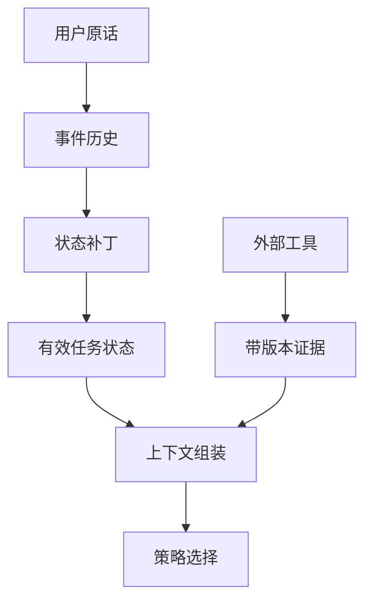
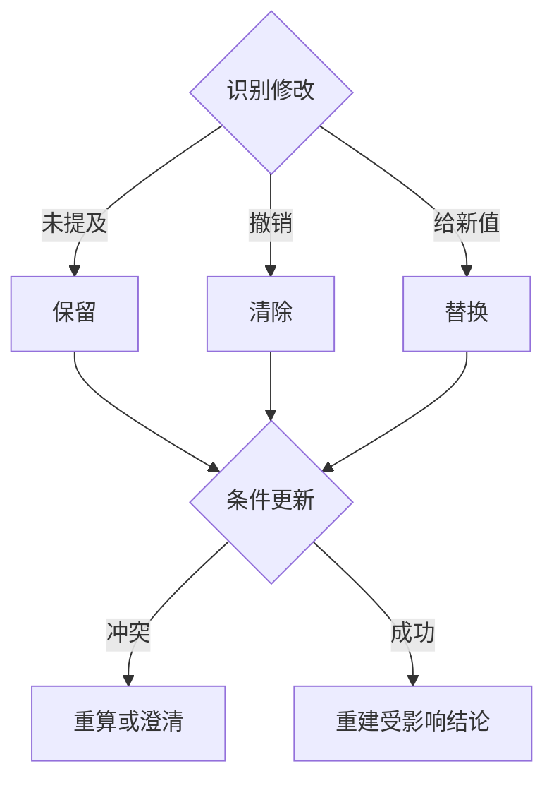
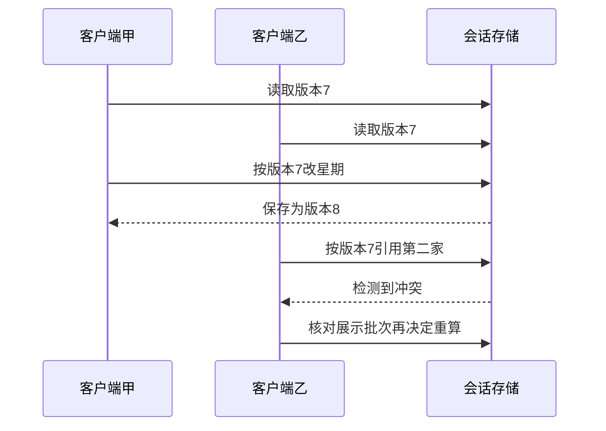
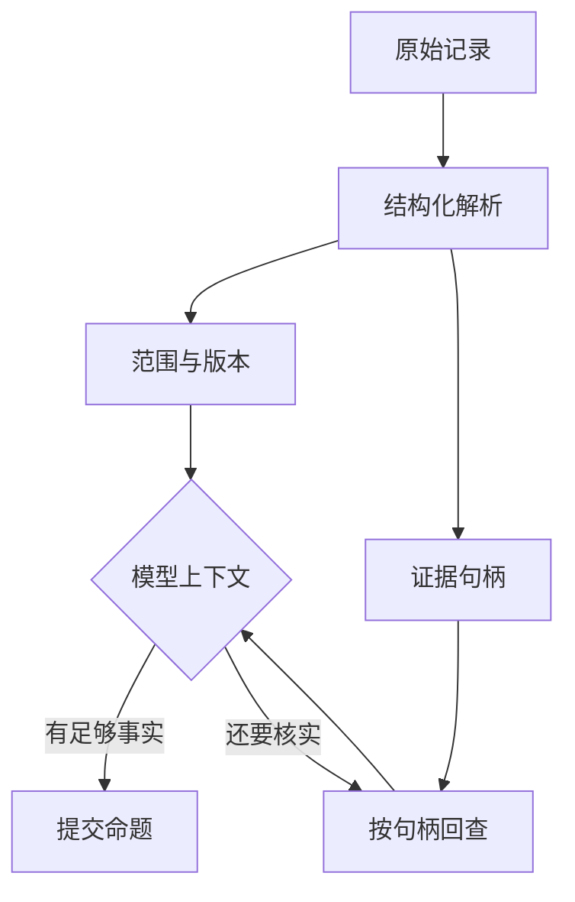

# 第 5 周每日课｜让 Agent 正确理解追问

第 29–31 天共同使用[理论里的三态补丁与演算](theory.md)，第 32–34 天用两个会话复现指代和并发问题。第 35 天检查“模型推断的补丁”和“宿主接受的状态”能否分别重放。

[本周理论](theory.md) · [本周实验](lab.md) · [课程目录](../../README.md)

本周交付一段能正确改星期、换分馆、澄清歧义且会话隔离的对话。

学习顺序：先读当天正文与例题，遮住参考解做一道变式，再完成“动手”和“过关”。第一次进入本周时，可先读[理论讲义的教师精讲](theory.md)；需要实现步骤时对照[本周实验](lab.md)。

## 第 29 天　指代解析和会话中的对象

**用户原话、业务状态与外部事实各自流向哪里**

本周配套研读：[会话中的“上一家”属于谁](readings/01.md)，文内有图和带解样例。

90 分钟（讲解与阅读 20 分钟，上机 70 分钟）。

“那周日呢”只带来一个新星期，原有地点、月份、时刻仍有用。丢失它们会导致不必要的追问。

**课堂推演。** 把星期补丁的 JSON 打印出来。如果它还含有新的 room_id，检查是否把模型重新猜测的地点当成用户说出的修改。

### 跟着老师走一遍

在 `{room:E06, day:SAT, time:19:00}` 上应用 `set(day=SUN)`。把刚才哪些字段来自本轮、哪些继承下来列成两列。如果把整个新解析对象覆盖旧状态，空的 room 与 time 就会意外抹掉原值。

**自己试一次。** 用户只说‘换成油麻地’时，应改动哪些已知条件？

做完再看参考解

地点更新为 E01，若语境仍在比较原时段就保留月份、星期和时刻。旧馆证据不再自动适用，必须为 E01 重新核实。

**动手。** 写出 E06 周六 19:00 的初始状态，将第二句解析成只设置星期的补丁。

**过关。** 比较前后状态，只有星期改变；用于最终答复的周六证据已经重新判定。

## 第 30 天　实现未提及、替换与清除

**三态补丁与版本冲突怎样处理**

本周配套研读：[保留、清除和替换的三态补丁](readings/02.md)，文内有图和带解样例。

75 分钟（讲解与阅读 15 分钟，上机 60 分钟）。

“改到周日”和“不限时间”具有不同语义。若 Java 中都用 null 承担，状态合并很容易把省略误当成删除。

**课堂推演。** 同一句‘时间随意’应清除时间筛选；‘没说时间’通常沿用上轮条件。写两个名字清楚的单测能避免长期混淆。

### 跟着老师走一遍

补丁设计可用 set 与 clear 两组字段表达：没出现的键自然沿用；set 中的键替换；明确撤销的键进 clear。这样就能区分自由文本中‘没提到星期’与‘星期几都行’两种行为。

**自己试一次。** 同时收到 set(weekday=SUN) 和 clear(weekday) 应静默取后一个吗？

做完再看参考解

先定义并测试明确的冲突策略。课堂建议拒绝冲突补丁并请求重新解析或澄清，避免通过数组顺序决定用户未表达过的意思。

**动手。** 设计三态更新接口，对“换成油麻地”“不限时段”“最好能用电脑”分别做输入输出测试。

**过关。** 明确区分清除与沿用，设施偏好不被误升为硬过滤条件。

## 第 31 天　决定什么证据需要失效

本周配套研读：[上下文预算究竟还能放几张完整卡](readings/03.md)，文内有图和带解样例。

75 分钟（讲解与阅读 15 分钟，上机 60 分钟）。

一条整周时刻表可以复用；由它推导出的‘周六晚开放’结论，切换星期后须重新计算。证据与结论应有不同生命周期。

**课堂推演。** 用同一张整周时刻表计算 E06 周六 19:00 与周日 19:00。证据文档可以命中同一缓存键，但派生结论应重新计算。

### 跟着老师走一遍

按证据范围建键：一张 E06 普通月份整周表可以供周六与周日读取；由它计算出的‘19:00 开放’是给定日期条件下的派生结果。若只按 E06 缓存最终答案，会把周六判断用到周日。

**自己试一次。** 发布了新版时间表，哪些缓存最值得先失效？

做完再看参考解

当前馆、区域、适用期对应的资料引用及依赖旧版本的派生结论。其他不依赖该来源的名录身份仍可复用。

**动手。** 为证据记录馆、范围、主题和快照版本。切换 E06 到 E01，输出此次移除或重新验证的引用。

**过关。** 即使两馆恰好同为关闭，引用仍落在正确分馆。

## 第 32 天　保存展示顺序

本周配套研读：[大日志摘要该在何时展开](readings/04.md)，文内有图和带解样例。

75 分钟（讲解与阅读 15 分钟，上机 60 分钟）。

用户说“第二家”时，指的是上一轮实际看到的第二条，不是重新搜索后的第二条。排序变化会暴露这一点。

**课堂推演。** 上一轮顺序 [E06,E01]，新一轮重排成 [E01,E06]。用户说‘第二家’时，预期绑定上一轮的 E01。

### 跟着老师走一遍

把上一轮实际展示保存为 `[E06,E01]`，用户说‘第二家’时解析为 E01。哪怕后台已重新排成 `[E01,E06]`，用户看到的那一屏并没有随之改变。

**自己试一次。** 用户说‘第三家’，实际只展示两家，是否可从第三个内部召回补上？

做完再看参考解

应澄清，因为用户无法用展示序号指向未展示的内部候选。可重列现有项让用户选择，而非猜一个未见对象。

**动手。** 保存最近展示的有序 ID，改变检索排序后解析“上面的第二家”，再测试序号越界。

**过关。** 指代与原显示顺序一致，越界时追问而非猜测。

## 第 33 天　处理位置与距离歧义

本周配套研读：[并发追问为什么不能机械重放](readings/05.md)，文内有图和带解样例。

75 分钟（讲解与阅读 15 分钟，上机 60 分钟）。

这份名录有地区和地址，没有步行路线。“附近”既可能指同一区，也可能指十分钟步行可达。

**课堂推演。** 若用户只说‘同一区也行’，地区查询便有可操作定义；它仍不产生一个经过证实的步行距离。

### 跟着老师走一遍

‘附近’是关系而非数据字段。若用户明确接受同一区，区名就提供了可执行的筛选；‘步行十分钟以内’依赖参考点、位置和路径数据，即使有两个地址文本也无法直接验证。

**自己试一次。** 当前只知道读者提过 E06，能直接把它当成读者当前位置吗？

做完再看参考解

不能。E06 是被讨论的地点，未必是出发地。先确认参考点及想采用的距离口径，再决定资料是否足够。

**动手。** 写出何时按明确地区搜索、何时追问参考位置、何时说明缺少路径数据。用两种表述跑一遍。

**过关。** 回答能说明距离口径；没有坐标或路线时不输出臆造的分钟数。

## 第 34 天　运行多轮与并发隔离实验

**同版本两次更新为什么有一次需要重算**

本周配套研读：[复用记忆时怎样剔除无权与过期项](readings/06.md)，文内有图和带解样例。

150 分钟（讲解与阅读 30 分钟，上机 120 分钟）。

不同会话的查询文本可以相同，但“那间”的含义不同。跨用户共享公开证据可以，共享当前所指分馆则会串话。

**课堂推演。** 把会话 A 的上一轮列表换到 B。即使两个地点都真实存在，也应能用隔离测试识别这种信息串用。

### 跟着老师走一遍

会话 A 把 E06 设为当前馆，会话 B 刚选 D07。若 currentRoom 是一个进程全局字段，下一条‘那周六呢’会被最后写入者覆盖。以 sessionId 关联状态，再测试交错执行，比只做顺序单用户测试更能暴露问题。

**自己试一次。** 所有人能否共用编号到公开名录的映射？

做完再看参考解

可共享同版本的只读名录。用户当前条件与上一轮展示顺序属于该会话，两者的生命周期和隔离要求不同。

**动手。** 交错运行两条三轮对话，一条从 E06 开始，一条从 D07 开始。比较完整历史与精简状态两种输入的 token、正确性和引用。

**过关。** 两位用户的对象未串用；若精简后指代丢失，能指出遗漏的状态字段。

## 第 35 天　回放、压缩与口述

**原文在模型外如何仍能核对证据**

本周配套研读：[检查点能证明哪些外部事实](readings/07.md)，文内有图和带解样例。

60 分钟（讲解与阅读 10 分钟，上机 50 分钟）。

好的上下文压缩保留下一步决策需要的信息。仅凭摘要读起来顺畅，不能证明没有丢掉硬约束。

**课堂推演。** 让同伴只读状态差异，不看模型生成的摘要，尝试重建第三轮输入。如果连原来是哪家馆都还原不了，状态保存得不够。

### 跟着老师走一遍

压缩不是只删字。假设摘要只留下‘用户想找自修室’，却删了‘19:00’和‘第二家’，下轮就无法保持原请求。先列出下一步决策必需的状态，再对比精简前后正确性与 token。

**自己试一次。** 输入 token 减半、地点仍正确，但开放判断错了，应怎样报告？

做完再看参考解

节约输入成立，该题任务正确性退化。核对是否丢掉时间或适用范围，补回关键状态后再测，不能只报告成本收益。

**动手。** 提交三轮状态差异和一条压缩回归。用两分钟解释保留哪些状态、丢掉哪些消息、怎样发现丢错。

**过关。** 从回放可重建每轮地点、时段、条件变化和引用，所有变化均有输入依据。
