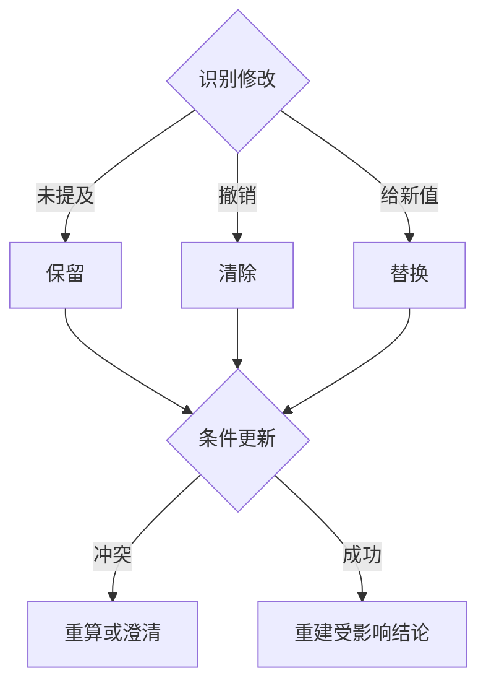

# 第 5 周 · 实践讲义｜多轮对话中的状态、证据与指代

**本周实验的流程参照：三态补丁与版本冲突怎样处理**



将实际执行记录与图中边界对齐；图所描述的是课程契约，尚未运行的依赖和分支不能据此标成已验证。


## 一次可以手算的并发实验

用 Java Map 存放两个会话，各保存 `version, place, day, shownIds, factRefs`。先给甲展示 [E06,D07]，给乙展示 [D07]。把“第二家”分别交给两者：甲可解析到 D07，乙应追问。然后给甲连续提交相同版本的两条更新，观察第二次是否被拒绝或显式重算。把 reducer 输出、数据库实际状态、送给下一轮模型的上下文并排打印。三者分别回答“想改什么、实际改了什么、模型看见什么”。

**验收变式。** 将地点由 E06 改成 D07 后，故意保留 E06 的 evidenceId。即使日期匹配，也禁止用该引用支撑 D07 的结论。先写一个会失败的作用域断言，再修改上下文组装逻辑。

## 老师先做一个状态更新测试

输入旧状态 `(room=E06, weekday=SAT, time=19:00)` 与补丁 `set(weekday=SUN)`。期望输出 `(E06,SUN,19:00)`，并撤销由周六证据推导的开放结论。再应用 `clear(time)`，预期只清除时刻；若业务允许限定整天，仍须保留星期。最后在另一个会话设置 room=D07，回头检查第一个会话仍指向 E06。

先手写补丁，给状态合并函数做无模型的确定性测试。再把模型生成的补丁接进来。这样一旦真实对话错了，就能判断是模型提取错还是程序合并错。

## 实验任务

复用第 4 周冻结版本，在同一命令行会话中支持改日期、换分馆、撤销条件和信息不足时追问。总上机预算 8 小时。用同一模型跑完整对话；用固定补丁写单测，把语言理解失败与状态合并错误分开。

1. **2 小时，设计状态和补丁。** 保存会话 ID、最近展示的有序候选、当前分馆、月份、星期、时间、硬条件、偏好及证据引用。写 `applyPatch`，覆盖沿用、替换和清除。示例补丁如下，它只修改星期。
2. **2 小时，实现证据失效。** 缓存条目附来源、版本、馆、主题和时段。改变分馆后撤销上轮针对该馆的结论；改变星期后重新选时间证据。可以继续复用包含整周时刻表的同一张卡，但需用新星期重新判定。
3. **2 小时，串起三轮。** 先问 E06 周六 19:00，再问“换周日”，最后问“换成油麻地”。每轮同时输出状态差异、实际引用与答复。两个馆在普通 11 月周日 19:00 恰好都已关闭，更要检查第三轮是否真的引用 E01。
4. **2 小时，做隔离与歧义测试。** 交错运行两个会话，一个查 E06，一个查 D07；都追问“周六呢”。再试“上面第二家”“不限时段”“附近十分钟内”。没有足够位置或路径信息时，检查是否澄清范围，并保留用户已说明的条件。

```json
{"set":{"weekday":"SUNDAY"},"clear":[]}
```

| 故障注入 | 错误表现 | 优先查看 |
| --- | --- | --- |
| 把未出现的字段设为 null | 一次改星期丢了分馆 | 补丁序列化与合并函数 |
| 只按 topic 缓存结论 | 换馆仍出现旧馆证据 | 缓存键及引用的 room_id |
| 两用户共用一个可变状态 | 同一句追问指向另一人的地点 | 会话键、状态持有者与并发更新 |

**产出。** 一份三轮轨迹、两条会话隔离断言和一份字段失效表。对一条长对话分别记录“完整历史”和“状态加必要证据”的输入 token、答对情况及遗漏的条件。若缩短上下文导致“第二家”的指代丢失，就把上一轮展示顺序补回状态。[时段核对来源](https://www.hkpl.gov.hk/tc/locations/opening-hours-04.html)

[本周理论讲义](./theory.md) · [本周每日课程](./daily.md) · [课程总目录](../../README.md)
