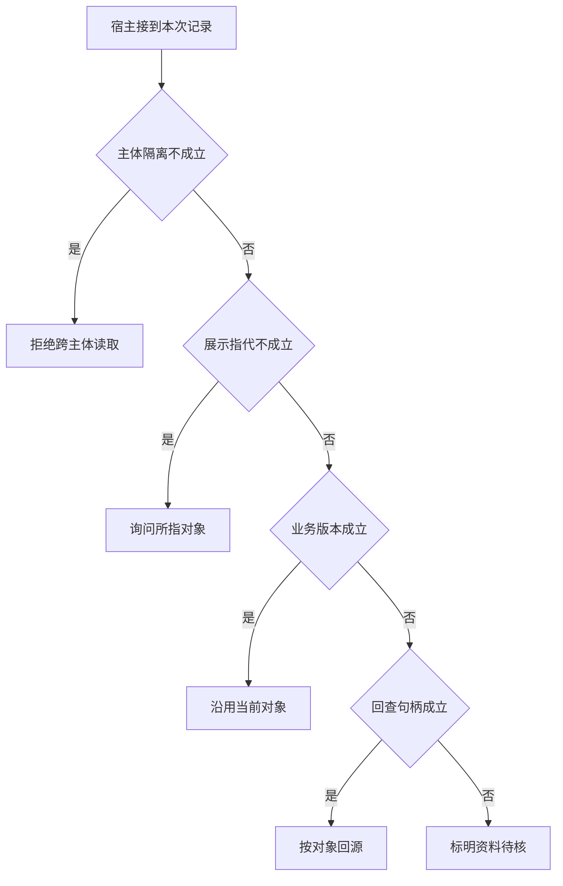

# 会话中的“上一家”属于谁

用户说第二家时，后台可能早已把排序反过来。
要恢复当时的显示批次、当前主体和有效资料版本。重新跑一次检索然后取第二名不能自动还原用户意图。

本篇用一个封闭的教学决策器说明这一问题。输入是宿主收到的记录，不保证每个下游字段都已经获准使用。前置检查未成立时，下游即使带着缓存值，也不能拿来作业务断言。

## 先解决一个具体问题

**为什么不能用最新排序解释用户所说的第二家？**

“第二家”指向上一轮真实展示快照。
新排序可能有不同顺序，即使更准确也改变参照对象。
记录显示批次及列表，然后再绑定业务 ID。


先取一个能走到「标明资料待核」的输入：数据与当前主体匹配、指代匹配用户所见列表、观察所依据版本已过期、无法取得原始材料。
把这四个条件代回后文的图，前面各个拦截分支都未满足，最终才有“指代成立但没有当前来源”这个判断。
还原这个现场时要分别问：哪些位来自可信状态，哪些只是在接口中出现、尚未获得解释资格的字段。

## 先沿一次决策走到底



从上到下取第一条成立的出口。只改一个开关时，只有它之前的检查都未截断，该变化才可能到达真实动作。

“主体隔离”的两种输入分别是“数据与当前主体匹配”与“数据属于另一主体”。
隔离应发生在把材料交给模型之前。

“展示指代”的两种输入分别是“指代匹配用户所见列表”与“指代无法唯一定位”。
第二家应基于真实展示批次而非最新内部排序。

“业务版本”的两种输入分别是“资料版本仍适用”与“观察所依据版本已过期”。
写入前应重新验证可能变化的业务前提。

“回查句柄”的两种输入分别是“能定位对应的原始材料”与“无法取得原始材料”。
摘要一旦丢失信息，需要可验证的回查路径。

## 最少需要哪几项观察

### 拒绝跨主体读取

记忆要在装入模型前进行隔离。
在本节的全部组合中，有 8 种产生「拒绝跨主体读取」，这只是逻辑空间的计数，不能当作实际用户请求的比例。

只取得数据属于另一主体，已经足以要求宿主「拒绝跨主体读取」。
保持这些已知项，其余开关自由变化，仍有 8 种补全，判断没有翻转。

若删掉关于主体隔离的证据，另一份允许的现场是数据与当前主体匹配、指代无法唯一定位、观察所依据版本已过期、无法取得原始材料，它会使宿主「询问所指对象」。

### 询问所指对象

无法由真实展示记录唯一定位。
在本节的全部组合中，有 4 种产生「询问所指对象」，这只是逻辑空间的计数，不能当作实际用户请求的比例。

只取得数据与当前主体匹配、指代无法唯一定位，已经足以要求宿主「询问所指对象」。
保持这些已知项，其余开关自由变化，仍有 4 种补全，判断没有翻转。

若删掉关于主体隔离的证据，另一份允许的现场是数据属于另一主体、指代无法唯一定位、观察所依据版本已过期、无法取得原始材料，它会使宿主「拒绝跨主体读取」。

若删掉关于展示指代的证据，另一份允许的现场是数据与当前主体匹配、指代匹配用户所见列表、观察所依据版本已过期、无法取得原始材料，它会使宿主「标明资料待核」。

### 沿用当前对象

显示与资料条件均成立。
在本节的全部组合中，有 2 种产生「沿用当前对象」，这只是逻辑空间的计数，不能当作实际用户请求的比例。

只取得数据与当前主体匹配、指代匹配用户所见列表、资料版本仍适用，已经足以要求宿主「沿用当前对象」。
保持这些已知项，其余开关自由变化，仍有 2 种补全，判断没有翻转。

若删掉关于主体隔离的证据，另一份允许的现场是数据属于另一主体、指代匹配用户所见列表、资料版本仍适用、无法取得原始材料，它会使宿主「拒绝跨主体读取」。

若删掉关于展示指代的证据，另一份允许的现场是数据与当前主体匹配、指代无法唯一定位、资料版本仍适用、无法取得原始材料，它会使宿主「询问所指对象」。

若删掉关于业务版本的证据，另一份允许的现场是数据与当前主体匹配、指代匹配用户所见列表、观察所依据版本已过期、无法取得原始材料，它会使宿主「标明资料待核」。

### 按对象回源

旧版本仍可定位但事实需要刷新。
在本节的全部组合中，有 1 种产生「按对象回源」，这只是逻辑空间的计数，不能当作实际用户请求的比例。

只取得数据与当前主体匹配、指代匹配用户所见列表、观察所依据版本已过期、能定位对应的原始材料，已经足以要求宿主「按对象回源」。
保持这些已知项，其余开关自由变化，仍有 1 种补全，判断没有翻转。

若删掉关于主体隔离的证据，另一份允许的现场是数据属于另一主体、指代匹配用户所见列表、观察所依据版本已过期、能定位对应的原始材料，它会使宿主「拒绝跨主体读取」。

若删掉关于展示指代的证据，另一份允许的现场是数据与当前主体匹配、指代无法唯一定位、观察所依据版本已过期、能定位对应的原始材料，它会使宿主「询问所指对象」。

若删掉关于业务版本的证据，另一份允许的现场是数据与当前主体匹配、指代匹配用户所见列表、资料版本仍适用、能定位对应的原始材料，它会使宿主「沿用当前对象」。

若删掉关于回查句柄的证据，另一份允许的现场是数据与当前主体匹配、指代匹配用户所见列表、观察所依据版本已过期、无法取得原始材料，它会使宿主「标明资料待核」。

### 标明资料待核

指代成立但没有当前来源。
在本节的全部组合中，有 1 种产生「标明资料待核」，这只是逻辑空间的计数，不能当作实际用户请求的比例。

只取得数据与当前主体匹配、指代匹配用户所见列表、观察所依据版本已过期、无法取得原始材料，已经足以要求宿主「标明资料待核」。

若删掉关于主体隔离的证据，另一份允许的现场是数据属于另一主体、指代匹配用户所见列表、观察所依据版本已过期、无法取得原始材料，它会使宿主「拒绝跨主体读取」。

若删掉关于展示指代的证据，另一份允许的现场是数据与当前主体匹配、指代无法唯一定位、观察所依据版本已过期、无法取得原始材料，它会使宿主「询问所指对象」。

若删掉关于业务版本的证据，另一份允许的现场是数据与当前主体匹配、指代匹配用户所见列表、资料版本仍适用、无法取得原始材料，它会使宿主「沿用当前对象」。

若删掉关于回查句柄的证据，另一份允许的现场是数据与当前主体匹配、指代匹配用户所见列表、观察所依据版本已过期、能定位对应的原始材料，它会使宿主「按对象回源」。

## 以同一份契约解释截然不同的现场

<details>
<summary>展开推演与对应反例</summary>

下列样本按最先命中的业务分支排列。四位编码只作本篇页内定位，顺序与开头的四项输入一致。可以先猜下一动作，再展开相邻样本。

### 能够触发“拒绝跨主体读取”的现场

**样本 0000**

业务侧交来数据属于另一主体、指代无法唯一定位，执行侧还记录了观察所依据版本已过期、无法取得原始材料。
把样本压成最短证明，保留数据属于另一主体就能支持「拒绝跨主体读取」。

在这份记录上，分别翻转「主体隔离」中的任一项，其他项完全不变时，下一动作都会改变。

保持其余观察不动，单独切换「展示指代」、「业务版本」、「回查句柄」仍得到「拒绝跨主体读取」，它们在这个现场不是决定性变量。

要从本例改走「询问所指对象」，至少需要变动 1 项，一组最少改动是将数据属于另一主体换成数据与当前主体匹配。

要从本例改走「标明资料待核」，至少需要变动 2 项，一组最少改动是将数据属于另一主体、指代无法唯一定位换成数据与当前主体匹配、指代匹配用户所见列表。

要从本例改走「按对象回源」，至少需要变动 3 项，一组最少改动是将数据属于另一主体、指代无法唯一定位、无法取得原始材料换成数据与当前主体匹配、指代匹配用户所见列表、能定位对应的原始材料。

要从本例改走「沿用当前对象」，至少需要变动 3 项，一组最少改动是将数据属于另一主体、指代无法唯一定位、观察所依据版本已过期换成数据与当前主体匹配、指代匹配用户所见列表、资料版本仍适用。

**样本 0001**

业务侧交来数据属于另一主体、指代无法唯一定位，执行侧还记录了观察所依据版本已过期、能定位对应的原始材料。


要从本例改走「按对象回源」，至少需要变动 2 项，一组最少改动是将数据属于另一主体、指代无法唯一定位换成数据与当前主体匹配、指代匹配用户所见列表。

要从本例改走「标明资料待核」，至少需要变动 3 项，一组最少改动是将数据属于另一主体、指代无法唯一定位、能定位对应的原始材料换成数据与当前主体匹配、指代匹配用户所见列表、无法取得原始材料。


**样本 0010**

业务侧交来数据属于另一主体、指代无法唯一定位，执行侧还记录了资料版本仍适用、无法取得原始材料。


要从本例改走「沿用当前对象」，至少需要变动 2 项，一组最少改动是将数据属于另一主体、指代无法唯一定位换成数据与当前主体匹配、指代匹配用户所见列表。

要从本例改走「标明资料待核」，至少需要变动 3 项，一组最少改动是将数据属于另一主体、指代无法唯一定位、资料版本仍适用换成数据与当前主体匹配、指代匹配用户所见列表、观察所依据版本已过期。

要从本例改走「按对象回源」，至少需要变动 4 项，一组最少改动是将数据属于另一主体、指代无法唯一定位、资料版本仍适用、无法取得原始材料换成数据与当前主体匹配、指代匹配用户所见列表、观察所依据版本已过期、能定位对应的原始材料。

**样本 0011**

业务侧交来数据属于另一主体、指代无法唯一定位，执行侧还记录了资料版本仍适用、能定位对应的原始材料。


要从本例改走「按对象回源」，至少需要变动 3 项，一组最少改动是将数据属于另一主体、指代无法唯一定位、资料版本仍适用换成数据与当前主体匹配、指代匹配用户所见列表、观察所依据版本已过期。

要从本例改走「标明资料待核」，至少需要变动 4 项，一组最少改动是将数据属于另一主体、指代无法唯一定位、资料版本仍适用、能定位对应的原始材料换成数据与当前主体匹配、指代匹配用户所见列表、观察所依据版本已过期、无法取得原始材料。

**样本 0100**

业务侧交来数据属于另一主体、指代匹配用户所见列表，执行侧还记录了观察所依据版本已过期、无法取得原始材料。


要从本例改走「标明资料待核」，至少需要变动 1 项，一组最少改动是将数据属于另一主体换成数据与当前主体匹配。

要从本例改走「询问所指对象」，至少需要变动 2 项，一组最少改动是将数据属于另一主体、指代匹配用户所见列表换成数据与当前主体匹配、指代无法唯一定位。

要从本例改走「按对象回源」，至少需要变动 2 项，一组最少改动是将数据属于另一主体、无法取得原始材料换成数据与当前主体匹配、能定位对应的原始材料。

要从本例改走「沿用当前对象」，至少需要变动 2 项，一组最少改动是将数据属于另一主体、观察所依据版本已过期换成数据与当前主体匹配、资料版本仍适用。

**样本 0101**

业务侧交来数据属于另一主体、指代匹配用户所见列表，执行侧还记录了观察所依据版本已过期、能定位对应的原始材料。


要从本例改走「按对象回源」，至少需要变动 1 项，一组最少改动是将数据属于另一主体换成数据与当前主体匹配。


要从本例改走「标明资料待核」，至少需要变动 2 项，一组最少改动是将数据属于另一主体、能定位对应的原始材料换成数据与当前主体匹配、无法取得原始材料。


**样本 0110**

业务侧交来数据属于另一主体、指代匹配用户所见列表，执行侧还记录了资料版本仍适用、无法取得原始材料。


要从本例改走「沿用当前对象」，至少需要变动 1 项，一组最少改动是将数据属于另一主体换成数据与当前主体匹配。


要从本例改走「标明资料待核」，至少需要变动 2 项，一组最少改动是将数据属于另一主体、资料版本仍适用换成数据与当前主体匹配、观察所依据版本已过期。

要从本例改走「按对象回源」，至少需要变动 3 项，一组最少改动是将数据属于另一主体、资料版本仍适用、无法取得原始材料换成数据与当前主体匹配、观察所依据版本已过期、能定位对应的原始材料。

**样本 0111**

业务侧交来数据属于另一主体、指代匹配用户所见列表，执行侧还记录了资料版本仍适用、能定位对应的原始材料。


要从本例改走「按对象回源」，至少需要变动 2 项，一组最少改动是将数据属于另一主体、资料版本仍适用换成数据与当前主体匹配、观察所依据版本已过期。

要从本例改走「标明资料待核」，至少需要变动 3 项，一组最少改动是将数据属于另一主体、资料版本仍适用、能定位对应的原始材料换成数据与当前主体匹配、观察所依据版本已过期、无法取得原始材料。

### 能够触发“询问所指对象”的现场

**样本 1000**

业务侧交来数据与当前主体匹配、指代无法唯一定位，执行侧还记录了观察所依据版本已过期、无法取得原始材料。
把样本压成最短证明，保留数据与当前主体匹配、指代无法唯一定位就能支持「询问所指对象」。

在这份记录上，分别翻转「主体隔离」、「展示指代」中的任一项，其他项完全不变时，下一动作都会改变。

保持其余观察不动，单独切换「业务版本」、「回查句柄」仍得到「询问所指对象」，它们在这个现场不是决定性变量。

本例没走更靠前的「拒绝跨主体读取」，因为数据与当前主体匹配与那个入口的必要条件不符。

要从本例改走「拒绝跨主体读取」，至少需要变动 1 项，一组最少改动是将数据与当前主体匹配换成数据属于另一主体。

要从本例改走「标明资料待核」，至少需要变动 1 项，一组最少改动是将指代无法唯一定位换成指代匹配用户所见列表。

要从本例改走「按对象回源」，至少需要变动 2 项，一组最少改动是将指代无法唯一定位、无法取得原始材料换成指代匹配用户所见列表、能定位对应的原始材料。

要从本例改走「沿用当前对象」，至少需要变动 2 项，一组最少改动是将指代无法唯一定位、观察所依据版本已过期换成指代匹配用户所见列表、资料版本仍适用。

**样本 1001**

业务侧交来数据与当前主体匹配、指代无法唯一定位，执行侧还记录了观察所依据版本已过期、能定位对应的原始材料。


要从本例改走「按对象回源」，至少需要变动 1 项，一组最少改动是将指代无法唯一定位换成指代匹配用户所见列表。

要从本例改走「标明资料待核」，至少需要变动 2 项，一组最少改动是将指代无法唯一定位、能定位对应的原始材料换成指代匹配用户所见列表、无法取得原始材料。


**样本 1010**

业务侧交来数据与当前主体匹配、指代无法唯一定位，执行侧还记录了资料版本仍适用、无法取得原始材料。


要从本例改走「沿用当前对象」，至少需要变动 1 项，一组最少改动是将指代无法唯一定位换成指代匹配用户所见列表。

要从本例改走「标明资料待核」，至少需要变动 2 项，一组最少改动是将指代无法唯一定位、资料版本仍适用换成指代匹配用户所见列表、观察所依据版本已过期。

要从本例改走「按对象回源」，至少需要变动 3 项，一组最少改动是将指代无法唯一定位、资料版本仍适用、无法取得原始材料换成指代匹配用户所见列表、观察所依据版本已过期、能定位对应的原始材料。

**样本 1011**

业务侧交来数据与当前主体匹配、指代无法唯一定位，执行侧还记录了资料版本仍适用、能定位对应的原始材料。


要从本例改走「按对象回源」，至少需要变动 2 项，一组最少改动是将指代无法唯一定位、资料版本仍适用换成指代匹配用户所见列表、观察所依据版本已过期。

要从本例改走「标明资料待核」，至少需要变动 3 项，一组最少改动是将指代无法唯一定位、资料版本仍适用、能定位对应的原始材料换成指代匹配用户所见列表、观察所依据版本已过期、无法取得原始材料。

### 能够触发“沿用当前对象”的现场

**样本 1110**

业务侧交来数据与当前主体匹配、指代匹配用户所见列表，执行侧还记录了资料版本仍适用、无法取得原始材料。
把样本压成最短证明，保留数据与当前主体匹配、指代匹配用户所见列表、资料版本仍适用就能支持「沿用当前对象」。

在这份记录上，分别翻转「主体隔离」、「展示指代」、「业务版本」中的任一项，其他项完全不变时，下一动作都会改变。

保持其余观察不动，单独切换「回查句柄」仍得到「沿用当前对象」，它们在这个现场不是决定性变量。


本例没走更靠前的「询问所指对象」，因为指代匹配用户所见列表与那个入口的必要条件不符。


要从本例改走「询问所指对象」，至少需要变动 1 项，一组最少改动是将指代匹配用户所见列表换成指代无法唯一定位。

要从本例改走「标明资料待核」，至少需要变动 1 项，一组最少改动是将资料版本仍适用换成观察所依据版本已过期。

要从本例改走「按对象回源」，至少需要变动 2 项，一组最少改动是将资料版本仍适用、无法取得原始材料换成观察所依据版本已过期、能定位对应的原始材料。

**样本 1111**

业务侧交来数据与当前主体匹配、指代匹配用户所见列表，执行侧还记录了资料版本仍适用、能定位对应的原始材料。


要从本例改走「按对象回源」，至少需要变动 1 项，一组最少改动是将资料版本仍适用换成观察所依据版本已过期。

要从本例改走「标明资料待核」，至少需要变动 2 项，一组最少改动是将资料版本仍适用、能定位对应的原始材料换成观察所依据版本已过期、无法取得原始材料。

### 能够触发“按对象回源”的现场

**样本 1101**

业务侧交来数据与当前主体匹配、指代匹配用户所见列表，执行侧还记录了观察所依据版本已过期、能定位对应的原始材料。
把样本压成最短证明，保留数据与当前主体匹配、指代匹配用户所见列表、观察所依据版本已过期、能定位对应的原始材料就能支持「按对象回源」。

在这份记录上，分别翻转「主体隔离」、「展示指代」、「业务版本」、「回查句柄」中的任一项，其他项完全不变时，下一动作都会改变。


本例没走更靠前的「沿用当前对象」，因为观察所依据版本已过期与那个入口的必要条件不符。


要从本例改走「标明资料待核」，至少需要变动 1 项，一组最少改动是将能定位对应的原始材料换成无法取得原始材料。

要从本例改走「沿用当前对象」，至少需要变动 1 项，一组最少改动是将观察所依据版本已过期换成资料版本仍适用。

### 能够触发“标明资料待核”的现场

**样本 1100**

业务侧交来数据与当前主体匹配、指代匹配用户所见列表，执行侧还记录了观察所依据版本已过期、无法取得原始材料。
把样本压成最短证明，保留数据与当前主体匹配、指代匹配用户所见列表、观察所依据版本已过期、无法取得原始材料就能支持「标明资料待核」。


本例没走更靠前的「按对象回源」，因为无法取得原始材料与那个入口的必要条件不符。


要从本例改走「按对象回源」，至少需要变动 1 项，一组最少改动是将无法取得原始材料换成能定位对应的原始材料。


</details>

## 当你只能看见一半记录

<details>
<summary>展开推演与对应反例</summary>

这次隐藏两个字段，保留另两个。对每个可见现场，检查四种合法补全是否同意。如仍有歧义，选择能使最坏剩余候选动作最少的字段继续查。并列时采用本篇字段顺序。

### 只保留主体隔离与展示指代

已知数据属于另一主体、指代无法唯一定位时，四种补全的动作分布为拒绝跨主体读取（4 种）。

就“拒绝跨主体读取”这个动作而言，在数据属于另一主体、指代无法唯一定位的前提下，另外两项观察不会推翻它。

已知数据属于另一主体、指代匹配用户所见列表时，四种补全的动作分布为拒绝跨主体读取（4 种）。

就“拒绝跨主体读取”这个动作而言，在数据属于另一主体、指代匹配用户所见列表的前提下，另外两项观察不会推翻它。

已知数据与当前主体匹配、指代无法唯一定位时，四种补全的动作分布为询问所指对象（4 种）。

就“询问所指对象”这个动作而言，在数据与当前主体匹配、指代无法唯一定位的前提下，另外两项观察不会推翻它。

已知数据与当前主体匹配、指代匹配用户所见列表时，四种补全的动作分布为沿用当前对象（2 种）、按对象回源（1 种）、标明资料待核（1 种）。

在数据与当前主体匹配、指代匹配用户所见列表这个现场补读「业务版本」，最坏还剩 2 种动作，计算时只衡量歧义，尚未扣读取代价。
若补来的观察为“观察所依据版本已过期”，范围缩成「标明资料待核」、「按对象回源」。若为“资料版本仍适用”，则保留「沿用当前对象」。

区分不了的两条执行可以具体写成 1100 与 1101：它们共享已展示字段，却分别需要「标明资料待核」和「按对象回源」。

### 只保留主体隔离与业务版本

已知数据属于另一主体、观察所依据版本已过期时，四种补全的动作分布为拒绝跨主体读取（4 种）。

就“拒绝跨主体读取”这个动作而言，在数据属于另一主体、观察所依据版本已过期的前提下，另外两项观察不会推翻它。

已知数据属于另一主体、资料版本仍适用时，四种补全的动作分布为拒绝跨主体读取（4 种）。

就“拒绝跨主体读取”这个动作而言，在数据属于另一主体、资料版本仍适用的前提下，另外两项观察不会推翻它。

已知数据与当前主体匹配、观察所依据版本已过期时，四种补全的动作分布为询问所指对象（2 种）、按对象回源（1 种）、标明资料待核（1 种）。

在数据与当前主体匹配、观察所依据版本已过期这个现场补读「展示指代」，最坏还剩 2 种动作，计算时只衡量歧义，尚未扣读取代价。
若补来的观察为“指代无法唯一定位”，范围缩成「询问所指对象」。若为“指代匹配用户所见列表”，则保留「标明资料待核」、「按对象回源」。

区分不了的两条执行可以具体写成 1000 与 1100：它们共享已展示字段，却分别需要「询问所指对象」和「标明资料待核」。

已知数据与当前主体匹配、资料版本仍适用时，四种补全的动作分布为询问所指对象（2 种）、沿用当前对象（2 种）。

在数据与当前主体匹配、资料版本仍适用这个现场补读「展示指代」，最坏还剩 1 种动作，计算时只衡量歧义，尚未扣读取代价。
若补来的观察为“指代无法唯一定位”，范围缩成「询问所指对象」。若为“指代匹配用户所见列表”，则保留「沿用当前对象」。

区分不了的两条执行可以具体写成 1010 与 1110：它们共享已展示字段，却分别需要「询问所指对象」和「沿用当前对象」。

### 只保留展示指代与业务版本

已知指代无法唯一定位、观察所依据版本已过期时，四种补全的动作分布为拒绝跨主体读取（2 种）、询问所指对象（2 种）。

在指代无法唯一定位、观察所依据版本已过期这个现场补读「主体隔离」，最坏还剩 1 种动作，计算时只衡量歧义，尚未扣读取代价。
若补来的观察为“数据属于另一主体”，范围缩成「拒绝跨主体读取」。若为“数据与当前主体匹配”，则保留「询问所指对象」。

区分不了的两条执行可以具体写成 0000 与 1000：它们共享已展示字段，却分别需要「拒绝跨主体读取」和「询问所指对象」。

已知指代无法唯一定位、资料版本仍适用时，四种补全的动作分布为拒绝跨主体读取（2 种）、询问所指对象（2 种）。

在指代无法唯一定位、资料版本仍适用这个现场补读「主体隔离」，最坏还剩 1 种动作，计算时只衡量歧义，尚未扣读取代价。

区分不了的两条执行可以具体写成 0010 与 1010：它们共享已展示字段，却分别需要「拒绝跨主体读取」和「询问所指对象」。

已知指代匹配用户所见列表、观察所依据版本已过期时，四种补全的动作分布为拒绝跨主体读取（2 种）、按对象回源（1 种）、标明资料待核（1 种）。

在指代匹配用户所见列表、观察所依据版本已过期这个现场补读「主体隔离」，最坏还剩 2 种动作，计算时只衡量歧义，尚未扣读取代价。
若补来的观察为“数据属于另一主体”，范围缩成「拒绝跨主体读取」。若为“数据与当前主体匹配”，则保留「标明资料待核」、「按对象回源」。

区分不了的两条执行可以具体写成 0100 与 1100：它们共享已展示字段，却分别需要「拒绝跨主体读取」和「标明资料待核」。

已知指代匹配用户所见列表、资料版本仍适用时，四种补全的动作分布为拒绝跨主体读取（2 种）、沿用当前对象（2 种）。

在指代匹配用户所见列表、资料版本仍适用这个现场补读「主体隔离」，最坏还剩 1 种动作，计算时只衡量歧义，尚未扣读取代价。
若补来的观察为“数据属于另一主体”，范围缩成「拒绝跨主体读取」。若为“数据与当前主体匹配”，则保留「沿用当前对象」。

区分不了的两条执行可以具体写成 0110 与 1110：它们共享已展示字段，却分别需要「拒绝跨主体读取」和「沿用当前对象」。

### 只保留主体隔离与回查句柄

已知数据属于另一主体、无法取得原始材料时，四种补全的动作分布为拒绝跨主体读取（4 种）。

就“拒绝跨主体读取”这个动作而言，在数据属于另一主体、无法取得原始材料的前提下，另外两项观察不会推翻它。

已知数据属于另一主体、能定位对应的原始材料时，四种补全的动作分布为拒绝跨主体读取（4 种）。

就“拒绝跨主体读取”这个动作而言，在数据属于另一主体、能定位对应的原始材料的前提下，另外两项观察不会推翻它。

已知数据与当前主体匹配、无法取得原始材料时，四种补全的动作分布为询问所指对象（2 种）、沿用当前对象（1 种）、标明资料待核（1 种）。

在数据与当前主体匹配、无法取得原始材料这个现场补读「展示指代」，最坏还剩 2 种动作，计算时只衡量歧义，尚未扣读取代价。
若补来的观察为“指代无法唯一定位”，范围缩成「询问所指对象」。若为“指代匹配用户所见列表”，则保留「标明资料待核」、「沿用当前对象」。


已知数据与当前主体匹配、能定位对应的原始材料时，四种补全的动作分布为询问所指对象（2 种）、沿用当前对象（1 种）、按对象回源（1 种）。

在数据与当前主体匹配、能定位对应的原始材料这个现场补读「展示指代」，最坏还剩 2 种动作，计算时只衡量歧义，尚未扣读取代价。
若补来的观察为“指代无法唯一定位”，范围缩成「询问所指对象」。若为“指代匹配用户所见列表”，则保留「按对象回源」、「沿用当前对象」。

区分不了的两条执行可以具体写成 1001 与 1101：它们共享已展示字段，却分别需要「询问所指对象」和「按对象回源」。

### 只保留展示指代与回查句柄

已知指代无法唯一定位、无法取得原始材料时，四种补全的动作分布为拒绝跨主体读取（2 种）、询问所指对象（2 种）。

在指代无法唯一定位、无法取得原始材料这个现场补读「主体隔离」，最坏还剩 1 种动作，计算时只衡量歧义，尚未扣读取代价。


已知指代无法唯一定位、能定位对应的原始材料时，四种补全的动作分布为拒绝跨主体读取（2 种）、询问所指对象（2 种）。

在指代无法唯一定位、能定位对应的原始材料这个现场补读「主体隔离」，最坏还剩 1 种动作，计算时只衡量歧义，尚未扣读取代价。

区分不了的两条执行可以具体写成 0001 与 1001：它们共享已展示字段，却分别需要「拒绝跨主体读取」和「询问所指对象」。

已知指代匹配用户所见列表、无法取得原始材料时，四种补全的动作分布为拒绝跨主体读取（2 种）、沿用当前对象（1 种）、标明资料待核（1 种）。

在指代匹配用户所见列表、无法取得原始材料这个现场补读「主体隔离」，最坏还剩 2 种动作，计算时只衡量歧义，尚未扣读取代价。
若补来的观察为“数据属于另一主体”，范围缩成「拒绝跨主体读取」。若为“数据与当前主体匹配”，则保留「标明资料待核」、「沿用当前对象」。


已知指代匹配用户所见列表、能定位对应的原始材料时，四种补全的动作分布为拒绝跨主体读取（2 种）、沿用当前对象（1 种）、按对象回源（1 种）。

在指代匹配用户所见列表、能定位对应的原始材料这个现场补读「主体隔离」，最坏还剩 2 种动作，计算时只衡量歧义，尚未扣读取代价。
若补来的观察为“数据属于另一主体”，范围缩成「拒绝跨主体读取」。若为“数据与当前主体匹配”，则保留「按对象回源」、「沿用当前对象」。

区分不了的两条执行可以具体写成 0101 与 1101：它们共享已展示字段，却分别需要「拒绝跨主体读取」和「按对象回源」。

### 只保留业务版本与回查句柄

已知观察所依据版本已过期、无法取得原始材料时，四种补全的动作分布为拒绝跨主体读取（2 种）、询问所指对象（1 种）、标明资料待核（1 种）。

在观察所依据版本已过期、无法取得原始材料这个现场补读「主体隔离」，最坏还剩 2 种动作，计算时只衡量歧义，尚未扣读取代价。
若补来的观察为“数据属于另一主体”，范围缩成「拒绝跨主体读取」。若为“数据与当前主体匹配”，则保留「询问所指对象」、「标明资料待核」。


已知观察所依据版本已过期、能定位对应的原始材料时，四种补全的动作分布为拒绝跨主体读取（2 种）、询问所指对象（1 种）、按对象回源（1 种）。

在观察所依据版本已过期、能定位对应的原始材料这个现场补读「主体隔离」，最坏还剩 2 种动作，计算时只衡量歧义，尚未扣读取代价。
若补来的观察为“数据属于另一主体”，范围缩成「拒绝跨主体读取」。若为“数据与当前主体匹配”，则保留「询问所指对象」、「按对象回源」。


已知资料版本仍适用、无法取得原始材料时，四种补全的动作分布为拒绝跨主体读取（2 种）、询问所指对象（1 种）、沿用当前对象（1 种）。

在资料版本仍适用、无法取得原始材料这个现场补读「主体隔离」，最坏还剩 2 种动作，计算时只衡量歧义，尚未扣读取代价。
若补来的观察为“数据属于另一主体”，范围缩成「拒绝跨主体读取」。若为“数据与当前主体匹配”，则保留「询问所指对象」、「沿用当前对象」。


已知资料版本仍适用、能定位对应的原始材料时，四种补全的动作分布为拒绝跨主体读取（2 种）、询问所指对象（1 种）、沿用当前对象（1 种）。

在资料版本仍适用、能定位对应的原始材料这个现场补读「主体隔离」，最坏还剩 2 种动作，计算时只衡量歧义，尚未扣读取代价。

区分不了的两条执行可以具体写成 0011 与 1011：它们共享已展示字段，却分别需要「拒绝跨主体读取」和「询问所指对象」。

</details>

## 单因素干预与边界测试

<details>
<summary>展开推演与对应反例</summary>

### 只改变主体隔离

固定另外三个条件得到八对现场，从“数据属于另一主体”转为“数据与当前主体匹配”时，8 对翻转动作，另外 0 对保持不变。

有 4 对现场沿「拒绝跨主体读取」变到「询问所指对象」，可复现的一组受控背景为指代无法唯一定位、观察所依据版本已过期、无法取得原始材料。

有 1 对现场沿「拒绝跨主体读取」变到「标明资料待核」，可复现的一组受控背景为指代匹配用户所见列表、观察所依据版本已过期、无法取得原始材料。

有 1 对现场沿「拒绝跨主体读取」变到「按对象回源」，可复现的一组受控背景为指代匹配用户所见列表、观察所依据版本已过期、能定位对应的原始材料。

有 2 对现场沿「拒绝跨主体读取」变到「沿用当前对象」，可复现的一组受控背景为指代匹配用户所见列表、资料版本仍适用、无法取得原始材料。

### 只改变展示指代

固定另外三个条件得到八对现场，从“指代无法唯一定位”转为“指代匹配用户所见列表”时，4 对翻转动作，另外 4 对保持不变。

令数据属于另一主体、观察所依据版本已过期、无法取得原始材料，展示指代的两个取值均得到「拒绝跨主体读取」。在八对中，共有 4 对表现为这一种稳定出口。

有 1 对现场沿「询问所指对象」变到「标明资料待核」，可复现的一组受控背景为数据与当前主体匹配、观察所依据版本已过期、无法取得原始材料。

有 1 对现场沿「询问所指对象」变到「按对象回源」，可复现的一组受控背景为数据与当前主体匹配、观察所依据版本已过期、能定位对应的原始材料。

有 2 对现场沿「询问所指对象」变到「沿用当前对象」，可复现的一组受控背景为数据与当前主体匹配、资料版本仍适用、无法取得原始材料。

### 只改变业务版本

固定另外三个条件得到八对现场，从“观察所依据版本已过期”转为“资料版本仍适用”时，2 对翻转动作，另外 6 对保持不变。

令数据属于另一主体、指代无法唯一定位、无法取得原始材料，业务版本的两个取值均得到「拒绝跨主体读取」。在八对中，共有 4 对表现为这一种稳定出口。

令数据与当前主体匹配、指代无法唯一定位、无法取得原始材料，业务版本的两个取值均得到「询问所指对象」。在八对中，共有 2 对表现为这一种稳定出口。

有 1 对现场沿「标明资料待核」变到「沿用当前对象」，可复现的一组受控背景为数据与当前主体匹配、指代匹配用户所见列表、无法取得原始材料。

有 1 对现场沿「按对象回源」变到「沿用当前对象」，可复现的一组受控背景为数据与当前主体匹配、指代匹配用户所见列表、能定位对应的原始材料。

### 只改变回查句柄

固定另外三个条件得到八对现场，从“无法取得原始材料”转为“能定位对应的原始材料”时，1 对翻转动作，另外 7 对保持不变。

令数据属于另一主体、指代无法唯一定位、观察所依据版本已过期，回查句柄的两个取值均得到「拒绝跨主体读取」。在八对中，共有 4 对表现为这一种稳定出口。

令数据与当前主体匹配、指代无法唯一定位、观察所依据版本已过期，回查句柄的两个取值均得到「询问所指对象」。在八对中，共有 2 对表现为这一种稳定出口。

有 1 对现场沿「标明资料待核」变到「按对象回源」，可复现的一组受控背景为数据与当前主体匹配、指代匹配用户所见列表、观察所依据版本已过期。

令数据与当前主体匹配、指代匹配用户所见列表、资料版本仍适用，回查句柄的两个取值均得到「沿用当前对象」。在八对中，共有 1 对表现为这一种稳定出口。

</details>

## 哪些回归样本真能抓住实现错误

<details>
<summary>展开推演与对应反例</summary>

如果删除“拒绝跨主体读取”这个分支，在本篇 16 种输入里有 8 种会改走另一出口。

反例 0000 的完整记录为数据属于另一主体、指代无法唯一定位、观察所依据版本已过期、无法取得原始材料。正确结果是「拒绝跨主体读取」，这个改坏的实现却给出「询问所指对象」。

如果删除“询问所指对象”这个分支，在本篇 16 种输入里有 4 种会改走另一出口。

反例 1000 的完整记录为数据与当前主体匹配、指代无法唯一定位、观察所依据版本已过期、无法取得原始材料。正确结果是「询问所指对象」，这个改坏的实现却给出「标明资料待核」。

如果删除“沿用当前对象”这个分支，在本篇 16 种输入里有 2 种会改走另一出口。

反例 1110 的完整记录为数据与当前主体匹配、指代匹配用户所见列表、资料版本仍适用、无法取得原始材料。正确结果是「沿用当前对象」，这个改坏的实现却给出「标明资料待核」。

如果删除“按对象回源”这个分支，在本篇 16 种输入里有 1 种会改走另一出口。

反例 1101 的完整记录为数据与当前主体匹配、指代匹配用户所见列表、观察所依据版本已过期、能定位对应的原始材料。正确结果是「按对象回源」，这个改坏的实现却给出「标明资料待核」。

如果交换“拒绝跨主体读取”和“询问所指对象”的判断次序，在本篇 16 种输入里有 4 种会改走另一出口。


如果交换“询问所指对象”和“沿用当前对象”的判断次序，在本篇 16 种输入里有 2 种会改走另一出口。

反例 1010 的完整记录为数据与当前主体匹配、指代无法唯一定位、资料版本仍适用、无法取得原始材料。正确结果是「询问所指对象」，这个改坏的实现却给出「沿用当前对象」。

如果交换“沿用当前对象”和“按对象回源”的判断次序，在本篇 16 种输入里有 1 种会改走另一出口。

反例 1111 的完整记录为数据与当前主体匹配、指代匹配用户所见列表、资料版本仍适用、能定位对应的原始材料。正确结果是「沿用当前对象」，这个改坏的实现却给出「按对象回源」。

补入样本 0000（数据属于另一主体、指代无法唯一定位、观察所依据版本已过期、无法取得原始材料）能新增检出「删除“拒绝跨主体读取”这个分支」、「交换“拒绝跨主体读取”和“询问所指对象”的判断次序」。

补入样本 1010（数据与当前主体匹配、指代无法唯一定位、资料版本仍适用、无法取得原始材料）能新增检出「删除“询问所指对象”这个分支」、「交换“询问所指对象”和“沿用当前对象”的判断次序」。

补入样本 1111（数据与当前主体匹配、指代匹配用户所见列表、资料版本仍适用、能定位对应的原始材料）能新增检出「删除“沿用当前对象”这个分支」、「交换“沿用当前对象”和“按对象回源”的判断次序」。

补入样本 1101（数据与当前主体匹配、指代匹配用户所见列表、观察所依据版本已过期、能定位对应的原始材料）能新增检出「删除“按对象回源”这个分支」。

这里每次选覆盖尚未捕获缺陷最多的样本，并不保证用例数全局最小。它给出的反例能作为 Java 单测输入。真实模型是否会自主产生这些提议，仍须单独评测。

</details>

## 把状态覆盖换成有抽样偏差的评测批次

<details>
<summary>展开推演与对应反例</summary>

前面的十六种记录各有一票。现在只改样本构成：对一个给定字段，把成立侧的每种记录各取三份、另一侧各取一份。这是人为配比的 32 份回放，不是线上频率估计。
将偏向成立与偏向不成立的两次批次对照，可以隔离分母变化。底层宿主和所有答案保持相同，比例仍可能移动。

### 改变“主体隔离”的样本配比

只看「拒绝跨主体读取」，在数据与当前主体匹配的八个不同输入中有 0 个命中，在数据属于另一主体的另八个输入中有 8 个命中。
把「主体隔离」成立侧按三倍取样，「拒绝跨主体读取」占 8/32，反过来向未成立侧倾斜后占 24/32。
这次重加权使「拒绝跨主体读取」的占比相差 50 个百分点。若按两种不同的“主体隔离”分布跑新旧版，不能把这项差异全部归功于实现。

只看「询问所指对象」，在数据与当前主体匹配的八个不同输入中有 4 个命中，在数据属于另一主体的另八个输入中有 0 个命中。
把「主体隔离」成立侧按三倍取样，「询问所指对象」占 12/32，反过来向未成立侧倾斜后占 4/32。
这次重加权使「询问所指对象」的占比相差 25 个百分点。若按两种不同的“主体隔离”分布跑新旧版，不能把这项差异全部归功于实现。

只看「沿用当前对象」，在数据与当前主体匹配的八个不同输入中有 2 个命中，在数据属于另一主体的另八个输入中有 0 个命中。
把「主体隔离」成立侧按三倍取样，「沿用当前对象」占 6/32，反过来向未成立侧倾斜后占 2/32。
这次重加权使「沿用当前对象」的占比相差 12.5 个百分点。若按两种不同的“主体隔离”分布跑新旧版，不能把这项差异全部归功于实现。

只看「按对象回源」，在数据与当前主体匹配的八个不同输入中有 1 个命中，在数据属于另一主体的另八个输入中有 0 个命中。
把「主体隔离」成立侧按三倍取样，「按对象回源」占 3/32，反过来向未成立侧倾斜后占 1/32。
这次重加权使「按对象回源」的占比相差 6.25 个百分点。若按两种不同的“主体隔离”分布跑新旧版，不能把这项差异全部归功于实现。

只看「标明资料待核」，在数据与当前主体匹配的八个不同输入中有 1 个命中，在数据属于另一主体的另八个输入中有 0 个命中。
把「主体隔离」成立侧按三倍取样，「标明资料待核」占 3/32，反过来向未成立侧倾斜后占 1/32。
这次重加权使「标明资料待核」的占比相差 6.25 个百分点。若按两种不同的“主体隔离”分布跑新旧版，不能把这项差异全部归功于实现。

### 改变“展示指代”的样本配比

只看「拒绝跨主体读取」，在指代匹配用户所见列表的八个不同输入中有 4 个命中，在指代无法唯一定位的另八个输入中有 4 个命中。
把「展示指代」成立侧按三倍取样，「拒绝跨主体读取」占 16/32，反过来向未成立侧倾斜后占 16/32。
两批「拒绝跨主体读取」的边际比例相同，是因为这个出口在“展示指代”的两侧计数相等，这不能单独证明每一对现场都不受它影响。

只看「询问所指对象」，在指代匹配用户所见列表的八个不同输入中有 0 个命中，在指代无法唯一定位的另八个输入中有 4 个命中。
把「展示指代」成立侧按三倍取样，「询问所指对象」占 4/32，反过来向未成立侧倾斜后占 12/32。
这次重加权使「询问所指对象」的占比相差 25 个百分点。若按两种不同的“展示指代”分布跑新旧版，不能把这项差异全部归功于实现。

只看「沿用当前对象」，在指代匹配用户所见列表的八个不同输入中有 2 个命中，在指代无法唯一定位的另八个输入中有 0 个命中。
把「展示指代」成立侧按三倍取样，「沿用当前对象」占 6/32，反过来向未成立侧倾斜后占 2/32。
这次重加权使「沿用当前对象」的占比相差 12.5 个百分点。若按两种不同的“展示指代”分布跑新旧版，不能把这项差异全部归功于实现。

只看「按对象回源」，在指代匹配用户所见列表的八个不同输入中有 1 个命中，在指代无法唯一定位的另八个输入中有 0 个命中。
把「展示指代」成立侧按三倍取样，「按对象回源」占 3/32，反过来向未成立侧倾斜后占 1/32。
这次重加权使「按对象回源」的占比相差 6.25 个百分点。若按两种不同的“展示指代”分布跑新旧版，不能把这项差异全部归功于实现。

只看「标明资料待核」，在指代匹配用户所见列表的八个不同输入中有 1 个命中，在指代无法唯一定位的另八个输入中有 0 个命中。
把「展示指代」成立侧按三倍取样，「标明资料待核」占 3/32，反过来向未成立侧倾斜后占 1/32。
这次重加权使「标明资料待核」的占比相差 6.25 个百分点。若按两种不同的“展示指代”分布跑新旧版，不能把这项差异全部归功于实现。

### 改变“业务版本”的样本配比

只看「拒绝跨主体读取」，在资料版本仍适用的八个不同输入中有 4 个命中，在观察所依据版本已过期的另八个输入中有 4 个命中。
把「业务版本」成立侧按三倍取样，「拒绝跨主体读取」占 16/32，反过来向未成立侧倾斜后占 16/32。
两批「拒绝跨主体读取」的边际比例相同，是因为这个出口在“业务版本”的两侧计数相等，这不能单独证明每一对现场都不受它影响。

只看「询问所指对象」，在资料版本仍适用的八个不同输入中有 2 个命中，在观察所依据版本已过期的另八个输入中有 2 个命中。
把「业务版本」成立侧按三倍取样，「询问所指对象」占 8/32，反过来向未成立侧倾斜后占 8/32。
两批「询问所指对象」的边际比例相同，是因为这个出口在“业务版本”的两侧计数相等，这不能单独证明每一对现场都不受它影响。

只看「沿用当前对象」，在资料版本仍适用的八个不同输入中有 2 个命中，在观察所依据版本已过期的另八个输入中有 0 个命中。
把「业务版本」成立侧按三倍取样，「沿用当前对象」占 6/32，反过来向未成立侧倾斜后占 2/32。
这次重加权使「沿用当前对象」的占比相差 12.5 个百分点。若按两种不同的“业务版本”分布跑新旧版，不能把这项差异全部归功于实现。

只看「按对象回源」，在资料版本仍适用的八个不同输入中有 0 个命中，在观察所依据版本已过期的另八个输入中有 1 个命中。
把「业务版本」成立侧按三倍取样，「按对象回源」占 1/32，反过来向未成立侧倾斜后占 3/32。
这次重加权使「按对象回源」的占比相差 6.25 个百分点。若按两种不同的“业务版本”分布跑新旧版，不能把这项差异全部归功于实现。

只看「标明资料待核」，在资料版本仍适用的八个不同输入中有 0 个命中，在观察所依据版本已过期的另八个输入中有 1 个命中。
把「业务版本」成立侧按三倍取样，「标明资料待核」占 1/32，反过来向未成立侧倾斜后占 3/32。
这次重加权使「标明资料待核」的占比相差 6.25 个百分点。若按两种不同的“业务版本”分布跑新旧版，不能把这项差异全部归功于实现。

### 改变“回查句柄”的样本配比

只看「拒绝跨主体读取」，在能定位对应的原始材料的八个不同输入中有 4 个命中，在无法取得原始材料的另八个输入中有 4 个命中。
把「回查句柄」成立侧按三倍取样，「拒绝跨主体读取」占 16/32，反过来向未成立侧倾斜后占 16/32。
两批「拒绝跨主体读取」的边际比例相同，是因为这个出口在“回查句柄”的两侧计数相等，这不能单独证明每一对现场都不受它影响。

只看「询问所指对象」，在能定位对应的原始材料的八个不同输入中有 2 个命中，在无法取得原始材料的另八个输入中有 2 个命中。
把「回查句柄」成立侧按三倍取样，「询问所指对象」占 8/32，反过来向未成立侧倾斜后占 8/32。
两批「询问所指对象」的边际比例相同，是因为这个出口在“回查句柄”的两侧计数相等，这不能单独证明每一对现场都不受它影响。

只看「沿用当前对象」，在能定位对应的原始材料的八个不同输入中有 1 个命中，在无法取得原始材料的另八个输入中有 1 个命中。
把「回查句柄」成立侧按三倍取样，「沿用当前对象」占 4/32，反过来向未成立侧倾斜后占 4/32。
两批「沿用当前对象」的边际比例相同，是因为这个出口在“回查句柄”的两侧计数相等，这不能单独证明每一对现场都不受它影响。

只看「按对象回源」，在能定位对应的原始材料的八个不同输入中有 1 个命中，在无法取得原始材料的另八个输入中有 0 个命中。
把「回查句柄」成立侧按三倍取样，「按对象回源」占 3/32，反过来向未成立侧倾斜后占 1/32。
这次重加权使「按对象回源」的占比相差 6.25 个百分点。若按两种不同的“回查句柄”分布跑新旧版，不能把这项差异全部归功于实现。

只看「标明资料待核」，在能定位对应的原始材料的八个不同输入中有 0 个命中，在无法取得原始材料的另八个输入中有 1 个命中。
把「回查句柄」成立侧按三倍取样，「标明资料待核」占 1/32，反过来向未成立侧倾斜后占 3/32。
这次重加权使「标明资料待核」的占比相差 6.25 个百分点。若按两种不同的“回查句柄”分布跑新旧版，不能把这项差异全部归功于实现。

</details>

## 只看终态，能逆推出多少原始事实

<details>
<summary>展开推演与对应反例</summary>

### 只保留“拒绝跨主体读取”这条结果时

在本节契约与完整输入域内，仅知「拒绝跨主体读取」就能倒推出数据属于另一主体，这一推断依赖版本未变且日志中的终态可信。

「拒绝跨主体读取」不能证明展示指代取哪一侧：0000 和 0100 有相同终态，却分别记为“指代无法唯一定位”和“指代匹配用户所见列表”。

「拒绝跨主体读取」不能证明业务版本取哪一侧：0000 和 0010 有相同终态，却分别记为“观察所依据版本已过期”和“资料版本仍适用”。

「拒绝跨主体读取」不能证明回查句柄取哪一侧：0000 和 0001 有相同终态，却分别记为“无法取得原始材料”和“能定位对应的原始材料”。

反查「拒绝跨主体读取」的诊断日志，优先保留能区分样本 0000 与 1000 的「主体隔离」，否则很容易把邻近的「询问所指对象」看成同一种故障。

### 只保留“询问所指对象”这条结果时

在本节契约与完整输入域内，仅知「询问所指对象」就能倒推出数据与当前主体匹配，这一推断依赖版本未变且日志中的终态可信。

在本节契约与完整输入域内，仅知「询问所指对象」就能倒推出指代无法唯一定位，这一推断依赖版本未变且日志中的终态可信。

「询问所指对象」不能证明业务版本取哪一侧：1000 和 1010 有相同终态，却分别记为“观察所依据版本已过期”和“资料版本仍适用”。

「询问所指对象」不能证明回查句柄取哪一侧：1000 和 1001 有相同终态，却分别记为“无法取得原始材料”和“能定位对应的原始材料”。

反查「询问所指对象」的诊断日志，优先保留能区分样本 1000 与 0000 的「主体隔离」，否则很容易把邻近的「拒绝跨主体读取」看成同一种故障。

### 只保留“沿用当前对象”这条结果时

在本节契约与完整输入域内，仅知「沿用当前对象」就能倒推出数据与当前主体匹配，这一推断依赖版本未变且日志中的终态可信。

在本节契约与完整输入域内，仅知「沿用当前对象」就能倒推出指代匹配用户所见列表，这一推断依赖版本未变且日志中的终态可信。

在本节契约与完整输入域内，仅知「沿用当前对象」就能倒推出资料版本仍适用，这一推断依赖版本未变且日志中的终态可信。

「沿用当前对象」不能证明回查句柄取哪一侧：1110 和 1111 有相同终态，却分别记为“无法取得原始材料”和“能定位对应的原始材料”。

反查「沿用当前对象」的诊断日志，优先保留能区分样本 1110 与 0110 的「主体隔离」，否则很容易把邻近的「拒绝跨主体读取」看成同一种故障。

### 只保留“按对象回源”这条结果时

在本节契约与完整输入域内，仅知「按对象回源」就能倒推出数据与当前主体匹配，这一推断依赖版本未变且日志中的终态可信。

在本节契约与完整输入域内，仅知「按对象回源」就能倒推出指代匹配用户所见列表，这一推断依赖版本未变且日志中的终态可信。

在本节契约与完整输入域内，仅知「按对象回源」就能倒推出观察所依据版本已过期，这一推断依赖版本未变且日志中的终态可信。

在本节契约与完整输入域内，仅知「按对象回源」就能倒推出能定位对应的原始材料，这一推断依赖版本未变且日志中的终态可信。

反查「按对象回源」的诊断日志，优先保留能区分样本 1101 与 0101 的「主体隔离」，否则很容易把邻近的「拒绝跨主体读取」看成同一种故障。

### 只保留“标明资料待核”这条结果时

在本节契约与完整输入域内，仅知「标明资料待核」就能倒推出数据与当前主体匹配，这一推断依赖版本未变且日志中的终态可信。

在本节契约与完整输入域内，仅知「标明资料待核」就能倒推出指代匹配用户所见列表，这一推断依赖版本未变且日志中的终态可信。

在本节契约与完整输入域内，仅知「标明资料待核」就能倒推出观察所依据版本已过期，这一推断依赖版本未变且日志中的终态可信。

在本节契约与完整输入域内，仅知「标明资料待核」就能倒推出无法取得原始材料，这一推断依赖版本未变且日志中的终态可信。

反查「标明资料待核」的诊断日志，优先保留能区分样本 1100 与 0100 的「主体隔离」，否则很容易把邻近的「拒绝跨主体读取」看成同一种故障。

</details>

## 面试复述与复算

面试题可以从“为什么不能用最新排序解释用户所说的第二家？”起步。先给出本篇的触发条件和一条真实执行端可检查的证据，再用一个相邻反例限定结论的适用范围。

在仓库根目录执行下列命令可以重算本篇的一个输入。四位数字依次选择正文列出的四项条件，0 表示未成立或低档，1 表示成立或高档。
```powershell
node examples/reading-cases/replay.mjs 5 1 0101
```

[本周主文](../theory.md) · [配套实验](../lab.md) · [下一篇研读](02.md)
