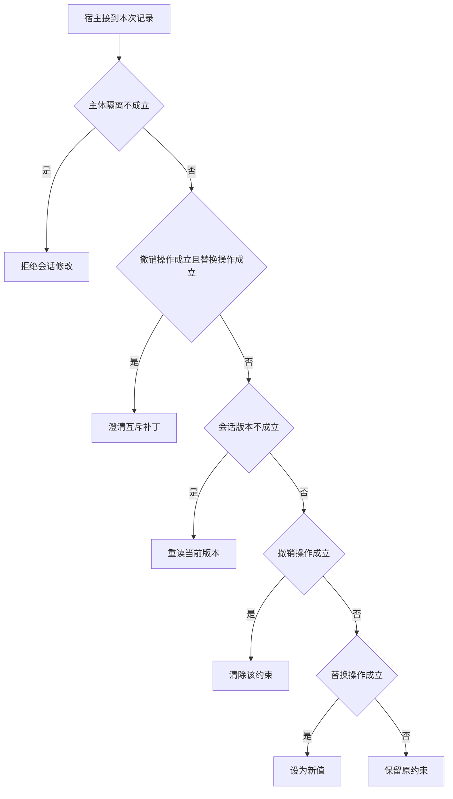

# 保留、清除和替换的三态补丁

“换周日”和“不限时间”不是同一个 null。
让模型先提出字段补丁，然后由 Java 的纯函数在指定版本上应用。
若同一字段同时出现清除与设值，示例将其交回澄清。

本篇用一个封闭的教学决策器说明这一问题。输入是宿主收到的记录，不保证每个下游字段都已经获准使用。前置检查未成立时，下游即使带着缓存值，也不能拿来作业务断言。

## 先解决一个具体问题

**用户没提时间和用户说“不限时间”，数据库里不都是 null 吗？**

语义上前者需要保留已有时刻，后者需要主动清除。
把补丁设计成保留、清除、设值三类并单测纯函数，就能避免同一可空字段承载两种意图。


先取一个能走到「保留原约束」的输入：数据与当前主体匹配、没有要求清除字段、本轮没有给出新值、补丁基于当前版本。
把这四个条件代回后文的图，前面各个拦截分支都未满足，最终才有“未指定变化就沿用状态”这个判断。
还原这个现场时要分别问：哪些位来自可信状态，哪些只是在接口中出现、尚未获得解释资格的字段。

## 先沿一次决策走到底



从上到下取第一条成立的出口。只改一个开关时，只有它之前的检查都未截断，该变化才可能到达真实动作。

“主体隔离”的两种输入分别是“数据与当前主体匹配”与“数据属于另一主体”。
隔离应发生在把材料交给模型之前。

“撤销操作”的两种输入分别是“用户明确清除字段”与“没有要求清除字段”。
未提及条件和明确取消条件语义不同。

“替换操作”的两种输入分别是“提供了一个新取值”与“本轮没有给出新值”。
补丁需要区分替换、保留与清除。

“会话版本”的两种输入分别是“补丁基于当前版本”与“补丁依据旧会话版本”。
条件写能发现并发冲突，但不负责解释指代。

## 最少需要哪几项观察

### 拒绝会话修改

另一主体不能更新当前状态。
在本节的全部组合中，有 8 种产生「拒绝会话修改」，这只是逻辑空间的计数，不能当作实际用户请求的比例。

只取得数据属于另一主体，已经足以要求宿主「拒绝会话修改」。
保持这些已知项，其余开关自由变化，仍有 8 种补全，判断没有翻转。

若删掉关于主体隔离的证据，另一份允许的现场是数据与当前主体匹配、没有要求清除字段、本轮没有给出新值、补丁依据旧会话版本，它会使宿主「重读当前版本」。

### 澄清互斥补丁

同一字段不能同时删除和替换。
在本节的全部组合中，有 2 种产生「澄清互斥补丁」，这只是逻辑空间的计数，不能当作实际用户请求的比例。

只取得数据与当前主体匹配、用户明确清除字段、提供了一个新取值，已经足以要求宿主「澄清互斥补丁」。
保持这些已知项，其余开关自由变化，仍有 2 种补全，判断没有翻转。

若删掉关于主体隔离的证据，另一份允许的现场是数据属于另一主体、用户明确清除字段、提供了一个新取值、补丁依据旧会话版本，它会使宿主「拒绝会话修改」。

若删掉关于撤销操作的证据，另一份允许的现场是数据与当前主体匹配、没有要求清除字段、提供了一个新取值、补丁依据旧会话版本，它会使宿主「重读当前版本」。

若删掉关于替换操作的证据，另一份允许的现场是数据与当前主体匹配、用户明确清除字段、本轮没有给出新值、补丁依据旧会话版本，它会使宿主「重读当前版本」。

### 重读当前版本

过期基线不能无条件覆盖整行。
在本节的全部组合中，有 3 种产生「重读当前版本」，这只是逻辑空间的计数，不能当作实际用户请求的比例。

只取得数据与当前主体匹配、没有要求清除字段、补丁依据旧会话版本，已经足以要求宿主「重读当前版本」。

若删掉关于主体隔离的证据，另一份允许的现场是数据属于另一主体、没有要求清除字段、本轮没有给出新值、补丁依据旧会话版本，它会使宿主「拒绝会话修改」。

若删掉关于撤销操作的证据，另一份允许的现场是数据与当前主体匹配、用户明确清除字段、提供了一个新取值、补丁依据旧会话版本，它会使宿主「澄清互斥补丁」。

若删掉关于会话版本的证据，另一份允许的现场是数据与当前主体匹配、没有要求清除字段、本轮没有给出新值、补丁基于当前版本，它会使宿主「保留原约束」。

只取得数据与当前主体匹配、本轮没有给出新值、补丁依据旧会话版本，已经足以要求宿主「重读当前版本」。


若删掉关于替换操作的证据，另一份允许的现场是数据与当前主体匹配、用户明确清除字段、提供了一个新取值、补丁依据旧会话版本，它会使宿主「澄清互斥补丁」。


### 清除该约束

用户明确撤销限制。
在本节的全部组合中，有 1 种产生「清除该约束」，这只是逻辑空间的计数，不能当作实际用户请求的比例。

只取得数据与当前主体匹配、用户明确清除字段、本轮没有给出新值、补丁基于当前版本，已经足以要求宿主「清除该约束」。
保持这些已知项，其余开关自由变化，仍有 1 种补全，判断没有翻转。

若删掉关于主体隔离的证据，另一份允许的现场是数据属于另一主体、用户明确清除字段、本轮没有给出新值、补丁基于当前版本，它会使宿主「拒绝会话修改」。

若删掉关于撤销操作的证据，另一份允许的现场是数据与当前主体匹配、没有要求清除字段、本轮没有给出新值、补丁基于当前版本，它会使宿主「保留原约束」。

若删掉关于替换操作的证据，另一份允许的现场是数据与当前主体匹配、用户明确清除字段、提供了一个新取值、补丁基于当前版本，它会使宿主「澄清互斥补丁」。

若删掉关于会话版本的证据，另一份允许的现场是数据与当前主体匹配、用户明确清除字段、本轮没有给出新值、补丁依据旧会话版本，它会使宿主「重读当前版本」。

### 设为新值

本轮存在具体可用替换。
在本节的全部组合中，有 1 种产生「设为新值」，这只是逻辑空间的计数，不能当作实际用户请求的比例。

只取得数据与当前主体匹配、没有要求清除字段、提供了一个新取值、补丁基于当前版本，已经足以要求宿主「设为新值」。

若删掉关于主体隔离的证据，另一份允许的现场是数据属于另一主体、没有要求清除字段、提供了一个新取值、补丁基于当前版本，它会使宿主「拒绝会话修改」。

若删掉关于撤销操作的证据，另一份允许的现场是数据与当前主体匹配、用户明确清除字段、提供了一个新取值、补丁基于当前版本，它会使宿主「澄清互斥补丁」。

若删掉关于替换操作的证据，另一份允许的现场是数据与当前主体匹配、没有要求清除字段、本轮没有给出新值、补丁基于当前版本，它会使宿主「保留原约束」。

若删掉关于会话版本的证据，另一份允许的现场是数据与当前主体匹配、没有要求清除字段、提供了一个新取值、补丁依据旧会话版本，它会使宿主「重读当前版本」。

### 保留原约束

未指定变化就沿用状态。
在本节的全部组合中，有 1 种产生「保留原约束」，这只是逻辑空间的计数，不能当作实际用户请求的比例。

只取得数据与当前主体匹配、没有要求清除字段、本轮没有给出新值、补丁基于当前版本，已经足以要求宿主「保留原约束」。

若删掉关于主体隔离的证据，另一份允许的现场是数据属于另一主体、没有要求清除字段、本轮没有给出新值、补丁基于当前版本，它会使宿主「拒绝会话修改」。

若删掉关于撤销操作的证据，另一份允许的现场是数据与当前主体匹配、用户明确清除字段、本轮没有给出新值、补丁基于当前版本，它会使宿主「清除该约束」。

若删掉关于替换操作的证据，另一份允许的现场是数据与当前主体匹配、没有要求清除字段、提供了一个新取值、补丁基于当前版本，它会使宿主「设为新值」。

若删掉关于会话版本的证据，另一份允许的现场是数据与当前主体匹配、没有要求清除字段、本轮没有给出新值、补丁依据旧会话版本，它会使宿主「重读当前版本」。

## 以同一份契约解释截然不同的现场

<details>
<summary>展开推演与对应反例</summary>

下列样本按最先命中的业务分支排列。四位编码只作本篇页内定位，顺序与开头的四项输入一致。可以先猜下一动作，再展开相邻样本。

### 能够触发“拒绝会话修改”的现场

**样本 0000**

业务侧交来数据属于另一主体、没有要求清除字段，执行侧还记录了本轮没有给出新值、补丁依据旧会话版本。
把样本压成最短证明，保留数据属于另一主体就能支持「拒绝会话修改」。

在这份记录上，分别翻转「主体隔离」中的任一项，其他项完全不变时，下一动作都会改变。

保持其余观察不动，单独切换「撤销操作」、「替换操作」、「会话版本」仍得到「拒绝会话修改」，它们在这个现场不是决定性变量。

要从本例改走「重读当前版本」，至少需要变动 1 项，一组最少改动是将数据属于另一主体换成数据与当前主体匹配。

要从本例改走「保留原约束」，至少需要变动 2 项，一组最少改动是将数据属于另一主体、补丁依据旧会话版本换成数据与当前主体匹配、补丁基于当前版本。

要从本例改走「设为新值」，至少需要变动 3 项，一组最少改动是将数据属于另一主体、本轮没有给出新值、补丁依据旧会话版本换成数据与当前主体匹配、提供了一个新取值、补丁基于当前版本。

要从本例改走「清除该约束」，至少需要变动 3 项，一组最少改动是将数据属于另一主体、没有要求清除字段、补丁依据旧会话版本换成数据与当前主体匹配、用户明确清除字段、补丁基于当前版本。

要从本例改走「澄清互斥补丁」，至少需要变动 3 项，一组最少改动是将数据属于另一主体、没有要求清除字段、本轮没有给出新值换成数据与当前主体匹配、用户明确清除字段、提供了一个新取值。

**样本 0001**

业务侧交来数据属于另一主体、没有要求清除字段，执行侧还记录了本轮没有给出新值、补丁基于当前版本。


要从本例改走「保留原约束」，至少需要变动 1 项，一组最少改动是将数据属于另一主体换成数据与当前主体匹配。

要从本例改走「重读当前版本」，至少需要变动 2 项，一组最少改动是将数据属于另一主体、补丁基于当前版本换成数据与当前主体匹配、补丁依据旧会话版本。

要从本例改走「设为新值」，至少需要变动 2 项，一组最少改动是将数据属于另一主体、本轮没有给出新值换成数据与当前主体匹配、提供了一个新取值。

要从本例改走「清除该约束」，至少需要变动 2 项，一组最少改动是将数据属于另一主体、没有要求清除字段换成数据与当前主体匹配、用户明确清除字段。


**样本 0010**

业务侧交来数据属于另一主体、没有要求清除字段，执行侧还记录了提供了一个新取值、补丁依据旧会话版本。


要从本例改走「设为新值」，至少需要变动 2 项，一组最少改动是将数据属于另一主体、补丁依据旧会话版本换成数据与当前主体匹配、补丁基于当前版本。

要从本例改走「澄清互斥补丁」，至少需要变动 2 项，一组最少改动是将数据属于另一主体、没有要求清除字段换成数据与当前主体匹配、用户明确清除字段。

要从本例改走「保留原约束」，至少需要变动 3 项，一组最少改动是将数据属于另一主体、提供了一个新取值、补丁依据旧会话版本换成数据与当前主体匹配、本轮没有给出新值、补丁基于当前版本。

要从本例改走「清除该约束」，至少需要变动 4 项，一组最少改动是将数据属于另一主体、没有要求清除字段、提供了一个新取值、补丁依据旧会话版本换成数据与当前主体匹配、用户明确清除字段、本轮没有给出新值、补丁基于当前版本。

**样本 0011**

业务侧交来数据属于另一主体、没有要求清除字段，执行侧还记录了提供了一个新取值、补丁基于当前版本。


要从本例改走「设为新值」，至少需要变动 1 项，一组最少改动是将数据属于另一主体换成数据与当前主体匹配。

要从本例改走「保留原约束」，至少需要变动 2 项，一组最少改动是将数据属于另一主体、提供了一个新取值换成数据与当前主体匹配、本轮没有给出新值。


要从本例改走「清除该约束」，至少需要变动 3 项，一组最少改动是将数据属于另一主体、没有要求清除字段、提供了一个新取值换成数据与当前主体匹配、用户明确清除字段、本轮没有给出新值。

**样本 0100**

业务侧交来数据属于另一主体、用户明确清除字段，执行侧还记录了本轮没有给出新值、补丁依据旧会话版本。


要从本例改走「清除该约束」，至少需要变动 2 项，一组最少改动是将数据属于另一主体、补丁依据旧会话版本换成数据与当前主体匹配、补丁基于当前版本。

要从本例改走「澄清互斥补丁」，至少需要变动 2 项，一组最少改动是将数据属于另一主体、本轮没有给出新值换成数据与当前主体匹配、提供了一个新取值。

要从本例改走「保留原约束」，至少需要变动 3 项，一组最少改动是将数据属于另一主体、用户明确清除字段、补丁依据旧会话版本换成数据与当前主体匹配、没有要求清除字段、补丁基于当前版本。

要从本例改走「设为新值」，至少需要变动 4 项，一组最少改动是将数据属于另一主体、用户明确清除字段、本轮没有给出新值、补丁依据旧会话版本换成数据与当前主体匹配、没有要求清除字段、提供了一个新取值、补丁基于当前版本。

**样本 0101**

业务侧交来数据属于另一主体、用户明确清除字段，执行侧还记录了本轮没有给出新值、补丁基于当前版本。


要从本例改走「清除该约束」，至少需要变动 1 项，一组最少改动是将数据属于另一主体换成数据与当前主体匹配。

要从本例改走「保留原约束」，至少需要变动 2 项，一组最少改动是将数据属于另一主体、用户明确清除字段换成数据与当前主体匹配、没有要求清除字段。


要从本例改走「设为新值」，至少需要变动 3 项，一组最少改动是将数据属于另一主体、用户明确清除字段、本轮没有给出新值换成数据与当前主体匹配、没有要求清除字段、提供了一个新取值。

**样本 0110**

业务侧交来数据属于另一主体、用户明确清除字段，执行侧还记录了提供了一个新取值、补丁依据旧会话版本。


要从本例改走「澄清互斥补丁」，至少需要变动 1 项，一组最少改动是将数据属于另一主体换成数据与当前主体匹配。

要从本例改走「重读当前版本」，至少需要变动 2 项，一组最少改动是将数据属于另一主体、用户明确清除字段换成数据与当前主体匹配、没有要求清除字段。

要从本例改走「设为新值」，至少需要变动 3 项，一组最少改动是将数据属于另一主体、用户明确清除字段、补丁依据旧会话版本换成数据与当前主体匹配、没有要求清除字段、补丁基于当前版本。

要从本例改走「清除该约束」，至少需要变动 3 项，一组最少改动是将数据属于另一主体、提供了一个新取值、补丁依据旧会话版本换成数据与当前主体匹配、本轮没有给出新值、补丁基于当前版本。

要从本例改走「保留原约束」，至少需要变动 4 项，一组最少改动是将数据属于另一主体、用户明确清除字段、提供了一个新取值、补丁依据旧会话版本换成数据与当前主体匹配、没有要求清除字段、本轮没有给出新值、补丁基于当前版本。

**样本 0111**

业务侧交来数据属于另一主体、用户明确清除字段，执行侧还记录了提供了一个新取值、补丁基于当前版本。


要从本例改走「设为新值」，至少需要变动 2 项，一组最少改动是将数据属于另一主体、用户明确清除字段换成数据与当前主体匹配、没有要求清除字段。

要从本例改走「清除该约束」，至少需要变动 2 项，一组最少改动是将数据属于另一主体、提供了一个新取值换成数据与当前主体匹配、本轮没有给出新值。

要从本例改走「保留原约束」，至少需要变动 3 项，一组最少改动是将数据属于另一主体、用户明确清除字段、提供了一个新取值换成数据与当前主体匹配、没有要求清除字段、本轮没有给出新值。

要从本例改走「重读当前版本」，至少需要变动 3 项，一组最少改动是将数据属于另一主体、用户明确清除字段、补丁基于当前版本换成数据与当前主体匹配、没有要求清除字段、补丁依据旧会话版本。

### 能够触发“澄清互斥补丁”的现场

**样本 1110**

业务侧交来数据与当前主体匹配、用户明确清除字段，执行侧还记录了提供了一个新取值、补丁依据旧会话版本。
把样本压成最短证明，保留数据与当前主体匹配、用户明确清除字段、提供了一个新取值就能支持「澄清互斥补丁」。

在这份记录上，分别翻转「主体隔离」、「撤销操作」、「替换操作」中的任一项，其他项完全不变时，下一动作都会改变。

保持其余观察不动，单独切换「会话版本」仍得到「澄清互斥补丁」，它们在这个现场不是决定性变量。

本例没走更靠前的「拒绝会话修改」，因为数据与当前主体匹配与那个入口的必要条件不符。

要从本例改走「拒绝会话修改」，至少需要变动 1 项，一组最少改动是将数据与当前主体匹配换成数据属于另一主体。

要从本例改走「重读当前版本」，至少需要变动 1 项，一组最少改动是将用户明确清除字段换成没有要求清除字段。

要从本例改走「设为新值」，至少需要变动 2 项，一组最少改动是将用户明确清除字段、补丁依据旧会话版本换成没有要求清除字段、补丁基于当前版本。

要从本例改走「清除该约束」，至少需要变动 2 项，一组最少改动是将提供了一个新取值、补丁依据旧会话版本换成本轮没有给出新值、补丁基于当前版本。

要从本例改走「保留原约束」，至少需要变动 3 项，一组最少改动是将用户明确清除字段、提供了一个新取值、补丁依据旧会话版本换成没有要求清除字段、本轮没有给出新值、补丁基于当前版本。

**样本 1111**

业务侧交来数据与当前主体匹配、用户明确清除字段，执行侧还记录了提供了一个新取值、补丁基于当前版本。


要从本例改走「设为新值」，至少需要变动 1 项，一组最少改动是将用户明确清除字段换成没有要求清除字段。

要从本例改走「清除该约束」，至少需要变动 1 项，一组最少改动是将提供了一个新取值换成本轮没有给出新值。

要从本例改走「保留原约束」，至少需要变动 2 项，一组最少改动是将用户明确清除字段、提供了一个新取值换成没有要求清除字段、本轮没有给出新值。

要从本例改走「重读当前版本」，至少需要变动 2 项，一组最少改动是将用户明确清除字段、补丁基于当前版本换成没有要求清除字段、补丁依据旧会话版本。

### 能够触发“重读当前版本”的现场

**样本 1000**

业务侧交来数据与当前主体匹配、没有要求清除字段，执行侧还记录了本轮没有给出新值、补丁依据旧会话版本。
把样本压成最短证明，保留数据与当前主体匹配、没有要求清除字段、补丁依据旧会话版本就能支持「重读当前版本」。

在这份记录上，分别翻转「主体隔离」、「会话版本」中的任一项，其他项完全不变时，下一动作都会改变。

保持其余观察不动，单独切换「撤销操作」、「替换操作」仍得到「重读当前版本」，它们在这个现场不是决定性变量。


本例没走更靠前的「澄清互斥补丁」，因为没有要求清除字段、本轮没有给出新值与那个入口的必要条件不符。


要从本例改走「保留原约束」，至少需要变动 1 项，一组最少改动是将补丁依据旧会话版本换成补丁基于当前版本。

要从本例改走「设为新值」，至少需要变动 2 项，一组最少改动是将本轮没有给出新值、补丁依据旧会话版本换成提供了一个新取值、补丁基于当前版本。

要从本例改走「清除该约束」，至少需要变动 2 项，一组最少改动是将没有要求清除字段、补丁依据旧会话版本换成用户明确清除字段、补丁基于当前版本。

要从本例改走「澄清互斥补丁」，至少需要变动 2 项，一组最少改动是将没有要求清除字段、本轮没有给出新值换成用户明确清除字段、提供了一个新取值。

**样本 1010**

业务侧交来数据与当前主体匹配、没有要求清除字段，执行侧还记录了提供了一个新取值、补丁依据旧会话版本。

在这份记录上，分别翻转「主体隔离」、「撤销操作」、「会话版本」中的任一项，其他项完全不变时，下一动作都会改变。

保持其余观察不动，单独切换「替换操作」仍得到「重读当前版本」，它们在这个现场不是决定性变量。


本例没走更靠前的「澄清互斥补丁」，因为没有要求清除字段与那个入口的必要条件不符。


要从本例改走「设为新值」，至少需要变动 1 项，一组最少改动是将补丁依据旧会话版本换成补丁基于当前版本。

要从本例改走「澄清互斥补丁」，至少需要变动 1 项，一组最少改动是将没有要求清除字段换成用户明确清除字段。

要从本例改走「保留原约束」，至少需要变动 2 项，一组最少改动是将提供了一个新取值、补丁依据旧会话版本换成本轮没有给出新值、补丁基于当前版本。

要从本例改走「清除该约束」，至少需要变动 3 项，一组最少改动是将没有要求清除字段、提供了一个新取值、补丁依据旧会话版本换成用户明确清除字段、本轮没有给出新值、补丁基于当前版本。

**样本 1100**

业务侧交来数据与当前主体匹配、用户明确清除字段，执行侧还记录了本轮没有给出新值、补丁依据旧会话版本。
把样本压成最短证明，保留数据与当前主体匹配、本轮没有给出新值、补丁依据旧会话版本就能支持「重读当前版本」。

在这份记录上，分别翻转「主体隔离」、「替换操作」、「会话版本」中的任一项，其他项完全不变时，下一动作都会改变。

保持其余观察不动，单独切换「撤销操作」仍得到「重读当前版本」，它们在这个现场不是决定性变量。


本例没走更靠前的「澄清互斥补丁」，因为本轮没有给出新值与那个入口的必要条件不符。


要从本例改走「清除该约束」，至少需要变动 1 项，一组最少改动是将补丁依据旧会话版本换成补丁基于当前版本。

要从本例改走「澄清互斥补丁」，至少需要变动 1 项，一组最少改动是将本轮没有给出新值换成提供了一个新取值。

要从本例改走「保留原约束」，至少需要变动 2 项，一组最少改动是将用户明确清除字段、补丁依据旧会话版本换成没有要求清除字段、补丁基于当前版本。

要从本例改走「设为新值」，至少需要变动 3 项，一组最少改动是将用户明确清除字段、本轮没有给出新值、补丁依据旧会话版本换成没有要求清除字段、提供了一个新取值、补丁基于当前版本。

### 能够触发“清除该约束”的现场

**样本 1101**

业务侧交来数据与当前主体匹配、用户明确清除字段，执行侧还记录了本轮没有给出新值、补丁基于当前版本。
把样本压成最短证明，保留数据与当前主体匹配、用户明确清除字段、本轮没有给出新值、补丁基于当前版本就能支持「清除该约束」。

在这份记录上，分别翻转「主体隔离」、「撤销操作」、「替换操作」、「会话版本」中的任一项，其他项完全不变时，下一动作都会改变。


本例没走更靠前的「重读当前版本」，因为补丁基于当前版本与那个入口的必要条件不符。


要从本例改走「保留原约束」，至少需要变动 1 项，一组最少改动是将用户明确清除字段换成没有要求清除字段。

要从本例改走「重读当前版本」，至少需要变动 1 项，一组最少改动是将补丁基于当前版本换成补丁依据旧会话版本。


要从本例改走「设为新值」，至少需要变动 2 项，一组最少改动是将用户明确清除字段、本轮没有给出新值换成没有要求清除字段、提供了一个新取值。

### 能够触发“设为新值”的现场

**样本 1011**

业务侧交来数据与当前主体匹配、没有要求清除字段，执行侧还记录了提供了一个新取值、补丁基于当前版本。
把样本压成最短证明，保留数据与当前主体匹配、没有要求清除字段、提供了一个新取值、补丁基于当前版本就能支持「设为新值」。


本例没走更靠前的「清除该约束」，因为没有要求清除字段与那个入口的必要条件不符。


要从本例改走「保留原约束」，至少需要变动 1 项，一组最少改动是将提供了一个新取值换成本轮没有给出新值。


要从本例改走「清除该约束」，至少需要变动 2 项，一组最少改动是将没有要求清除字段、提供了一个新取值换成用户明确清除字段、本轮没有给出新值。

### 能够触发“保留原约束”的现场

**样本 1001**

业务侧交来数据与当前主体匹配、没有要求清除字段，执行侧还记录了本轮没有给出新值、补丁基于当前版本。
把样本压成最短证明，保留数据与当前主体匹配、没有要求清除字段、本轮没有给出新值、补丁基于当前版本就能支持「保留原约束」。


本例没走更靠前的「设为新值」，因为本轮没有给出新值与那个入口的必要条件不符。


要从本例改走「设为新值」，至少需要变动 1 项，一组最少改动是将本轮没有给出新值换成提供了一个新取值。

要从本例改走「清除该约束」，至少需要变动 1 项，一组最少改动是将没有要求清除字段换成用户明确清除字段。


</details>

## 当你只能看见一半记录

<details>
<summary>展开推演与对应反例</summary>

这次隐藏两个字段，保留另两个。对每个可见现场，检查四种合法补全是否同意。如仍有歧义，选择能使最坏剩余候选动作最少的字段继续查。并列时采用本篇字段顺序。

### 只保留主体隔离与撤销操作

已知数据属于另一主体、没有要求清除字段时，四种补全的动作分布为拒绝会话修改（4 种）。

就“拒绝会话修改”这个动作而言，在数据属于另一主体、没有要求清除字段的前提下，另外两项观察不会推翻它。

已知数据属于另一主体、用户明确清除字段时，四种补全的动作分布为拒绝会话修改（4 种）。

就“拒绝会话修改”这个动作而言，在数据属于另一主体、用户明确清除字段的前提下，另外两项观察不会推翻它。

已知数据与当前主体匹配、没有要求清除字段时，四种补全的动作分布为重读当前版本（2 种）、设为新值（1 种）、保留原约束（1 种）。

在数据与当前主体匹配、没有要求清除字段这个现场补读「替换操作」，最坏还剩 2 种动作，计算时只衡量歧义，尚未扣读取代价。
若补来的观察为“本轮没有给出新值”，范围缩成「重读当前版本」、「保留原约束」。若为“提供了一个新取值”，则保留「重读当前版本」、「设为新值」。

区分不了的两条执行可以具体写成 1000 与 1001：它们共享已展示字段，却分别需要「重读当前版本」和「保留原约束」。

已知数据与当前主体匹配、用户明确清除字段时，四种补全的动作分布为澄清互斥补丁（2 种）、重读当前版本（1 种）、清除该约束（1 种）。

在数据与当前主体匹配、用户明确清除字段这个现场补读「替换操作」，最坏还剩 2 种动作，计算时只衡量歧义，尚未扣读取代价。
若补来的观察为“本轮没有给出新值”，范围缩成「重读当前版本」、「清除该约束」。若为“提供了一个新取值”，则保留「澄清互斥补丁」。

区分不了的两条执行可以具体写成 1100 与 1101：它们共享已展示字段，却分别需要「重读当前版本」和「清除该约束」。

### 只保留主体隔离与替换操作

已知数据属于另一主体、本轮没有给出新值时，四种补全的动作分布为拒绝会话修改（4 种）。

就“拒绝会话修改”这个动作而言，在数据属于另一主体、本轮没有给出新值的前提下，另外两项观察不会推翻它。

已知数据属于另一主体、提供了一个新取值时，四种补全的动作分布为拒绝会话修改（4 种）。

就“拒绝会话修改”这个动作而言，在数据属于另一主体、提供了一个新取值的前提下，另外两项观察不会推翻它。

已知数据与当前主体匹配、本轮没有给出新值时，四种补全的动作分布为重读当前版本（2 种）、清除该约束（1 种）、保留原约束（1 种）。

在数据与当前主体匹配、本轮没有给出新值这个现场补读「撤销操作」，最坏还剩 2 种动作，计算时只衡量歧义，尚未扣读取代价。
若补来的观察为“没有要求清除字段”，范围缩成「重读当前版本」、「保留原约束」。若为“用户明确清除字段”，则保留「重读当前版本」、「清除该约束」。


已知数据与当前主体匹配、提供了一个新取值时，四种补全的动作分布为澄清互斥补丁（2 种）、重读当前版本（1 种）、设为新值（1 种）。

在数据与当前主体匹配、提供了一个新取值这个现场补读「撤销操作」，最坏还剩 2 种动作，计算时只衡量歧义，尚未扣读取代价。
若补来的观察为“没有要求清除字段”，范围缩成「重读当前版本」、「设为新值」。若为“用户明确清除字段”，则保留「澄清互斥补丁」。

区分不了的两条执行可以具体写成 1010 与 1011：它们共享已展示字段，却分别需要「重读当前版本」和「设为新值」。

### 只保留撤销操作与替换操作

已知没有要求清除字段、本轮没有给出新值时，四种补全的动作分布为拒绝会话修改（2 种）、重读当前版本（1 种）、保留原约束（1 种）。

在没有要求清除字段、本轮没有给出新值这个现场补读「主体隔离」，最坏还剩 2 种动作，计算时只衡量歧义，尚未扣读取代价。
若补来的观察为“数据属于另一主体”，范围缩成「拒绝会话修改」。若为“数据与当前主体匹配”，则保留「重读当前版本」、「保留原约束」。

区分不了的两条执行可以具体写成 0000 与 1000：它们共享已展示字段，却分别需要「拒绝会话修改」和「重读当前版本」。

已知没有要求清除字段、提供了一个新取值时，四种补全的动作分布为拒绝会话修改（2 种）、重读当前版本（1 种）、设为新值（1 种）。

在没有要求清除字段、提供了一个新取值这个现场补读「主体隔离」，最坏还剩 2 种动作，计算时只衡量歧义，尚未扣读取代价。
若补来的观察为“数据属于另一主体”，范围缩成「拒绝会话修改」。若为“数据与当前主体匹配”，则保留「重读当前版本」、「设为新值」。

区分不了的两条执行可以具体写成 0010 与 1010：它们共享已展示字段，却分别需要「拒绝会话修改」和「重读当前版本」。

已知用户明确清除字段、本轮没有给出新值时，四种补全的动作分布为拒绝会话修改（2 种）、重读当前版本（1 种）、清除该约束（1 种）。

在用户明确清除字段、本轮没有给出新值这个现场补读「主体隔离」，最坏还剩 2 种动作，计算时只衡量歧义，尚未扣读取代价。
若补来的观察为“数据属于另一主体”，范围缩成「拒绝会话修改」。若为“数据与当前主体匹配”，则保留「重读当前版本」、「清除该约束」。

区分不了的两条执行可以具体写成 0100 与 1100：它们共享已展示字段，却分别需要「拒绝会话修改」和「重读当前版本」。

已知用户明确清除字段、提供了一个新取值时，四种补全的动作分布为拒绝会话修改（2 种）、澄清互斥补丁（2 种）。

在用户明确清除字段、提供了一个新取值这个现场补读「主体隔离」，最坏还剩 1 种动作，计算时只衡量歧义，尚未扣读取代价。
若补来的观察为“数据属于另一主体”，范围缩成「拒绝会话修改」。若为“数据与当前主体匹配”，则保留「澄清互斥补丁」。

区分不了的两条执行可以具体写成 0110 与 1110：它们共享已展示字段，却分别需要「拒绝会话修改」和「澄清互斥补丁」。

### 只保留主体隔离与会话版本

已知数据属于另一主体、补丁依据旧会话版本时，四种补全的动作分布为拒绝会话修改（4 种）。

就“拒绝会话修改”这个动作而言，在数据属于另一主体、补丁依据旧会话版本的前提下，另外两项观察不会推翻它。

已知数据属于另一主体、补丁基于当前版本时，四种补全的动作分布为拒绝会话修改（4 种）。

就“拒绝会话修改”这个动作而言，在数据属于另一主体、补丁基于当前版本的前提下，另外两项观察不会推翻它。

已知数据与当前主体匹配、补丁依据旧会话版本时，四种补全的动作分布为澄清互斥补丁（1 种）、重读当前版本（3 种）。

在数据与当前主体匹配、补丁依据旧会话版本这个现场补读「撤销操作」，最坏还剩 2 种动作，计算时只衡量歧义，尚未扣读取代价。
若补来的观察为“没有要求清除字段”，范围缩成「重读当前版本」。若为“用户明确清除字段”，则保留「重读当前版本」、「澄清互斥补丁」。

区分不了的两条执行可以具体写成 1000 与 1110：它们共享已展示字段，却分别需要「重读当前版本」和「澄清互斥补丁」。

已知数据与当前主体匹配、补丁基于当前版本时，四种补全的动作分布为澄清互斥补丁（1 种）、清除该约束（1 种）、设为新值（1 种）、保留原约束（1 种）。

在数据与当前主体匹配、补丁基于当前版本这个现场补读「撤销操作」，最坏还剩 2 种动作，计算时只衡量歧义，尚未扣读取代价。
若补来的观察为“没有要求清除字段”，范围缩成「保留原约束」、「设为新值」。若为“用户明确清除字段”，则保留「清除该约束」、「澄清互斥补丁」。

区分不了的两条执行可以具体写成 1001 与 1011：它们共享已展示字段，却分别需要「保留原约束」和「设为新值」。

### 只保留撤销操作与会话版本

已知没有要求清除字段、补丁依据旧会话版本时，四种补全的动作分布为拒绝会话修改（2 种）、重读当前版本（2 种）。

在没有要求清除字段、补丁依据旧会话版本这个现场补读「主体隔离」，最坏还剩 1 种动作，计算时只衡量歧义，尚未扣读取代价。
若补来的观察为“数据属于另一主体”，范围缩成「拒绝会话修改」。若为“数据与当前主体匹配”，则保留「重读当前版本」。


已知没有要求清除字段、补丁基于当前版本时，四种补全的动作分布为拒绝会话修改（2 种）、设为新值（1 种）、保留原约束（1 种）。

在没有要求清除字段、补丁基于当前版本这个现场补读「主体隔离」，最坏还剩 2 种动作，计算时只衡量歧义，尚未扣读取代价。
若补来的观察为“数据属于另一主体”，范围缩成「拒绝会话修改」。若为“数据与当前主体匹配”，则保留「保留原约束」、「设为新值」。

区分不了的两条执行可以具体写成 0001 与 1001：它们共享已展示字段，却分别需要「拒绝会话修改」和「保留原约束」。

已知用户明确清除字段、补丁依据旧会话版本时，四种补全的动作分布为拒绝会话修改（2 种）、澄清互斥补丁（1 种）、重读当前版本（1 种）。

在用户明确清除字段、补丁依据旧会话版本这个现场补读「主体隔离」，最坏还剩 2 种动作，计算时只衡量歧义，尚未扣读取代价。
若补来的观察为“数据属于另一主体”，范围缩成「拒绝会话修改」。若为“数据与当前主体匹配”，则保留「重读当前版本」、「澄清互斥补丁」。


已知用户明确清除字段、补丁基于当前版本时，四种补全的动作分布为拒绝会话修改（2 种）、澄清互斥补丁（1 种）、清除该约束（1 种）。

在用户明确清除字段、补丁基于当前版本这个现场补读「主体隔离」，最坏还剩 2 种动作，计算时只衡量歧义，尚未扣读取代价。
若补来的观察为“数据属于另一主体”，范围缩成「拒绝会话修改」。若为“数据与当前主体匹配”，则保留「清除该约束」、「澄清互斥补丁」。

区分不了的两条执行可以具体写成 0101 与 1101：它们共享已展示字段，却分别需要「拒绝会话修改」和「清除该约束」。

### 只保留替换操作与会话版本

已知本轮没有给出新值、补丁依据旧会话版本时，四种补全的动作分布为拒绝会话修改（2 种）、重读当前版本（2 种）。

在本轮没有给出新值、补丁依据旧会话版本这个现场补读「主体隔离」，最坏还剩 1 种动作，计算时只衡量歧义，尚未扣读取代价。


已知本轮没有给出新值、补丁基于当前版本时，四种补全的动作分布为拒绝会话修改（2 种）、清除该约束（1 种）、保留原约束（1 种）。

在本轮没有给出新值、补丁基于当前版本这个现场补读「主体隔离」，最坏还剩 2 种动作，计算时只衡量歧义，尚未扣读取代价。
若补来的观察为“数据属于另一主体”，范围缩成「拒绝会话修改」。若为“数据与当前主体匹配”，则保留「保留原约束」、「清除该约束」。


已知提供了一个新取值、补丁依据旧会话版本时，四种补全的动作分布为拒绝会话修改（2 种）、澄清互斥补丁（1 种）、重读当前版本（1 种）。

在提供了一个新取值、补丁依据旧会话版本这个现场补读「主体隔离」，最坏还剩 2 种动作，计算时只衡量歧义，尚未扣读取代价。


已知提供了一个新取值、补丁基于当前版本时，四种补全的动作分布为拒绝会话修改（2 种）、澄清互斥补丁（1 种）、设为新值（1 种）。

在提供了一个新取值、补丁基于当前版本这个现场补读「主体隔离」，最坏还剩 2 种动作，计算时只衡量歧义，尚未扣读取代价。
若补来的观察为“数据属于另一主体”，范围缩成「拒绝会话修改」。若为“数据与当前主体匹配”，则保留「设为新值」、「澄清互斥补丁」。

区分不了的两条执行可以具体写成 0011 与 1011：它们共享已展示字段，却分别需要「拒绝会话修改」和「设为新值」。

</details>

## 单因素干预与边界测试

<details>
<summary>展开推演与对应反例</summary>

### 只改变主体隔离

固定另外三个条件得到八对现场，从“数据属于另一主体”转为“数据与当前主体匹配”时，8 对翻转动作，另外 0 对保持不变。

有 3 对现场沿「拒绝会话修改」变到「重读当前版本」，可复现的一组受控背景为没有要求清除字段、本轮没有给出新值、补丁依据旧会话版本。

有 1 对现场沿「拒绝会话修改」变到「保留原约束」，可复现的一组受控背景为没有要求清除字段、本轮没有给出新值、补丁基于当前版本。

有 1 对现场沿「拒绝会话修改」变到「设为新值」，可复现的一组受控背景为没有要求清除字段、提供了一个新取值、补丁基于当前版本。

有 1 对现场沿「拒绝会话修改」变到「清除该约束」，可复现的一组受控背景为用户明确清除字段、本轮没有给出新值、补丁基于当前版本。

有 2 对现场沿「拒绝会话修改」变到「澄清互斥补丁」，可复现的一组受控背景为用户明确清除字段、提供了一个新取值、补丁依据旧会话版本。

### 只改变撤销操作

固定另外三个条件得到八对现场，从“没有要求清除字段”转为“用户明确清除字段”时，3 对翻转动作，另外 5 对保持不变。

令数据属于另一主体、本轮没有给出新值、补丁依据旧会话版本，撤销操作的两个取值均得到「拒绝会话修改」。在八对中，共有 4 对表现为这一种稳定出口。

令数据与当前主体匹配、本轮没有给出新值、补丁依据旧会话版本，撤销操作的两个取值均得到「重读当前版本」。在八对中，共有 1 对表现为这一种稳定出口。

有 1 对现场沿「保留原约束」变到「清除该约束」，可复现的一组受控背景为数据与当前主体匹配、本轮没有给出新值、补丁基于当前版本。

有 1 对现场沿「重读当前版本」变到「澄清互斥补丁」，可复现的一组受控背景为数据与当前主体匹配、提供了一个新取值、补丁依据旧会话版本。

有 1 对现场沿「设为新值」变到「澄清互斥补丁」，可复现的一组受控背景为数据与当前主体匹配、提供了一个新取值、补丁基于当前版本。

### 只改变替换操作

固定另外三个条件得到八对现场，从“本轮没有给出新值”转为“提供了一个新取值”时，3 对翻转动作，另外 5 对保持不变。

令数据属于另一主体、没有要求清除字段、补丁依据旧会话版本，替换操作的两个取值均得到「拒绝会话修改」。在八对中，共有 4 对表现为这一种稳定出口。

令数据与当前主体匹配、没有要求清除字段、补丁依据旧会话版本，替换操作的两个取值均得到「重读当前版本」。在八对中，共有 1 对表现为这一种稳定出口。

有 1 对现场沿「保留原约束」变到「设为新值」，可复现的一组受控背景为数据与当前主体匹配、没有要求清除字段、补丁基于当前版本。

有 1 对现场沿「重读当前版本」变到「澄清互斥补丁」，可复现的一组受控背景为数据与当前主体匹配、用户明确清除字段、补丁依据旧会话版本。

有 1 对现场沿「清除该约束」变到「澄清互斥补丁」，可复现的一组受控背景为数据与当前主体匹配、用户明确清除字段、补丁基于当前版本。

### 只改变会话版本

固定另外三个条件得到八对现场，从“补丁依据旧会话版本”转为“补丁基于当前版本”时，3 对翻转动作，另外 5 对保持不变。

令数据属于另一主体、没有要求清除字段、本轮没有给出新值，会话版本的两个取值均得到「拒绝会话修改」。在八对中，共有 4 对表现为这一种稳定出口。

有 1 对现场沿「重读当前版本」变到「保留原约束」，可复现的一组受控背景为数据与当前主体匹配、没有要求清除字段、本轮没有给出新值。

有 1 对现场沿「重读当前版本」变到「设为新值」，可复现的一组受控背景为数据与当前主体匹配、没有要求清除字段、提供了一个新取值。

有 1 对现场沿「重读当前版本」变到「清除该约束」，可复现的一组受控背景为数据与当前主体匹配、用户明确清除字段、本轮没有给出新值。

令数据与当前主体匹配、用户明确清除字段、提供了一个新取值，会话版本的两个取值均得到「澄清互斥补丁」。在八对中，共有 1 对表现为这一种稳定出口。

</details>

## 哪些回归样本真能抓住实现错误

<details>
<summary>展开推演与对应反例</summary>

如果删除“拒绝会话修改”这个分支，在本篇 16 种输入里有 8 种会改走另一出口。

反例 0000 的完整记录为数据属于另一主体、没有要求清除字段、本轮没有给出新值、补丁依据旧会话版本。正确结果是「拒绝会话修改」，这个改坏的实现却给出「重读当前版本」。

如果删除“澄清互斥补丁”这个分支，在本篇 16 种输入里有 2 种会改走另一出口。

反例 1110 的完整记录为数据与当前主体匹配、用户明确清除字段、提供了一个新取值、补丁依据旧会话版本。正确结果是「澄清互斥补丁」，这个改坏的实现却给出「重读当前版本」。

如果删除“重读当前版本”这个分支，在本篇 16 种输入里有 3 种会改走另一出口。

反例 1000 的完整记录为数据与当前主体匹配、没有要求清除字段、本轮没有给出新值、补丁依据旧会话版本。正确结果是「重读当前版本」，这个改坏的实现却给出「保留原约束」。

如果删除“清除该约束”这个分支，在本篇 16 种输入里有 1 种会改走另一出口。

反例 1101 的完整记录为数据与当前主体匹配、用户明确清除字段、本轮没有给出新值、补丁基于当前版本。正确结果是「清除该约束」，这个改坏的实现却给出「保留原约束」。

如果删除“设为新值”这个分支，在本篇 16 种输入里有 1 种会改走另一出口。

反例 1011 的完整记录为数据与当前主体匹配、没有要求清除字段、提供了一个新取值、补丁基于当前版本。正确结果是「设为新值」，这个改坏的实现却给出「保留原约束」。

如果交换“拒绝会话修改”和“澄清互斥补丁”的判断次序，在本篇 16 种输入里有 2 种会改走另一出口。

反例 0110 的完整记录为数据属于另一主体、用户明确清除字段、提供了一个新取值、补丁依据旧会话版本。正确结果是「拒绝会话修改」，这个改坏的实现却给出「澄清互斥补丁」。

如果交换“澄清互斥补丁”和“重读当前版本”的判断次序，在本篇 16 种输入里有 1 种会改走另一出口。


如果交换“重读当前版本”和“清除该约束”的判断次序，在本篇 16 种输入里有 1 种会改走另一出口。

反例 1100 的完整记录为数据与当前主体匹配、用户明确清除字段、本轮没有给出新值、补丁依据旧会话版本。正确结果是「重读当前版本」，这个改坏的实现却给出「清除该约束」。

如果交换“清除该约束”和“设为新值”的判断次序，在本篇 16 种输入里有 0 种会改走另一出口。

对于“交换“清除该约束”和“设为新值”的判断次序”这项修改，在声明输入域内没有区分它的样本，不能宣称测试捕捉到了故障。

补入样本 0110（数据属于另一主体、用户明确清除字段、提供了一个新取值、补丁依据旧会话版本）能新增检出「删除“拒绝会话修改”这个分支」、「交换“拒绝会话修改”和“澄清互斥补丁”的判断次序」。

补入样本 1100（数据与当前主体匹配、用户明确清除字段、本轮没有给出新值、补丁依据旧会话版本）能新增检出「删除“重读当前版本”这个分支」、「交换“重读当前版本”和“清除该约束”的判断次序」。

补入样本 1110（数据与当前主体匹配、用户明确清除字段、提供了一个新取值、补丁依据旧会话版本）能新增检出「删除“澄清互斥补丁”这个分支」、「交换“澄清互斥补丁”和“重读当前版本”的判断次序」。

补入样本 1011（数据与当前主体匹配、没有要求清除字段、提供了一个新取值、补丁基于当前版本）能新增检出「删除“设为新值”这个分支」。

补入样本 1101（数据与当前主体匹配、用户明确清除字段、本轮没有给出新值、补丁基于当前版本）能新增检出「删除“清除该约束”这个分支」。

这里每次选覆盖尚未捕获缺陷最多的样本，并不保证用例数全局最小。它给出的反例能作为 Java 单测输入。真实模型是否会自主产生这些提议，仍须单独评测。

</details>

## 把状态覆盖换成有抽样偏差的评测批次

<details>
<summary>展开推演与对应反例</summary>

前面的十六种记录各有一票。现在只改样本构成：对一个给定字段，把成立侧的每种记录各取三份、另一侧各取一份。这是人为配比的 32 份回放，不是线上频率估计。
将偏向成立与偏向不成立的两次批次对照，可以隔离分母变化。底层宿主和所有答案保持相同，比例仍可能移动。

### 改变“主体隔离”的样本配比

只看「拒绝会话修改」，在数据与当前主体匹配的八个不同输入中有 0 个命中，在数据属于另一主体的另八个输入中有 8 个命中。
把「主体隔离」成立侧按三倍取样，「拒绝会话修改」占 8/32，反过来向未成立侧倾斜后占 24/32。
这次重加权使「拒绝会话修改」的占比相差 50 个百分点。若按两种不同的“主体隔离”分布跑新旧版，不能把这项差异全部归功于实现。

只看「澄清互斥补丁」，在数据与当前主体匹配的八个不同输入中有 2 个命中，在数据属于另一主体的另八个输入中有 0 个命中。
把「主体隔离」成立侧按三倍取样，「澄清互斥补丁」占 6/32，反过来向未成立侧倾斜后占 2/32。
这次重加权使「澄清互斥补丁」的占比相差 12.5 个百分点。若按两种不同的“主体隔离”分布跑新旧版，不能把这项差异全部归功于实现。

只看「重读当前版本」，在数据与当前主体匹配的八个不同输入中有 3 个命中，在数据属于另一主体的另八个输入中有 0 个命中。
把「主体隔离」成立侧按三倍取样，「重读当前版本」占 9/32，反过来向未成立侧倾斜后占 3/32。
这次重加权使「重读当前版本」的占比相差 18.75 个百分点。若按两种不同的“主体隔离”分布跑新旧版，不能把这项差异全部归功于实现。

只看「清除该约束」，在数据与当前主体匹配的八个不同输入中有 1 个命中，在数据属于另一主体的另八个输入中有 0 个命中。
把「主体隔离」成立侧按三倍取样，「清除该约束」占 3/32，反过来向未成立侧倾斜后占 1/32。
这次重加权使「清除该约束」的占比相差 6.25 个百分点。若按两种不同的“主体隔离”分布跑新旧版，不能把这项差异全部归功于实现。

只看「设为新值」，在数据与当前主体匹配的八个不同输入中有 1 个命中，在数据属于另一主体的另八个输入中有 0 个命中。
把「主体隔离」成立侧按三倍取样，「设为新值」占 3/32，反过来向未成立侧倾斜后占 1/32。
这次重加权使「设为新值」的占比相差 6.25 个百分点。若按两种不同的“主体隔离”分布跑新旧版，不能把这项差异全部归功于实现。

只看「保留原约束」，在数据与当前主体匹配的八个不同输入中有 1 个命中，在数据属于另一主体的另八个输入中有 0 个命中。
把「主体隔离」成立侧按三倍取样，「保留原约束」占 3/32，反过来向未成立侧倾斜后占 1/32。
这次重加权使「保留原约束」的占比相差 6.25 个百分点。若按两种不同的“主体隔离”分布跑新旧版，不能把这项差异全部归功于实现。

### 改变“撤销操作”的样本配比

只看「拒绝会话修改」，在用户明确清除字段的八个不同输入中有 4 个命中，在没有要求清除字段的另八个输入中有 4 个命中。
把「撤销操作」成立侧按三倍取样，「拒绝会话修改」占 16/32，反过来向未成立侧倾斜后占 16/32。
两批「拒绝会话修改」的边际比例相同，是因为这个出口在“撤销操作”的两侧计数相等，这不能单独证明每一对现场都不受它影响。

只看「澄清互斥补丁」，在用户明确清除字段的八个不同输入中有 2 个命中，在没有要求清除字段的另八个输入中有 0 个命中。
把「撤销操作」成立侧按三倍取样，「澄清互斥补丁」占 6/32，反过来向未成立侧倾斜后占 2/32。
这次重加权使「澄清互斥补丁」的占比相差 12.5 个百分点。若按两种不同的“撤销操作”分布跑新旧版，不能把这项差异全部归功于实现。

只看「重读当前版本」，在用户明确清除字段的八个不同输入中有 1 个命中，在没有要求清除字段的另八个输入中有 2 个命中。
把「撤销操作」成立侧按三倍取样，「重读当前版本」占 5/32，反过来向未成立侧倾斜后占 7/32。
这次重加权使「重读当前版本」的占比相差 6.25 个百分点。若按两种不同的“撤销操作”分布跑新旧版，不能把这项差异全部归功于实现。

只看「清除该约束」，在用户明确清除字段的八个不同输入中有 1 个命中，在没有要求清除字段的另八个输入中有 0 个命中。
把「撤销操作」成立侧按三倍取样，「清除该约束」占 3/32，反过来向未成立侧倾斜后占 1/32。
这次重加权使「清除该约束」的占比相差 6.25 个百分点。若按两种不同的“撤销操作”分布跑新旧版，不能把这项差异全部归功于实现。

只看「设为新值」，在用户明确清除字段的八个不同输入中有 0 个命中，在没有要求清除字段的另八个输入中有 1 个命中。
把「撤销操作」成立侧按三倍取样，「设为新值」占 1/32，反过来向未成立侧倾斜后占 3/32。
这次重加权使「设为新值」的占比相差 6.25 个百分点。若按两种不同的“撤销操作”分布跑新旧版，不能把这项差异全部归功于实现。

只看「保留原约束」，在用户明确清除字段的八个不同输入中有 0 个命中，在没有要求清除字段的另八个输入中有 1 个命中。
把「撤销操作」成立侧按三倍取样，「保留原约束」占 1/32，反过来向未成立侧倾斜后占 3/32。
这次重加权使「保留原约束」的占比相差 6.25 个百分点。若按两种不同的“撤销操作”分布跑新旧版，不能把这项差异全部归功于实现。

### 改变“替换操作”的样本配比

只看「拒绝会话修改」，在提供了一个新取值的八个不同输入中有 4 个命中，在本轮没有给出新值的另八个输入中有 4 个命中。
把「替换操作」成立侧按三倍取样，「拒绝会话修改」占 16/32，反过来向未成立侧倾斜后占 16/32。
两批「拒绝会话修改」的边际比例相同，是因为这个出口在“替换操作”的两侧计数相等，这不能单独证明每一对现场都不受它影响。

只看「澄清互斥补丁」，在提供了一个新取值的八个不同输入中有 2 个命中，在本轮没有给出新值的另八个输入中有 0 个命中。
把「替换操作」成立侧按三倍取样，「澄清互斥补丁」占 6/32，反过来向未成立侧倾斜后占 2/32。
这次重加权使「澄清互斥补丁」的占比相差 12.5 个百分点。若按两种不同的“替换操作”分布跑新旧版，不能把这项差异全部归功于实现。

只看「重读当前版本」，在提供了一个新取值的八个不同输入中有 1 个命中，在本轮没有给出新值的另八个输入中有 2 个命中。
把「替换操作」成立侧按三倍取样，「重读当前版本」占 5/32，反过来向未成立侧倾斜后占 7/32。
这次重加权使「重读当前版本」的占比相差 6.25 个百分点。若按两种不同的“替换操作”分布跑新旧版，不能把这项差异全部归功于实现。

只看「清除该约束」，在提供了一个新取值的八个不同输入中有 0 个命中，在本轮没有给出新值的另八个输入中有 1 个命中。
把「替换操作」成立侧按三倍取样，「清除该约束」占 1/32，反过来向未成立侧倾斜后占 3/32。
这次重加权使「清除该约束」的占比相差 6.25 个百分点。若按两种不同的“替换操作”分布跑新旧版，不能把这项差异全部归功于实现。

只看「设为新值」，在提供了一个新取值的八个不同输入中有 1 个命中，在本轮没有给出新值的另八个输入中有 0 个命中。
把「替换操作」成立侧按三倍取样，「设为新值」占 3/32，反过来向未成立侧倾斜后占 1/32。
这次重加权使「设为新值」的占比相差 6.25 个百分点。若按两种不同的“替换操作”分布跑新旧版，不能把这项差异全部归功于实现。

只看「保留原约束」，在提供了一个新取值的八个不同输入中有 0 个命中，在本轮没有给出新值的另八个输入中有 1 个命中。
把「替换操作」成立侧按三倍取样，「保留原约束」占 1/32，反过来向未成立侧倾斜后占 3/32。
这次重加权使「保留原约束」的占比相差 6.25 个百分点。若按两种不同的“替换操作”分布跑新旧版，不能把这项差异全部归功于实现。

### 改变“会话版本”的样本配比

只看「拒绝会话修改」，在补丁基于当前版本的八个不同输入中有 4 个命中，在补丁依据旧会话版本的另八个输入中有 4 个命中。
把「会话版本」成立侧按三倍取样，「拒绝会话修改」占 16/32，反过来向未成立侧倾斜后占 16/32。
两批「拒绝会话修改」的边际比例相同，是因为这个出口在“会话版本”的两侧计数相等，这不能单独证明每一对现场都不受它影响。

只看「澄清互斥补丁」，在补丁基于当前版本的八个不同输入中有 1 个命中，在补丁依据旧会话版本的另八个输入中有 1 个命中。
把「会话版本」成立侧按三倍取样，「澄清互斥补丁」占 4/32，反过来向未成立侧倾斜后占 4/32。
两批「澄清互斥补丁」的边际比例相同，是因为这个出口在“会话版本”的两侧计数相等，这不能单独证明每一对现场都不受它影响。

只看「重读当前版本」，在补丁基于当前版本的八个不同输入中有 0 个命中，在补丁依据旧会话版本的另八个输入中有 3 个命中。
把「会话版本」成立侧按三倍取样，「重读当前版本」占 3/32，反过来向未成立侧倾斜后占 9/32。
这次重加权使「重读当前版本」的占比相差 18.75 个百分点。若按两种不同的“会话版本”分布跑新旧版，不能把这项差异全部归功于实现。

只看「清除该约束」，在补丁基于当前版本的八个不同输入中有 1 个命中，在补丁依据旧会话版本的另八个输入中有 0 个命中。
把「会话版本」成立侧按三倍取样，「清除该约束」占 3/32，反过来向未成立侧倾斜后占 1/32。
这次重加权使「清除该约束」的占比相差 6.25 个百分点。若按两种不同的“会话版本”分布跑新旧版，不能把这项差异全部归功于实现。

只看「设为新值」，在补丁基于当前版本的八个不同输入中有 1 个命中，在补丁依据旧会话版本的另八个输入中有 0 个命中。
把「会话版本」成立侧按三倍取样，「设为新值」占 3/32，反过来向未成立侧倾斜后占 1/32。
这次重加权使「设为新值」的占比相差 6.25 个百分点。若按两种不同的“会话版本”分布跑新旧版，不能把这项差异全部归功于实现。

只看「保留原约束」，在补丁基于当前版本的八个不同输入中有 1 个命中，在补丁依据旧会话版本的另八个输入中有 0 个命中。
把「会话版本」成立侧按三倍取样，「保留原约束」占 3/32，反过来向未成立侧倾斜后占 1/32。
这次重加权使「保留原约束」的占比相差 6.25 个百分点。若按两种不同的“会话版本”分布跑新旧版，不能把这项差异全部归功于实现。

</details>

## 只看终态，能逆推出多少原始事实

<details>
<summary>展开推演与对应反例</summary>

### 只保留“拒绝会话修改”这条结果时

在本节契约与完整输入域内，仅知「拒绝会话修改」就能倒推出数据属于另一主体，这一推断依赖版本未变且日志中的终态可信。

「拒绝会话修改」不能证明撤销操作取哪一侧：0000 和 0100 有相同终态，却分别记为“没有要求清除字段”和“用户明确清除字段”。

「拒绝会话修改」不能证明替换操作取哪一侧：0000 和 0010 有相同终态，却分别记为“本轮没有给出新值”和“提供了一个新取值”。

「拒绝会话修改」不能证明会话版本取哪一侧：0000 和 0001 有相同终态，却分别记为“补丁依据旧会话版本”和“补丁基于当前版本”。

反查「拒绝会话修改」的诊断日志，优先保留能区分样本 0000 与 1000 的「主体隔离」，否则很容易把邻近的「重读当前版本」看成同一种故障。

### 只保留“澄清互斥补丁”这条结果时

在本节契约与完整输入域内，仅知「澄清互斥补丁」就能倒推出数据与当前主体匹配，这一推断依赖版本未变且日志中的终态可信。

在本节契约与完整输入域内，仅知「澄清互斥补丁」就能倒推出用户明确清除字段，这一推断依赖版本未变且日志中的终态可信。

在本节契约与完整输入域内，仅知「澄清互斥补丁」就能倒推出提供了一个新取值，这一推断依赖版本未变且日志中的终态可信。

「澄清互斥补丁」不能证明会话版本取哪一侧：1110 和 1111 有相同终态，却分别记为“补丁依据旧会话版本”和“补丁基于当前版本”。

反查「澄清互斥补丁」的诊断日志，优先保留能区分样本 1110 与 0110 的「主体隔离」，否则很容易把邻近的「拒绝会话修改」看成同一种故障。

### 只保留“重读当前版本”这条结果时

在本节契约与完整输入域内，仅知「重读当前版本」就能倒推出数据与当前主体匹配，这一推断依赖版本未变且日志中的终态可信。

「重读当前版本」不能证明撤销操作取哪一侧：1000 和 1100 有相同终态，却分别记为“没有要求清除字段”和“用户明确清除字段”。

「重读当前版本」不能证明替换操作取哪一侧：1000 和 1010 有相同终态，却分别记为“本轮没有给出新值”和“提供了一个新取值”。

在本节契约与完整输入域内，仅知「重读当前版本」就能倒推出补丁依据旧会话版本，这一推断依赖版本未变且日志中的终态可信。

反查「重读当前版本」的诊断日志，优先保留能区分样本 1000 与 0000 的「主体隔离」，否则很容易把邻近的「拒绝会话修改」看成同一种故障。

### 只保留“清除该约束”这条结果时

在本节契约与完整输入域内，仅知「清除该约束」就能倒推出数据与当前主体匹配，这一推断依赖版本未变且日志中的终态可信。

在本节契约与完整输入域内，仅知「清除该约束」就能倒推出用户明确清除字段，这一推断依赖版本未变且日志中的终态可信。

在本节契约与完整输入域内，仅知「清除该约束」就能倒推出本轮没有给出新值，这一推断依赖版本未变且日志中的终态可信。

在本节契约与完整输入域内，仅知「清除该约束」就能倒推出补丁基于当前版本，这一推断依赖版本未变且日志中的终态可信。

反查「清除该约束」的诊断日志，优先保留能区分样本 1101 与 0101 的「主体隔离」，否则很容易把邻近的「拒绝会话修改」看成同一种故障。

### 只保留“设为新值”这条结果时

在本节契约与完整输入域内，仅知「设为新值」就能倒推出数据与当前主体匹配，这一推断依赖版本未变且日志中的终态可信。

在本节契约与完整输入域内，仅知「设为新值」就能倒推出没有要求清除字段，这一推断依赖版本未变且日志中的终态可信。

在本节契约与完整输入域内，仅知「设为新值」就能倒推出提供了一个新取值，这一推断依赖版本未变且日志中的终态可信。

在本节契约与完整输入域内，仅知「设为新值」就能倒推出补丁基于当前版本，这一推断依赖版本未变且日志中的终态可信。

反查「设为新值」的诊断日志，优先保留能区分样本 1011 与 0011 的「主体隔离」，否则很容易把邻近的「拒绝会话修改」看成同一种故障。

### 只保留“保留原约束”这条结果时

在本节契约与完整输入域内，仅知「保留原约束」就能倒推出数据与当前主体匹配，这一推断依赖版本未变且日志中的终态可信。

在本节契约与完整输入域内，仅知「保留原约束」就能倒推出没有要求清除字段，这一推断依赖版本未变且日志中的终态可信。

在本节契约与完整输入域内，仅知「保留原约束」就能倒推出本轮没有给出新值，这一推断依赖版本未变且日志中的终态可信。

在本节契约与完整输入域内，仅知「保留原约束」就能倒推出补丁基于当前版本，这一推断依赖版本未变且日志中的终态可信。

反查「保留原约束」的诊断日志，优先保留能区分样本 1001 与 0001 的「主体隔离」，否则很容易把邻近的「拒绝会话修改」看成同一种故障。

</details>

## 面试复述与复算

面试题可以从“用户没提时间和用户说“不限时间”，数据库里不都是 null 吗？”起步。先给出本篇的触发条件和一条真实执行端可检查的证据，再用一个相邻反例限定结论的适用范围。

在仓库根目录执行下列命令可以重算本篇的一个输入。四位数字依次选择正文列出的四项条件，0 表示未成立或低档，1 表示成立或高档。
```powershell
node examples/reading-cases/replay.mjs 5 2 0101
```

[本周主文](../theory.md) · [配套实验](../lab.md) · [下一篇研读](03.md)
