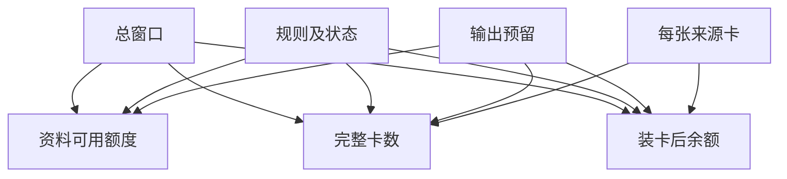

# 上下文预算究竟还能放几张完整卡

本轮首先保留规则、有效状态和必要输出，再给来源卡分配余量。
裁掉对象名或适用时间的半张卡不能作为完整证据。
把输入和预留输出放在同一教学窗口中。实际供应商的计量边界需要单独核对。

## 先解决一个具体问题

**把所有资料都放进长窗口，为什么还是需要状态管理？**

窗口只是供模型阅读的容量。
哪个补丁生效、哪些结论过期、哪个对象对当前主体可见，仍是业务状态问题。
先选有效事实，再谈片段能否装入。


先从具体的低档设定开始：总窗口取 4096token、规则及状态取 1200token、输出预留取 600token、每张来源卡取 320token。
三个结果依次是资料可用额度 2296token、完整卡数 7张、装卡后余额 56token。
先手算这个起点，读完后再把另一个输入切到高档，这样能知道数字变化时究竟改变了哪个假设。

## 先写清输入边界和三个观测量

用 a 表示总窗口，取 4096token 或 8192token，这两点是用于隔离因果影响的教学输入。

用 b 表示规则及状态，取 1200token 或 2300token，这两点是用于隔离因果影响的教学输入。

用 c 表示输出预留，取 600token 或 1100token，这两点是用于隔离因果影响的教学输入。

用 d 表示每张来源卡，取 320token 或 700token，这两点是用于隔离因果影响的教学输入。

「资料可用额度」的计算式为 `a-b-c`，按业务量展开是 `总窗口-规则及状态-输出预留`，输出单位为token。

「完整卡数」的计算式为 `floor((a-b-c)/d)`，按业务量展开是 `floor((总窗口-规则及状态-输出预留)/每张来源卡)`，输出单位为张。

「装卡后余额」的计算式为 `(a-b-c)%d`，按业务量展开是 `(总窗口-规则及状态-输出预留)%每张来源卡`，输出单位为token。

公式中 ceil 与 floor 分别向上、向下取整，% 在表达式中作取余，** 为乘方，三元条件按“条件 ? 成立值 : 其他值”读取。展示数值最多保留三位小数，比较和反推采用未舍入值。



图上的箭头表示该输入出现在计算式中。同一输入通向多个指标时，三个读数可能共同移动。分支、取整或相互抵消又会使某些边在具体样本上没有可见增量。

## 从输入按单位逐步算到可比较的结果

<details>
<summary>展开推演与对应反例</summary>

### 样本 0000：总窗口 4096、规则及状态 1200

这一组设定为总窗口为 4096token、规则及状态为 1200token、输出预留为 600token、每张来源卡为 320token。

代入「资料可用额度」：`4096-1200-600`，得到 2296token。

代入「完整卡数」：`floor((4096-1200-600)/320)`，得到 7张。

代入「装卡后余额」：`(4096-1200-600)%320`，得到 56token。

以「完整卡数」作主读数时，本组单独切换总窗口的绝对变化最大或并列最大，读数会从 7张 变为 19张。

对角样本 1111 的主读数为 6张。它同时改了四项，差额不能充当任一单个因素的净收益。

### 样本 0001：总窗口 4096、规则及状态 1200

这一组设定为总窗口为 4096token、规则及状态为 1200token、输出预留为 600token、每张来源卡为 700token。


代入「完整卡数」：`floor((4096-1200-600)/700)`，得到 3张。

代入「装卡后余额」：`(4096-1200-600)%700`，得到 196token。

以「完整卡数」作主读数时，本组单独切换总窗口的绝对变化最大或并列最大，读数会从 3张 变为 9张。

对角样本 1110 的主读数为 14张。它同时改了四项，差额不能充当任一单个因素的净收益。

### 样本 0010：总窗口 4096、规则及状态 1200

这一组设定为总窗口为 4096token、规则及状态为 1200token、输出预留为 1100token、每张来源卡为 320token。

代入「资料可用额度」：`4096-1200-1100`，得到 1796token。

代入「完整卡数」：`floor((4096-1200-1100)/320)`，得到 5张。

代入「装卡后余额」：`(4096-1200-1100)%320`，得到 196token。

以「完整卡数」作主读数时，本组单独切换总窗口的绝对变化最大或并列最大，读数会从 5张 变为 18张。

对角样本 1101 的主读数为 7张。它同时改了四项，差额不能充当任一单个因素的净收益。

### 样本 0011：总窗口 4096、规则及状态 1200

这一组设定为总窗口为 4096token、规则及状态为 1200token、输出预留为 1100token、每张来源卡为 700token。


代入「完整卡数」：`floor((4096-1200-1100)/700)`，得到 2张。

代入「装卡后余额」：`(4096-1200-1100)%700`，得到 396token。

以「完整卡数」作主读数时，本组单独切换总窗口的绝对变化最大或并列最大，读数会从 2张 变为 8张。

对角样本 1100 的主读数为 16张。它同时改了四项，差额不能充当任一单个因素的净收益。

### 样本 0100：总窗口 4096、规则及状态 2300

这一组设定为总窗口为 4096token、规则及状态为 2300token、输出预留为 600token、每张来源卡为 320token。

代入「资料可用额度」：`4096-2300-600`，得到 1196token。

代入「完整卡数」：`floor((4096-2300-600)/320)`，得到 3张。

代入「装卡后余额」：`(4096-2300-600)%320`，得到 236token。

以「完整卡数」作主读数时，本组单独切换总窗口的绝对变化最大或并列最大，读数会从 3张 变为 16张。

对角样本 1011 的主读数为 8张。它同时改了四项，差额不能充当任一单个因素的净收益。

### 样本 0101：总窗口 4096、规则及状态 2300

这一组设定为总窗口为 4096token、规则及状态为 2300token、输出预留为 600token、每张来源卡为 700token。


代入「完整卡数」：`floor((4096-2300-600)/700)`，得到 1张。

代入「装卡后余额」：`(4096-2300-600)%700`，得到 496token。

以「完整卡数」作主读数时，本组单独切换总窗口的绝对变化最大或并列最大，读数会从 1张 变为 7张。

对角样本 1010 的主读数为 18张。它同时改了四项，差额不能充当任一单个因素的净收益。

### 样本 0110：总窗口 4096、规则及状态 2300

这一组设定为总窗口为 4096token、规则及状态为 2300token、输出预留为 1100token、每张来源卡为 320token。

代入「资料可用额度」：`4096-2300-1100`，得到 696token。

代入「完整卡数」：`floor((4096-2300-1100)/320)`，得到 2张。

代入「装卡后余额」：`(4096-2300-1100)%320`，得到 56token。

以「完整卡数」作主读数时，本组单独切换总窗口的绝对变化最大或并列最大，读数会从 2张 变为 14张。

对角样本 1001 的主读数为 9张。它同时改了四项，差额不能充当任一单个因素的净收益。

### 样本 0111：总窗口 4096、规则及状态 2300

这一组设定为总窗口为 4096token、规则及状态为 2300token、输出预留为 1100token、每张来源卡为 700token。


代入「完整卡数」：`floor((4096-2300-1100)/700)`，得到 0张。

代入「装卡后余额」：`(4096-2300-1100)%700`，得到 696token。

以「完整卡数」作主读数时，本组单独切换总窗口的绝对变化最大或并列最大，读数会从 0张 变为 6张。

对角样本 1000 的主读数为 19张。它同时改了四项，差额不能充当任一单个因素的净收益。

### 样本 1000：总窗口 8192、规则及状态 1200

这一组设定为总窗口为 8192token、规则及状态为 1200token、输出预留为 600token、每张来源卡为 320token。

代入「资料可用额度」：`8192-1200-600`，得到 6392token。

代入「完整卡数」：`floor((8192-1200-600)/320)`，得到 19张。

代入「装卡后余额」：`(8192-1200-600)%320`，得到 312token。

以「完整卡数」作主读数时，本组单独切换总窗口的绝对变化最大或并列最大，读数会从 19张 变为 7张。

对角样本 0111 的主读数为 0张。它同时改了四项，差额不能充当任一单个因素的净收益。

### 样本 1001：总窗口 8192、规则及状态 1200

这一组设定为总窗口为 8192token、规则及状态为 1200token、输出预留为 600token、每张来源卡为 700token。


代入「完整卡数」：`floor((8192-1200-600)/700)`，得到 9张。

代入「装卡后余额」：`(8192-1200-600)%700`，得到 92token。

以「完整卡数」作主读数时，本组单独切换每张来源卡的绝对变化最大或并列最大，读数会从 9张 变为 19张。

对角样本 0110 的主读数为 2张。它同时改了四项，差额不能充当任一单个因素的净收益。

### 样本 1010：总窗口 8192、规则及状态 1200

这一组设定为总窗口为 8192token、规则及状态为 1200token、输出预留为 1100token、每张来源卡为 320token。

代入「资料可用额度」：`8192-1200-1100`，得到 5892token。

代入「完整卡数」：`floor((8192-1200-1100)/320)`，得到 18张。

代入「装卡后余额」：`(8192-1200-1100)%320`，得到 132token。

以「完整卡数」作主读数时，本组单独切换总窗口的绝对变化最大或并列最大，读数会从 18张 变为 5张。

对角样本 0101 的主读数为 1张。它同时改了四项，差额不能充当任一单个因素的净收益。

### 样本 1011：总窗口 8192、规则及状态 1200

这一组设定为总窗口为 8192token、规则及状态为 1200token、输出预留为 1100token、每张来源卡为 700token。


代入「完整卡数」：`floor((8192-1200-1100)/700)`，得到 8张。

代入「装卡后余额」：`(8192-1200-1100)%700`，得到 292token。

以「完整卡数」作主读数时，本组单独切换每张来源卡的绝对变化最大或并列最大，读数会从 8张 变为 18张。

对角样本 0100 的主读数为 3张。它同时改了四项，差额不能充当任一单个因素的净收益。

### 样本 1100：总窗口 8192、规则及状态 2300

这一组设定为总窗口为 8192token、规则及状态为 2300token、输出预留为 600token、每张来源卡为 320token。

代入「资料可用额度」：`8192-2300-600`，得到 5292token。

代入「完整卡数」：`floor((8192-2300-600)/320)`，得到 16张。

代入「装卡后余额」：`(8192-2300-600)%320`，得到 172token。

以「完整卡数」作主读数时，本组单独切换总窗口的绝对变化最大或并列最大，读数会从 16张 变为 3张。

对角样本 0011 的主读数为 2张。它同时改了四项，差额不能充当任一单个因素的净收益。

### 样本 1101：总窗口 8192、规则及状态 2300

这一组设定为总窗口为 8192token、规则及状态为 2300token、输出预留为 600token、每张来源卡为 700token。


代入「完整卡数」：`floor((8192-2300-600)/700)`，得到 7张。

代入「装卡后余额」：`(8192-2300-600)%700`，得到 392token。

以「完整卡数」作主读数时，本组单独切换每张来源卡的绝对变化最大或并列最大，读数会从 7张 变为 16张。

对角样本 0010 的主读数为 5张。它同时改了四项，差额不能充当任一单个因素的净收益。

### 样本 1110：总窗口 8192、规则及状态 2300

这一组设定为总窗口为 8192token、规则及状态为 2300token、输出预留为 1100token、每张来源卡为 320token。

代入「资料可用额度」：`8192-2300-1100`，得到 4792token。

代入「完整卡数」：`floor((8192-2300-1100)/320)`，得到 14张。

代入「装卡后余额」：`(8192-2300-1100)%320`，得到 312token。

以「完整卡数」作主读数时，本组单独切换总窗口的绝对变化最大或并列最大，读数会从 14张 变为 2张。

对角样本 0001 的主读数为 3张。它同时改了四项，差额不能充当任一单个因素的净收益。

### 样本 1111：总窗口 8192、规则及状态 2300

这一组设定为总窗口为 8192token、规则及状态为 2300token、输出预留为 1100token、每张来源卡为 700token。


代入「完整卡数」：`floor((8192-2300-1100)/700)`，得到 6张。

代入「装卡后余额」：`(8192-2300-1100)%700`，得到 592token。

以「完整卡数」作主读数时，本组单独切换每张来源卡的绝对变化最大或并列最大，读数会从 6张 变为 14张。

对角样本 0000 的主读数为 7张。它同时改了四项，差额不能充当任一单个因素的净收益。

</details>

## 逐个干预：其余条件固定时，变化真的发生在哪里

<details>
<summary>展开推演与对应反例</summary>

### 只改变总窗口

固定规则及状态为 1200token、输出预留为 600token、每张来源卡为 320token，只把总窗口从 4096token改到 8192token。
这一对的资料可用额度从 2296token 变为 6392token，完整卡数的差为 12张，装卡后余额的差为 256token。

固定规则及状态为 1200token、输出预留为 600token、每张来源卡为 700token，只把总窗口从 4096token改到 8192token。
这一对的资料可用额度从 2296token 变为 6392token，完整卡数的差为 6张，装卡后余额的差为 -104token。

固定规则及状态为 1200token、输出预留为 1100token、每张来源卡为 320token，只把总窗口从 4096token改到 8192token。
这一对的资料可用额度从 1796token 变为 5892token，完整卡数的差为 13张，装卡后余额的差为 -64token。

固定规则及状态为 1200token、输出预留为 1100token、每张来源卡为 700token，只把总窗口从 4096token改到 8192token。
这一对的资料可用额度从 1796token 变为 5892token，完整卡数的差为 6张，装卡后余额的差为 -104token。

固定规则及状态为 2300token、输出预留为 600token、每张来源卡为 320token，只把总窗口从 4096token改到 8192token。
这一对的资料可用额度从 1196token 变为 5292token，完整卡数的差为 13张，装卡后余额的差为 -64token。

固定规则及状态为 2300token、输出预留为 600token、每张来源卡为 700token，只把总窗口从 4096token改到 8192token。
这一对的资料可用额度从 1196token 变为 5292token，完整卡数的差为 6张，装卡后余额的差为 -104token。

固定规则及状态为 2300token、输出预留为 1100token、每张来源卡为 320token，只把总窗口从 4096token改到 8192token。
这一对的资料可用额度从 696token 变为 4792token，完整卡数的差为 12张，装卡后余额的差为 256token。

固定规则及状态为 2300token、输出预留为 1100token、每张来源卡为 700token，只把总窗口从 4096token改到 8192token。
这一对的资料可用额度从 696token 变为 4792token，完整卡数的差为 6张，装卡后余额的差为 -104token。

综合八组受控背景，总窗口升到较高设定时「资料可用额度」的差值区间是 4096token，共有 8 对出现可观察变化。

综合八组受控背景，总窗口升到较高设定时「完整卡数」的差值区间是 6张 至 13张，共有 8 对出现可观察变化。

综合八组受控背景，总窗口升到较高设定时「装卡后余额」的差值区间是 -104token 至 256token，共有 8 对出现可观察变化。

### 只改变规则及状态

固定总窗口为 4096token、输出预留为 600token、每张来源卡为 320token，只把规则及状态从 1200token改到 2300token。
这一对的资料可用额度从 2296token 变为 1196token，完整卡数的差为 -4张，装卡后余额的差为 180token。

固定总窗口为 4096token、输出预留为 600token、每张来源卡为 700token，只把规则及状态从 1200token改到 2300token。
这一对的资料可用额度从 2296token 变为 1196token，完整卡数的差为 -2张，装卡后余额的差为 300token。

固定总窗口为 4096token、输出预留为 1100token、每张来源卡为 320token，只把规则及状态从 1200token改到 2300token。
这一对的资料可用额度从 1796token 变为 696token，完整卡数的差为 -3张，装卡后余额的差为 -140token。

固定总窗口为 4096token、输出预留为 1100token、每张来源卡为 700token，只把规则及状态从 1200token改到 2300token。
这一对的资料可用额度从 1796token 变为 696token，完整卡数的差为 -2张，装卡后余额的差为 300token。

固定总窗口为 8192token、输出预留为 600token、每张来源卡为 320token，只把规则及状态从 1200token改到 2300token。
这一对的资料可用额度从 6392token 变为 5292token，完整卡数的差为 -3张，装卡后余额的差为 -140token。

固定总窗口为 8192token、输出预留为 600token、每张来源卡为 700token，只把规则及状态从 1200token改到 2300token。
这一对的资料可用额度从 6392token 变为 5292token，完整卡数的差为 -2张，装卡后余额的差为 300token。

固定总窗口为 8192token、输出预留为 1100token、每张来源卡为 320token，只把规则及状态从 1200token改到 2300token。
这一对的资料可用额度从 5892token 变为 4792token，完整卡数的差为 -4张，装卡后余额的差为 180token。

固定总窗口为 8192token、输出预留为 1100token、每张来源卡为 700token，只把规则及状态从 1200token改到 2300token。
这一对的资料可用额度从 5892token 变为 4792token，完整卡数的差为 -2张，装卡后余额的差为 300token。

综合八组受控背景，规则及状态升到较高设定时「资料可用额度」的差值区间是 -1100token，共有 8 对出现可观察变化。

综合八组受控背景，规则及状态升到较高设定时「完整卡数」的差值区间是 -4张 至 -2张，共有 8 对出现可观察变化。

综合八组受控背景，规则及状态升到较高设定时「装卡后余额」的差值区间是 -140token 至 300token，共有 8 对出现可观察变化。

### 只改变输出预留

固定总窗口为 4096token、规则及状态为 1200token、每张来源卡为 320token，只把输出预留从 600token改到 1100token。
这一对的资料可用额度从 2296token 变为 1796token，完整卡数的差为 -2张，装卡后余额的差为 140token。

固定总窗口为 4096token、规则及状态为 1200token、每张来源卡为 700token，只把输出预留从 600token改到 1100token。
这一对的资料可用额度从 2296token 变为 1796token，完整卡数的差为 -1张，装卡后余额的差为 200token。

固定总窗口为 4096token、规则及状态为 2300token、每张来源卡为 320token，只把输出预留从 600token改到 1100token。
这一对的资料可用额度从 1196token 变为 696token，完整卡数的差为 -1张，装卡后余额的差为 -180token。

固定总窗口为 4096token、规则及状态为 2300token、每张来源卡为 700token，只把输出预留从 600token改到 1100token。
这一对的资料可用额度从 1196token 变为 696token，完整卡数的差为 -1张，装卡后余额的差为 200token。

固定总窗口为 8192token、规则及状态为 1200token、每张来源卡为 320token，只把输出预留从 600token改到 1100token。
这一对的资料可用额度从 6392token 变为 5892token，完整卡数的差为 -1张，装卡后余额的差为 -180token。

固定总窗口为 8192token、规则及状态为 1200token、每张来源卡为 700token，只把输出预留从 600token改到 1100token。
这一对的资料可用额度从 6392token 变为 5892token，完整卡数的差为 -1张，装卡后余额的差为 200token。

固定总窗口为 8192token、规则及状态为 2300token、每张来源卡为 320token，只把输出预留从 600token改到 1100token。
这一对的资料可用额度从 5292token 变为 4792token，完整卡数的差为 -2张，装卡后余额的差为 140token。

固定总窗口为 8192token、规则及状态为 2300token、每张来源卡为 700token，只把输出预留从 600token改到 1100token。
这一对的资料可用额度从 5292token 变为 4792token，完整卡数的差为 -1张，装卡后余额的差为 200token。

综合八组受控背景，输出预留升到较高设定时「资料可用额度」的差值区间是 -500token，共有 8 对出现可观察变化。

综合八组受控背景，输出预留升到较高设定时「完整卡数」的差值区间是 -2张 至 -1张，共有 8 对出现可观察变化。

综合八组受控背景，输出预留升到较高设定时「装卡后余额」的差值区间是 -180token 至 200token，共有 8 对出现可观察变化。

### 只改变每张来源卡

固定总窗口为 4096token、规则及状态为 1200token、输出预留为 600token，只把每张来源卡从 320token改到 700token。
这一对的资料可用额度从 2296token 变为 2296token，完整卡数的差为 -4张，装卡后余额的差为 140token。

固定总窗口为 4096token、规则及状态为 1200token、输出预留为 1100token，只把每张来源卡从 320token改到 700token。
这一对的资料可用额度从 1796token 变为 1796token，完整卡数的差为 -3张，装卡后余额的差为 200token。

固定总窗口为 4096token、规则及状态为 2300token、输出预留为 600token，只把每张来源卡从 320token改到 700token。
这一对的资料可用额度从 1196token 变为 1196token，完整卡数的差为 -2张，装卡后余额的差为 260token。

固定总窗口为 4096token、规则及状态为 2300token、输出预留为 1100token，只把每张来源卡从 320token改到 700token。
这一对的资料可用额度从 696token 变为 696token，完整卡数的差为 -2张，装卡后余额的差为 640token。

固定总窗口为 8192token、规则及状态为 1200token、输出预留为 600token，只把每张来源卡从 320token改到 700token。
这一对的资料可用额度从 6392token 变为 6392token，完整卡数的差为 -10张，装卡后余额的差为 -220token。

固定总窗口为 8192token、规则及状态为 1200token、输出预留为 1100token，只把每张来源卡从 320token改到 700token。
这一对的资料可用额度从 5892token 变为 5892token，完整卡数的差为 -10张，装卡后余额的差为 160token。

固定总窗口为 8192token、规则及状态为 2300token、输出预留为 600token，只把每张来源卡从 320token改到 700token。
这一对的资料可用额度从 5292token 变为 5292token，完整卡数的差为 -9张，装卡后余额的差为 220token。

固定总窗口为 8192token、规则及状态为 2300token、输出预留为 1100token，只把每张来源卡从 320token改到 700token。
这一对的资料可用额度从 4792token 变为 4792token，完整卡数的差为 -8张，装卡后余额的差为 280token。

综合八组受控背景，每张来源卡升到较高设定时「资料可用额度」的差值区间是 0token，共有 0 对出现可观察变化。

综合八组受控背景，每张来源卡升到较高设定时「完整卡数」的差值区间是 -10张 至 -2张，共有 8 对出现可观察变化。

综合八组受控背景，每张来源卡升到较高设定时「装卡后余额」的差值区间是 -220token 至 640token，共有 8 对出现可观察变化。

</details>

## 只拿到部分输入，结论还能缩小到多大范围

<details>
<summary>展开推演与对应反例</summary>

### 已知总窗口和规则及状态

当总窗口为 4096token、规则及状态为 1200token时，另两项有四种补全，主读数「完整卡数」只能限定为 2张 至 7张。
这个条件下，取输出预留为 1100token、每张来源卡为 700token可得到下界 2张，取输出预留为 600token、每张来源卡为 320token可达到上界 7张。

用同样可见的总窗口为 4096token、规则及状态为 1200token去推「资料可用额度」，能得到的范围为 1796token 至 2296token，不能把另一个指标的单位代入。

用同样可见的总窗口为 4096token、规则及状态为 1200token去推「装卡后余额」，能得到的范围为 56token 至 396token，不能把另一个指标的单位代入。

若只许再问一项，按最坏区间宽度优先核对每张来源卡，补得低档时为 5张 至 7张，高档时为 2张 至 3张。

当总窗口为 4096token、规则及状态为 2300token时，另两项有四种补全，主读数「完整卡数」只能限定为 0张 至 3张。
这个条件下，取输出预留为 1100token、每张来源卡为 700token可得到下界 0张，取输出预留为 600token、每张来源卡为 320token可达到上界 3张。

用同样可见的总窗口为 4096token、规则及状态为 2300token去推「资料可用额度」，能得到的范围为 696token 至 1196token，不能把另一个指标的单位代入。

用同样可见的总窗口为 4096token、规则及状态为 2300token去推「装卡后余额」，能得到的范围为 56token 至 696token，不能把另一个指标的单位代入。

若只许再问一项，按最坏区间宽度优先核对每张来源卡，补得低档时为 2张 至 3张，高档时为 0张 至 1张。

当总窗口为 8192token、规则及状态为 1200token时，另两项有四种补全，主读数「完整卡数」只能限定为 8张 至 19张。
这个条件下，取输出预留为 1100token、每张来源卡为 700token可得到下界 8张，取输出预留为 600token、每张来源卡为 320token可达到上界 19张。

用同样可见的总窗口为 8192token、规则及状态为 1200token去推「资料可用额度」，能得到的范围为 5892token 至 6392token，不能把另一个指标的单位代入。

用同样可见的总窗口为 8192token、规则及状态为 1200token去推「装卡后余额」，能得到的范围为 92token 至 312token，不能把另一个指标的单位代入。

若只许再问一项，按最坏区间宽度优先核对每张来源卡，补得低档时为 18张 至 19张，高档时为 8张 至 9张。

当总窗口为 8192token、规则及状态为 2300token时，另两项有四种补全，主读数「完整卡数」只能限定为 6张 至 16张。
这个条件下，取输出预留为 1100token、每张来源卡为 700token可得到下界 6张，取输出预留为 600token、每张来源卡为 320token可达到上界 16张。

用同样可见的总窗口为 8192token、规则及状态为 2300token去推「资料可用额度」，能得到的范围为 4792token 至 5292token，不能把另一个指标的单位代入。

用同样可见的总窗口为 8192token、规则及状态为 2300token去推「装卡后余额」，能得到的范围为 172token 至 592token，不能把另一个指标的单位代入。

若只许再问一项，按最坏区间宽度优先核对每张来源卡，补得低档时为 14张 至 16张，高档时为 6张 至 7张。

### 已知总窗口和输出预留

当总窗口为 4096token、输出预留为 600token时，另两项有四种补全，主读数「完整卡数」只能限定为 1张 至 7张。
这个条件下，取规则及状态为 2300token、每张来源卡为 700token可得到下界 1张，取规则及状态为 1200token、每张来源卡为 320token可达到上界 7张。

用同样可见的总窗口为 4096token、输出预留为 600token去推「资料可用额度」，能得到的范围为 1196token 至 2296token，不能把另一个指标的单位代入。

用同样可见的总窗口为 4096token、输出预留为 600token去推「装卡后余额」，能得到的范围为 56token 至 496token，不能把另一个指标的单位代入。

若只许再问一项，按最坏区间宽度优先核对规则及状态，补得低档时为 3张 至 7张，高档时为 1张 至 3张。

当总窗口为 4096token、输出预留为 1100token时，另两项有四种补全，主读数「完整卡数」只能限定为 0张 至 5张。
这个条件下，取规则及状态为 2300token、每张来源卡为 700token可得到下界 0张，取规则及状态为 1200token、每张来源卡为 320token可达到上界 5张。

用同样可见的总窗口为 4096token、输出预留为 1100token去推「资料可用额度」，能得到的范围为 696token 至 1796token，不能把另一个指标的单位代入。

用同样可见的总窗口为 4096token、输出预留为 1100token去推「装卡后余额」，能得到的范围为 56token 至 696token，不能把另一个指标的单位代入。

若只许再问一项，按最坏区间宽度优先核对规则及状态，补得低档时为 2张 至 5张，高档时为 0张 至 2张。

当总窗口为 8192token、输出预留为 600token时，另两项有四种补全，主读数「完整卡数」只能限定为 7张 至 19张。
这个条件下，取规则及状态为 2300token、每张来源卡为 700token可得到下界 7张，取规则及状态为 1200token、每张来源卡为 320token可达到上界 19张。

用同样可见的总窗口为 8192token、输出预留为 600token去推「资料可用额度」，能得到的范围为 5292token 至 6392token，不能把另一个指标的单位代入。

用同样可见的总窗口为 8192token、输出预留为 600token去推「装卡后余额」，能得到的范围为 92token 至 392token，不能把另一个指标的单位代入。

若只许再问一项，按最坏区间宽度优先核对每张来源卡，补得低档时为 16张 至 19张，高档时为 7张 至 9张。

当总窗口为 8192token、输出预留为 1100token时，另两项有四种补全，主读数「完整卡数」只能限定为 6张 至 18张。
这个条件下，取规则及状态为 2300token、每张来源卡为 700token可得到下界 6张，取规则及状态为 1200token、每张来源卡为 320token可达到上界 18张。

用同样可见的总窗口为 8192token、输出预留为 1100token去推「资料可用额度」，能得到的范围为 4792token 至 5892token，不能把另一个指标的单位代入。

用同样可见的总窗口为 8192token、输出预留为 1100token去推「装卡后余额」，能得到的范围为 132token 至 592token，不能把另一个指标的单位代入。

若只许再问一项，按最坏区间宽度优先核对每张来源卡，补得低档时为 14张 至 18张，高档时为 6张 至 8张。

### 已知规则及状态和输出预留

当规则及状态为 1200token、输出预留为 600token时，另两项有四种补全，主读数「完整卡数」只能限定为 3张 至 19张。
这个条件下，取总窗口为 4096token、每张来源卡为 700token可得到下界 3张，取总窗口为 8192token、每张来源卡为 320token可达到上界 19张。

用同样可见的规则及状态为 1200token、输出预留为 600token去推「资料可用额度」，能得到的范围为 2296token 至 6392token，不能把另一个指标的单位代入。

用同样可见的规则及状态为 1200token、输出预留为 600token去推「装卡后余额」，能得到的范围为 56token 至 312token，不能把另一个指标的单位代入。

若只许再问一项，按最坏区间宽度优先核对总窗口，补得低档时为 3张 至 7张，高档时为 9张 至 19张。

当规则及状态为 1200token、输出预留为 1100token时，另两项有四种补全，主读数「完整卡数」只能限定为 2张 至 18张。
这个条件下，取总窗口为 4096token、每张来源卡为 700token可得到下界 2张，取总窗口为 8192token、每张来源卡为 320token可达到上界 18张。

用同样可见的规则及状态为 1200token、输出预留为 1100token去推「资料可用额度」，能得到的范围为 1796token 至 5892token，不能把另一个指标的单位代入。

用同样可见的规则及状态为 1200token、输出预留为 1100token去推「装卡后余额」，能得到的范围为 132token 至 396token，不能把另一个指标的单位代入。

若只许再问一项，按最坏区间宽度优先核对总窗口，补得低档时为 2张 至 5张，高档时为 8张 至 18张。

当规则及状态为 2300token、输出预留为 600token时，另两项有四种补全，主读数「完整卡数」只能限定为 1张 至 16张。
这个条件下，取总窗口为 4096token、每张来源卡为 700token可得到下界 1张，取总窗口为 8192token、每张来源卡为 320token可达到上界 16张。

用同样可见的规则及状态为 2300token、输出预留为 600token去推「资料可用额度」，能得到的范围为 1196token 至 5292token，不能把另一个指标的单位代入。

用同样可见的规则及状态为 2300token、输出预留为 600token去推「装卡后余额」，能得到的范围为 172token 至 496token，不能把另一个指标的单位代入。

若只许再问一项，按最坏区间宽度优先核对总窗口，补得低档时为 1张 至 3张，高档时为 7张 至 16张。

当规则及状态为 2300token、输出预留为 1100token时，另两项有四种补全，主读数「完整卡数」只能限定为 0张 至 14张。
这个条件下，取总窗口为 4096token、每张来源卡为 700token可得到下界 0张，取总窗口为 8192token、每张来源卡为 320token可达到上界 14张。

用同样可见的规则及状态为 2300token、输出预留为 1100token去推「资料可用额度」，能得到的范围为 696token 至 4792token，不能把另一个指标的单位代入。

用同样可见的规则及状态为 2300token、输出预留为 1100token去推「装卡后余额」，能得到的范围为 56token 至 696token，不能把另一个指标的单位代入。

若只许再问一项，按最坏区间宽度优先核对总窗口，补得低档时为 0张 至 2张，高档时为 6张 至 14张。

### 已知总窗口和每张来源卡

当总窗口为 4096token、每张来源卡为 320token时，另两项有四种补全，主读数「完整卡数」只能限定为 2张 至 7张。
这个条件下，取规则及状态为 2300token、输出预留为 1100token可得到下界 2张，取规则及状态为 1200token、输出预留为 600token可达到上界 7张。

用同样可见的总窗口为 4096token、每张来源卡为 320token去推「资料可用额度」，能得到的范围为 696token 至 2296token，不能把另一个指标的单位代入。

用同样可见的总窗口为 4096token、每张来源卡为 320token去推「装卡后余额」，能得到的范围为 56token 至 236token，不能把另一个指标的单位代入。

若只许再问一项，按最坏区间宽度优先核对规则及状态，补得低档时为 5张 至 7张，高档时为 2张 至 3张。

当总窗口为 4096token、每张来源卡为 700token时，另两项有四种补全，主读数「完整卡数」只能限定为 0张 至 3张。
这个条件下，取规则及状态为 2300token、输出预留为 1100token可得到下界 0张，取规则及状态为 1200token、输出预留为 600token可达到上界 3张。

用同样可见的总窗口为 4096token、每张来源卡为 700token去推「资料可用额度」，能得到的范围为 696token 至 2296token，不能把另一个指标的单位代入。

用同样可见的总窗口为 4096token、每张来源卡为 700token去推「装卡后余额」，能得到的范围为 196token 至 696token，不能把另一个指标的单位代入。

若只许再问一项，按最坏区间宽度优先核对规则及状态，补得低档时为 2张 至 3张，高档时为 0张 至 1张。

当总窗口为 8192token、每张来源卡为 320token时，另两项有四种补全，主读数「完整卡数」只能限定为 14张 至 19张。
这个条件下，取规则及状态为 2300token、输出预留为 1100token可得到下界 14张，取规则及状态为 1200token、输出预留为 600token可达到上界 19张。

用同样可见的总窗口为 8192token、每张来源卡为 320token去推「资料可用额度」，能得到的范围为 4792token 至 6392token，不能把另一个指标的单位代入。

用同样可见的总窗口为 8192token、每张来源卡为 320token去推「装卡后余额」，能得到的范围为 132token 至 312token，不能把另一个指标的单位代入。

若只许再问一项，按最坏区间宽度优先核对规则及状态，补得低档时为 18张 至 19张，高档时为 14张 至 16张。

当总窗口为 8192token、每张来源卡为 700token时，另两项有四种补全，主读数「完整卡数」只能限定为 6张 至 9张。
这个条件下，取规则及状态为 2300token、输出预留为 1100token可得到下界 6张，取规则及状态为 1200token、输出预留为 600token可达到上界 9张。

用同样可见的总窗口为 8192token、每张来源卡为 700token去推「资料可用额度」，能得到的范围为 4792token 至 6392token，不能把另一个指标的单位代入。

用同样可见的总窗口为 8192token、每张来源卡为 700token去推「装卡后余额」，能得到的范围为 92token 至 592token，不能把另一个指标的单位代入。

若只许再问一项，按最坏区间宽度优先核对规则及状态，补得低档时为 8张 至 9张，高档时为 6张 至 7张。

### 已知规则及状态和每张来源卡

当规则及状态为 1200token、每张来源卡为 320token时，另两项有四种补全，主读数「完整卡数」只能限定为 5张 至 19张。
这个条件下，取总窗口为 4096token、输出预留为 1100token可得到下界 5张，取总窗口为 8192token、输出预留为 600token可达到上界 19张。

用同样可见的规则及状态为 1200token、每张来源卡为 320token去推「资料可用额度」，能得到的范围为 1796token 至 6392token，不能把另一个指标的单位代入。

用同样可见的规则及状态为 1200token、每张来源卡为 320token去推「装卡后余额」，能得到的范围为 56token 至 312token，不能把另一个指标的单位代入。

若只许再问一项，按最坏区间宽度优先核对总窗口，补得低档时为 5张 至 7张，高档时为 18张 至 19张。

当规则及状态为 1200token、每张来源卡为 700token时，另两项有四种补全，主读数「完整卡数」只能限定为 2张 至 9张。
这个条件下，取总窗口为 4096token、输出预留为 1100token可得到下界 2张，取总窗口为 8192token、输出预留为 600token可达到上界 9张。

用同样可见的规则及状态为 1200token、每张来源卡为 700token去推「资料可用额度」，能得到的范围为 1796token 至 6392token，不能把另一个指标的单位代入。

用同样可见的规则及状态为 1200token、每张来源卡为 700token去推「装卡后余额」，能得到的范围为 92token 至 396token，不能把另一个指标的单位代入。

若只许再问一项，按最坏区间宽度优先核对总窗口，补得低档时为 2张 至 3张，高档时为 8张 至 9张。

当规则及状态为 2300token、每张来源卡为 320token时，另两项有四种补全，主读数「完整卡数」只能限定为 2张 至 16张。
这个条件下，取总窗口为 4096token、输出预留为 1100token可得到下界 2张，取总窗口为 8192token、输出预留为 600token可达到上界 16张。

用同样可见的规则及状态为 2300token、每张来源卡为 320token去推「资料可用额度」，能得到的范围为 696token 至 5292token，不能把另一个指标的单位代入。

用同样可见的规则及状态为 2300token、每张来源卡为 320token去推「装卡后余额」，能得到的范围为 56token 至 312token，不能把另一个指标的单位代入。

若只许再问一项，按最坏区间宽度优先核对总窗口，补得低档时为 2张 至 3张，高档时为 14张 至 16张。

当规则及状态为 2300token、每张来源卡为 700token时，另两项有四种补全，主读数「完整卡数」只能限定为 0张 至 7张。
这个条件下，取总窗口为 4096token、输出预留为 1100token可得到下界 0张，取总窗口为 8192token、输出预留为 600token可达到上界 7张。

用同样可见的规则及状态为 2300token、每张来源卡为 700token去推「资料可用额度」，能得到的范围为 696token 至 5292token，不能把另一个指标的单位代入。

用同样可见的规则及状态为 2300token、每张来源卡为 700token去推「装卡后余额」，能得到的范围为 392token 至 696token，不能把另一个指标的单位代入。

若只许再问一项，按最坏区间宽度优先核对总窗口，补得低档时为 0张 至 1张，高档时为 6张 至 7张。

### 已知输出预留和每张来源卡

当输出预留为 600token、每张来源卡为 320token时，另两项有四种补全，主读数「完整卡数」只能限定为 3张 至 19张。
这个条件下，取总窗口为 4096token、规则及状态为 2300token可得到下界 3张，取总窗口为 8192token、规则及状态为 1200token可达到上界 19张。

用同样可见的输出预留为 600token、每张来源卡为 320token去推「资料可用额度」，能得到的范围为 1196token 至 6392token，不能把另一个指标的单位代入。

用同样可见的输出预留为 600token、每张来源卡为 320token去推「装卡后余额」，能得到的范围为 56token 至 312token，不能把另一个指标的单位代入。

若只许再问一项，按最坏区间宽度优先核对总窗口，补得低档时为 3张 至 7张，高档时为 16张 至 19张。

当输出预留为 600token、每张来源卡为 700token时，另两项有四种补全，主读数「完整卡数」只能限定为 1张 至 9张。
这个条件下，取总窗口为 4096token、规则及状态为 2300token可得到下界 1张，取总窗口为 8192token、规则及状态为 1200token可达到上界 9张。

用同样可见的输出预留为 600token、每张来源卡为 700token去推「资料可用额度」，能得到的范围为 1196token 至 6392token，不能把另一个指标的单位代入。

用同样可见的输出预留为 600token、每张来源卡为 700token去推「装卡后余额」，能得到的范围为 92token 至 496token，不能把另一个指标的单位代入。

若只许再问一项，按最坏区间宽度优先核对总窗口，补得低档时为 1张 至 3张，高档时为 7张 至 9张。

当输出预留为 1100token、每张来源卡为 320token时，另两项有四种补全，主读数「完整卡数」只能限定为 2张 至 18张。
这个条件下，取总窗口为 4096token、规则及状态为 2300token可得到下界 2张，取总窗口为 8192token、规则及状态为 1200token可达到上界 18张。

用同样可见的输出预留为 1100token、每张来源卡为 320token去推「资料可用额度」，能得到的范围为 696token 至 5892token，不能把另一个指标的单位代入。

用同样可见的输出预留为 1100token、每张来源卡为 320token去推「装卡后余额」，能得到的范围为 56token 至 312token，不能把另一个指标的单位代入。

若只许再问一项，按最坏区间宽度优先核对总窗口，补得低档时为 2张 至 5张，高档时为 14张 至 18张。

当输出预留为 1100token、每张来源卡为 700token时，另两项有四种补全，主读数「完整卡数」只能限定为 0张 至 8张。
这个条件下，取总窗口为 4096token、规则及状态为 2300token可得到下界 0张，取总窗口为 8192token、规则及状态为 1200token可达到上界 8张。

用同样可见的输出预留为 1100token、每张来源卡为 700token去推「资料可用额度」，能得到的范围为 696token 至 5892token，不能把另一个指标的单位代入。

用同样可见的输出预留为 1100token、每张来源卡为 700token去推「装卡后余额」，能得到的范围为 292token 至 696token，不能把另一个指标的单位代入。

若只许再问一项，按最坏区间宽度优先核对总窗口，补得低档时为 0张 至 2张，高档时为 6张 至 8张。

</details>

## 反过来审查一份报表：能从结果还原哪些输入

<details>
<summary>展开推演与对应反例</summary>

### 仅保留“资料可用额度”的读数

报表只写「资料可用额度=2296token」时，在本实验的离散取值中有 2 组输入与之相容。

对这个 2296token 的「资料可用额度」读数，所有相容样本都要求总窗口为 4096token、规则及状态为 1200token、输出预留为 600token。

只凭「资料可用额度」的 2296token 无法确定每张来源卡：0000 与 0001 的取值分别为 320 和 700token。

报表只写「资料可用额度=1796token」时，在本实验的离散取值中有 2 组输入与之相容。

对这个 1796token 的「资料可用额度」读数，所有相容样本都要求总窗口为 4096token、规则及状态为 1200token、输出预留为 1100token。

只凭「资料可用额度」的 1796token 无法确定每张来源卡：0010 与 0011 的取值分别为 320 和 700token。

报表只写「资料可用额度=1196token」时，在本实验的离散取值中有 2 组输入与之相容。

对这个 1196token 的「资料可用额度」读数，所有相容样本都要求总窗口为 4096token、规则及状态为 2300token、输出预留为 600token。

只凭「资料可用额度」的 1196token 无法确定每张来源卡：0100 与 0101 的取值分别为 320 和 700token。

报表只写「资料可用额度=696token」时，在本实验的离散取值中有 2 组输入与之相容。

对这个 696token 的「资料可用额度」读数，所有相容样本都要求总窗口为 4096token、规则及状态为 2300token、输出预留为 1100token。

只凭「资料可用额度」的 696token 无法确定每张来源卡：0110 与 0111 的取值分别为 320 和 700token。

报表只写「资料可用额度=6392token」时，在本实验的离散取值中有 2 组输入与之相容。

对这个 6392token 的「资料可用额度」读数，所有相容样本都要求总窗口为 8192token、规则及状态为 1200token、输出预留为 600token。

只凭「资料可用额度」的 6392token 无法确定每张来源卡：1000 与 1001 的取值分别为 320 和 700token。

报表只写「资料可用额度=5892token」时，在本实验的离散取值中有 2 组输入与之相容。

对这个 5892token 的「资料可用额度」读数，所有相容样本都要求总窗口为 8192token、规则及状态为 1200token、输出预留为 1100token。

只凭「资料可用额度」的 5892token 无法确定每张来源卡：1010 与 1011 的取值分别为 320 和 700token。

报表只写「资料可用额度=5292token」时，在本实验的离散取值中有 2 组输入与之相容。

对这个 5292token 的「资料可用额度」读数，所有相容样本都要求总窗口为 8192token、规则及状态为 2300token、输出预留为 600token。

只凭「资料可用额度」的 5292token 无法确定每张来源卡：1100 与 1101 的取值分别为 320 和 700token。

报表只写「资料可用额度=4792token」时，在本实验的离散取值中有 2 组输入与之相容。

对这个 4792token 的「资料可用额度」读数，所有相容样本都要求总窗口为 8192token、规则及状态为 2300token、输出预留为 1100token。

只凭「资料可用额度」的 4792token 无法确定每张来源卡：1110 与 1111 的取值分别为 320 和 700token。

### 仅保留“完整卡数”的读数

报表只写「完整卡数=7张」时，在本实验的离散取值中有 2 组输入与之相容。

对这个 7张 的「完整卡数」读数，所有相容样本都要求输出预留为 600token。

只凭「完整卡数」的 7张 无法确定总窗口：0000 与 1101 的取值分别为 4096 和 8192token。

报表只写「完整卡数=3张」时，在本实验的离散取值中有 2 组输入与之相容。

对这个 3张 的「完整卡数」读数，所有相容样本都要求总窗口为 4096token、输出预留为 600token。

只凭「完整卡数」的 3张 无法确定规则及状态：0001 与 0100 的取值分别为 1200 和 2300token。

报表只写「完整卡数=5张」时，在本实验的离散取值中有 1 组输入与之相容。

对这个 5张 的「完整卡数」读数，所有相容样本都要求总窗口为 4096token、规则及状态为 1200token、输出预留为 1100token、每张来源卡为 320token。

报表只写「完整卡数=2张」时，在本实验的离散取值中有 2 组输入与之相容。

对这个 2张 的「完整卡数」读数，所有相容样本都要求总窗口为 4096token、输出预留为 1100token。

只凭「完整卡数」的 2张 无法确定规则及状态：0011 与 0110 的取值分别为 1200 和 2300token。

报表只写「完整卡数=1张」时，在本实验的离散取值中有 1 组输入与之相容。

对这个 1张 的「完整卡数」读数，所有相容样本都要求总窗口为 4096token、规则及状态为 2300token、输出预留为 600token、每张来源卡为 700token。

报表只写「完整卡数=0张」时，在本实验的离散取值中有 1 组输入与之相容。

对这个 0张 的「完整卡数」读数，所有相容样本都要求总窗口为 4096token、规则及状态为 2300token、输出预留为 1100token、每张来源卡为 700token。

报表只写「完整卡数=19张」时，在本实验的离散取值中有 1 组输入与之相容。

对这个 19张 的「完整卡数」读数，所有相容样本都要求总窗口为 8192token、规则及状态为 1200token、输出预留为 600token、每张来源卡为 320token。

报表只写「完整卡数=9张」时，在本实验的离散取值中有 1 组输入与之相容。

对这个 9张 的「完整卡数」读数，所有相容样本都要求总窗口为 8192token、规则及状态为 1200token、输出预留为 600token、每张来源卡为 700token。

报表只写「完整卡数=18张」时，在本实验的离散取值中有 1 组输入与之相容。

对这个 18张 的「完整卡数」读数，所有相容样本都要求总窗口为 8192token、规则及状态为 1200token、输出预留为 1100token、每张来源卡为 320token。

报表只写「完整卡数=8张」时，在本实验的离散取值中有 1 组输入与之相容。

对这个 8张 的「完整卡数」读数，所有相容样本都要求总窗口为 8192token、规则及状态为 1200token、输出预留为 1100token、每张来源卡为 700token。

报表只写「完整卡数=16张」时，在本实验的离散取值中有 1 组输入与之相容。

对这个 16张 的「完整卡数」读数，所有相容样本都要求总窗口为 8192token、规则及状态为 2300token、输出预留为 600token、每张来源卡为 320token。

报表只写「完整卡数=14张」时，在本实验的离散取值中有 1 组输入与之相容。

对这个 14张 的「完整卡数」读数，所有相容样本都要求总窗口为 8192token、规则及状态为 2300token、输出预留为 1100token、每张来源卡为 320token。

报表只写「完整卡数=6张」时，在本实验的离散取值中有 1 组输入与之相容。

对这个 6张 的「完整卡数」读数，所有相容样本都要求总窗口为 8192token、规则及状态为 2300token、输出预留为 1100token、每张来源卡为 700token。

### 仅保留“装卡后余额”的读数

报表只写「装卡后余额=56token」时，在本实验的离散取值中有 2 组输入与之相容。

对这个 56token 的「装卡后余额」读数，所有相容样本都要求总窗口为 4096token、每张来源卡为 320token。

只凭「装卡后余额」的 56token 无法确定规则及状态：0000 与 0110 的取值分别为 1200 和 2300token。

报表只写「装卡后余额=196token」时，在本实验的离散取值中有 2 组输入与之相容。

对这个 196token 的「装卡后余额」读数，所有相容样本都要求总窗口为 4096token、规则及状态为 1200token。

只凭「装卡后余额」的 196token 无法确定输出预留：0001 与 0010 的取值分别为 600 和 1100token。

报表只写「装卡后余额=396token」时，在本实验的离散取值中有 1 组输入与之相容。

对这个 396token 的「装卡后余额」读数，所有相容样本都要求总窗口为 4096token、规则及状态为 1200token、输出预留为 1100token、每张来源卡为 700token。

报表只写「装卡后余额=236token」时，在本实验的离散取值中有 1 组输入与之相容。

对这个 236token 的「装卡后余额」读数，所有相容样本都要求总窗口为 4096token、规则及状态为 2300token、输出预留为 600token、每张来源卡为 320token。

报表只写「装卡后余额=496token」时，在本实验的离散取值中有 1 组输入与之相容。

对这个 496token 的「装卡后余额」读数，所有相容样本都要求总窗口为 4096token、规则及状态为 2300token、输出预留为 600token、每张来源卡为 700token。

报表只写「装卡后余额=696token」时，在本实验的离散取值中有 1 组输入与之相容。

对这个 696token 的「装卡后余额」读数，所有相容样本都要求总窗口为 4096token、规则及状态为 2300token、输出预留为 1100token、每张来源卡为 700token。

报表只写「装卡后余额=312token」时，在本实验的离散取值中有 2 组输入与之相容。

对这个 312token 的「装卡后余额」读数，所有相容样本都要求总窗口为 8192token、每张来源卡为 320token。

只凭「装卡后余额」的 312token 无法确定规则及状态：1000 与 1110 的取值分别为 1200 和 2300token。

报表只写「装卡后余额=92token」时，在本实验的离散取值中有 1 组输入与之相容。

对这个 92token 的「装卡后余额」读数，所有相容样本都要求总窗口为 8192token、规则及状态为 1200token、输出预留为 600token、每张来源卡为 700token。

报表只写「装卡后余额=132token」时，在本实验的离散取值中有 1 组输入与之相容。

对这个 132token 的「装卡后余额」读数，所有相容样本都要求总窗口为 8192token、规则及状态为 1200token、输出预留为 1100token、每张来源卡为 320token。

报表只写「装卡后余额=292token」时，在本实验的离散取值中有 1 组输入与之相容。

对这个 292token 的「装卡后余额」读数，所有相容样本都要求总窗口为 8192token、规则及状态为 1200token、输出预留为 1100token、每张来源卡为 700token。

报表只写「装卡后余额=172token」时，在本实验的离散取值中有 1 组输入与之相容。

对这个 172token 的「装卡后余额」读数，所有相容样本都要求总窗口为 8192token、规则及状态为 2300token、输出预留为 600token、每张来源卡为 320token。

报表只写「装卡后余额=392token」时，在本实验的离散取值中有 1 组输入与之相容。

对这个 392token 的「装卡后余额」读数，所有相容样本都要求总窗口为 8192token、规则及状态为 2300token、输出预留为 600token、每张来源卡为 700token。

报表只写「装卡后余额=592token」时，在本实验的离散取值中有 1 组输入与之相容。

对这个 592token 的「装卡后余额」读数，所有相容样本都要求总窗口为 8192token、规则及状态为 2300token、输出预留为 1100token、每张来源卡为 700token。

</details>

## 给错误算法找反例，再给正确算法画使用边界

<details>
<summary>展开推演与对应反例</summary>

### 不预留输出额度

把「完整卡数」错写成 `floor((a-b)/d)`，在 16 组教学输入中有 15 组会与参照计算不同。

对于总窗口为 4096token、规则及状态为 1200token、输出预留为 600token、每张来源卡为 320token，这个错误口径得 9张，参照式为 7张，偏差为 2张。

对于总窗口为 4096token、规则及状态为 1200token、输出预留为 600token、每张来源卡为 700token，这个错误口径得 4张，参照式为 3张，偏差为 1张。

对于总窗口为 4096token、规则及状态为 1200token、输出预留为 1100token、每张来源卡为 320token，这个错误口径得 9张，参照式为 5张，偏差为 4张。

对于总窗口为 4096token、规则及状态为 1200token、输出预留为 1100token、每张来源卡为 700token，这个错误口径得 4张，参照式为 2张，偏差为 2张。

对于总窗口为 4096token、规则及状态为 2300token、输出预留为 600token、每张来源卡为 320token，这个错误口径得 5张，参照式为 3张，偏差为 2张。

对于总窗口为 4096token、规则及状态为 2300token、输出预留为 600token、每张来源卡为 700token，这个错误口径得 2张，参照式为 1张，偏差为 1张。

对于总窗口为 4096token、规则及状态为 2300token、输出预留为 1100token、每张来源卡为 320token，这个错误口径得 5张，参照式为 2张，偏差为 3张。

对于总窗口为 4096token、规则及状态为 2300token、输出预留为 1100token、每张来源卡为 700token，这个错误口径得 2张，参照式为 0张，偏差为 2张。

对于总窗口为 8192token、规则及状态为 1200token、输出预留为 600token、每张来源卡为 320token，这个错误口径得 21张，参照式为 19张，偏差为 2张。

样本 1001 令错误式 `floor((a-b)/d)` 恰好也给出 9张，因此仅拿这次「完整卡数」做回归发现不了该缺陷。

对于总窗口为 8192token、规则及状态为 1200token、输出预留为 1100token、每张来源卡为 320token，这个错误口径得 21张，参照式为 18张，偏差为 3张。

对于总窗口为 8192token、规则及状态为 1200token、输出预留为 1100token、每张来源卡为 700token，这个错误口径得 9张，参照式为 8张，偏差为 1张。

对于总窗口为 8192token、规则及状态为 2300token、输出预留为 600token、每张来源卡为 320token，这个错误口径得 18张，参照式为 16张，偏差为 2张。

对于总窗口为 8192token、规则及状态为 2300token、输出预留为 600token、每张来源卡为 700token，这个错误口径得 8张，参照式为 7张，偏差为 1张。

对于总窗口为 8192token、规则及状态为 2300token、输出预留为 1100token、每张来源卡为 320token，这个错误口径得 18张，参照式为 14张，偏差为 4张。

对于总窗口为 8192token、规则及状态为 2300token、输出预留为 1100token、每张来源卡为 700token，这个错误口径得 8张，参照式为 6张，偏差为 2张。

### 把残缺卡也记作完整可引来源

把「完整卡数」错写成 `ceil((a-b-c)/d)`，在 16 组教学输入中有 16 组会与参照计算不同。

对于总窗口为 4096token、规则及状态为 1200token、输出预留为 600token、每张来源卡为 320token，这个错误口径得 8张，参照式为 7张，偏差为 1张。


对于总窗口为 4096token、规则及状态为 1200token、输出预留为 1100token、每张来源卡为 320token，这个错误口径得 6张，参照式为 5张，偏差为 1张。

对于总窗口为 4096token、规则及状态为 1200token、输出预留为 1100token、每张来源卡为 700token，这个错误口径得 3张，参照式为 2张，偏差为 1张。

对于总窗口为 4096token、规则及状态为 2300token、输出预留为 600token、每张来源卡为 320token，这个错误口径得 4张，参照式为 3张，偏差为 1张。


对于总窗口为 4096token、规则及状态为 2300token、输出预留为 1100token、每张来源卡为 320token，这个错误口径得 3张，参照式为 2张，偏差为 1张。

对于总窗口为 4096token、规则及状态为 2300token、输出预留为 1100token、每张来源卡为 700token，这个错误口径得 1张，参照式为 0张，偏差为 1张。

对于总窗口为 8192token、规则及状态为 1200token、输出预留为 600token、每张来源卡为 320token，这个错误口径得 20张，参照式为 19张，偏差为 1张。

对于总窗口为 8192token、规则及状态为 1200token、输出预留为 600token、每张来源卡为 700token，这个错误口径得 10张，参照式为 9张，偏差为 1张。

对于总窗口为 8192token、规则及状态为 1200token、输出预留为 1100token、每张来源卡为 320token，这个错误口径得 19张，参照式为 18张，偏差为 1张。


对于总窗口为 8192token、规则及状态为 2300token、输出预留为 600token、每张来源卡为 320token，这个错误口径得 17张，参照式为 16张，偏差为 1张。


对于总窗口为 8192token、规则及状态为 2300token、输出预留为 1100token、每张来源卡为 320token，这个错误口径得 15张，参照式为 14张，偏差为 1张。

对于总窗口为 8192token、规则及状态为 2300token、输出预留为 1100token、每张来源卡为 700token，这个错误口径得 7张，参照式为 6张，偏差为 1张。

</details>

## 从教学算例回到可验证的工程结论

要把这些数写入项目说明，先用真实输入替换教学常数，列明样本分母、实际资源限制和观测边界，再验证公式所需前提。两点敏感性只描述这两个设定之间的差异。

## 面试复述与复算

面试题可以从“把所有资料都放进长窗口，为什么还是需要状态管理？”起步。先给出本篇的触发条件和一条真实执行端可检查的证据，再用一个相邻反例限定结论的适用范围。

在仓库根目录执行下列命令可以重算本篇的一个输入。四位数字依次选择正文列出的四项条件，0 表示未成立或低档，1 表示成立或高档。
```powershell
node examples/reading-cases/replay.mjs 5 3 0101
```

[本周主文](../theory.md) · [配套实验](../lab.md) · [下一篇研读](04.md)
