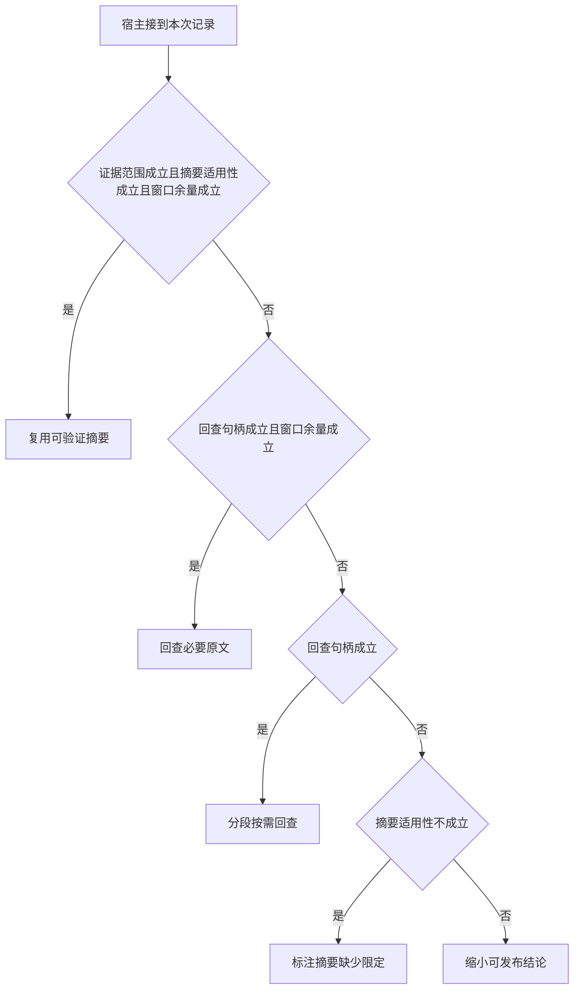

# 大日志摘要该在何时展开

一份压缩摘要丢掉“只记录前两名”，模型便可能断言候选完全没有目标。
把地址、范围与原文版本绑定后，系统才知道什么时候可以复用摘要、什么时候须再读窄窗口。

本篇用一个封闭的教学决策器说明这一问题。输入是宿主收到的记录，不保证每个下游字段都已经获准使用。前置检查未成立时，下游即使带着缓存值，也不能拿来作业务断言。

本例假定原文能按证据句柄进一步切窄。若单条必要事实仍无法进入窗口，分段方案也须降级为注明缺口。

## 先解决一个具体问题

**摘要压缩后句意近似，为什么有时不能继续引用？**

如果丢了“完整集合”还是“前两项”，相似句子可以支持相反强度的结论。
让引用绑定对象、版本及覆盖范围，需要时按句柄回查原文。


先取一个能走到「缩小可发布结论」的输入：资料来自另一服务区域、摘要保留关键限定、无法取得原始材料、窗口不足以装入必要材料。
把这四个条件代回后文的图，前面各个拦截分支都未满足，最终才有“现有范围或容量不足以支持完整命题”这个判断。
还原这个现场时要分别问：哪些位来自可信状态，哪些只是在接口中出现、尚未获得解释资格的字段。

## 先沿一次决策走到底



从上到下取第一条成立的出口。只改一个开关时，只有它之前的检查都未截断，该变化才可能到达真实动作。

“证据范围”的两种输入分别是“资料属于目标服务”与“资料来自另一服务区域”。
同楼地点也可能服务不同，引用要绑定业务对象。

“摘要适用性”的两种输入分别是“摘要保留关键限定”与“摘要丢失重要的限定”。
相似文本也可能不再支持当前命题。

“回查句柄”的两种输入分别是“能定位对应的原始材料”与“无法取得原始材料”。
摘要一旦丢失信息，需要可验证的回查路径。

“窗口余量”的两种输入分别是“可放入必要材料”与“窗口不足以装入必要材料”。
输出与工具说明也占用本次容量。

## 最少需要哪几项观察

### 复用可验证摘要

对象范围与限定及容量均有效。
在本节的全部组合中，有 2 种产生「复用可验证摘要」，这只是逻辑空间的计数，不能当作实际用户请求的比例。

只取得资料属于目标服务、摘要保留关键限定、可放入必要材料，已经足以要求宿主「复用可验证摘要」。
保持这些已知项，其余开关自由变化，仍有 2 种补全，判断没有翻转。

若删掉关于证据范围的证据，另一份允许的现场是资料来自另一服务区域、摘要保留关键限定、无法取得原始材料、可放入必要材料，它会使宿主「缩小可发布结论」。

若删掉关于摘要适用性的证据，另一份允许的现场是资料属于目标服务、摘要丢失重要的限定、无法取得原始材料、可放入必要材料，它会使宿主「标注摘要缺少限定」。

若删掉关于窗口余量的证据，另一份允许的现场是资料属于目标服务、摘要保留关键限定、无法取得原始材料、窗口不足以装入必要材料，它会使宿主「缩小可发布结论」。

### 回查必要原文

当前摘要不可直用但有来源和空间。
在本节的全部组合中，有 3 种产生「回查必要原文」，这只是逻辑空间的计数，不能当作实际用户请求的比例。

只取得资料来自另一服务区域、能定位对应的原始材料、可放入必要材料，已经足以要求宿主「回查必要原文」。

若删掉关于证据范围的证据，另一份允许的现场是资料属于目标服务、摘要保留关键限定、能定位对应的原始材料、可放入必要材料，它会使宿主「复用可验证摘要」。

若删掉关于回查句柄的证据，另一份允许的现场是资料来自另一服务区域、摘要丢失重要的限定、无法取得原始材料、可放入必要材料，它会使宿主「标注摘要缺少限定」。

若删掉关于窗口余量的证据，另一份允许的现场是资料来自另一服务区域、摘要丢失重要的限定、能定位对应的原始材料、窗口不足以装入必要材料，它会使宿主「分段按需回查」。

只取得摘要丢失重要的限定、能定位对应的原始材料、可放入必要材料，已经足以要求宿主「回查必要原文」。

若删掉关于摘要适用性的证据，另一份允许的现场是资料属于目标服务、摘要保留关键限定、能定位对应的原始材料、可放入必要材料，它会使宿主「复用可验证摘要」。


### 分段按需回查

可回查原文但不能一次装入。
在本节的全部组合中，有 4 种产生「分段按需回查」，这只是逻辑空间的计数，不能当作实际用户请求的比例。

只取得能定位对应的原始材料、窗口不足以装入必要材料，已经足以要求宿主「分段按需回查」。
保持这些已知项，其余开关自由变化，仍有 4 种补全，判断没有翻转。

若删掉关于回查句柄的证据，另一份允许的现场是资料来自另一服务区域、摘要丢失重要的限定、无法取得原始材料、窗口不足以装入必要材料，它会使宿主「标注摘要缺少限定」。

若删掉关于窗口余量的证据，另一份允许的现场是资料来自另一服务区域、摘要丢失重要的限定、能定位对应的原始材料、可放入必要材料，它会使宿主「回查必要原文」。

### 标注摘要缺少限定

摘要已失真且无法恢复原文。
在本节的全部组合中，有 4 种产生「标注摘要缺少限定」，这只是逻辑空间的计数，不能当作实际用户请求的比例。

只取得摘要丢失重要的限定、无法取得原始材料，已经足以要求宿主「标注摘要缺少限定」。

若删掉关于摘要适用性的证据，另一份允许的现场是资料来自另一服务区域、摘要保留关键限定、无法取得原始材料、窗口不足以装入必要材料，它会使宿主「缩小可发布结论」。

若删掉关于回查句柄的证据，另一份允许的现场是资料来自另一服务区域、摘要丢失重要的限定、能定位对应的原始材料、窗口不足以装入必要材料，它会使宿主「分段按需回查」。

### 缩小可发布结论

现有范围或容量不足以支持完整命题。
在本节的全部组合中，有 3 种产生「缩小可发布结论」，这只是逻辑空间的计数，不能当作实际用户请求的比例。

只取得资料来自另一服务区域、摘要保留关键限定、无法取得原始材料，已经足以要求宿主「缩小可发布结论」。

若删掉关于证据范围的证据，另一份允许的现场是资料属于目标服务、摘要保留关键限定、无法取得原始材料、可放入必要材料，它会使宿主「复用可验证摘要」。

若删掉关于摘要适用性的证据，另一份允许的现场是资料来自另一服务区域、摘要丢失重要的限定、无法取得原始材料、窗口不足以装入必要材料，它会使宿主「标注摘要缺少限定」。

若删掉关于回查句柄的证据，另一份允许的现场是资料来自另一服务区域、摘要保留关键限定、能定位对应的原始材料、窗口不足以装入必要材料，它会使宿主「分段按需回查」。

只取得摘要保留关键限定、无法取得原始材料、窗口不足以装入必要材料，已经足以要求宿主「缩小可发布结论」。


若删掉关于窗口余量的证据，另一份允许的现场是资料属于目标服务、摘要保留关键限定、无法取得原始材料、可放入必要材料，它会使宿主「复用可验证摘要」。

## 以同一份契约解释截然不同的现场

<details>
<summary>展开推演与对应反例</summary>

下列样本按最先命中的业务分支排列。四位编码只作本篇页内定位，顺序与开头的四项输入一致。可以先猜下一动作，再展开相邻样本。

### 能够触发“复用可验证摘要”的现场

**样本 1101**

业务侧交来资料属于目标服务、摘要保留关键限定，执行侧还记录了无法取得原始材料、可放入必要材料。
把样本压成最短证明，保留资料属于目标服务、摘要保留关键限定、可放入必要材料就能支持「复用可验证摘要」。

在这份记录上，分别翻转「证据范围」、「摘要适用性」、「窗口余量」中的任一项，其他项完全不变时，下一动作都会改变。

保持其余观察不动，单独切换「回查句柄」仍得到「复用可验证摘要」，它们在这个现场不是决定性变量。

要从本例改走「缩小可发布结论」，至少需要变动 1 项，一组最少改动是将资料属于目标服务换成资料来自另一服务区域。

要从本例改走「标注摘要缺少限定」，至少需要变动 1 项，一组最少改动是将摘要保留关键限定换成摘要丢失重要的限定。

要从本例改走「回查必要原文」，至少需要变动 2 项，一组最少改动是将资料属于目标服务、无法取得原始材料换成资料来自另一服务区域、能定位对应的原始材料。

要从本例改走「分段按需回查」，至少需要变动 2 项，一组最少改动是将无法取得原始材料、可放入必要材料换成能定位对应的原始材料、窗口不足以装入必要材料。

**样本 1111**

业务侧交来资料属于目标服务、摘要保留关键限定，执行侧还记录了能定位对应的原始材料、可放入必要材料。


要从本例改走「回查必要原文」，至少需要变动 1 项，一组最少改动是将资料属于目标服务换成资料来自另一服务区域。

要从本例改走「分段按需回查」，至少需要变动 1 项，一组最少改动是将可放入必要材料换成窗口不足以装入必要材料。

要从本例改走「缩小可发布结论」，至少需要变动 2 项，一组最少改动是将资料属于目标服务、能定位对应的原始材料换成资料来自另一服务区域、无法取得原始材料。

要从本例改走「标注摘要缺少限定」，至少需要变动 2 项，一组最少改动是将摘要保留关键限定、能定位对应的原始材料换成摘要丢失重要的限定、无法取得原始材料。

### 能够触发“回查必要原文”的现场

**样本 0011**

业务侧交来资料来自另一服务区域、摘要丢失重要的限定，执行侧还记录了能定位对应的原始材料、可放入必要材料。
把样本压成最短证明，保留资料来自另一服务区域、能定位对应的原始材料、可放入必要材料就能支持「回查必要原文」。

在这份记录上，分别翻转「回查句柄」、「窗口余量」中的任一项，其他项完全不变时，下一动作都会改变。

保持其余观察不动，单独切换「证据范围」、「摘要适用性」仍得到「回查必要原文」，它们在这个现场不是决定性变量。

本例没走更靠前的「复用可验证摘要」，因为资料来自另一服务区域、摘要丢失重要的限定与那个入口的必要条件不符。

要从本例改走「标注摘要缺少限定」，至少需要变动 1 项，一组最少改动是将能定位对应的原始材料换成无法取得原始材料。


要从本例改走「缩小可发布结论」，至少需要变动 2 项，一组最少改动是将摘要丢失重要的限定、能定位对应的原始材料换成摘要保留关键限定、无法取得原始材料。

要从本例改走「复用可验证摘要」，至少需要变动 2 项，一组最少改动是将资料来自另一服务区域、摘要丢失重要的限定换成资料属于目标服务、摘要保留关键限定。

**样本 0111**

业务侧交来资料来自另一服务区域、摘要保留关键限定，执行侧还记录了能定位对应的原始材料、可放入必要材料。

在这份记录上，分别翻转「证据范围」、「回查句柄」、「窗口余量」中的任一项，其他项完全不变时，下一动作都会改变。

保持其余观察不动，单独切换「摘要适用性」仍得到「回查必要原文」，它们在这个现场不是决定性变量。

本例没走更靠前的「复用可验证摘要」，因为资料来自另一服务区域与那个入口的必要条件不符。

要从本例改走「缩小可发布结论」，至少需要变动 1 项，一组最少改动是将能定位对应的原始材料换成无法取得原始材料。


要从本例改走「复用可验证摘要」，至少需要变动 1 项，一组最少改动是将资料来自另一服务区域换成资料属于目标服务。


**样本 1011**

业务侧交来资料属于目标服务、摘要丢失重要的限定，执行侧还记录了能定位对应的原始材料、可放入必要材料。
把样本压成最短证明，保留摘要丢失重要的限定、能定位对应的原始材料、可放入必要材料就能支持「回查必要原文」。

在这份记录上，分别翻转「摘要适用性」、「回查句柄」、「窗口余量」中的任一项，其他项完全不变时，下一动作都会改变。

保持其余观察不动，单独切换「证据范围」仍得到「回查必要原文」，它们在这个现场不是决定性变量。

本例没走更靠前的「复用可验证摘要」，因为摘要丢失重要的限定与那个入口的必要条件不符。


要从本例改走「复用可验证摘要」，至少需要变动 1 项，一组最少改动是将摘要丢失重要的限定换成摘要保留关键限定。

要从本例改走「缩小可发布结论」，至少需要变动 3 项，一组最少改动是将资料属于目标服务、摘要丢失重要的限定、能定位对应的原始材料换成资料来自另一服务区域、摘要保留关键限定、无法取得原始材料。

### 能够触发“分段按需回查”的现场

**样本 0010**

业务侧交来资料来自另一服务区域、摘要丢失重要的限定，执行侧还记录了能定位对应的原始材料、窗口不足以装入必要材料。
把样本压成最短证明，保留能定位对应的原始材料、窗口不足以装入必要材料就能支持「分段按需回查」。


保持其余观察不动，单独切换「证据范围」、「摘要适用性」仍得到「分段按需回查」，它们在这个现场不是决定性变量。

本例没走更靠前的「复用可验证摘要」，因为资料来自另一服务区域、摘要丢失重要的限定、窗口不足以装入必要材料与那个入口的必要条件不符。

本例没走更靠前的「回查必要原文」，因为窗口不足以装入必要材料与那个入口的必要条件不符。


要从本例改走「回查必要原文」，至少需要变动 1 项，一组最少改动是将窗口不足以装入必要材料换成可放入必要材料。


要从本例改走「复用可验证摘要」，至少需要变动 3 项，一组最少改动是将资料来自另一服务区域、摘要丢失重要的限定、窗口不足以装入必要材料换成资料属于目标服务、摘要保留关键限定、可放入必要材料。

**样本 0110**

业务侧交来资料来自另一服务区域、摘要保留关键限定，执行侧还记录了能定位对应的原始材料、窗口不足以装入必要材料。


本例没走更靠前的「复用可验证摘要」，因为资料来自另一服务区域、窗口不足以装入必要材料与那个入口的必要条件不符。


要从本例改走「复用可验证摘要」，至少需要变动 2 项，一组最少改动是将资料来自另一服务区域、窗口不足以装入必要材料换成资料属于目标服务、可放入必要材料。

**样本 1010**

业务侧交来资料属于目标服务、摘要丢失重要的限定，执行侧还记录了能定位对应的原始材料、窗口不足以装入必要材料。


本例没走更靠前的「复用可验证摘要」，因为摘要丢失重要的限定、窗口不足以装入必要材料与那个入口的必要条件不符。


要从本例改走「复用可验证摘要」，至少需要变动 2 项，一组最少改动是将摘要丢失重要的限定、窗口不足以装入必要材料换成摘要保留关键限定、可放入必要材料。

**样本 1110**

业务侧交来资料属于目标服务、摘要保留关键限定，执行侧还记录了能定位对应的原始材料、窗口不足以装入必要材料。


本例没走更靠前的「复用可验证摘要」，因为窗口不足以装入必要材料与那个入口的必要条件不符。


要从本例改走「复用可验证摘要」，至少需要变动 1 项，一组最少改动是将窗口不足以装入必要材料换成可放入必要材料。

要从本例改走「回查必要原文」，至少需要变动 2 项，一组最少改动是将资料属于目标服务、窗口不足以装入必要材料换成资料来自另一服务区域、可放入必要材料。


### 能够触发“标注摘要缺少限定”的现场

**样本 0000**

业务侧交来资料来自另一服务区域、摘要丢失重要的限定，执行侧还记录了无法取得原始材料、窗口不足以装入必要材料。
把样本压成最短证明，保留摘要丢失重要的限定、无法取得原始材料就能支持「标注摘要缺少限定」。

在这份记录上，分别翻转「摘要适用性」、「回查句柄」中的任一项，其他项完全不变时，下一动作都会改变。

保持其余观察不动，单独切换「证据范围」、「窗口余量」仍得到「标注摘要缺少限定」，它们在这个现场不是决定性变量。


本例没走更靠前的「回查必要原文」，因为无法取得原始材料、窗口不足以装入必要材料与那个入口的必要条件不符。

本例没走更靠前的「分段按需回查」，因为无法取得原始材料与那个入口的必要条件不符。

要从本例改走「分段按需回查」，至少需要变动 1 项，一组最少改动是将无法取得原始材料换成能定位对应的原始材料。

要从本例改走「缩小可发布结论」，至少需要变动 1 项，一组最少改动是将摘要丢失重要的限定换成摘要保留关键限定。

要从本例改走「回查必要原文」，至少需要变动 2 项，一组最少改动是将无法取得原始材料、窗口不足以装入必要材料换成能定位对应的原始材料、可放入必要材料。


**样本 0001**

业务侧交来资料来自另一服务区域、摘要丢失重要的限定，执行侧还记录了无法取得原始材料、可放入必要材料。


本例没走更靠前的「回查必要原文」，因为无法取得原始材料与那个入口的必要条件不符。


要从本例改走「回查必要原文」，至少需要变动 1 项，一组最少改动是将无法取得原始材料换成能定位对应的原始材料。


**样本 1000**

业务侧交来资料属于目标服务、摘要丢失重要的限定，执行侧还记录了无法取得原始材料、窗口不足以装入必要材料。


**样本 1001**

业务侧交来资料属于目标服务、摘要丢失重要的限定，执行侧还记录了无法取得原始材料、可放入必要材料。


要从本例改走「缩小可发布结论」，至少需要变动 2 项，一组最少改动是将资料属于目标服务、摘要丢失重要的限定换成资料来自另一服务区域、摘要保留关键限定。


### 能够触发“缩小可发布结论”的现场

**样本 0100**

业务侧交来资料来自另一服务区域、摘要保留关键限定，执行侧还记录了无法取得原始材料、窗口不足以装入必要材料。
把样本压成最短证明，保留资料来自另一服务区域、摘要保留关键限定、无法取得原始材料就能支持「缩小可发布结论」。


保持其余观察不动，单独切换「证据范围」、「窗口余量」仍得到「缩小可发布结论」，它们在这个现场不是决定性变量。


本例没走更靠前的「标注摘要缺少限定」，因为摘要保留关键限定与那个入口的必要条件不符。


**样本 0101**

业务侧交来资料来自另一服务区域、摘要保留关键限定，执行侧还记录了无法取得原始材料、可放入必要材料。

在这份记录上，分别翻转「证据范围」、「摘要适用性」、「回查句柄」中的任一项，其他项完全不变时，下一动作都会改变。

保持其余观察不动，单独切换「窗口余量」仍得到「缩小可发布结论」，它们在这个现场不是决定性变量。


**样本 1100**

业务侧交来资料属于目标服务、摘要保留关键限定，执行侧还记录了无法取得原始材料、窗口不足以装入必要材料。
把样本压成最短证明，保留摘要保留关键限定、无法取得原始材料、窗口不足以装入必要材料就能支持「缩小可发布结论」。


保持其余观察不动，单独切换「证据范围」仍得到「缩小可发布结论」，它们在这个现场不是决定性变量。


要从本例改走「回查必要原文」，至少需要变动 3 项，一组最少改动是将资料属于目标服务、无法取得原始材料、窗口不足以装入必要材料换成资料来自另一服务区域、能定位对应的原始材料、可放入必要材料。

</details>

## 当你只能看见一半记录

<details>
<summary>展开推演与对应反例</summary>

这次隐藏两个字段，保留另两个。对每个可见现场，检查四种合法补全是否同意。如仍有歧义，选择能使最坏剩余候选动作最少的字段继续查。并列时采用本篇字段顺序。

### 只保留证据范围与摘要适用性

已知资料来自另一服务区域、摘要丢失重要的限定时，四种补全的动作分布为回查必要原文（1 种）、分段按需回查（1 种）、标注摘要缺少限定（2 种）。

在资料来自另一服务区域、摘要丢失重要的限定这个现场补读「回查句柄」，最坏还剩 2 种动作，计算时只衡量歧义，尚未扣读取代价。
若补来的观察为“无法取得原始材料”，范围缩成「标注摘要缺少限定」。若为“能定位对应的原始材料”，则保留「分段按需回查」、「回查必要原文」。

区分不了的两条执行可以具体写成 0000 与 0010：它们共享已展示字段，却分别需要「标注摘要缺少限定」和「分段按需回查」。

已知资料来自另一服务区域、摘要保留关键限定时，四种补全的动作分布为回查必要原文（1 种）、分段按需回查（1 种）、缩小可发布结论（2 种）。

在资料来自另一服务区域、摘要保留关键限定这个现场补读「回查句柄」，最坏还剩 2 种动作，计算时只衡量歧义，尚未扣读取代价。
若补来的观察为“无法取得原始材料”，范围缩成「缩小可发布结论」。若为“能定位对应的原始材料”，则保留「分段按需回查」、「回查必要原文」。

区分不了的两条执行可以具体写成 0100 与 0110：它们共享已展示字段，却分别需要「缩小可发布结论」和「分段按需回查」。

已知资料属于目标服务、摘要丢失重要的限定时，四种补全的动作分布为回查必要原文（1 种）、分段按需回查（1 种）、标注摘要缺少限定（2 种）。

在资料属于目标服务、摘要丢失重要的限定这个现场补读「回查句柄」，最坏还剩 2 种动作，计算时只衡量歧义，尚未扣读取代价。

区分不了的两条执行可以具体写成 1000 与 1010：它们共享已展示字段，却分别需要「标注摘要缺少限定」和「分段按需回查」。

已知资料属于目标服务、摘要保留关键限定时，四种补全的动作分布为复用可验证摘要（2 种）、分段按需回查（1 种）、缩小可发布结论（1 种）。

在资料属于目标服务、摘要保留关键限定这个现场补读「回查句柄」，最坏还剩 2 种动作，计算时只衡量歧义，尚未扣读取代价。
若补来的观察为“无法取得原始材料”，范围缩成「缩小可发布结论」、「复用可验证摘要」。若为“能定位对应的原始材料”，则保留「分段按需回查」、「复用可验证摘要」。

区分不了的两条执行可以具体写成 1100 与 1101：它们共享已展示字段，却分别需要「缩小可发布结论」和「复用可验证摘要」。

### 只保留证据范围与回查句柄

已知资料来自另一服务区域、无法取得原始材料时，四种补全的动作分布为标注摘要缺少限定（2 种）、缩小可发布结论（2 种）。

在资料来自另一服务区域、无法取得原始材料这个现场补读「摘要适用性」，最坏还剩 1 种动作，计算时只衡量歧义，尚未扣读取代价。
若补来的观察为“摘要丢失重要的限定”，范围缩成「标注摘要缺少限定」。若为“摘要保留关键限定”，则保留「缩小可发布结论」。

区分不了的两条执行可以具体写成 0000 与 0100：它们共享已展示字段，却分别需要「标注摘要缺少限定」和「缩小可发布结论」。

已知资料来自另一服务区域、能定位对应的原始材料时，四种补全的动作分布为回查必要原文（2 种）、分段按需回查（2 种）。

在资料来自另一服务区域、能定位对应的原始材料这个现场补读「窗口余量」，最坏还剩 1 种动作，计算时只衡量歧义，尚未扣读取代价。
若补来的观察为“窗口不足以装入必要材料”，范围缩成「分段按需回查」。若为“可放入必要材料”，则保留「回查必要原文」。

区分不了的两条执行可以具体写成 0010 与 0011：它们共享已展示字段，却分别需要「分段按需回查」和「回查必要原文」。

已知资料属于目标服务、无法取得原始材料时，四种补全的动作分布为复用可验证摘要（1 种）、标注摘要缺少限定（2 种）、缩小可发布结论（1 种）。

在资料属于目标服务、无法取得原始材料这个现场补读「摘要适用性」，最坏还剩 2 种动作，计算时只衡量歧义，尚未扣读取代价。
若补来的观察为“摘要丢失重要的限定”，范围缩成「标注摘要缺少限定」。若为“摘要保留关键限定”，则保留「缩小可发布结论」、「复用可验证摘要」。

区分不了的两条执行可以具体写成 1000 与 1100：它们共享已展示字段，却分别需要「标注摘要缺少限定」和「缩小可发布结论」。

已知资料属于目标服务、能定位对应的原始材料时，四种补全的动作分布为复用可验证摘要（1 种）、回查必要原文（1 种）、分段按需回查（2 种）。

在资料属于目标服务、能定位对应的原始材料这个现场补读「摘要适用性」，最坏还剩 2 种动作，计算时只衡量歧义，尚未扣读取代价。
若补来的观察为“摘要丢失重要的限定”，范围缩成「分段按需回查」、「回查必要原文」。若为“摘要保留关键限定”，则保留「分段按需回查」、「复用可验证摘要」。

区分不了的两条执行可以具体写成 1010 与 1011：它们共享已展示字段，却分别需要「分段按需回查」和「回查必要原文」。

### 只保留摘要适用性与回查句柄

已知摘要丢失重要的限定、无法取得原始材料时，四种补全的动作分布为标注摘要缺少限定（4 种）。

就“标注摘要缺少限定”这个动作而言，在摘要丢失重要的限定、无法取得原始材料的前提下，另外两项观察不会推翻它。

已知摘要丢失重要的限定、能定位对应的原始材料时，四种补全的动作分布为回查必要原文（2 种）、分段按需回查（2 种）。

在摘要丢失重要的限定、能定位对应的原始材料这个现场补读「窗口余量」，最坏还剩 1 种动作，计算时只衡量歧义，尚未扣读取代价。


已知摘要保留关键限定、无法取得原始材料时，四种补全的动作分布为复用可验证摘要（1 种）、缩小可发布结论（3 种）。

在摘要保留关键限定、无法取得原始材料这个现场补读「证据范围」，最坏还剩 2 种动作，计算时只衡量歧义，尚未扣读取代价。
若补来的观察为“资料来自另一服务区域”，范围缩成「缩小可发布结论」。若为“资料属于目标服务”，则保留「缩小可发布结论」、「复用可验证摘要」。

区分不了的两条执行可以具体写成 0100 与 1101：它们共享已展示字段，却分别需要「缩小可发布结论」和「复用可验证摘要」。

已知摘要保留关键限定、能定位对应的原始材料时，四种补全的动作分布为复用可验证摘要（1 种）、回查必要原文（1 种）、分段按需回查（2 种）。

在摘要保留关键限定、能定位对应的原始材料这个现场补读「证据范围」，最坏还剩 2 种动作，计算时只衡量歧义，尚未扣读取代价。
若补来的观察为“资料来自另一服务区域”，范围缩成「分段按需回查」、「回查必要原文」。若为“资料属于目标服务”，则保留「分段按需回查」、「复用可验证摘要」。

区分不了的两条执行可以具体写成 0110 与 0111：它们共享已展示字段，却分别需要「分段按需回查」和「回查必要原文」。

### 只保留证据范围与窗口余量

已知资料来自另一服务区域、窗口不足以装入必要材料时，四种补全的动作分布为分段按需回查（2 种）、标注摘要缺少限定（1 种）、缩小可发布结论（1 种）。

在资料来自另一服务区域、窗口不足以装入必要材料这个现场补读「摘要适用性」，最坏还剩 2 种动作，计算时只衡量歧义，尚未扣读取代价。
若补来的观察为“摘要丢失重要的限定”，范围缩成「标注摘要缺少限定」、「分段按需回查」。若为“摘要保留关键限定”，则保留「缩小可发布结论」、「分段按需回查」。


已知资料来自另一服务区域、可放入必要材料时，四种补全的动作分布为回查必要原文（2 种）、标注摘要缺少限定（1 种）、缩小可发布结论（1 种）。

在资料来自另一服务区域、可放入必要材料这个现场补读「摘要适用性」，最坏还剩 2 种动作，计算时只衡量歧义，尚未扣读取代价。
若补来的观察为“摘要丢失重要的限定”，范围缩成「标注摘要缺少限定」、「回查必要原文」。若为“摘要保留关键限定”，则保留「缩小可发布结论」、「回查必要原文」。

区分不了的两条执行可以具体写成 0001 与 0011：它们共享已展示字段，却分别需要「标注摘要缺少限定」和「回查必要原文」。

已知资料属于目标服务、窗口不足以装入必要材料时，四种补全的动作分布为分段按需回查（2 种）、标注摘要缺少限定（1 种）、缩小可发布结论（1 种）。

在资料属于目标服务、窗口不足以装入必要材料这个现场补读「摘要适用性」，最坏还剩 2 种动作，计算时只衡量歧义，尚未扣读取代价。


已知资料属于目标服务、可放入必要材料时，四种补全的动作分布为复用可验证摘要（2 种）、回查必要原文（1 种）、标注摘要缺少限定（1 种）。

在资料属于目标服务、可放入必要材料这个现场补读「摘要适用性」，最坏还剩 2 种动作，计算时只衡量歧义，尚未扣读取代价。
若补来的观察为“摘要丢失重要的限定”，范围缩成「标注摘要缺少限定」、「回查必要原文」。若为“摘要保留关键限定”，则保留「复用可验证摘要」。

区分不了的两条执行可以具体写成 1001 与 1011：它们共享已展示字段，却分别需要「标注摘要缺少限定」和「回查必要原文」。

### 只保留摘要适用性与窗口余量

已知摘要丢失重要的限定、窗口不足以装入必要材料时，四种补全的动作分布为分段按需回查（2 种）、标注摘要缺少限定（2 种）。

在摘要丢失重要的限定、窗口不足以装入必要材料这个现场补读「回查句柄」，最坏还剩 1 种动作，计算时只衡量歧义，尚未扣读取代价。
若补来的观察为“无法取得原始材料”，范围缩成「标注摘要缺少限定」。若为“能定位对应的原始材料”，则保留「分段按需回查」。


已知摘要丢失重要的限定、可放入必要材料时，四种补全的动作分布为回查必要原文（2 种）、标注摘要缺少限定（2 种）。

在摘要丢失重要的限定、可放入必要材料这个现场补读「回查句柄」，最坏还剩 1 种动作，计算时只衡量歧义，尚未扣读取代价。
若补来的观察为“无法取得原始材料”，范围缩成「标注摘要缺少限定」。若为“能定位对应的原始材料”，则保留「回查必要原文」。


已知摘要保留关键限定、窗口不足以装入必要材料时，四种补全的动作分布为分段按需回查（2 种）、缩小可发布结论（2 种）。

在摘要保留关键限定、窗口不足以装入必要材料这个现场补读「回查句柄」，最坏还剩 1 种动作，计算时只衡量歧义，尚未扣读取代价。
若补来的观察为“无法取得原始材料”，范围缩成「缩小可发布结论」。若为“能定位对应的原始材料”，则保留「分段按需回查」。


已知摘要保留关键限定、可放入必要材料时，四种补全的动作分布为复用可验证摘要（2 种）、回查必要原文（1 种）、缩小可发布结论（1 种）。

在摘要保留关键限定、可放入必要材料这个现场补读「证据范围」，最坏还剩 2 种动作，计算时只衡量歧义，尚未扣读取代价。
若补来的观察为“资料来自另一服务区域”，范围缩成「缩小可发布结论」、「回查必要原文」。若为“资料属于目标服务”，则保留「复用可验证摘要」。

区分不了的两条执行可以具体写成 0101 与 0111：它们共享已展示字段，却分别需要「缩小可发布结论」和「回查必要原文」。

### 只保留回查句柄与窗口余量

已知无法取得原始材料、窗口不足以装入必要材料时，四种补全的动作分布为标注摘要缺少限定（2 种）、缩小可发布结论（2 种）。

在无法取得原始材料、窗口不足以装入必要材料这个现场补读「摘要适用性」，最坏还剩 1 种动作，计算时只衡量歧义，尚未扣读取代价。


已知无法取得原始材料、可放入必要材料时，四种补全的动作分布为复用可验证摘要（1 种）、标注摘要缺少限定（2 种）、缩小可发布结论（1 种）。

在无法取得原始材料、可放入必要材料这个现场补读「证据范围」，最坏还剩 2 种动作，计算时只衡量歧义，尚未扣读取代价。
若补来的观察为“资料来自另一服务区域”，范围缩成「标注摘要缺少限定」、「缩小可发布结论」。若为“资料属于目标服务”，则保留「标注摘要缺少限定」、「复用可验证摘要」。

区分不了的两条执行可以具体写成 0001 与 0101：它们共享已展示字段，却分别需要「标注摘要缺少限定」和「缩小可发布结论」。

已知能定位对应的原始材料、窗口不足以装入必要材料时，四种补全的动作分布为分段按需回查（4 种）。

就“分段按需回查”这个动作而言，在能定位对应的原始材料、窗口不足以装入必要材料的前提下，另外两项观察不会推翻它。

已知能定位对应的原始材料、可放入必要材料时，四种补全的动作分布为复用可验证摘要（1 种）、回查必要原文（3 种）。

在能定位对应的原始材料、可放入必要材料这个现场补读「证据范围」，最坏还剩 2 种动作，计算时只衡量歧义，尚未扣读取代价。
若补来的观察为“资料来自另一服务区域”，范围缩成「回查必要原文」。若为“资料属于目标服务”，则保留「回查必要原文」、「复用可验证摘要」。

区分不了的两条执行可以具体写成 0011 与 1111：它们共享已展示字段，却分别需要「回查必要原文」和「复用可验证摘要」。

</details>

## 单因素干预与边界测试

<details>
<summary>展开推演与对应反例</summary>

### 只改变证据范围

固定另外三个条件得到八对现场，从“资料来自另一服务区域”转为“资料属于目标服务”时，2 对翻转动作，另外 6 对保持不变。

令摘要丢失重要的限定、无法取得原始材料、窗口不足以装入必要材料，证据范围的两个取值均得到「标注摘要缺少限定」。在八对中，共有 2 对表现为这一种稳定出口。

令摘要丢失重要的限定、能定位对应的原始材料、窗口不足以装入必要材料，证据范围的两个取值均得到「分段按需回查」。在八对中，共有 2 对表现为这一种稳定出口。

令摘要丢失重要的限定、能定位对应的原始材料、可放入必要材料，证据范围的两个取值均得到「回查必要原文」。在八对中，共有 1 对表现为这一种稳定出口。

令摘要保留关键限定、无法取得原始材料、窗口不足以装入必要材料，证据范围的两个取值均得到「缩小可发布结论」。在八对中，共有 1 对表现为这一种稳定出口。

有 1 对现场沿「缩小可发布结论」变到「复用可验证摘要」，可复现的一组受控背景为摘要保留关键限定、无法取得原始材料、可放入必要材料。

有 1 对现场沿「回查必要原文」变到「复用可验证摘要」，可复现的一组受控背景为摘要保留关键限定、能定位对应的原始材料、可放入必要材料。

### 只改变摘要适用性

固定另外三个条件得到八对现场，从“摘要丢失重要的限定”转为“摘要保留关键限定”时，5 对翻转动作，另外 3 对保持不变。

有 3 对现场沿「标注摘要缺少限定」变到「缩小可发布结论」，可复现的一组受控背景为资料来自另一服务区域、无法取得原始材料、窗口不足以装入必要材料。

令资料来自另一服务区域、能定位对应的原始材料、窗口不足以装入必要材料，摘要适用性的两个取值均得到「分段按需回查」。在八对中，共有 2 对表现为这一种稳定出口。

令资料来自另一服务区域、能定位对应的原始材料、可放入必要材料，摘要适用性的两个取值均得到「回查必要原文」。在八对中，共有 1 对表现为这一种稳定出口。

有 1 对现场沿「标注摘要缺少限定」变到「复用可验证摘要」，可复现的一组受控背景为资料属于目标服务、无法取得原始材料、可放入必要材料。

有 1 对现场沿「回查必要原文」变到「复用可验证摘要」，可复现的一组受控背景为资料属于目标服务、能定位对应的原始材料、可放入必要材料。

### 只改变回查句柄

固定另外三个条件得到八对现场，从“无法取得原始材料”转为“能定位对应的原始材料”时，7 对翻转动作，另外 1 对保持不变。

有 2 对现场沿「标注摘要缺少限定」变到「分段按需回查」，可复现的一组受控背景为资料来自另一服务区域、摘要丢失重要的限定、窗口不足以装入必要材料。

有 2 对现场沿「标注摘要缺少限定」变到「回查必要原文」，可复现的一组受控背景为资料来自另一服务区域、摘要丢失重要的限定、可放入必要材料。

有 2 对现场沿「缩小可发布结论」变到「分段按需回查」，可复现的一组受控背景为资料来自另一服务区域、摘要保留关键限定、窗口不足以装入必要材料。

有 1 对现场沿「缩小可发布结论」变到「回查必要原文」，可复现的一组受控背景为资料来自另一服务区域、摘要保留关键限定、可放入必要材料。

令资料属于目标服务、摘要保留关键限定、可放入必要材料，回查句柄的两个取值均得到「复用可验证摘要」。在八对中，共有 1 对表现为这一种稳定出口。

### 只改变窗口余量

固定另外三个条件得到八对现场，从“窗口不足以装入必要材料”转为“可放入必要材料”时，5 对翻转动作，另外 3 对保持不变。

令资料来自另一服务区域、摘要丢失重要的限定、无法取得原始材料，窗口余量的两个取值均得到「标注摘要缺少限定」。在八对中，共有 2 对表现为这一种稳定出口。

有 3 对现场沿「分段按需回查」变到「回查必要原文」，可复现的一组受控背景为资料来自另一服务区域、摘要丢失重要的限定、能定位对应的原始材料。

令资料来自另一服务区域、摘要保留关键限定、无法取得原始材料，窗口余量的两个取值均得到「缩小可发布结论」。在八对中，共有 1 对表现为这一种稳定出口。

有 1 对现场沿「缩小可发布结论」变到「复用可验证摘要」，可复现的一组受控背景为资料属于目标服务、摘要保留关键限定、无法取得原始材料。

有 1 对现场沿「分段按需回查」变到「复用可验证摘要」，可复现的一组受控背景为资料属于目标服务、摘要保留关键限定、能定位对应的原始材料。

</details>

## 哪些回归样本真能抓住实现错误

<details>
<summary>展开推演与对应反例</summary>

如果删除“复用可验证摘要”这个分支，在本篇 16 种输入里有 2 种会改走另一出口。

反例 1101 的完整记录为资料属于目标服务、摘要保留关键限定、无法取得原始材料、可放入必要材料。正确结果是「复用可验证摘要」，这个改坏的实现却给出「缩小可发布结论」。

如果删除“回查必要原文”这个分支，在本篇 16 种输入里有 3 种会改走另一出口。

反例 0011 的完整记录为资料来自另一服务区域、摘要丢失重要的限定、能定位对应的原始材料、可放入必要材料。正确结果是「回查必要原文」，这个改坏的实现却给出「分段按需回查」。

如果删除“分段按需回查”这个分支，在本篇 16 种输入里有 4 种会改走另一出口。

反例 0010 的完整记录为资料来自另一服务区域、摘要丢失重要的限定、能定位对应的原始材料、窗口不足以装入必要材料。正确结果是「分段按需回查」，这个改坏的实现却给出「标注摘要缺少限定」。

如果删除“标注摘要缺少限定”这个分支，在本篇 16 种输入里有 4 种会改走另一出口。

反例 0000 的完整记录为资料来自另一服务区域、摘要丢失重要的限定、无法取得原始材料、窗口不足以装入必要材料。正确结果是「标注摘要缺少限定」，这个改坏的实现却给出「缩小可发布结论」。

如果交换“复用可验证摘要”和“回查必要原文”的判断次序，在本篇 16 种输入里有 1 种会改走另一出口。

反例 1111 的完整记录为资料属于目标服务、摘要保留关键限定、能定位对应的原始材料、可放入必要材料。正确结果是「复用可验证摘要」，这个改坏的实现却给出「回查必要原文」。

如果交换“回查必要原文”和“分段按需回查”的判断次序，在本篇 16 种输入里有 3 种会改走另一出口。


如果交换“分段按需回查”和“标注摘要缺少限定”的判断次序，在本篇 16 种输入里有 2 种会改走另一出口。


补入样本 0010（资料来自另一服务区域、摘要丢失重要的限定、能定位对应的原始材料、窗口不足以装入必要材料）能新增检出「删除“分段按需回查”这个分支」、「交换“分段按需回查”和“标注摘要缺少限定”的判断次序」。

补入样本 0011（资料来自另一服务区域、摘要丢失重要的限定、能定位对应的原始材料、可放入必要材料）能新增检出「删除“回查必要原文”这个分支」、「交换“回查必要原文”和“分段按需回查”的判断次序」。

补入样本 1111（资料属于目标服务、摘要保留关键限定、能定位对应的原始材料、可放入必要材料）能新增检出「删除“复用可验证摘要”这个分支」、「交换“复用可验证摘要”和“回查必要原文”的判断次序」。

补入样本 0000（资料来自另一服务区域、摘要丢失重要的限定、无法取得原始材料、窗口不足以装入必要材料）能新增检出「删除“标注摘要缺少限定”这个分支」。

这里每次选覆盖尚未捕获缺陷最多的样本，并不保证用例数全局最小。它给出的反例能作为 Java 单测输入。真实模型是否会自主产生这些提议，仍须单独评测。

</details>

## 把状态覆盖换成有抽样偏差的评测批次

<details>
<summary>展开推演与对应反例</summary>

前面的十六种记录各有一票。现在只改样本构成：对一个给定字段，把成立侧的每种记录各取三份、另一侧各取一份。这是人为配比的 32 份回放，不是线上频率估计。
将偏向成立与偏向不成立的两次批次对照，可以隔离分母变化。底层宿主和所有答案保持相同，比例仍可能移动。

### 改变“证据范围”的样本配比

只看「复用可验证摘要」，在资料属于目标服务的八个不同输入中有 2 个命中，在资料来自另一服务区域的另八个输入中有 0 个命中。
把「证据范围」成立侧按三倍取样，「复用可验证摘要」占 6/32，反过来向未成立侧倾斜后占 2/32。
这次重加权使「复用可验证摘要」的占比相差 12.5 个百分点。若按两种不同的“证据范围”分布跑新旧版，不能把这项差异全部归功于实现。

只看「回查必要原文」，在资料属于目标服务的八个不同输入中有 1 个命中，在资料来自另一服务区域的另八个输入中有 2 个命中。
把「证据范围」成立侧按三倍取样，「回查必要原文」占 5/32，反过来向未成立侧倾斜后占 7/32。
这次重加权使「回查必要原文」的占比相差 6.25 个百分点。若按两种不同的“证据范围”分布跑新旧版，不能把这项差异全部归功于实现。

只看「分段按需回查」，在资料属于目标服务的八个不同输入中有 2 个命中，在资料来自另一服务区域的另八个输入中有 2 个命中。
把「证据范围」成立侧按三倍取样，「分段按需回查」占 8/32，反过来向未成立侧倾斜后占 8/32。
两批「分段按需回查」的边际比例相同，是因为这个出口在“证据范围”的两侧计数相等，这不能单独证明每一对现场都不受它影响。

只看「标注摘要缺少限定」，在资料属于目标服务的八个不同输入中有 2 个命中，在资料来自另一服务区域的另八个输入中有 2 个命中。
把「证据范围」成立侧按三倍取样，「标注摘要缺少限定」占 8/32，反过来向未成立侧倾斜后占 8/32。
两批「标注摘要缺少限定」的边际比例相同，是因为这个出口在“证据范围”的两侧计数相等，这不能单独证明每一对现场都不受它影响。

只看「缩小可发布结论」，在资料属于目标服务的八个不同输入中有 1 个命中，在资料来自另一服务区域的另八个输入中有 2 个命中。
把「证据范围」成立侧按三倍取样，「缩小可发布结论」占 5/32，反过来向未成立侧倾斜后占 7/32。
这次重加权使「缩小可发布结论」的占比相差 6.25 个百分点。若按两种不同的“证据范围”分布跑新旧版，不能把这项差异全部归功于实现。

### 改变“摘要适用性”的样本配比

只看「复用可验证摘要」，在摘要保留关键限定的八个不同输入中有 2 个命中，在摘要丢失重要的限定的另八个输入中有 0 个命中。
把「摘要适用性」成立侧按三倍取样，「复用可验证摘要」占 6/32，反过来向未成立侧倾斜后占 2/32。
这次重加权使「复用可验证摘要」的占比相差 12.5 个百分点。若按两种不同的“摘要适用性”分布跑新旧版，不能把这项差异全部归功于实现。

只看「回查必要原文」，在摘要保留关键限定的八个不同输入中有 1 个命中，在摘要丢失重要的限定的另八个输入中有 2 个命中。
把「摘要适用性」成立侧按三倍取样，「回查必要原文」占 5/32，反过来向未成立侧倾斜后占 7/32。
这次重加权使「回查必要原文」的占比相差 6.25 个百分点。若按两种不同的“摘要适用性”分布跑新旧版，不能把这项差异全部归功于实现。

只看「分段按需回查」，在摘要保留关键限定的八个不同输入中有 2 个命中，在摘要丢失重要的限定的另八个输入中有 2 个命中。
把「摘要适用性」成立侧按三倍取样，「分段按需回查」占 8/32，反过来向未成立侧倾斜后占 8/32。
两批「分段按需回查」的边际比例相同，是因为这个出口在“摘要适用性”的两侧计数相等，这不能单独证明每一对现场都不受它影响。

只看「标注摘要缺少限定」，在摘要保留关键限定的八个不同输入中有 0 个命中，在摘要丢失重要的限定的另八个输入中有 4 个命中。
把「摘要适用性」成立侧按三倍取样，「标注摘要缺少限定」占 4/32，反过来向未成立侧倾斜后占 12/32。
这次重加权使「标注摘要缺少限定」的占比相差 25 个百分点。若按两种不同的“摘要适用性”分布跑新旧版，不能把这项差异全部归功于实现。

只看「缩小可发布结论」，在摘要保留关键限定的八个不同输入中有 3 个命中，在摘要丢失重要的限定的另八个输入中有 0 个命中。
把「摘要适用性」成立侧按三倍取样，「缩小可发布结论」占 9/32，反过来向未成立侧倾斜后占 3/32。
这次重加权使「缩小可发布结论」的占比相差 18.75 个百分点。若按两种不同的“摘要适用性”分布跑新旧版，不能把这项差异全部归功于实现。

### 改变“回查句柄”的样本配比

只看「复用可验证摘要」，在能定位对应的原始材料的八个不同输入中有 1 个命中，在无法取得原始材料的另八个输入中有 1 个命中。
把「回查句柄」成立侧按三倍取样，「复用可验证摘要」占 4/32，反过来向未成立侧倾斜后占 4/32。
两批「复用可验证摘要」的边际比例相同，是因为这个出口在“回查句柄”的两侧计数相等，这不能单独证明每一对现场都不受它影响。

只看「回查必要原文」，在能定位对应的原始材料的八个不同输入中有 3 个命中，在无法取得原始材料的另八个输入中有 0 个命中。
把「回查句柄」成立侧按三倍取样，「回查必要原文」占 9/32，反过来向未成立侧倾斜后占 3/32。
这次重加权使「回查必要原文」的占比相差 18.75 个百分点。若按两种不同的“回查句柄”分布跑新旧版，不能把这项差异全部归功于实现。

只看「分段按需回查」，在能定位对应的原始材料的八个不同输入中有 4 个命中，在无法取得原始材料的另八个输入中有 0 个命中。
把「回查句柄」成立侧按三倍取样，「分段按需回查」占 12/32，反过来向未成立侧倾斜后占 4/32。
这次重加权使「分段按需回查」的占比相差 25 个百分点。若按两种不同的“回查句柄”分布跑新旧版，不能把这项差异全部归功于实现。

只看「标注摘要缺少限定」，在能定位对应的原始材料的八个不同输入中有 0 个命中，在无法取得原始材料的另八个输入中有 4 个命中。
把「回查句柄」成立侧按三倍取样，「标注摘要缺少限定」占 4/32，反过来向未成立侧倾斜后占 12/32。
这次重加权使「标注摘要缺少限定」的占比相差 25 个百分点。若按两种不同的“回查句柄”分布跑新旧版，不能把这项差异全部归功于实现。

只看「缩小可发布结论」，在能定位对应的原始材料的八个不同输入中有 0 个命中，在无法取得原始材料的另八个输入中有 3 个命中。
把「回查句柄」成立侧按三倍取样，「缩小可发布结论」占 3/32，反过来向未成立侧倾斜后占 9/32。
这次重加权使「缩小可发布结论」的占比相差 18.75 个百分点。若按两种不同的“回查句柄”分布跑新旧版，不能把这项差异全部归功于实现。

### 改变“窗口余量”的样本配比

只看「复用可验证摘要」，在可放入必要材料的八个不同输入中有 2 个命中，在窗口不足以装入必要材料的另八个输入中有 0 个命中。
把「窗口余量」成立侧按三倍取样，「复用可验证摘要」占 6/32，反过来向未成立侧倾斜后占 2/32。
这次重加权使「复用可验证摘要」的占比相差 12.5 个百分点。若按两种不同的“窗口余量”分布跑新旧版，不能把这项差异全部归功于实现。

只看「回查必要原文」，在可放入必要材料的八个不同输入中有 3 个命中，在窗口不足以装入必要材料的另八个输入中有 0 个命中。
把「窗口余量」成立侧按三倍取样，「回查必要原文」占 9/32，反过来向未成立侧倾斜后占 3/32。
这次重加权使「回查必要原文」的占比相差 18.75 个百分点。若按两种不同的“窗口余量”分布跑新旧版，不能把这项差异全部归功于实现。

只看「分段按需回查」，在可放入必要材料的八个不同输入中有 0 个命中，在窗口不足以装入必要材料的另八个输入中有 4 个命中。
把「窗口余量」成立侧按三倍取样，「分段按需回查」占 4/32，反过来向未成立侧倾斜后占 12/32。
这次重加权使「分段按需回查」的占比相差 25 个百分点。若按两种不同的“窗口余量”分布跑新旧版，不能把这项差异全部归功于实现。

只看「标注摘要缺少限定」，在可放入必要材料的八个不同输入中有 2 个命中，在窗口不足以装入必要材料的另八个输入中有 2 个命中。
把「窗口余量」成立侧按三倍取样，「标注摘要缺少限定」占 8/32，反过来向未成立侧倾斜后占 8/32。
两批「标注摘要缺少限定」的边际比例相同，是因为这个出口在“窗口余量”的两侧计数相等，这不能单独证明每一对现场都不受它影响。

只看「缩小可发布结论」，在可放入必要材料的八个不同输入中有 1 个命中，在窗口不足以装入必要材料的另八个输入中有 2 个命中。
把「窗口余量」成立侧按三倍取样，「缩小可发布结论」占 5/32，反过来向未成立侧倾斜后占 7/32。
这次重加权使「缩小可发布结论」的占比相差 6.25 个百分点。若按两种不同的“窗口余量”分布跑新旧版，不能把这项差异全部归功于实现。

</details>

## 只看终态，能逆推出多少原始事实

<details>
<summary>展开推演与对应反例</summary>

### 只保留“复用可验证摘要”这条结果时

在本节契约与完整输入域内，仅知「复用可验证摘要」就能倒推出资料属于目标服务，这一推断依赖版本未变且日志中的终态可信。

在本节契约与完整输入域内，仅知「复用可验证摘要」就能倒推出摘要保留关键限定，这一推断依赖版本未变且日志中的终态可信。

「复用可验证摘要」不能证明回查句柄取哪一侧：1101 和 1111 有相同终态，却分别记为“无法取得原始材料”和“能定位对应的原始材料”。

在本节契约与完整输入域内，仅知「复用可验证摘要」就能倒推出可放入必要材料，这一推断依赖版本未变且日志中的终态可信。

反查「复用可验证摘要」的诊断日志，优先保留能区分样本 1101 与 0101 的「证据范围」，否则很容易把邻近的「缩小可发布结论」看成同一种故障。

### 只保留“回查必要原文”这条结果时

「回查必要原文」不能证明证据范围取哪一侧：0011 和 1011 有相同终态，却分别记为“资料来自另一服务区域”和“资料属于目标服务”。

「回查必要原文」不能证明摘要适用性取哪一侧：0011 和 0111 有相同终态，却分别记为“摘要丢失重要的限定”和“摘要保留关键限定”。

在本节契约与完整输入域内，仅知「回查必要原文」就能倒推出能定位对应的原始材料，这一推断依赖版本未变且日志中的终态可信。

在本节契约与完整输入域内，仅知「回查必要原文」就能倒推出可放入必要材料，这一推断依赖版本未变且日志中的终态可信。

反查「回查必要原文」的诊断日志，优先保留能区分样本 0011 与 0001 的「回查句柄」，否则很容易把邻近的「标注摘要缺少限定」看成同一种故障。

### 只保留“分段按需回查”这条结果时

「分段按需回查」不能证明证据范围取哪一侧：0010 和 1010 有相同终态，却分别记为“资料来自另一服务区域”和“资料属于目标服务”。

「分段按需回查」不能证明摘要适用性取哪一侧：0010 和 0110 有相同终态，却分别记为“摘要丢失重要的限定”和“摘要保留关键限定”。

在本节契约与完整输入域内，仅知「分段按需回查」就能倒推出能定位对应的原始材料，这一推断依赖版本未变且日志中的终态可信。

在本节契约与完整输入域内，仅知「分段按需回查」就能倒推出窗口不足以装入必要材料，这一推断依赖版本未变且日志中的终态可信。

反查「分段按需回查」的诊断日志，优先保留能区分样本 0010 与 0000 的「回查句柄」，否则很容易把邻近的「标注摘要缺少限定」看成同一种故障。

### 只保留“标注摘要缺少限定”这条结果时

「标注摘要缺少限定」不能证明证据范围取哪一侧：0000 和 1000 有相同终态，却分别记为“资料来自另一服务区域”和“资料属于目标服务”。

在本节契约与完整输入域内，仅知「标注摘要缺少限定」就能倒推出摘要丢失重要的限定，这一推断依赖版本未变且日志中的终态可信。

在本节契约与完整输入域内，仅知「标注摘要缺少限定」就能倒推出无法取得原始材料，这一推断依赖版本未变且日志中的终态可信。

「标注摘要缺少限定」不能证明窗口余量取哪一侧：0000 和 0001 有相同终态，却分别记为“窗口不足以装入必要材料”和“可放入必要材料”。

反查「标注摘要缺少限定」的诊断日志，优先保留能区分样本 0000 与 0010 的「回查句柄」，否则很容易把邻近的「分段按需回查」看成同一种故障。

### 只保留“缩小可发布结论”这条结果时

「缩小可发布结论」不能证明证据范围取哪一侧：0100 和 1100 有相同终态，却分别记为“资料来自另一服务区域”和“资料属于目标服务”。

在本节契约与完整输入域内，仅知「缩小可发布结论」就能倒推出摘要保留关键限定，这一推断依赖版本未变且日志中的终态可信。

在本节契约与完整输入域内，仅知「缩小可发布结论」就能倒推出无法取得原始材料，这一推断依赖版本未变且日志中的终态可信。

「缩小可发布结论」不能证明窗口余量取哪一侧：0100 和 0101 有相同终态，却分别记为“窗口不足以装入必要材料”和“可放入必要材料”。

反查「缩小可发布结论」的诊断日志，优先保留能区分样本 0100 与 0000 的「摘要适用性」，否则很容易把邻近的「标注摘要缺少限定」看成同一种故障。

</details>

## 面试复述与复算

面试题可以从“摘要压缩后句意近似，为什么有时不能继续引用？”起步。先给出本篇的触发条件和一条真实执行端可检查的证据，再用一个相邻反例限定结论的适用范围。

在仓库根目录执行下列命令可以重算本篇的一个输入。四位数字依次选择正文列出的四项条件，0 表示未成立或低档，1 表示成立或高档。
```powershell
node examples/reading-cases/replay.mjs 5 4 0101
```

[本周主文](../theory.md) · [配套实验](../lab.md) · [下一篇研读](05.md)
