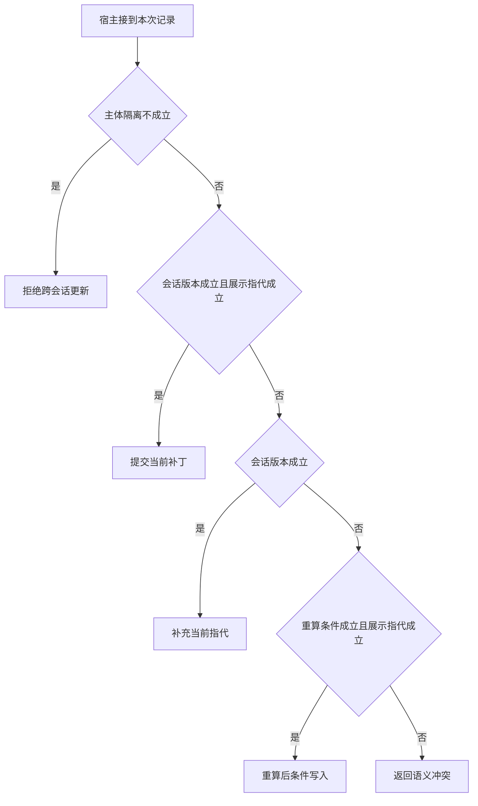

# 并发追问为什么不能机械重放

两部手机同时提交追问，一部改星期，一部引用刚才展示的第二家。
数据库版本冲突可以被检测，但只有语义独立的补丁才能自动重算。

本篇用一个封闭的教学决策器说明这一问题。输入是宿主收到的记录，不保证每个下游字段都已经获准使用。前置检查未成立时，下游即使带着缓存值，也不能拿来作业务断言。

## 先解决一个具体问题

**乐观锁已经检查版本，还要做什么？**

版本号检测到冲突，但不会替用户解释旧序号与新列表。
可交换的字段修改可重算。依赖原对象的指代须回到原展示语境或要求补充。


先取一个能走到「返回语义冲突」的输入：数据与当前主体匹配、补丁依据旧会话版本、补丁依赖旧对象或显示顺序、指代无法唯一定位。
把这四个条件代回后文的图，前面各个拦截分支都未满足，最终才有“不能证明旧指代在新状态仍成立”这个判断。
还原这个现场时要分别问：哪些位来自可信状态，哪些只是在接口中出现、尚未获得解释资格的字段。

## 先沿一次决策走到底



从上到下取第一条成立的出口。只改一个开关时，只有它之前的检查都未截断，该变化才可能到达真实动作。

“主体隔离”的两种输入分别是“数据与当前主体匹配”与“数据属于另一主体”。
隔离应发生在把材料交给模型之前。

“会话版本”的两种输入分别是“补丁基于当前版本”与“补丁依据旧会话版本”。
条件写能发现并发冲突，但不负责解释指代。

“重算条件”的两种输入分别是“补丁可在新基线上重算”与“补丁依赖旧对象或显示顺序”。
机械重放不一定保持用户原来的意思。

“展示指代”的两种输入分别是“指代匹配用户所见列表”与“指代无法唯一定位”。
第二家应基于真实展示批次而非最新内部排序。

## 最少需要哪几项观察

### 拒绝跨会话更新

主体不匹配。
在本节的全部组合中，有 8 种产生「拒绝跨会话更新」，这只是逻辑空间的计数，不能当作实际用户请求的比例。

只取得数据属于另一主体，已经足以要求宿主「拒绝跨会话更新」。
保持这些已知项，其余开关自由变化，仍有 8 种补全，判断没有翻转。

若删掉关于主体隔离的证据，另一份允许的现场是数据与当前主体匹配、补丁依据旧会话版本、补丁依赖旧对象或显示顺序、指代无法唯一定位，它会使宿主「返回语义冲突」。

### 提交当前补丁

版本一致且指代可解释。
在本节的全部组合中，有 2 种产生「提交当前补丁」，这只是逻辑空间的计数，不能当作实际用户请求的比例。

只取得数据与当前主体匹配、补丁基于当前版本、指代匹配用户所见列表，已经足以要求宿主「提交当前补丁」。
保持这些已知项，其余开关自由变化，仍有 2 种补全，判断没有翻转。

若删掉关于主体隔离的证据，另一份允许的现场是数据属于另一主体、补丁基于当前版本、补丁依赖旧对象或显示顺序、指代匹配用户所见列表，它会使宿主「拒绝跨会话更新」。

若删掉关于会话版本的证据，另一份允许的现场是数据与当前主体匹配、补丁依据旧会话版本、补丁依赖旧对象或显示顺序、指代匹配用户所见列表，它会使宿主「返回语义冲突」。

若删掉关于展示指代的证据，另一份允许的现场是数据与当前主体匹配、补丁基于当前版本、补丁依赖旧对象或显示顺序、指代无法唯一定位，它会使宿主「补充当前指代」。

### 补充当前指代

基线一致但用户所指并不明确。
在本节的全部组合中，有 2 种产生「补充当前指代」，这只是逻辑空间的计数，不能当作实际用户请求的比例。

只取得数据与当前主体匹配、补丁基于当前版本、指代无法唯一定位，已经足以要求宿主「补充当前指代」。

若删掉关于主体隔离的证据，另一份允许的现场是数据属于另一主体、补丁基于当前版本、补丁依赖旧对象或显示顺序、指代无法唯一定位，它会使宿主「拒绝跨会话更新」。

若删掉关于会话版本的证据，另一份允许的现场是数据与当前主体匹配、补丁依据旧会话版本、补丁依赖旧对象或显示顺序、指代无法唯一定位，它会使宿主「返回语义冲突」。

若删掉关于展示指代的证据，另一份允许的现场是数据与当前主体匹配、补丁基于当前版本、补丁依赖旧对象或显示顺序、指代匹配用户所见列表，它会使宿主「提交当前补丁」。

### 重算后条件写入

补丁可在新基线上复算且对象明确。
在本节的全部组合中，有 1 种产生「重算后条件写入」，这只是逻辑空间的计数，不能当作实际用户请求的比例。

只取得数据与当前主体匹配、补丁依据旧会话版本、补丁可在新基线上重算、指代匹配用户所见列表，已经足以要求宿主「重算后条件写入」。
保持这些已知项，其余开关自由变化，仍有 1 种补全，判断没有翻转。

若删掉关于主体隔离的证据，另一份允许的现场是数据属于另一主体、补丁依据旧会话版本、补丁可在新基线上重算、指代匹配用户所见列表，它会使宿主「拒绝跨会话更新」。

若删掉关于会话版本的证据，另一份允许的现场是数据与当前主体匹配、补丁基于当前版本、补丁可在新基线上重算、指代匹配用户所见列表，它会使宿主「提交当前补丁」。

若删掉关于重算条件的证据，另一份允许的现场是数据与当前主体匹配、补丁依据旧会话版本、补丁依赖旧对象或显示顺序、指代匹配用户所见列表，它会使宿主「返回语义冲突」。

若删掉关于展示指代的证据，另一份允许的现场是数据与当前主体匹配、补丁依据旧会话版本、补丁可在新基线上重算、指代无法唯一定位，它会使宿主「返回语义冲突」。

### 返回语义冲突

不能证明旧指代在新状态仍成立。
在本节的全部组合中，有 3 种产生「返回语义冲突」，这只是逻辑空间的计数，不能当作实际用户请求的比例。

只取得数据与当前主体匹配、补丁依据旧会话版本、补丁依赖旧对象或显示顺序，已经足以要求宿主「返回语义冲突」。

若删掉关于主体隔离的证据，另一份允许的现场是数据属于另一主体、补丁依据旧会话版本、补丁依赖旧对象或显示顺序、指代无法唯一定位，它会使宿主「拒绝跨会话更新」。

若删掉关于会话版本的证据，另一份允许的现场是数据与当前主体匹配、补丁基于当前版本、补丁依赖旧对象或显示顺序、指代无法唯一定位，它会使宿主「补充当前指代」。

若删掉关于重算条件的证据，另一份允许的现场是数据与当前主体匹配、补丁依据旧会话版本、补丁可在新基线上重算、指代匹配用户所见列表，它会使宿主「重算后条件写入」。

只取得数据与当前主体匹配、补丁依据旧会话版本、指代无法唯一定位，已经足以要求宿主「返回语义冲突」。


若删掉关于展示指代的证据，另一份允许的现场是数据与当前主体匹配、补丁依据旧会话版本、补丁可在新基线上重算、指代匹配用户所见列表，它会使宿主「重算后条件写入」。

## 以同一份契约解释截然不同的现场

<details>
<summary>展开推演与对应反例</summary>

下列样本按最先命中的业务分支排列。四位编码只作本篇页内定位，顺序与开头的四项输入一致。可以先猜下一动作，再展开相邻样本。

### 能够触发“拒绝跨会话更新”的现场

**样本 0000**

业务侧交来数据属于另一主体、补丁依据旧会话版本，执行侧还记录了补丁依赖旧对象或显示顺序、指代无法唯一定位。
把样本压成最短证明，保留数据属于另一主体就能支持「拒绝跨会话更新」。

在这份记录上，分别翻转「主体隔离」中的任一项，其他项完全不变时，下一动作都会改变。

保持其余观察不动，单独切换「会话版本」、「重算条件」、「展示指代」仍得到「拒绝跨会话更新」，它们在这个现场不是决定性变量。

要从本例改走「返回语义冲突」，至少需要变动 1 项，一组最少改动是将数据属于另一主体换成数据与当前主体匹配。

要从本例改走「补充当前指代」，至少需要变动 2 项，一组最少改动是将数据属于另一主体、补丁依据旧会话版本换成数据与当前主体匹配、补丁基于当前版本。

要从本例改走「重算后条件写入」，至少需要变动 3 项，一组最少改动是将数据属于另一主体、补丁依赖旧对象或显示顺序、指代无法唯一定位换成数据与当前主体匹配、补丁可在新基线上重算、指代匹配用户所见列表。

要从本例改走「提交当前补丁」，至少需要变动 3 项，一组最少改动是将数据属于另一主体、补丁依据旧会话版本、指代无法唯一定位换成数据与当前主体匹配、补丁基于当前版本、指代匹配用户所见列表。

**样本 0001**

业务侧交来数据属于另一主体、补丁依据旧会话版本，执行侧还记录了补丁依赖旧对象或显示顺序、指代匹配用户所见列表。


要从本例改走「重算后条件写入」，至少需要变动 2 项，一组最少改动是将数据属于另一主体、补丁依赖旧对象或显示顺序换成数据与当前主体匹配、补丁可在新基线上重算。

要从本例改走「提交当前补丁」，至少需要变动 2 项，一组最少改动是将数据属于另一主体、补丁依据旧会话版本换成数据与当前主体匹配、补丁基于当前版本。

要从本例改走「补充当前指代」，至少需要变动 3 项，一组最少改动是将数据属于另一主体、补丁依据旧会话版本、指代匹配用户所见列表换成数据与当前主体匹配、补丁基于当前版本、指代无法唯一定位。

**样本 0010**

业务侧交来数据属于另一主体、补丁依据旧会话版本，执行侧还记录了补丁可在新基线上重算、指代无法唯一定位。


要从本例改走「重算后条件写入」，至少需要变动 2 项，一组最少改动是将数据属于另一主体、指代无法唯一定位换成数据与当前主体匹配、指代匹配用户所见列表。


**样本 0011**

业务侧交来数据属于另一主体、补丁依据旧会话版本，执行侧还记录了补丁可在新基线上重算、指代匹配用户所见列表。


要从本例改走「重算后条件写入」，至少需要变动 1 项，一组最少改动是将数据属于另一主体换成数据与当前主体匹配。

要从本例改走「返回语义冲突」，至少需要变动 2 项，一组最少改动是将数据属于另一主体、补丁可在新基线上重算换成数据与当前主体匹配、补丁依赖旧对象或显示顺序。


**样本 0100**

业务侧交来数据属于另一主体、补丁基于当前版本，执行侧还记录了补丁依赖旧对象或显示顺序、指代无法唯一定位。


要从本例改走「补充当前指代」，至少需要变动 1 项，一组最少改动是将数据属于另一主体换成数据与当前主体匹配。

要从本例改走「返回语义冲突」，至少需要变动 2 项，一组最少改动是将数据属于另一主体、补丁基于当前版本换成数据与当前主体匹配、补丁依据旧会话版本。

要从本例改走「提交当前补丁」，至少需要变动 2 项，一组最少改动是将数据属于另一主体、指代无法唯一定位换成数据与当前主体匹配、指代匹配用户所见列表。

要从本例改走「重算后条件写入」，至少需要变动 4 项，一组最少改动是将数据属于另一主体、补丁基于当前版本、补丁依赖旧对象或显示顺序、指代无法唯一定位换成数据与当前主体匹配、补丁依据旧会话版本、补丁可在新基线上重算、指代匹配用户所见列表。

**样本 0101**

业务侧交来数据属于另一主体、补丁基于当前版本，执行侧还记录了补丁依赖旧对象或显示顺序、指代匹配用户所见列表。


要从本例改走「提交当前补丁」，至少需要变动 1 项，一组最少改动是将数据属于另一主体换成数据与当前主体匹配。


要从本例改走「补充当前指代」，至少需要变动 2 项，一组最少改动是将数据属于另一主体、指代匹配用户所见列表换成数据与当前主体匹配、指代无法唯一定位。

要从本例改走「重算后条件写入」，至少需要变动 3 项，一组最少改动是将数据属于另一主体、补丁基于当前版本、补丁依赖旧对象或显示顺序换成数据与当前主体匹配、补丁依据旧会话版本、补丁可在新基线上重算。

**样本 0110**

业务侧交来数据属于另一主体、补丁基于当前版本，执行侧还记录了补丁可在新基线上重算、指代无法唯一定位。


要从本例改走「重算后条件写入」，至少需要变动 3 项，一组最少改动是将数据属于另一主体、补丁基于当前版本、指代无法唯一定位换成数据与当前主体匹配、补丁依据旧会话版本、指代匹配用户所见列表。

**样本 0111**

业务侧交来数据属于另一主体、补丁基于当前版本，执行侧还记录了补丁可在新基线上重算、指代匹配用户所见列表。


要从本例改走「重算后条件写入」，至少需要变动 2 项，一组最少改动是将数据属于另一主体、补丁基于当前版本换成数据与当前主体匹配、补丁依据旧会话版本。


要从本例改走「返回语义冲突」，至少需要变动 3 项，一组最少改动是将数据属于另一主体、补丁基于当前版本、补丁可在新基线上重算换成数据与当前主体匹配、补丁依据旧会话版本、补丁依赖旧对象或显示顺序。

### 能够触发“提交当前补丁”的现场

**样本 1101**

业务侧交来数据与当前主体匹配、补丁基于当前版本，执行侧还记录了补丁依赖旧对象或显示顺序、指代匹配用户所见列表。
把样本压成最短证明，保留数据与当前主体匹配、补丁基于当前版本、指代匹配用户所见列表就能支持「提交当前补丁」。

在这份记录上，分别翻转「主体隔离」、「会话版本」、「展示指代」中的任一项，其他项完全不变时，下一动作都会改变。

保持其余观察不动，单独切换「重算条件」仍得到「提交当前补丁」，它们在这个现场不是决定性变量。

本例没走更靠前的「拒绝跨会话更新」，因为数据与当前主体匹配与那个入口的必要条件不符。

要从本例改走「拒绝跨会话更新」，至少需要变动 1 项，一组最少改动是将数据与当前主体匹配换成数据属于另一主体。

要从本例改走「返回语义冲突」，至少需要变动 1 项，一组最少改动是将补丁基于当前版本换成补丁依据旧会话版本。

要从本例改走「补充当前指代」，至少需要变动 1 项，一组最少改动是将指代匹配用户所见列表换成指代无法唯一定位。

要从本例改走「重算后条件写入」，至少需要变动 2 项，一组最少改动是将补丁基于当前版本、补丁依赖旧对象或显示顺序换成补丁依据旧会话版本、补丁可在新基线上重算。

**样本 1111**

业务侧交来数据与当前主体匹配、补丁基于当前版本，执行侧还记录了补丁可在新基线上重算、指代匹配用户所见列表。


要从本例改走「重算后条件写入」，至少需要变动 1 项，一组最少改动是将补丁基于当前版本换成补丁依据旧会话版本。


要从本例改走「返回语义冲突」，至少需要变动 2 项，一组最少改动是将补丁基于当前版本、补丁可在新基线上重算换成补丁依据旧会话版本、补丁依赖旧对象或显示顺序。

### 能够触发“补充当前指代”的现场

**样本 1100**

业务侧交来数据与当前主体匹配、补丁基于当前版本，执行侧还记录了补丁依赖旧对象或显示顺序、指代无法唯一定位。
把样本压成最短证明，保留数据与当前主体匹配、补丁基于当前版本、指代无法唯一定位就能支持「补充当前指代」。


保持其余观察不动，单独切换「重算条件」仍得到「补充当前指代」，它们在这个现场不是决定性变量。


本例没走更靠前的「提交当前补丁」，因为指代无法唯一定位与那个入口的必要条件不符。


要从本例改走「提交当前补丁」，至少需要变动 1 项，一组最少改动是将指代无法唯一定位换成指代匹配用户所见列表。

要从本例改走「重算后条件写入」，至少需要变动 3 项，一组最少改动是将补丁基于当前版本、补丁依赖旧对象或显示顺序、指代无法唯一定位换成补丁依据旧会话版本、补丁可在新基线上重算、指代匹配用户所见列表。

**样本 1110**

业务侧交来数据与当前主体匹配、补丁基于当前版本，执行侧还记录了补丁可在新基线上重算、指代无法唯一定位。


要从本例改走「重算后条件写入」，至少需要变动 2 项，一组最少改动是将补丁基于当前版本、指代无法唯一定位换成补丁依据旧会话版本、指代匹配用户所见列表。

### 能够触发“重算后条件写入”的现场

**样本 1011**

业务侧交来数据与当前主体匹配、补丁依据旧会话版本，执行侧还记录了补丁可在新基线上重算、指代匹配用户所见列表。
把样本压成最短证明，保留数据与当前主体匹配、补丁依据旧会话版本、补丁可在新基线上重算、指代匹配用户所见列表就能支持「重算后条件写入」。

在这份记录上，分别翻转「主体隔离」、「会话版本」、「重算条件」、「展示指代」中的任一项，其他项完全不变时，下一动作都会改变。


本例没走更靠前的「提交当前补丁」，因为补丁依据旧会话版本与那个入口的必要条件不符。

本例没走更靠前的「补充当前指代」，因为补丁依据旧会话版本与那个入口的必要条件不符。


要从本例改走「返回语义冲突」，至少需要变动 1 项，一组最少改动是将补丁可在新基线上重算换成补丁依赖旧对象或显示顺序。

要从本例改走「提交当前补丁」，至少需要变动 1 项，一组最少改动是将补丁依据旧会话版本换成补丁基于当前版本。

要从本例改走「补充当前指代」，至少需要变动 2 项，一组最少改动是将补丁依据旧会话版本、指代匹配用户所见列表换成补丁基于当前版本、指代无法唯一定位。

### 能够触发“返回语义冲突”的现场

**样本 1000**

业务侧交来数据与当前主体匹配、补丁依据旧会话版本，执行侧还记录了补丁依赖旧对象或显示顺序、指代无法唯一定位。
把样本压成最短证明，保留数据与当前主体匹配、补丁依据旧会话版本、补丁依赖旧对象或显示顺序就能支持「返回语义冲突」。

在这份记录上，分别翻转「主体隔离」、「会话版本」中的任一项，其他项完全不变时，下一动作都会改变。

保持其余观察不动，单独切换「重算条件」、「展示指代」仍得到「返回语义冲突」，它们在这个现场不是决定性变量。


本例没走更靠前的「提交当前补丁」，因为补丁依据旧会话版本、指代无法唯一定位与那个入口的必要条件不符。


本例没走更靠前的「重算后条件写入」，因为补丁依赖旧对象或显示顺序、指代无法唯一定位与那个入口的必要条件不符。


要从本例改走「补充当前指代」，至少需要变动 1 项，一组最少改动是将补丁依据旧会话版本换成补丁基于当前版本。

要从本例改走「重算后条件写入」，至少需要变动 2 项，一组最少改动是将补丁依赖旧对象或显示顺序、指代无法唯一定位换成补丁可在新基线上重算、指代匹配用户所见列表。

要从本例改走「提交当前补丁」，至少需要变动 2 项，一组最少改动是将补丁依据旧会话版本、指代无法唯一定位换成补丁基于当前版本、指代匹配用户所见列表。

**样本 1001**

业务侧交来数据与当前主体匹配、补丁依据旧会话版本，执行侧还记录了补丁依赖旧对象或显示顺序、指代匹配用户所见列表。

在这份记录上，分别翻转「主体隔离」、「会话版本」、「重算条件」中的任一项，其他项完全不变时，下一动作都会改变。

保持其余观察不动，单独切换「展示指代」仍得到「返回语义冲突」，它们在这个现场不是决定性变量。


本例没走更靠前的「重算后条件写入」，因为补丁依赖旧对象或显示顺序与那个入口的必要条件不符。


要从本例改走「重算后条件写入」，至少需要变动 1 项，一组最少改动是将补丁依赖旧对象或显示顺序换成补丁可在新基线上重算。


**样本 1010**

业务侧交来数据与当前主体匹配、补丁依据旧会话版本，执行侧还记录了补丁可在新基线上重算、指代无法唯一定位。
把样本压成最短证明，保留数据与当前主体匹配、补丁依据旧会话版本、指代无法唯一定位就能支持「返回语义冲突」。


保持其余观察不动，单独切换「重算条件」仍得到「返回语义冲突」，它们在这个现场不是决定性变量。


本例没走更靠前的「重算后条件写入」，因为指代无法唯一定位与那个入口的必要条件不符。


要从本例改走「重算后条件写入」，至少需要变动 1 项，一组最少改动是将指代无法唯一定位换成指代匹配用户所见列表。


</details>

## 当你只能看见一半记录

<details>
<summary>展开推演与对应反例</summary>

这次隐藏两个字段，保留另两个。对每个可见现场，检查四种合法补全是否同意。如仍有歧义，选择能使最坏剩余候选动作最少的字段继续查。并列时采用本篇字段顺序。

### 只保留主体隔离与会话版本

已知数据属于另一主体、补丁依据旧会话版本时，四种补全的动作分布为拒绝跨会话更新（4 种）。

就“拒绝跨会话更新”这个动作而言，在数据属于另一主体、补丁依据旧会话版本的前提下，另外两项观察不会推翻它。

已知数据属于另一主体、补丁基于当前版本时，四种补全的动作分布为拒绝跨会话更新（4 种）。

就“拒绝跨会话更新”这个动作而言，在数据属于另一主体、补丁基于当前版本的前提下，另外两项观察不会推翻它。

已知数据与当前主体匹配、补丁依据旧会话版本时，四种补全的动作分布为重算后条件写入（1 种）、返回语义冲突（3 种）。

在数据与当前主体匹配、补丁依据旧会话版本这个现场补读「重算条件」，最坏还剩 2 种动作，计算时只衡量歧义，尚未扣读取代价。
若补来的观察为“补丁依赖旧对象或显示顺序”，范围缩成「返回语义冲突」。若为“补丁可在新基线上重算”，则保留「返回语义冲突」、「重算后条件写入」。

区分不了的两条执行可以具体写成 1000 与 1011：它们共享已展示字段，却分别需要「返回语义冲突」和「重算后条件写入」。

已知数据与当前主体匹配、补丁基于当前版本时，四种补全的动作分布为提交当前补丁（2 种）、补充当前指代（2 种）。

在数据与当前主体匹配、补丁基于当前版本这个现场补读「展示指代」，最坏还剩 1 种动作，计算时只衡量歧义，尚未扣读取代价。
若补来的观察为“指代无法唯一定位”，范围缩成「补充当前指代」。若为“指代匹配用户所见列表”，则保留「提交当前补丁」。

区分不了的两条执行可以具体写成 1100 与 1101：它们共享已展示字段，却分别需要「补充当前指代」和「提交当前补丁」。

### 只保留主体隔离与重算条件

已知数据属于另一主体、补丁依赖旧对象或显示顺序时，四种补全的动作分布为拒绝跨会话更新（4 种）。

就“拒绝跨会话更新”这个动作而言，在数据属于另一主体、补丁依赖旧对象或显示顺序的前提下，另外两项观察不会推翻它。

已知数据属于另一主体、补丁可在新基线上重算时，四种补全的动作分布为拒绝跨会话更新（4 种）。

就“拒绝跨会话更新”这个动作而言，在数据属于另一主体、补丁可在新基线上重算的前提下，另外两项观察不会推翻它。

已知数据与当前主体匹配、补丁依赖旧对象或显示顺序时，四种补全的动作分布为提交当前补丁（1 种）、补充当前指代（1 种）、返回语义冲突（2 种）。

在数据与当前主体匹配、补丁依赖旧对象或显示顺序这个现场补读「会话版本」，最坏还剩 2 种动作，计算时只衡量歧义，尚未扣读取代价。
若补来的观察为“补丁依据旧会话版本”，范围缩成「返回语义冲突」。若为“补丁基于当前版本”，则保留「补充当前指代」、「提交当前补丁」。

区分不了的两条执行可以具体写成 1000 与 1100：它们共享已展示字段，却分别需要「返回语义冲突」和「补充当前指代」。

已知数据与当前主体匹配、补丁可在新基线上重算时，四种补全的动作分布为提交当前补丁（1 种）、补充当前指代（1 种）、重算后条件写入（1 种）、返回语义冲突（1 种）。

在数据与当前主体匹配、补丁可在新基线上重算这个现场补读「会话版本」，最坏还剩 2 种动作，计算时只衡量歧义，尚未扣读取代价。
若补来的观察为“补丁依据旧会话版本”，范围缩成「返回语义冲突」、「重算后条件写入」。若为“补丁基于当前版本”，则保留「补充当前指代」、「提交当前补丁」。

区分不了的两条执行可以具体写成 1010 与 1011：它们共享已展示字段，却分别需要「返回语义冲突」和「重算后条件写入」。

### 只保留会话版本与重算条件

已知补丁依据旧会话版本、补丁依赖旧对象或显示顺序时，四种补全的动作分布为拒绝跨会话更新（2 种）、返回语义冲突（2 种）。

在补丁依据旧会话版本、补丁依赖旧对象或显示顺序这个现场补读「主体隔离」，最坏还剩 1 种动作，计算时只衡量歧义，尚未扣读取代价。
若补来的观察为“数据属于另一主体”，范围缩成「拒绝跨会话更新」。若为“数据与当前主体匹配”，则保留「返回语义冲突」。

区分不了的两条执行可以具体写成 0000 与 1000：它们共享已展示字段，却分别需要「拒绝跨会话更新」和「返回语义冲突」。

已知补丁依据旧会话版本、补丁可在新基线上重算时，四种补全的动作分布为拒绝跨会话更新（2 种）、重算后条件写入（1 种）、返回语义冲突（1 种）。

在补丁依据旧会话版本、补丁可在新基线上重算这个现场补读「主体隔离」，最坏还剩 2 种动作，计算时只衡量歧义，尚未扣读取代价。
若补来的观察为“数据属于另一主体”，范围缩成「拒绝跨会话更新」。若为“数据与当前主体匹配”，则保留「返回语义冲突」、「重算后条件写入」。

区分不了的两条执行可以具体写成 0010 与 1010：它们共享已展示字段，却分别需要「拒绝跨会话更新」和「返回语义冲突」。

已知补丁基于当前版本、补丁依赖旧对象或显示顺序时，四种补全的动作分布为拒绝跨会话更新（2 种）、提交当前补丁（1 种）、补充当前指代（1 种）。

在补丁基于当前版本、补丁依赖旧对象或显示顺序这个现场补读「主体隔离」，最坏还剩 2 种动作，计算时只衡量歧义，尚未扣读取代价。
若补来的观察为“数据属于另一主体”，范围缩成「拒绝跨会话更新」。若为“数据与当前主体匹配”，则保留「补充当前指代」、「提交当前补丁」。

区分不了的两条执行可以具体写成 0100 与 1100：它们共享已展示字段，却分别需要「拒绝跨会话更新」和「补充当前指代」。

已知补丁基于当前版本、补丁可在新基线上重算时，四种补全的动作分布为拒绝跨会话更新（2 种）、提交当前补丁（1 种）、补充当前指代（1 种）。

在补丁基于当前版本、补丁可在新基线上重算这个现场补读「主体隔离」，最坏还剩 2 种动作，计算时只衡量歧义，尚未扣读取代价。

区分不了的两条执行可以具体写成 0110 与 1110：它们共享已展示字段，却分别需要「拒绝跨会话更新」和「补充当前指代」。

### 只保留主体隔离与展示指代

已知数据属于另一主体、指代无法唯一定位时，四种补全的动作分布为拒绝跨会话更新（4 种）。

就“拒绝跨会话更新”这个动作而言，在数据属于另一主体、指代无法唯一定位的前提下，另外两项观察不会推翻它。

已知数据属于另一主体、指代匹配用户所见列表时，四种补全的动作分布为拒绝跨会话更新（4 种）。

就“拒绝跨会话更新”这个动作而言，在数据属于另一主体、指代匹配用户所见列表的前提下，另外两项观察不会推翻它。

已知数据与当前主体匹配、指代无法唯一定位时，四种补全的动作分布为补充当前指代（2 种）、返回语义冲突（2 种）。

在数据与当前主体匹配、指代无法唯一定位这个现场补读「会话版本」，最坏还剩 1 种动作，计算时只衡量歧义，尚未扣读取代价。
若补来的观察为“补丁依据旧会话版本”，范围缩成「返回语义冲突」。若为“补丁基于当前版本”，则保留「补充当前指代」。


已知数据与当前主体匹配、指代匹配用户所见列表时，四种补全的动作分布为提交当前补丁（2 种）、重算后条件写入（1 种）、返回语义冲突（1 种）。

在数据与当前主体匹配、指代匹配用户所见列表这个现场补读「会话版本」，最坏还剩 2 种动作，计算时只衡量歧义，尚未扣读取代价。
若补来的观察为“补丁依据旧会话版本”，范围缩成「返回语义冲突」、「重算后条件写入」。若为“补丁基于当前版本”，则保留「提交当前补丁」。

区分不了的两条执行可以具体写成 1001 与 1011：它们共享已展示字段，却分别需要「返回语义冲突」和「重算后条件写入」。

### 只保留会话版本与展示指代

已知补丁依据旧会话版本、指代无法唯一定位时，四种补全的动作分布为拒绝跨会话更新（2 种）、返回语义冲突（2 种）。

在补丁依据旧会话版本、指代无法唯一定位这个现场补读「主体隔离」，最坏还剩 1 种动作，计算时只衡量歧义，尚未扣读取代价。


已知补丁依据旧会话版本、指代匹配用户所见列表时，四种补全的动作分布为拒绝跨会话更新（2 种）、重算后条件写入（1 种）、返回语义冲突（1 种）。

在补丁依据旧会话版本、指代匹配用户所见列表这个现场补读「主体隔离」，最坏还剩 2 种动作，计算时只衡量歧义，尚未扣读取代价。

区分不了的两条执行可以具体写成 0001 与 1001：它们共享已展示字段，却分别需要「拒绝跨会话更新」和「返回语义冲突」。

已知补丁基于当前版本、指代无法唯一定位时，四种补全的动作分布为拒绝跨会话更新（2 种）、补充当前指代（2 种）。

在补丁基于当前版本、指代无法唯一定位这个现场补读「主体隔离」，最坏还剩 1 种动作，计算时只衡量歧义，尚未扣读取代价。
若补来的观察为“数据属于另一主体”，范围缩成「拒绝跨会话更新」。若为“数据与当前主体匹配”，则保留「补充当前指代」。


已知补丁基于当前版本、指代匹配用户所见列表时，四种补全的动作分布为拒绝跨会话更新（2 种）、提交当前补丁（2 种）。

在补丁基于当前版本、指代匹配用户所见列表这个现场补读「主体隔离」，最坏还剩 1 种动作，计算时只衡量歧义，尚未扣读取代价。
若补来的观察为“数据属于另一主体”，范围缩成「拒绝跨会话更新」。若为“数据与当前主体匹配”，则保留「提交当前补丁」。

区分不了的两条执行可以具体写成 0101 与 1101：它们共享已展示字段，却分别需要「拒绝跨会话更新」和「提交当前补丁」。

### 只保留重算条件与展示指代

已知补丁依赖旧对象或显示顺序、指代无法唯一定位时，四种补全的动作分布为拒绝跨会话更新（2 种）、补充当前指代（1 种）、返回语义冲突（1 种）。

在补丁依赖旧对象或显示顺序、指代无法唯一定位这个现场补读「主体隔离」，最坏还剩 2 种动作，计算时只衡量歧义，尚未扣读取代价。
若补来的观察为“数据属于另一主体”，范围缩成「拒绝跨会话更新」。若为“数据与当前主体匹配”，则保留「返回语义冲突」、「补充当前指代」。


已知补丁依赖旧对象或显示顺序、指代匹配用户所见列表时，四种补全的动作分布为拒绝跨会话更新（2 种）、提交当前补丁（1 种）、返回语义冲突（1 种）。

在补丁依赖旧对象或显示顺序、指代匹配用户所见列表这个现场补读「主体隔离」，最坏还剩 2 种动作，计算时只衡量歧义，尚未扣读取代价。
若补来的观察为“数据属于另一主体”，范围缩成「拒绝跨会话更新」。若为“数据与当前主体匹配”，则保留「返回语义冲突」、「提交当前补丁」。


已知补丁可在新基线上重算、指代无法唯一定位时，四种补全的动作分布为拒绝跨会话更新（2 种）、补充当前指代（1 种）、返回语义冲突（1 种）。

在补丁可在新基线上重算、指代无法唯一定位这个现场补读「主体隔离」，最坏还剩 2 种动作，计算时只衡量歧义，尚未扣读取代价。


已知补丁可在新基线上重算、指代匹配用户所见列表时，四种补全的动作分布为拒绝跨会话更新（2 种）、提交当前补丁（1 种）、重算后条件写入（1 种）。

在补丁可在新基线上重算、指代匹配用户所见列表这个现场补读「主体隔离」，最坏还剩 2 种动作，计算时只衡量歧义，尚未扣读取代价。
若补来的观察为“数据属于另一主体”，范围缩成「拒绝跨会话更新」。若为“数据与当前主体匹配”，则保留「重算后条件写入」、「提交当前补丁」。

区分不了的两条执行可以具体写成 0011 与 1011：它们共享已展示字段，却分别需要「拒绝跨会话更新」和「重算后条件写入」。

</details>

## 单因素干预与边界测试

<details>
<summary>展开推演与对应反例</summary>

### 只改变主体隔离

固定另外三个条件得到八对现场，从“数据属于另一主体”转为“数据与当前主体匹配”时，8 对翻转动作，另外 0 对保持不变。

有 3 对现场沿「拒绝跨会话更新」变到「返回语义冲突」，可复现的一组受控背景为补丁依据旧会话版本、补丁依赖旧对象或显示顺序、指代无法唯一定位。

有 1 对现场沿「拒绝跨会话更新」变到「重算后条件写入」，可复现的一组受控背景为补丁依据旧会话版本、补丁可在新基线上重算、指代匹配用户所见列表。

有 2 对现场沿「拒绝跨会话更新」变到「补充当前指代」，可复现的一组受控背景为补丁基于当前版本、补丁依赖旧对象或显示顺序、指代无法唯一定位。

有 2 对现场沿「拒绝跨会话更新」变到「提交当前补丁」，可复现的一组受控背景为补丁基于当前版本、补丁依赖旧对象或显示顺序、指代匹配用户所见列表。

### 只改变会话版本

固定另外三个条件得到八对现场，从“补丁依据旧会话版本”转为“补丁基于当前版本”时，4 对翻转动作，另外 4 对保持不变。

令数据属于另一主体、补丁依赖旧对象或显示顺序、指代无法唯一定位，会话版本的两个取值均得到「拒绝跨会话更新」。在八对中，共有 4 对表现为这一种稳定出口。

有 2 对现场沿「返回语义冲突」变到「补充当前指代」，可复现的一组受控背景为数据与当前主体匹配、补丁依赖旧对象或显示顺序、指代无法唯一定位。

有 1 对现场沿「返回语义冲突」变到「提交当前补丁」，可复现的一组受控背景为数据与当前主体匹配、补丁依赖旧对象或显示顺序、指代匹配用户所见列表。

有 1 对现场沿「重算后条件写入」变到「提交当前补丁」，可复现的一组受控背景为数据与当前主体匹配、补丁可在新基线上重算、指代匹配用户所见列表。

### 只改变重算条件

固定另外三个条件得到八对现场，从“补丁依赖旧对象或显示顺序”转为“补丁可在新基线上重算”时，1 对翻转动作，另外 7 对保持不变。

令数据属于另一主体、补丁依据旧会话版本、指代无法唯一定位，重算条件的两个取值均得到「拒绝跨会话更新」。在八对中，共有 4 对表现为这一种稳定出口。

令数据与当前主体匹配、补丁依据旧会话版本、指代无法唯一定位，重算条件的两个取值均得到「返回语义冲突」。在八对中，共有 1 对表现为这一种稳定出口。

有 1 对现场沿「返回语义冲突」变到「重算后条件写入」，可复现的一组受控背景为数据与当前主体匹配、补丁依据旧会话版本、指代匹配用户所见列表。

令数据与当前主体匹配、补丁基于当前版本、指代无法唯一定位，重算条件的两个取值均得到「补充当前指代」。在八对中，共有 1 对表现为这一种稳定出口。

令数据与当前主体匹配、补丁基于当前版本、指代匹配用户所见列表，重算条件的两个取值均得到「提交当前补丁」。在八对中，共有 1 对表现为这一种稳定出口。

### 只改变展示指代

固定另外三个条件得到八对现场，从“指代无法唯一定位”转为“指代匹配用户所见列表”时，3 对翻转动作，另外 5 对保持不变。

令数据属于另一主体、补丁依据旧会话版本、补丁依赖旧对象或显示顺序，展示指代的两个取值均得到「拒绝跨会话更新」。在八对中，共有 4 对表现为这一种稳定出口。

令数据与当前主体匹配、补丁依据旧会话版本、补丁依赖旧对象或显示顺序，展示指代的两个取值均得到「返回语义冲突」。在八对中，共有 1 对表现为这一种稳定出口。

有 1 对现场沿「返回语义冲突」变到「重算后条件写入」，可复现的一组受控背景为数据与当前主体匹配、补丁依据旧会话版本、补丁可在新基线上重算。

有 2 对现场沿「补充当前指代」变到「提交当前补丁」，可复现的一组受控背景为数据与当前主体匹配、补丁基于当前版本、补丁依赖旧对象或显示顺序。

</details>

## 哪些回归样本真能抓住实现错误

<details>
<summary>展开推演与对应反例</summary>

如果删除“拒绝跨会话更新”这个分支，在本篇 16 种输入里有 8 种会改走另一出口。

反例 0000 的完整记录为数据属于另一主体、补丁依据旧会话版本、补丁依赖旧对象或显示顺序、指代无法唯一定位。正确结果是「拒绝跨会话更新」，这个改坏的实现却给出「返回语义冲突」。

如果删除“提交当前补丁”这个分支，在本篇 16 种输入里有 2 种会改走另一出口。

反例 1101 的完整记录为数据与当前主体匹配、补丁基于当前版本、补丁依赖旧对象或显示顺序、指代匹配用户所见列表。正确结果是「提交当前补丁」，这个改坏的实现却给出「补充当前指代」。

如果删除“补充当前指代”这个分支，在本篇 16 种输入里有 2 种会改走另一出口。

反例 1100 的完整记录为数据与当前主体匹配、补丁基于当前版本、补丁依赖旧对象或显示顺序、指代无法唯一定位。正确结果是「补充当前指代」，这个改坏的实现却给出「返回语义冲突」。

如果删除“重算后条件写入”这个分支，在本篇 16 种输入里有 1 种会改走另一出口。

反例 1011 的完整记录为数据与当前主体匹配、补丁依据旧会话版本、补丁可在新基线上重算、指代匹配用户所见列表。正确结果是「重算后条件写入」，这个改坏的实现却给出「返回语义冲突」。

如果交换“拒绝跨会话更新”和“提交当前补丁”的判断次序，在本篇 16 种输入里有 2 种会改走另一出口。

反例 0101 的完整记录为数据属于另一主体、补丁基于当前版本、补丁依赖旧对象或显示顺序、指代匹配用户所见列表。正确结果是「拒绝跨会话更新」，这个改坏的实现却给出「提交当前补丁」。

如果交换“提交当前补丁”和“补充当前指代”的判断次序，在本篇 16 种输入里有 2 种会改走另一出口。


如果交换“补充当前指代”和“重算后条件写入”的判断次序，在本篇 16 种输入里有 0 种会改走另一出口。

对于“交换“补充当前指代”和“重算后条件写入”的判断次序”这项修改，在声明输入域内没有区分它的样本，不能宣称测试捕捉到了故障。

补入样本 0101（数据属于另一主体、补丁基于当前版本、补丁依赖旧对象或显示顺序、指代匹配用户所见列表）能新增检出「删除“拒绝跨会话更新”这个分支」、「交换“拒绝跨会话更新”和“提交当前补丁”的判断次序」。

补入样本 1101（数据与当前主体匹配、补丁基于当前版本、补丁依赖旧对象或显示顺序、指代匹配用户所见列表）能新增检出「删除“提交当前补丁”这个分支」、「交换“提交当前补丁”和“补充当前指代”的判断次序」。

补入样本 1011（数据与当前主体匹配、补丁依据旧会话版本、补丁可在新基线上重算、指代匹配用户所见列表）能新增检出「删除“重算后条件写入”这个分支」。

补入样本 1100（数据与当前主体匹配、补丁基于当前版本、补丁依赖旧对象或显示顺序、指代无法唯一定位）能新增检出「删除“补充当前指代”这个分支」。

这里每次选覆盖尚未捕获缺陷最多的样本，并不保证用例数全局最小。它给出的反例能作为 Java 单测输入。真实模型是否会自主产生这些提议，仍须单独评测。

</details>

## 把状态覆盖换成有抽样偏差的评测批次

<details>
<summary>展开推演与对应反例</summary>

前面的十六种记录各有一票。现在只改样本构成：对一个给定字段，把成立侧的每种记录各取三份、另一侧各取一份。这是人为配比的 32 份回放，不是线上频率估计。
将偏向成立与偏向不成立的两次批次对照，可以隔离分母变化。底层宿主和所有答案保持相同，比例仍可能移动。

### 改变“主体隔离”的样本配比

只看「拒绝跨会话更新」，在数据与当前主体匹配的八个不同输入中有 0 个命中，在数据属于另一主体的另八个输入中有 8 个命中。
把「主体隔离」成立侧按三倍取样，「拒绝跨会话更新」占 8/32，反过来向未成立侧倾斜后占 24/32。
这次重加权使「拒绝跨会话更新」的占比相差 50 个百分点。若按两种不同的“主体隔离”分布跑新旧版，不能把这项差异全部归功于实现。

只看「提交当前补丁」，在数据与当前主体匹配的八个不同输入中有 2 个命中，在数据属于另一主体的另八个输入中有 0 个命中。
把「主体隔离」成立侧按三倍取样，「提交当前补丁」占 6/32，反过来向未成立侧倾斜后占 2/32。
这次重加权使「提交当前补丁」的占比相差 12.5 个百分点。若按两种不同的“主体隔离”分布跑新旧版，不能把这项差异全部归功于实现。

只看「补充当前指代」，在数据与当前主体匹配的八个不同输入中有 2 个命中，在数据属于另一主体的另八个输入中有 0 个命中。
把「主体隔离」成立侧按三倍取样，「补充当前指代」占 6/32，反过来向未成立侧倾斜后占 2/32。
这次重加权使「补充当前指代」的占比相差 12.5 个百分点。若按两种不同的“主体隔离”分布跑新旧版，不能把这项差异全部归功于实现。

只看「重算后条件写入」，在数据与当前主体匹配的八个不同输入中有 1 个命中，在数据属于另一主体的另八个输入中有 0 个命中。
把「主体隔离」成立侧按三倍取样，「重算后条件写入」占 3/32，反过来向未成立侧倾斜后占 1/32。
这次重加权使「重算后条件写入」的占比相差 6.25 个百分点。若按两种不同的“主体隔离”分布跑新旧版，不能把这项差异全部归功于实现。

只看「返回语义冲突」，在数据与当前主体匹配的八个不同输入中有 3 个命中，在数据属于另一主体的另八个输入中有 0 个命中。
把「主体隔离」成立侧按三倍取样，「返回语义冲突」占 9/32，反过来向未成立侧倾斜后占 3/32。
这次重加权使「返回语义冲突」的占比相差 18.75 个百分点。若按两种不同的“主体隔离”分布跑新旧版，不能把这项差异全部归功于实现。

### 改变“会话版本”的样本配比

只看「拒绝跨会话更新」，在补丁基于当前版本的八个不同输入中有 4 个命中，在补丁依据旧会话版本的另八个输入中有 4 个命中。
把「会话版本」成立侧按三倍取样，「拒绝跨会话更新」占 16/32，反过来向未成立侧倾斜后占 16/32。
两批「拒绝跨会话更新」的边际比例相同，是因为这个出口在“会话版本”的两侧计数相等，这不能单独证明每一对现场都不受它影响。

只看「提交当前补丁」，在补丁基于当前版本的八个不同输入中有 2 个命中，在补丁依据旧会话版本的另八个输入中有 0 个命中。
把「会话版本」成立侧按三倍取样，「提交当前补丁」占 6/32，反过来向未成立侧倾斜后占 2/32。
这次重加权使「提交当前补丁」的占比相差 12.5 个百分点。若按两种不同的“会话版本”分布跑新旧版，不能把这项差异全部归功于实现。

只看「补充当前指代」，在补丁基于当前版本的八个不同输入中有 2 个命中，在补丁依据旧会话版本的另八个输入中有 0 个命中。
把「会话版本」成立侧按三倍取样，「补充当前指代」占 6/32，反过来向未成立侧倾斜后占 2/32。
这次重加权使「补充当前指代」的占比相差 12.5 个百分点。若按两种不同的“会话版本”分布跑新旧版，不能把这项差异全部归功于实现。

只看「重算后条件写入」，在补丁基于当前版本的八个不同输入中有 0 个命中，在补丁依据旧会话版本的另八个输入中有 1 个命中。
把「会话版本」成立侧按三倍取样，「重算后条件写入」占 1/32，反过来向未成立侧倾斜后占 3/32。
这次重加权使「重算后条件写入」的占比相差 6.25 个百分点。若按两种不同的“会话版本”分布跑新旧版，不能把这项差异全部归功于实现。

只看「返回语义冲突」，在补丁基于当前版本的八个不同输入中有 0 个命中，在补丁依据旧会话版本的另八个输入中有 3 个命中。
把「会话版本」成立侧按三倍取样，「返回语义冲突」占 3/32，反过来向未成立侧倾斜后占 9/32。
这次重加权使「返回语义冲突」的占比相差 18.75 个百分点。若按两种不同的“会话版本”分布跑新旧版，不能把这项差异全部归功于实现。

### 改变“重算条件”的样本配比

只看「拒绝跨会话更新」，在补丁可在新基线上重算的八个不同输入中有 4 个命中，在补丁依赖旧对象或显示顺序的另八个输入中有 4 个命中。
把「重算条件」成立侧按三倍取样，「拒绝跨会话更新」占 16/32，反过来向未成立侧倾斜后占 16/32。
两批「拒绝跨会话更新」的边际比例相同，是因为这个出口在“重算条件”的两侧计数相等，这不能单独证明每一对现场都不受它影响。

只看「提交当前补丁」，在补丁可在新基线上重算的八个不同输入中有 1 个命中，在补丁依赖旧对象或显示顺序的另八个输入中有 1 个命中。
把「重算条件」成立侧按三倍取样，「提交当前补丁」占 4/32，反过来向未成立侧倾斜后占 4/32。
两批「提交当前补丁」的边际比例相同，是因为这个出口在“重算条件”的两侧计数相等，这不能单独证明每一对现场都不受它影响。

只看「补充当前指代」，在补丁可在新基线上重算的八个不同输入中有 1 个命中，在补丁依赖旧对象或显示顺序的另八个输入中有 1 个命中。
把「重算条件」成立侧按三倍取样，「补充当前指代」占 4/32，反过来向未成立侧倾斜后占 4/32。
两批「补充当前指代」的边际比例相同，是因为这个出口在“重算条件”的两侧计数相等，这不能单独证明每一对现场都不受它影响。

只看「重算后条件写入」，在补丁可在新基线上重算的八个不同输入中有 1 个命中，在补丁依赖旧对象或显示顺序的另八个输入中有 0 个命中。
把「重算条件」成立侧按三倍取样，「重算后条件写入」占 3/32，反过来向未成立侧倾斜后占 1/32。
这次重加权使「重算后条件写入」的占比相差 6.25 个百分点。若按两种不同的“重算条件”分布跑新旧版，不能把这项差异全部归功于实现。

只看「返回语义冲突」，在补丁可在新基线上重算的八个不同输入中有 1 个命中，在补丁依赖旧对象或显示顺序的另八个输入中有 2 个命中。
把「重算条件」成立侧按三倍取样，「返回语义冲突」占 5/32，反过来向未成立侧倾斜后占 7/32。
这次重加权使「返回语义冲突」的占比相差 6.25 个百分点。若按两种不同的“重算条件”分布跑新旧版，不能把这项差异全部归功于实现。

### 改变“展示指代”的样本配比

只看「拒绝跨会话更新」，在指代匹配用户所见列表的八个不同输入中有 4 个命中，在指代无法唯一定位的另八个输入中有 4 个命中。
把「展示指代」成立侧按三倍取样，「拒绝跨会话更新」占 16/32，反过来向未成立侧倾斜后占 16/32。
两批「拒绝跨会话更新」的边际比例相同，是因为这个出口在“展示指代”的两侧计数相等，这不能单独证明每一对现场都不受它影响。

只看「提交当前补丁」，在指代匹配用户所见列表的八个不同输入中有 2 个命中，在指代无法唯一定位的另八个输入中有 0 个命中。
把「展示指代」成立侧按三倍取样，「提交当前补丁」占 6/32，反过来向未成立侧倾斜后占 2/32。
这次重加权使「提交当前补丁」的占比相差 12.5 个百分点。若按两种不同的“展示指代”分布跑新旧版，不能把这项差异全部归功于实现。

只看「补充当前指代」，在指代匹配用户所见列表的八个不同输入中有 0 个命中，在指代无法唯一定位的另八个输入中有 2 个命中。
把「展示指代」成立侧按三倍取样，「补充当前指代」占 2/32，反过来向未成立侧倾斜后占 6/32。
这次重加权使「补充当前指代」的占比相差 12.5 个百分点。若按两种不同的“展示指代”分布跑新旧版，不能把这项差异全部归功于实现。

只看「重算后条件写入」，在指代匹配用户所见列表的八个不同输入中有 1 个命中，在指代无法唯一定位的另八个输入中有 0 个命中。
把「展示指代」成立侧按三倍取样，「重算后条件写入」占 3/32，反过来向未成立侧倾斜后占 1/32。
这次重加权使「重算后条件写入」的占比相差 6.25 个百分点。若按两种不同的“展示指代”分布跑新旧版，不能把这项差异全部归功于实现。

只看「返回语义冲突」，在指代匹配用户所见列表的八个不同输入中有 1 个命中，在指代无法唯一定位的另八个输入中有 2 个命中。
把「展示指代」成立侧按三倍取样，「返回语义冲突」占 5/32，反过来向未成立侧倾斜后占 7/32。
这次重加权使「返回语义冲突」的占比相差 6.25 个百分点。若按两种不同的“展示指代”分布跑新旧版，不能把这项差异全部归功于实现。

</details>

## 只看终态，能逆推出多少原始事实

<details>
<summary>展开推演与对应反例</summary>

### 只保留“拒绝跨会话更新”这条结果时

在本节契约与完整输入域内，仅知「拒绝跨会话更新」就能倒推出数据属于另一主体，这一推断依赖版本未变且日志中的终态可信。

「拒绝跨会话更新」不能证明会话版本取哪一侧：0000 和 0100 有相同终态，却分别记为“补丁依据旧会话版本”和“补丁基于当前版本”。

「拒绝跨会话更新」不能证明重算条件取哪一侧：0000 和 0010 有相同终态，却分别记为“补丁依赖旧对象或显示顺序”和“补丁可在新基线上重算”。

「拒绝跨会话更新」不能证明展示指代取哪一侧：0000 和 0001 有相同终态，却分别记为“指代无法唯一定位”和“指代匹配用户所见列表”。

反查「拒绝跨会话更新」的诊断日志，优先保留能区分样本 0000 与 1000 的「主体隔离」，否则很容易把邻近的「返回语义冲突」看成同一种故障。

### 只保留“提交当前补丁”这条结果时

在本节契约与完整输入域内，仅知「提交当前补丁」就能倒推出数据与当前主体匹配，这一推断依赖版本未变且日志中的终态可信。

在本节契约与完整输入域内，仅知「提交当前补丁」就能倒推出补丁基于当前版本，这一推断依赖版本未变且日志中的终态可信。

「提交当前补丁」不能证明重算条件取哪一侧：1101 和 1111 有相同终态，却分别记为“补丁依赖旧对象或显示顺序”和“补丁可在新基线上重算”。

在本节契约与完整输入域内，仅知「提交当前补丁」就能倒推出指代匹配用户所见列表，这一推断依赖版本未变且日志中的终态可信。

反查「提交当前补丁」的诊断日志，优先保留能区分样本 1101 与 0101 的「主体隔离」，否则很容易把邻近的「拒绝跨会话更新」看成同一种故障。

### 只保留“补充当前指代”这条结果时

在本节契约与完整输入域内，仅知「补充当前指代」就能倒推出数据与当前主体匹配，这一推断依赖版本未变且日志中的终态可信。

在本节契约与完整输入域内，仅知「补充当前指代」就能倒推出补丁基于当前版本，这一推断依赖版本未变且日志中的终态可信。

「补充当前指代」不能证明重算条件取哪一侧：1100 和 1110 有相同终态，却分别记为“补丁依赖旧对象或显示顺序”和“补丁可在新基线上重算”。

在本节契约与完整输入域内，仅知「补充当前指代」就能倒推出指代无法唯一定位，这一推断依赖版本未变且日志中的终态可信。

反查「补充当前指代」的诊断日志，优先保留能区分样本 1100 与 0100 的「主体隔离」，否则很容易把邻近的「拒绝跨会话更新」看成同一种故障。

### 只保留“重算后条件写入”这条结果时

在本节契约与完整输入域内，仅知「重算后条件写入」就能倒推出数据与当前主体匹配，这一推断依赖版本未变且日志中的终态可信。

在本节契约与完整输入域内，仅知「重算后条件写入」就能倒推出补丁依据旧会话版本，这一推断依赖版本未变且日志中的终态可信。

在本节契约与完整输入域内，仅知「重算后条件写入」就能倒推出补丁可在新基线上重算，这一推断依赖版本未变且日志中的终态可信。

在本节契约与完整输入域内，仅知「重算后条件写入」就能倒推出指代匹配用户所见列表，这一推断依赖版本未变且日志中的终态可信。

反查「重算后条件写入」的诊断日志，优先保留能区分样本 1011 与 0011 的「主体隔离」，否则很容易把邻近的「拒绝跨会话更新」看成同一种故障。

### 只保留“返回语义冲突”这条结果时

在本节契约与完整输入域内，仅知「返回语义冲突」就能倒推出数据与当前主体匹配，这一推断依赖版本未变且日志中的终态可信。

在本节契约与完整输入域内，仅知「返回语义冲突」就能倒推出补丁依据旧会话版本，这一推断依赖版本未变且日志中的终态可信。

「返回语义冲突」不能证明重算条件取哪一侧：1000 和 1010 有相同终态，却分别记为“补丁依赖旧对象或显示顺序”和“补丁可在新基线上重算”。

「返回语义冲突」不能证明展示指代取哪一侧：1000 和 1001 有相同终态，却分别记为“指代无法唯一定位”和“指代匹配用户所见列表”。

反查「返回语义冲突」的诊断日志，优先保留能区分样本 1000 与 0000 的「主体隔离」，否则很容易把邻近的「拒绝跨会话更新」看成同一种故障。

</details>

## 面试复述与复算

面试题可以从“乐观锁已经检查版本，还要做什么？”起步。先给出本篇的触发条件和一条真实执行端可检查的证据，再用一个相邻反例限定结论的适用范围。

在仓库根目录执行下列命令可以重算本篇的一个输入。四位数字依次选择正文列出的四项条件，0 表示未成立或低档，1 表示成立或高档。
```powershell
node examples/reading-cases/replay.mjs 5 5 0101
```

[本周主文](../theory.md) · [配套实验](../lab.md) · [下一篇研读](06.md)
