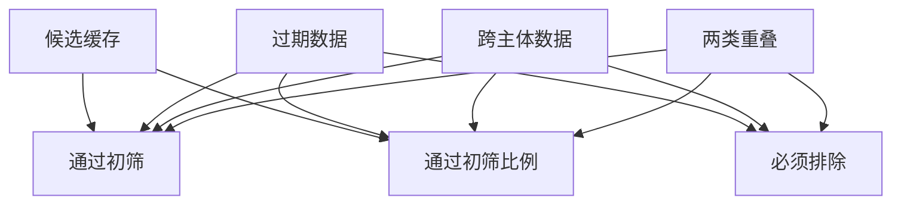

# 复用记忆时怎样剔除无权与过期项

同属性缓存里可能既跨主体又已过期。
两种失效集合存在交集，简单逐项相减会重复扣除一批记录。
初筛只覆盖主体与版本，最终引用仍须核实用户目标与服务范围。

## 先解决一个具体问题

**同一条记录既跨用户又过期，缓存统计该扣几次？**

算可复用条数时按集合并集扣一次，安全审计中却可以给它两种失败原因。
先说清统计对象是记录数还是违规原因数，再比较命中率。


先从具体的低档设定开始：候选缓存取 40条、过期数据取 8条、跨主体数据取 6条、两类重叠取 2条。
三个结果依次是必须排除 12条、通过初筛 28条、通过初筛比例 70%。
先手算这个起点，读完后再把另一个输入切到高档，这样能知道数字变化时究竟改变了哪个假设。

## 先写清输入边界和三个观测量

用 a 表示候选缓存，取 40条 或 80条，这两点是用于隔离因果影响的教学输入。

用 b 表示过期数据，取 8条 或 15条，这两点是用于隔离因果影响的教学输入。

用 c 表示跨主体数据，取 6条 或 12条，这两点是用于隔离因果影响的教学输入。

用 d 表示两类重叠，取 2条 或 5条，这两点是用于隔离因果影响的教学输入。

「必须排除」的计算式为 `b+c-d`，按业务量展开是 `过期数据+跨主体数据-两类重叠`，输出单位为条。

「通过初筛」的计算式为 `a-b-c+d`，按业务量展开是 `候选缓存-过期数据-跨主体数据+两类重叠`，输出单位为条。

「通过初筛比例」的计算式为 `100*(a-b-c+d)/a`，按业务量展开是 `100×(候选缓存-过期数据-跨主体数据+两类重叠)/候选缓存`，输出单位为%。

公式中 ceil 与 floor 分别向上、向下取整，% 在表达式中作取余，** 为乘方，三元条件按“条件 ? 成立值 : 其他值”读取。展示数值最多保留三位小数，比较和反推采用未舍入值。



图上的箭头表示该输入出现在计算式中。同一输入通向多个指标时，三个读数可能共同移动。分支、取整或相互抵消又会使某些边在具体样本上没有可见增量。

## 从输入按单位逐步算到可比较的结果

<details>
<summary>展开推演与对应反例</summary>

### 样本 0000：候选缓存 40、过期数据 8

这一组设定为候选缓存为 40条、过期数据为 8条、跨主体数据为 6条、两类重叠为 2条。

代入「必须排除」：`8+6-2`，得到 12条。

代入「通过初筛」：`40-8-6+2`，得到 28条。

代入「通过初筛比例」：`100*(40-8-6+2)/40`，得到 70%。

以「通过初筛」作主读数时，本组单独切换候选缓存的绝对变化最大或并列最大，读数会从 28条 变为 68条。

对角样本 1111 的主读数为 58条。它同时改了四项，差额不能充当任一单个因素的净收益。

### 样本 0001：候选缓存 40、过期数据 8

这一组设定为候选缓存为 40条、过期数据为 8条、跨主体数据为 6条、两类重叠为 5条。

代入「必须排除」：`8+6-5`，得到 9条。

代入「通过初筛」：`40-8-6+5`，得到 31条。

代入「通过初筛比例」：`100*(40-8-6+5)/40`，得到 77.5%。

以「通过初筛」作主读数时，本组单独切换候选缓存的绝对变化最大或并列最大，读数会从 31条 变为 71条。

对角样本 1110 的主读数为 55条。它同时改了四项，差额不能充当任一单个因素的净收益。

### 样本 0010：候选缓存 40、过期数据 8

这一组设定为候选缓存为 40条、过期数据为 8条、跨主体数据为 12条、两类重叠为 2条。

代入「必须排除」：`8+12-2`，得到 18条。

代入「通过初筛」：`40-8-12+2`，得到 22条。

代入「通过初筛比例」：`100*(40-8-12+2)/40`，得到 55%。

以「通过初筛」作主读数时，本组单独切换候选缓存的绝对变化最大或并列最大，读数会从 22条 变为 62条。

对角样本 1101 的主读数为 64条。它同时改了四项，差额不能充当任一单个因素的净收益。

### 样本 0011：候选缓存 40、过期数据 8

这一组设定为候选缓存为 40条、过期数据为 8条、跨主体数据为 12条、两类重叠为 5条。

代入「必须排除」：`8+12-5`，得到 15条。

代入「通过初筛」：`40-8-12+5`，得到 25条。

代入「通过初筛比例」：`100*(40-8-12+5)/40`，得到 62.5%。

以「通过初筛」作主读数时，本组单独切换候选缓存的绝对变化最大或并列最大，读数会从 25条 变为 65条。

对角样本 1100 的主读数为 61条。它同时改了四项，差额不能充当任一单个因素的净收益。

### 样本 0100：候选缓存 40、过期数据 15

这一组设定为候选缓存为 40条、过期数据为 15条、跨主体数据为 6条、两类重叠为 2条。

代入「必须排除」：`15+6-2`，得到 19条。

代入「通过初筛」：`40-15-6+2`，得到 21条。

代入「通过初筛比例」：`100*(40-15-6+2)/40`，得到 52.5%。

以「通过初筛」作主读数时，本组单独切换候选缓存的绝对变化最大或并列最大，读数会从 21条 变为 61条。

对角样本 1011 的主读数为 65条。它同时改了四项，差额不能充当任一单个因素的净收益。

### 样本 0101：候选缓存 40、过期数据 15

这一组设定为候选缓存为 40条、过期数据为 15条、跨主体数据为 6条、两类重叠为 5条。

代入「必须排除」：`15+6-5`，得到 16条。

代入「通过初筛」：`40-15-6+5`，得到 24条。

代入「通过初筛比例」：`100*(40-15-6+5)/40`，得到 60%。

以「通过初筛」作主读数时，本组单独切换候选缓存的绝对变化最大或并列最大，读数会从 24条 变为 64条。

对角样本 1010 的主读数为 62条。它同时改了四项，差额不能充当任一单个因素的净收益。

### 样本 0110：候选缓存 40、过期数据 15

这一组设定为候选缓存为 40条、过期数据为 15条、跨主体数据为 12条、两类重叠为 2条。

代入「必须排除」：`15+12-2`，得到 25条。

代入「通过初筛」：`40-15-12+2`，得到 15条。

代入「通过初筛比例」：`100*(40-15-12+2)/40`，得到 37.5%。

以「通过初筛」作主读数时，本组单独切换候选缓存的绝对变化最大或并列最大，读数会从 15条 变为 55条。

对角样本 1001 的主读数为 71条。它同时改了四项，差额不能充当任一单个因素的净收益。

### 样本 0111：候选缓存 40、过期数据 15

这一组设定为候选缓存为 40条、过期数据为 15条、跨主体数据为 12条、两类重叠为 5条。

代入「必须排除」：`15+12-5`，得到 22条。

代入「通过初筛」：`40-15-12+5`，得到 18条。

代入「通过初筛比例」：`100*(40-15-12+5)/40`，得到 45%。

以「通过初筛」作主读数时，本组单独切换候选缓存的绝对变化最大或并列最大，读数会从 18条 变为 58条。

对角样本 1000 的主读数为 68条。它同时改了四项，差额不能充当任一单个因素的净收益。

### 样本 1000：候选缓存 80、过期数据 8

这一组设定为候选缓存为 80条、过期数据为 8条、跨主体数据为 6条、两类重叠为 2条。

代入「必须排除」：`8+6-2`，得到 12条。

代入「通过初筛」：`80-8-6+2`，得到 68条。

代入「通过初筛比例」：`100*(80-8-6+2)/80`，得到 85%。

以「通过初筛」作主读数时，本组单独切换候选缓存的绝对变化最大或并列最大，读数会从 68条 变为 28条。

对角样本 0111 的主读数为 18条。它同时改了四项，差额不能充当任一单个因素的净收益。

### 样本 1001：候选缓存 80、过期数据 8

这一组设定为候选缓存为 80条、过期数据为 8条、跨主体数据为 6条、两类重叠为 5条。

代入「必须排除」：`8+6-5`，得到 9条。

代入「通过初筛」：`80-8-6+5`，得到 71条。

代入「通过初筛比例」：`100*(80-8-6+5)/80`，得到 88.75%。

以「通过初筛」作主读数时，本组单独切换候选缓存的绝对变化最大或并列最大，读数会从 71条 变为 31条。

对角样本 0110 的主读数为 15条。它同时改了四项，差额不能充当任一单个因素的净收益。

### 样本 1010：候选缓存 80、过期数据 8

这一组设定为候选缓存为 80条、过期数据为 8条、跨主体数据为 12条、两类重叠为 2条。

代入「必须排除」：`8+12-2`，得到 18条。

代入「通过初筛」：`80-8-12+2`，得到 62条。

代入「通过初筛比例」：`100*(80-8-12+2)/80`，得到 77.5%。

以「通过初筛」作主读数时，本组单独切换候选缓存的绝对变化最大或并列最大，读数会从 62条 变为 22条。

对角样本 0101 的主读数为 24条。它同时改了四项，差额不能充当任一单个因素的净收益。

### 样本 1011：候选缓存 80、过期数据 8

这一组设定为候选缓存为 80条、过期数据为 8条、跨主体数据为 12条、两类重叠为 5条。

代入「必须排除」：`8+12-5`，得到 15条。

代入「通过初筛」：`80-8-12+5`，得到 65条。

代入「通过初筛比例」：`100*(80-8-12+5)/80`，得到 81.25%。

以「通过初筛」作主读数时，本组单独切换候选缓存的绝对变化最大或并列最大，读数会从 65条 变为 25条。

对角样本 0100 的主读数为 21条。它同时改了四项，差额不能充当任一单个因素的净收益。

### 样本 1100：候选缓存 80、过期数据 15

这一组设定为候选缓存为 80条、过期数据为 15条、跨主体数据为 6条、两类重叠为 2条。

代入「必须排除」：`15+6-2`，得到 19条。

代入「通过初筛」：`80-15-6+2`，得到 61条。

代入「通过初筛比例」：`100*(80-15-6+2)/80`，得到 76.25%。

以「通过初筛」作主读数时，本组单独切换候选缓存的绝对变化最大或并列最大，读数会从 61条 变为 21条。

对角样本 0011 的主读数为 25条。它同时改了四项，差额不能充当任一单个因素的净收益。

### 样本 1101：候选缓存 80、过期数据 15

这一组设定为候选缓存为 80条、过期数据为 15条、跨主体数据为 6条、两类重叠为 5条。

代入「必须排除」：`15+6-5`，得到 16条。

代入「通过初筛」：`80-15-6+5`，得到 64条。

代入「通过初筛比例」：`100*(80-15-6+5)/80`，得到 80%。

以「通过初筛」作主读数时，本组单独切换候选缓存的绝对变化最大或并列最大，读数会从 64条 变为 24条。

对角样本 0010 的主读数为 22条。它同时改了四项，差额不能充当任一单个因素的净收益。

### 样本 1110：候选缓存 80、过期数据 15

这一组设定为候选缓存为 80条、过期数据为 15条、跨主体数据为 12条、两类重叠为 2条。

代入「必须排除」：`15+12-2`，得到 25条。

代入「通过初筛」：`80-15-12+2`，得到 55条。

代入「通过初筛比例」：`100*(80-15-12+2)/80`，得到 68.75%。

以「通过初筛」作主读数时，本组单独切换候选缓存的绝对变化最大或并列最大，读数会从 55条 变为 15条。

对角样本 0001 的主读数为 31条。它同时改了四项，差额不能充当任一单个因素的净收益。

### 样本 1111：候选缓存 80、过期数据 15

这一组设定为候选缓存为 80条、过期数据为 15条、跨主体数据为 12条、两类重叠为 5条。

代入「必须排除」：`15+12-5`，得到 22条。

代入「通过初筛」：`80-15-12+5`，得到 58条。

代入「通过初筛比例」：`100*(80-15-12+5)/80`，得到 72.5%。

以「通过初筛」作主读数时，本组单独切换候选缓存的绝对变化最大或并列最大，读数会从 58条 变为 18条。

对角样本 0000 的主读数为 28条。它同时改了四项，差额不能充当任一单个因素的净收益。

</details>

## 逐个干预：其余条件固定时，变化真的发生在哪里

<details>
<summary>展开推演与对应反例</summary>

### 只改变候选缓存

固定过期数据为 8条、跨主体数据为 6条、两类重叠为 2条，只把候选缓存从 40条改到 80条。
这一对的必须排除从 12条 变为 12条，通过初筛的差为 40条，通过初筛比例的差为 15%。

固定过期数据为 8条、跨主体数据为 6条、两类重叠为 5条，只把候选缓存从 40条改到 80条。
这一对的必须排除从 9条 变为 9条，通过初筛的差为 40条，通过初筛比例的差为 11.25%。

固定过期数据为 8条、跨主体数据为 12条、两类重叠为 2条，只把候选缓存从 40条改到 80条。
这一对的必须排除从 18条 变为 18条，通过初筛的差为 40条，通过初筛比例的差为 22.5%。

固定过期数据为 8条、跨主体数据为 12条、两类重叠为 5条，只把候选缓存从 40条改到 80条。
这一对的必须排除从 15条 变为 15条，通过初筛的差为 40条，通过初筛比例的差为 18.75%。

固定过期数据为 15条、跨主体数据为 6条、两类重叠为 2条，只把候选缓存从 40条改到 80条。
这一对的必须排除从 19条 变为 19条，通过初筛的差为 40条，通过初筛比例的差为 23.75%。

固定过期数据为 15条、跨主体数据为 6条、两类重叠为 5条，只把候选缓存从 40条改到 80条。
这一对的必须排除从 16条 变为 16条，通过初筛的差为 40条，通过初筛比例的差为 20%。

固定过期数据为 15条、跨主体数据为 12条、两类重叠为 2条，只把候选缓存从 40条改到 80条。
这一对的必须排除从 25条 变为 25条，通过初筛的差为 40条，通过初筛比例的差为 31.25%。

固定过期数据为 15条、跨主体数据为 12条、两类重叠为 5条，只把候选缓存从 40条改到 80条。
这一对的必须排除从 22条 变为 22条，通过初筛的差为 40条，通过初筛比例的差为 27.5%。

综合八组受控背景，候选缓存升到较高设定时「必须排除」的差值区间是 0条，共有 0 对出现可观察变化。

综合八组受控背景，候选缓存升到较高设定时「通过初筛」的差值区间是 40条，共有 8 对出现可观察变化。

综合八组受控背景，候选缓存升到较高设定时「通过初筛比例」的差值区间是 11.25% 至 31.25%，共有 8 对出现可观察变化。

### 只改变过期数据

固定候选缓存为 40条、跨主体数据为 6条、两类重叠为 2条，只把过期数据从 8条改到 15条。
这一对的必须排除从 12条 变为 19条，通过初筛的差为 -7条，通过初筛比例的差为 -17.5%。

固定候选缓存为 40条、跨主体数据为 6条、两类重叠为 5条，只把过期数据从 8条改到 15条。
这一对的必须排除从 9条 变为 16条，通过初筛的差为 -7条，通过初筛比例的差为 -17.5%。

固定候选缓存为 40条、跨主体数据为 12条、两类重叠为 2条，只把过期数据从 8条改到 15条。
这一对的必须排除从 18条 变为 25条，通过初筛的差为 -7条，通过初筛比例的差为 -17.5%。

固定候选缓存为 40条、跨主体数据为 12条、两类重叠为 5条，只把过期数据从 8条改到 15条。
这一对的必须排除从 15条 变为 22条，通过初筛的差为 -7条，通过初筛比例的差为 -17.5%。

固定候选缓存为 80条、跨主体数据为 6条、两类重叠为 2条，只把过期数据从 8条改到 15条。
这一对的必须排除从 12条 变为 19条，通过初筛的差为 -7条，通过初筛比例的差为 -8.75%。

固定候选缓存为 80条、跨主体数据为 6条、两类重叠为 5条，只把过期数据从 8条改到 15条。
这一对的必须排除从 9条 变为 16条，通过初筛的差为 -7条，通过初筛比例的差为 -8.75%。

固定候选缓存为 80条、跨主体数据为 12条、两类重叠为 2条，只把过期数据从 8条改到 15条。
这一对的必须排除从 18条 变为 25条，通过初筛的差为 -7条，通过初筛比例的差为 -8.75%。

固定候选缓存为 80条、跨主体数据为 12条、两类重叠为 5条，只把过期数据从 8条改到 15条。
这一对的必须排除从 15条 变为 22条，通过初筛的差为 -7条，通过初筛比例的差为 -8.75%。

综合八组受控背景，过期数据升到较高设定时「必须排除」的差值区间是 7条，共有 8 对出现可观察变化。

综合八组受控背景，过期数据升到较高设定时「通过初筛」的差值区间是 -7条，共有 8 对出现可观察变化。

综合八组受控背景，过期数据升到较高设定时「通过初筛比例」的差值区间是 -17.5% 至 -8.75%，共有 8 对出现可观察变化。

### 只改变跨主体数据

固定候选缓存为 40条、过期数据为 8条、两类重叠为 2条，只把跨主体数据从 6条改到 12条。
这一对的必须排除从 12条 变为 18条，通过初筛的差为 -6条，通过初筛比例的差为 -15%。

固定候选缓存为 40条、过期数据为 8条、两类重叠为 5条，只把跨主体数据从 6条改到 12条。
这一对的必须排除从 9条 变为 15条，通过初筛的差为 -6条，通过初筛比例的差为 -15%。

固定候选缓存为 40条、过期数据为 15条、两类重叠为 2条，只把跨主体数据从 6条改到 12条。
这一对的必须排除从 19条 变为 25条，通过初筛的差为 -6条，通过初筛比例的差为 -15%。

固定候选缓存为 40条、过期数据为 15条、两类重叠为 5条，只把跨主体数据从 6条改到 12条。
这一对的必须排除从 16条 变为 22条，通过初筛的差为 -6条，通过初筛比例的差为 -15%。

固定候选缓存为 80条、过期数据为 8条、两类重叠为 2条，只把跨主体数据从 6条改到 12条。
这一对的必须排除从 12条 变为 18条，通过初筛的差为 -6条，通过初筛比例的差为 -7.5%。

固定候选缓存为 80条、过期数据为 8条、两类重叠为 5条，只把跨主体数据从 6条改到 12条。
这一对的必须排除从 9条 变为 15条，通过初筛的差为 -6条，通过初筛比例的差为 -7.5%。

固定候选缓存为 80条、过期数据为 15条、两类重叠为 2条，只把跨主体数据从 6条改到 12条。
这一对的必须排除从 19条 变为 25条，通过初筛的差为 -6条，通过初筛比例的差为 -7.5%。

固定候选缓存为 80条、过期数据为 15条、两类重叠为 5条，只把跨主体数据从 6条改到 12条。
这一对的必须排除从 16条 变为 22条，通过初筛的差为 -6条，通过初筛比例的差为 -7.5%。

综合八组受控背景，跨主体数据升到较高设定时「必须排除」的差值区间是 6条，共有 8 对出现可观察变化。

综合八组受控背景，跨主体数据升到较高设定时「通过初筛」的差值区间是 -6条，共有 8 对出现可观察变化。

综合八组受控背景，跨主体数据升到较高设定时「通过初筛比例」的差值区间是 -15% 至 -7.5%，共有 8 对出现可观察变化。

### 只改变两类重叠

固定候选缓存为 40条、过期数据为 8条、跨主体数据为 6条，只把两类重叠从 2条改到 5条。
这一对的必须排除从 12条 变为 9条，通过初筛的差为 3条，通过初筛比例的差为 7.5%。

固定候选缓存为 40条、过期数据为 8条、跨主体数据为 12条，只把两类重叠从 2条改到 5条。
这一对的必须排除从 18条 变为 15条，通过初筛的差为 3条，通过初筛比例的差为 7.5%。

固定候选缓存为 40条、过期数据为 15条、跨主体数据为 6条，只把两类重叠从 2条改到 5条。
这一对的必须排除从 19条 变为 16条，通过初筛的差为 3条，通过初筛比例的差为 7.5%。

固定候选缓存为 40条、过期数据为 15条、跨主体数据为 12条，只把两类重叠从 2条改到 5条。
这一对的必须排除从 25条 变为 22条，通过初筛的差为 3条，通过初筛比例的差为 7.5%。

固定候选缓存为 80条、过期数据为 8条、跨主体数据为 6条，只把两类重叠从 2条改到 5条。
这一对的必须排除从 12条 变为 9条，通过初筛的差为 3条，通过初筛比例的差为 3.75%。

固定候选缓存为 80条、过期数据为 8条、跨主体数据为 12条，只把两类重叠从 2条改到 5条。
这一对的必须排除从 18条 变为 15条，通过初筛的差为 3条，通过初筛比例的差为 3.75%。

固定候选缓存为 80条、过期数据为 15条、跨主体数据为 6条，只把两类重叠从 2条改到 5条。
这一对的必须排除从 19条 变为 16条，通过初筛的差为 3条，通过初筛比例的差为 3.75%。

固定候选缓存为 80条、过期数据为 15条、跨主体数据为 12条，只把两类重叠从 2条改到 5条。
这一对的必须排除从 25条 变为 22条，通过初筛的差为 3条，通过初筛比例的差为 3.75%。

综合八组受控背景，两类重叠升到较高设定时「必须排除」的差值区间是 -3条，共有 8 对出现可观察变化。

综合八组受控背景，两类重叠升到较高设定时「通过初筛」的差值区间是 3条，共有 8 对出现可观察变化。

综合八组受控背景，两类重叠升到较高设定时「通过初筛比例」的差值区间是 3.75% 至 7.5%，共有 8 对出现可观察变化。

</details>

## 只拿到部分输入，结论还能缩小到多大范围

<details>
<summary>展开推演与对应反例</summary>

### 已知候选缓存和过期数据

当候选缓存为 40条、过期数据为 8条时，另两项有四种补全，主读数「通过初筛」只能限定为 22条 至 31条。
这个条件下，取跨主体数据为 12条、两类重叠为 2条可得到下界 22条，取跨主体数据为 6条、两类重叠为 5条可达到上界 31条。

用同样可见的候选缓存为 40条、过期数据为 8条去推「必须排除」，能得到的范围为 9条 至 18条，不能把另一个指标的单位代入。

用同样可见的候选缓存为 40条、过期数据为 8条去推「通过初筛比例」，能得到的范围为 55% 至 77.5%，不能把另一个指标的单位代入。

若只许再问一项，按最坏区间宽度优先核对跨主体数据，补得低档时为 28条 至 31条，高档时为 22条 至 25条。

当候选缓存为 40条、过期数据为 15条时，另两项有四种补全，主读数「通过初筛」只能限定为 15条 至 24条。
这个条件下，取跨主体数据为 12条、两类重叠为 2条可得到下界 15条，取跨主体数据为 6条、两类重叠为 5条可达到上界 24条。

用同样可见的候选缓存为 40条、过期数据为 15条去推「必须排除」，能得到的范围为 16条 至 25条，不能把另一个指标的单位代入。

用同样可见的候选缓存为 40条、过期数据为 15条去推「通过初筛比例」，能得到的范围为 37.5% 至 60%，不能把另一个指标的单位代入。

若只许再问一项，按最坏区间宽度优先核对跨主体数据，补得低档时为 21条 至 24条，高档时为 15条 至 18条。

当候选缓存为 80条、过期数据为 8条时，另两项有四种补全，主读数「通过初筛」只能限定为 62条 至 71条。
这个条件下，取跨主体数据为 12条、两类重叠为 2条可得到下界 62条，取跨主体数据为 6条、两类重叠为 5条可达到上界 71条。

用同样可见的候选缓存为 80条、过期数据为 8条去推「必须排除」，能得到的范围为 9条 至 18条，不能把另一个指标的单位代入。

用同样可见的候选缓存为 80条、过期数据为 8条去推「通过初筛比例」，能得到的范围为 77.5% 至 88.75%，不能把另一个指标的单位代入。

若只许再问一项，按最坏区间宽度优先核对跨主体数据，补得低档时为 68条 至 71条，高档时为 62条 至 65条。

当候选缓存为 80条、过期数据为 15条时，另两项有四种补全，主读数「通过初筛」只能限定为 55条 至 64条。
这个条件下，取跨主体数据为 12条、两类重叠为 2条可得到下界 55条，取跨主体数据为 6条、两类重叠为 5条可达到上界 64条。

用同样可见的候选缓存为 80条、过期数据为 15条去推「必须排除」，能得到的范围为 16条 至 25条，不能把另一个指标的单位代入。

用同样可见的候选缓存为 80条、过期数据为 15条去推「通过初筛比例」，能得到的范围为 68.75% 至 80%，不能把另一个指标的单位代入。

若只许再问一项，按最坏区间宽度优先核对跨主体数据，补得低档时为 61条 至 64条，高档时为 55条 至 58条。

### 已知候选缓存和跨主体数据

当候选缓存为 40条、跨主体数据为 6条时，另两项有四种补全，主读数「通过初筛」只能限定为 21条 至 31条。
这个条件下，取过期数据为 15条、两类重叠为 2条可得到下界 21条，取过期数据为 8条、两类重叠为 5条可达到上界 31条。

用同样可见的候选缓存为 40条、跨主体数据为 6条去推「必须排除」，能得到的范围为 9条 至 19条，不能把另一个指标的单位代入。

用同样可见的候选缓存为 40条、跨主体数据为 6条去推「通过初筛比例」，能得到的范围为 52.5% 至 77.5%，不能把另一个指标的单位代入。

若只许再问一项，按最坏区间宽度优先核对过期数据，补得低档时为 28条 至 31条，高档时为 21条 至 24条。

当候选缓存为 40条、跨主体数据为 12条时，另两项有四种补全，主读数「通过初筛」只能限定为 15条 至 25条。
这个条件下，取过期数据为 15条、两类重叠为 2条可得到下界 15条，取过期数据为 8条、两类重叠为 5条可达到上界 25条。

用同样可见的候选缓存为 40条、跨主体数据为 12条去推「必须排除」，能得到的范围为 15条 至 25条，不能把另一个指标的单位代入。

用同样可见的候选缓存为 40条、跨主体数据为 12条去推「通过初筛比例」，能得到的范围为 37.5% 至 62.5%，不能把另一个指标的单位代入。

若只许再问一项，按最坏区间宽度优先核对过期数据，补得低档时为 22条 至 25条，高档时为 15条 至 18条。

当候选缓存为 80条、跨主体数据为 6条时，另两项有四种补全，主读数「通过初筛」只能限定为 61条 至 71条。
这个条件下，取过期数据为 15条、两类重叠为 2条可得到下界 61条，取过期数据为 8条、两类重叠为 5条可达到上界 71条。

用同样可见的候选缓存为 80条、跨主体数据为 6条去推「必须排除」，能得到的范围为 9条 至 19条，不能把另一个指标的单位代入。

用同样可见的候选缓存为 80条、跨主体数据为 6条去推「通过初筛比例」，能得到的范围为 76.25% 至 88.75%，不能把另一个指标的单位代入。

若只许再问一项，按最坏区间宽度优先核对过期数据，补得低档时为 68条 至 71条，高档时为 61条 至 64条。

当候选缓存为 80条、跨主体数据为 12条时，另两项有四种补全，主读数「通过初筛」只能限定为 55条 至 65条。
这个条件下，取过期数据为 15条、两类重叠为 2条可得到下界 55条，取过期数据为 8条、两类重叠为 5条可达到上界 65条。

用同样可见的候选缓存为 80条、跨主体数据为 12条去推「必须排除」，能得到的范围为 15条 至 25条，不能把另一个指标的单位代入。

用同样可见的候选缓存为 80条、跨主体数据为 12条去推「通过初筛比例」，能得到的范围为 68.75% 至 81.25%，不能把另一个指标的单位代入。

若只许再问一项，按最坏区间宽度优先核对过期数据，补得低档时为 62条 至 65条，高档时为 55条 至 58条。

### 已知过期数据和跨主体数据

当过期数据为 8条、跨主体数据为 6条时，另两项有四种补全，主读数「通过初筛」只能限定为 28条 至 71条。
这个条件下，取候选缓存为 40条、两类重叠为 2条可得到下界 28条，取候选缓存为 80条、两类重叠为 5条可达到上界 71条。

用同样可见的过期数据为 8条、跨主体数据为 6条去推「必须排除」，能得到的范围为 9条 至 12条，不能把另一个指标的单位代入。

用同样可见的过期数据为 8条、跨主体数据为 6条去推「通过初筛比例」，能得到的范围为 70% 至 88.75%，不能把另一个指标的单位代入。

若只许再问一项，按最坏区间宽度优先核对候选缓存，补得低档时为 28条 至 31条，高档时为 68条 至 71条。

当过期数据为 8条、跨主体数据为 12条时，另两项有四种补全，主读数「通过初筛」只能限定为 22条 至 65条。
这个条件下，取候选缓存为 40条、两类重叠为 2条可得到下界 22条，取候选缓存为 80条、两类重叠为 5条可达到上界 65条。

用同样可见的过期数据为 8条、跨主体数据为 12条去推「必须排除」，能得到的范围为 15条 至 18条，不能把另一个指标的单位代入。

用同样可见的过期数据为 8条、跨主体数据为 12条去推「通过初筛比例」，能得到的范围为 55% 至 81.25%，不能把另一个指标的单位代入。

若只许再问一项，按最坏区间宽度优先核对候选缓存，补得低档时为 22条 至 25条，高档时为 62条 至 65条。

当过期数据为 15条、跨主体数据为 6条时，另两项有四种补全，主读数「通过初筛」只能限定为 21条 至 64条。
这个条件下，取候选缓存为 40条、两类重叠为 2条可得到下界 21条，取候选缓存为 80条、两类重叠为 5条可达到上界 64条。

用同样可见的过期数据为 15条、跨主体数据为 6条去推「必须排除」，能得到的范围为 16条 至 19条，不能把另一个指标的单位代入。

用同样可见的过期数据为 15条、跨主体数据为 6条去推「通过初筛比例」，能得到的范围为 52.5% 至 80%，不能把另一个指标的单位代入。

若只许再问一项，按最坏区间宽度优先核对候选缓存，补得低档时为 21条 至 24条，高档时为 61条 至 64条。

当过期数据为 15条、跨主体数据为 12条时，另两项有四种补全，主读数「通过初筛」只能限定为 15条 至 58条。
这个条件下，取候选缓存为 40条、两类重叠为 2条可得到下界 15条，取候选缓存为 80条、两类重叠为 5条可达到上界 58条。

用同样可见的过期数据为 15条、跨主体数据为 12条去推「必须排除」，能得到的范围为 22条 至 25条，不能把另一个指标的单位代入。

用同样可见的过期数据为 15条、跨主体数据为 12条去推「通过初筛比例」，能得到的范围为 37.5% 至 72.5%，不能把另一个指标的单位代入。

若只许再问一项，按最坏区间宽度优先核对候选缓存，补得低档时为 15条 至 18条，高档时为 55条 至 58条。

### 已知候选缓存和两类重叠

当候选缓存为 40条、两类重叠为 2条时，另两项有四种补全，主读数「通过初筛」只能限定为 15条 至 28条。
这个条件下，取过期数据为 15条、跨主体数据为 12条可得到下界 15条，取过期数据为 8条、跨主体数据为 6条可达到上界 28条。

用同样可见的候选缓存为 40条、两类重叠为 2条去推「必须排除」，能得到的范围为 12条 至 25条，不能把另一个指标的单位代入。

用同样可见的候选缓存为 40条、两类重叠为 2条去推「通过初筛比例」，能得到的范围为 37.5% 至 70%，不能把另一个指标的单位代入。

若只许再问一项，按最坏区间宽度优先核对过期数据，补得低档时为 22条 至 28条，高档时为 15条 至 21条。

当候选缓存为 40条、两类重叠为 5条时，另两项有四种补全，主读数「通过初筛」只能限定为 18条 至 31条。
这个条件下，取过期数据为 15条、跨主体数据为 12条可得到下界 18条，取过期数据为 8条、跨主体数据为 6条可达到上界 31条。

用同样可见的候选缓存为 40条、两类重叠为 5条去推「必须排除」，能得到的范围为 9条 至 22条，不能把另一个指标的单位代入。

用同样可见的候选缓存为 40条、两类重叠为 5条去推「通过初筛比例」，能得到的范围为 45% 至 77.5%，不能把另一个指标的单位代入。

若只许再问一项，按最坏区间宽度优先核对过期数据，补得低档时为 25条 至 31条，高档时为 18条 至 24条。

当候选缓存为 80条、两类重叠为 2条时，另两项有四种补全，主读数「通过初筛」只能限定为 55条 至 68条。
这个条件下，取过期数据为 15条、跨主体数据为 12条可得到下界 55条，取过期数据为 8条、跨主体数据为 6条可达到上界 68条。

用同样可见的候选缓存为 80条、两类重叠为 2条去推「必须排除」，能得到的范围为 12条 至 25条，不能把另一个指标的单位代入。

用同样可见的候选缓存为 80条、两类重叠为 2条去推「通过初筛比例」，能得到的范围为 68.75% 至 85%，不能把另一个指标的单位代入。

若只许再问一项，按最坏区间宽度优先核对过期数据，补得低档时为 62条 至 68条，高档时为 55条 至 61条。

当候选缓存为 80条、两类重叠为 5条时，另两项有四种补全，主读数「通过初筛」只能限定为 58条 至 71条。
这个条件下，取过期数据为 15条、跨主体数据为 12条可得到下界 58条，取过期数据为 8条、跨主体数据为 6条可达到上界 71条。

用同样可见的候选缓存为 80条、两类重叠为 5条去推「必须排除」，能得到的范围为 9条 至 22条，不能把另一个指标的单位代入。

用同样可见的候选缓存为 80条、两类重叠为 5条去推「通过初筛比例」，能得到的范围为 72.5% 至 88.75%，不能把另一个指标的单位代入。

若只许再问一项，按最坏区间宽度优先核对过期数据，补得低档时为 65条 至 71条，高档时为 58条 至 64条。

### 已知过期数据和两类重叠

当过期数据为 8条、两类重叠为 2条时，另两项有四种补全，主读数「通过初筛」只能限定为 22条 至 68条。
这个条件下，取候选缓存为 40条、跨主体数据为 12条可得到下界 22条，取候选缓存为 80条、跨主体数据为 6条可达到上界 68条。

用同样可见的过期数据为 8条、两类重叠为 2条去推「必须排除」，能得到的范围为 12条 至 18条，不能把另一个指标的单位代入。

用同样可见的过期数据为 8条、两类重叠为 2条去推「通过初筛比例」，能得到的范围为 55% 至 85%，不能把另一个指标的单位代入。

若只许再问一项，按最坏区间宽度优先核对候选缓存，补得低档时为 22条 至 28条，高档时为 62条 至 68条。

当过期数据为 8条、两类重叠为 5条时，另两项有四种补全，主读数「通过初筛」只能限定为 25条 至 71条。
这个条件下，取候选缓存为 40条、跨主体数据为 12条可得到下界 25条，取候选缓存为 80条、跨主体数据为 6条可达到上界 71条。

用同样可见的过期数据为 8条、两类重叠为 5条去推「必须排除」，能得到的范围为 9条 至 15条，不能把另一个指标的单位代入。

用同样可见的过期数据为 8条、两类重叠为 5条去推「通过初筛比例」，能得到的范围为 62.5% 至 88.75%，不能把另一个指标的单位代入。

若只许再问一项，按最坏区间宽度优先核对候选缓存，补得低档时为 25条 至 31条，高档时为 65条 至 71条。

当过期数据为 15条、两类重叠为 2条时，另两项有四种补全，主读数「通过初筛」只能限定为 15条 至 61条。
这个条件下，取候选缓存为 40条、跨主体数据为 12条可得到下界 15条，取候选缓存为 80条、跨主体数据为 6条可达到上界 61条。

用同样可见的过期数据为 15条、两类重叠为 2条去推「必须排除」，能得到的范围为 19条 至 25条，不能把另一个指标的单位代入。

用同样可见的过期数据为 15条、两类重叠为 2条去推「通过初筛比例」，能得到的范围为 37.5% 至 76.25%，不能把另一个指标的单位代入。

若只许再问一项，按最坏区间宽度优先核对候选缓存，补得低档时为 15条 至 21条，高档时为 55条 至 61条。

当过期数据为 15条、两类重叠为 5条时，另两项有四种补全，主读数「通过初筛」只能限定为 18条 至 64条。
这个条件下，取候选缓存为 40条、跨主体数据为 12条可得到下界 18条，取候选缓存为 80条、跨主体数据为 6条可达到上界 64条。

用同样可见的过期数据为 15条、两类重叠为 5条去推「必须排除」，能得到的范围为 16条 至 22条，不能把另一个指标的单位代入。

用同样可见的过期数据为 15条、两类重叠为 5条去推「通过初筛比例」，能得到的范围为 45% 至 80%，不能把另一个指标的单位代入。

若只许再问一项，按最坏区间宽度优先核对候选缓存，补得低档时为 18条 至 24条，高档时为 58条 至 64条。

### 已知跨主体数据和两类重叠

当跨主体数据为 6条、两类重叠为 2条时，另两项有四种补全，主读数「通过初筛」只能限定为 21条 至 68条。
这个条件下，取候选缓存为 40条、过期数据为 15条可得到下界 21条，取候选缓存为 80条、过期数据为 8条可达到上界 68条。

用同样可见的跨主体数据为 6条、两类重叠为 2条去推「必须排除」，能得到的范围为 12条 至 19条，不能把另一个指标的单位代入。

用同样可见的跨主体数据为 6条、两类重叠为 2条去推「通过初筛比例」，能得到的范围为 52.5% 至 85%，不能把另一个指标的单位代入。

若只许再问一项，按最坏区间宽度优先核对候选缓存，补得低档时为 21条 至 28条，高档时为 61条 至 68条。

当跨主体数据为 6条、两类重叠为 5条时，另两项有四种补全，主读数「通过初筛」只能限定为 24条 至 71条。
这个条件下，取候选缓存为 40条、过期数据为 15条可得到下界 24条，取候选缓存为 80条、过期数据为 8条可达到上界 71条。

用同样可见的跨主体数据为 6条、两类重叠为 5条去推「必须排除」，能得到的范围为 9条 至 16条，不能把另一个指标的单位代入。

用同样可见的跨主体数据为 6条、两类重叠为 5条去推「通过初筛比例」，能得到的范围为 60% 至 88.75%，不能把另一个指标的单位代入。

若只许再问一项，按最坏区间宽度优先核对候选缓存，补得低档时为 24条 至 31条，高档时为 64条 至 71条。

当跨主体数据为 12条、两类重叠为 2条时，另两项有四种补全，主读数「通过初筛」只能限定为 15条 至 62条。
这个条件下，取候选缓存为 40条、过期数据为 15条可得到下界 15条，取候选缓存为 80条、过期数据为 8条可达到上界 62条。

用同样可见的跨主体数据为 12条、两类重叠为 2条去推「必须排除」，能得到的范围为 18条 至 25条，不能把另一个指标的单位代入。

用同样可见的跨主体数据为 12条、两类重叠为 2条去推「通过初筛比例」，能得到的范围为 37.5% 至 77.5%，不能把另一个指标的单位代入。

若只许再问一项，按最坏区间宽度优先核对候选缓存，补得低档时为 15条 至 22条，高档时为 55条 至 62条。

当跨主体数据为 12条、两类重叠为 5条时，另两项有四种补全，主读数「通过初筛」只能限定为 18条 至 65条。
这个条件下，取候选缓存为 40条、过期数据为 15条可得到下界 18条，取候选缓存为 80条、过期数据为 8条可达到上界 65条。

用同样可见的跨主体数据为 12条、两类重叠为 5条去推「必须排除」，能得到的范围为 15条 至 22条，不能把另一个指标的单位代入。

用同样可见的跨主体数据为 12条、两类重叠为 5条去推「通过初筛比例」，能得到的范围为 45% 至 81.25%，不能把另一个指标的单位代入。

若只许再问一项，按最坏区间宽度优先核对候选缓存，补得低档时为 18条 至 25条，高档时为 58条 至 65条。

</details>

## 反过来审查一份报表：能从结果还原哪些输入

<details>
<summary>展开推演与对应反例</summary>

### 仅保留“必须排除”的读数

报表只写「必须排除=12条」时，在本实验的离散取值中有 2 组输入与之相容。

对这个 12条 的「必须排除」读数，所有相容样本都要求过期数据为 8条、跨主体数据为 6条、两类重叠为 2条。

只凭「必须排除」的 12条 无法确定候选缓存：0000 与 1000 的取值分别为 40 和 80条。

报表只写「必须排除=9条」时，在本实验的离散取值中有 2 组输入与之相容。

对这个 9条 的「必须排除」读数，所有相容样本都要求过期数据为 8条、跨主体数据为 6条、两类重叠为 5条。

只凭「必须排除」的 9条 无法确定候选缓存：0001 与 1001 的取值分别为 40 和 80条。

报表只写「必须排除=18条」时，在本实验的离散取值中有 2 组输入与之相容。

对这个 18条 的「必须排除」读数，所有相容样本都要求过期数据为 8条、跨主体数据为 12条、两类重叠为 2条。

只凭「必须排除」的 18条 无法确定候选缓存：0010 与 1010 的取值分别为 40 和 80条。

报表只写「必须排除=15条」时，在本实验的离散取值中有 2 组输入与之相容。

对这个 15条 的「必须排除」读数，所有相容样本都要求过期数据为 8条、跨主体数据为 12条、两类重叠为 5条。

只凭「必须排除」的 15条 无法确定候选缓存：0011 与 1011 的取值分别为 40 和 80条。

报表只写「必须排除=19条」时，在本实验的离散取值中有 2 组输入与之相容。

对这个 19条 的「必须排除」读数，所有相容样本都要求过期数据为 15条、跨主体数据为 6条、两类重叠为 2条。

只凭「必须排除」的 19条 无法确定候选缓存：0100 与 1100 的取值分别为 40 和 80条。

报表只写「必须排除=16条」时，在本实验的离散取值中有 2 组输入与之相容。

对这个 16条 的「必须排除」读数，所有相容样本都要求过期数据为 15条、跨主体数据为 6条、两类重叠为 5条。

只凭「必须排除」的 16条 无法确定候选缓存：0101 与 1101 的取值分别为 40 和 80条。

报表只写「必须排除=25条」时，在本实验的离散取值中有 2 组输入与之相容。

对这个 25条 的「必须排除」读数，所有相容样本都要求过期数据为 15条、跨主体数据为 12条、两类重叠为 2条。

只凭「必须排除」的 25条 无法确定候选缓存：0110 与 1110 的取值分别为 40 和 80条。

报表只写「必须排除=22条」时，在本实验的离散取值中有 2 组输入与之相容。

对这个 22条 的「必须排除」读数，所有相容样本都要求过期数据为 15条、跨主体数据为 12条、两类重叠为 5条。

只凭「必须排除」的 22条 无法确定候选缓存：0111 与 1111 的取值分别为 40 和 80条。

### 仅保留“通过初筛”的读数

报表只写「通过初筛=28条」时，在本实验的离散取值中有 1 组输入与之相容。

对这个 28条 的「通过初筛」读数，所有相容样本都要求候选缓存为 40条、过期数据为 8条、跨主体数据为 6条、两类重叠为 2条。

报表只写「通过初筛=31条」时，在本实验的离散取值中有 1 组输入与之相容。

对这个 31条 的「通过初筛」读数，所有相容样本都要求候选缓存为 40条、过期数据为 8条、跨主体数据为 6条、两类重叠为 5条。

报表只写「通过初筛=22条」时，在本实验的离散取值中有 1 组输入与之相容。

对这个 22条 的「通过初筛」读数，所有相容样本都要求候选缓存为 40条、过期数据为 8条、跨主体数据为 12条、两类重叠为 2条。

报表只写「通过初筛=25条」时，在本实验的离散取值中有 1 组输入与之相容。

对这个 25条 的「通过初筛」读数，所有相容样本都要求候选缓存为 40条、过期数据为 8条、跨主体数据为 12条、两类重叠为 5条。

报表只写「通过初筛=21条」时，在本实验的离散取值中有 1 组输入与之相容。

对这个 21条 的「通过初筛」读数，所有相容样本都要求候选缓存为 40条、过期数据为 15条、跨主体数据为 6条、两类重叠为 2条。

报表只写「通过初筛=24条」时，在本实验的离散取值中有 1 组输入与之相容。

对这个 24条 的「通过初筛」读数，所有相容样本都要求候选缓存为 40条、过期数据为 15条、跨主体数据为 6条、两类重叠为 5条。

报表只写「通过初筛=15条」时，在本实验的离散取值中有 1 组输入与之相容。

对这个 15条 的「通过初筛」读数，所有相容样本都要求候选缓存为 40条、过期数据为 15条、跨主体数据为 12条、两类重叠为 2条。

报表只写「通过初筛=18条」时，在本实验的离散取值中有 1 组输入与之相容。

对这个 18条 的「通过初筛」读数，所有相容样本都要求候选缓存为 40条、过期数据为 15条、跨主体数据为 12条、两类重叠为 5条。

报表只写「通过初筛=68条」时，在本实验的离散取值中有 1 组输入与之相容。

对这个 68条 的「通过初筛」读数，所有相容样本都要求候选缓存为 80条、过期数据为 8条、跨主体数据为 6条、两类重叠为 2条。

报表只写「通过初筛=71条」时，在本实验的离散取值中有 1 组输入与之相容。

对这个 71条 的「通过初筛」读数，所有相容样本都要求候选缓存为 80条、过期数据为 8条、跨主体数据为 6条、两类重叠为 5条。

报表只写「通过初筛=62条」时，在本实验的离散取值中有 1 组输入与之相容。

对这个 62条 的「通过初筛」读数，所有相容样本都要求候选缓存为 80条、过期数据为 8条、跨主体数据为 12条、两类重叠为 2条。

报表只写「通过初筛=65条」时，在本实验的离散取值中有 1 组输入与之相容。

对这个 65条 的「通过初筛」读数，所有相容样本都要求候选缓存为 80条、过期数据为 8条、跨主体数据为 12条、两类重叠为 5条。

报表只写「通过初筛=61条」时，在本实验的离散取值中有 1 组输入与之相容。

对这个 61条 的「通过初筛」读数，所有相容样本都要求候选缓存为 80条、过期数据为 15条、跨主体数据为 6条、两类重叠为 2条。

报表只写「通过初筛=64条」时，在本实验的离散取值中有 1 组输入与之相容。

对这个 64条 的「通过初筛」读数，所有相容样本都要求候选缓存为 80条、过期数据为 15条、跨主体数据为 6条、两类重叠为 5条。

报表只写「通过初筛=55条」时，在本实验的离散取值中有 1 组输入与之相容。

对这个 55条 的「通过初筛」读数，所有相容样本都要求候选缓存为 80条、过期数据为 15条、跨主体数据为 12条、两类重叠为 2条。

报表只写「通过初筛=58条」时，在本实验的离散取值中有 1 组输入与之相容。

对这个 58条 的「通过初筛」读数，所有相容样本都要求候选缓存为 80条、过期数据为 15条、跨主体数据为 12条、两类重叠为 5条。

### 仅保留“通过初筛比例”的读数

报表只写「通过初筛比例=70%」时，在本实验的离散取值中有 1 组输入与之相容。

对这个 70% 的「通过初筛比例」读数，所有相容样本都要求候选缓存为 40条、过期数据为 8条、跨主体数据为 6条、两类重叠为 2条。

报表只写「通过初筛比例=77.5%」时，在本实验的离散取值中有 2 组输入与之相容。

对这个 77.5% 的「通过初筛比例」读数，所有相容样本都要求过期数据为 8条。

只凭「通过初筛比例」的 77.5% 无法确定候选缓存：0001 与 1010 的取值分别为 40 和 80条。

报表只写「通过初筛比例=55%」时，在本实验的离散取值中有 1 组输入与之相容。

对这个 55% 的「通过初筛比例」读数，所有相容样本都要求候选缓存为 40条、过期数据为 8条、跨主体数据为 12条、两类重叠为 2条。

报表只写「通过初筛比例=62.5%」时，在本实验的离散取值中有 1 组输入与之相容。

对这个 62.5% 的「通过初筛比例」读数，所有相容样本都要求候选缓存为 40条、过期数据为 8条、跨主体数据为 12条、两类重叠为 5条。

报表只写「通过初筛比例=52.5%」时，在本实验的离散取值中有 1 组输入与之相容。

对这个 52.5% 的「通过初筛比例」读数，所有相容样本都要求候选缓存为 40条、过期数据为 15条、跨主体数据为 6条、两类重叠为 2条。

报表只写「通过初筛比例=60%」时，在本实验的离散取值中有 1 组输入与之相容。

对这个 60% 的「通过初筛比例」读数，所有相容样本都要求候选缓存为 40条、过期数据为 15条、跨主体数据为 6条、两类重叠为 5条。

报表只写「通过初筛比例=37.5%」时，在本实验的离散取值中有 1 组输入与之相容。

对这个 37.5% 的「通过初筛比例」读数，所有相容样本都要求候选缓存为 40条、过期数据为 15条、跨主体数据为 12条、两类重叠为 2条。

报表只写「通过初筛比例=45%」时，在本实验的离散取值中有 1 组输入与之相容。

对这个 45% 的「通过初筛比例」读数，所有相容样本都要求候选缓存为 40条、过期数据为 15条、跨主体数据为 12条、两类重叠为 5条。

报表只写「通过初筛比例=85%」时，在本实验的离散取值中有 1 组输入与之相容。

对这个 85% 的「通过初筛比例」读数，所有相容样本都要求候选缓存为 80条、过期数据为 8条、跨主体数据为 6条、两类重叠为 2条。

报表只写「通过初筛比例=88.75%」时，在本实验的离散取值中有 1 组输入与之相容。

对这个 88.75% 的「通过初筛比例」读数，所有相容样本都要求候选缓存为 80条、过期数据为 8条、跨主体数据为 6条、两类重叠为 5条。

报表只写「通过初筛比例=81.25%」时，在本实验的离散取值中有 1 组输入与之相容。

对这个 81.25% 的「通过初筛比例」读数，所有相容样本都要求候选缓存为 80条、过期数据为 8条、跨主体数据为 12条、两类重叠为 5条。

报表只写「通过初筛比例=76.25%」时，在本实验的离散取值中有 1 组输入与之相容。

对这个 76.25% 的「通过初筛比例」读数，所有相容样本都要求候选缓存为 80条、过期数据为 15条、跨主体数据为 6条、两类重叠为 2条。

报表只写「通过初筛比例=80%」时，在本实验的离散取值中有 1 组输入与之相容。

对这个 80% 的「通过初筛比例」读数，所有相容样本都要求候选缓存为 80条、过期数据为 15条、跨主体数据为 6条、两类重叠为 5条。

报表只写「通过初筛比例=68.75%」时，在本实验的离散取值中有 1 组输入与之相容。

对这个 68.75% 的「通过初筛比例」读数，所有相容样本都要求候选缓存为 80条、过期数据为 15条、跨主体数据为 12条、两类重叠为 2条。

报表只写「通过初筛比例=72.5%」时，在本实验的离散取值中有 1 组输入与之相容。

对这个 72.5% 的「通过初筛比例」读数，所有相容样本都要求候选缓存为 80条、过期数据为 15条、跨主体数据为 12条、两类重叠为 5条。

</details>

## 给错误算法找反例，再给正确算法画使用边界

<details>
<summary>展开推演与对应反例</summary>

### 重复扣除同时失效的记录

把「通过初筛」错写成 `a-b-c`，在 16 组教学输入中有 16 组会与参照计算不同。

对于候选缓存为 40条、过期数据为 8条、跨主体数据为 6条、两类重叠为 2条，这个错误口径得 26条，参照式为 28条，偏差为 -2条。

对于候选缓存为 40条、过期数据为 8条、跨主体数据为 6条、两类重叠为 5条，这个错误口径得 26条，参照式为 31条，偏差为 -5条。

对于候选缓存为 40条、过期数据为 8条、跨主体数据为 12条、两类重叠为 2条，这个错误口径得 20条，参照式为 22条，偏差为 -2条。

对于候选缓存为 40条、过期数据为 8条、跨主体数据为 12条、两类重叠为 5条，这个错误口径得 20条，参照式为 25条，偏差为 -5条。

对于候选缓存为 40条、过期数据为 15条、跨主体数据为 6条、两类重叠为 2条，这个错误口径得 19条，参照式为 21条，偏差为 -2条。

对于候选缓存为 40条、过期数据为 15条、跨主体数据为 6条、两类重叠为 5条，这个错误口径得 19条，参照式为 24条，偏差为 -5条。

对于候选缓存为 40条、过期数据为 15条、跨主体数据为 12条、两类重叠为 2条，这个错误口径得 13条，参照式为 15条，偏差为 -2条。

对于候选缓存为 40条、过期数据为 15条、跨主体数据为 12条、两类重叠为 5条，这个错误口径得 13条，参照式为 18条，偏差为 -5条。

对于候选缓存为 80条、过期数据为 8条、跨主体数据为 6条、两类重叠为 2条，这个错误口径得 66条，参照式为 68条，偏差为 -2条。

对于候选缓存为 80条、过期数据为 8条、跨主体数据为 6条、两类重叠为 5条，这个错误口径得 66条，参照式为 71条，偏差为 -5条。

对于候选缓存为 80条、过期数据为 8条、跨主体数据为 12条、两类重叠为 2条，这个错误口径得 60条，参照式为 62条，偏差为 -2条。

对于候选缓存为 80条、过期数据为 8条、跨主体数据为 12条、两类重叠为 5条，这个错误口径得 60条，参照式为 65条，偏差为 -5条。

对于候选缓存为 80条、过期数据为 15条、跨主体数据为 6条、两类重叠为 2条，这个错误口径得 59条，参照式为 61条，偏差为 -2条。

对于候选缓存为 80条、过期数据为 15条、跨主体数据为 6条、两类重叠为 5条，这个错误口径得 59条，参照式为 64条，偏差为 -5条。

对于候选缓存为 80条、过期数据为 15条、跨主体数据为 12条、两类重叠为 2条，这个错误口径得 53条，参照式为 55条，偏差为 -2条。

对于候选缓存为 80条、过期数据为 15条、跨主体数据为 12条、两类重叠为 5条，这个错误口径得 53条，参照式为 58条，偏差为 -5条。

### 只检查版本不检查主体

把「通过初筛」错写成 `a-b`，在 16 组教学输入中有 16 组会与参照计算不同。

对于候选缓存为 40条、过期数据为 8条、跨主体数据为 6条、两类重叠为 2条，这个错误口径得 32条，参照式为 28条，偏差为 4条。

对于候选缓存为 40条、过期数据为 8条、跨主体数据为 6条、两类重叠为 5条，这个错误口径得 32条，参照式为 31条，偏差为 1条。

对于候选缓存为 40条、过期数据为 8条、跨主体数据为 12条、两类重叠为 2条，这个错误口径得 32条，参照式为 22条，偏差为 10条。

对于候选缓存为 40条、过期数据为 8条、跨主体数据为 12条、两类重叠为 5条，这个错误口径得 32条，参照式为 25条，偏差为 7条。

对于候选缓存为 40条、过期数据为 15条、跨主体数据为 6条、两类重叠为 2条，这个错误口径得 25条，参照式为 21条，偏差为 4条。

对于候选缓存为 40条、过期数据为 15条、跨主体数据为 6条、两类重叠为 5条，这个错误口径得 25条，参照式为 24条，偏差为 1条。

对于候选缓存为 40条、过期数据为 15条、跨主体数据为 12条、两类重叠为 2条，这个错误口径得 25条，参照式为 15条，偏差为 10条。

对于候选缓存为 40条、过期数据为 15条、跨主体数据为 12条、两类重叠为 5条，这个错误口径得 25条，参照式为 18条，偏差为 7条。

对于候选缓存为 80条、过期数据为 8条、跨主体数据为 6条、两类重叠为 2条，这个错误口径得 72条，参照式为 68条，偏差为 4条。

对于候选缓存为 80条、过期数据为 8条、跨主体数据为 6条、两类重叠为 5条，这个错误口径得 72条，参照式为 71条，偏差为 1条。

对于候选缓存为 80条、过期数据为 8条、跨主体数据为 12条、两类重叠为 2条，这个错误口径得 72条，参照式为 62条，偏差为 10条。

对于候选缓存为 80条、过期数据为 8条、跨主体数据为 12条、两类重叠为 5条，这个错误口径得 72条，参照式为 65条，偏差为 7条。

对于候选缓存为 80条、过期数据为 15条、跨主体数据为 6条、两类重叠为 2条，这个错误口径得 65条，参照式为 61条，偏差为 4条。

对于候选缓存为 80条、过期数据为 15条、跨主体数据为 6条、两类重叠为 5条，这个错误口径得 65条，参照式为 64条，偏差为 1条。

对于候选缓存为 80条、过期数据为 15条、跨主体数据为 12条、两类重叠为 2条，这个错误口径得 65条，参照式为 55条，偏差为 10条。

对于候选缓存为 80条、过期数据为 15条、跨主体数据为 12条、两类重叠为 5条，这个错误口径得 65条，参照式为 58条，偏差为 7条。

</details>

## 从教学算例回到可验证的工程结论

要把这些数写入项目说明，先用真实输入替换教学常数，列明样本分母、实际资源限制和观测边界，再验证公式所需前提。两点敏感性只描述这两个设定之间的差异。

## 面试复述与复算

面试题可以从“同一条记录既跨用户又过期，缓存统计该扣几次？”起步。先给出本篇的触发条件和一条真实执行端可检查的证据，再用一个相邻反例限定结论的适用范围。

在仓库根目录执行下列命令可以重算本篇的一个输入。四位数字依次选择正文列出的四项条件，0 表示未成立或低档，1 表示成立或高档。
```powershell
node examples/reading-cases/replay.mjs 5 6 0101
```

[本周主文](../theory.md) · [配套实验](../lab.md) · [下一篇研读](07.md)
