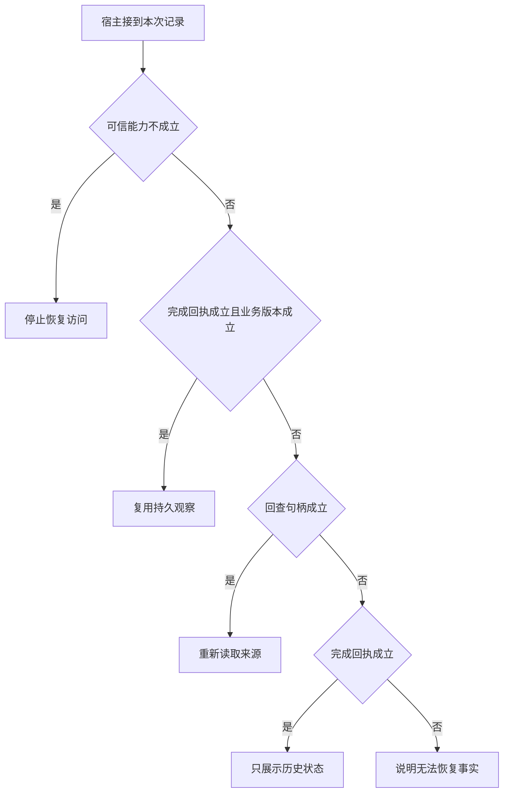

# 检查点能证明哪些外部事实

恢复线程能加载昨天的会话，却不一定能继续引用昨天的材料清单。
先检查授权、完成凭证和版本，区分复用观察、重新读取和注明历史范围。

本篇用一个封闭的教学决策器说明这一问题。输入是宿主收到的记录，不保证每个下游字段都已经获准使用。前置检查未成立时，下游即使带着缓存值，也不能拿来作业务断言。

## 先解决一个具体问题

**恢复一条长对话，相当于恢复了当时的世界吗？**

只能重建当时已记录的状态。
外部数据、用户授权和截止均可能变化。
旧观察可用作历史解释，当前断言是否可用须在恢复时重新判定。


先取一个能走到「说明无法恢复事实」的输入：只有派发记录、观察所依据版本已过期、无法取得原始材料、宿主确认当前主体获准。
把这四个条件代回后文的图，前面各个拦截分支都未满足，最终才有“没有结果也缺重新获取途径”这个判断。
还原这个现场时要分别问：哪些位来自可信状态，哪些只是在接口中出现、尚未获得解释资格的字段。

## 先沿一次决策走到底



从上到下取第一条成立的出口。只改一个开关时，只有它之前的检查都未截断，该变化才可能到达真实动作。

“完成回执”的两种输入分别是“已持久化完成结果”与“只有派发记录”。
断点恢复能否复用结果取决于检查点位置。

“业务版本”的两种输入分别是“资料版本仍适用”与“观察所依据版本已过期”。
写入前应重新验证可能变化的业务前提。

“回查句柄”的两种输入分别是“能定位对应的原始材料”与“无法取得原始材料”。
摘要一旦丢失信息，需要可验证的回查路径。

“可信能力”的两种输入分别是“宿主确认当前主体获准”与“当前主体未获授权”。
权限取自可信入口或执行端，不由模型生成。

## 最少需要哪几项观察

### 停止恢复访问

重启后授权仍须成立。
在本节的全部组合中，有 8 种产生「停止恢复访问」，这只是逻辑空间的计数，不能当作实际用户请求的比例。

只取得当前主体未获授权，已经足以要求宿主「停止恢复访问」。
保持这些已知项，其余开关自由变化，仍有 8 种补全，判断没有翻转。

若删掉关于可信能力的证据，另一份允许的现场是只有派发记录、观察所依据版本已过期、无法取得原始材料、宿主确认当前主体获准，它会使宿主「说明无法恢复事实」。

### 复用持久观察

有回执且外部版本仍然适用。
在本节的全部组合中，有 2 种产生「复用持久观察」，这只是逻辑空间的计数，不能当作实际用户请求的比例。

只取得已持久化完成结果、资料版本仍适用、宿主确认当前主体获准，已经足以要求宿主「复用持久观察」。
保持这些已知项，其余开关自由变化，仍有 2 种补全，判断没有翻转。

若删掉关于完成回执的证据，另一份允许的现场是只有派发记录、资料版本仍适用、无法取得原始材料、宿主确认当前主体获准，它会使宿主「说明无法恢复事实」。

若删掉关于业务版本的证据，另一份允许的现场是已持久化完成结果、观察所依据版本已过期、无法取得原始材料、宿主确认当前主体获准，它会使宿主「只展示历史状态」。

若删掉关于可信能力的证据，另一份允许的现场是已持久化完成结果、资料版本仍适用、无法取得原始材料、当前主体未获授权，它会使宿主「停止恢复访问」。

### 重新读取来源

有可信句柄可核验当前资料。
在本节的全部组合中，有 3 种产生「重新读取来源」，这只是逻辑空间的计数，不能当作实际用户请求的比例。

只取得只有派发记录、能定位对应的原始材料、宿主确认当前主体获准，已经足以要求宿主「重新读取来源」。

若删掉关于完成回执的证据，另一份允许的现场是已持久化完成结果、资料版本仍适用、能定位对应的原始材料、宿主确认当前主体获准，它会使宿主「复用持久观察」。

若删掉关于回查句柄的证据，另一份允许的现场是只有派发记录、观察所依据版本已过期、无法取得原始材料、宿主确认当前主体获准，它会使宿主「说明无法恢复事实」。

若删掉关于可信能力的证据，另一份允许的现场是只有派发记录、观察所依据版本已过期、能定位对应的原始材料、当前主体未获授权，它会使宿主「停止恢复访问」。

只取得观察所依据版本已过期、能定位对应的原始材料、宿主确认当前主体获准，已经足以要求宿主「重新读取来源」。

若删掉关于业务版本的证据，另一份允许的现场是已持久化完成结果、资料版本仍适用、能定位对应的原始材料、宿主确认当前主体获准，它会使宿主「复用持久观察」。


### 只展示历史状态

旧回执可以解释过去而不能证明现在。
在本节的全部组合中，有 1 种产生「只展示历史状态」，这只是逻辑空间的计数，不能当作实际用户请求的比例。

只取得已持久化完成结果、观察所依据版本已过期、无法取得原始材料、宿主确认当前主体获准，已经足以要求宿主「只展示历史状态」。
保持这些已知项，其余开关自由变化，仍有 1 种补全，判断没有翻转。

若删掉关于完成回执的证据，另一份允许的现场是只有派发记录、观察所依据版本已过期、无法取得原始材料、宿主确认当前主体获准，它会使宿主「说明无法恢复事实」。

若删掉关于业务版本的证据，另一份允许的现场是已持久化完成结果、资料版本仍适用、无法取得原始材料、宿主确认当前主体获准，它会使宿主「复用持久观察」。

若删掉关于回查句柄的证据，另一份允许的现场是已持久化完成结果、观察所依据版本已过期、能定位对应的原始材料、宿主确认当前主体获准，它会使宿主「重新读取来源」。

若删掉关于可信能力的证据，另一份允许的现场是已持久化完成结果、观察所依据版本已过期、无法取得原始材料、当前主体未获授权，它会使宿主「停止恢复访问」。

### 说明无法恢复事实

没有结果也缺重新获取途径。
在本节的全部组合中，有 2 种产生「说明无法恢复事实」，这只是逻辑空间的计数，不能当作实际用户请求的比例。

只取得只有派发记录、无法取得原始材料、宿主确认当前主体获准，已经足以要求宿主「说明无法恢复事实」。

若删掉关于完成回执的证据，另一份允许的现场是已持久化完成结果、观察所依据版本已过期、无法取得原始材料、宿主确认当前主体获准，它会使宿主「只展示历史状态」。

若删掉关于回查句柄的证据，另一份允许的现场是只有派发记录、观察所依据版本已过期、能定位对应的原始材料、宿主确认当前主体获准，它会使宿主「重新读取来源」。

若删掉关于可信能力的证据，另一份允许的现场是只有派发记录、观察所依据版本已过期、无法取得原始材料、当前主体未获授权，它会使宿主「停止恢复访问」。

## 以同一份契约解释截然不同的现场

<details>
<summary>展开推演与对应反例</summary>

下列样本按最先命中的业务分支排列。四位编码只作本篇页内定位，顺序与开头的四项输入一致。可以先猜下一动作，再展开相邻样本。

### 能够触发“停止恢复访问”的现场

**样本 0000**

业务侧交来只有派发记录、观察所依据版本已过期，执行侧还记录了无法取得原始材料、当前主体未获授权。
把样本压成最短证明，保留当前主体未获授权就能支持「停止恢复访问」。

在这份记录上，分别翻转「可信能力」中的任一项，其他项完全不变时，下一动作都会改变。

保持其余观察不动，单独切换「完成回执」、「业务版本」、「回查句柄」仍得到「停止恢复访问」，它们在这个现场不是决定性变量。

要从本例改走「说明无法恢复事实」，至少需要变动 1 项，一组最少改动是将当前主体未获授权换成宿主确认当前主体获准。

要从本例改走「重新读取来源」，至少需要变动 2 项，一组最少改动是将无法取得原始材料、当前主体未获授权换成能定位对应的原始材料、宿主确认当前主体获准。

要从本例改走「只展示历史状态」，至少需要变动 2 项，一组最少改动是将只有派发记录、当前主体未获授权换成已持久化完成结果、宿主确认当前主体获准。

要从本例改走「复用持久观察」，至少需要变动 3 项，一组最少改动是将只有派发记录、观察所依据版本已过期、当前主体未获授权换成已持久化完成结果、资料版本仍适用、宿主确认当前主体获准。

**样本 0010**

业务侧交来只有派发记录、观察所依据版本已过期，执行侧还记录了能定位对应的原始材料、当前主体未获授权。


要从本例改走「重新读取来源」，至少需要变动 1 项，一组最少改动是将当前主体未获授权换成宿主确认当前主体获准。

要从本例改走「说明无法恢复事实」，至少需要变动 2 项，一组最少改动是将能定位对应的原始材料、当前主体未获授权换成无法取得原始材料、宿主确认当前主体获准。

要从本例改走「只展示历史状态」，至少需要变动 3 项，一组最少改动是将只有派发记录、能定位对应的原始材料、当前主体未获授权换成已持久化完成结果、无法取得原始材料、宿主确认当前主体获准。


**样本 0100**

业务侧交来只有派发记录、资料版本仍适用，执行侧还记录了无法取得原始材料、当前主体未获授权。


要从本例改走「复用持久观察」，至少需要变动 2 项，一组最少改动是将只有派发记录、当前主体未获授权换成已持久化完成结果、宿主确认当前主体获准。

要从本例改走「只展示历史状态」，至少需要变动 3 项，一组最少改动是将只有派发记录、资料版本仍适用、当前主体未获授权换成已持久化完成结果、观察所依据版本已过期、宿主确认当前主体获准。

**样本 0110**

业务侧交来只有派发记录、资料版本仍适用，执行侧还记录了能定位对应的原始材料、当前主体未获授权。


要从本例改走「只展示历史状态」，至少需要变动 4 项，一组最少改动是将只有派发记录、资料版本仍适用、能定位对应的原始材料、当前主体未获授权换成已持久化完成结果、观察所依据版本已过期、无法取得原始材料、宿主确认当前主体获准。

**样本 1000**

业务侧交来已持久化完成结果、观察所依据版本已过期，执行侧还记录了无法取得原始材料、当前主体未获授权。


要从本例改走「只展示历史状态」，至少需要变动 1 项，一组最少改动是将当前主体未获授权换成宿主确认当前主体获准。

要从本例改走「说明无法恢复事实」，至少需要变动 2 项，一组最少改动是将已持久化完成结果、当前主体未获授权换成只有派发记录、宿主确认当前主体获准。


要从本例改走「复用持久观察」，至少需要变动 2 项，一组最少改动是将观察所依据版本已过期、当前主体未获授权换成资料版本仍适用、宿主确认当前主体获准。

**样本 1010**

业务侧交来已持久化完成结果、观察所依据版本已过期，执行侧还记录了能定位对应的原始材料、当前主体未获授权。


要从本例改走「只展示历史状态」，至少需要变动 2 项，一组最少改动是将能定位对应的原始材料、当前主体未获授权换成无法取得原始材料、宿主确认当前主体获准。


要从本例改走「说明无法恢复事实」，至少需要变动 3 项，一组最少改动是将已持久化完成结果、能定位对应的原始材料、当前主体未获授权换成只有派发记录、无法取得原始材料、宿主确认当前主体获准。

**样本 1100**

业务侧交来已持久化完成结果、资料版本仍适用，执行侧还记录了无法取得原始材料、当前主体未获授权。


要从本例改走「复用持久观察」，至少需要变动 1 项，一组最少改动是将当前主体未获授权换成宿主确认当前主体获准。


要从本例改走「只展示历史状态」，至少需要变动 2 项，一组最少改动是将资料版本仍适用、当前主体未获授权换成观察所依据版本已过期、宿主确认当前主体获准。

要从本例改走「重新读取来源」，至少需要变动 3 项，一组最少改动是将已持久化完成结果、无法取得原始材料、当前主体未获授权换成只有派发记录、能定位对应的原始材料、宿主确认当前主体获准。

**样本 1110**

业务侧交来已持久化完成结果、资料版本仍适用，执行侧还记录了能定位对应的原始材料、当前主体未获授权。


要从本例改走「重新读取来源」，至少需要变动 2 项，一组最少改动是将已持久化完成结果、当前主体未获授权换成只有派发记录、宿主确认当前主体获准。


要从本例改走「只展示历史状态」，至少需要变动 3 项，一组最少改动是将资料版本仍适用、能定位对应的原始材料、当前主体未获授权换成观察所依据版本已过期、无法取得原始材料、宿主确认当前主体获准。

### 能够触发“复用持久观察”的现场

**样本 1101**

业务侧交来已持久化完成结果、资料版本仍适用，执行侧还记录了无法取得原始材料、宿主确认当前主体获准。
把样本压成最短证明，保留已持久化完成结果、资料版本仍适用、宿主确认当前主体获准就能支持「复用持久观察」。

在这份记录上，分别翻转「完成回执」、「业务版本」、「可信能力」中的任一项，其他项完全不变时，下一动作都会改变。

保持其余观察不动，单独切换「回查句柄」仍得到「复用持久观察」，它们在这个现场不是决定性变量。

本例没走更靠前的「停止恢复访问」，因为宿主确认当前主体获准与那个入口的必要条件不符。

要从本例改走「说明无法恢复事实」，至少需要变动 1 项，一组最少改动是将已持久化完成结果换成只有派发记录。

要从本例改走「只展示历史状态」，至少需要变动 1 项，一组最少改动是将资料版本仍适用换成观察所依据版本已过期。

要从本例改走「停止恢复访问」，至少需要变动 1 项，一组最少改动是将宿主确认当前主体获准换成当前主体未获授权。

要从本例改走「重新读取来源」，至少需要变动 2 项，一组最少改动是将已持久化完成结果、无法取得原始材料换成只有派发记录、能定位对应的原始材料。

**样本 1111**

业务侧交来已持久化完成结果、资料版本仍适用，执行侧还记录了能定位对应的原始材料、宿主确认当前主体获准。


要从本例改走「重新读取来源」，至少需要变动 1 项，一组最少改动是将已持久化完成结果换成只有派发记录。


要从本例改走「说明无法恢复事实」，至少需要变动 2 项，一组最少改动是将已持久化完成结果、能定位对应的原始材料换成只有派发记录、无法取得原始材料。

要从本例改走「只展示历史状态」，至少需要变动 2 项，一组最少改动是将资料版本仍适用、能定位对应的原始材料换成观察所依据版本已过期、无法取得原始材料。

### 能够触发“重新读取来源”的现场

**样本 0011**

业务侧交来只有派发记录、观察所依据版本已过期，执行侧还记录了能定位对应的原始材料、宿主确认当前主体获准。
把样本压成最短证明，保留只有派发记录、能定位对应的原始材料、宿主确认当前主体获准就能支持「重新读取来源」。

在这份记录上，分别翻转「回查句柄」、「可信能力」中的任一项，其他项完全不变时，下一动作都会改变。

保持其余观察不动，单独切换「完成回执」、「业务版本」仍得到「重新读取来源」，它们在这个现场不是决定性变量。


本例没走更靠前的「复用持久观察」，因为只有派发记录、观察所依据版本已过期与那个入口的必要条件不符。

要从本例改走「说明无法恢复事实」，至少需要变动 1 项，一组最少改动是将能定位对应的原始材料换成无法取得原始材料。


要从本例改走「只展示历史状态」，至少需要变动 2 项，一组最少改动是将只有派发记录、能定位对应的原始材料换成已持久化完成结果、无法取得原始材料。

要从本例改走「复用持久观察」，至少需要变动 2 项，一组最少改动是将只有派发记录、观察所依据版本已过期换成已持久化完成结果、资料版本仍适用。

**样本 0111**

业务侧交来只有派发记录、资料版本仍适用，执行侧还记录了能定位对应的原始材料、宿主确认当前主体获准。

在这份记录上，分别翻转「完成回执」、「回查句柄」、「可信能力」中的任一项，其他项完全不变时，下一动作都会改变。

保持其余观察不动，单独切换「业务版本」仍得到「重新读取来源」，它们在这个现场不是决定性变量。


本例没走更靠前的「复用持久观察」，因为只有派发记录与那个入口的必要条件不符。


要从本例改走「复用持久观察」，至少需要变动 1 项，一组最少改动是将只有派发记录换成已持久化完成结果。

要从本例改走「只展示历史状态」，至少需要变动 3 项，一组最少改动是将只有派发记录、资料版本仍适用、能定位对应的原始材料换成已持久化完成结果、观察所依据版本已过期、无法取得原始材料。

**样本 1011**

业务侧交来已持久化完成结果、观察所依据版本已过期，执行侧还记录了能定位对应的原始材料、宿主确认当前主体获准。
把样本压成最短证明，保留观察所依据版本已过期、能定位对应的原始材料、宿主确认当前主体获准就能支持「重新读取来源」。

在这份记录上，分别翻转「业务版本」、「回查句柄」、「可信能力」中的任一项，其他项完全不变时，下一动作都会改变。

保持其余观察不动，单独切换「完成回执」仍得到「重新读取来源」，它们在这个现场不是决定性变量。


本例没走更靠前的「复用持久观察」，因为观察所依据版本已过期与那个入口的必要条件不符。

要从本例改走「只展示历史状态」，至少需要变动 1 项，一组最少改动是将能定位对应的原始材料换成无法取得原始材料。


要从本例改走「复用持久观察」，至少需要变动 1 项，一组最少改动是将观察所依据版本已过期换成资料版本仍适用。


### 能够触发“只展示历史状态”的现场

**样本 1001**

业务侧交来已持久化完成结果、观察所依据版本已过期，执行侧还记录了无法取得原始材料、宿主确认当前主体获准。
把样本压成最短证明，保留已持久化完成结果、观察所依据版本已过期、无法取得原始材料、宿主确认当前主体获准就能支持「只展示历史状态」。

在这份记录上，分别翻转「完成回执」、「业务版本」、「回查句柄」、「可信能力」中的任一项，其他项完全不变时，下一动作都会改变。


本例没走更靠前的「重新读取来源」，因为无法取得原始材料与那个入口的必要条件不符。


要从本例改走「重新读取来源」，至少需要变动 1 项，一组最少改动是将无法取得原始材料换成能定位对应的原始材料。


### 能够触发“说明无法恢复事实”的现场

**样本 0001**

业务侧交来只有派发记录、观察所依据版本已过期，执行侧还记录了无法取得原始材料、宿主确认当前主体获准。
把样本压成最短证明，保留只有派发记录、无法取得原始材料、宿主确认当前主体获准就能支持「说明无法恢复事实」。


保持其余观察不动，单独切换「业务版本」仍得到「说明无法恢复事实」，它们在这个现场不是决定性变量。


本例没走更靠前的「只展示历史状态」，因为只有派发记录与那个入口的必要条件不符。


要从本例改走「只展示历史状态」，至少需要变动 1 项，一组最少改动是将只有派发记录换成已持久化完成结果。


**样本 0101**

业务侧交来只有派发记录、资料版本仍适用，执行侧还记录了无法取得原始材料、宿主确认当前主体获准。


要从本例改走「只展示历史状态」，至少需要变动 2 项，一组最少改动是将只有派发记录、资料版本仍适用换成已持久化完成结果、观察所依据版本已过期。

</details>

## 当你只能看见一半记录

<details>
<summary>展开推演与对应反例</summary>

这次隐藏两个字段，保留另两个。对每个可见现场，检查四种合法补全是否同意。如仍有歧义，选择能使最坏剩余候选动作最少的字段继续查。并列时采用本篇字段顺序。

### 只保留完成回执与业务版本

已知只有派发记录、观察所依据版本已过期时，四种补全的动作分布为停止恢复访问（2 种）、重新读取来源（1 种）、说明无法恢复事实（1 种）。

在只有派发记录、观察所依据版本已过期这个现场补读「回查句柄」，最坏还剩 2 种动作，计算时只衡量歧义，尚未扣读取代价。
若补来的观察为“无法取得原始材料”，范围缩成「停止恢复访问」、「说明无法恢复事实」。若为“能定位对应的原始材料”，则保留「停止恢复访问」、「重新读取来源」。

区分不了的两条执行可以具体写成 0000 与 0001：它们共享已展示字段，却分别需要「停止恢复访问」和「说明无法恢复事实」。

已知只有派发记录、资料版本仍适用时，四种补全的动作分布为停止恢复访问（2 种）、重新读取来源（1 种）、说明无法恢复事实（1 种）。

在只有派发记录、资料版本仍适用这个现场补读「回查句柄」，最坏还剩 2 种动作，计算时只衡量歧义，尚未扣读取代价。

区分不了的两条执行可以具体写成 0100 与 0101：它们共享已展示字段，却分别需要「停止恢复访问」和「说明无法恢复事实」。

已知已持久化完成结果、观察所依据版本已过期时，四种补全的动作分布为停止恢复访问（2 种）、重新读取来源（1 种）、只展示历史状态（1 种）。

在已持久化完成结果、观察所依据版本已过期这个现场补读「回查句柄」，最坏还剩 2 种动作，计算时只衡量歧义，尚未扣读取代价。
若补来的观察为“无法取得原始材料”，范围缩成「停止恢复访问」、「只展示历史状态」。若为“能定位对应的原始材料”，则保留「停止恢复访问」、「重新读取来源」。

区分不了的两条执行可以具体写成 1000 与 1001：它们共享已展示字段，却分别需要「停止恢复访问」和「只展示历史状态」。

已知已持久化完成结果、资料版本仍适用时，四种补全的动作分布为停止恢复访问（2 种）、复用持久观察（2 种）。

在已持久化完成结果、资料版本仍适用这个现场补读「可信能力」，最坏还剩 1 种动作，计算时只衡量歧义，尚未扣读取代价。
若补来的观察为“当前主体未获授权”，范围缩成「停止恢复访问」。若为“宿主确认当前主体获准”，则保留「复用持久观察」。

区分不了的两条执行可以具体写成 1100 与 1101：它们共享已展示字段，却分别需要「停止恢复访问」和「复用持久观察」。

### 只保留完成回执与回查句柄

已知只有派发记录、无法取得原始材料时，四种补全的动作分布为停止恢复访问（2 种）、说明无法恢复事实（2 种）。

在只有派发记录、无法取得原始材料这个现场补读「可信能力」，最坏还剩 1 种动作，计算时只衡量歧义，尚未扣读取代价。
若补来的观察为“当前主体未获授权”，范围缩成「停止恢复访问」。若为“宿主确认当前主体获准”，则保留「说明无法恢复事实」。


已知只有派发记录、能定位对应的原始材料时，四种补全的动作分布为停止恢复访问（2 种）、重新读取来源（2 种）。

在只有派发记录、能定位对应的原始材料这个现场补读「可信能力」，最坏还剩 1 种动作，计算时只衡量歧义，尚未扣读取代价。
若补来的观察为“当前主体未获授权”，范围缩成「停止恢复访问」。若为“宿主确认当前主体获准”，则保留「重新读取来源」。

区分不了的两条执行可以具体写成 0010 与 0011：它们共享已展示字段，却分别需要「停止恢复访问」和「重新读取来源」。

已知已持久化完成结果、无法取得原始材料时，四种补全的动作分布为停止恢复访问（2 种）、复用持久观察（1 种）、只展示历史状态（1 种）。

在已持久化完成结果、无法取得原始材料这个现场补读「业务版本」，最坏还剩 2 种动作，计算时只衡量歧义，尚未扣读取代价。
若补来的观察为“观察所依据版本已过期”，范围缩成「停止恢复访问」、「只展示历史状态」。若为“资料版本仍适用”，则保留「停止恢复访问」、「复用持久观察」。


已知已持久化完成结果、能定位对应的原始材料时，四种补全的动作分布为停止恢复访问（2 种）、复用持久观察（1 种）、重新读取来源（1 种）。

在已持久化完成结果、能定位对应的原始材料这个现场补读「业务版本」，最坏还剩 2 种动作，计算时只衡量歧义，尚未扣读取代价。
若补来的观察为“观察所依据版本已过期”，范围缩成「停止恢复访问」、「重新读取来源」。若为“资料版本仍适用”，则保留「停止恢复访问」、「复用持久观察」。

区分不了的两条执行可以具体写成 1010 与 1011：它们共享已展示字段，却分别需要「停止恢复访问」和「重新读取来源」。

### 只保留业务版本与回查句柄

已知观察所依据版本已过期、无法取得原始材料时，四种补全的动作分布为停止恢复访问（2 种）、只展示历史状态（1 种）、说明无法恢复事实（1 种）。

在观察所依据版本已过期、无法取得原始材料这个现场补读「完成回执」，最坏还剩 2 种动作，计算时只衡量歧义，尚未扣读取代价。
若补来的观察为“只有派发记录”，范围缩成「停止恢复访问」、「说明无法恢复事实」。若为“已持久化完成结果”，则保留「停止恢复访问」、「只展示历史状态」。


已知观察所依据版本已过期、能定位对应的原始材料时，四种补全的动作分布为停止恢复访问（2 种）、重新读取来源（2 种）。

在观察所依据版本已过期、能定位对应的原始材料这个现场补读「可信能力」，最坏还剩 1 种动作，计算时只衡量歧义，尚未扣读取代价。


已知资料版本仍适用、无法取得原始材料时，四种补全的动作分布为停止恢复访问（2 种）、复用持久观察（1 种）、说明无法恢复事实（1 种）。

在资料版本仍适用、无法取得原始材料这个现场补读「完成回执」，最坏还剩 2 种动作，计算时只衡量歧义，尚未扣读取代价。
若补来的观察为“只有派发记录”，范围缩成「停止恢复访问」、「说明无法恢复事实」。若为“已持久化完成结果”，则保留「停止恢复访问」、「复用持久观察」。


已知资料版本仍适用、能定位对应的原始材料时，四种补全的动作分布为停止恢复访问（2 种）、复用持久观察（1 种）、重新读取来源（1 种）。

在资料版本仍适用、能定位对应的原始材料这个现场补读「完成回执」，最坏还剩 2 种动作，计算时只衡量歧义，尚未扣读取代价。
若补来的观察为“只有派发记录”，范围缩成「停止恢复访问」、「重新读取来源」。若为“已持久化完成结果”，则保留「停止恢复访问」、「复用持久观察」。

区分不了的两条执行可以具体写成 0110 与 0111：它们共享已展示字段，却分别需要「停止恢复访问」和「重新读取来源」。

### 只保留完成回执与可信能力

已知只有派发记录、当前主体未获授权时，四种补全的动作分布为停止恢复访问（4 种）。

就“停止恢复访问”这个动作而言，在只有派发记录、当前主体未获授权的前提下，另外两项观察不会推翻它。

已知只有派发记录、宿主确认当前主体获准时，四种补全的动作分布为重新读取来源（2 种）、说明无法恢复事实（2 种）。

在只有派发记录、宿主确认当前主体获准这个现场补读「回查句柄」，最坏还剩 1 种动作，计算时只衡量歧义，尚未扣读取代价。
若补来的观察为“无法取得原始材料”，范围缩成「说明无法恢复事实」。若为“能定位对应的原始材料”，则保留「重新读取来源」。

区分不了的两条执行可以具体写成 0001 与 0011：它们共享已展示字段，却分别需要「说明无法恢复事实」和「重新读取来源」。

已知已持久化完成结果、当前主体未获授权时，四种补全的动作分布为停止恢复访问（4 种）。

就“停止恢复访问”这个动作而言，在已持久化完成结果、当前主体未获授权的前提下，另外两项观察不会推翻它。

已知已持久化完成结果、宿主确认当前主体获准时，四种补全的动作分布为复用持久观察（2 种）、重新读取来源（1 种）、只展示历史状态（1 种）。

在已持久化完成结果、宿主确认当前主体获准这个现场补读「业务版本」，最坏还剩 2 种动作，计算时只衡量歧义，尚未扣读取代价。
若补来的观察为“观察所依据版本已过期”，范围缩成「只展示历史状态」、「重新读取来源」。若为“资料版本仍适用”，则保留「复用持久观察」。

区分不了的两条执行可以具体写成 1001 与 1011：它们共享已展示字段，却分别需要「只展示历史状态」和「重新读取来源」。

### 只保留业务版本与可信能力

已知观察所依据版本已过期、当前主体未获授权时，四种补全的动作分布为停止恢复访问（4 种）。

就“停止恢复访问”这个动作而言，在观察所依据版本已过期、当前主体未获授权的前提下，另外两项观察不会推翻它。

已知观察所依据版本已过期、宿主确认当前主体获准时，四种补全的动作分布为重新读取来源（2 种）、只展示历史状态（1 种）、说明无法恢复事实（1 种）。

在观察所依据版本已过期、宿主确认当前主体获准这个现场补读「完成回执」，最坏还剩 2 种动作，计算时只衡量歧义，尚未扣读取代价。
若补来的观察为“只有派发记录”，范围缩成「说明无法恢复事实」、「重新读取来源」。若为“已持久化完成结果”，则保留「只展示历史状态」、「重新读取来源」。


已知资料版本仍适用、当前主体未获授权时，四种补全的动作分布为停止恢复访问（4 种）。

就“停止恢复访问”这个动作而言，在资料版本仍适用、当前主体未获授权的前提下，另外两项观察不会推翻它。

已知资料版本仍适用、宿主确认当前主体获准时，四种补全的动作分布为复用持久观察（2 种）、重新读取来源（1 种）、说明无法恢复事实（1 种）。

在资料版本仍适用、宿主确认当前主体获准这个现场补读「完成回执」，最坏还剩 2 种动作，计算时只衡量歧义，尚未扣读取代价。
若补来的观察为“只有派发记录”，范围缩成「说明无法恢复事实」、「重新读取来源」。若为“已持久化完成结果”，则保留「复用持久观察」。

区分不了的两条执行可以具体写成 0101 与 0111：它们共享已展示字段，却分别需要「说明无法恢复事实」和「重新读取来源」。

### 只保留回查句柄与可信能力

已知无法取得原始材料、当前主体未获授权时，四种补全的动作分布为停止恢复访问（4 种）。

就“停止恢复访问”这个动作而言，在无法取得原始材料、当前主体未获授权的前提下，另外两项观察不会推翻它。

已知无法取得原始材料、宿主确认当前主体获准时，四种补全的动作分布为复用持久观察（1 种）、只展示历史状态（1 种）、说明无法恢复事实（2 种）。

在无法取得原始材料、宿主确认当前主体获准这个现场补读「完成回执」，最坏还剩 2 种动作，计算时只衡量歧义，尚未扣读取代价。
若补来的观察为“只有派发记录”，范围缩成「说明无法恢复事实」。若为“已持久化完成结果”，则保留「只展示历史状态」、「复用持久观察」。

区分不了的两条执行可以具体写成 0001 与 1001：它们共享已展示字段，却分别需要「说明无法恢复事实」和「只展示历史状态」。

已知能定位对应的原始材料、当前主体未获授权时，四种补全的动作分布为停止恢复访问（4 种）。

就“停止恢复访问”这个动作而言，在能定位对应的原始材料、当前主体未获授权的前提下，另外两项观察不会推翻它。

已知能定位对应的原始材料、宿主确认当前主体获准时，四种补全的动作分布为复用持久观察（1 种）、重新读取来源（3 种）。

在能定位对应的原始材料、宿主确认当前主体获准这个现场补读「完成回执」，最坏还剩 2 种动作，计算时只衡量歧义，尚未扣读取代价。
若补来的观察为“只有派发记录”，范围缩成「重新读取来源」。若为“已持久化完成结果”，则保留「重新读取来源」、「复用持久观察」。

区分不了的两条执行可以具体写成 0011 与 1111：它们共享已展示字段，却分别需要「重新读取来源」和「复用持久观察」。

</details>

## 单因素干预与边界测试

<details>
<summary>展开推演与对应反例</summary>

### 只改变完成回执

固定另外三个条件得到八对现场，从“只有派发记录”转为“已持久化完成结果”时，3 对翻转动作，另外 5 对保持不变。

令观察所依据版本已过期、无法取得原始材料、当前主体未获授权，完成回执的两个取值均得到「停止恢复访问」。在八对中，共有 4 对表现为这一种稳定出口。

有 1 对现场沿「说明无法恢复事实」变到「只展示历史状态」，可复现的一组受控背景为观察所依据版本已过期、无法取得原始材料、宿主确认当前主体获准。

令观察所依据版本已过期、能定位对应的原始材料、宿主确认当前主体获准，完成回执的两个取值均得到「重新读取来源」。在八对中，共有 1 对表现为这一种稳定出口。

有 1 对现场沿「说明无法恢复事实」变到「复用持久观察」，可复现的一组受控背景为资料版本仍适用、无法取得原始材料、宿主确认当前主体获准。

有 1 对现场沿「重新读取来源」变到「复用持久观察」，可复现的一组受控背景为资料版本仍适用、能定位对应的原始材料、宿主确认当前主体获准。

### 只改变业务版本

固定另外三个条件得到八对现场，从“观察所依据版本已过期”转为“资料版本仍适用”时，2 对翻转动作，另外 6 对保持不变。

令只有派发记录、无法取得原始材料、当前主体未获授权，业务版本的两个取值均得到「停止恢复访问」。在八对中，共有 4 对表现为这一种稳定出口。

令只有派发记录、无法取得原始材料、宿主确认当前主体获准，业务版本的两个取值均得到「说明无法恢复事实」。在八对中，共有 1 对表现为这一种稳定出口。

令只有派发记录、能定位对应的原始材料、宿主确认当前主体获准，业务版本的两个取值均得到「重新读取来源」。在八对中，共有 1 对表现为这一种稳定出口。

有 1 对现场沿「只展示历史状态」变到「复用持久观察」，可复现的一组受控背景为已持久化完成结果、无法取得原始材料、宿主确认当前主体获准。

有 1 对现场沿「重新读取来源」变到「复用持久观察」，可复现的一组受控背景为已持久化完成结果、能定位对应的原始材料、宿主确认当前主体获准。

### 只改变回查句柄

固定另外三个条件得到八对现场，从“无法取得原始材料”转为“能定位对应的原始材料”时，3 对翻转动作，另外 5 对保持不变。

令只有派发记录、观察所依据版本已过期、当前主体未获授权，回查句柄的两个取值均得到「停止恢复访问」。在八对中，共有 4 对表现为这一种稳定出口。

有 2 对现场沿「说明无法恢复事实」变到「重新读取来源」，可复现的一组受控背景为只有派发记录、观察所依据版本已过期、宿主确认当前主体获准。

有 1 对现场沿「只展示历史状态」变到「重新读取来源」，可复现的一组受控背景为已持久化完成结果、观察所依据版本已过期、宿主确认当前主体获准。

令已持久化完成结果、资料版本仍适用、宿主确认当前主体获准，回查句柄的两个取值均得到「复用持久观察」。在八对中，共有 1 对表现为这一种稳定出口。

### 只改变可信能力

固定另外三个条件得到八对现场，从“当前主体未获授权”转为“宿主确认当前主体获准”时，8 对翻转动作，另外 0 对保持不变。

有 2 对现场沿「停止恢复访问」变到「说明无法恢复事实」，可复现的一组受控背景为只有派发记录、观察所依据版本已过期、无法取得原始材料。

有 3 对现场沿「停止恢复访问」变到「重新读取来源」，可复现的一组受控背景为只有派发记录、观察所依据版本已过期、能定位对应的原始材料。

有 1 对现场沿「停止恢复访问」变到「只展示历史状态」，可复现的一组受控背景为已持久化完成结果、观察所依据版本已过期、无法取得原始材料。

有 2 对现场沿「停止恢复访问」变到「复用持久观察」，可复现的一组受控背景为已持久化完成结果、资料版本仍适用、无法取得原始材料。

</details>

## 哪些回归样本真能抓住实现错误

<details>
<summary>展开推演与对应反例</summary>

如果删除“停止恢复访问”这个分支，在本篇 16 种输入里有 8 种会改走另一出口。

反例 0000 的完整记录为只有派发记录、观察所依据版本已过期、无法取得原始材料、当前主体未获授权。正确结果是「停止恢复访问」，这个改坏的实现却给出「说明无法恢复事实」。

如果删除“复用持久观察”这个分支，在本篇 16 种输入里有 2 种会改走另一出口。

反例 1101 的完整记录为已持久化完成结果、资料版本仍适用、无法取得原始材料、宿主确认当前主体获准。正确结果是「复用持久观察」，这个改坏的实现却给出「只展示历史状态」。

如果删除“重新读取来源”这个分支，在本篇 16 种输入里有 3 种会改走另一出口。

反例 0011 的完整记录为只有派发记录、观察所依据版本已过期、能定位对应的原始材料、宿主确认当前主体获准。正确结果是「重新读取来源」，这个改坏的实现却给出「说明无法恢复事实」。

如果删除“只展示历史状态”这个分支，在本篇 16 种输入里有 1 种会改走另一出口。

反例 1001 的完整记录为已持久化完成结果、观察所依据版本已过期、无法取得原始材料、宿主确认当前主体获准。正确结果是「只展示历史状态」，这个改坏的实现却给出「说明无法恢复事实」。

如果交换“停止恢复访问”和“复用持久观察”的判断次序，在本篇 16 种输入里有 2 种会改走另一出口。

反例 1100 的完整记录为已持久化完成结果、资料版本仍适用、无法取得原始材料、当前主体未获授权。正确结果是「停止恢复访问」，这个改坏的实现却给出「复用持久观察」。

如果交换“复用持久观察”和“重新读取来源”的判断次序，在本篇 16 种输入里有 1 种会改走另一出口。

反例 1111 的完整记录为已持久化完成结果、资料版本仍适用、能定位对应的原始材料、宿主确认当前主体获准。正确结果是「复用持久观察」，这个改坏的实现却给出「重新读取来源」。

如果交换“重新读取来源”和“只展示历史状态”的判断次序，在本篇 16 种输入里有 1 种会改走另一出口。

反例 1011 的完整记录为已持久化完成结果、观察所依据版本已过期、能定位对应的原始材料、宿主确认当前主体获准。正确结果是「重新读取来源」，这个改坏的实现却给出「只展示历史状态」。

补入样本 1011（已持久化完成结果、观察所依据版本已过期、能定位对应的原始材料、宿主确认当前主体获准）能新增检出「删除“重新读取来源”这个分支」、「交换“重新读取来源”和“只展示历史状态”的判断次序」。

补入样本 1100（已持久化完成结果、资料版本仍适用、无法取得原始材料、当前主体未获授权）能新增检出「删除“停止恢复访问”这个分支」、「交换“停止恢复访问”和“复用持久观察”的判断次序」。

补入样本 1111（已持久化完成结果、资料版本仍适用、能定位对应的原始材料、宿主确认当前主体获准）能新增检出「删除“复用持久观察”这个分支」、「交换“复用持久观察”和“重新读取来源”的判断次序」。

补入样本 1001（已持久化完成结果、观察所依据版本已过期、无法取得原始材料、宿主确认当前主体获准）能新增检出「删除“只展示历史状态”这个分支」。

这里每次选覆盖尚未捕获缺陷最多的样本，并不保证用例数全局最小。它给出的反例能作为 Java 单测输入。真实模型是否会自主产生这些提议，仍须单独评测。

</details>

## 把状态覆盖换成有抽样偏差的评测批次

<details>
<summary>展开推演与对应反例</summary>

前面的十六种记录各有一票。现在只改样本构成：对一个给定字段，把成立侧的每种记录各取三份、另一侧各取一份。这是人为配比的 32 份回放，不是线上频率估计。
将偏向成立与偏向不成立的两次批次对照，可以隔离分母变化。底层宿主和所有答案保持相同，比例仍可能移动。

### 改变“完成回执”的样本配比

只看「停止恢复访问」，在已持久化完成结果的八个不同输入中有 4 个命中，在只有派发记录的另八个输入中有 4 个命中。
把「完成回执」成立侧按三倍取样，「停止恢复访问」占 16/32，反过来向未成立侧倾斜后占 16/32。
两批「停止恢复访问」的边际比例相同，是因为这个出口在“完成回执”的两侧计数相等，这不能单独证明每一对现场都不受它影响。

只看「复用持久观察」，在已持久化完成结果的八个不同输入中有 2 个命中，在只有派发记录的另八个输入中有 0 个命中。
把「完成回执」成立侧按三倍取样，「复用持久观察」占 6/32，反过来向未成立侧倾斜后占 2/32。
这次重加权使「复用持久观察」的占比相差 12.5 个百分点。若按两种不同的“完成回执”分布跑新旧版，不能把这项差异全部归功于实现。

只看「重新读取来源」，在已持久化完成结果的八个不同输入中有 1 个命中，在只有派发记录的另八个输入中有 2 个命中。
把「完成回执」成立侧按三倍取样，「重新读取来源」占 5/32，反过来向未成立侧倾斜后占 7/32。
这次重加权使「重新读取来源」的占比相差 6.25 个百分点。若按两种不同的“完成回执”分布跑新旧版，不能把这项差异全部归功于实现。

只看「只展示历史状态」，在已持久化完成结果的八个不同输入中有 1 个命中，在只有派发记录的另八个输入中有 0 个命中。
把「完成回执」成立侧按三倍取样，「只展示历史状态」占 3/32，反过来向未成立侧倾斜后占 1/32。
这次重加权使「只展示历史状态」的占比相差 6.25 个百分点。若按两种不同的“完成回执”分布跑新旧版，不能把这项差异全部归功于实现。

只看「说明无法恢复事实」，在已持久化完成结果的八个不同输入中有 0 个命中，在只有派发记录的另八个输入中有 2 个命中。
把「完成回执」成立侧按三倍取样，「说明无法恢复事实」占 2/32，反过来向未成立侧倾斜后占 6/32。
这次重加权使「说明无法恢复事实」的占比相差 12.5 个百分点。若按两种不同的“完成回执”分布跑新旧版，不能把这项差异全部归功于实现。

### 改变“业务版本”的样本配比

只看「停止恢复访问」，在资料版本仍适用的八个不同输入中有 4 个命中，在观察所依据版本已过期的另八个输入中有 4 个命中。
把「业务版本」成立侧按三倍取样，「停止恢复访问」占 16/32，反过来向未成立侧倾斜后占 16/32。
两批「停止恢复访问」的边际比例相同，是因为这个出口在“业务版本”的两侧计数相等，这不能单独证明每一对现场都不受它影响。

只看「复用持久观察」，在资料版本仍适用的八个不同输入中有 2 个命中，在观察所依据版本已过期的另八个输入中有 0 个命中。
把「业务版本」成立侧按三倍取样，「复用持久观察」占 6/32，反过来向未成立侧倾斜后占 2/32。
这次重加权使「复用持久观察」的占比相差 12.5 个百分点。若按两种不同的“业务版本”分布跑新旧版，不能把这项差异全部归功于实现。

只看「重新读取来源」，在资料版本仍适用的八个不同输入中有 1 个命中，在观察所依据版本已过期的另八个输入中有 2 个命中。
把「业务版本」成立侧按三倍取样，「重新读取来源」占 5/32，反过来向未成立侧倾斜后占 7/32。
这次重加权使「重新读取来源」的占比相差 6.25 个百分点。若按两种不同的“业务版本”分布跑新旧版，不能把这项差异全部归功于实现。

只看「只展示历史状态」，在资料版本仍适用的八个不同输入中有 0 个命中，在观察所依据版本已过期的另八个输入中有 1 个命中。
把「业务版本」成立侧按三倍取样，「只展示历史状态」占 1/32，反过来向未成立侧倾斜后占 3/32。
这次重加权使「只展示历史状态」的占比相差 6.25 个百分点。若按两种不同的“业务版本”分布跑新旧版，不能把这项差异全部归功于实现。

只看「说明无法恢复事实」，在资料版本仍适用的八个不同输入中有 1 个命中，在观察所依据版本已过期的另八个输入中有 1 个命中。
把「业务版本」成立侧按三倍取样，「说明无法恢复事实」占 4/32，反过来向未成立侧倾斜后占 4/32。
两批「说明无法恢复事实」的边际比例相同，是因为这个出口在“业务版本”的两侧计数相等，这不能单独证明每一对现场都不受它影响。

### 改变“回查句柄”的样本配比

只看「停止恢复访问」，在能定位对应的原始材料的八个不同输入中有 4 个命中，在无法取得原始材料的另八个输入中有 4 个命中。
把「回查句柄」成立侧按三倍取样，「停止恢复访问」占 16/32，反过来向未成立侧倾斜后占 16/32。
两批「停止恢复访问」的边际比例相同，是因为这个出口在“回查句柄”的两侧计数相等，这不能单独证明每一对现场都不受它影响。

只看「复用持久观察」，在能定位对应的原始材料的八个不同输入中有 1 个命中，在无法取得原始材料的另八个输入中有 1 个命中。
把「回查句柄」成立侧按三倍取样，「复用持久观察」占 4/32，反过来向未成立侧倾斜后占 4/32。
两批「复用持久观察」的边际比例相同，是因为这个出口在“回查句柄”的两侧计数相等，这不能单独证明每一对现场都不受它影响。

只看「重新读取来源」，在能定位对应的原始材料的八个不同输入中有 3 个命中，在无法取得原始材料的另八个输入中有 0 个命中。
把「回查句柄」成立侧按三倍取样，「重新读取来源」占 9/32，反过来向未成立侧倾斜后占 3/32。
这次重加权使「重新读取来源」的占比相差 18.75 个百分点。若按两种不同的“回查句柄”分布跑新旧版，不能把这项差异全部归功于实现。

只看「只展示历史状态」，在能定位对应的原始材料的八个不同输入中有 0 个命中，在无法取得原始材料的另八个输入中有 1 个命中。
把「回查句柄」成立侧按三倍取样，「只展示历史状态」占 1/32，反过来向未成立侧倾斜后占 3/32。
这次重加权使「只展示历史状态」的占比相差 6.25 个百分点。若按两种不同的“回查句柄”分布跑新旧版，不能把这项差异全部归功于实现。

只看「说明无法恢复事实」，在能定位对应的原始材料的八个不同输入中有 0 个命中，在无法取得原始材料的另八个输入中有 2 个命中。
把「回查句柄」成立侧按三倍取样，「说明无法恢复事实」占 2/32，反过来向未成立侧倾斜后占 6/32。
这次重加权使「说明无法恢复事实」的占比相差 12.5 个百分点。若按两种不同的“回查句柄”分布跑新旧版，不能把这项差异全部归功于实现。

### 改变“可信能力”的样本配比

只看「停止恢复访问」，在宿主确认当前主体获准的八个不同输入中有 0 个命中，在当前主体未获授权的另八个输入中有 8 个命中。
把「可信能力」成立侧按三倍取样，「停止恢复访问」占 8/32，反过来向未成立侧倾斜后占 24/32。
这次重加权使「停止恢复访问」的占比相差 50 个百分点。若按两种不同的“可信能力”分布跑新旧版，不能把这项差异全部归功于实现。

只看「复用持久观察」，在宿主确认当前主体获准的八个不同输入中有 2 个命中，在当前主体未获授权的另八个输入中有 0 个命中。
把「可信能力」成立侧按三倍取样，「复用持久观察」占 6/32，反过来向未成立侧倾斜后占 2/32。
这次重加权使「复用持久观察」的占比相差 12.5 个百分点。若按两种不同的“可信能力”分布跑新旧版，不能把这项差异全部归功于实现。

只看「重新读取来源」，在宿主确认当前主体获准的八个不同输入中有 3 个命中，在当前主体未获授权的另八个输入中有 0 个命中。
把「可信能力」成立侧按三倍取样，「重新读取来源」占 9/32，反过来向未成立侧倾斜后占 3/32。
这次重加权使「重新读取来源」的占比相差 18.75 个百分点。若按两种不同的“可信能力”分布跑新旧版，不能把这项差异全部归功于实现。

只看「只展示历史状态」，在宿主确认当前主体获准的八个不同输入中有 1 个命中，在当前主体未获授权的另八个输入中有 0 个命中。
把「可信能力」成立侧按三倍取样，「只展示历史状态」占 3/32，反过来向未成立侧倾斜后占 1/32。
这次重加权使「只展示历史状态」的占比相差 6.25 个百分点。若按两种不同的“可信能力”分布跑新旧版，不能把这项差异全部归功于实现。

只看「说明无法恢复事实」，在宿主确认当前主体获准的八个不同输入中有 2 个命中，在当前主体未获授权的另八个输入中有 0 个命中。
把「可信能力」成立侧按三倍取样，「说明无法恢复事实」占 6/32，反过来向未成立侧倾斜后占 2/32。
这次重加权使「说明无法恢复事实」的占比相差 12.5 个百分点。若按两种不同的“可信能力”分布跑新旧版，不能把这项差异全部归功于实现。

</details>

## 只看终态，能逆推出多少原始事实

<details>
<summary>展开推演与对应反例</summary>

### 只保留“停止恢复访问”这条结果时

「停止恢复访问」不能证明完成回执取哪一侧：0000 和 1000 有相同终态，却分别记为“只有派发记录”和“已持久化完成结果”。

「停止恢复访问」不能证明业务版本取哪一侧：0000 和 0100 有相同终态，却分别记为“观察所依据版本已过期”和“资料版本仍适用”。

「停止恢复访问」不能证明回查句柄取哪一侧：0000 和 0010 有相同终态，却分别记为“无法取得原始材料”和“能定位对应的原始材料”。

在本节契约与完整输入域内，仅知「停止恢复访问」就能倒推出当前主体未获授权，这一推断依赖版本未变且日志中的终态可信。

反查「停止恢复访问」的诊断日志，优先保留能区分样本 0000 与 0001 的「可信能力」，否则很容易把邻近的「说明无法恢复事实」看成同一种故障。

### 只保留“复用持久观察”这条结果时

在本节契约与完整输入域内，仅知「复用持久观察」就能倒推出已持久化完成结果，这一推断依赖版本未变且日志中的终态可信。

在本节契约与完整输入域内，仅知「复用持久观察」就能倒推出资料版本仍适用，这一推断依赖版本未变且日志中的终态可信。

「复用持久观察」不能证明回查句柄取哪一侧：1101 和 1111 有相同终态，却分别记为“无法取得原始材料”和“能定位对应的原始材料”。

在本节契约与完整输入域内，仅知「复用持久观察」就能倒推出宿主确认当前主体获准，这一推断依赖版本未变且日志中的终态可信。

反查「复用持久观察」的诊断日志，优先保留能区分样本 1101 与 0101 的「完成回执」，否则很容易把邻近的「说明无法恢复事实」看成同一种故障。

### 只保留“重新读取来源”这条结果时

「重新读取来源」不能证明完成回执取哪一侧：0011 和 1011 有相同终态，却分别记为“只有派发记录”和“已持久化完成结果”。

「重新读取来源」不能证明业务版本取哪一侧：0011 和 0111 有相同终态，却分别记为“观察所依据版本已过期”和“资料版本仍适用”。

在本节契约与完整输入域内，仅知「重新读取来源」就能倒推出能定位对应的原始材料，这一推断依赖版本未变且日志中的终态可信。

在本节契约与完整输入域内，仅知「重新读取来源」就能倒推出宿主确认当前主体获准，这一推断依赖版本未变且日志中的终态可信。

反查「重新读取来源」的诊断日志，优先保留能区分样本 0011 与 0001 的「回查句柄」，否则很容易把邻近的「说明无法恢复事实」看成同一种故障。

### 只保留“只展示历史状态”这条结果时

在本节契约与完整输入域内，仅知「只展示历史状态」就能倒推出已持久化完成结果，这一推断依赖版本未变且日志中的终态可信。

在本节契约与完整输入域内，仅知「只展示历史状态」就能倒推出观察所依据版本已过期，这一推断依赖版本未变且日志中的终态可信。

在本节契约与完整输入域内，仅知「只展示历史状态」就能倒推出无法取得原始材料，这一推断依赖版本未变且日志中的终态可信。

在本节契约与完整输入域内，仅知「只展示历史状态」就能倒推出宿主确认当前主体获准，这一推断依赖版本未变且日志中的终态可信。

反查「只展示历史状态」的诊断日志，优先保留能区分样本 1001 与 0001 的「完成回执」，否则很容易把邻近的「说明无法恢复事实」看成同一种故障。

### 只保留“说明无法恢复事实”这条结果时

在本节契约与完整输入域内，仅知「说明无法恢复事实」就能倒推出只有派发记录，这一推断依赖版本未变且日志中的终态可信。

「说明无法恢复事实」不能证明业务版本取哪一侧：0001 和 0101 有相同终态，却分别记为“观察所依据版本已过期”和“资料版本仍适用”。

在本节契约与完整输入域内，仅知「说明无法恢复事实」就能倒推出无法取得原始材料，这一推断依赖版本未变且日志中的终态可信。

在本节契约与完整输入域内，仅知「说明无法恢复事实」就能倒推出宿主确认当前主体获准，这一推断依赖版本未变且日志中的终态可信。

反查「说明无法恢复事实」的诊断日志，优先保留能区分样本 0001 与 0000 的「可信能力」，否则很容易把邻近的「停止恢复访问」看成同一种故障。

</details>

## 面试复述与复算

面试题可以从“恢复一条长对话，相当于恢复了当时的世界吗？”起步。先给出本篇的触发条件和一条真实执行端可检查的证据，再用一个相邻反例限定结论的适用范围。

在仓库根目录执行下列命令可以重算本篇的一个输入。四位数字依次选择正文列出的四项条件，0 表示未成立或低档，1 表示成立或高档。
```powershell
node examples/reading-cases/replay.mjs 5 7 0101
```

[本周主文](../theory.md) · [配套实验](../lab.md)
