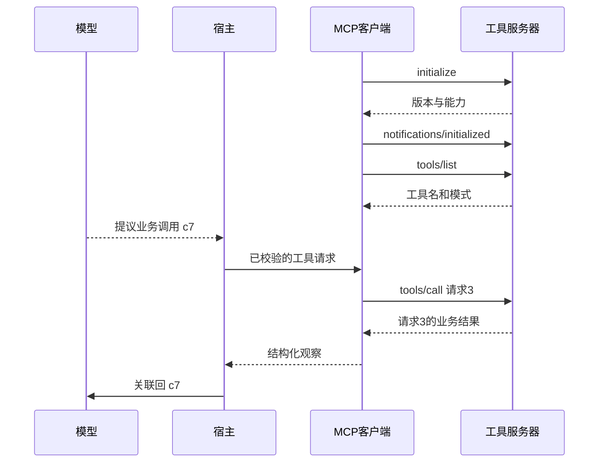
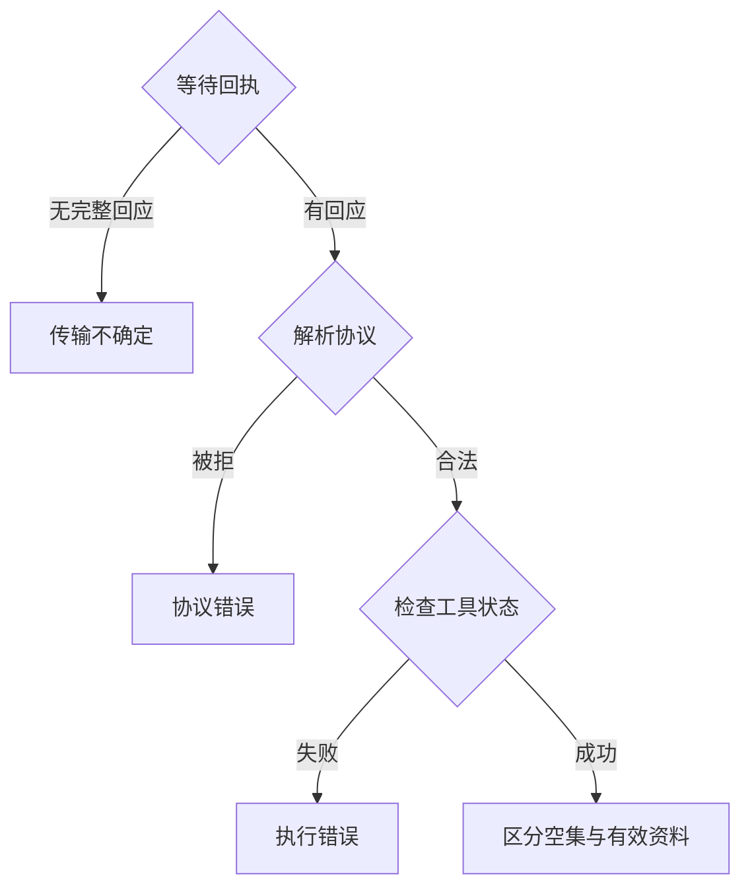
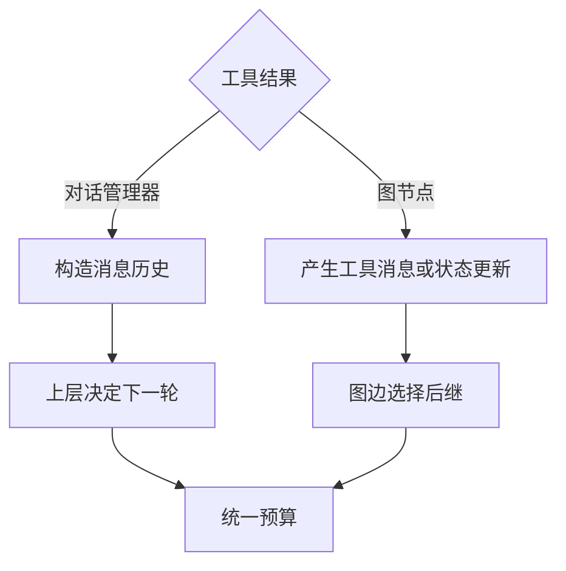
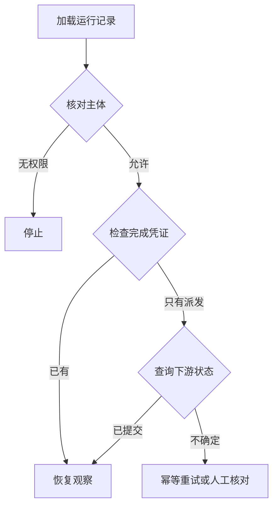

# 第 6 周每日课｜把取证能力做成可恢复的 MCP 工具

第 36 天先跑[本地 MCP 往返实验](lab.md)，对每个观察判断它来自客户端、服务端还是业务快照。第 41 天可直接对照[课内两种框架的执行路径](theory.md)，源码链接用于核对。

[本周理论](theory.md) · [本周实验](lab.md) · [课程目录](../../README.md)

让同一证据工具通过 MCP 工作，并用可复现故障验证边界。

学习顺序：先读当天正文与例题，遮住参考解做一道变式，再完成“动手”和“过关”。第一次进入本周时，可先读[理论讲义的教师精讲](theory.md)；需要实现步骤时对照[本周实验](lab.md)。

## 第 36 天　先画跨进程边界

本周配套研读：[从连接成功到一次合法调用](readings/01.md)，文内有图和带解样例。

90 分钟（讲解与阅读 20 分钟，上机 70 分钟）。

同进程方法变为跨进程调用后，新增序列化、协议协商、传输失败和独立进程状态。先保留本地函数，它是检查适配是否正确的对照。

**课堂推演。** 写下 `req-1 / rpc-7 / E06` 分别代表谁。哪一个能用来查地点原记录，哪一个能在客户端配对响应？

### 跟着老师走一遍

用同一个业务问题走两条链：本地调用直接返回卡片；MCP 调用经客户端编码、服务端分派和响应解码再返回。对照时应固定 room_id、topic 与资料版本。如果事实不同，先比较两边配置与序列化字段，再怀疑模型。

**自己试一次。** 怎样区分关联标识与业务参数？

做完再看参考解

比如 RPC ID=17 用来匹配本次协议响应，room_id=E06 指向业务实体。另一请求查同一家馆时，后者可相同，前者会因调用上下文改变。

**动手。** 把现有 lookup_evidence 的输入输出固定成契约，分别圈出业务数据、协议字段和诊断字段。

**过关。** 能解释一次真实的工具调用会涉及哪些 ID，且不把 JSON-RPC ID 当成地点 ID。

## 第 37 天　握手、能力交换和发现

**模型、宿主、客户端与服务器的消息顺序**

本周配套研读：[把模型调用接回正确的 RPC](readings/02.md)，文内有图和带解样例。

75 分钟（讲解与阅读 15 分钟，上机 60 分钟）。

知道服务器进程存在，还不等于两端已就版本和能力达成一致。完成初始化后，工具列表才说明客户端可发现什么。

**课堂推演。** 即使进程已经启动，如果客户端尚未完成版本和能力协商，工具调用失败首先是协议诊断问题。

### 跟着老师走一遍

启动成功只是进程层事件。记录 initialize 的发送与响应、协商能力以及 initialized 通知；之后再看 tools/list。若服务器把普通日志写进 stdio 的 stdout，客户端可能在握手前就无法解析流。

**自己试一次。** 终端能看见调试文字，客户端却报告 JSON 解析失败，先查哪里？

做完再看参考解

先确认 stdout 是否混入日志，诊断文字改走 stderr，再检查每条协议消息的边界。此时还没有证据说明取证函数本身错误。

**动手。** 按本周实践选择一个 Java MCP SDK 版本，启动 stdio 服务，跑 initialize、初始化完成通知和工具列表。把版本及返回工具名记入轨迹。

**过关。** 能复现从空进程启动到发现 lookup_evidence；普通诊断日志走 stderr。

## 第 38 天　打通一次端到端取证

本周配套研读：[为 RPC 的第二次尝试算出剩余 deadline](readings/03.md)，文内有图和带解样例。

75 分钟（讲解与阅读 15 分钟，上机 60 分钟）。

同一请求跨过协议边界后，业务事实应保持一致。先测一条有明确参考答案的记录才能排除模型随机性。

**课堂推演。** 同一 `room_id=E06, topic=hours` 经过两种入口，允许日志 ID 不同，地点、证据来源和适用时段应相同。

### 跟着老师走一遍

让客户端发 `tools/call(id=17, name=lookup_evidence, room_id=E06)`。收到响应后先校验 ID，再解释结果。返回的成功卡片应能追溯到 E06；若 ID 对了而房间错了，协议层可成功、业务层仍失败。

**自己试一次。** 两个请求反序返回，测试应该断言什么？

做完再看参考解

按请求 ID 对齐各自结果，再断言房间与来源。不要按响应抵达顺序绑定业务对象。

**动手。** 分别用本地函数和 MCP 客户端查询 E06 的 hours，比照地点、服务区域、适用条件、证据标识。

**过关。** 两端事实一致，能从客户端响应关联到正确的 RPC 请求与服务端执行。

## 第 39 天　区分三层失败

**分离传输、协议、执行与业务不命中**

本周配套研读：[RPC 成功与业务空集的区别](readings/04.md)，文内有图和带解样例。

75 分钟（讲解与阅读 15 分钟，上机 60 分钟）。

查无材料是业务结果；工具执行异常是执行层结果；连接断开则可能没有任何响应。把它们都写成空数组会带来错误用户解释。

**课堂推演。** 模拟‘服务器已经读完资料、回复在传输中断掉’。客户端只知道没拿到完整回复，不能据此说没有时段证据。

### 跟着老师走一遍

三次观察：① 合法调用返回空卡列表；② 已知工具在读取资料时失败；③ 客户端连接被断开。三次都可能没有可展示的开放时段，但第一种能说明这份资料的覆盖范围，后两种只说明此次取证未完成。

**自己试一次。** 哪一次支持回复‘这份资料没有该主题’？

做完再看参考解

只有成功且确实以正确参数查过相应范围、结果为空时才支持。错误或断连要报告暂时未取得资料。

**动手。** 制造有效查询但未收录、参数错误、进程通信中断三种情形，记录原始返回与展示文案。

**过关。** 三种错误的重试决策和用户说明有可解释差异。

## 第 40 天　把重试放在一个地方

**工具消息如何回到不同框架的控制层**

本周配套研读：[共享连接上的父子任务权限](readings/05.md)，文内有图和带解样例。

75 分钟（讲解与阅读 15 分钟，上机 60 分钟）。

嵌套重试会放大一次故障。例如模型侧和客户端各允许一次重试，总尝试数就可能超出团队预期。

**课堂推演。** 若外层每次最多尝试 2 次、内层每次也最多尝试 2 次，单个逻辑操作可能放大为 4 次物理调用。

### 跟着老师走一遍

假设下游首尝试已用 700 ms，请求剩余 300 ms，正常取证需要约 500 ms。只看‘最多两次’会再次尝试；检查剩余时限则可能直接降级，留时间返回已知信息。次数上限不等于时间上限。

**自己试一次。** 模型侧和 SDK 都允许重试一次，最坏会执行几次，怎样控制？

做完再看参考解

两层各最多 2 次可能产生 4 次尝试。应由指定一层统筹，所有层共享剩余总时限，并记录真实物理调用数。

**动手。** 给只读取证设置共享总时限，选择一层管理重试。让首次调用超时，分别测试剩余时限充分与不足。

**过关。** 看得见真实尝试次数；剩余时限不足时能停止并交回已知事实。

## 第 41 天　走读源码与可选的断点恢复

**恢复动作由最后一个持久事件决定**

本周配套研读：[三层重试的最坏放大倍数](readings/06.md)，文内有图和带解样例。

150 分钟（讲解与阅读 30 分钟，上机 120 分钟）。

某些框架会将工具异常包装成模型可读的消息。若上层只检查是否正常返回，便可能把失败计为成功。

**课堂推演。** 一个检查点只有 `dispatched`，另一个有 `completed` 与结果哈希。恢复时应能解释为什么前者需要重新判断，而后者可以复用。

### 跟着老师走一遍

重启后看到 dispatched(C7) 只证明发起过，不能证明收到结果；看到 completed(C7, snapshot=v1, result=H) 则可验证并复用 H。若当前要求 v2，已有结果不能直接当成这次的新证据。

**自己试一次。** 两种情况都以‘处理过这个 ID’跳过执行，会有什么故障？

做完再看参考解

仅派发的那条会永久缺结果。恢复逻辑需要区分状态、结果是否可读取及版本是否一致，而不是只看 ID 存在。

**动手。** 在 Spring AI 与 LangGraph 源码中追一次工具错误回传。必修用两客户端查不同馆，检查结果与失败计数。选修在结果落盘后中断，再恢复。

**过关。** 能说明框架包装后的错误由哪一层识别；完成选修时，展示已落盘和仅已派发两种状态的不同恢复行为。

## 第 42 天　一份可以交接的故障记录

本周配套研读：[崩溃后从哪个事件继续](readings/07.md)，文内有图和带解样例。

60 分钟（讲解与阅读 10 分钟，上机 50 分钟）。

一份故障记录应该能回答：发了什么、哪层失败、用户实际看见什么。

**课堂推演。** 交给同伴一条没有最终答复的故障轨迹，让他自己定位故障层级。这比看状态码列表更能检验可观测性。

### 跟着老师走一遍

给值班者一段轨迹：客户端 300 ms 超时；服务器日志显示第 340 ms 查到卡片。两个日志可同时为真。用户的本次答复在截止前没有获得这张卡，下次请求能否复用则要看缓存与版本。

**自己试一次。** 该把这次记为‘业务无数据’还是‘端到端未在限时完成’？

做完再看参考解

记为后者，另报服务器后来成功和晚到结果。否则会把基础设施延迟当作数据资料缺失，导致错误改进方向。

**动手。** 复跑正常、空结果、超时三题，输出脱敏日志与用户答复。检查一次‘工具暂时失败’是否被说成‘场馆无服务’。

**过关。** 交付可启动命令、SDK 版本和三组轨迹，同伴能复现并区分三种结局。
