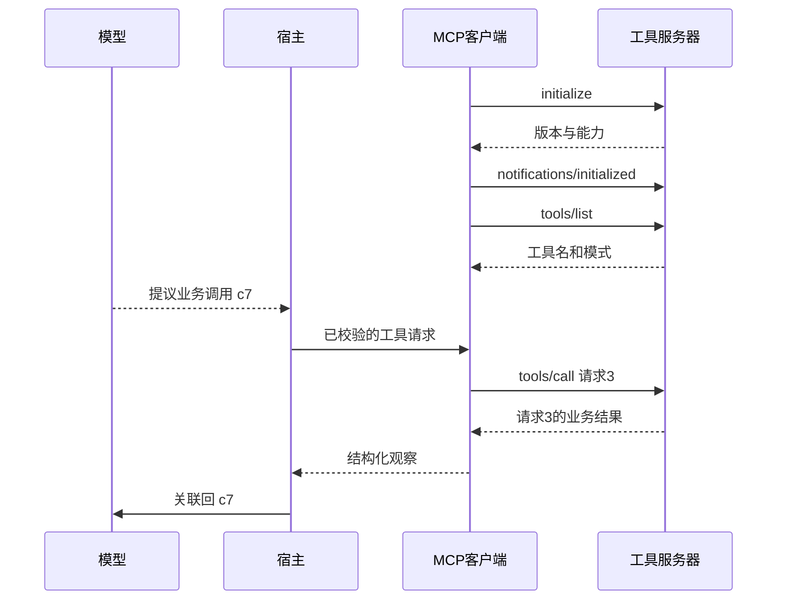

# 第 6 周 · 实践讲义｜MCP 工具边界与可恢复的只读查询

**本周实验的流程参照：模型、宿主、客户端与服务器的消息顺序**



将实际执行记录与图中边界对齐；图所描述的是课程契约，尚未运行的依赖和分支不能据此标成已验证。


## 先跑一次真的本地进程通信

```powershell
py -3 examples/mcp/roundtrip.py E06
py -3 examples/mcp/roundtrip.py DOES_NOT_EXIST
```

[课内客户端和服务端](../../examples/mcp/roundtrip.py)用 Python 标准库启动独立子进程，以标准输入输出交换换行分隔的 JSON-RPC 消息，演示 MCP 2025-11-25 的 stdio 子集。两条命令都应完成版本协商和工具发现，第一条返回 FOUND 和 hours:E06，第二条返回成功的工具消息，其业务体为 NO_DATA。把调用的工具名写错再跑，观察协议错误如何与两者区分。这个样例只服务本地只读课题，学习完整 SDK 时再替换传输适配层。

**故障练习。** 暂停服务端处理最后一次 call，在客户端设置短截止时间。记录是否曾收到完整的 RPC 响应；由宿主把“没收到”映射为超时。不要在服务端 stdout 打印调试行，否则会破坏协议帧，日志应走 stderr。

## 老师先核对一次 MCP 调用

测试时把三列并排：模型调用 c7、协议请求 17、地点 E06。向服务端发送的 JSON-RPC 请求用 id=17；从工具响应取出的记录应带 E06；给模型的结果消息要关联 c7。因此即使 RPC 正常返回，如果宿主把结果写进另一轮模型会话，也属于端到端错误。

先用同一个正确参数跑一次跨进程和同进程调用，比较地点、主题、证据 ID。然后关闭服务端重试，再以一个合法但未收录的主题重试。两次界面都可能没有结果，但轨迹分别是传输失败与成功空集。把用户提示的断言写在这两条轨迹后面。

## 交付物

一个通过本地 stdio 启动的只读 MCP 证据服务、一个能调用它的客户端，以及三种故障轨迹。服务与客户端可以都用 Java。必修可从本页的标准库样例出发，扩展工具和错误处理。选修用 Java SDK 替换进程适配层，记录版本和启动参数。[Java SDK 快速开始](https://java.sdk.modelcontextprotocol.io/latest/quickstart/) · [服务端](https://java.sdk.modelcontextprotocol.io/latest/server/) · [客户端](https://java.sdk.modelcontextprotocol.io/latest/client/)

1. **2 小时，封装工具。** 为已有 `lookup_evidence` 声明输入 Schema：`room_id` 和 `topic` 必填。服务只查本地保存的官方材料。stdio 模式下诊断日志走 stderr，stdout 留给协议消息。保持同进程实现，随后对同一输入核对两端返回的事实。
2. **2 小时，跑通协议。** 用本页客户端或选修的 SDK 发起会话，记录协商版本和服务能力，列工具后执行下列调用。它是完成初始化后的一条 JSON-RPC 示例，ID 可自行分配。确认响应 ID 为 17，读出 E06 时段及证据引用。不要把 MCP 请求 JSON 直接当成模型工具结果回传。
3. **2 小时，注入故障。** 让 E06 的 `live_seats` 查无资料；在本地测试替身中再让 `hours` 首次延迟到超时；最后传入不符合 Schema 的参数。为三种情况分别记录上游错误类型、是否重试、用户答复。跨重试只允许一个层级管理总预算。
4. **2 小时，验证边界并读源码。** 开两个测试客户端，分别查 E06 和 D07，断言返回的证据和调用关联正确。为超时配置短测试时限，达到上限后停止，让最终答复区分“未收录”和“暂时未能取得”。在理论讲义指出的两个源码文件中标注各自回传执行结果的位置。

```json
{"jsonrpc":"2.0","id":17,"method":"tools/call","params":{"name":"lookup_evidence","arguments":{"room_id":"E06","topic":"hours"}}}
```

**通过条件。** 正常响应与本地函数的地点、事实和来源一致；空结果不触发无效重试；可重试的超时最多补查一次，且总时限优先；非法请求不会执行工具。真实模型接通后复跑一题，看其能否正确表述故障。

**选修恢复实验。** 在证据结果已经持久化、尚未装入模型历史时停掉宿主。检查点用会话、步骤 ID、参数和证据版本匹配，重启后复用已完成的结果；只记录“已派发”而没有结果时，按只读查询的规则重新发起。展示两种中断位置产生的不同轨迹。

[本周理论讲义](./theory.md) · [本周每日课程](./daily.md) · [课程总目录](../../README.md)
