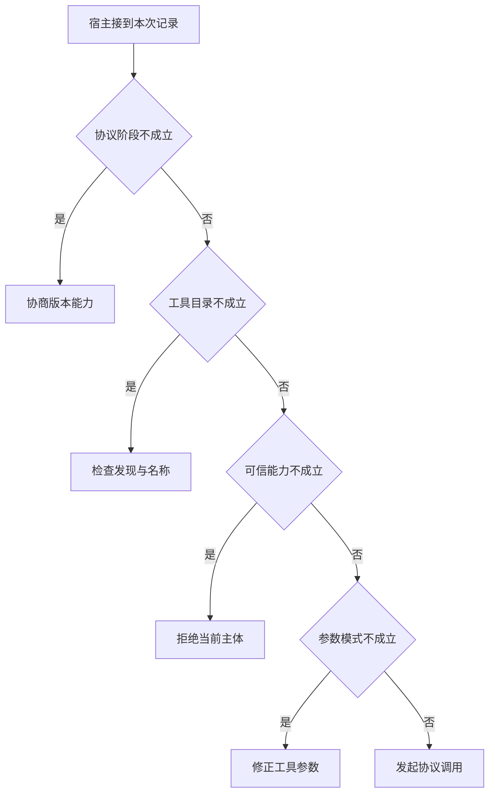

# 从连接成功到一次合法调用

同一 MCP 服务器可以对 SDK 公布工具，但宿主未必允许当前会话调用。
把协商、发现、主体授权、参数验收分别记录，接口不通时就能定位第一个不成立的条件。

本篇用一个封闭的教学决策器说明这一问题。输入是宿主收到的记录，不保证每个下游字段都已经获准使用。前置检查未成立时，下游即使带着缓存值，也不能拿来作业务断言。

## 先解决一个具体问题

**工具能被列出，为什么不能说“功能已验证”？**

list 只给名称和模式，执行还涉及授权、入参、服务端依赖与实际数据。
验收一次正常和一次受控错误调用，分别核对协议 ID 与业务观察。


先取一个能走到「发起协议调用」的输入：已协商版本和能力、当前目录已声明此工具、宿主确认当前主体获准、参数通过结构检查。
把这四个条件代回后文的图，前面各个拦截分支都未满足，最终才有“协商和应用前提均成立”这个判断。
还原这个现场时要分别问：哪些位来自可信状态，哪些只是在接口中出现、尚未获得解释资格的字段。

## 先沿一次决策走到底



从上到下取第一条成立的出口。只改一个开关时，只有它之前的检查都未截断，该变化才可能到达真实动作。

“协议阶段”的两种输入分别是“已协商版本和能力”与“协议协商尚未完成”。
服务能力发现与实际调用有生命周期前提。

“工具目录”的两种输入分别是“当前目录已声明此工具”与“当前目录没有该工具”。
连接成功不能证明某业务动作已对外公布。

“可信能力”的两种输入分别是“宿主确认当前主体获准”与“当前主体未获授权”。
权限取自可信入口或执行端，不由模型生成。

“参数模式”的两种输入分别是“参数通过结构检查”与“缺少可执行的必填参数”。
能解码文本并不等于可以调用业务方法。

## 最少需要哪几项观察

### 协商版本能力

未建立协议前提。
在本节的全部组合中，有 8 种产生「协商版本能力」，这只是逻辑空间的计数，不能当作实际用户请求的比例。

只取得协议协商尚未完成，已经足以要求宿主「协商版本能力」。
保持这些已知项，其余开关自由变化，仍有 8 种补全，判断没有翻转。

若删掉关于协议阶段的证据，另一份允许的现场是已协商版本和能力、当前目录没有该工具、当前主体未获授权、缺少可执行的必填参数，它会使宿主「检查发现与名称」。

### 检查发现与名称

协商目录里没有相应工具。
在本节的全部组合中，有 4 种产生「检查发现与名称」，这只是逻辑空间的计数，不能当作实际用户请求的比例。

只取得已协商版本和能力、当前目录没有该工具，已经足以要求宿主「检查发现与名称」。
保持这些已知项，其余开关自由变化，仍有 4 种补全，判断没有翻转。

若删掉关于协议阶段的证据，另一份允许的现场是协议协商尚未完成、当前目录没有该工具、当前主体未获授权、缺少可执行的必填参数，它会使宿主「协商版本能力」。

若删掉关于工具目录的证据，另一份允许的现场是已协商版本和能力、当前目录已声明此工具、当前主体未获授权、缺少可执行的必填参数，它会使宿主「拒绝当前主体」。

### 拒绝当前主体

服务公布不等于获准执行。
在本节的全部组合中，有 2 种产生「拒绝当前主体」，这只是逻辑空间的计数，不能当作实际用户请求的比例。

只取得已协商版本和能力、当前目录已声明此工具、当前主体未获授权，已经足以要求宿主「拒绝当前主体」。
保持这些已知项，其余开关自由变化，仍有 2 种补全，判断没有翻转。

若删掉关于协议阶段的证据，另一份允许的现场是协议协商尚未完成、当前目录已声明此工具、当前主体未获授权、缺少可执行的必填参数，它会使宿主「协商版本能力」。

若删掉关于工具目录的证据，另一份允许的现场是已协商版本和能力、当前目录没有该工具、当前主体未获授权、缺少可执行的必填参数，它会使宿主「检查发现与名称」。

若删掉关于可信能力的证据，另一份允许的现场是已协商版本和能力、当前目录已声明此工具、宿主确认当前主体获准、缺少可执行的必填参数，它会使宿主「修正工具参数」。

### 修正工具参数

存在接口仍需有效入参。
在本节的全部组合中，有 1 种产生「修正工具参数」，这只是逻辑空间的计数，不能当作实际用户请求的比例。

只取得已协商版本和能力、当前目录已声明此工具、宿主确认当前主体获准、缺少可执行的必填参数，已经足以要求宿主「修正工具参数」。
保持这些已知项，其余开关自由变化，仍有 1 种补全，判断没有翻转。

若删掉关于协议阶段的证据，另一份允许的现场是协议协商尚未完成、当前目录已声明此工具、宿主确认当前主体获准、缺少可执行的必填参数，它会使宿主「协商版本能力」。

若删掉关于工具目录的证据，另一份允许的现场是已协商版本和能力、当前目录没有该工具、宿主确认当前主体获准、缺少可执行的必填参数，它会使宿主「检查发现与名称」。

若删掉关于可信能力的证据，另一份允许的现场是已协商版本和能力、当前目录已声明此工具、当前主体未获授权、缺少可执行的必填参数，它会使宿主「拒绝当前主体」。

若删掉关于参数模式的证据，另一份允许的现场是已协商版本和能力、当前目录已声明此工具、宿主确认当前主体获准、参数通过结构检查，它会使宿主「发起协议调用」。

### 发起协议调用

协商和应用前提均成立。
在本节的全部组合中，有 1 种产生「发起协议调用」，这只是逻辑空间的计数，不能当作实际用户请求的比例。

只取得已协商版本和能力、当前目录已声明此工具、宿主确认当前主体获准、参数通过结构检查，已经足以要求宿主「发起协议调用」。

若删掉关于协议阶段的证据，另一份允许的现场是协议协商尚未完成、当前目录已声明此工具、宿主确认当前主体获准、参数通过结构检查，它会使宿主「协商版本能力」。

若删掉关于工具目录的证据，另一份允许的现场是已协商版本和能力、当前目录没有该工具、宿主确认当前主体获准、参数通过结构检查，它会使宿主「检查发现与名称」。

若删掉关于可信能力的证据，另一份允许的现场是已协商版本和能力、当前目录已声明此工具、当前主体未获授权、参数通过结构检查，它会使宿主「拒绝当前主体」。

若删掉关于参数模式的证据，另一份允许的现场是已协商版本和能力、当前目录已声明此工具、宿主确认当前主体获准、缺少可执行的必填参数，它会使宿主「修正工具参数」。

## 以同一份契约解释截然不同的现场

<details>
<summary>展开推演与对应反例</summary>

下列样本按最先命中的业务分支排列。四位编码只作本篇页内定位，顺序与开头的四项输入一致。可以先猜下一动作，再展开相邻样本。

### 能够触发“协商版本能力”的现场

**样本 0000**

业务侧交来协议协商尚未完成、当前目录没有该工具，执行侧还记录了当前主体未获授权、缺少可执行的必填参数。
把样本压成最短证明，保留协议协商尚未完成就能支持「协商版本能力」。

在这份记录上，分别翻转「协议阶段」中的任一项，其他项完全不变时，下一动作都会改变。

保持其余观察不动，单独切换「工具目录」、「可信能力」、「参数模式」仍得到「协商版本能力」，它们在这个现场不是决定性变量。

要从本例改走「检查发现与名称」，至少需要变动 1 项，一组最少改动是将协议协商尚未完成换成已协商版本和能力。

要从本例改走「拒绝当前主体」，至少需要变动 2 项，一组最少改动是将协议协商尚未完成、当前目录没有该工具换成已协商版本和能力、当前目录已声明此工具。

要从本例改走「修正工具参数」，至少需要变动 3 项，一组最少改动是将协议协商尚未完成、当前目录没有该工具、当前主体未获授权换成已协商版本和能力、当前目录已声明此工具、宿主确认当前主体获准。

要从本例改走「发起协议调用」，至少需要变动 4 项，一组最少改动是将协议协商尚未完成、当前目录没有该工具、当前主体未获授权、缺少可执行的必填参数换成已协商版本和能力、当前目录已声明此工具、宿主确认当前主体获准、参数通过结构检查。

**样本 0001**

业务侧交来协议协商尚未完成、当前目录没有该工具，执行侧还记录了当前主体未获授权、参数通过结构检查。


要从本例改走「发起协议调用」，至少需要变动 3 项，一组最少改动是将协议协商尚未完成、当前目录没有该工具、当前主体未获授权换成已协商版本和能力、当前目录已声明此工具、宿主确认当前主体获准。

要从本例改走「修正工具参数」，至少需要变动 4 项，一组最少改动是将协议协商尚未完成、当前目录没有该工具、当前主体未获授权、参数通过结构检查换成已协商版本和能力、当前目录已声明此工具、宿主确认当前主体获准、缺少可执行的必填参数。

**样本 0010**

业务侧交来协议协商尚未完成、当前目录没有该工具，执行侧还记录了宿主确认当前主体获准、缺少可执行的必填参数。


要从本例改走「修正工具参数」，至少需要变动 2 项，一组最少改动是将协议协商尚未完成、当前目录没有该工具换成已协商版本和能力、当前目录已声明此工具。

要从本例改走「拒绝当前主体」，至少需要变动 3 项，一组最少改动是将协议协商尚未完成、当前目录没有该工具、宿主确认当前主体获准换成已协商版本和能力、当前目录已声明此工具、当前主体未获授权。

要从本例改走「发起协议调用」，至少需要变动 3 项，一组最少改动是将协议协商尚未完成、当前目录没有该工具、缺少可执行的必填参数换成已协商版本和能力、当前目录已声明此工具、参数通过结构检查。

**样本 0011**

业务侧交来协议协商尚未完成、当前目录没有该工具，执行侧还记录了宿主确认当前主体获准、参数通过结构检查。


要从本例改走「发起协议调用」，至少需要变动 2 项，一组最少改动是将协议协商尚未完成、当前目录没有该工具换成已协商版本和能力、当前目录已声明此工具。


要从本例改走「修正工具参数」，至少需要变动 3 项，一组最少改动是将协议协商尚未完成、当前目录没有该工具、参数通过结构检查换成已协商版本和能力、当前目录已声明此工具、缺少可执行的必填参数。

**样本 0100**

业务侧交来协议协商尚未完成、当前目录已声明此工具，执行侧还记录了当前主体未获授权、缺少可执行的必填参数。


要从本例改走「拒绝当前主体」，至少需要变动 1 项，一组最少改动是将协议协商尚未完成换成已协商版本和能力。

要从本例改走「检查发现与名称」，至少需要变动 2 项，一组最少改动是将协议协商尚未完成、当前目录已声明此工具换成已协商版本和能力、当前目录没有该工具。

要从本例改走「修正工具参数」，至少需要变动 2 项，一组最少改动是将协议协商尚未完成、当前主体未获授权换成已协商版本和能力、宿主确认当前主体获准。

要从本例改走「发起协议调用」，至少需要变动 3 项，一组最少改动是将协议协商尚未完成、当前主体未获授权、缺少可执行的必填参数换成已协商版本和能力、宿主确认当前主体获准、参数通过结构检查。

**样本 0101**

业务侧交来协议协商尚未完成、当前目录已声明此工具，执行侧还记录了当前主体未获授权、参数通过结构检查。


要从本例改走「发起协议调用」，至少需要变动 2 项，一组最少改动是将协议协商尚未完成、当前主体未获授权换成已协商版本和能力、宿主确认当前主体获准。

要从本例改走「修正工具参数」，至少需要变动 3 项，一组最少改动是将协议协商尚未完成、当前主体未获授权、参数通过结构检查换成已协商版本和能力、宿主确认当前主体获准、缺少可执行的必填参数。

**样本 0110**

业务侧交来协议协商尚未完成、当前目录已声明此工具，执行侧还记录了宿主确认当前主体获准、缺少可执行的必填参数。


要从本例改走「修正工具参数」，至少需要变动 1 项，一组最少改动是将协议协商尚未完成换成已协商版本和能力。


要从本例改走「拒绝当前主体」，至少需要变动 2 项，一组最少改动是将协议协商尚未完成、宿主确认当前主体获准换成已协商版本和能力、当前主体未获授权。

要从本例改走「发起协议调用」，至少需要变动 2 项，一组最少改动是将协议协商尚未完成、缺少可执行的必填参数换成已协商版本和能力、参数通过结构检查。

**样本 0111**

业务侧交来协议协商尚未完成、当前目录已声明此工具，执行侧还记录了宿主确认当前主体获准、参数通过结构检查。


要从本例改走「发起协议调用」，至少需要变动 1 项，一组最少改动是将协议协商尚未完成换成已协商版本和能力。


要从本例改走「修正工具参数」，至少需要变动 2 项，一组最少改动是将协议协商尚未完成、参数通过结构检查换成已协商版本和能力、缺少可执行的必填参数。

### 能够触发“检查发现与名称”的现场

**样本 1000**

业务侧交来已协商版本和能力、当前目录没有该工具，执行侧还记录了当前主体未获授权、缺少可执行的必填参数。
把样本压成最短证明，保留已协商版本和能力、当前目录没有该工具就能支持「检查发现与名称」。

在这份记录上，分别翻转「协议阶段」、「工具目录」中的任一项，其他项完全不变时，下一动作都会改变。

保持其余观察不动，单独切换「可信能力」、「参数模式」仍得到「检查发现与名称」，它们在这个现场不是决定性变量。

本例没走更靠前的「协商版本能力」，因为已协商版本和能力与那个入口的必要条件不符。

要从本例改走「协商版本能力」，至少需要变动 1 项，一组最少改动是将已协商版本和能力换成协议协商尚未完成。

要从本例改走「拒绝当前主体」，至少需要变动 1 项，一组最少改动是将当前目录没有该工具换成当前目录已声明此工具。

要从本例改走「修正工具参数」，至少需要变动 2 项，一组最少改动是将当前目录没有该工具、当前主体未获授权换成当前目录已声明此工具、宿主确认当前主体获准。

要从本例改走「发起协议调用」，至少需要变动 3 项，一组最少改动是将当前目录没有该工具、当前主体未获授权、缺少可执行的必填参数换成当前目录已声明此工具、宿主确认当前主体获准、参数通过结构检查。

**样本 1001**

业务侧交来已协商版本和能力、当前目录没有该工具，执行侧还记录了当前主体未获授权、参数通过结构检查。


要从本例改走「发起协议调用」，至少需要变动 2 项，一组最少改动是将当前目录没有该工具、当前主体未获授权换成当前目录已声明此工具、宿主确认当前主体获准。

要从本例改走「修正工具参数」，至少需要变动 3 项，一组最少改动是将当前目录没有该工具、当前主体未获授权、参数通过结构检查换成当前目录已声明此工具、宿主确认当前主体获准、缺少可执行的必填参数。

**样本 1010**

业务侧交来已协商版本和能力、当前目录没有该工具，执行侧还记录了宿主确认当前主体获准、缺少可执行的必填参数。


要从本例改走「修正工具参数」，至少需要变动 1 项，一组最少改动是将当前目录没有该工具换成当前目录已声明此工具。

要从本例改走「拒绝当前主体」，至少需要变动 2 项，一组最少改动是将当前目录没有该工具、宿主确认当前主体获准换成当前目录已声明此工具、当前主体未获授权。

要从本例改走「发起协议调用」，至少需要变动 2 项，一组最少改动是将当前目录没有该工具、缺少可执行的必填参数换成当前目录已声明此工具、参数通过结构检查。

**样本 1011**

业务侧交来已协商版本和能力、当前目录没有该工具，执行侧还记录了宿主确认当前主体获准、参数通过结构检查。


要从本例改走「发起协议调用」，至少需要变动 1 项，一组最少改动是将当前目录没有该工具换成当前目录已声明此工具。


要从本例改走「修正工具参数」，至少需要变动 2 项，一组最少改动是将当前目录没有该工具、参数通过结构检查换成当前目录已声明此工具、缺少可执行的必填参数。

### 能够触发“拒绝当前主体”的现场

**样本 1100**

业务侧交来已协商版本和能力、当前目录已声明此工具，执行侧还记录了当前主体未获授权、缺少可执行的必填参数。
把样本压成最短证明，保留已协商版本和能力、当前目录已声明此工具、当前主体未获授权就能支持「拒绝当前主体」。

在这份记录上，分别翻转「协议阶段」、「工具目录」、「可信能力」中的任一项，其他项完全不变时，下一动作都会改变。

保持其余观察不动，单独切换「参数模式」仍得到「拒绝当前主体」，它们在这个现场不是决定性变量。


本例没走更靠前的「检查发现与名称」，因为当前目录已声明此工具与那个入口的必要条件不符。


要从本例改走「检查发现与名称」，至少需要变动 1 项，一组最少改动是将当前目录已声明此工具换成当前目录没有该工具。

要从本例改走「修正工具参数」，至少需要变动 1 项，一组最少改动是将当前主体未获授权换成宿主确认当前主体获准。

要从本例改走「发起协议调用」，至少需要变动 2 项，一组最少改动是将当前主体未获授权、缺少可执行的必填参数换成宿主确认当前主体获准、参数通过结构检查。

**样本 1101**

业务侧交来已协商版本和能力、当前目录已声明此工具，执行侧还记录了当前主体未获授权、参数通过结构检查。


要从本例改走「发起协议调用」，至少需要变动 1 项，一组最少改动是将当前主体未获授权换成宿主确认当前主体获准。

要从本例改走「修正工具参数」，至少需要变动 2 项，一组最少改动是将当前主体未获授权、参数通过结构检查换成宿主确认当前主体获准、缺少可执行的必填参数。

### 能够触发“修正工具参数”的现场

**样本 1110**

业务侧交来已协商版本和能力、当前目录已声明此工具，执行侧还记录了宿主确认当前主体获准、缺少可执行的必填参数。
把样本压成最短证明，保留已协商版本和能力、当前目录已声明此工具、宿主确认当前主体获准、缺少可执行的必填参数就能支持「修正工具参数」。

在这份记录上，分别翻转「协议阶段」、「工具目录」、「可信能力」、「参数模式」中的任一项，其他项完全不变时，下一动作都会改变。


本例没走更靠前的「拒绝当前主体」，因为宿主确认当前主体获准与那个入口的必要条件不符。


要从本例改走「拒绝当前主体」，至少需要变动 1 项，一组最少改动是将宿主确认当前主体获准换成当前主体未获授权。

要从本例改走「发起协议调用」，至少需要变动 1 项，一组最少改动是将缺少可执行的必填参数换成参数通过结构检查。

### 能够触发“发起协议调用”的现场

**样本 1111**

业务侧交来已协商版本和能力、当前目录已声明此工具，执行侧还记录了宿主确认当前主体获准、参数通过结构检查。
把样本压成最短证明，保留已协商版本和能力、当前目录已声明此工具、宿主确认当前主体获准、参数通过结构检查就能支持「发起协议调用」。


本例没走更靠前的「修正工具参数」，因为参数通过结构检查与那个入口的必要条件不符。


要从本例改走「修正工具参数」，至少需要变动 1 项，一组最少改动是将参数通过结构检查换成缺少可执行的必填参数。

</details>

## 当你只能看见一半记录

<details>
<summary>展开推演与对应反例</summary>

这次隐藏两个字段，保留另两个。对每个可见现场，检查四种合法补全是否同意。如仍有歧义，选择能使最坏剩余候选动作最少的字段继续查。并列时采用本篇字段顺序。

### 只保留协议阶段与工具目录

已知协议协商尚未完成、当前目录没有该工具时，四种补全的动作分布为协商版本能力（4 种）。

就“协商版本能力”这个动作而言，在协议协商尚未完成、当前目录没有该工具的前提下，另外两项观察不会推翻它。

已知协议协商尚未完成、当前目录已声明此工具时，四种补全的动作分布为协商版本能力（4 种）。

就“协商版本能力”这个动作而言，在协议协商尚未完成、当前目录已声明此工具的前提下，另外两项观察不会推翻它。

已知已协商版本和能力、当前目录没有该工具时，四种补全的动作分布为检查发现与名称（4 种）。

就“检查发现与名称”这个动作而言，在已协商版本和能力、当前目录没有该工具的前提下，另外两项观察不会推翻它。

已知已协商版本和能力、当前目录已声明此工具时，四种补全的动作分布为拒绝当前主体（2 种）、修正工具参数（1 种）、发起协议调用（1 种）。

在已协商版本和能力、当前目录已声明此工具这个现场补读「可信能力」，最坏还剩 2 种动作，计算时只衡量歧义，尚未扣读取代价。
若补来的观察为“当前主体未获授权”，范围缩成「拒绝当前主体」。若为“宿主确认当前主体获准”，则保留「修正工具参数」、「发起协议调用」。

区分不了的两条执行可以具体写成 1100 与 1110：它们共享已展示字段，却分别需要「拒绝当前主体」和「修正工具参数」。

### 只保留协议阶段与可信能力

已知协议协商尚未完成、当前主体未获授权时，四种补全的动作分布为协商版本能力（4 种）。

就“协商版本能力”这个动作而言，在协议协商尚未完成、当前主体未获授权的前提下，另外两项观察不会推翻它。

已知协议协商尚未完成、宿主确认当前主体获准时，四种补全的动作分布为协商版本能力（4 种）。

就“协商版本能力”这个动作而言，在协议协商尚未完成、宿主确认当前主体获准的前提下，另外两项观察不会推翻它。

已知已协商版本和能力、当前主体未获授权时，四种补全的动作分布为检查发现与名称（2 种）、拒绝当前主体（2 种）。

在已协商版本和能力、当前主体未获授权这个现场补读「工具目录」，最坏还剩 1 种动作，计算时只衡量歧义，尚未扣读取代价。
若补来的观察为“当前目录没有该工具”，范围缩成「检查发现与名称」。若为“当前目录已声明此工具”，则保留「拒绝当前主体」。

区分不了的两条执行可以具体写成 1000 与 1100：它们共享已展示字段，却分别需要「检查发现与名称」和「拒绝当前主体」。

已知已协商版本和能力、宿主确认当前主体获准时，四种补全的动作分布为检查发现与名称（2 种）、修正工具参数（1 种）、发起协议调用（1 种）。

在已协商版本和能力、宿主确认当前主体获准这个现场补读「工具目录」，最坏还剩 2 种动作，计算时只衡量歧义，尚未扣读取代价。
若补来的观察为“当前目录没有该工具”，范围缩成「检查发现与名称」。若为“当前目录已声明此工具”，则保留「修正工具参数」、「发起协议调用」。

区分不了的两条执行可以具体写成 1010 与 1110：它们共享已展示字段，却分别需要「检查发现与名称」和「修正工具参数」。

### 只保留工具目录与可信能力

已知当前目录没有该工具、当前主体未获授权时，四种补全的动作分布为协商版本能力（2 种）、检查发现与名称（2 种）。

在当前目录没有该工具、当前主体未获授权这个现场补读「协议阶段」，最坏还剩 1 种动作，计算时只衡量歧义，尚未扣读取代价。
若补来的观察为“协议协商尚未完成”，范围缩成「协商版本能力」。若为“已协商版本和能力”，则保留「检查发现与名称」。

区分不了的两条执行可以具体写成 0000 与 1000：它们共享已展示字段，却分别需要「协商版本能力」和「检查发现与名称」。

已知当前目录没有该工具、宿主确认当前主体获准时，四种补全的动作分布为协商版本能力（2 种）、检查发现与名称（2 种）。

在当前目录没有该工具、宿主确认当前主体获准这个现场补读「协议阶段」，最坏还剩 1 种动作，计算时只衡量歧义，尚未扣读取代价。

区分不了的两条执行可以具体写成 0010 与 1010：它们共享已展示字段，却分别需要「协商版本能力」和「检查发现与名称」。

已知当前目录已声明此工具、当前主体未获授权时，四种补全的动作分布为协商版本能力（2 种）、拒绝当前主体（2 种）。

在当前目录已声明此工具、当前主体未获授权这个现场补读「协议阶段」，最坏还剩 1 种动作，计算时只衡量歧义，尚未扣读取代价。
若补来的观察为“协议协商尚未完成”，范围缩成「协商版本能力」。若为“已协商版本和能力”，则保留「拒绝当前主体」。

区分不了的两条执行可以具体写成 0100 与 1100：它们共享已展示字段，却分别需要「协商版本能力」和「拒绝当前主体」。

已知当前目录已声明此工具、宿主确认当前主体获准时，四种补全的动作分布为协商版本能力（2 种）、修正工具参数（1 种）、发起协议调用（1 种）。

在当前目录已声明此工具、宿主确认当前主体获准这个现场补读「协议阶段」，最坏还剩 2 种动作，计算时只衡量歧义，尚未扣读取代价。
若补来的观察为“协议协商尚未完成”，范围缩成「协商版本能力」。若为“已协商版本和能力”，则保留「修正工具参数」、「发起协议调用」。

区分不了的两条执行可以具体写成 0110 与 1110：它们共享已展示字段，却分别需要「协商版本能力」和「修正工具参数」。

### 只保留协议阶段与参数模式

已知协议协商尚未完成、缺少可执行的必填参数时，四种补全的动作分布为协商版本能力（4 种）。

就“协商版本能力”这个动作而言，在协议协商尚未完成、缺少可执行的必填参数的前提下，另外两项观察不会推翻它。

已知协议协商尚未完成、参数通过结构检查时，四种补全的动作分布为协商版本能力（4 种）。

就“协商版本能力”这个动作而言，在协议协商尚未完成、参数通过结构检查的前提下，另外两项观察不会推翻它。

已知已协商版本和能力、缺少可执行的必填参数时，四种补全的动作分布为检查发现与名称（2 种）、拒绝当前主体（1 种）、修正工具参数（1 种）。

在已协商版本和能力、缺少可执行的必填参数这个现场补读「工具目录」，最坏还剩 2 种动作，计算时只衡量歧义，尚未扣读取代价。
若补来的观察为“当前目录没有该工具”，范围缩成「检查发现与名称」。若为“当前目录已声明此工具”，则保留「拒绝当前主体」、「修正工具参数」。


已知已协商版本和能力、参数通过结构检查时，四种补全的动作分布为检查发现与名称（2 种）、拒绝当前主体（1 种）、发起协议调用（1 种）。

在已协商版本和能力、参数通过结构检查这个现场补读「工具目录」，最坏还剩 2 种动作，计算时只衡量歧义，尚未扣读取代价。
若补来的观察为“当前目录没有该工具”，范围缩成「检查发现与名称」。若为“当前目录已声明此工具”，则保留「拒绝当前主体」、「发起协议调用」。

区分不了的两条执行可以具体写成 1001 与 1101：它们共享已展示字段，却分别需要「检查发现与名称」和「拒绝当前主体」。

### 只保留工具目录与参数模式

已知当前目录没有该工具、缺少可执行的必填参数时，四种补全的动作分布为协商版本能力（2 种）、检查发现与名称（2 种）。

在当前目录没有该工具、缺少可执行的必填参数这个现场补读「协议阶段」，最坏还剩 1 种动作，计算时只衡量歧义，尚未扣读取代价。


已知当前目录没有该工具、参数通过结构检查时，四种补全的动作分布为协商版本能力（2 种）、检查发现与名称（2 种）。

在当前目录没有该工具、参数通过结构检查这个现场补读「协议阶段」，最坏还剩 1 种动作，计算时只衡量歧义，尚未扣读取代价。

区分不了的两条执行可以具体写成 0001 与 1001：它们共享已展示字段，却分别需要「协商版本能力」和「检查发现与名称」。

已知当前目录已声明此工具、缺少可执行的必填参数时，四种补全的动作分布为协商版本能力（2 种）、拒绝当前主体（1 种）、修正工具参数（1 种）。

在当前目录已声明此工具、缺少可执行的必填参数这个现场补读「协议阶段」，最坏还剩 2 种动作，计算时只衡量歧义，尚未扣读取代价。
若补来的观察为“协议协商尚未完成”，范围缩成「协商版本能力」。若为“已协商版本和能力”，则保留「拒绝当前主体」、「修正工具参数」。


已知当前目录已声明此工具、参数通过结构检查时，四种补全的动作分布为协商版本能力（2 种）、拒绝当前主体（1 种）、发起协议调用（1 种）。

在当前目录已声明此工具、参数通过结构检查这个现场补读「协议阶段」，最坏还剩 2 种动作，计算时只衡量歧义，尚未扣读取代价。
若补来的观察为“协议协商尚未完成”，范围缩成「协商版本能力」。若为“已协商版本和能力”，则保留「拒绝当前主体」、「发起协议调用」。

区分不了的两条执行可以具体写成 0101 与 1101：它们共享已展示字段，却分别需要「协商版本能力」和「拒绝当前主体」。

### 只保留可信能力与参数模式

已知当前主体未获授权、缺少可执行的必填参数时，四种补全的动作分布为协商版本能力（2 种）、检查发现与名称（1 种）、拒绝当前主体（1 种）。

在当前主体未获授权、缺少可执行的必填参数这个现场补读「协议阶段」，最坏还剩 2 种动作，计算时只衡量歧义，尚未扣读取代价。
若补来的观察为“协议协商尚未完成”，范围缩成「协商版本能力」。若为“已协商版本和能力”，则保留「检查发现与名称」、「拒绝当前主体」。


已知当前主体未获授权、参数通过结构检查时，四种补全的动作分布为协商版本能力（2 种）、检查发现与名称（1 种）、拒绝当前主体（1 种）。

在当前主体未获授权、参数通过结构检查这个现场补读「协议阶段」，最坏还剩 2 种动作，计算时只衡量歧义，尚未扣读取代价。


已知宿主确认当前主体获准、缺少可执行的必填参数时，四种补全的动作分布为协商版本能力（2 种）、检查发现与名称（1 种）、修正工具参数（1 种）。

在宿主确认当前主体获准、缺少可执行的必填参数这个现场补读「协议阶段」，最坏还剩 2 种动作，计算时只衡量歧义，尚未扣读取代价。
若补来的观察为“协议协商尚未完成”，范围缩成「协商版本能力」。若为“已协商版本和能力”，则保留「检查发现与名称」、「修正工具参数」。


已知宿主确认当前主体获准、参数通过结构检查时，四种补全的动作分布为协商版本能力（2 种）、检查发现与名称（1 种）、发起协议调用（1 种）。

在宿主确认当前主体获准、参数通过结构检查这个现场补读「协议阶段」，最坏还剩 2 种动作，计算时只衡量歧义，尚未扣读取代价。
若补来的观察为“协议协商尚未完成”，范围缩成「协商版本能力」。若为“已协商版本和能力”，则保留「检查发现与名称」、「发起协议调用」。

区分不了的两条执行可以具体写成 0011 与 1011：它们共享已展示字段，却分别需要「协商版本能力」和「检查发现与名称」。

</details>

## 单因素干预与边界测试

<details>
<summary>展开推演与对应反例</summary>

### 只改变协议阶段

固定另外三个条件得到八对现场，从“协议协商尚未完成”转为“已协商版本和能力”时，8 对翻转动作，另外 0 对保持不变。

有 4 对现场沿「协商版本能力」变到「检查发现与名称」，可复现的一组受控背景为当前目录没有该工具、当前主体未获授权、缺少可执行的必填参数。

有 2 对现场沿「协商版本能力」变到「拒绝当前主体」，可复现的一组受控背景为当前目录已声明此工具、当前主体未获授权、缺少可执行的必填参数。

有 1 对现场沿「协商版本能力」变到「修正工具参数」，可复现的一组受控背景为当前目录已声明此工具、宿主确认当前主体获准、缺少可执行的必填参数。

有 1 对现场沿「协商版本能力」变到「发起协议调用」，可复现的一组受控背景为当前目录已声明此工具、宿主确认当前主体获准、参数通过结构检查。

### 只改变工具目录

固定另外三个条件得到八对现场，从“当前目录没有该工具”转为“当前目录已声明此工具”时，4 对翻转动作，另外 4 对保持不变。

令协议协商尚未完成、当前主体未获授权、缺少可执行的必填参数，工具目录的两个取值均得到「协商版本能力」。在八对中，共有 4 对表现为这一种稳定出口。

有 2 对现场沿「检查发现与名称」变到「拒绝当前主体」，可复现的一组受控背景为已协商版本和能力、当前主体未获授权、缺少可执行的必填参数。

有 1 对现场沿「检查发现与名称」变到「修正工具参数」，可复现的一组受控背景为已协商版本和能力、宿主确认当前主体获准、缺少可执行的必填参数。

有 1 对现场沿「检查发现与名称」变到「发起协议调用」，可复现的一组受控背景为已协商版本和能力、宿主确认当前主体获准、参数通过结构检查。

### 只改变可信能力

固定另外三个条件得到八对现场，从“当前主体未获授权”转为“宿主确认当前主体获准”时，2 对翻转动作，另外 6 对保持不变。

令协议协商尚未完成、当前目录没有该工具、缺少可执行的必填参数，可信能力的两个取值均得到「协商版本能力」。在八对中，共有 4 对表现为这一种稳定出口。

令已协商版本和能力、当前目录没有该工具、缺少可执行的必填参数，可信能力的两个取值均得到「检查发现与名称」。在八对中，共有 2 对表现为这一种稳定出口。

有 1 对现场沿「拒绝当前主体」变到「修正工具参数」，可复现的一组受控背景为已协商版本和能力、当前目录已声明此工具、缺少可执行的必填参数。

有 1 对现场沿「拒绝当前主体」变到「发起协议调用」，可复现的一组受控背景为已协商版本和能力、当前目录已声明此工具、参数通过结构检查。

### 只改变参数模式

固定另外三个条件得到八对现场，从“缺少可执行的必填参数”转为“参数通过结构检查”时，1 对翻转动作，另外 7 对保持不变。

令协议协商尚未完成、当前目录没有该工具、当前主体未获授权，参数模式的两个取值均得到「协商版本能力」。在八对中，共有 4 对表现为这一种稳定出口。

令已协商版本和能力、当前目录没有该工具、当前主体未获授权，参数模式的两个取值均得到「检查发现与名称」。在八对中，共有 2 对表现为这一种稳定出口。

令已协商版本和能力、当前目录已声明此工具、当前主体未获授权，参数模式的两个取值均得到「拒绝当前主体」。在八对中，共有 1 对表现为这一种稳定出口。

有 1 对现场沿「修正工具参数」变到「发起协议调用」，可复现的一组受控背景为已协商版本和能力、当前目录已声明此工具、宿主确认当前主体获准。

</details>

## 哪些回归样本真能抓住实现错误

<details>
<summary>展开推演与对应反例</summary>

如果删除“协商版本能力”这个分支，在本篇 16 种输入里有 8 种会改走另一出口。

反例 0000 的完整记录为协议协商尚未完成、当前目录没有该工具、当前主体未获授权、缺少可执行的必填参数。正确结果是「协商版本能力」，这个改坏的实现却给出「检查发现与名称」。

如果删除“检查发现与名称”这个分支，在本篇 16 种输入里有 4 种会改走另一出口。

反例 1000 的完整记录为已协商版本和能力、当前目录没有该工具、当前主体未获授权、缺少可执行的必填参数。正确结果是「检查发现与名称」，这个改坏的实现却给出「拒绝当前主体」。

如果删除“拒绝当前主体”这个分支，在本篇 16 种输入里有 2 种会改走另一出口。

反例 1100 的完整记录为已协商版本和能力、当前目录已声明此工具、当前主体未获授权、缺少可执行的必填参数。正确结果是「拒绝当前主体」，这个改坏的实现却给出「修正工具参数」。

如果删除“修正工具参数”这个分支，在本篇 16 种输入里有 1 种会改走另一出口。

反例 1110 的完整记录为已协商版本和能力、当前目录已声明此工具、宿主确认当前主体获准、缺少可执行的必填参数。正确结果是「修正工具参数」，这个改坏的实现却给出「发起协议调用」。

如果交换“协商版本能力”和“检查发现与名称”的判断次序，在本篇 16 种输入里有 4 种会改走另一出口。


如果交换“检查发现与名称”和“拒绝当前主体”的判断次序，在本篇 16 种输入里有 2 种会改走另一出口。


如果交换“拒绝当前主体”和“修正工具参数”的判断次序，在本篇 16 种输入里有 1 种会改走另一出口。


补入样本 0000（协议协商尚未完成、当前目录没有该工具、当前主体未获授权、缺少可执行的必填参数）能新增检出「删除“协商版本能力”这个分支」、「交换“协商版本能力”和“检查发现与名称”的判断次序」。

补入样本 1000（已协商版本和能力、当前目录没有该工具、当前主体未获授权、缺少可执行的必填参数）能新增检出「删除“检查发现与名称”这个分支」、「交换“检查发现与名称”和“拒绝当前主体”的判断次序」。

补入样本 1100（已协商版本和能力、当前目录已声明此工具、当前主体未获授权、缺少可执行的必填参数）能新增检出「删除“拒绝当前主体”这个分支」、「交换“拒绝当前主体”和“修正工具参数”的判断次序」。

补入样本 1110（已协商版本和能力、当前目录已声明此工具、宿主确认当前主体获准、缺少可执行的必填参数）能新增检出「删除“修正工具参数”这个分支」。

这里每次选覆盖尚未捕获缺陷最多的样本，并不保证用例数全局最小。它给出的反例能作为 Java 单测输入。真实模型是否会自主产生这些提议，仍须单独评测。

</details>

## 把状态覆盖换成有抽样偏差的评测批次

<details>
<summary>展开推演与对应反例</summary>

前面的十六种记录各有一票。现在只改样本构成：对一个给定字段，把成立侧的每种记录各取三份、另一侧各取一份。这是人为配比的 32 份回放，不是线上频率估计。
将偏向成立与偏向不成立的两次批次对照，可以隔离分母变化。底层宿主和所有答案保持相同，比例仍可能移动。

### 改变“协议阶段”的样本配比

只看「协商版本能力」，在已协商版本和能力的八个不同输入中有 0 个命中，在协议协商尚未完成的另八个输入中有 8 个命中。
把「协议阶段」成立侧按三倍取样，「协商版本能力」占 8/32，反过来向未成立侧倾斜后占 24/32。
这次重加权使「协商版本能力」的占比相差 50 个百分点。若按两种不同的“协议阶段”分布跑新旧版，不能把这项差异全部归功于实现。

只看「检查发现与名称」，在已协商版本和能力的八个不同输入中有 4 个命中，在协议协商尚未完成的另八个输入中有 0 个命中。
把「协议阶段」成立侧按三倍取样，「检查发现与名称」占 12/32，反过来向未成立侧倾斜后占 4/32。
这次重加权使「检查发现与名称」的占比相差 25 个百分点。若按两种不同的“协议阶段”分布跑新旧版，不能把这项差异全部归功于实现。

只看「拒绝当前主体」，在已协商版本和能力的八个不同输入中有 2 个命中，在协议协商尚未完成的另八个输入中有 0 个命中。
把「协议阶段」成立侧按三倍取样，「拒绝当前主体」占 6/32，反过来向未成立侧倾斜后占 2/32。
这次重加权使「拒绝当前主体」的占比相差 12.5 个百分点。若按两种不同的“协议阶段”分布跑新旧版，不能把这项差异全部归功于实现。

只看「修正工具参数」，在已协商版本和能力的八个不同输入中有 1 个命中，在协议协商尚未完成的另八个输入中有 0 个命中。
把「协议阶段」成立侧按三倍取样，「修正工具参数」占 3/32，反过来向未成立侧倾斜后占 1/32。
这次重加权使「修正工具参数」的占比相差 6.25 个百分点。若按两种不同的“协议阶段”分布跑新旧版，不能把这项差异全部归功于实现。

只看「发起协议调用」，在已协商版本和能力的八个不同输入中有 1 个命中，在协议协商尚未完成的另八个输入中有 0 个命中。
把「协议阶段」成立侧按三倍取样，「发起协议调用」占 3/32，反过来向未成立侧倾斜后占 1/32。
这次重加权使「发起协议调用」的占比相差 6.25 个百分点。若按两种不同的“协议阶段”分布跑新旧版，不能把这项差异全部归功于实现。

### 改变“工具目录”的样本配比

只看「协商版本能力」，在当前目录已声明此工具的八个不同输入中有 4 个命中，在当前目录没有该工具的另八个输入中有 4 个命中。
把「工具目录」成立侧按三倍取样，「协商版本能力」占 16/32，反过来向未成立侧倾斜后占 16/32。
两批「协商版本能力」的边际比例相同，是因为这个出口在“工具目录”的两侧计数相等，这不能单独证明每一对现场都不受它影响。

只看「检查发现与名称」，在当前目录已声明此工具的八个不同输入中有 0 个命中，在当前目录没有该工具的另八个输入中有 4 个命中。
把「工具目录」成立侧按三倍取样，「检查发现与名称」占 4/32，反过来向未成立侧倾斜后占 12/32。
这次重加权使「检查发现与名称」的占比相差 25 个百分点。若按两种不同的“工具目录”分布跑新旧版，不能把这项差异全部归功于实现。

只看「拒绝当前主体」，在当前目录已声明此工具的八个不同输入中有 2 个命中，在当前目录没有该工具的另八个输入中有 0 个命中。
把「工具目录」成立侧按三倍取样，「拒绝当前主体」占 6/32，反过来向未成立侧倾斜后占 2/32。
这次重加权使「拒绝当前主体」的占比相差 12.5 个百分点。若按两种不同的“工具目录”分布跑新旧版，不能把这项差异全部归功于实现。

只看「修正工具参数」，在当前目录已声明此工具的八个不同输入中有 1 个命中，在当前目录没有该工具的另八个输入中有 0 个命中。
把「工具目录」成立侧按三倍取样，「修正工具参数」占 3/32，反过来向未成立侧倾斜后占 1/32。
这次重加权使「修正工具参数」的占比相差 6.25 个百分点。若按两种不同的“工具目录”分布跑新旧版，不能把这项差异全部归功于实现。

只看「发起协议调用」，在当前目录已声明此工具的八个不同输入中有 1 个命中，在当前目录没有该工具的另八个输入中有 0 个命中。
把「工具目录」成立侧按三倍取样，「发起协议调用」占 3/32，反过来向未成立侧倾斜后占 1/32。
这次重加权使「发起协议调用」的占比相差 6.25 个百分点。若按两种不同的“工具目录”分布跑新旧版，不能把这项差异全部归功于实现。

### 改变“可信能力”的样本配比

只看「协商版本能力」，在宿主确认当前主体获准的八个不同输入中有 4 个命中，在当前主体未获授权的另八个输入中有 4 个命中。
把「可信能力」成立侧按三倍取样，「协商版本能力」占 16/32，反过来向未成立侧倾斜后占 16/32。
两批「协商版本能力」的边际比例相同，是因为这个出口在“可信能力”的两侧计数相等，这不能单独证明每一对现场都不受它影响。

只看「检查发现与名称」，在宿主确认当前主体获准的八个不同输入中有 2 个命中，在当前主体未获授权的另八个输入中有 2 个命中。
把「可信能力」成立侧按三倍取样，「检查发现与名称」占 8/32，反过来向未成立侧倾斜后占 8/32。
两批「检查发现与名称」的边际比例相同，是因为这个出口在“可信能力”的两侧计数相等，这不能单独证明每一对现场都不受它影响。

只看「拒绝当前主体」，在宿主确认当前主体获准的八个不同输入中有 0 个命中，在当前主体未获授权的另八个输入中有 2 个命中。
把「可信能力」成立侧按三倍取样，「拒绝当前主体」占 2/32，反过来向未成立侧倾斜后占 6/32。
这次重加权使「拒绝当前主体」的占比相差 12.5 个百分点。若按两种不同的“可信能力”分布跑新旧版，不能把这项差异全部归功于实现。

只看「修正工具参数」，在宿主确认当前主体获准的八个不同输入中有 1 个命中，在当前主体未获授权的另八个输入中有 0 个命中。
把「可信能力」成立侧按三倍取样，「修正工具参数」占 3/32，反过来向未成立侧倾斜后占 1/32。
这次重加权使「修正工具参数」的占比相差 6.25 个百分点。若按两种不同的“可信能力”分布跑新旧版，不能把这项差异全部归功于实现。

只看「发起协议调用」，在宿主确认当前主体获准的八个不同输入中有 1 个命中，在当前主体未获授权的另八个输入中有 0 个命中。
把「可信能力」成立侧按三倍取样，「发起协议调用」占 3/32，反过来向未成立侧倾斜后占 1/32。
这次重加权使「发起协议调用」的占比相差 6.25 个百分点。若按两种不同的“可信能力”分布跑新旧版，不能把这项差异全部归功于实现。

### 改变“参数模式”的样本配比

只看「协商版本能力」，在参数通过结构检查的八个不同输入中有 4 个命中，在缺少可执行的必填参数的另八个输入中有 4 个命中。
把「参数模式」成立侧按三倍取样，「协商版本能力」占 16/32，反过来向未成立侧倾斜后占 16/32。
两批「协商版本能力」的边际比例相同，是因为这个出口在“参数模式”的两侧计数相等，这不能单独证明每一对现场都不受它影响。

只看「检查发现与名称」，在参数通过结构检查的八个不同输入中有 2 个命中，在缺少可执行的必填参数的另八个输入中有 2 个命中。
把「参数模式」成立侧按三倍取样，「检查发现与名称」占 8/32，反过来向未成立侧倾斜后占 8/32。
两批「检查发现与名称」的边际比例相同，是因为这个出口在“参数模式”的两侧计数相等，这不能单独证明每一对现场都不受它影响。

只看「拒绝当前主体」，在参数通过结构检查的八个不同输入中有 1 个命中，在缺少可执行的必填参数的另八个输入中有 1 个命中。
把「参数模式」成立侧按三倍取样，「拒绝当前主体」占 4/32，反过来向未成立侧倾斜后占 4/32。
两批「拒绝当前主体」的边际比例相同，是因为这个出口在“参数模式”的两侧计数相等，这不能单独证明每一对现场都不受它影响。

只看「修正工具参数」，在参数通过结构检查的八个不同输入中有 0 个命中，在缺少可执行的必填参数的另八个输入中有 1 个命中。
把「参数模式」成立侧按三倍取样，「修正工具参数」占 1/32，反过来向未成立侧倾斜后占 3/32。
这次重加权使「修正工具参数」的占比相差 6.25 个百分点。若按两种不同的“参数模式”分布跑新旧版，不能把这项差异全部归功于实现。

只看「发起协议调用」，在参数通过结构检查的八个不同输入中有 1 个命中，在缺少可执行的必填参数的另八个输入中有 0 个命中。
把「参数模式」成立侧按三倍取样，「发起协议调用」占 3/32，反过来向未成立侧倾斜后占 1/32。
这次重加权使「发起协议调用」的占比相差 6.25 个百分点。若按两种不同的“参数模式”分布跑新旧版，不能把这项差异全部归功于实现。

</details>

## 只看终态，能逆推出多少原始事实

<details>
<summary>展开推演与对应反例</summary>

### 只保留“协商版本能力”这条结果时

在本节契约与完整输入域内，仅知「协商版本能力」就能倒推出协议协商尚未完成，这一推断依赖版本未变且日志中的终态可信。

「协商版本能力」不能证明工具目录取哪一侧：0000 和 0100 有相同终态，却分别记为“当前目录没有该工具”和“当前目录已声明此工具”。

「协商版本能力」不能证明可信能力取哪一侧：0000 和 0010 有相同终态，却分别记为“当前主体未获授权”和“宿主确认当前主体获准”。

「协商版本能力」不能证明参数模式取哪一侧：0000 和 0001 有相同终态，却分别记为“缺少可执行的必填参数”和“参数通过结构检查”。

反查「协商版本能力」的诊断日志，优先保留能区分样本 0000 与 1000 的「协议阶段」，否则很容易把邻近的「检查发现与名称」看成同一种故障。

### 只保留“检查发现与名称”这条结果时

在本节契约与完整输入域内，仅知「检查发现与名称」就能倒推出已协商版本和能力，这一推断依赖版本未变且日志中的终态可信。

在本节契约与完整输入域内，仅知「检查发现与名称」就能倒推出当前目录没有该工具，这一推断依赖版本未变且日志中的终态可信。

「检查发现与名称」不能证明可信能力取哪一侧：1000 和 1010 有相同终态，却分别记为“当前主体未获授权”和“宿主确认当前主体获准”。

「检查发现与名称」不能证明参数模式取哪一侧：1000 和 1001 有相同终态，却分别记为“缺少可执行的必填参数”和“参数通过结构检查”。

反查「检查发现与名称」的诊断日志，优先保留能区分样本 1000 与 0000 的「协议阶段」，否则很容易把邻近的「协商版本能力」看成同一种故障。

### 只保留“拒绝当前主体”这条结果时

在本节契约与完整输入域内，仅知「拒绝当前主体」就能倒推出已协商版本和能力，这一推断依赖版本未变且日志中的终态可信。

在本节契约与完整输入域内，仅知「拒绝当前主体」就能倒推出当前目录已声明此工具，这一推断依赖版本未变且日志中的终态可信。

在本节契约与完整输入域内，仅知「拒绝当前主体」就能倒推出当前主体未获授权，这一推断依赖版本未变且日志中的终态可信。

「拒绝当前主体」不能证明参数模式取哪一侧：1100 和 1101 有相同终态，却分别记为“缺少可执行的必填参数”和“参数通过结构检查”。

反查「拒绝当前主体」的诊断日志，优先保留能区分样本 1100 与 0100 的「协议阶段」，否则很容易把邻近的「协商版本能力」看成同一种故障。

### 只保留“修正工具参数”这条结果时

在本节契约与完整输入域内，仅知「修正工具参数」就能倒推出已协商版本和能力，这一推断依赖版本未变且日志中的终态可信。

在本节契约与完整输入域内，仅知「修正工具参数」就能倒推出当前目录已声明此工具，这一推断依赖版本未变且日志中的终态可信。

在本节契约与完整输入域内，仅知「修正工具参数」就能倒推出宿主确认当前主体获准，这一推断依赖版本未变且日志中的终态可信。

在本节契约与完整输入域内，仅知「修正工具参数」就能倒推出缺少可执行的必填参数，这一推断依赖版本未变且日志中的终态可信。

反查「修正工具参数」的诊断日志，优先保留能区分样本 1110 与 0110 的「协议阶段」，否则很容易把邻近的「协商版本能力」看成同一种故障。

### 只保留“发起协议调用”这条结果时

在本节契约与完整输入域内，仅知「发起协议调用」就能倒推出已协商版本和能力，这一推断依赖版本未变且日志中的终态可信。

在本节契约与完整输入域内，仅知「发起协议调用」就能倒推出当前目录已声明此工具，这一推断依赖版本未变且日志中的终态可信。

在本节契约与完整输入域内，仅知「发起协议调用」就能倒推出宿主确认当前主体获准，这一推断依赖版本未变且日志中的终态可信。

在本节契约与完整输入域内，仅知「发起协议调用」就能倒推出参数通过结构检查，这一推断依赖版本未变且日志中的终态可信。

反查「发起协议调用」的诊断日志，优先保留能区分样本 1111 与 0111 的「协议阶段」，否则很容易把邻近的「协商版本能力」看成同一种故障。

</details>

## 面试复述与复算

面试题可以从“工具能被列出，为什么不能说“功能已验证”？”起步。先给出本篇的触发条件和一条真实执行端可检查的证据，再用一个相邻反例限定结论的适用范围。

在仓库根目录执行下列命令可以重算本篇的一个输入。四位数字依次选择正文列出的四项条件，0 表示未成立或低档，1 表示成立或高档。
```powershell
node examples/reading-cases/replay.mjs 6 1 0101
```

[本周主文](../theory.md) · [配套实验](../lab.md) · [下一篇研读](02.md)
