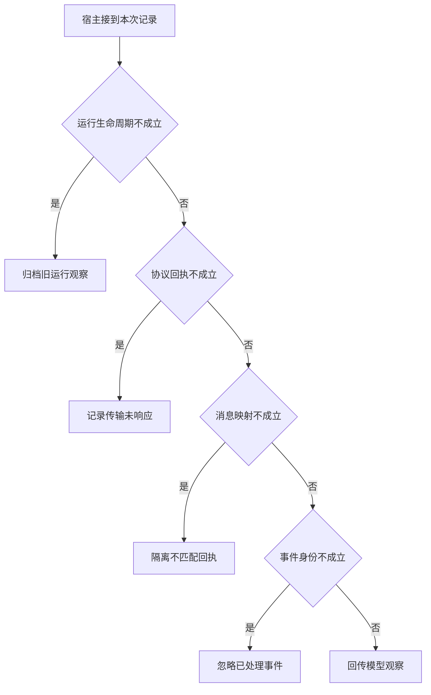

# 把模型调用接回正确的 RPC

同一条传输连接复用多个请求。
端到端 trace 至少要关联用户运行、模型调用、RPC 请求和业务对象。只留地点名不够定位并发串线。

本篇用一个封闭的教学决策器说明这一问题。输入是宿主收到的记录，不保证每个下游字段都已经获准使用。前置检查未成立时，下游即使带着缓存值，也不能拿来作业务断言。

## 先解决一个具体问题

**同一条 stdio 连接在两个会话复用，会混淆什么？**

连接只标识传输通道。
应把每次请求 ID、模型 call ID 与应用执行 ID 映射起来，业务地点 ID 则用于核对事实。
三者不能互当身份令牌。


先取一个能走到「回传模型观察」的输入：本轮尚在处理、收到完整的协议响应、回执属于待处理调用、本事件首次出现。
把这四个条件代回后文的图，前面各个拦截分支都未满足，最终才有“有效响应已正确关联且首次处理”这个判断。
还原这个现场时要分别问：哪些位来自可信状态，哪些只是在接口中出现、尚未获得解释资格的字段。

## 先沿一次决策走到底



从上到下取第一条成立的出口。只改一个开关时，只有它之前的检查都未截断，该变化才可能到达真实动作。

“运行生命周期”的两种输入分别是“本轮尚在处理”与“本轮已经终止”。
过期回执可归档，不能悄悄覆盖已交付的终态。

“协议回执”的两种输入分别是“收到完整的协议响应”与“时限内未见有效协议回执”。
本地未收到回应不能排除远端已执行。

“消息映射”的两种输入分别是“回执属于待处理调用”与“无法对应本次调用”。
仅凭返回顺序归并可能将另一请求的观察放进历史。

“事件身份”的两种输入分别是“本事件首次出现”与“该事件已经处理”。
重复投递与模型再次请求同一参数要分别处理。

## 最少需要哪几项观察

### 归档旧运行观察

不可把晚到结果推给新对话。
在本节的全部组合中，有 8 种产生「归档旧运行观察」，这只是逻辑空间的计数，不能当作实际用户请求的比例。

只取得本轮已经终止，已经足以要求宿主「归档旧运行观察」。
保持这些已知项，其余开关自由变化，仍有 8 种补全，判断没有翻转。

若删掉关于运行生命周期的证据，另一份允许的现场是本轮尚在处理、时限内未见有效协议回执、无法对应本次调用、该事件已经处理，它会使宿主「记录传输未响应」。

### 记录传输未响应

没有完整协议帧。
在本节的全部组合中，有 4 种产生「记录传输未响应」，这只是逻辑空间的计数，不能当作实际用户请求的比例。

只取得本轮尚在处理、时限内未见有效协议回执，已经足以要求宿主「记录传输未响应」。
保持这些已知项，其余开关自由变化，仍有 4 种补全，判断没有翻转。

若删掉关于运行生命周期的证据，另一份允许的现场是本轮已经终止、时限内未见有效协议回执、无法对应本次调用、该事件已经处理，它会使宿主「归档旧运行观察」。

若删掉关于协议回执的证据，另一份允许的现场是本轮尚在处理、收到完整的协议响应、无法对应本次调用、该事件已经处理，它会使宿主「隔离不匹配回执」。

### 隔离不匹配回执

传输回应不属于本轮模型调用。
在本节的全部组合中，有 2 种产生「隔离不匹配回执」，这只是逻辑空间的计数，不能当作实际用户请求的比例。

只取得本轮尚在处理、收到完整的协议响应、无法对应本次调用，已经足以要求宿主「隔离不匹配回执」。
保持这些已知项，其余开关自由变化，仍有 2 种补全，判断没有翻转。

若删掉关于运行生命周期的证据，另一份允许的现场是本轮已经终止、收到完整的协议响应、无法对应本次调用、该事件已经处理，它会使宿主「归档旧运行观察」。

若删掉关于协议回执的证据，另一份允许的现场是本轮尚在处理、时限内未见有效协议回执、无法对应本次调用、该事件已经处理，它会使宿主「记录传输未响应」。

若删掉关于消息映射的证据，另一份允许的现场是本轮尚在处理、收到完整的协议响应、回执属于待处理调用、该事件已经处理，它会使宿主「忽略已处理事件」。

### 忽略已处理事件

去除同一回执的重复投递。
在本节的全部组合中，有 1 种产生「忽略已处理事件」，这只是逻辑空间的计数，不能当作实际用户请求的比例。

只取得本轮尚在处理、收到完整的协议响应、回执属于待处理调用、该事件已经处理，已经足以要求宿主「忽略已处理事件」。
保持这些已知项，其余开关自由变化，仍有 1 种补全，判断没有翻转。

若删掉关于运行生命周期的证据，另一份允许的现场是本轮已经终止、收到完整的协议响应、回执属于待处理调用、该事件已经处理，它会使宿主「归档旧运行观察」。

若删掉关于协议回执的证据，另一份允许的现场是本轮尚在处理、时限内未见有效协议回执、回执属于待处理调用、该事件已经处理，它会使宿主「记录传输未响应」。

若删掉关于消息映射的证据，另一份允许的现场是本轮尚在处理、收到完整的协议响应、无法对应本次调用、该事件已经处理，它会使宿主「隔离不匹配回执」。

若删掉关于事件身份的证据，另一份允许的现场是本轮尚在处理、收到完整的协议响应、回执属于待处理调用、本事件首次出现，它会使宿主「回传模型观察」。

### 回传模型观察

有效响应已正确关联且首次处理。
在本节的全部组合中，有 1 种产生「回传模型观察」，这只是逻辑空间的计数，不能当作实际用户请求的比例。

只取得本轮尚在处理、收到完整的协议响应、回执属于待处理调用、本事件首次出现，已经足以要求宿主「回传模型观察」。

若删掉关于运行生命周期的证据，另一份允许的现场是本轮已经终止、收到完整的协议响应、回执属于待处理调用、本事件首次出现，它会使宿主「归档旧运行观察」。

若删掉关于协议回执的证据，另一份允许的现场是本轮尚在处理、时限内未见有效协议回执、回执属于待处理调用、本事件首次出现，它会使宿主「记录传输未响应」。

若删掉关于消息映射的证据，另一份允许的现场是本轮尚在处理、收到完整的协议响应、无法对应本次调用、本事件首次出现，它会使宿主「隔离不匹配回执」。

若删掉关于事件身份的证据，另一份允许的现场是本轮尚在处理、收到完整的协议响应、回执属于待处理调用、该事件已经处理，它会使宿主「忽略已处理事件」。

## 以同一份契约解释截然不同的现场

<details>
<summary>展开推演与对应反例</summary>

下列样本按最先命中的业务分支排列。四位编码只作本篇页内定位，顺序与开头的四项输入一致。可以先猜下一动作，再展开相邻样本。

### 能够触发“归档旧运行观察”的现场

**样本 0000**

业务侧交来本轮已经终止、时限内未见有效协议回执，执行侧还记录了无法对应本次调用、该事件已经处理。
把样本压成最短证明，保留本轮已经终止就能支持「归档旧运行观察」。

在这份记录上，分别翻转「运行生命周期」中的任一项，其他项完全不变时，下一动作都会改变。

保持其余观察不动，单独切换「协议回执」、「消息映射」、「事件身份」仍得到「归档旧运行观察」，它们在这个现场不是决定性变量。

要从本例改走「记录传输未响应」，至少需要变动 1 项，一组最少改动是将本轮已经终止换成本轮尚在处理。

要从本例改走「隔离不匹配回执」，至少需要变动 2 项，一组最少改动是将本轮已经终止、时限内未见有效协议回执换成本轮尚在处理、收到完整的协议响应。

要从本例改走「忽略已处理事件」，至少需要变动 3 项，一组最少改动是将本轮已经终止、时限内未见有效协议回执、无法对应本次调用换成本轮尚在处理、收到完整的协议响应、回执属于待处理调用。

要从本例改走「回传模型观察」，至少需要变动 4 项，一组最少改动是将本轮已经终止、时限内未见有效协议回执、无法对应本次调用、该事件已经处理换成本轮尚在处理、收到完整的协议响应、回执属于待处理调用、本事件首次出现。

**样本 0001**

业务侧交来本轮已经终止、时限内未见有效协议回执，执行侧还记录了无法对应本次调用、本事件首次出现。


要从本例改走「回传模型观察」，至少需要变动 3 项，一组最少改动是将本轮已经终止、时限内未见有效协议回执、无法对应本次调用换成本轮尚在处理、收到完整的协议响应、回执属于待处理调用。

要从本例改走「忽略已处理事件」，至少需要变动 4 项，一组最少改动是将本轮已经终止、时限内未见有效协议回执、无法对应本次调用、本事件首次出现换成本轮尚在处理、收到完整的协议响应、回执属于待处理调用、该事件已经处理。

**样本 0010**

业务侧交来本轮已经终止、时限内未见有效协议回执，执行侧还记录了回执属于待处理调用、该事件已经处理。


要从本例改走「忽略已处理事件」，至少需要变动 2 项，一组最少改动是将本轮已经终止、时限内未见有效协议回执换成本轮尚在处理、收到完整的协议响应。

要从本例改走「隔离不匹配回执」，至少需要变动 3 项，一组最少改动是将本轮已经终止、时限内未见有效协议回执、回执属于待处理调用换成本轮尚在处理、收到完整的协议响应、无法对应本次调用。

要从本例改走「回传模型观察」，至少需要变动 3 项，一组最少改动是将本轮已经终止、时限内未见有效协议回执、该事件已经处理换成本轮尚在处理、收到完整的协议响应、本事件首次出现。

**样本 0011**

业务侧交来本轮已经终止、时限内未见有效协议回执，执行侧还记录了回执属于待处理调用、本事件首次出现。


要从本例改走「回传模型观察」，至少需要变动 2 项，一组最少改动是将本轮已经终止、时限内未见有效协议回执换成本轮尚在处理、收到完整的协议响应。


要从本例改走「忽略已处理事件」，至少需要变动 3 项，一组最少改动是将本轮已经终止、时限内未见有效协议回执、本事件首次出现换成本轮尚在处理、收到完整的协议响应、该事件已经处理。

**样本 0100**

业务侧交来本轮已经终止、收到完整的协议响应，执行侧还记录了无法对应本次调用、该事件已经处理。


要从本例改走「隔离不匹配回执」，至少需要变动 1 项，一组最少改动是将本轮已经终止换成本轮尚在处理。

要从本例改走「记录传输未响应」，至少需要变动 2 项，一组最少改动是将本轮已经终止、收到完整的协议响应换成本轮尚在处理、时限内未见有效协议回执。

要从本例改走「忽略已处理事件」，至少需要变动 2 项，一组最少改动是将本轮已经终止、无法对应本次调用换成本轮尚在处理、回执属于待处理调用。

要从本例改走「回传模型观察」，至少需要变动 3 项，一组最少改动是将本轮已经终止、无法对应本次调用、该事件已经处理换成本轮尚在处理、回执属于待处理调用、本事件首次出现。

**样本 0101**

业务侧交来本轮已经终止、收到完整的协议响应，执行侧还记录了无法对应本次调用、本事件首次出现。


要从本例改走「回传模型观察」，至少需要变动 2 项，一组最少改动是将本轮已经终止、无法对应本次调用换成本轮尚在处理、回执属于待处理调用。

要从本例改走「忽略已处理事件」，至少需要变动 3 项，一组最少改动是将本轮已经终止、无法对应本次调用、本事件首次出现换成本轮尚在处理、回执属于待处理调用、该事件已经处理。

**样本 0110**

业务侧交来本轮已经终止、收到完整的协议响应，执行侧还记录了回执属于待处理调用、该事件已经处理。


要从本例改走「忽略已处理事件」，至少需要变动 1 项，一组最少改动是将本轮已经终止换成本轮尚在处理。


要从本例改走「隔离不匹配回执」，至少需要变动 2 项，一组最少改动是将本轮已经终止、回执属于待处理调用换成本轮尚在处理、无法对应本次调用。

要从本例改走「回传模型观察」，至少需要变动 2 项，一组最少改动是将本轮已经终止、该事件已经处理换成本轮尚在处理、本事件首次出现。

**样本 0111**

业务侧交来本轮已经终止、收到完整的协议响应，执行侧还记录了回执属于待处理调用、本事件首次出现。


要从本例改走「回传模型观察」，至少需要变动 1 项，一组最少改动是将本轮已经终止换成本轮尚在处理。


要从本例改走「忽略已处理事件」，至少需要变动 2 项，一组最少改动是将本轮已经终止、本事件首次出现换成本轮尚在处理、该事件已经处理。

### 能够触发“记录传输未响应”的现场

**样本 1000**

业务侧交来本轮尚在处理、时限内未见有效协议回执，执行侧还记录了无法对应本次调用、该事件已经处理。
把样本压成最短证明，保留本轮尚在处理、时限内未见有效协议回执就能支持「记录传输未响应」。

在这份记录上，分别翻转「运行生命周期」、「协议回执」中的任一项，其他项完全不变时，下一动作都会改变。

保持其余观察不动，单独切换「消息映射」、「事件身份」仍得到「记录传输未响应」，它们在这个现场不是决定性变量。

本例没走更靠前的「归档旧运行观察」，因为本轮尚在处理与那个入口的必要条件不符。

要从本例改走「归档旧运行观察」，至少需要变动 1 项，一组最少改动是将本轮尚在处理换成本轮已经终止。

要从本例改走「隔离不匹配回执」，至少需要变动 1 项，一组最少改动是将时限内未见有效协议回执换成收到完整的协议响应。

要从本例改走「忽略已处理事件」，至少需要变动 2 项，一组最少改动是将时限内未见有效协议回执、无法对应本次调用换成收到完整的协议响应、回执属于待处理调用。

要从本例改走「回传模型观察」，至少需要变动 3 项，一组最少改动是将时限内未见有效协议回执、无法对应本次调用、该事件已经处理换成收到完整的协议响应、回执属于待处理调用、本事件首次出现。

**样本 1001**

业务侧交来本轮尚在处理、时限内未见有效协议回执，执行侧还记录了无法对应本次调用、本事件首次出现。


要从本例改走「回传模型观察」，至少需要变动 2 项，一组最少改动是将时限内未见有效协议回执、无法对应本次调用换成收到完整的协议响应、回执属于待处理调用。

要从本例改走「忽略已处理事件」，至少需要变动 3 项，一组最少改动是将时限内未见有效协议回执、无法对应本次调用、本事件首次出现换成收到完整的协议响应、回执属于待处理调用、该事件已经处理。

**样本 1010**

业务侧交来本轮尚在处理、时限内未见有效协议回执，执行侧还记录了回执属于待处理调用、该事件已经处理。


要从本例改走「忽略已处理事件」，至少需要变动 1 项，一组最少改动是将时限内未见有效协议回执换成收到完整的协议响应。

要从本例改走「隔离不匹配回执」，至少需要变动 2 项，一组最少改动是将时限内未见有效协议回执、回执属于待处理调用换成收到完整的协议响应、无法对应本次调用。

要从本例改走「回传模型观察」，至少需要变动 2 项，一组最少改动是将时限内未见有效协议回执、该事件已经处理换成收到完整的协议响应、本事件首次出现。

**样本 1011**

业务侧交来本轮尚在处理、时限内未见有效协议回执，执行侧还记录了回执属于待处理调用、本事件首次出现。


要从本例改走「回传模型观察」，至少需要变动 1 项，一组最少改动是将时限内未见有效协议回执换成收到完整的协议响应。


要从本例改走「忽略已处理事件」，至少需要变动 2 项，一组最少改动是将时限内未见有效协议回执、本事件首次出现换成收到完整的协议响应、该事件已经处理。

### 能够触发“隔离不匹配回执”的现场

**样本 1100**

业务侧交来本轮尚在处理、收到完整的协议响应，执行侧还记录了无法对应本次调用、该事件已经处理。
把样本压成最短证明，保留本轮尚在处理、收到完整的协议响应、无法对应本次调用就能支持「隔离不匹配回执」。

在这份记录上，分别翻转「运行生命周期」、「协议回执」、「消息映射」中的任一项，其他项完全不变时，下一动作都会改变。

保持其余观察不动，单独切换「事件身份」仍得到「隔离不匹配回执」，它们在这个现场不是决定性变量。


本例没走更靠前的「记录传输未响应」，因为收到完整的协议响应与那个入口的必要条件不符。


要从本例改走「记录传输未响应」，至少需要变动 1 项，一组最少改动是将收到完整的协议响应换成时限内未见有效协议回执。

要从本例改走「忽略已处理事件」，至少需要变动 1 项，一组最少改动是将无法对应本次调用换成回执属于待处理调用。

要从本例改走「回传模型观察」，至少需要变动 2 项，一组最少改动是将无法对应本次调用、该事件已经处理换成回执属于待处理调用、本事件首次出现。

**样本 1101**

业务侧交来本轮尚在处理、收到完整的协议响应，执行侧还记录了无法对应本次调用、本事件首次出现。


要从本例改走「回传模型观察」，至少需要变动 1 项，一组最少改动是将无法对应本次调用换成回执属于待处理调用。

要从本例改走「忽略已处理事件」，至少需要变动 2 项，一组最少改动是将无法对应本次调用、本事件首次出现换成回执属于待处理调用、该事件已经处理。

### 能够触发“忽略已处理事件”的现场

**样本 1110**

业务侧交来本轮尚在处理、收到完整的协议响应，执行侧还记录了回执属于待处理调用、该事件已经处理。
把样本压成最短证明，保留本轮尚在处理、收到完整的协议响应、回执属于待处理调用、该事件已经处理就能支持「忽略已处理事件」。

在这份记录上，分别翻转「运行生命周期」、「协议回执」、「消息映射」、「事件身份」中的任一项，其他项完全不变时，下一动作都会改变。


本例没走更靠前的「隔离不匹配回执」，因为回执属于待处理调用与那个入口的必要条件不符。


要从本例改走「隔离不匹配回执」，至少需要变动 1 项，一组最少改动是将回执属于待处理调用换成无法对应本次调用。

要从本例改走「回传模型观察」，至少需要变动 1 项，一组最少改动是将该事件已经处理换成本事件首次出现。

### 能够触发“回传模型观察”的现场

**样本 1111**

业务侧交来本轮尚在处理、收到完整的协议响应，执行侧还记录了回执属于待处理调用、本事件首次出现。
把样本压成最短证明，保留本轮尚在处理、收到完整的协议响应、回执属于待处理调用、本事件首次出现就能支持「回传模型观察」。


本例没走更靠前的「忽略已处理事件」，因为本事件首次出现与那个入口的必要条件不符。


要从本例改走「忽略已处理事件」，至少需要变动 1 项，一组最少改动是将本事件首次出现换成该事件已经处理。

</details>

## 当你只能看见一半记录

<details>
<summary>展开推演与对应反例</summary>

这次隐藏两个字段，保留另两个。对每个可见现场，检查四种合法补全是否同意。如仍有歧义，选择能使最坏剩余候选动作最少的字段继续查。并列时采用本篇字段顺序。

### 只保留运行生命周期与协议回执

已知本轮已经终止、时限内未见有效协议回执时，四种补全的动作分布为归档旧运行观察（4 种）。

就“归档旧运行观察”这个动作而言，在本轮已经终止、时限内未见有效协议回执的前提下，另外两项观察不会推翻它。

已知本轮已经终止、收到完整的协议响应时，四种补全的动作分布为归档旧运行观察（4 种）。

就“归档旧运行观察”这个动作而言，在本轮已经终止、收到完整的协议响应的前提下，另外两项观察不会推翻它。

已知本轮尚在处理、时限内未见有效协议回执时，四种补全的动作分布为记录传输未响应（4 种）。

就“记录传输未响应”这个动作而言，在本轮尚在处理、时限内未见有效协议回执的前提下，另外两项观察不会推翻它。

已知本轮尚在处理、收到完整的协议响应时，四种补全的动作分布为隔离不匹配回执（2 种）、忽略已处理事件（1 种）、回传模型观察（1 种）。

在本轮尚在处理、收到完整的协议响应这个现场补读「消息映射」，最坏还剩 2 种动作，计算时只衡量歧义，尚未扣读取代价。
若补来的观察为“无法对应本次调用”，范围缩成「隔离不匹配回执」。若为“回执属于待处理调用”，则保留「忽略已处理事件」、「回传模型观察」。

区分不了的两条执行可以具体写成 1100 与 1110：它们共享已展示字段，却分别需要「隔离不匹配回执」和「忽略已处理事件」。

### 只保留运行生命周期与消息映射

已知本轮已经终止、无法对应本次调用时，四种补全的动作分布为归档旧运行观察（4 种）。

就“归档旧运行观察”这个动作而言，在本轮已经终止、无法对应本次调用的前提下，另外两项观察不会推翻它。

已知本轮已经终止、回执属于待处理调用时，四种补全的动作分布为归档旧运行观察（4 种）。

就“归档旧运行观察”这个动作而言，在本轮已经终止、回执属于待处理调用的前提下，另外两项观察不会推翻它。

已知本轮尚在处理、无法对应本次调用时，四种补全的动作分布为记录传输未响应（2 种）、隔离不匹配回执（2 种）。

在本轮尚在处理、无法对应本次调用这个现场补读「协议回执」，最坏还剩 1 种动作，计算时只衡量歧义，尚未扣读取代价。
若补来的观察为“时限内未见有效协议回执”，范围缩成「记录传输未响应」。若为“收到完整的协议响应”，则保留「隔离不匹配回执」。

区分不了的两条执行可以具体写成 1000 与 1100：它们共享已展示字段，却分别需要「记录传输未响应」和「隔离不匹配回执」。

已知本轮尚在处理、回执属于待处理调用时，四种补全的动作分布为记录传输未响应（2 种）、忽略已处理事件（1 种）、回传模型观察（1 种）。

在本轮尚在处理、回执属于待处理调用这个现场补读「协议回执」，最坏还剩 2 种动作，计算时只衡量歧义，尚未扣读取代价。
若补来的观察为“时限内未见有效协议回执”，范围缩成「记录传输未响应」。若为“收到完整的协议响应”，则保留「忽略已处理事件」、「回传模型观察」。

区分不了的两条执行可以具体写成 1010 与 1110：它们共享已展示字段，却分别需要「记录传输未响应」和「忽略已处理事件」。

### 只保留协议回执与消息映射

已知时限内未见有效协议回执、无法对应本次调用时，四种补全的动作分布为归档旧运行观察（2 种）、记录传输未响应（2 种）。

在时限内未见有效协议回执、无法对应本次调用这个现场补读「运行生命周期」，最坏还剩 1 种动作，计算时只衡量歧义，尚未扣读取代价。
若补来的观察为“本轮已经终止”，范围缩成「归档旧运行观察」。若为“本轮尚在处理”，则保留「记录传输未响应」。

区分不了的两条执行可以具体写成 0000 与 1000：它们共享已展示字段，却分别需要「归档旧运行观察」和「记录传输未响应」。

已知时限内未见有效协议回执、回执属于待处理调用时，四种补全的动作分布为归档旧运行观察（2 种）、记录传输未响应（2 种）。

在时限内未见有效协议回执、回执属于待处理调用这个现场补读「运行生命周期」，最坏还剩 1 种动作，计算时只衡量歧义，尚未扣读取代价。

区分不了的两条执行可以具体写成 0010 与 1010：它们共享已展示字段，却分别需要「归档旧运行观察」和「记录传输未响应」。

已知收到完整的协议响应、无法对应本次调用时，四种补全的动作分布为归档旧运行观察（2 种）、隔离不匹配回执（2 种）。

在收到完整的协议响应、无法对应本次调用这个现场补读「运行生命周期」，最坏还剩 1 种动作，计算时只衡量歧义，尚未扣读取代价。
若补来的观察为“本轮已经终止”，范围缩成「归档旧运行观察」。若为“本轮尚在处理”，则保留「隔离不匹配回执」。

区分不了的两条执行可以具体写成 0100 与 1100：它们共享已展示字段，却分别需要「归档旧运行观察」和「隔离不匹配回执」。

已知收到完整的协议响应、回执属于待处理调用时，四种补全的动作分布为归档旧运行观察（2 种）、忽略已处理事件（1 种）、回传模型观察（1 种）。

在收到完整的协议响应、回执属于待处理调用这个现场补读「运行生命周期」，最坏还剩 2 种动作，计算时只衡量歧义，尚未扣读取代价。
若补来的观察为“本轮已经终止”，范围缩成「归档旧运行观察」。若为“本轮尚在处理”，则保留「忽略已处理事件」、「回传模型观察」。

区分不了的两条执行可以具体写成 0110 与 1110：它们共享已展示字段，却分别需要「归档旧运行观察」和「忽略已处理事件」。

### 只保留运行生命周期与事件身份

已知本轮已经终止、该事件已经处理时，四种补全的动作分布为归档旧运行观察（4 种）。

就“归档旧运行观察”这个动作而言，在本轮已经终止、该事件已经处理的前提下，另外两项观察不会推翻它。

已知本轮已经终止、本事件首次出现时，四种补全的动作分布为归档旧运行观察（4 种）。

就“归档旧运行观察”这个动作而言，在本轮已经终止、本事件首次出现的前提下，另外两项观察不会推翻它。

已知本轮尚在处理、该事件已经处理时，四种补全的动作分布为记录传输未响应（2 种）、隔离不匹配回执（1 种）、忽略已处理事件（1 种）。

在本轮尚在处理、该事件已经处理这个现场补读「协议回执」，最坏还剩 2 种动作，计算时只衡量歧义，尚未扣读取代价。
若补来的观察为“时限内未见有效协议回执”，范围缩成「记录传输未响应」。若为“收到完整的协议响应”，则保留「隔离不匹配回执」、「忽略已处理事件」。


已知本轮尚在处理、本事件首次出现时，四种补全的动作分布为记录传输未响应（2 种）、隔离不匹配回执（1 种）、回传模型观察（1 种）。

在本轮尚在处理、本事件首次出现这个现场补读「协议回执」，最坏还剩 2 种动作，计算时只衡量歧义，尚未扣读取代价。
若补来的观察为“时限内未见有效协议回执”，范围缩成「记录传输未响应」。若为“收到完整的协议响应”，则保留「隔离不匹配回执」、「回传模型观察」。

区分不了的两条执行可以具体写成 1001 与 1101：它们共享已展示字段，却分别需要「记录传输未响应」和「隔离不匹配回执」。

### 只保留协议回执与事件身份

已知时限内未见有效协议回执、该事件已经处理时，四种补全的动作分布为归档旧运行观察（2 种）、记录传输未响应（2 种）。

在时限内未见有效协议回执、该事件已经处理这个现场补读「运行生命周期」，最坏还剩 1 种动作，计算时只衡量歧义，尚未扣读取代价。


已知时限内未见有效协议回执、本事件首次出现时，四种补全的动作分布为归档旧运行观察（2 种）、记录传输未响应（2 种）。

在时限内未见有效协议回执、本事件首次出现这个现场补读「运行生命周期」，最坏还剩 1 种动作，计算时只衡量歧义，尚未扣读取代价。

区分不了的两条执行可以具体写成 0001 与 1001：它们共享已展示字段，却分别需要「归档旧运行观察」和「记录传输未响应」。

已知收到完整的协议响应、该事件已经处理时，四种补全的动作分布为归档旧运行观察（2 种）、隔离不匹配回执（1 种）、忽略已处理事件（1 种）。

在收到完整的协议响应、该事件已经处理这个现场补读「运行生命周期」，最坏还剩 2 种动作，计算时只衡量歧义，尚未扣读取代价。
若补来的观察为“本轮已经终止”，范围缩成「归档旧运行观察」。若为“本轮尚在处理”，则保留「隔离不匹配回执」、「忽略已处理事件」。


已知收到完整的协议响应、本事件首次出现时，四种补全的动作分布为归档旧运行观察（2 种）、隔离不匹配回执（1 种）、回传模型观察（1 种）。

在收到完整的协议响应、本事件首次出现这个现场补读「运行生命周期」，最坏还剩 2 种动作，计算时只衡量歧义，尚未扣读取代价。
若补来的观察为“本轮已经终止”，范围缩成「归档旧运行观察」。若为“本轮尚在处理”，则保留「隔离不匹配回执」、「回传模型观察」。

区分不了的两条执行可以具体写成 0101 与 1101：它们共享已展示字段，却分别需要「归档旧运行观察」和「隔离不匹配回执」。

### 只保留消息映射与事件身份

已知无法对应本次调用、该事件已经处理时，四种补全的动作分布为归档旧运行观察（2 种）、记录传输未响应（1 种）、隔离不匹配回执（1 种）。

在无法对应本次调用、该事件已经处理这个现场补读「运行生命周期」，最坏还剩 2 种动作，计算时只衡量歧义，尚未扣读取代价。
若补来的观察为“本轮已经终止”，范围缩成「归档旧运行观察」。若为“本轮尚在处理”，则保留「记录传输未响应」、「隔离不匹配回执」。


已知无法对应本次调用、本事件首次出现时，四种补全的动作分布为归档旧运行观察（2 种）、记录传输未响应（1 种）、隔离不匹配回执（1 种）。

在无法对应本次调用、本事件首次出现这个现场补读「运行生命周期」，最坏还剩 2 种动作，计算时只衡量歧义，尚未扣读取代价。


已知回执属于待处理调用、该事件已经处理时，四种补全的动作分布为归档旧运行观察（2 种）、记录传输未响应（1 种）、忽略已处理事件（1 种）。

在回执属于待处理调用、该事件已经处理这个现场补读「运行生命周期」，最坏还剩 2 种动作，计算时只衡量歧义，尚未扣读取代价。
若补来的观察为“本轮已经终止”，范围缩成「归档旧运行观察」。若为“本轮尚在处理”，则保留「记录传输未响应」、「忽略已处理事件」。


已知回执属于待处理调用、本事件首次出现时，四种补全的动作分布为归档旧运行观察（2 种）、记录传输未响应（1 种）、回传模型观察（1 种）。

在回执属于待处理调用、本事件首次出现这个现场补读「运行生命周期」，最坏还剩 2 种动作，计算时只衡量歧义，尚未扣读取代价。
若补来的观察为“本轮已经终止”，范围缩成「归档旧运行观察」。若为“本轮尚在处理”，则保留「记录传输未响应」、「回传模型观察」。

区分不了的两条执行可以具体写成 0011 与 1011：它们共享已展示字段，却分别需要「归档旧运行观察」和「记录传输未响应」。

</details>

## 单因素干预与边界测试

<details>
<summary>展开推演与对应反例</summary>

### 只改变运行生命周期

固定另外三个条件得到八对现场，从“本轮已经终止”转为“本轮尚在处理”时，8 对翻转动作，另外 0 对保持不变。

有 4 对现场沿「归档旧运行观察」变到「记录传输未响应」，可复现的一组受控背景为时限内未见有效协议回执、无法对应本次调用、该事件已经处理。

有 2 对现场沿「归档旧运行观察」变到「隔离不匹配回执」，可复现的一组受控背景为收到完整的协议响应、无法对应本次调用、该事件已经处理。

有 1 对现场沿「归档旧运行观察」变到「忽略已处理事件」，可复现的一组受控背景为收到完整的协议响应、回执属于待处理调用、该事件已经处理。

有 1 对现场沿「归档旧运行观察」变到「回传模型观察」，可复现的一组受控背景为收到完整的协议响应、回执属于待处理调用、本事件首次出现。

### 只改变协议回执

固定另外三个条件得到八对现场，从“时限内未见有效协议回执”转为“收到完整的协议响应”时，4 对翻转动作，另外 4 对保持不变。

令本轮已经终止、无法对应本次调用、该事件已经处理，协议回执的两个取值均得到「归档旧运行观察」。在八对中，共有 4 对表现为这一种稳定出口。

有 2 对现场沿「记录传输未响应」变到「隔离不匹配回执」，可复现的一组受控背景为本轮尚在处理、无法对应本次调用、该事件已经处理。

有 1 对现场沿「记录传输未响应」变到「忽略已处理事件」，可复现的一组受控背景为本轮尚在处理、回执属于待处理调用、该事件已经处理。

有 1 对现场沿「记录传输未响应」变到「回传模型观察」，可复现的一组受控背景为本轮尚在处理、回执属于待处理调用、本事件首次出现。

### 只改变消息映射

固定另外三个条件得到八对现场，从“无法对应本次调用”转为“回执属于待处理调用”时，2 对翻转动作，另外 6 对保持不变。

令本轮已经终止、时限内未见有效协议回执、该事件已经处理，消息映射的两个取值均得到「归档旧运行观察」。在八对中，共有 4 对表现为这一种稳定出口。

令本轮尚在处理、时限内未见有效协议回执、该事件已经处理，消息映射的两个取值均得到「记录传输未响应」。在八对中，共有 2 对表现为这一种稳定出口。

有 1 对现场沿「隔离不匹配回执」变到「忽略已处理事件」，可复现的一组受控背景为本轮尚在处理、收到完整的协议响应、该事件已经处理。

有 1 对现场沿「隔离不匹配回执」变到「回传模型观察」，可复现的一组受控背景为本轮尚在处理、收到完整的协议响应、本事件首次出现。

### 只改变事件身份

固定另外三个条件得到八对现场，从“该事件已经处理”转为“本事件首次出现”时，1 对翻转动作，另外 7 对保持不变。

令本轮已经终止、时限内未见有效协议回执、无法对应本次调用，事件身份的两个取值均得到「归档旧运行观察」。在八对中，共有 4 对表现为这一种稳定出口。

令本轮尚在处理、时限内未见有效协议回执、无法对应本次调用，事件身份的两个取值均得到「记录传输未响应」。在八对中，共有 2 对表现为这一种稳定出口。

令本轮尚在处理、收到完整的协议响应、无法对应本次调用，事件身份的两个取值均得到「隔离不匹配回执」。在八对中，共有 1 对表现为这一种稳定出口。

有 1 对现场沿「忽略已处理事件」变到「回传模型观察」，可复现的一组受控背景为本轮尚在处理、收到完整的协议响应、回执属于待处理调用。

</details>

## 哪些回归样本真能抓住实现错误

<details>
<summary>展开推演与对应反例</summary>

如果删除“归档旧运行观察”这个分支，在本篇 16 种输入里有 8 种会改走另一出口。

反例 0000 的完整记录为本轮已经终止、时限内未见有效协议回执、无法对应本次调用、该事件已经处理。正确结果是「归档旧运行观察」，这个改坏的实现却给出「记录传输未响应」。

如果删除“记录传输未响应”这个分支，在本篇 16 种输入里有 4 种会改走另一出口。

反例 1000 的完整记录为本轮尚在处理、时限内未见有效协议回执、无法对应本次调用、该事件已经处理。正确结果是「记录传输未响应」，这个改坏的实现却给出「隔离不匹配回执」。

如果删除“隔离不匹配回执”这个分支，在本篇 16 种输入里有 2 种会改走另一出口。

反例 1100 的完整记录为本轮尚在处理、收到完整的协议响应、无法对应本次调用、该事件已经处理。正确结果是「隔离不匹配回执」，这个改坏的实现却给出「忽略已处理事件」。

如果删除“忽略已处理事件”这个分支，在本篇 16 种输入里有 1 种会改走另一出口。

反例 1110 的完整记录为本轮尚在处理、收到完整的协议响应、回执属于待处理调用、该事件已经处理。正确结果是「忽略已处理事件」，这个改坏的实现却给出「回传模型观察」。

如果交换“归档旧运行观察”和“记录传输未响应”的判断次序，在本篇 16 种输入里有 4 种会改走另一出口。


如果交换“记录传输未响应”和“隔离不匹配回执”的判断次序，在本篇 16 种输入里有 2 种会改走另一出口。


如果交换“隔离不匹配回执”和“忽略已处理事件”的判断次序，在本篇 16 种输入里有 1 种会改走另一出口。


补入样本 0000（本轮已经终止、时限内未见有效协议回执、无法对应本次调用、该事件已经处理）能新增检出「删除“归档旧运行观察”这个分支」、「交换“归档旧运行观察”和“记录传输未响应”的判断次序」。

补入样本 1000（本轮尚在处理、时限内未见有效协议回执、无法对应本次调用、该事件已经处理）能新增检出「删除“记录传输未响应”这个分支」、「交换“记录传输未响应”和“隔离不匹配回执”的判断次序」。

补入样本 1100（本轮尚在处理、收到完整的协议响应、无法对应本次调用、该事件已经处理）能新增检出「删除“隔离不匹配回执”这个分支」、「交换“隔离不匹配回执”和“忽略已处理事件”的判断次序」。

补入样本 1110（本轮尚在处理、收到完整的协议响应、回执属于待处理调用、该事件已经处理）能新增检出「删除“忽略已处理事件”这个分支」。

这里每次选覆盖尚未捕获缺陷最多的样本，并不保证用例数全局最小。它给出的反例能作为 Java 单测输入。真实模型是否会自主产生这些提议，仍须单独评测。

</details>

## 把状态覆盖换成有抽样偏差的评测批次

<details>
<summary>展开推演与对应反例</summary>

前面的十六种记录各有一票。现在只改样本构成：对一个给定字段，把成立侧的每种记录各取三份、另一侧各取一份。这是人为配比的 32 份回放，不是线上频率估计。
将偏向成立与偏向不成立的两次批次对照，可以隔离分母变化。底层宿主和所有答案保持相同，比例仍可能移动。

### 改变“运行生命周期”的样本配比

只看「归档旧运行观察」，在本轮尚在处理的八个不同输入中有 0 个命中，在本轮已经终止的另八个输入中有 8 个命中。
把「运行生命周期」成立侧按三倍取样，「归档旧运行观察」占 8/32，反过来向未成立侧倾斜后占 24/32。
这次重加权使「归档旧运行观察」的占比相差 50 个百分点。若按两种不同的“运行生命周期”分布跑新旧版，不能把这项差异全部归功于实现。

只看「记录传输未响应」，在本轮尚在处理的八个不同输入中有 4 个命中，在本轮已经终止的另八个输入中有 0 个命中。
把「运行生命周期」成立侧按三倍取样，「记录传输未响应」占 12/32，反过来向未成立侧倾斜后占 4/32。
这次重加权使「记录传输未响应」的占比相差 25 个百分点。若按两种不同的“运行生命周期”分布跑新旧版，不能把这项差异全部归功于实现。

只看「隔离不匹配回执」，在本轮尚在处理的八个不同输入中有 2 个命中，在本轮已经终止的另八个输入中有 0 个命中。
把「运行生命周期」成立侧按三倍取样，「隔离不匹配回执」占 6/32，反过来向未成立侧倾斜后占 2/32。
这次重加权使「隔离不匹配回执」的占比相差 12.5 个百分点。若按两种不同的“运行生命周期”分布跑新旧版，不能把这项差异全部归功于实现。

只看「忽略已处理事件」，在本轮尚在处理的八个不同输入中有 1 个命中，在本轮已经终止的另八个输入中有 0 个命中。
把「运行生命周期」成立侧按三倍取样，「忽略已处理事件」占 3/32，反过来向未成立侧倾斜后占 1/32。
这次重加权使「忽略已处理事件」的占比相差 6.25 个百分点。若按两种不同的“运行生命周期”分布跑新旧版，不能把这项差异全部归功于实现。

只看「回传模型观察」，在本轮尚在处理的八个不同输入中有 1 个命中，在本轮已经终止的另八个输入中有 0 个命中。
把「运行生命周期」成立侧按三倍取样，「回传模型观察」占 3/32，反过来向未成立侧倾斜后占 1/32。
这次重加权使「回传模型观察」的占比相差 6.25 个百分点。若按两种不同的“运行生命周期”分布跑新旧版，不能把这项差异全部归功于实现。

### 改变“协议回执”的样本配比

只看「归档旧运行观察」，在收到完整的协议响应的八个不同输入中有 4 个命中，在时限内未见有效协议回执的另八个输入中有 4 个命中。
把「协议回执」成立侧按三倍取样，「归档旧运行观察」占 16/32，反过来向未成立侧倾斜后占 16/32。
两批「归档旧运行观察」的边际比例相同，是因为这个出口在“协议回执”的两侧计数相等，这不能单独证明每一对现场都不受它影响。

只看「记录传输未响应」，在收到完整的协议响应的八个不同输入中有 0 个命中，在时限内未见有效协议回执的另八个输入中有 4 个命中。
把「协议回执」成立侧按三倍取样，「记录传输未响应」占 4/32，反过来向未成立侧倾斜后占 12/32。
这次重加权使「记录传输未响应」的占比相差 25 个百分点。若按两种不同的“协议回执”分布跑新旧版，不能把这项差异全部归功于实现。

只看「隔离不匹配回执」，在收到完整的协议响应的八个不同输入中有 2 个命中，在时限内未见有效协议回执的另八个输入中有 0 个命中。
把「协议回执」成立侧按三倍取样，「隔离不匹配回执」占 6/32，反过来向未成立侧倾斜后占 2/32。
这次重加权使「隔离不匹配回执」的占比相差 12.5 个百分点。若按两种不同的“协议回执”分布跑新旧版，不能把这项差异全部归功于实现。

只看「忽略已处理事件」，在收到完整的协议响应的八个不同输入中有 1 个命中，在时限内未见有效协议回执的另八个输入中有 0 个命中。
把「协议回执」成立侧按三倍取样，「忽略已处理事件」占 3/32，反过来向未成立侧倾斜后占 1/32。
这次重加权使「忽略已处理事件」的占比相差 6.25 个百分点。若按两种不同的“协议回执”分布跑新旧版，不能把这项差异全部归功于实现。

只看「回传模型观察」，在收到完整的协议响应的八个不同输入中有 1 个命中，在时限内未见有效协议回执的另八个输入中有 0 个命中。
把「协议回执」成立侧按三倍取样，「回传模型观察」占 3/32，反过来向未成立侧倾斜后占 1/32。
这次重加权使「回传模型观察」的占比相差 6.25 个百分点。若按两种不同的“协议回执”分布跑新旧版，不能把这项差异全部归功于实现。

### 改变“消息映射”的样本配比

只看「归档旧运行观察」，在回执属于待处理调用的八个不同输入中有 4 个命中，在无法对应本次调用的另八个输入中有 4 个命中。
把「消息映射」成立侧按三倍取样，「归档旧运行观察」占 16/32，反过来向未成立侧倾斜后占 16/32。
两批「归档旧运行观察」的边际比例相同，是因为这个出口在“消息映射”的两侧计数相等，这不能单独证明每一对现场都不受它影响。

只看「记录传输未响应」，在回执属于待处理调用的八个不同输入中有 2 个命中，在无法对应本次调用的另八个输入中有 2 个命中。
把「消息映射」成立侧按三倍取样，「记录传输未响应」占 8/32，反过来向未成立侧倾斜后占 8/32。
两批「记录传输未响应」的边际比例相同，是因为这个出口在“消息映射”的两侧计数相等，这不能单独证明每一对现场都不受它影响。

只看「隔离不匹配回执」，在回执属于待处理调用的八个不同输入中有 0 个命中，在无法对应本次调用的另八个输入中有 2 个命中。
把「消息映射」成立侧按三倍取样，「隔离不匹配回执」占 2/32，反过来向未成立侧倾斜后占 6/32。
这次重加权使「隔离不匹配回执」的占比相差 12.5 个百分点。若按两种不同的“消息映射”分布跑新旧版，不能把这项差异全部归功于实现。

只看「忽略已处理事件」，在回执属于待处理调用的八个不同输入中有 1 个命中，在无法对应本次调用的另八个输入中有 0 个命中。
把「消息映射」成立侧按三倍取样，「忽略已处理事件」占 3/32，反过来向未成立侧倾斜后占 1/32。
这次重加权使「忽略已处理事件」的占比相差 6.25 个百分点。若按两种不同的“消息映射”分布跑新旧版，不能把这项差异全部归功于实现。

只看「回传模型观察」，在回执属于待处理调用的八个不同输入中有 1 个命中，在无法对应本次调用的另八个输入中有 0 个命中。
把「消息映射」成立侧按三倍取样，「回传模型观察」占 3/32，反过来向未成立侧倾斜后占 1/32。
这次重加权使「回传模型观察」的占比相差 6.25 个百分点。若按两种不同的“消息映射”分布跑新旧版，不能把这项差异全部归功于实现。

### 改变“事件身份”的样本配比

只看「归档旧运行观察」，在本事件首次出现的八个不同输入中有 4 个命中，在该事件已经处理的另八个输入中有 4 个命中。
把「事件身份」成立侧按三倍取样，「归档旧运行观察」占 16/32，反过来向未成立侧倾斜后占 16/32。
两批「归档旧运行观察」的边际比例相同，是因为这个出口在“事件身份”的两侧计数相等，这不能单独证明每一对现场都不受它影响。

只看「记录传输未响应」，在本事件首次出现的八个不同输入中有 2 个命中，在该事件已经处理的另八个输入中有 2 个命中。
把「事件身份」成立侧按三倍取样，「记录传输未响应」占 8/32，反过来向未成立侧倾斜后占 8/32。
两批「记录传输未响应」的边际比例相同，是因为这个出口在“事件身份”的两侧计数相等，这不能单独证明每一对现场都不受它影响。

只看「隔离不匹配回执」，在本事件首次出现的八个不同输入中有 1 个命中，在该事件已经处理的另八个输入中有 1 个命中。
把「事件身份」成立侧按三倍取样，「隔离不匹配回执」占 4/32，反过来向未成立侧倾斜后占 4/32。
两批「隔离不匹配回执」的边际比例相同，是因为这个出口在“事件身份”的两侧计数相等，这不能单独证明每一对现场都不受它影响。

只看「忽略已处理事件」，在本事件首次出现的八个不同输入中有 0 个命中，在该事件已经处理的另八个输入中有 1 个命中。
把「事件身份」成立侧按三倍取样，「忽略已处理事件」占 1/32，反过来向未成立侧倾斜后占 3/32。
这次重加权使「忽略已处理事件」的占比相差 6.25 个百分点。若按两种不同的“事件身份”分布跑新旧版，不能把这项差异全部归功于实现。

只看「回传模型观察」，在本事件首次出现的八个不同输入中有 1 个命中，在该事件已经处理的另八个输入中有 0 个命中。
把「事件身份」成立侧按三倍取样，「回传模型观察」占 3/32，反过来向未成立侧倾斜后占 1/32。
这次重加权使「回传模型观察」的占比相差 6.25 个百分点。若按两种不同的“事件身份”分布跑新旧版，不能把这项差异全部归功于实现。

</details>

## 只看终态，能逆推出多少原始事实

<details>
<summary>展开推演与对应反例</summary>

### 只保留“归档旧运行观察”这条结果时

在本节契约与完整输入域内，仅知「归档旧运行观察」就能倒推出本轮已经终止，这一推断依赖版本未变且日志中的终态可信。

「归档旧运行观察」不能证明协议回执取哪一侧：0000 和 0100 有相同终态，却分别记为“时限内未见有效协议回执”和“收到完整的协议响应”。

「归档旧运行观察」不能证明消息映射取哪一侧：0000 和 0010 有相同终态，却分别记为“无法对应本次调用”和“回执属于待处理调用”。

「归档旧运行观察」不能证明事件身份取哪一侧：0000 和 0001 有相同终态，却分别记为“该事件已经处理”和“本事件首次出现”。

反查「归档旧运行观察」的诊断日志，优先保留能区分样本 0000 与 1000 的「运行生命周期」，否则很容易把邻近的「记录传输未响应」看成同一种故障。

### 只保留“记录传输未响应”这条结果时

在本节契约与完整输入域内，仅知「记录传输未响应」就能倒推出本轮尚在处理，这一推断依赖版本未变且日志中的终态可信。

在本节契约与完整输入域内，仅知「记录传输未响应」就能倒推出时限内未见有效协议回执，这一推断依赖版本未变且日志中的终态可信。

「记录传输未响应」不能证明消息映射取哪一侧：1000 和 1010 有相同终态，却分别记为“无法对应本次调用”和“回执属于待处理调用”。

「记录传输未响应」不能证明事件身份取哪一侧：1000 和 1001 有相同终态，却分别记为“该事件已经处理”和“本事件首次出现”。

反查「记录传输未响应」的诊断日志，优先保留能区分样本 1000 与 0000 的「运行生命周期」，否则很容易把邻近的「归档旧运行观察」看成同一种故障。

### 只保留“隔离不匹配回执”这条结果时

在本节契约与完整输入域内，仅知「隔离不匹配回执」就能倒推出本轮尚在处理，这一推断依赖版本未变且日志中的终态可信。

在本节契约与完整输入域内，仅知「隔离不匹配回执」就能倒推出收到完整的协议响应，这一推断依赖版本未变且日志中的终态可信。

在本节契约与完整输入域内，仅知「隔离不匹配回执」就能倒推出无法对应本次调用，这一推断依赖版本未变且日志中的终态可信。

「隔离不匹配回执」不能证明事件身份取哪一侧：1100 和 1101 有相同终态，却分别记为“该事件已经处理”和“本事件首次出现”。

反查「隔离不匹配回执」的诊断日志，优先保留能区分样本 1100 与 0100 的「运行生命周期」，否则很容易把邻近的「归档旧运行观察」看成同一种故障。

### 只保留“忽略已处理事件”这条结果时

在本节契约与完整输入域内，仅知「忽略已处理事件」就能倒推出本轮尚在处理，这一推断依赖版本未变且日志中的终态可信。

在本节契约与完整输入域内，仅知「忽略已处理事件」就能倒推出收到完整的协议响应，这一推断依赖版本未变且日志中的终态可信。

在本节契约与完整输入域内，仅知「忽略已处理事件」就能倒推出回执属于待处理调用，这一推断依赖版本未变且日志中的终态可信。

在本节契约与完整输入域内，仅知「忽略已处理事件」就能倒推出该事件已经处理，这一推断依赖版本未变且日志中的终态可信。

反查「忽略已处理事件」的诊断日志，优先保留能区分样本 1110 与 0110 的「运行生命周期」，否则很容易把邻近的「归档旧运行观察」看成同一种故障。

### 只保留“回传模型观察”这条结果时

在本节契约与完整输入域内，仅知「回传模型观察」就能倒推出本轮尚在处理，这一推断依赖版本未变且日志中的终态可信。

在本节契约与完整输入域内，仅知「回传模型观察」就能倒推出收到完整的协议响应，这一推断依赖版本未变且日志中的终态可信。

在本节契约与完整输入域内，仅知「回传模型观察」就能倒推出回执属于待处理调用，这一推断依赖版本未变且日志中的终态可信。

在本节契约与完整输入域内，仅知「回传模型观察」就能倒推出本事件首次出现，这一推断依赖版本未变且日志中的终态可信。

反查「回传模型观察」的诊断日志，优先保留能区分样本 1111 与 0111 的「运行生命周期」，否则很容易把邻近的「归档旧运行观察」看成同一种故障。

</details>

## 面试复述与复算

面试题可以从“同一条 stdio 连接在两个会话复用，会混淆什么？”起步。先给出本篇的触发条件和一条真实执行端可检查的证据，再用一个相邻反例限定结论的适用范围。

在仓库根目录执行下列命令可以重算本篇的一个输入。四位数字依次选择正文列出的四项条件，0 表示未成立或低档，1 表示成立或高档。
```powershell
node examples/reading-cases/replay.mjs 6 2 0101
```

[本周主文](../theory.md) · [配套实验](../lab.md) · [下一篇研读](03.md)
