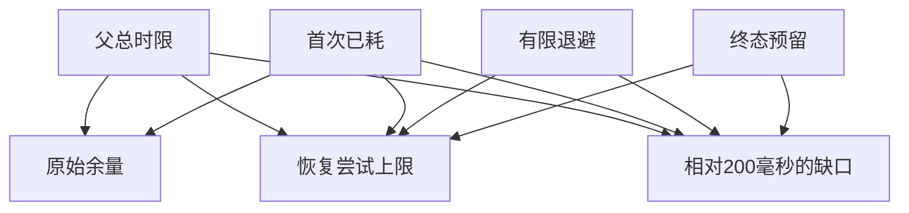

# 为 RPC 的第二次尝试算出剩余 deadline

宿主等到首次超时，退避和最终回复依旧占用父请求时间。
先算还能用多少，再决定应当尝试还是交付不确定。
200毫秒为待验证的教学最短尝试时间。超时不证明下游没有执行。

## 先解决一个具体问题

**第二次读取的超时时间该从哪里来？**

从父请求剩余时间扣除退避和交付预留，结合工具最小可用时长决定是否派发。
给每次重试重新分配完整父时限会在多层调用中叠加超时。


先从具体的低档设定开始：父总时限取 700毫秒、首次已耗取 250毫秒、有限退避取 40毫秒、终态预留取 80毫秒。
三个结果依次是原始余量 450毫秒、恢复尝试上限 330毫秒、相对200毫秒的缺口 0毫秒。
先手算这个起点，读完后再把另一个输入切到高档，这样能知道数字变化时究竟改变了哪个假设。

## 先写清输入边界和三个观测量

用 a 表示父总时限，取 700毫秒 或 1400毫秒，这两点是用于隔离因果影响的教学输入。

用 b 表示首次已耗，取 250毫秒 或 580毫秒，这两点是用于隔离因果影响的教学输入。

用 c 表示有限退避，取 40毫秒 或 160毫秒，这两点是用于隔离因果影响的教学输入。

用 d 表示终态预留，取 80毫秒 或 220毫秒，这两点是用于隔离因果影响的教学输入。

「原始余量」的计算式为 `a-b`，按业务量展开是 `父总时限-首次已耗`，输出单位为毫秒。

「恢复尝试上限」的计算式为 `max(0,a-b-c-d)`，按业务量展开是 `max(0,父总时限-首次已耗-有限退避-终态预留)`，输出单位为毫秒。

「相对200毫秒的缺口」的计算式为 `max(0,200-max(0,a-b-c-d))`，按业务量展开是 `max(0,200-max(0,父总时限-首次已耗-有限退避-终态预留))`，输出单位为毫秒。

公式中 ceil 与 floor 分别向上、向下取整，% 在表达式中作取余，** 为乘方，三元条件按“条件 ? 成立值 : 其他值”读取。展示数值最多保留三位小数，比较和反推采用未舍入值。



图上的箭头表示该输入出现在计算式中。同一输入通向多个指标时，三个读数可能共同移动。分支、取整或相互抵消又会使某些边在具体样本上没有可见增量。

## 从输入按单位逐步算到可比较的结果

<details>
<summary>展开推演与对应反例</summary>

### 样本 0000：父总时限 700、首次已耗 250

这一组设定为父总时限为 700毫秒、首次已耗为 250毫秒、有限退避为 40毫秒、终态预留为 80毫秒。

代入「原始余量」：`700-250`，得到 450毫秒。

代入「恢复尝试上限」：`max(0,700-250-40-80)`，得到 330毫秒。

代入「相对200毫秒的缺口」：`max(0,200-max(0,700-250-40-80))`，得到 0毫秒。

以「恢复尝试上限」作主读数时，本组单独切换父总时限的绝对变化最大或并列最大，读数会从 330毫秒 变为 1030毫秒。

对角样本 1111 的主读数为 440毫秒。它同时改了四项，差额不能充当任一单个因素的净收益。

### 样本 0001：父总时限 700、首次已耗 250

这一组设定为父总时限为 700毫秒、首次已耗为 250毫秒、有限退避为 40毫秒、终态预留为 220毫秒。


代入「恢复尝试上限」：`max(0,700-250-40-220)`，得到 190毫秒。

代入「相对200毫秒的缺口」：`max(0,200-max(0,700-250-40-220))`，得到 10毫秒。

以「恢复尝试上限」作主读数时，本组单独切换父总时限的绝对变化最大或并列最大，读数会从 190毫秒 变为 890毫秒。

对角样本 1110 的主读数为 580毫秒。它同时改了四项，差额不能充当任一单个因素的净收益。

### 样本 0010：父总时限 700、首次已耗 250

这一组设定为父总时限为 700毫秒、首次已耗为 250毫秒、有限退避为 160毫秒、终态预留为 80毫秒。


代入「恢复尝试上限」：`max(0,700-250-160-80)`，得到 210毫秒。

代入「相对200毫秒的缺口」：`max(0,200-max(0,700-250-160-80))`，得到 0毫秒。

以「恢复尝试上限」作主读数时，本组单独切换父总时限的绝对变化最大或并列最大，读数会从 210毫秒 变为 910毫秒。

对角样本 1101 的主读数为 560毫秒。它同时改了四项，差额不能充当任一单个因素的净收益。

### 样本 0011：父总时限 700、首次已耗 250

这一组设定为父总时限为 700毫秒、首次已耗为 250毫秒、有限退避为 160毫秒、终态预留为 220毫秒。


代入「恢复尝试上限」：`max(0,700-250-160-220)`，得到 70毫秒。

代入「相对200毫秒的缺口」：`max(0,200-max(0,700-250-160-220))`，得到 130毫秒。

以「恢复尝试上限」作主读数时，本组单独切换父总时限的绝对变化最大或并列最大，读数会从 70毫秒 变为 770毫秒。

对角样本 1100 的主读数为 700毫秒。它同时改了四项，差额不能充当任一单个因素的净收益。

### 样本 0100：父总时限 700、首次已耗 580

这一组设定为父总时限为 700毫秒、首次已耗为 580毫秒、有限退避为 40毫秒、终态预留为 80毫秒。

代入「原始余量」：`700-580`，得到 120毫秒。

代入「恢复尝试上限」：`max(0,700-580-40-80)`，得到 0毫秒。

代入「相对200毫秒的缺口」：`max(0,200-max(0,700-580-40-80))`，得到 200毫秒。

以「恢复尝试上限」作主读数时，本组单独切换父总时限的绝对变化最大或并列最大，读数会从 0毫秒 变为 700毫秒。

本组固定其余输入时，分别改变「有限退避」、「终态预留」均不会改变 0毫秒 这个主读数，是否影响另一指标仍需另算。

对角样本 1011 的主读数为 770毫秒。它同时改了四项，差额不能充当任一单个因素的净收益。

### 样本 0101：父总时限 700、首次已耗 580

这一组设定为父总时限为 700毫秒、首次已耗为 580毫秒、有限退避为 40毫秒、终态预留为 220毫秒。


代入「恢复尝试上限」：`max(0,700-580-40-220)`，得到 0毫秒。

代入「相对200毫秒的缺口」：`max(0,200-max(0,700-580-40-220))`，得到 200毫秒。

以「恢复尝试上限」作主读数时，本组单独切换父总时限的绝对变化最大或并列最大，读数会从 0毫秒 变为 560毫秒。


对角样本 1010 的主读数为 910毫秒。它同时改了四项，差额不能充当任一单个因素的净收益。

### 样本 0110：父总时限 700、首次已耗 580

这一组设定为父总时限为 700毫秒、首次已耗为 580毫秒、有限退避为 160毫秒、终态预留为 80毫秒。


代入「恢复尝试上限」：`max(0,700-580-160-80)`，得到 0毫秒。

代入「相对200毫秒的缺口」：`max(0,200-max(0,700-580-160-80))`，得到 200毫秒。

以「恢复尝试上限」作主读数时，本组单独切换父总时限的绝对变化最大或并列最大，读数会从 0毫秒 变为 580毫秒。


对角样本 1001 的主读数为 890毫秒。它同时改了四项，差额不能充当任一单个因素的净收益。

### 样本 0111：父总时限 700、首次已耗 580

这一组设定为父总时限为 700毫秒、首次已耗为 580毫秒、有限退避为 160毫秒、终态预留为 220毫秒。


代入「恢复尝试上限」：`max(0,700-580-160-220)`，得到 0毫秒。

代入「相对200毫秒的缺口」：`max(0,200-max(0,700-580-160-220))`，得到 200毫秒。

以「恢复尝试上限」作主读数时，本组单独切换父总时限的绝对变化最大或并列最大，读数会从 0毫秒 变为 440毫秒。


对角样本 1000 的主读数为 1030毫秒。它同时改了四项，差额不能充当任一单个因素的净收益。

### 样本 1000：父总时限 1400、首次已耗 250

这一组设定为父总时限为 1400毫秒、首次已耗为 250毫秒、有限退避为 40毫秒、终态预留为 80毫秒。

代入「原始余量」：`1400-250`，得到 1150毫秒。

代入「恢复尝试上限」：`max(0,1400-250-40-80)`，得到 1030毫秒。

代入「相对200毫秒的缺口」：`max(0,200-max(0,1400-250-40-80))`，得到 0毫秒。

以「恢复尝试上限」作主读数时，本组单独切换父总时限的绝对变化最大或并列最大，读数会从 1030毫秒 变为 330毫秒。

对角样本 0111 的主读数为 0毫秒。它同时改了四项，差额不能充当任一单个因素的净收益。

### 样本 1001：父总时限 1400、首次已耗 250

这一组设定为父总时限为 1400毫秒、首次已耗为 250毫秒、有限退避为 40毫秒、终态预留为 220毫秒。


代入「恢复尝试上限」：`max(0,1400-250-40-220)`，得到 890毫秒。

代入「相对200毫秒的缺口」：`max(0,200-max(0,1400-250-40-220))`，得到 0毫秒。

以「恢复尝试上限」作主读数时，本组单独切换父总时限的绝对变化最大或并列最大，读数会从 890毫秒 变为 190毫秒。

对角样本 0110 的主读数为 0毫秒。它同时改了四项，差额不能充当任一单个因素的净收益。

### 样本 1010：父总时限 1400、首次已耗 250

这一组设定为父总时限为 1400毫秒、首次已耗为 250毫秒、有限退避为 160毫秒、终态预留为 80毫秒。


代入「恢复尝试上限」：`max(0,1400-250-160-80)`，得到 910毫秒。

代入「相对200毫秒的缺口」：`max(0,200-max(0,1400-250-160-80))`，得到 0毫秒。

以「恢复尝试上限」作主读数时，本组单独切换父总时限的绝对变化最大或并列最大，读数会从 910毫秒 变为 210毫秒。

对角样本 0101 的主读数为 0毫秒。它同时改了四项，差额不能充当任一单个因素的净收益。

### 样本 1011：父总时限 1400、首次已耗 250

这一组设定为父总时限为 1400毫秒、首次已耗为 250毫秒、有限退避为 160毫秒、终态预留为 220毫秒。


代入「恢复尝试上限」：`max(0,1400-250-160-220)`，得到 770毫秒。

代入「相对200毫秒的缺口」：`max(0,200-max(0,1400-250-160-220))`，得到 0毫秒。

以「恢复尝试上限」作主读数时，本组单独切换父总时限的绝对变化最大或并列最大，读数会从 770毫秒 变为 70毫秒。

对角样本 0100 的主读数为 0毫秒。它同时改了四项，差额不能充当任一单个因素的净收益。

### 样本 1100：父总时限 1400、首次已耗 580

这一组设定为父总时限为 1400毫秒、首次已耗为 580毫秒、有限退避为 40毫秒、终态预留为 80毫秒。

代入「原始余量」：`1400-580`，得到 820毫秒。

代入「恢复尝试上限」：`max(0,1400-580-40-80)`，得到 700毫秒。

代入「相对200毫秒的缺口」：`max(0,200-max(0,1400-580-40-80))`，得到 0毫秒。

以「恢复尝试上限」作主读数时，本组单独切换父总时限的绝对变化最大或并列最大，读数会从 700毫秒 变为 0毫秒。

对角样本 0011 的主读数为 70毫秒。它同时改了四项，差额不能充当任一单个因素的净收益。

### 样本 1101：父总时限 1400、首次已耗 580

这一组设定为父总时限为 1400毫秒、首次已耗为 580毫秒、有限退避为 40毫秒、终态预留为 220毫秒。


代入「恢复尝试上限」：`max(0,1400-580-40-220)`，得到 560毫秒。

代入「相对200毫秒的缺口」：`max(0,200-max(0,1400-580-40-220))`，得到 0毫秒。

以「恢复尝试上限」作主读数时，本组单独切换父总时限的绝对变化最大或并列最大，读数会从 560毫秒 变为 0毫秒。

对角样本 0010 的主读数为 210毫秒。它同时改了四项，差额不能充当任一单个因素的净收益。

### 样本 1110：父总时限 1400、首次已耗 580

这一组设定为父总时限为 1400毫秒、首次已耗为 580毫秒、有限退避为 160毫秒、终态预留为 80毫秒。


代入「恢复尝试上限」：`max(0,1400-580-160-80)`，得到 580毫秒。

代入「相对200毫秒的缺口」：`max(0,200-max(0,1400-580-160-80))`，得到 0毫秒。

以「恢复尝试上限」作主读数时，本组单独切换父总时限的绝对变化最大或并列最大，读数会从 580毫秒 变为 0毫秒。

对角样本 0001 的主读数为 190毫秒。它同时改了四项，差额不能充当任一单个因素的净收益。

### 样本 1111：父总时限 1400、首次已耗 580

这一组设定为父总时限为 1400毫秒、首次已耗为 580毫秒、有限退避为 160毫秒、终态预留为 220毫秒。


代入「恢复尝试上限」：`max(0,1400-580-160-220)`，得到 440毫秒。

代入「相对200毫秒的缺口」：`max(0,200-max(0,1400-580-160-220))`，得到 0毫秒。

以「恢复尝试上限」作主读数时，本组单独切换父总时限的绝对变化最大或并列最大，读数会从 440毫秒 变为 0毫秒。

对角样本 0000 的主读数为 330毫秒。它同时改了四项，差额不能充当任一单个因素的净收益。

</details>

## 逐个干预：其余条件固定时，变化真的发生在哪里

<details>
<summary>展开推演与对应反例</summary>

### 只改变父总时限

固定首次已耗为 250毫秒、有限退避为 40毫秒、终态预留为 80毫秒，只把父总时限从 700毫秒改到 1400毫秒。
这一对的原始余量从 450毫秒 变为 1150毫秒，恢复尝试上限的差为 700毫秒，相对200毫秒的缺口的差为 0毫秒。

固定首次已耗为 250毫秒、有限退避为 40毫秒、终态预留为 220毫秒，只把父总时限从 700毫秒改到 1400毫秒。
这一对的原始余量从 450毫秒 变为 1150毫秒，恢复尝试上限的差为 700毫秒，相对200毫秒的缺口的差为 -10毫秒。

固定首次已耗为 250毫秒、有限退避为 160毫秒、终态预留为 80毫秒，只把父总时限从 700毫秒改到 1400毫秒。

固定首次已耗为 250毫秒、有限退避为 160毫秒、终态预留为 220毫秒，只把父总时限从 700毫秒改到 1400毫秒。
这一对的原始余量从 450毫秒 变为 1150毫秒，恢复尝试上限的差为 700毫秒，相对200毫秒的缺口的差为 -130毫秒。

固定首次已耗为 580毫秒、有限退避为 40毫秒、终态预留为 80毫秒，只把父总时限从 700毫秒改到 1400毫秒。
这一对的原始余量从 120毫秒 变为 820毫秒，恢复尝试上限的差为 700毫秒，相对200毫秒的缺口的差为 -200毫秒。

固定首次已耗为 580毫秒、有限退避为 40毫秒、终态预留为 220毫秒，只把父总时限从 700毫秒改到 1400毫秒。
这一对的原始余量从 120毫秒 变为 820毫秒，恢复尝试上限的差为 560毫秒，相对200毫秒的缺口的差为 -200毫秒。

固定首次已耗为 580毫秒、有限退避为 160毫秒、终态预留为 80毫秒，只把父总时限从 700毫秒改到 1400毫秒。
这一对的原始余量从 120毫秒 变为 820毫秒，恢复尝试上限的差为 580毫秒，相对200毫秒的缺口的差为 -200毫秒。

固定首次已耗为 580毫秒、有限退避为 160毫秒、终态预留为 220毫秒，只把父总时限从 700毫秒改到 1400毫秒。
这一对的原始余量从 120毫秒 变为 820毫秒，恢复尝试上限的差为 440毫秒，相对200毫秒的缺口的差为 -200毫秒。

综合八组受控背景，父总时限升到较高设定时「原始余量」的差值区间是 700毫秒，共有 8 对出现可观察变化。

综合八组受控背景，父总时限升到较高设定时「恢复尝试上限」的差值区间是 440毫秒 至 700毫秒，共有 8 对出现可观察变化。

综合八组受控背景，父总时限升到较高设定时「相对200毫秒的缺口」的差值区间是 -200毫秒 至 0毫秒，共有 6 对出现可观察变化。

### 只改变首次已耗

固定父总时限为 700毫秒、有限退避为 40毫秒、终态预留为 80毫秒，只把首次已耗从 250毫秒改到 580毫秒。
这一对的原始余量从 450毫秒 变为 120毫秒，恢复尝试上限的差为 -330毫秒，相对200毫秒的缺口的差为 200毫秒。

固定父总时限为 700毫秒、有限退避为 40毫秒、终态预留为 220毫秒，只把首次已耗从 250毫秒改到 580毫秒。
这一对的原始余量从 450毫秒 变为 120毫秒，恢复尝试上限的差为 -190毫秒，相对200毫秒的缺口的差为 190毫秒。

固定父总时限为 700毫秒、有限退避为 160毫秒、终态预留为 80毫秒，只把首次已耗从 250毫秒改到 580毫秒。
这一对的原始余量从 450毫秒 变为 120毫秒，恢复尝试上限的差为 -210毫秒，相对200毫秒的缺口的差为 200毫秒。

固定父总时限为 700毫秒、有限退避为 160毫秒、终态预留为 220毫秒，只把首次已耗从 250毫秒改到 580毫秒。
这一对的原始余量从 450毫秒 变为 120毫秒，恢复尝试上限的差为 -70毫秒，相对200毫秒的缺口的差为 70毫秒。

固定父总时限为 1400毫秒、有限退避为 40毫秒、终态预留为 80毫秒，只把首次已耗从 250毫秒改到 580毫秒。
这一对的原始余量从 1150毫秒 变为 820毫秒，恢复尝试上限的差为 -330毫秒，相对200毫秒的缺口的差为 0毫秒。

固定父总时限为 1400毫秒、有限退避为 40毫秒、终态预留为 220毫秒，只把首次已耗从 250毫秒改到 580毫秒。

固定父总时限为 1400毫秒、有限退避为 160毫秒、终态预留为 80毫秒，只把首次已耗从 250毫秒改到 580毫秒。

固定父总时限为 1400毫秒、有限退避为 160毫秒、终态预留为 220毫秒，只把首次已耗从 250毫秒改到 580毫秒。

综合八组受控背景，首次已耗升到较高设定时「原始余量」的差值区间是 -330毫秒，共有 8 对出现可观察变化。

综合八组受控背景，首次已耗升到较高设定时「恢复尝试上限」的差值区间是 -330毫秒 至 -70毫秒，共有 8 对出现可观察变化。

综合八组受控背景，首次已耗升到较高设定时「相对200毫秒的缺口」的差值区间是 0毫秒 至 200毫秒，共有 4 对出现可观察变化。

### 只改变有限退避

固定父总时限为 700毫秒、首次已耗为 250毫秒、终态预留为 80毫秒，只把有限退避从 40毫秒改到 160毫秒。
这一对的原始余量从 450毫秒 变为 450毫秒，恢复尝试上限的差为 -120毫秒，相对200毫秒的缺口的差为 0毫秒。

固定父总时限为 700毫秒、首次已耗为 250毫秒、终态预留为 220毫秒，只把有限退避从 40毫秒改到 160毫秒。
这一对的原始余量从 450毫秒 变为 450毫秒，恢复尝试上限的差为 -120毫秒，相对200毫秒的缺口的差为 120毫秒。

固定父总时限为 700毫秒、首次已耗为 580毫秒、终态预留为 80毫秒，只把有限退避从 40毫秒改到 160毫秒。
这一对的原始余量从 120毫秒 变为 120毫秒，恢复尝试上限的差为 0毫秒，相对200毫秒的缺口的差为 0毫秒。

固定父总时限为 700毫秒、首次已耗为 580毫秒、终态预留为 220毫秒，只把有限退避从 40毫秒改到 160毫秒。

固定父总时限为 1400毫秒、首次已耗为 250毫秒、终态预留为 80毫秒，只把有限退避从 40毫秒改到 160毫秒。
这一对的原始余量从 1150毫秒 变为 1150毫秒，恢复尝试上限的差为 -120毫秒，相对200毫秒的缺口的差为 0毫秒。

固定父总时限为 1400毫秒、首次已耗为 250毫秒、终态预留为 220毫秒，只把有限退避从 40毫秒改到 160毫秒。

固定父总时限为 1400毫秒、首次已耗为 580毫秒、终态预留为 80毫秒，只把有限退避从 40毫秒改到 160毫秒。
这一对的原始余量从 820毫秒 变为 820毫秒，恢复尝试上限的差为 -120毫秒，相对200毫秒的缺口的差为 0毫秒。

固定父总时限为 1400毫秒、首次已耗为 580毫秒、终态预留为 220毫秒，只把有限退避从 40毫秒改到 160毫秒。

综合八组受控背景，有限退避升到较高设定时「原始余量」的差值区间是 0毫秒，共有 0 对出现可观察变化。

综合八组受控背景，有限退避升到较高设定时「恢复尝试上限」的差值区间是 -120毫秒 至 0毫秒，共有 6 对出现可观察变化。

综合八组受控背景，有限退避升到较高设定时「相对200毫秒的缺口」的差值区间是 0毫秒 至 120毫秒，共有 1 对出现可观察变化。

### 只改变终态预留

固定父总时限为 700毫秒、首次已耗为 250毫秒、有限退避为 40毫秒，只把终态预留从 80毫秒改到 220毫秒。
这一对的原始余量从 450毫秒 变为 450毫秒，恢复尝试上限的差为 -140毫秒，相对200毫秒的缺口的差为 10毫秒。

固定父总时限为 700毫秒、首次已耗为 250毫秒、有限退避为 160毫秒，只把终态预留从 80毫秒改到 220毫秒。
这一对的原始余量从 450毫秒 变为 450毫秒，恢复尝试上限的差为 -140毫秒，相对200毫秒的缺口的差为 130毫秒。

固定父总时限为 700毫秒、首次已耗为 580毫秒、有限退避为 40毫秒，只把终态预留从 80毫秒改到 220毫秒。

固定父总时限为 700毫秒、首次已耗为 580毫秒、有限退避为 160毫秒，只把终态预留从 80毫秒改到 220毫秒。

固定父总时限为 1400毫秒、首次已耗为 250毫秒、有限退避为 40毫秒，只把终态预留从 80毫秒改到 220毫秒。
这一对的原始余量从 1150毫秒 变为 1150毫秒，恢复尝试上限的差为 -140毫秒，相对200毫秒的缺口的差为 0毫秒。

固定父总时限为 1400毫秒、首次已耗为 250毫秒、有限退避为 160毫秒，只把终态预留从 80毫秒改到 220毫秒。

固定父总时限为 1400毫秒、首次已耗为 580毫秒、有限退避为 40毫秒，只把终态预留从 80毫秒改到 220毫秒。
这一对的原始余量从 820毫秒 变为 820毫秒，恢复尝试上限的差为 -140毫秒，相对200毫秒的缺口的差为 0毫秒。

固定父总时限为 1400毫秒、首次已耗为 580毫秒、有限退避为 160毫秒，只把终态预留从 80毫秒改到 220毫秒。

综合八组受控背景，终态预留升到较高设定时「原始余量」的差值区间是 0毫秒，共有 0 对出现可观察变化。

综合八组受控背景，终态预留升到较高设定时「恢复尝试上限」的差值区间是 -140毫秒 至 0毫秒，共有 6 对出现可观察变化。

综合八组受控背景，终态预留升到较高设定时「相对200毫秒的缺口」的差值区间是 0毫秒 至 130毫秒，共有 2 对出现可观察变化。

</details>

## 只拿到部分输入，结论还能缩小到多大范围

<details>
<summary>展开推演与对应反例</summary>

### 已知父总时限和首次已耗

当父总时限为 700毫秒、首次已耗为 250毫秒时，另两项有四种补全，主读数「恢复尝试上限」只能限定为 70毫秒 至 330毫秒。
这个条件下，取有限退避为 160毫秒、终态预留为 220毫秒可得到下界 70毫秒，取有限退避为 40毫秒、终态预留为 80毫秒可达到上界 330毫秒。

用同样可见的父总时限为 700毫秒、首次已耗为 250毫秒去推「原始余量」，能得到的范围为 450毫秒，不能把另一个指标的单位代入。

用同样可见的父总时限为 700毫秒、首次已耗为 250毫秒去推「相对200毫秒的缺口」，能得到的范围为 0毫秒 至 130毫秒，不能把另一个指标的单位代入。

若只许再问一项，按最坏区间宽度优先核对终态预留，补得低档时为 210毫秒 至 330毫秒，高档时为 70毫秒 至 190毫秒。

当父总时限为 700毫秒、首次已耗为 580毫秒时，另两项有四种补全，主读数「恢复尝试上限」只能限定为 0毫秒。
这个条件下，取有限退避为 40毫秒、终态预留为 80毫秒可得到下界 0毫秒，取有限退避为 40毫秒、终态预留为 80毫秒可达到上界 0毫秒。

用同样可见的父总时限为 700毫秒、首次已耗为 580毫秒去推「原始余量」，能得到的范围为 120毫秒，不能把另一个指标的单位代入。

用同样可见的父总时限为 700毫秒、首次已耗为 580毫秒去推「相对200毫秒的缺口」，能得到的范围为 200毫秒，不能把另一个指标的单位代入。

当父总时限为 1400毫秒、首次已耗为 250毫秒时，另两项有四种补全，主读数「恢复尝试上限」只能限定为 770毫秒 至 1030毫秒。
这个条件下，取有限退避为 160毫秒、终态预留为 220毫秒可得到下界 770毫秒，取有限退避为 40毫秒、终态预留为 80毫秒可达到上界 1030毫秒。

用同样可见的父总时限为 1400毫秒、首次已耗为 250毫秒去推「原始余量」，能得到的范围为 1150毫秒，不能把另一个指标的单位代入。

用同样可见的父总时限为 1400毫秒、首次已耗为 250毫秒去推「相对200毫秒的缺口」，能得到的范围为 0毫秒，不能把另一个指标的单位代入。

若只许再问一项，按最坏区间宽度优先核对终态预留，补得低档时为 910毫秒 至 1030毫秒，高档时为 770毫秒 至 890毫秒。

当父总时限为 1400毫秒、首次已耗为 580毫秒时，另两项有四种补全，主读数「恢复尝试上限」只能限定为 440毫秒 至 700毫秒。
这个条件下，取有限退避为 160毫秒、终态预留为 220毫秒可得到下界 440毫秒，取有限退避为 40毫秒、终态预留为 80毫秒可达到上界 700毫秒。

用同样可见的父总时限为 1400毫秒、首次已耗为 580毫秒去推「原始余量」，能得到的范围为 820毫秒，不能把另一个指标的单位代入。

用同样可见的父总时限为 1400毫秒、首次已耗为 580毫秒去推「相对200毫秒的缺口」，能得到的范围为 0毫秒，不能把另一个指标的单位代入。

若只许再问一项，按最坏区间宽度优先核对终态预留，补得低档时为 580毫秒 至 700毫秒，高档时为 440毫秒 至 560毫秒。

### 已知父总时限和有限退避

当父总时限为 700毫秒、有限退避为 40毫秒时，另两项有四种补全，主读数「恢复尝试上限」只能限定为 0毫秒 至 330毫秒。
这个条件下，取首次已耗为 580毫秒、终态预留为 80毫秒可得到下界 0毫秒，取首次已耗为 250毫秒、终态预留为 80毫秒可达到上界 330毫秒。

用同样可见的父总时限为 700毫秒、有限退避为 40毫秒去推「原始余量」，能得到的范围为 120毫秒 至 450毫秒，不能把另一个指标的单位代入。

用同样可见的父总时限为 700毫秒、有限退避为 40毫秒去推「相对200毫秒的缺口」，能得到的范围为 0毫秒 至 200毫秒，不能把另一个指标的单位代入。

若只许再问一项，按最坏区间宽度优先核对首次已耗，补得低档时为 190毫秒 至 330毫秒，高档时为 0毫秒。

当父总时限为 700毫秒、有限退避为 160毫秒时，另两项有四种补全，主读数「恢复尝试上限」只能限定为 0毫秒 至 210毫秒。
这个条件下，取首次已耗为 580毫秒、终态预留为 80毫秒可得到下界 0毫秒，取首次已耗为 250毫秒、终态预留为 80毫秒可达到上界 210毫秒。

用同样可见的父总时限为 700毫秒、有限退避为 160毫秒去推「原始余量」，能得到的范围为 120毫秒 至 450毫秒，不能把另一个指标的单位代入。

用同样可见的父总时限为 700毫秒、有限退避为 160毫秒去推「相对200毫秒的缺口」，能得到的范围为 0毫秒 至 200毫秒，不能把另一个指标的单位代入。

若只许再问一项，按最坏区间宽度优先核对首次已耗，补得低档时为 70毫秒 至 210毫秒，高档时为 0毫秒。

当父总时限为 1400毫秒、有限退避为 40毫秒时，另两项有四种补全，主读数「恢复尝试上限」只能限定为 560毫秒 至 1030毫秒。
这个条件下，取首次已耗为 580毫秒、终态预留为 220毫秒可得到下界 560毫秒，取首次已耗为 250毫秒、终态预留为 80毫秒可达到上界 1030毫秒。

用同样可见的父总时限为 1400毫秒、有限退避为 40毫秒去推「原始余量」，能得到的范围为 820毫秒 至 1150毫秒，不能把另一个指标的单位代入。

用同样可见的父总时限为 1400毫秒、有限退避为 40毫秒去推「相对200毫秒的缺口」，能得到的范围为 0毫秒，不能把另一个指标的单位代入。

若只许再问一项，按最坏区间宽度优先核对首次已耗，补得低档时为 890毫秒 至 1030毫秒，高档时为 560毫秒 至 700毫秒。

当父总时限为 1400毫秒、有限退避为 160毫秒时，另两项有四种补全，主读数「恢复尝试上限」只能限定为 440毫秒 至 910毫秒。
这个条件下，取首次已耗为 580毫秒、终态预留为 220毫秒可得到下界 440毫秒，取首次已耗为 250毫秒、终态预留为 80毫秒可达到上界 910毫秒。

用同样可见的父总时限为 1400毫秒、有限退避为 160毫秒去推「原始余量」，能得到的范围为 820毫秒 至 1150毫秒，不能把另一个指标的单位代入。

用同样可见的父总时限为 1400毫秒、有限退避为 160毫秒去推「相对200毫秒的缺口」，能得到的范围为 0毫秒，不能把另一个指标的单位代入。

若只许再问一项，按最坏区间宽度优先核对首次已耗，补得低档时为 770毫秒 至 910毫秒，高档时为 440毫秒 至 580毫秒。

### 已知首次已耗和有限退避

当首次已耗为 250毫秒、有限退避为 40毫秒时，另两项有四种补全，主读数「恢复尝试上限」只能限定为 190毫秒 至 1030毫秒。
这个条件下，取父总时限为 700毫秒、终态预留为 220毫秒可得到下界 190毫秒，取父总时限为 1400毫秒、终态预留为 80毫秒可达到上界 1030毫秒。

用同样可见的首次已耗为 250毫秒、有限退避为 40毫秒去推「原始余量」，能得到的范围为 450毫秒 至 1150毫秒，不能把另一个指标的单位代入。

用同样可见的首次已耗为 250毫秒、有限退避为 40毫秒去推「相对200毫秒的缺口」，能得到的范围为 0毫秒 至 10毫秒，不能把另一个指标的单位代入。

若只许再问一项，按最坏区间宽度优先核对父总时限，补得低档时为 190毫秒 至 330毫秒，高档时为 890毫秒 至 1030毫秒。

当首次已耗为 250毫秒、有限退避为 160毫秒时，另两项有四种补全，主读数「恢复尝试上限」只能限定为 70毫秒 至 910毫秒。
这个条件下，取父总时限为 700毫秒、终态预留为 220毫秒可得到下界 70毫秒，取父总时限为 1400毫秒、终态预留为 80毫秒可达到上界 910毫秒。

用同样可见的首次已耗为 250毫秒、有限退避为 160毫秒去推「原始余量」，能得到的范围为 450毫秒 至 1150毫秒，不能把另一个指标的单位代入。

用同样可见的首次已耗为 250毫秒、有限退避为 160毫秒去推「相对200毫秒的缺口」，能得到的范围为 0毫秒 至 130毫秒，不能把另一个指标的单位代入。

若只许再问一项，按最坏区间宽度优先核对父总时限，补得低档时为 70毫秒 至 210毫秒，高档时为 770毫秒 至 910毫秒。

当首次已耗为 580毫秒、有限退避为 40毫秒时，另两项有四种补全，主读数「恢复尝试上限」只能限定为 0毫秒 至 700毫秒。
这个条件下，取父总时限为 700毫秒、终态预留为 80毫秒可得到下界 0毫秒，取父总时限为 1400毫秒、终态预留为 80毫秒可达到上界 700毫秒。

用同样可见的首次已耗为 580毫秒、有限退避为 40毫秒去推「原始余量」，能得到的范围为 120毫秒 至 820毫秒，不能把另一个指标的单位代入。

用同样可见的首次已耗为 580毫秒、有限退避为 40毫秒去推「相对200毫秒的缺口」，能得到的范围为 0毫秒 至 200毫秒，不能把另一个指标的单位代入。

若只许再问一项，按最坏区间宽度优先核对父总时限，补得低档时为 0毫秒，高档时为 560毫秒 至 700毫秒。

当首次已耗为 580毫秒、有限退避为 160毫秒时，另两项有四种补全，主读数「恢复尝试上限」只能限定为 0毫秒 至 580毫秒。
这个条件下，取父总时限为 700毫秒、终态预留为 80毫秒可得到下界 0毫秒，取父总时限为 1400毫秒、终态预留为 80毫秒可达到上界 580毫秒。

用同样可见的首次已耗为 580毫秒、有限退避为 160毫秒去推「原始余量」，能得到的范围为 120毫秒 至 820毫秒，不能把另一个指标的单位代入。

用同样可见的首次已耗为 580毫秒、有限退避为 160毫秒去推「相对200毫秒的缺口」，能得到的范围为 0毫秒 至 200毫秒，不能把另一个指标的单位代入。

若只许再问一项，按最坏区间宽度优先核对父总时限，补得低档时为 0毫秒，高档时为 440毫秒 至 580毫秒。

### 已知父总时限和终态预留

当父总时限为 700毫秒、终态预留为 80毫秒时，另两项有四种补全，主读数「恢复尝试上限」只能限定为 0毫秒 至 330毫秒。
这个条件下，取首次已耗为 580毫秒、有限退避为 40毫秒可得到下界 0毫秒，取首次已耗为 250毫秒、有限退避为 40毫秒可达到上界 330毫秒。

用同样可见的父总时限为 700毫秒、终态预留为 80毫秒去推「原始余量」，能得到的范围为 120毫秒 至 450毫秒，不能把另一个指标的单位代入。

用同样可见的父总时限为 700毫秒、终态预留为 80毫秒去推「相对200毫秒的缺口」，能得到的范围为 0毫秒 至 200毫秒，不能把另一个指标的单位代入。

若只许再问一项，按最坏区间宽度优先核对首次已耗，补得低档时为 210毫秒 至 330毫秒，高档时为 0毫秒。

当父总时限为 700毫秒、终态预留为 220毫秒时，另两项有四种补全，主读数「恢复尝试上限」只能限定为 0毫秒 至 190毫秒。
这个条件下，取首次已耗为 580毫秒、有限退避为 40毫秒可得到下界 0毫秒，取首次已耗为 250毫秒、有限退避为 40毫秒可达到上界 190毫秒。

用同样可见的父总时限为 700毫秒、终态预留为 220毫秒去推「原始余量」，能得到的范围为 120毫秒 至 450毫秒，不能把另一个指标的单位代入。

用同样可见的父总时限为 700毫秒、终态预留为 220毫秒去推「相对200毫秒的缺口」，能得到的范围为 10毫秒 至 200毫秒，不能把另一个指标的单位代入。

若只许再问一项，按最坏区间宽度优先核对首次已耗，补得低档时为 70毫秒 至 190毫秒，高档时为 0毫秒。

当父总时限为 1400毫秒、终态预留为 80毫秒时，另两项有四种补全，主读数「恢复尝试上限」只能限定为 580毫秒 至 1030毫秒。
这个条件下，取首次已耗为 580毫秒、有限退避为 160毫秒可得到下界 580毫秒，取首次已耗为 250毫秒、有限退避为 40毫秒可达到上界 1030毫秒。

用同样可见的父总时限为 1400毫秒、终态预留为 80毫秒去推「原始余量」，能得到的范围为 820毫秒 至 1150毫秒，不能把另一个指标的单位代入。

用同样可见的父总时限为 1400毫秒、终态预留为 80毫秒去推「相对200毫秒的缺口」，能得到的范围为 0毫秒，不能把另一个指标的单位代入。

若只许再问一项，按最坏区间宽度优先核对首次已耗，补得低档时为 910毫秒 至 1030毫秒，高档时为 580毫秒 至 700毫秒。

当父总时限为 1400毫秒、终态预留为 220毫秒时，另两项有四种补全，主读数「恢复尝试上限」只能限定为 440毫秒 至 890毫秒。
这个条件下，取首次已耗为 580毫秒、有限退避为 160毫秒可得到下界 440毫秒，取首次已耗为 250毫秒、有限退避为 40毫秒可达到上界 890毫秒。

用同样可见的父总时限为 1400毫秒、终态预留为 220毫秒去推「原始余量」，能得到的范围为 820毫秒 至 1150毫秒，不能把另一个指标的单位代入。

用同样可见的父总时限为 1400毫秒、终态预留为 220毫秒去推「相对200毫秒的缺口」，能得到的范围为 0毫秒，不能把另一个指标的单位代入。

若只许再问一项，按最坏区间宽度优先核对首次已耗，补得低档时为 770毫秒 至 890毫秒，高档时为 440毫秒 至 560毫秒。

### 已知首次已耗和终态预留

当首次已耗为 250毫秒、终态预留为 80毫秒时，另两项有四种补全，主读数「恢复尝试上限」只能限定为 210毫秒 至 1030毫秒。
这个条件下，取父总时限为 700毫秒、有限退避为 160毫秒可得到下界 210毫秒，取父总时限为 1400毫秒、有限退避为 40毫秒可达到上界 1030毫秒。

用同样可见的首次已耗为 250毫秒、终态预留为 80毫秒去推「原始余量」，能得到的范围为 450毫秒 至 1150毫秒，不能把另一个指标的单位代入。

用同样可见的首次已耗为 250毫秒、终态预留为 80毫秒去推「相对200毫秒的缺口」，能得到的范围为 0毫秒，不能把另一个指标的单位代入。

若只许再问一项，按最坏区间宽度优先核对父总时限，补得低档时为 210毫秒 至 330毫秒，高档时为 910毫秒 至 1030毫秒。

当首次已耗为 250毫秒、终态预留为 220毫秒时，另两项有四种补全，主读数「恢复尝试上限」只能限定为 70毫秒 至 890毫秒。
这个条件下，取父总时限为 700毫秒、有限退避为 160毫秒可得到下界 70毫秒，取父总时限为 1400毫秒、有限退避为 40毫秒可达到上界 890毫秒。

用同样可见的首次已耗为 250毫秒、终态预留为 220毫秒去推「原始余量」，能得到的范围为 450毫秒 至 1150毫秒，不能把另一个指标的单位代入。

用同样可见的首次已耗为 250毫秒、终态预留为 220毫秒去推「相对200毫秒的缺口」，能得到的范围为 0毫秒 至 130毫秒，不能把另一个指标的单位代入。

若只许再问一项，按最坏区间宽度优先核对父总时限，补得低档时为 70毫秒 至 190毫秒，高档时为 770毫秒 至 890毫秒。

当首次已耗为 580毫秒、终态预留为 80毫秒时，另两项有四种补全，主读数「恢复尝试上限」只能限定为 0毫秒 至 700毫秒。
这个条件下，取父总时限为 700毫秒、有限退避为 40毫秒可得到下界 0毫秒，取父总时限为 1400毫秒、有限退避为 40毫秒可达到上界 700毫秒。

用同样可见的首次已耗为 580毫秒、终态预留为 80毫秒去推「原始余量」，能得到的范围为 120毫秒 至 820毫秒，不能把另一个指标的单位代入。

用同样可见的首次已耗为 580毫秒、终态预留为 80毫秒去推「相对200毫秒的缺口」，能得到的范围为 0毫秒 至 200毫秒，不能把另一个指标的单位代入。

若只许再问一项，按最坏区间宽度优先核对父总时限，补得低档时为 0毫秒，高档时为 580毫秒 至 700毫秒。

当首次已耗为 580毫秒、终态预留为 220毫秒时，另两项有四种补全，主读数「恢复尝试上限」只能限定为 0毫秒 至 560毫秒。
这个条件下，取父总时限为 700毫秒、有限退避为 40毫秒可得到下界 0毫秒，取父总时限为 1400毫秒、有限退避为 40毫秒可达到上界 560毫秒。

用同样可见的首次已耗为 580毫秒、终态预留为 220毫秒去推「原始余量」，能得到的范围为 120毫秒 至 820毫秒，不能把另一个指标的单位代入。

用同样可见的首次已耗为 580毫秒、终态预留为 220毫秒去推「相对200毫秒的缺口」，能得到的范围为 0毫秒 至 200毫秒，不能把另一个指标的单位代入。

若只许再问一项，按最坏区间宽度优先核对父总时限，补得低档时为 0毫秒，高档时为 440毫秒 至 560毫秒。

### 已知有限退避和终态预留

当有限退避为 40毫秒、终态预留为 80毫秒时，另两项有四种补全，主读数「恢复尝试上限」只能限定为 0毫秒 至 1030毫秒。
这个条件下，取父总时限为 700毫秒、首次已耗为 580毫秒可得到下界 0毫秒，取父总时限为 1400毫秒、首次已耗为 250毫秒可达到上界 1030毫秒。

用同样可见的有限退避为 40毫秒、终态预留为 80毫秒去推「原始余量」，能得到的范围为 120毫秒 至 1150毫秒，不能把另一个指标的单位代入。

用同样可见的有限退避为 40毫秒、终态预留为 80毫秒去推「相对200毫秒的缺口」，能得到的范围为 0毫秒 至 200毫秒，不能把另一个指标的单位代入。

若只许再问一项，按最坏区间宽度优先核对父总时限，补得低档时为 0毫秒 至 330毫秒，高档时为 700毫秒 至 1030毫秒。

当有限退避为 40毫秒、终态预留为 220毫秒时，另两项有四种补全，主读数「恢复尝试上限」只能限定为 0毫秒 至 890毫秒。
这个条件下，取父总时限为 700毫秒、首次已耗为 580毫秒可得到下界 0毫秒，取父总时限为 1400毫秒、首次已耗为 250毫秒可达到上界 890毫秒。

用同样可见的有限退避为 40毫秒、终态预留为 220毫秒去推「原始余量」，能得到的范围为 120毫秒 至 1150毫秒，不能把另一个指标的单位代入。

用同样可见的有限退避为 40毫秒、终态预留为 220毫秒去推「相对200毫秒的缺口」，能得到的范围为 0毫秒 至 200毫秒，不能把另一个指标的单位代入。

若只许再问一项，按最坏区间宽度优先核对父总时限，补得低档时为 0毫秒 至 190毫秒，高档时为 560毫秒 至 890毫秒。

当有限退避为 160毫秒、终态预留为 80毫秒时，另两项有四种补全，主读数「恢复尝试上限」只能限定为 0毫秒 至 910毫秒。
这个条件下，取父总时限为 700毫秒、首次已耗为 580毫秒可得到下界 0毫秒，取父总时限为 1400毫秒、首次已耗为 250毫秒可达到上界 910毫秒。

用同样可见的有限退避为 160毫秒、终态预留为 80毫秒去推「原始余量」，能得到的范围为 120毫秒 至 1150毫秒，不能把另一个指标的单位代入。

用同样可见的有限退避为 160毫秒、终态预留为 80毫秒去推「相对200毫秒的缺口」，能得到的范围为 0毫秒 至 200毫秒，不能把另一个指标的单位代入。

若只许再问一项，按最坏区间宽度优先核对父总时限，补得低档时为 0毫秒 至 210毫秒，高档时为 580毫秒 至 910毫秒。

当有限退避为 160毫秒、终态预留为 220毫秒时，另两项有四种补全，主读数「恢复尝试上限」只能限定为 0毫秒 至 770毫秒。
这个条件下，取父总时限为 700毫秒、首次已耗为 580毫秒可得到下界 0毫秒，取父总时限为 1400毫秒、首次已耗为 250毫秒可达到上界 770毫秒。

用同样可见的有限退避为 160毫秒、终态预留为 220毫秒去推「原始余量」，能得到的范围为 120毫秒 至 1150毫秒，不能把另一个指标的单位代入。

用同样可见的有限退避为 160毫秒、终态预留为 220毫秒去推「相对200毫秒的缺口」，能得到的范围为 0毫秒 至 200毫秒，不能把另一个指标的单位代入。

若只许再问一项，按最坏区间宽度优先核对父总时限，补得低档时为 0毫秒 至 70毫秒，高档时为 440毫秒 至 770毫秒。

</details>

## 反过来审查一份报表：能从结果还原哪些输入

<details>
<summary>展开推演与对应反例</summary>

### 仅保留“原始余量”的读数

报表只写「原始余量=450毫秒」时，在本实验的离散取值中有 4 组输入与之相容。

对这个 450毫秒 的「原始余量」读数，所有相容样本都要求父总时限为 700毫秒、首次已耗为 250毫秒。

只凭「原始余量」的 450毫秒 无法确定有限退避：0000 与 0010 的取值分别为 40 和 160毫秒。

报表只写「原始余量=120毫秒」时，在本实验的离散取值中有 4 组输入与之相容。

对这个 120毫秒 的「原始余量」读数，所有相容样本都要求父总时限为 700毫秒、首次已耗为 580毫秒。

只凭「原始余量」的 120毫秒 无法确定有限退避：0100 与 0110 的取值分别为 40 和 160毫秒。

报表只写「原始余量=1150毫秒」时，在本实验的离散取值中有 4 组输入与之相容。

对这个 1150毫秒 的「原始余量」读数，所有相容样本都要求父总时限为 1400毫秒、首次已耗为 250毫秒。

只凭「原始余量」的 1150毫秒 无法确定有限退避：1000 与 1010 的取值分别为 40 和 160毫秒。

报表只写「原始余量=820毫秒」时，在本实验的离散取值中有 4 组输入与之相容。

对这个 820毫秒 的「原始余量」读数，所有相容样本都要求父总时限为 1400毫秒、首次已耗为 580毫秒。

只凭「原始余量」的 820毫秒 无法确定有限退避：1100 与 1110 的取值分别为 40 和 160毫秒。

### 仅保留“恢复尝试上限”的读数

报表只写「恢复尝试上限=330毫秒」时，在本实验的离散取值中有 1 组输入与之相容。

对这个 330毫秒 的「恢复尝试上限」读数，所有相容样本都要求父总时限为 700毫秒、首次已耗为 250毫秒、有限退避为 40毫秒、终态预留为 80毫秒。

报表只写「恢复尝试上限=190毫秒」时，在本实验的离散取值中有 1 组输入与之相容。

对这个 190毫秒 的「恢复尝试上限」读数，所有相容样本都要求父总时限为 700毫秒、首次已耗为 250毫秒、有限退避为 40毫秒、终态预留为 220毫秒。

报表只写「恢复尝试上限=210毫秒」时，在本实验的离散取值中有 1 组输入与之相容。

对这个 210毫秒 的「恢复尝试上限」读数，所有相容样本都要求父总时限为 700毫秒、首次已耗为 250毫秒、有限退避为 160毫秒、终态预留为 80毫秒。

报表只写「恢复尝试上限=70毫秒」时，在本实验的离散取值中有 1 组输入与之相容。

对这个 70毫秒 的「恢复尝试上限」读数，所有相容样本都要求父总时限为 700毫秒、首次已耗为 250毫秒、有限退避为 160毫秒、终态预留为 220毫秒。

报表只写「恢复尝试上限=0毫秒」时，在本实验的离散取值中有 4 组输入与之相容。

对这个 0毫秒 的「恢复尝试上限」读数，所有相容样本都要求父总时限为 700毫秒、首次已耗为 580毫秒。

只凭「恢复尝试上限」的 0毫秒 无法确定有限退避：0100 与 0110 的取值分别为 40 和 160毫秒。

报表只写「恢复尝试上限=1030毫秒」时，在本实验的离散取值中有 1 组输入与之相容。

对这个 1030毫秒 的「恢复尝试上限」读数，所有相容样本都要求父总时限为 1400毫秒、首次已耗为 250毫秒、有限退避为 40毫秒、终态预留为 80毫秒。

报表只写「恢复尝试上限=890毫秒」时，在本实验的离散取值中有 1 组输入与之相容。

对这个 890毫秒 的「恢复尝试上限」读数，所有相容样本都要求父总时限为 1400毫秒、首次已耗为 250毫秒、有限退避为 40毫秒、终态预留为 220毫秒。

报表只写「恢复尝试上限=910毫秒」时，在本实验的离散取值中有 1 组输入与之相容。

对这个 910毫秒 的「恢复尝试上限」读数，所有相容样本都要求父总时限为 1400毫秒、首次已耗为 250毫秒、有限退避为 160毫秒、终态预留为 80毫秒。

报表只写「恢复尝试上限=770毫秒」时，在本实验的离散取值中有 1 组输入与之相容。

对这个 770毫秒 的「恢复尝试上限」读数，所有相容样本都要求父总时限为 1400毫秒、首次已耗为 250毫秒、有限退避为 160毫秒、终态预留为 220毫秒。

报表只写「恢复尝试上限=700毫秒」时，在本实验的离散取值中有 1 组输入与之相容。

对这个 700毫秒 的「恢复尝试上限」读数，所有相容样本都要求父总时限为 1400毫秒、首次已耗为 580毫秒、有限退避为 40毫秒、终态预留为 80毫秒。

报表只写「恢复尝试上限=560毫秒」时，在本实验的离散取值中有 1 组输入与之相容。

对这个 560毫秒 的「恢复尝试上限」读数，所有相容样本都要求父总时限为 1400毫秒、首次已耗为 580毫秒、有限退避为 40毫秒、终态预留为 220毫秒。

报表只写「恢复尝试上限=580毫秒」时，在本实验的离散取值中有 1 组输入与之相容。

对这个 580毫秒 的「恢复尝试上限」读数，所有相容样本都要求父总时限为 1400毫秒、首次已耗为 580毫秒、有限退避为 160毫秒、终态预留为 80毫秒。

报表只写「恢复尝试上限=440毫秒」时，在本实验的离散取值中有 1 组输入与之相容。

对这个 440毫秒 的「恢复尝试上限」读数，所有相容样本都要求父总时限为 1400毫秒、首次已耗为 580毫秒、有限退避为 160毫秒、终态预留为 220毫秒。

### 仅保留“相对200毫秒的缺口”的读数

报表只写「相对200毫秒的缺口=0毫秒」时，在本实验的离散取值中有 10 组输入与之相容。

只凭「相对200毫秒的缺口」的 0毫秒 无法确定父总时限：0000 与 1000 的取值分别为 700 和 1400毫秒。

报表只写「相对200毫秒的缺口=10毫秒」时，在本实验的离散取值中有 1 组输入与之相容。

对这个 10毫秒 的「相对200毫秒的缺口」读数，所有相容样本都要求父总时限为 700毫秒、首次已耗为 250毫秒、有限退避为 40毫秒、终态预留为 220毫秒。

报表只写「相对200毫秒的缺口=130毫秒」时，在本实验的离散取值中有 1 组输入与之相容。

对这个 130毫秒 的「相对200毫秒的缺口」读数，所有相容样本都要求父总时限为 700毫秒、首次已耗为 250毫秒、有限退避为 160毫秒、终态预留为 220毫秒。

报表只写「相对200毫秒的缺口=200毫秒」时，在本实验的离散取值中有 4 组输入与之相容。

对这个 200毫秒 的「相对200毫秒的缺口」读数，所有相容样本都要求父总时限为 700毫秒、首次已耗为 580毫秒。

只凭「相对200毫秒的缺口」的 200毫秒 无法确定有限退避：0100 与 0110 的取值分别为 40 和 160毫秒。

</details>

## 给错误算法找反例，再给正确算法画使用边界

<details>
<summary>展开推演与对应反例</summary>

### 每次重试都从头给完整父时限

把「恢复尝试上限」错写成 `a`，在 16 组教学输入中有 16 组会与参照计算不同。

对于父总时限为 700毫秒、首次已耗为 250毫秒、有限退避为 40毫秒、终态预留为 80毫秒，这个错误口径得 700毫秒，参照式为 330毫秒，偏差为 370毫秒。

对于父总时限为 700毫秒、首次已耗为 250毫秒、有限退避为 40毫秒、终态预留为 220毫秒，这个错误口径得 700毫秒，参照式为 190毫秒，偏差为 510毫秒。

对于父总时限为 700毫秒、首次已耗为 250毫秒、有限退避为 160毫秒、终态预留为 80毫秒，这个错误口径得 700毫秒，参照式为 210毫秒，偏差为 490毫秒。

对于父总时限为 700毫秒、首次已耗为 250毫秒、有限退避为 160毫秒、终态预留为 220毫秒，这个错误口径得 700毫秒，参照式为 70毫秒，偏差为 630毫秒。

对于父总时限为 700毫秒、首次已耗为 580毫秒、有限退避为 40毫秒、终态预留为 80毫秒，这个错误口径得 700毫秒，参照式为 0毫秒，偏差为 700毫秒。

对于父总时限为 700毫秒、首次已耗为 580毫秒、有限退避为 40毫秒、终态预留为 220毫秒，这个错误口径得 700毫秒，参照式为 0毫秒，偏差为 700毫秒。

对于父总时限为 700毫秒、首次已耗为 580毫秒、有限退避为 160毫秒、终态预留为 80毫秒，这个错误口径得 700毫秒，参照式为 0毫秒，偏差为 700毫秒。

对于父总时限为 700毫秒、首次已耗为 580毫秒、有限退避为 160毫秒、终态预留为 220毫秒，这个错误口径得 700毫秒，参照式为 0毫秒，偏差为 700毫秒。

对于父总时限为 1400毫秒、首次已耗为 250毫秒、有限退避为 40毫秒、终态预留为 80毫秒，这个错误口径得 1400毫秒，参照式为 1030毫秒，偏差为 370毫秒。

对于父总时限为 1400毫秒、首次已耗为 250毫秒、有限退避为 40毫秒、终态预留为 220毫秒，这个错误口径得 1400毫秒，参照式为 890毫秒，偏差为 510毫秒。

对于父总时限为 1400毫秒、首次已耗为 250毫秒、有限退避为 160毫秒、终态预留为 80毫秒，这个错误口径得 1400毫秒，参照式为 910毫秒，偏差为 490毫秒。

对于父总时限为 1400毫秒、首次已耗为 250毫秒、有限退避为 160毫秒、终态预留为 220毫秒，这个错误口径得 1400毫秒，参照式为 770毫秒，偏差为 630毫秒。

对于父总时限为 1400毫秒、首次已耗为 580毫秒、有限退避为 40毫秒、终态预留为 80毫秒，这个错误口径得 1400毫秒，参照式为 700毫秒，偏差为 700毫秒。

对于父总时限为 1400毫秒、首次已耗为 580毫秒、有限退避为 40毫秒、终态预留为 220毫秒，这个错误口径得 1400毫秒，参照式为 560毫秒，偏差为 840毫秒。

对于父总时限为 1400毫秒、首次已耗为 580毫秒、有限退避为 160毫秒、终态预留为 80毫秒，这个错误口径得 1400毫秒，参照式为 580毫秒，偏差为 820毫秒。

对于父总时限为 1400毫秒、首次已耗为 580毫秒、有限退避为 160毫秒、终态预留为 220毫秒，这个错误口径得 1400毫秒，参照式为 440毫秒，偏差为 960毫秒。

### 忘记扣掉退避等待

把「恢复尝试上限」错写成 `max(0,a-b-d)`，在 16 组教学输入中有 14 组会与参照计算不同。

对于父总时限为 700毫秒、首次已耗为 250毫秒、有限退避为 40毫秒、终态预留为 80毫秒，这个错误口径得 370毫秒，参照式为 330毫秒，偏差为 40毫秒。

对于父总时限为 700毫秒、首次已耗为 250毫秒、有限退避为 40毫秒、终态预留为 220毫秒，这个错误口径得 230毫秒，参照式为 190毫秒，偏差为 40毫秒。

对于父总时限为 700毫秒、首次已耗为 250毫秒、有限退避为 160毫秒、终态预留为 80毫秒，这个错误口径得 370毫秒，参照式为 210毫秒，偏差为 160毫秒。

对于父总时限为 700毫秒、首次已耗为 250毫秒、有限退避为 160毫秒、终态预留为 220毫秒，这个错误口径得 230毫秒，参照式为 70毫秒，偏差为 160毫秒。

对于父总时限为 700毫秒、首次已耗为 580毫秒、有限退避为 40毫秒、终态预留为 80毫秒，这个错误口径得 40毫秒，参照式为 0毫秒，偏差为 40毫秒。

样本 0101 令错误式 `max(0,a-b-d)` 恰好也给出 0毫秒，因此仅拿这次「恢复尝试上限」做回归发现不了该缺陷。

对于父总时限为 700毫秒、首次已耗为 580毫秒、有限退避为 160毫秒、终态预留为 80毫秒，这个错误口径得 40毫秒，参照式为 0毫秒，偏差为 40毫秒。

样本 0111 令错误式 `max(0,a-b-d)` 恰好也给出 0毫秒，因此仅拿这次「恢复尝试上限」做回归发现不了该缺陷。

对于父总时限为 1400毫秒、首次已耗为 250毫秒、有限退避为 40毫秒、终态预留为 80毫秒，这个错误口径得 1070毫秒，参照式为 1030毫秒，偏差为 40毫秒。

对于父总时限为 1400毫秒、首次已耗为 250毫秒、有限退避为 40毫秒、终态预留为 220毫秒，这个错误口径得 930毫秒，参照式为 890毫秒，偏差为 40毫秒。

对于父总时限为 1400毫秒、首次已耗为 250毫秒、有限退避为 160毫秒、终态预留为 80毫秒，这个错误口径得 1070毫秒，参照式为 910毫秒，偏差为 160毫秒。

对于父总时限为 1400毫秒、首次已耗为 250毫秒、有限退避为 160毫秒、终态预留为 220毫秒，这个错误口径得 930毫秒，参照式为 770毫秒，偏差为 160毫秒。

对于父总时限为 1400毫秒、首次已耗为 580毫秒、有限退避为 40毫秒、终态预留为 80毫秒，这个错误口径得 740毫秒，参照式为 700毫秒，偏差为 40毫秒。

对于父总时限为 1400毫秒、首次已耗为 580毫秒、有限退避为 40毫秒、终态预留为 220毫秒，这个错误口径得 600毫秒，参照式为 560毫秒，偏差为 40毫秒。

对于父总时限为 1400毫秒、首次已耗为 580毫秒、有限退避为 160毫秒、终态预留为 80毫秒，这个错误口径得 740毫秒，参照式为 580毫秒，偏差为 160毫秒。

对于父总时限为 1400毫秒、首次已耗为 580毫秒、有限退避为 160毫秒、终态预留为 220毫秒，这个错误口径得 600毫秒，参照式为 440毫秒，偏差为 160毫秒。

</details>

## 从教学算例回到可验证的工程结论

要把这些数写入项目说明，先用真实输入替换教学常数，列明样本分母、实际资源限制和观测边界，再验证公式所需前提。两点敏感性只描述这两个设定之间的差异。

## 面试复述与复算

面试题可以从“第二次读取的超时时间该从哪里来？”起步。先给出本篇的触发条件和一条真实执行端可检查的证据，再用一个相邻反例限定结论的适用范围。

在仓库根目录执行下列命令可以重算本篇的一个输入。四位数字依次选择正文列出的四项条件，0 表示未成立或低档，1 表示成立或高档。
```powershell
node examples/reading-cases/replay.mjs 6 3 0101
```

[本周主文](../theory.md) · [配套实验](../lab.md) · [下一篇研读](04.md)
