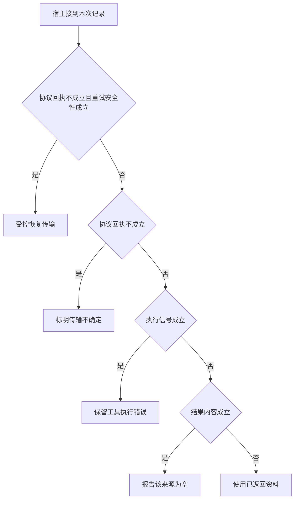

# RPC 成功与业务空集的区别

同一接口可能没收到响应、收到明确错误或成功查到空集。
把三者都写成空数组会让下一轮模型把基础设施故障解释成资料不存在。

本篇用一个封闭的教学决策器说明这一问题。输入是宿主收到的记录，不保证每个下游字段都已经获准使用。前置检查未成立时，下游即使带着缓存值，也不能拿来作业务断言。

## 先解决一个具体问题

**一次 HTTP 200、业务为空与一次超时可以给模型同一消息吗？**

前者有一份已完成查询的有效观察，后者连内容都未知。
分开记录让模型能区分“此来源未收录”和“本轮没拿到资料”，也能按不同政策重试。


先取一个能走到「使用已返回资料」的输入：收到完整的协议响应、工具没有报告执行错误、成功业务体提供所需资料、无法安全重放该操作。
把这四个条件代回后文的图，前面各个拦截分支都未满足，最终才有“合法且非空的工具观察可供判断”这个判断。
还原这个现场时要分别问：哪些位来自可信状态，哪些只是在接口中出现、尚未获得解释资格的字段。

## 先沿一次决策走到底



从上到下取第一条成立的出口。只改一个开关时，只有它之前的检查都未截断，该变化才可能到达真实动作。

“协议回执”的两种输入分别是“收到完整的协议响应”与“时限内未见有效协议回执”。
本地未收到回应不能排除远端已执行。

“执行信号”的两种输入分别是“工具明确报告执行错误”与“工具没有报告执行错误”。
业务空集不同于执行失败或协议拒绝。

“结果内容”的两种输入分别是“成功业务体中的资料为空”与“成功业务体提供所需资料”。
只有得到合法业务响应后才能解释空集。

“重试安全性”的两种输入分别是“支持有界安全重试”与“无法安全重放该操作”。
可靠性要看副作用和实际恢复协议。

## 最少需要哪几项观察

### 受控恢复传输

读操作可安全重试但没有回执。
在本节的全部组合中，有 4 种产生「受控恢复传输」，这只是逻辑空间的计数，不能当作实际用户请求的比例。

只取得时限内未见有效协议回执、支持有界安全重试，已经足以要求宿主「受控恢复传输」。
保持这些已知项，其余开关自由变化，仍有 4 种补全，判断没有翻转。

若删掉关于协议回执的证据，另一份允许的现场是收到完整的协议响应、工具没有报告执行错误、成功业务体提供所需资料、支持有界安全重试，它会使宿主「使用已返回资料」。

若删掉关于重试安全性的证据，另一份允许的现场是时限内未见有效协议回执、工具没有报告执行错误、成功业务体提供所需资料、无法安全重放该操作，它会使宿主「标明传输不确定」。

### 标明传输不确定

无有效回应不支持业务判断。
在本节的全部组合中，有 4 种产生「标明传输不确定」，这只是逻辑空间的计数，不能当作实际用户请求的比例。

只取得时限内未见有效协议回执、无法安全重放该操作，已经足以要求宿主「标明传输不确定」。

若删掉关于协议回执的证据，另一份允许的现场是收到完整的协议响应、工具没有报告执行错误、成功业务体提供所需资料、无法安全重放该操作，它会使宿主「使用已返回资料」。

若删掉关于重试安全性的证据，另一份允许的现场是时限内未见有效协议回执、工具没有报告执行错误、成功业务体提供所需资料、支持有界安全重试，它会使宿主「受控恢复传输」。

### 保留工具执行错误

明确失败应与业务缺失区分。
在本节的全部组合中，有 4 种产生「保留工具执行错误」，这只是逻辑空间的计数，不能当作实际用户请求的比例。

只取得收到完整的协议响应、工具明确报告执行错误，已经足以要求宿主「保留工具执行错误」。

若删掉关于协议回执的证据，另一份允许的现场是时限内未见有效协议回执、工具明确报告执行错误、成功业务体提供所需资料、无法安全重放该操作，它会使宿主「标明传输不确定」。

若删掉关于执行信号的证据，另一份允许的现场是收到完整的协议响应、工具没有报告执行错误、成功业务体提供所需资料、无法安全重放该操作，它会使宿主「使用已返回资料」。

### 报告该来源为空

合法查询完成且载荷为空。
在本节的全部组合中，有 2 种产生「报告该来源为空」，这只是逻辑空间的计数，不能当作实际用户请求的比例。

只取得收到完整的协议响应、工具没有报告执行错误、成功业务体中的资料为空，已经足以要求宿主「报告该来源为空」。
保持这些已知项，其余开关自由变化，仍有 2 种补全，判断没有翻转。

若删掉关于协议回执的证据，另一份允许的现场是时限内未见有效协议回执、工具没有报告执行错误、成功业务体中的资料为空、无法安全重放该操作，它会使宿主「标明传输不确定」。

若删掉关于执行信号的证据，另一份允许的现场是收到完整的协议响应、工具明确报告执行错误、成功业务体中的资料为空、无法安全重放该操作，它会使宿主「保留工具执行错误」。

若删掉关于结果内容的证据，另一份允许的现场是收到完整的协议响应、工具没有报告执行错误、成功业务体提供所需资料、无法安全重放该操作，它会使宿主「使用已返回资料」。

### 使用已返回资料

合法且非空的工具观察可供判断。
在本节的全部组合中，有 2 种产生「使用已返回资料」，这只是逻辑空间的计数，不能当作实际用户请求的比例。

只取得收到完整的协议响应、工具没有报告执行错误、成功业务体提供所需资料，已经足以要求宿主「使用已返回资料」。

若删掉关于协议回执的证据，另一份允许的现场是时限内未见有效协议回执、工具没有报告执行错误、成功业务体提供所需资料、无法安全重放该操作，它会使宿主「标明传输不确定」。

若删掉关于执行信号的证据，另一份允许的现场是收到完整的协议响应、工具明确报告执行错误、成功业务体提供所需资料、无法安全重放该操作，它会使宿主「保留工具执行错误」。

若删掉关于结果内容的证据，另一份允许的现场是收到完整的协议响应、工具没有报告执行错误、成功业务体中的资料为空、无法安全重放该操作，它会使宿主「报告该来源为空」。

## 以同一份契约解释截然不同的现场

<details>
<summary>展开推演与对应反例</summary>

下列样本按最先命中的业务分支排列。四位编码只作本篇页内定位，顺序与开头的四项输入一致。可以先猜下一动作，再展开相邻样本。

### 能够触发“受控恢复传输”的现场

**样本 0001**

业务侧交来时限内未见有效协议回执、工具没有报告执行错误，执行侧还记录了成功业务体提供所需资料、支持有界安全重试。
把样本压成最短证明，保留时限内未见有效协议回执、支持有界安全重试就能支持「受控恢复传输」。

在这份记录上，分别翻转「协议回执」、「重试安全性」中的任一项，其他项完全不变时，下一动作都会改变。

保持其余观察不动，单独切换「执行信号」、「结果内容」仍得到「受控恢复传输」，它们在这个现场不是决定性变量。

要从本例改走「标明传输不确定」，至少需要变动 1 项，一组最少改动是将支持有界安全重试换成无法安全重放该操作。

要从本例改走「使用已返回资料」，至少需要变动 1 项，一组最少改动是将时限内未见有效协议回执换成收到完整的协议响应。

要从本例改走「报告该来源为空」，至少需要变动 2 项，一组最少改动是将时限内未见有效协议回执、成功业务体提供所需资料换成收到完整的协议响应、成功业务体中的资料为空。

要从本例改走「保留工具执行错误」，至少需要变动 2 项，一组最少改动是将时限内未见有效协议回执、工具没有报告执行错误换成收到完整的协议响应、工具明确报告执行错误。

**样本 0011**

业务侧交来时限内未见有效协议回执、工具没有报告执行错误，执行侧还记录了成功业务体中的资料为空、支持有界安全重试。


要从本例改走「报告该来源为空」，至少需要变动 1 项，一组最少改动是将时限内未见有效协议回执换成收到完整的协议响应。

要从本例改走「使用已返回资料」，至少需要变动 2 项，一组最少改动是将时限内未见有效协议回执、成功业务体中的资料为空换成收到完整的协议响应、成功业务体提供所需资料。


**样本 0101**

业务侧交来时限内未见有效协议回执、工具明确报告执行错误，执行侧还记录了成功业务体提供所需资料、支持有界安全重试。


要从本例改走「保留工具执行错误」，至少需要变动 1 项，一组最少改动是将时限内未见有效协议回执换成收到完整的协议响应。

要从本例改走「使用已返回资料」，至少需要变动 2 项，一组最少改动是将时限内未见有效协议回执、工具明确报告执行错误换成收到完整的协议响应、工具没有报告执行错误。

要从本例改走「报告该来源为空」，至少需要变动 3 项，一组最少改动是将时限内未见有效协议回执、工具明确报告执行错误、成功业务体提供所需资料换成收到完整的协议响应、工具没有报告执行错误、成功业务体中的资料为空。

**样本 0111**

业务侧交来时限内未见有效协议回执、工具明确报告执行错误，执行侧还记录了成功业务体中的资料为空、支持有界安全重试。


要从本例改走「报告该来源为空」，至少需要变动 2 项，一组最少改动是将时限内未见有效协议回执、工具明确报告执行错误换成收到完整的协议响应、工具没有报告执行错误。

要从本例改走「使用已返回资料」，至少需要变动 3 项，一组最少改动是将时限内未见有效协议回执、工具明确报告执行错误、成功业务体中的资料为空换成收到完整的协议响应、工具没有报告执行错误、成功业务体提供所需资料。

### 能够触发“标明传输不确定”的现场

**样本 0000**

业务侧交来时限内未见有效协议回执、工具没有报告执行错误，执行侧还记录了成功业务体提供所需资料、无法安全重放该操作。
把样本压成最短证明，保留时限内未见有效协议回执、无法安全重放该操作就能支持「标明传输不确定」。


保持其余观察不动，单独切换「执行信号」、「结果内容」仍得到「标明传输不确定」，它们在这个现场不是决定性变量。

本例没走更靠前的「受控恢复传输」，因为无法安全重放该操作与那个入口的必要条件不符。

要从本例改走「受控恢复传输」，至少需要变动 1 项，一组最少改动是将无法安全重放该操作换成支持有界安全重试。


**样本 0010**

业务侧交来时限内未见有效协议回执、工具没有报告执行错误，执行侧还记录了成功业务体中的资料为空、无法安全重放该操作。


**样本 0100**

业务侧交来时限内未见有效协议回执、工具明确报告执行错误，执行侧还记录了成功业务体提供所需资料、无法安全重放该操作。


**样本 0110**

业务侧交来时限内未见有效协议回执、工具明确报告执行错误，执行侧还记录了成功业务体中的资料为空、无法安全重放该操作。


### 能够触发“保留工具执行错误”的现场

**样本 1100**

业务侧交来收到完整的协议响应、工具明确报告执行错误，执行侧还记录了成功业务体提供所需资料、无法安全重放该操作。
把样本压成最短证明，保留收到完整的协议响应、工具明确报告执行错误就能支持「保留工具执行错误」。

在这份记录上，分别翻转「协议回执」、「执行信号」中的任一项，其他项完全不变时，下一动作都会改变。

保持其余观察不动，单独切换「结果内容」、「重试安全性」仍得到「保留工具执行错误」，它们在这个现场不是决定性变量。

本例没走更靠前的「受控恢复传输」，因为收到完整的协议响应、无法安全重放该操作与那个入口的必要条件不符。

本例没走更靠前的「标明传输不确定」，因为收到完整的协议响应与那个入口的必要条件不符。

要从本例改走「标明传输不确定」，至少需要变动 1 项，一组最少改动是将收到完整的协议响应换成时限内未见有效协议回执。

要从本例改走「使用已返回资料」，至少需要变动 1 项，一组最少改动是将工具明确报告执行错误换成工具没有报告执行错误。

要从本例改走「受控恢复传输」，至少需要变动 2 项，一组最少改动是将收到完整的协议响应、无法安全重放该操作换成时限内未见有效协议回执、支持有界安全重试。

要从本例改走「报告该来源为空」，至少需要变动 2 项，一组最少改动是将工具明确报告执行错误、成功业务体提供所需资料换成工具没有报告执行错误、成功业务体中的资料为空。

**样本 1101**

业务侧交来收到完整的协议响应、工具明确报告执行错误，执行侧还记录了成功业务体提供所需资料、支持有界安全重试。


本例没走更靠前的「受控恢复传输」，因为收到完整的协议响应与那个入口的必要条件不符。


要从本例改走「受控恢复传输」，至少需要变动 1 项，一组最少改动是将收到完整的协议响应换成时限内未见有效协议回执。


要从本例改走「标明传输不确定」，至少需要变动 2 项，一组最少改动是将收到完整的协议响应、支持有界安全重试换成时限内未见有效协议回执、无法安全重放该操作。


**样本 1110**

业务侧交来收到完整的协议响应、工具明确报告执行错误，执行侧还记录了成功业务体中的资料为空、无法安全重放该操作。


要从本例改走「报告该来源为空」，至少需要变动 1 项，一组最少改动是将工具明确报告执行错误换成工具没有报告执行错误。


要从本例改走「使用已返回资料」，至少需要变动 2 项，一组最少改动是将工具明确报告执行错误、成功业务体中的资料为空换成工具没有报告执行错误、成功业务体提供所需资料。

**样本 1111**

业务侧交来收到完整的协议响应、工具明确报告执行错误，执行侧还记录了成功业务体中的资料为空、支持有界安全重试。


### 能够触发“报告该来源为空”的现场

**样本 1010**

业务侧交来收到完整的协议响应、工具没有报告执行错误，执行侧还记录了成功业务体中的资料为空、无法安全重放该操作。
把样本压成最短证明，保留收到完整的协议响应、工具没有报告执行错误、成功业务体中的资料为空就能支持「报告该来源为空」。

在这份记录上，分别翻转「协议回执」、「执行信号」、「结果内容」中的任一项，其他项完全不变时，下一动作都会改变。

保持其余观察不动，单独切换「重试安全性」仍得到「报告该来源为空」，它们在这个现场不是决定性变量。


本例没走更靠前的「保留工具执行错误」，因为工具没有报告执行错误与那个入口的必要条件不符。


要从本例改走「使用已返回资料」，至少需要变动 1 项，一组最少改动是将成功业务体中的资料为空换成成功业务体提供所需资料。

要从本例改走「保留工具执行错误」，至少需要变动 1 项，一组最少改动是将工具没有报告执行错误换成工具明确报告执行错误。


**样本 1011**

业务侧交来收到完整的协议响应、工具没有报告执行错误，执行侧还记录了成功业务体中的资料为空、支持有界安全重试。


### 能够触发“使用已返回资料”的现场

**样本 1000**

业务侧交来收到完整的协议响应、工具没有报告执行错误，执行侧还记录了成功业务体提供所需资料、无法安全重放该操作。
把样本压成最短证明，保留收到完整的协议响应、工具没有报告执行错误、成功业务体提供所需资料就能支持「使用已返回资料」。


保持其余观察不动，单独切换「重试安全性」仍得到「使用已返回资料」，它们在这个现场不是决定性变量。


本例没走更靠前的「报告该来源为空」，因为成功业务体提供所需资料与那个入口的必要条件不符。


要从本例改走「报告该来源为空」，至少需要变动 1 项，一组最少改动是将成功业务体提供所需资料换成成功业务体中的资料为空。


**样本 1001**

业务侧交来收到完整的协议响应、工具没有报告执行错误，执行侧还记录了成功业务体提供所需资料、支持有界安全重试。


</details>

## 当你只能看见一半记录

<details>
<summary>展开推演与对应反例</summary>

这次隐藏两个字段，保留另两个。对每个可见现场，检查四种合法补全是否同意。如仍有歧义，选择能使最坏剩余候选动作最少的字段继续查。并列时采用本篇字段顺序。

### 只保留协议回执与执行信号

已知时限内未见有效协议回执、工具没有报告执行错误时，四种补全的动作分布为受控恢复传输（2 种）、标明传输不确定（2 种）。

在时限内未见有效协议回执、工具没有报告执行错误这个现场补读「重试安全性」，最坏还剩 1 种动作，计算时只衡量歧义，尚未扣读取代价。
若补来的观察为“无法安全重放该操作”，范围缩成「标明传输不确定」。若为“支持有界安全重试”，则保留「受控恢复传输」。

区分不了的两条执行可以具体写成 0000 与 0001：它们共享已展示字段，却分别需要「标明传输不确定」和「受控恢复传输」。

已知时限内未见有效协议回执、工具明确报告执行错误时，四种补全的动作分布为受控恢复传输（2 种）、标明传输不确定（2 种）。

在时限内未见有效协议回执、工具明确报告执行错误这个现场补读「重试安全性」，最坏还剩 1 种动作，计算时只衡量歧义，尚未扣读取代价。

区分不了的两条执行可以具体写成 0100 与 0101：它们共享已展示字段，却分别需要「标明传输不确定」和「受控恢复传输」。

已知收到完整的协议响应、工具没有报告执行错误时，四种补全的动作分布为报告该来源为空（2 种）、使用已返回资料（2 种）。

在收到完整的协议响应、工具没有报告执行错误这个现场补读「结果内容」，最坏还剩 1 种动作，计算时只衡量歧义，尚未扣读取代价。
若补来的观察为“成功业务体提供所需资料”，范围缩成「使用已返回资料」。若为“成功业务体中的资料为空”，则保留「报告该来源为空」。

区分不了的两条执行可以具体写成 1000 与 1010：它们共享已展示字段，却分别需要「使用已返回资料」和「报告该来源为空」。

已知收到完整的协议响应、工具明确报告执行错误时，四种补全的动作分布为保留工具执行错误（4 种）。

就“保留工具执行错误”这个动作而言，在收到完整的协议响应、工具明确报告执行错误的前提下，另外两项观察不会推翻它。

### 只保留协议回执与结果内容

已知时限内未见有效协议回执、成功业务体提供所需资料时，四种补全的动作分布为受控恢复传输（2 种）、标明传输不确定（2 种）。

在时限内未见有效协议回执、成功业务体提供所需资料这个现场补读「重试安全性」，最坏还剩 1 种动作，计算时只衡量歧义，尚未扣读取代价。


已知时限内未见有效协议回执、成功业务体中的资料为空时，四种补全的动作分布为受控恢复传输（2 种）、标明传输不确定（2 种）。

在时限内未见有效协议回执、成功业务体中的资料为空这个现场补读「重试安全性」，最坏还剩 1 种动作，计算时只衡量歧义，尚未扣读取代价。

区分不了的两条执行可以具体写成 0010 与 0011：它们共享已展示字段，却分别需要「标明传输不确定」和「受控恢复传输」。

已知收到完整的协议响应、成功业务体提供所需资料时，四种补全的动作分布为保留工具执行错误（2 种）、使用已返回资料（2 种）。

在收到完整的协议响应、成功业务体提供所需资料这个现场补读「执行信号」，最坏还剩 1 种动作，计算时只衡量歧义，尚未扣读取代价。
若补来的观察为“工具没有报告执行错误”，范围缩成「使用已返回资料」。若为“工具明确报告执行错误”，则保留「保留工具执行错误」。

区分不了的两条执行可以具体写成 1000 与 1100：它们共享已展示字段，却分别需要「使用已返回资料」和「保留工具执行错误」。

已知收到完整的协议响应、成功业务体中的资料为空时，四种补全的动作分布为保留工具执行错误（2 种）、报告该来源为空（2 种）。

在收到完整的协议响应、成功业务体中的资料为空这个现场补读「执行信号」，最坏还剩 1 种动作，计算时只衡量歧义，尚未扣读取代价。
若补来的观察为“工具没有报告执行错误”，范围缩成「报告该来源为空」。若为“工具明确报告执行错误”，则保留「保留工具执行错误」。

区分不了的两条执行可以具体写成 1010 与 1110：它们共享已展示字段，却分别需要「报告该来源为空」和「保留工具执行错误」。

### 只保留执行信号与结果内容

已知工具没有报告执行错误、成功业务体提供所需资料时，四种补全的动作分布为受控恢复传输（1 种）、标明传输不确定（1 种）、使用已返回资料（2 种）。

在工具没有报告执行错误、成功业务体提供所需资料这个现场补读「协议回执」，最坏还剩 2 种动作，计算时只衡量歧义，尚未扣读取代价。
若补来的观察为“时限内未见有效协议回执”，范围缩成「标明传输不确定」、「受控恢复传输」。若为“收到完整的协议响应”，则保留「使用已返回资料」。


已知工具没有报告执行错误、成功业务体中的资料为空时，四种补全的动作分布为受控恢复传输（1 种）、标明传输不确定（1 种）、报告该来源为空（2 种）。

在工具没有报告执行错误、成功业务体中的资料为空这个现场补读「协议回执」，最坏还剩 2 种动作，计算时只衡量歧义，尚未扣读取代价。
若补来的观察为“时限内未见有效协议回执”，范围缩成「标明传输不确定」、「受控恢复传输」。若为“收到完整的协议响应”，则保留「报告该来源为空」。


已知工具明确报告执行错误、成功业务体提供所需资料时，四种补全的动作分布为受控恢复传输（1 种）、标明传输不确定（1 种）、保留工具执行错误（2 种）。

在工具明确报告执行错误、成功业务体提供所需资料这个现场补读「协议回执」，最坏还剩 2 种动作，计算时只衡量歧义，尚未扣读取代价。
若补来的观察为“时限内未见有效协议回执”，范围缩成「标明传输不确定」、「受控恢复传输」。若为“收到完整的协议响应”，则保留「保留工具执行错误」。


已知工具明确报告执行错误、成功业务体中的资料为空时，四种补全的动作分布为受控恢复传输（1 种）、标明传输不确定（1 种）、保留工具执行错误（2 种）。

在工具明确报告执行错误、成功业务体中的资料为空这个现场补读「协议回执」，最坏还剩 2 种动作，计算时只衡量歧义，尚未扣读取代价。

区分不了的两条执行可以具体写成 0110 与 0111：它们共享已展示字段，却分别需要「标明传输不确定」和「受控恢复传输」。

### 只保留协议回执与重试安全性

已知时限内未见有效协议回执、无法安全重放该操作时，四种补全的动作分布为标明传输不确定（4 种）。

就“标明传输不确定”这个动作而言，在时限内未见有效协议回执、无法安全重放该操作的前提下，另外两项观察不会推翻它。

已知时限内未见有效协议回执、支持有界安全重试时，四种补全的动作分布为受控恢复传输（4 种）。

就“受控恢复传输”这个动作而言，在时限内未见有效协议回执、支持有界安全重试的前提下，另外两项观察不会推翻它。

已知收到完整的协议响应、无法安全重放该操作时，四种补全的动作分布为保留工具执行错误（2 种）、报告该来源为空（1 种）、使用已返回资料（1 种）。

在收到完整的协议响应、无法安全重放该操作这个现场补读「执行信号」，最坏还剩 2 种动作，计算时只衡量歧义，尚未扣读取代价。
若补来的观察为“工具没有报告执行错误”，范围缩成「使用已返回资料」、「报告该来源为空」。若为“工具明确报告执行错误”，则保留「保留工具执行错误」。


已知收到完整的协议响应、支持有界安全重试时，四种补全的动作分布为保留工具执行错误（2 种）、报告该来源为空（1 种）、使用已返回资料（1 种）。

在收到完整的协议响应、支持有界安全重试这个现场补读「执行信号」，最坏还剩 2 种动作，计算时只衡量歧义，尚未扣读取代价。

区分不了的两条执行可以具体写成 1001 与 1011：它们共享已展示字段，却分别需要「使用已返回资料」和「报告该来源为空」。

### 只保留执行信号与重试安全性

已知工具没有报告执行错误、无法安全重放该操作时，四种补全的动作分布为标明传输不确定（2 种）、报告该来源为空（1 种）、使用已返回资料（1 种）。

在工具没有报告执行错误、无法安全重放该操作这个现场补读「协议回执」，最坏还剩 2 种动作，计算时只衡量歧义，尚未扣读取代价。
若补来的观察为“时限内未见有效协议回执”，范围缩成「标明传输不确定」。若为“收到完整的协议响应”，则保留「使用已返回资料」、「报告该来源为空」。

区分不了的两条执行可以具体写成 0000 与 1000：它们共享已展示字段，却分别需要「标明传输不确定」和「使用已返回资料」。

已知工具没有报告执行错误、支持有界安全重试时，四种补全的动作分布为受控恢复传输（2 种）、报告该来源为空（1 种）、使用已返回资料（1 种）。

在工具没有报告执行错误、支持有界安全重试这个现场补读「协议回执」，最坏还剩 2 种动作，计算时只衡量歧义，尚未扣读取代价。
若补来的观察为“时限内未见有效协议回执”，范围缩成「受控恢复传输」。若为“收到完整的协议响应”，则保留「使用已返回资料」、「报告该来源为空」。

区分不了的两条执行可以具体写成 0001 与 1001：它们共享已展示字段，却分别需要「受控恢复传输」和「使用已返回资料」。

已知工具明确报告执行错误、无法安全重放该操作时，四种补全的动作分布为标明传输不确定（2 种）、保留工具执行错误（2 种）。

在工具明确报告执行错误、无法安全重放该操作这个现场补读「协议回执」，最坏还剩 1 种动作，计算时只衡量歧义，尚未扣读取代价。
若补来的观察为“时限内未见有效协议回执”，范围缩成「标明传输不确定」。若为“收到完整的协议响应”，则保留「保留工具执行错误」。

区分不了的两条执行可以具体写成 0100 与 1100：它们共享已展示字段，却分别需要「标明传输不确定」和「保留工具执行错误」。

已知工具明确报告执行错误、支持有界安全重试时，四种补全的动作分布为受控恢复传输（2 种）、保留工具执行错误（2 种）。

在工具明确报告执行错误、支持有界安全重试这个现场补读「协议回执」，最坏还剩 1 种动作，计算时只衡量歧义，尚未扣读取代价。
若补来的观察为“时限内未见有效协议回执”，范围缩成「受控恢复传输」。若为“收到完整的协议响应”，则保留「保留工具执行错误」。

区分不了的两条执行可以具体写成 0101 与 1101：它们共享已展示字段，却分别需要「受控恢复传输」和「保留工具执行错误」。

### 只保留结果内容与重试安全性

已知成功业务体提供所需资料、无法安全重放该操作时，四种补全的动作分布为标明传输不确定（2 种）、保留工具执行错误（1 种）、使用已返回资料（1 种）。

在成功业务体提供所需资料、无法安全重放该操作这个现场补读「协议回执」，最坏还剩 2 种动作，计算时只衡量歧义，尚未扣读取代价。
若补来的观察为“时限内未见有效协议回执”，范围缩成「标明传输不确定」。若为“收到完整的协议响应”，则保留「使用已返回资料」、「保留工具执行错误」。


已知成功业务体提供所需资料、支持有界安全重试时，四种补全的动作分布为受控恢复传输（2 种）、保留工具执行错误（1 种）、使用已返回资料（1 种）。

在成功业务体提供所需资料、支持有界安全重试这个现场补读「协议回执」，最坏还剩 2 种动作，计算时只衡量歧义，尚未扣读取代价。
若补来的观察为“时限内未见有效协议回执”，范围缩成「受控恢复传输」。若为“收到完整的协议响应”，则保留「使用已返回资料」、「保留工具执行错误」。


已知成功业务体中的资料为空、无法安全重放该操作时，四种补全的动作分布为标明传输不确定（2 种）、保留工具执行错误（1 种）、报告该来源为空（1 种）。

在成功业务体中的资料为空、无法安全重放该操作这个现场补读「协议回执」，最坏还剩 2 种动作，计算时只衡量歧义，尚未扣读取代价。
若补来的观察为“时限内未见有效协议回执”，范围缩成「标明传输不确定」。若为“收到完整的协议响应”，则保留「报告该来源为空」、「保留工具执行错误」。

区分不了的两条执行可以具体写成 0010 与 1010：它们共享已展示字段，却分别需要「标明传输不确定」和「报告该来源为空」。

已知成功业务体中的资料为空、支持有界安全重试时，四种补全的动作分布为受控恢复传输（2 种）、保留工具执行错误（1 种）、报告该来源为空（1 种）。

在成功业务体中的资料为空、支持有界安全重试这个现场补读「协议回执」，最坏还剩 2 种动作，计算时只衡量歧义，尚未扣读取代价。
若补来的观察为“时限内未见有效协议回执”，范围缩成「受控恢复传输」。若为“收到完整的协议响应”，则保留「报告该来源为空」、「保留工具执行错误」。

区分不了的两条执行可以具体写成 0011 与 1011：它们共享已展示字段，却分别需要「受控恢复传输」和「报告该来源为空」。

</details>

## 单因素干预与边界测试

<details>
<summary>展开推演与对应反例</summary>

### 只改变协议回执

固定另外三个条件得到八对现场，从“时限内未见有效协议回执”转为“收到完整的协议响应”时，8 对翻转动作，另外 0 对保持不变。

有 1 对现场沿「标明传输不确定」变到「使用已返回资料」，可复现的一组受控背景为工具没有报告执行错误、成功业务体提供所需资料、无法安全重放该操作。

有 1 对现场沿「受控恢复传输」变到「使用已返回资料」，可复现的一组受控背景为工具没有报告执行错误、成功业务体提供所需资料、支持有界安全重试。

有 1 对现场沿「标明传输不确定」变到「报告该来源为空」，可复现的一组受控背景为工具没有报告执行错误、成功业务体中的资料为空、无法安全重放该操作。

有 1 对现场沿「受控恢复传输」变到「报告该来源为空」，可复现的一组受控背景为工具没有报告执行错误、成功业务体中的资料为空、支持有界安全重试。

有 2 对现场沿「标明传输不确定」变到「保留工具执行错误」，可复现的一组受控背景为工具明确报告执行错误、成功业务体提供所需资料、无法安全重放该操作。

有 2 对现场沿「受控恢复传输」变到「保留工具执行错误」，可复现的一组受控背景为工具明确报告执行错误、成功业务体提供所需资料、支持有界安全重试。

### 只改变执行信号

固定另外三个条件得到八对现场，从“工具没有报告执行错误”转为“工具明确报告执行错误”时，4 对翻转动作，另外 4 对保持不变。

令时限内未见有效协议回执、成功业务体提供所需资料、无法安全重放该操作，执行信号的两个取值均得到「标明传输不确定」。在八对中，共有 2 对表现为这一种稳定出口。

令时限内未见有效协议回执、成功业务体提供所需资料、支持有界安全重试，执行信号的两个取值均得到「受控恢复传输」。在八对中，共有 2 对表现为这一种稳定出口。

有 2 对现场沿「使用已返回资料」变到「保留工具执行错误」，可复现的一组受控背景为收到完整的协议响应、成功业务体提供所需资料、无法安全重放该操作。

有 2 对现场沿「报告该来源为空」变到「保留工具执行错误」，可复现的一组受控背景为收到完整的协议响应、成功业务体中的资料为空、无法安全重放该操作。

### 只改变结果内容

固定另外三个条件得到八对现场，从“成功业务体提供所需资料”转为“成功业务体中的资料为空”时，2 对翻转动作，另外 6 对保持不变。

令时限内未见有效协议回执、工具没有报告执行错误、无法安全重放该操作，结果内容的两个取值均得到「标明传输不确定」。在八对中，共有 2 对表现为这一种稳定出口。

令时限内未见有效协议回执、工具没有报告执行错误、支持有界安全重试，结果内容的两个取值均得到「受控恢复传输」。在八对中，共有 2 对表现为这一种稳定出口。

有 2 对现场沿「使用已返回资料」变到「报告该来源为空」，可复现的一组受控背景为收到完整的协议响应、工具没有报告执行错误、无法安全重放该操作。

令收到完整的协议响应、工具明确报告执行错误、无法安全重放该操作，结果内容的两个取值均得到「保留工具执行错误」。在八对中，共有 2 对表现为这一种稳定出口。

### 只改变重试安全性

固定另外三个条件得到八对现场，从“无法安全重放该操作”转为“支持有界安全重试”时，4 对翻转动作，另外 4 对保持不变。

有 4 对现场沿「标明传输不确定」变到「受控恢复传输」，可复现的一组受控背景为时限内未见有效协议回执、工具没有报告执行错误、成功业务体提供所需资料。

令收到完整的协议响应、工具没有报告执行错误、成功业务体提供所需资料，重试安全性的两个取值均得到「使用已返回资料」。在八对中，共有 1 对表现为这一种稳定出口。

令收到完整的协议响应、工具没有报告执行错误、成功业务体中的资料为空，重试安全性的两个取值均得到「报告该来源为空」。在八对中，共有 1 对表现为这一种稳定出口。

令收到完整的协议响应、工具明确报告执行错误、成功业务体提供所需资料，重试安全性的两个取值均得到「保留工具执行错误」。在八对中，共有 2 对表现为这一种稳定出口。

</details>

## 哪些回归样本真能抓住实现错误

<details>
<summary>展开推演与对应反例</summary>

如果删除“受控恢复传输”这个分支，在本篇 16 种输入里有 4 种会改走另一出口。

反例 0001 的完整记录为时限内未见有效协议回执、工具没有报告执行错误、成功业务体提供所需资料、支持有界安全重试。正确结果是「受控恢复传输」，这个改坏的实现却给出「标明传输不确定」。

如果删除“标明传输不确定”这个分支，在本篇 16 种输入里有 4 种会改走另一出口。

反例 0000 的完整记录为时限内未见有效协议回执、工具没有报告执行错误、成功业务体提供所需资料、无法安全重放该操作。正确结果是「标明传输不确定」，这个改坏的实现却给出「使用已返回资料」。

如果删除“保留工具执行错误”这个分支，在本篇 16 种输入里有 4 种会改走另一出口。

反例 1100 的完整记录为收到完整的协议响应、工具明确报告执行错误、成功业务体提供所需资料、无法安全重放该操作。正确结果是「保留工具执行错误」，这个改坏的实现却给出「使用已返回资料」。

如果删除“报告该来源为空”这个分支，在本篇 16 种输入里有 2 种会改走另一出口。

反例 1010 的完整记录为收到完整的协议响应、工具没有报告执行错误、成功业务体中的资料为空、无法安全重放该操作。正确结果是「报告该来源为空」，这个改坏的实现却给出「使用已返回资料」。

如果交换“受控恢复传输”和“标明传输不确定”的判断次序，在本篇 16 种输入里有 4 种会改走另一出口。


如果交换“标明传输不确定”和“保留工具执行错误”的判断次序，在本篇 16 种输入里有 2 种会改走另一出口。

反例 0100 的完整记录为时限内未见有效协议回执、工具明确报告执行错误、成功业务体提供所需资料、无法安全重放该操作。正确结果是「标明传输不确定」，这个改坏的实现却给出「保留工具执行错误」。

如果交换“保留工具执行错误”和“报告该来源为空”的判断次序，在本篇 16 种输入里有 2 种会改走另一出口。

反例 1110 的完整记录为收到完整的协议响应、工具明确报告执行错误、成功业务体中的资料为空、无法安全重放该操作。正确结果是「保留工具执行错误」，这个改坏的实现却给出「报告该来源为空」。

补入样本 0001（时限内未见有效协议回执、工具没有报告执行错误、成功业务体提供所需资料、支持有界安全重试）能新增检出「删除“受控恢复传输”这个分支」、「交换“受控恢复传输”和“标明传输不确定”的判断次序」。

补入样本 0100（时限内未见有效协议回执、工具明确报告执行错误、成功业务体提供所需资料、无法安全重放该操作）能新增检出「删除“标明传输不确定”这个分支」、「交换“标明传输不确定”和“保留工具执行错误”的判断次序」。

补入样本 1110（收到完整的协议响应、工具明确报告执行错误、成功业务体中的资料为空、无法安全重放该操作）能新增检出「删除“保留工具执行错误”这个分支」、「交换“保留工具执行错误”和“报告该来源为空”的判断次序」。

补入样本 1010（收到完整的协议响应、工具没有报告执行错误、成功业务体中的资料为空、无法安全重放该操作）能新增检出「删除“报告该来源为空”这个分支」。

这里每次选覆盖尚未捕获缺陷最多的样本，并不保证用例数全局最小。它给出的反例能作为 Java 单测输入。真实模型是否会自主产生这些提议，仍须单独评测。

</details>

## 把状态覆盖换成有抽样偏差的评测批次

<details>
<summary>展开推演与对应反例</summary>

前面的十六种记录各有一票。现在只改样本构成：对一个给定字段，把成立侧的每种记录各取三份、另一侧各取一份。这是人为配比的 32 份回放，不是线上频率估计。
将偏向成立与偏向不成立的两次批次对照，可以隔离分母变化。底层宿主和所有答案保持相同，比例仍可能移动。

### 改变“协议回执”的样本配比

只看「受控恢复传输」，在收到完整的协议响应的八个不同输入中有 0 个命中，在时限内未见有效协议回执的另八个输入中有 4 个命中。
把「协议回执」成立侧按三倍取样，「受控恢复传输」占 4/32，反过来向未成立侧倾斜后占 12/32。
这次重加权使「受控恢复传输」的占比相差 25 个百分点。若按两种不同的“协议回执”分布跑新旧版，不能把这项差异全部归功于实现。

只看「标明传输不确定」，在收到完整的协议响应的八个不同输入中有 0 个命中，在时限内未见有效协议回执的另八个输入中有 4 个命中。
把「协议回执」成立侧按三倍取样，「标明传输不确定」占 4/32，反过来向未成立侧倾斜后占 12/32。
这次重加权使「标明传输不确定」的占比相差 25 个百分点。若按两种不同的“协议回执”分布跑新旧版，不能把这项差异全部归功于实现。

只看「保留工具执行错误」，在收到完整的协议响应的八个不同输入中有 4 个命中，在时限内未见有效协议回执的另八个输入中有 0 个命中。
把「协议回执」成立侧按三倍取样，「保留工具执行错误」占 12/32，反过来向未成立侧倾斜后占 4/32。
这次重加权使「保留工具执行错误」的占比相差 25 个百分点。若按两种不同的“协议回执”分布跑新旧版，不能把这项差异全部归功于实现。

只看「报告该来源为空」，在收到完整的协议响应的八个不同输入中有 2 个命中，在时限内未见有效协议回执的另八个输入中有 0 个命中。
把「协议回执」成立侧按三倍取样，「报告该来源为空」占 6/32，反过来向未成立侧倾斜后占 2/32。
这次重加权使「报告该来源为空」的占比相差 12.5 个百分点。若按两种不同的“协议回执”分布跑新旧版，不能把这项差异全部归功于实现。

只看「使用已返回资料」，在收到完整的协议响应的八个不同输入中有 2 个命中，在时限内未见有效协议回执的另八个输入中有 0 个命中。
把「协议回执」成立侧按三倍取样，「使用已返回资料」占 6/32，反过来向未成立侧倾斜后占 2/32。
这次重加权使「使用已返回资料」的占比相差 12.5 个百分点。若按两种不同的“协议回执”分布跑新旧版，不能把这项差异全部归功于实现。

### 改变“执行信号”的样本配比

只看「受控恢复传输」，在工具明确报告执行错误的八个不同输入中有 2 个命中，在工具没有报告执行错误的另八个输入中有 2 个命中。
把「执行信号」成立侧按三倍取样，「受控恢复传输」占 8/32，反过来向未成立侧倾斜后占 8/32。
两批「受控恢复传输」的边际比例相同，是因为这个出口在“执行信号”的两侧计数相等，这不能单独证明每一对现场都不受它影响。

只看「标明传输不确定」，在工具明确报告执行错误的八个不同输入中有 2 个命中，在工具没有报告执行错误的另八个输入中有 2 个命中。
把「执行信号」成立侧按三倍取样，「标明传输不确定」占 8/32，反过来向未成立侧倾斜后占 8/32。
两批「标明传输不确定」的边际比例相同，是因为这个出口在“执行信号”的两侧计数相等，这不能单独证明每一对现场都不受它影响。

只看「保留工具执行错误」，在工具明确报告执行错误的八个不同输入中有 4 个命中，在工具没有报告执行错误的另八个输入中有 0 个命中。
把「执行信号」成立侧按三倍取样，「保留工具执行错误」占 12/32，反过来向未成立侧倾斜后占 4/32。
这次重加权使「保留工具执行错误」的占比相差 25 个百分点。若按两种不同的“执行信号”分布跑新旧版，不能把这项差异全部归功于实现。

只看「报告该来源为空」，在工具明确报告执行错误的八个不同输入中有 0 个命中，在工具没有报告执行错误的另八个输入中有 2 个命中。
把「执行信号」成立侧按三倍取样，「报告该来源为空」占 2/32，反过来向未成立侧倾斜后占 6/32。
这次重加权使「报告该来源为空」的占比相差 12.5 个百分点。若按两种不同的“执行信号”分布跑新旧版，不能把这项差异全部归功于实现。

只看「使用已返回资料」，在工具明确报告执行错误的八个不同输入中有 0 个命中，在工具没有报告执行错误的另八个输入中有 2 个命中。
把「执行信号」成立侧按三倍取样，「使用已返回资料」占 2/32，反过来向未成立侧倾斜后占 6/32。
这次重加权使「使用已返回资料」的占比相差 12.5 个百分点。若按两种不同的“执行信号”分布跑新旧版，不能把这项差异全部归功于实现。

### 改变“结果内容”的样本配比

只看「受控恢复传输」，在成功业务体中的资料为空的八个不同输入中有 2 个命中，在成功业务体提供所需资料的另八个输入中有 2 个命中。
把「结果内容」成立侧按三倍取样，「受控恢复传输」占 8/32，反过来向未成立侧倾斜后占 8/32。
两批「受控恢复传输」的边际比例相同，是因为这个出口在“结果内容”的两侧计数相等，这不能单独证明每一对现场都不受它影响。

只看「标明传输不确定」，在成功业务体中的资料为空的八个不同输入中有 2 个命中，在成功业务体提供所需资料的另八个输入中有 2 个命中。
把「结果内容」成立侧按三倍取样，「标明传输不确定」占 8/32，反过来向未成立侧倾斜后占 8/32。
两批「标明传输不确定」的边际比例相同，是因为这个出口在“结果内容”的两侧计数相等，这不能单独证明每一对现场都不受它影响。

只看「保留工具执行错误」，在成功业务体中的资料为空的八个不同输入中有 2 个命中，在成功业务体提供所需资料的另八个输入中有 2 个命中。
把「结果内容」成立侧按三倍取样，「保留工具执行错误」占 8/32，反过来向未成立侧倾斜后占 8/32。
两批「保留工具执行错误」的边际比例相同，是因为这个出口在“结果内容”的两侧计数相等，这不能单独证明每一对现场都不受它影响。

只看「报告该来源为空」，在成功业务体中的资料为空的八个不同输入中有 2 个命中，在成功业务体提供所需资料的另八个输入中有 0 个命中。
把「结果内容」成立侧按三倍取样，「报告该来源为空」占 6/32，反过来向未成立侧倾斜后占 2/32。
这次重加权使「报告该来源为空」的占比相差 12.5 个百分点。若按两种不同的“结果内容”分布跑新旧版，不能把这项差异全部归功于实现。

只看「使用已返回资料」，在成功业务体中的资料为空的八个不同输入中有 0 个命中，在成功业务体提供所需资料的另八个输入中有 2 个命中。
把「结果内容」成立侧按三倍取样，「使用已返回资料」占 2/32，反过来向未成立侧倾斜后占 6/32。
这次重加权使「使用已返回资料」的占比相差 12.5 个百分点。若按两种不同的“结果内容”分布跑新旧版，不能把这项差异全部归功于实现。

### 改变“重试安全性”的样本配比

只看「受控恢复传输」，在支持有界安全重试的八个不同输入中有 4 个命中，在无法安全重放该操作的另八个输入中有 0 个命中。
把「重试安全性」成立侧按三倍取样，「受控恢复传输」占 12/32，反过来向未成立侧倾斜后占 4/32。
这次重加权使「受控恢复传输」的占比相差 25 个百分点。若按两种不同的“重试安全性”分布跑新旧版，不能把这项差异全部归功于实现。

只看「标明传输不确定」，在支持有界安全重试的八个不同输入中有 0 个命中，在无法安全重放该操作的另八个输入中有 4 个命中。
把「重试安全性」成立侧按三倍取样，「标明传输不确定」占 4/32，反过来向未成立侧倾斜后占 12/32。
这次重加权使「标明传输不确定」的占比相差 25 个百分点。若按两种不同的“重试安全性”分布跑新旧版，不能把这项差异全部归功于实现。

只看「保留工具执行错误」，在支持有界安全重试的八个不同输入中有 2 个命中，在无法安全重放该操作的另八个输入中有 2 个命中。
把「重试安全性」成立侧按三倍取样，「保留工具执行错误」占 8/32，反过来向未成立侧倾斜后占 8/32。
两批「保留工具执行错误」的边际比例相同，是因为这个出口在“重试安全性”的两侧计数相等，这不能单独证明每一对现场都不受它影响。

只看「报告该来源为空」，在支持有界安全重试的八个不同输入中有 1 个命中，在无法安全重放该操作的另八个输入中有 1 个命中。
把「重试安全性」成立侧按三倍取样，「报告该来源为空」占 4/32，反过来向未成立侧倾斜后占 4/32。
两批「报告该来源为空」的边际比例相同，是因为这个出口在“重试安全性”的两侧计数相等，这不能单独证明每一对现场都不受它影响。

只看「使用已返回资料」，在支持有界安全重试的八个不同输入中有 1 个命中，在无法安全重放该操作的另八个输入中有 1 个命中。
把「重试安全性」成立侧按三倍取样，「使用已返回资料」占 4/32，反过来向未成立侧倾斜后占 4/32。
两批「使用已返回资料」的边际比例相同，是因为这个出口在“重试安全性”的两侧计数相等，这不能单独证明每一对现场都不受它影响。

</details>

## 只看终态，能逆推出多少原始事实

<details>
<summary>展开推演与对应反例</summary>

### 只保留“受控恢复传输”这条结果时

在本节契约与完整输入域内，仅知「受控恢复传输」就能倒推出时限内未见有效协议回执，这一推断依赖版本未变且日志中的终态可信。

「受控恢复传输」不能证明执行信号取哪一侧：0001 和 0101 有相同终态，却分别记为“工具没有报告执行错误”和“工具明确报告执行错误”。

「受控恢复传输」不能证明结果内容取哪一侧：0001 和 0011 有相同终态，却分别记为“成功业务体提供所需资料”和“成功业务体中的资料为空”。

在本节契约与完整输入域内，仅知「受控恢复传输」就能倒推出支持有界安全重试，这一推断依赖版本未变且日志中的终态可信。

反查「受控恢复传输」的诊断日志，优先保留能区分样本 0001 与 0000 的「重试安全性」，否则很容易把邻近的「标明传输不确定」看成同一种故障。

### 只保留“标明传输不确定”这条结果时

在本节契约与完整输入域内，仅知「标明传输不确定」就能倒推出时限内未见有效协议回执，这一推断依赖版本未变且日志中的终态可信。

「标明传输不确定」不能证明执行信号取哪一侧：0000 和 0100 有相同终态，却分别记为“工具没有报告执行错误”和“工具明确报告执行错误”。

「标明传输不确定」不能证明结果内容取哪一侧：0000 和 0010 有相同终态，却分别记为“成功业务体提供所需资料”和“成功业务体中的资料为空”。

在本节契约与完整输入域内，仅知「标明传输不确定」就能倒推出无法安全重放该操作，这一推断依赖版本未变且日志中的终态可信。

反查「标明传输不确定」的诊断日志，优先保留能区分样本 0000 与 0001 的「重试安全性」，否则很容易把邻近的「受控恢复传输」看成同一种故障。

### 只保留“保留工具执行错误”这条结果时

在本节契约与完整输入域内，仅知「保留工具执行错误」就能倒推出收到完整的协议响应，这一推断依赖版本未变且日志中的终态可信。

在本节契约与完整输入域内，仅知「保留工具执行错误」就能倒推出工具明确报告执行错误，这一推断依赖版本未变且日志中的终态可信。

「保留工具执行错误」不能证明结果内容取哪一侧：1100 和 1110 有相同终态，却分别记为“成功业务体提供所需资料”和“成功业务体中的资料为空”。

「保留工具执行错误」不能证明重试安全性取哪一侧：1100 和 1101 有相同终态，却分别记为“无法安全重放该操作”和“支持有界安全重试”。

反查「保留工具执行错误」的诊断日志，优先保留能区分样本 1100 与 0100 的「协议回执」，否则很容易把邻近的「标明传输不确定」看成同一种故障。

### 只保留“报告该来源为空”这条结果时

在本节契约与完整输入域内，仅知「报告该来源为空」就能倒推出收到完整的协议响应，这一推断依赖版本未变且日志中的终态可信。

在本节契约与完整输入域内，仅知「报告该来源为空」就能倒推出工具没有报告执行错误，这一推断依赖版本未变且日志中的终态可信。

在本节契约与完整输入域内，仅知「报告该来源为空」就能倒推出成功业务体中的资料为空，这一推断依赖版本未变且日志中的终态可信。

「报告该来源为空」不能证明重试安全性取哪一侧：1010 和 1011 有相同终态，却分别记为“无法安全重放该操作”和“支持有界安全重试”。

反查「报告该来源为空」的诊断日志，优先保留能区分样本 1010 与 0010 的「协议回执」，否则很容易把邻近的「标明传输不确定」看成同一种故障。

### 只保留“使用已返回资料”这条结果时

在本节契约与完整输入域内，仅知「使用已返回资料」就能倒推出收到完整的协议响应，这一推断依赖版本未变且日志中的终态可信。

在本节契约与完整输入域内，仅知「使用已返回资料」就能倒推出工具没有报告执行错误，这一推断依赖版本未变且日志中的终态可信。

在本节契约与完整输入域内，仅知「使用已返回资料」就能倒推出成功业务体提供所需资料，这一推断依赖版本未变且日志中的终态可信。

「使用已返回资料」不能证明重试安全性取哪一侧：1000 和 1001 有相同终态，却分别记为“无法安全重放该操作”和“支持有界安全重试”。

反查「使用已返回资料」的诊断日志，优先保留能区分样本 1000 与 0000 的「协议回执」，否则很容易把邻近的「标明传输不确定」看成同一种故障。

</details>

## 面试复述与复算

面试题可以从“一次 HTTP 200、业务为空与一次超时可以给模型同一消息吗？”起步。先给出本篇的触发条件和一条真实执行端可检查的证据，再用一个相邻反例限定结论的适用范围。

在仓库根目录执行下列命令可以重算本篇的一个输入。四位数字依次选择正文列出的四项条件，0 表示未成立或低档，1 表示成立或高档。
```powershell
node examples/reading-cases/replay.mjs 6 4 0101
```

[本周主文](../theory.md) · [配套实验](../lab.md) · [下一篇研读](05.md)
