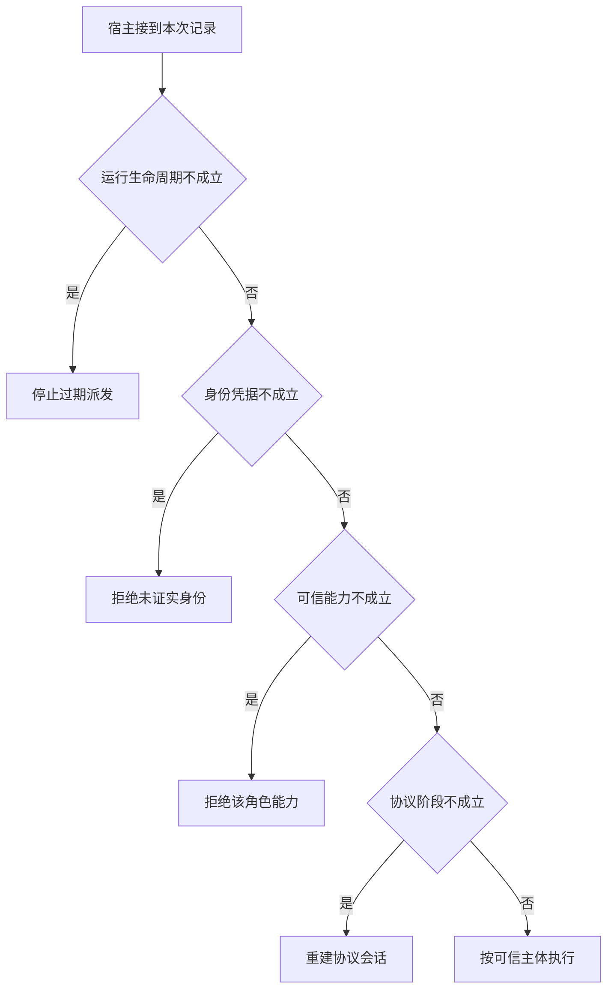

# 共享连接上的父子任务权限

主任务和子任务共用管道时，服务器只看到名字与参数。
正文里自称主任务不能替代逐调用身份。
即使成功握手，也应能通过一个反例证明禁用能力确实受执行层控制。

本篇用一个封闭的教学决策器说明这一问题。输入是宿主收到的记录，不保证每个下游字段都已经获准使用。前置检查未成立时，下游即使带着缓存值，也不能拿来作业务断言。

## 先解决一个具体问题

**禁止子任务调 MCP，只在提示词里声明是否足够？**

如果子运行时仍持有可用连接和工具，提示未改变实际权限。
可在宿主移除能力，或用执行端可核验的逐调用身份裁决。再用伪造角色和直接调用做负例。


先取一个能走到「按可信主体执行」的输入：执行端可以验证调用者、宿主确认当前主体获准、已协商版本和能力、本轮尚在处理。
把这四个条件代回后文的图，前面各个拦截分支都未满足，最终才有“身份与能力及会话状态均满足”这个判断。
还原这个现场时要分别问：哪些位来自可信状态，哪些只是在接口中出现、尚未获得解释资格的字段。

## 先沿一次决策走到底



从上到下取第一条成立的出口。只改一个开关时，只有它之前的检查都未截断，该变化才可能到达真实动作。

“身份凭据”的两种输入分别是“执行端可以验证调用者”与“角色只由消息正文自报”。
公共连接本身无法可靠区分父子任务。

“可信能力”的两种输入分别是“宿主确认当前主体获准”与“当前主体未获授权”。
权限取自可信入口或执行端，不由模型生成。

“协议阶段”的两种输入分别是“已协商版本和能力”与“协议协商尚未完成”。
服务能力发现与实际调用有生命周期前提。

“运行生命周期”的两种输入分别是“本轮尚在处理”与“本轮已经终止”。
过期回执可归档，不能悄悄覆盖已交付的终态。

## 最少需要哪几项观察

### 停止过期派发

本轮已经结束。
在本节的全部组合中，有 8 种产生「停止过期派发」，这只是逻辑空间的计数，不能当作实际用户请求的比例。

只取得本轮已经终止，已经足以要求宿主「停止过期派发」。
保持这些已知项，其余开关自由变化，仍有 8 种补全，判断没有翻转。

若删掉关于运行生命周期的证据，另一份允许的现场是角色只由消息正文自报、当前主体未获授权、协议协商尚未完成、本轮尚在处理，它会使宿主「拒绝未证实身份」。

### 拒绝未证实身份

文字声明无法证明角色。
在本节的全部组合中，有 4 种产生「拒绝未证实身份」，这只是逻辑空间的计数，不能当作实际用户请求的比例。

只取得角色只由消息正文自报、本轮尚在处理，已经足以要求宿主「拒绝未证实身份」。
保持这些已知项，其余开关自由变化，仍有 4 种补全，判断没有翻转。

若删掉关于身份凭据的证据，另一份允许的现场是执行端可以验证调用者、当前主体未获授权、协议协商尚未完成、本轮尚在处理，它会使宿主「拒绝该角色能力」。

若删掉关于运行生命周期的证据，另一份允许的现场是角色只由消息正文自报、当前主体未获授权、协议协商尚未完成、本轮已经终止，它会使宿主「停止过期派发」。

### 拒绝该角色能力

身份可信也要检查具体权限。
在本节的全部组合中，有 2 种产生「拒绝该角色能力」，这只是逻辑空间的计数，不能当作实际用户请求的比例。

只取得执行端可以验证调用者、当前主体未获授权、本轮尚在处理，已经足以要求宿主「拒绝该角色能力」。
保持这些已知项，其余开关自由变化，仍有 2 种补全，判断没有翻转。

若删掉关于身份凭据的证据，另一份允许的现场是角色只由消息正文自报、当前主体未获授权、协议协商尚未完成、本轮尚在处理，它会使宿主「拒绝未证实身份」。

若删掉关于可信能力的证据，另一份允许的现场是执行端可以验证调用者、宿主确认当前主体获准、协议协商尚未完成、本轮尚在处理，它会使宿主「重建协议会话」。

若删掉关于运行生命周期的证据，另一份允许的现场是执行端可以验证调用者、当前主体未获授权、协议协商尚未完成、本轮已经终止，它会使宿主「停止过期派发」。

### 重建协议会话

前提成立仍需完成协商。
在本节的全部组合中，有 1 种产生「重建协议会话」，这只是逻辑空间的计数，不能当作实际用户请求的比例。

只取得执行端可以验证调用者、宿主确认当前主体获准、协议协商尚未完成、本轮尚在处理，已经足以要求宿主「重建协议会话」。
保持这些已知项，其余开关自由变化，仍有 1 种补全，判断没有翻转。

若删掉关于身份凭据的证据，另一份允许的现场是角色只由消息正文自报、宿主确认当前主体获准、协议协商尚未完成、本轮尚在处理，它会使宿主「拒绝未证实身份」。

若删掉关于可信能力的证据，另一份允许的现场是执行端可以验证调用者、当前主体未获授权、协议协商尚未完成、本轮尚在处理，它会使宿主「拒绝该角色能力」。

若删掉关于协议阶段的证据，另一份允许的现场是执行端可以验证调用者、宿主确认当前主体获准、已协商版本和能力、本轮尚在处理，它会使宿主「按可信主体执行」。

若删掉关于运行生命周期的证据，另一份允许的现场是执行端可以验证调用者、宿主确认当前主体获准、协议协商尚未完成、本轮已经终止，它会使宿主「停止过期派发」。

### 按可信主体执行

身份与能力及会话状态均满足。
在本节的全部组合中，有 1 种产生「按可信主体执行」，这只是逻辑空间的计数，不能当作实际用户请求的比例。

只取得执行端可以验证调用者、宿主确认当前主体获准、已协商版本和能力、本轮尚在处理，已经足以要求宿主「按可信主体执行」。

若删掉关于身份凭据的证据，另一份允许的现场是角色只由消息正文自报、宿主确认当前主体获准、已协商版本和能力、本轮尚在处理，它会使宿主「拒绝未证实身份」。

若删掉关于可信能力的证据，另一份允许的现场是执行端可以验证调用者、当前主体未获授权、已协商版本和能力、本轮尚在处理，它会使宿主「拒绝该角色能力」。

若删掉关于协议阶段的证据，另一份允许的现场是执行端可以验证调用者、宿主确认当前主体获准、协议协商尚未完成、本轮尚在处理，它会使宿主「重建协议会话」。

若删掉关于运行生命周期的证据，另一份允许的现场是执行端可以验证调用者、宿主确认当前主体获准、已协商版本和能力、本轮已经终止，它会使宿主「停止过期派发」。

## 以同一份契约解释截然不同的现场

<details>
<summary>展开推演与对应反例</summary>

下列样本按最先命中的业务分支排列。四位编码只作本篇页内定位，顺序与开头的四项输入一致。可以先猜下一动作，再展开相邻样本。

### 能够触发“停止过期派发”的现场

**样本 0000**

业务侧交来角色只由消息正文自报、当前主体未获授权，执行侧还记录了协议协商尚未完成、本轮已经终止。
把样本压成最短证明，保留本轮已经终止就能支持「停止过期派发」。

在这份记录上，分别翻转「运行生命周期」中的任一项，其他项完全不变时，下一动作都会改变。

保持其余观察不动，单独切换「身份凭据」、「可信能力」、「协议阶段」仍得到「停止过期派发」，它们在这个现场不是决定性变量。

要从本例改走「拒绝未证实身份」，至少需要变动 1 项，一组最少改动是将本轮已经终止换成本轮尚在处理。

要从本例改走「拒绝该角色能力」，至少需要变动 2 项，一组最少改动是将角色只由消息正文自报、本轮已经终止换成执行端可以验证调用者、本轮尚在处理。

要从本例改走「重建协议会话」，至少需要变动 3 项，一组最少改动是将角色只由消息正文自报、当前主体未获授权、本轮已经终止换成执行端可以验证调用者、宿主确认当前主体获准、本轮尚在处理。

要从本例改走「按可信主体执行」，至少需要变动 4 项，一组最少改动是将角色只由消息正文自报、当前主体未获授权、协议协商尚未完成、本轮已经终止换成执行端可以验证调用者、宿主确认当前主体获准、已协商版本和能力、本轮尚在处理。

**样本 0010**

业务侧交来角色只由消息正文自报、当前主体未获授权，执行侧还记录了已协商版本和能力、本轮已经终止。


要从本例改走「按可信主体执行」，至少需要变动 3 项，一组最少改动是将角色只由消息正文自报、当前主体未获授权、本轮已经终止换成执行端可以验证调用者、宿主确认当前主体获准、本轮尚在处理。

要从本例改走「重建协议会话」，至少需要变动 4 项，一组最少改动是将角色只由消息正文自报、当前主体未获授权、已协商版本和能力、本轮已经终止换成执行端可以验证调用者、宿主确认当前主体获准、协议协商尚未完成、本轮尚在处理。

**样本 0100**

业务侧交来角色只由消息正文自报、宿主确认当前主体获准，执行侧还记录了协议协商尚未完成、本轮已经终止。


要从本例改走「重建协议会话」，至少需要变动 2 项，一组最少改动是将角色只由消息正文自报、本轮已经终止换成执行端可以验证调用者、本轮尚在处理。

要从本例改走「拒绝该角色能力」，至少需要变动 3 项，一组最少改动是将角色只由消息正文自报、宿主确认当前主体获准、本轮已经终止换成执行端可以验证调用者、当前主体未获授权、本轮尚在处理。

要从本例改走「按可信主体执行」，至少需要变动 3 项，一组最少改动是将角色只由消息正文自报、协议协商尚未完成、本轮已经终止换成执行端可以验证调用者、已协商版本和能力、本轮尚在处理。

**样本 0110**

业务侧交来角色只由消息正文自报、宿主确认当前主体获准，执行侧还记录了已协商版本和能力、本轮已经终止。


要从本例改走「按可信主体执行」，至少需要变动 2 项，一组最少改动是将角色只由消息正文自报、本轮已经终止换成执行端可以验证调用者、本轮尚在处理。


要从本例改走「重建协议会话」，至少需要变动 3 项，一组最少改动是将角色只由消息正文自报、已协商版本和能力、本轮已经终止换成执行端可以验证调用者、协议协商尚未完成、本轮尚在处理。

**样本 1000**

业务侧交来执行端可以验证调用者、当前主体未获授权，执行侧还记录了协议协商尚未完成、本轮已经终止。


要从本例改走「拒绝该角色能力」，至少需要变动 1 项，一组最少改动是将本轮已经终止换成本轮尚在处理。

要从本例改走「拒绝未证实身份」，至少需要变动 2 项，一组最少改动是将执行端可以验证调用者、本轮已经终止换成角色只由消息正文自报、本轮尚在处理。

要从本例改走「重建协议会话」，至少需要变动 2 项，一组最少改动是将当前主体未获授权、本轮已经终止换成宿主确认当前主体获准、本轮尚在处理。

要从本例改走「按可信主体执行」，至少需要变动 3 项，一组最少改动是将当前主体未获授权、协议协商尚未完成、本轮已经终止换成宿主确认当前主体获准、已协商版本和能力、本轮尚在处理。

**样本 1010**

业务侧交来执行端可以验证调用者、当前主体未获授权，执行侧还记录了已协商版本和能力、本轮已经终止。


要从本例改走「按可信主体执行」，至少需要变动 2 项，一组最少改动是将当前主体未获授权、本轮已经终止换成宿主确认当前主体获准、本轮尚在处理。

要从本例改走「重建协议会话」，至少需要变动 3 项，一组最少改动是将当前主体未获授权、已协商版本和能力、本轮已经终止换成宿主确认当前主体获准、协议协商尚未完成、本轮尚在处理。

**样本 1100**

业务侧交来执行端可以验证调用者、宿主确认当前主体获准，执行侧还记录了协议协商尚未完成、本轮已经终止。


要从本例改走「重建协议会话」，至少需要变动 1 项，一组最少改动是将本轮已经终止换成本轮尚在处理。


要从本例改走「拒绝该角色能力」，至少需要变动 2 项，一组最少改动是将宿主确认当前主体获准、本轮已经终止换成当前主体未获授权、本轮尚在处理。

要从本例改走「按可信主体执行」，至少需要变动 2 项，一组最少改动是将协议协商尚未完成、本轮已经终止换成已协商版本和能力、本轮尚在处理。

**样本 1110**

业务侧交来执行端可以验证调用者、宿主确认当前主体获准，执行侧还记录了已协商版本和能力、本轮已经终止。


要从本例改走「按可信主体执行」，至少需要变动 1 项，一组最少改动是将本轮已经终止换成本轮尚在处理。


要从本例改走「重建协议会话」，至少需要变动 2 项，一组最少改动是将已协商版本和能力、本轮已经终止换成协议协商尚未完成、本轮尚在处理。

### 能够触发“拒绝未证实身份”的现场

**样本 0001**

业务侧交来角色只由消息正文自报、当前主体未获授权，执行侧还记录了协议协商尚未完成、本轮尚在处理。
把样本压成最短证明，保留角色只由消息正文自报、本轮尚在处理就能支持「拒绝未证实身份」。

在这份记录上，分别翻转「身份凭据」、「运行生命周期」中的任一项，其他项完全不变时，下一动作都会改变。

保持其余观察不动，单独切换「可信能力」、「协议阶段」仍得到「拒绝未证实身份」，它们在这个现场不是决定性变量。

本例没走更靠前的「停止过期派发」，因为本轮尚在处理与那个入口的必要条件不符。

要从本例改走「停止过期派发」，至少需要变动 1 项，一组最少改动是将本轮尚在处理换成本轮已经终止。

要从本例改走「拒绝该角色能力」，至少需要变动 1 项，一组最少改动是将角色只由消息正文自报换成执行端可以验证调用者。

要从本例改走「重建协议会话」，至少需要变动 2 项，一组最少改动是将角色只由消息正文自报、当前主体未获授权换成执行端可以验证调用者、宿主确认当前主体获准。

要从本例改走「按可信主体执行」，至少需要变动 3 项，一组最少改动是将角色只由消息正文自报、当前主体未获授权、协议协商尚未完成换成执行端可以验证调用者、宿主确认当前主体获准、已协商版本和能力。

**样本 0011**

业务侧交来角色只由消息正文自报、当前主体未获授权，执行侧还记录了已协商版本和能力、本轮尚在处理。


要从本例改走「按可信主体执行」，至少需要变动 2 项，一组最少改动是将角色只由消息正文自报、当前主体未获授权换成执行端可以验证调用者、宿主确认当前主体获准。

要从本例改走「重建协议会话」，至少需要变动 3 项，一组最少改动是将角色只由消息正文自报、当前主体未获授权、已协商版本和能力换成执行端可以验证调用者、宿主确认当前主体获准、协议协商尚未完成。

**样本 0101**

业务侧交来角色只由消息正文自报、宿主确认当前主体获准，执行侧还记录了协议协商尚未完成、本轮尚在处理。


要从本例改走「重建协议会话」，至少需要变动 1 项，一组最少改动是将角色只由消息正文自报换成执行端可以验证调用者。

要从本例改走「拒绝该角色能力」，至少需要变动 2 项，一组最少改动是将角色只由消息正文自报、宿主确认当前主体获准换成执行端可以验证调用者、当前主体未获授权。

要从本例改走「按可信主体执行」，至少需要变动 2 项，一组最少改动是将角色只由消息正文自报、协议协商尚未完成换成执行端可以验证调用者、已协商版本和能力。

**样本 0111**

业务侧交来角色只由消息正文自报、宿主确认当前主体获准，执行侧还记录了已协商版本和能力、本轮尚在处理。


要从本例改走「按可信主体执行」，至少需要变动 1 项，一组最少改动是将角色只由消息正文自报换成执行端可以验证调用者。


要从本例改走「重建协议会话」，至少需要变动 2 项，一组最少改动是将角色只由消息正文自报、已协商版本和能力换成执行端可以验证调用者、协议协商尚未完成。

### 能够触发“拒绝该角色能力”的现场

**样本 1001**

业务侧交来执行端可以验证调用者、当前主体未获授权，执行侧还记录了协议协商尚未完成、本轮尚在处理。
把样本压成最短证明，保留执行端可以验证调用者、当前主体未获授权、本轮尚在处理就能支持「拒绝该角色能力」。

在这份记录上，分别翻转「身份凭据」、「可信能力」、「运行生命周期」中的任一项，其他项完全不变时，下一动作都会改变。

保持其余观察不动，单独切换「协议阶段」仍得到「拒绝该角色能力」，它们在这个现场不是决定性变量。


本例没走更靠前的「拒绝未证实身份」，因为执行端可以验证调用者与那个入口的必要条件不符。

要从本例改走「拒绝未证实身份」，至少需要变动 1 项，一组最少改动是将执行端可以验证调用者换成角色只由消息正文自报。


要从本例改走「重建协议会话」，至少需要变动 1 项，一组最少改动是将当前主体未获授权换成宿主确认当前主体获准。

要从本例改走「按可信主体执行」，至少需要变动 2 项，一组最少改动是将当前主体未获授权、协议协商尚未完成换成宿主确认当前主体获准、已协商版本和能力。

**样本 1011**

业务侧交来执行端可以验证调用者、当前主体未获授权，执行侧还记录了已协商版本和能力、本轮尚在处理。


要从本例改走「按可信主体执行」，至少需要变动 1 项，一组最少改动是将当前主体未获授权换成宿主确认当前主体获准。

要从本例改走「重建协议会话」，至少需要变动 2 项，一组最少改动是将当前主体未获授权、已协商版本和能力换成宿主确认当前主体获准、协议协商尚未完成。

### 能够触发“重建协议会话”的现场

**样本 1101**

业务侧交来执行端可以验证调用者、宿主确认当前主体获准，执行侧还记录了协议协商尚未完成、本轮尚在处理。
把样本压成最短证明，保留执行端可以验证调用者、宿主确认当前主体获准、协议协商尚未完成、本轮尚在处理就能支持「重建协议会话」。

在这份记录上，分别翻转「身份凭据」、「可信能力」、「协议阶段」、「运行生命周期」中的任一项，其他项完全不变时，下一动作都会改变。


本例没走更靠前的「拒绝该角色能力」，因为宿主确认当前主体获准与那个入口的必要条件不符。


要从本例改走「拒绝该角色能力」，至少需要变动 1 项，一组最少改动是将宿主确认当前主体获准换成当前主体未获授权。


要从本例改走「按可信主体执行」，至少需要变动 1 项，一组最少改动是将协议协商尚未完成换成已协商版本和能力。

### 能够触发“按可信主体执行”的现场

**样本 1111**

业务侧交来执行端可以验证调用者、宿主确认当前主体获准，执行侧还记录了已协商版本和能力、本轮尚在处理。
把样本压成最短证明，保留执行端可以验证调用者、宿主确认当前主体获准、已协商版本和能力、本轮尚在处理就能支持「按可信主体执行」。


本例没走更靠前的「重建协议会话」，因为已协商版本和能力与那个入口的必要条件不符。


要从本例改走「重建协议会话」，至少需要变动 1 项，一组最少改动是将已协商版本和能力换成协议协商尚未完成。


</details>

## 当你只能看见一半记录

<details>
<summary>展开推演与对应反例</summary>

这次隐藏两个字段，保留另两个。对每个可见现场，检查四种合法补全是否同意。如仍有歧义，选择能使最坏剩余候选动作最少的字段继续查。并列时采用本篇字段顺序。

### 只保留身份凭据与可信能力

已知角色只由消息正文自报、当前主体未获授权时，四种补全的动作分布为停止过期派发（2 种）、拒绝未证实身份（2 种）。

在角色只由消息正文自报、当前主体未获授权这个现场补读「运行生命周期」，最坏还剩 1 种动作，计算时只衡量歧义，尚未扣读取代价。
若补来的观察为“本轮已经终止”，范围缩成「停止过期派发」。若为“本轮尚在处理”，则保留「拒绝未证实身份」。

区分不了的两条执行可以具体写成 0000 与 0001：它们共享已展示字段，却分别需要「停止过期派发」和「拒绝未证实身份」。

已知角色只由消息正文自报、宿主确认当前主体获准时，四种补全的动作分布为停止过期派发（2 种）、拒绝未证实身份（2 种）。

在角色只由消息正文自报、宿主确认当前主体获准这个现场补读「运行生命周期」，最坏还剩 1 种动作，计算时只衡量歧义，尚未扣读取代价。

区分不了的两条执行可以具体写成 0100 与 0101：它们共享已展示字段，却分别需要「停止过期派发」和「拒绝未证实身份」。

已知执行端可以验证调用者、当前主体未获授权时，四种补全的动作分布为停止过期派发（2 种）、拒绝该角色能力（2 种）。

在执行端可以验证调用者、当前主体未获授权这个现场补读「运行生命周期」，最坏还剩 1 种动作，计算时只衡量歧义，尚未扣读取代价。
若补来的观察为“本轮已经终止”，范围缩成「停止过期派发」。若为“本轮尚在处理”，则保留「拒绝该角色能力」。

区分不了的两条执行可以具体写成 1000 与 1001：它们共享已展示字段，却分别需要「停止过期派发」和「拒绝该角色能力」。

已知执行端可以验证调用者、宿主确认当前主体获准时，四种补全的动作分布为停止过期派发（2 种）、重建协议会话（1 种）、按可信主体执行（1 种）。

在执行端可以验证调用者、宿主确认当前主体获准这个现场补读「协议阶段」，最坏还剩 2 种动作，计算时只衡量歧义，尚未扣读取代价。
若补来的观察为“协议协商尚未完成”，范围缩成「停止过期派发」、「重建协议会话」。若为“已协商版本和能力”，则保留「停止过期派发」、「按可信主体执行」。

区分不了的两条执行可以具体写成 1100 与 1101：它们共享已展示字段，却分别需要「停止过期派发」和「重建协议会话」。

### 只保留身份凭据与协议阶段

已知角色只由消息正文自报、协议协商尚未完成时，四种补全的动作分布为停止过期派发（2 种）、拒绝未证实身份（2 种）。

在角色只由消息正文自报、协议协商尚未完成这个现场补读「运行生命周期」，最坏还剩 1 种动作，计算时只衡量歧义，尚未扣读取代价。


已知角色只由消息正文自报、已协商版本和能力时，四种补全的动作分布为停止过期派发（2 种）、拒绝未证实身份（2 种）。

在角色只由消息正文自报、已协商版本和能力这个现场补读「运行生命周期」，最坏还剩 1 种动作，计算时只衡量歧义，尚未扣读取代价。

区分不了的两条执行可以具体写成 0010 与 0011：它们共享已展示字段，却分别需要「停止过期派发」和「拒绝未证实身份」。

已知执行端可以验证调用者、协议协商尚未完成时，四种补全的动作分布为停止过期派发（2 种）、拒绝该角色能力（1 种）、重建协议会话（1 种）。

在执行端可以验证调用者、协议协商尚未完成这个现场补读「可信能力」，最坏还剩 2 种动作，计算时只衡量歧义，尚未扣读取代价。
若补来的观察为“当前主体未获授权”，范围缩成「停止过期派发」、「拒绝该角色能力」。若为“宿主确认当前主体获准”，则保留「停止过期派发」、「重建协议会话」。


已知执行端可以验证调用者、已协商版本和能力时，四种补全的动作分布为停止过期派发（2 种）、拒绝该角色能力（1 种）、按可信主体执行（1 种）。

在执行端可以验证调用者、已协商版本和能力这个现场补读「可信能力」，最坏还剩 2 种动作，计算时只衡量歧义，尚未扣读取代价。
若补来的观察为“当前主体未获授权”，范围缩成「停止过期派发」、「拒绝该角色能力」。若为“宿主确认当前主体获准”，则保留「停止过期派发」、「按可信主体执行」。

区分不了的两条执行可以具体写成 1010 与 1011：它们共享已展示字段，却分别需要「停止过期派发」和「拒绝该角色能力」。

### 只保留可信能力与协议阶段

已知当前主体未获授权、协议协商尚未完成时，四种补全的动作分布为停止过期派发（2 种）、拒绝未证实身份（1 种）、拒绝该角色能力（1 种）。

在当前主体未获授权、协议协商尚未完成这个现场补读「身份凭据」，最坏还剩 2 种动作，计算时只衡量歧义，尚未扣读取代价。
若补来的观察为“角色只由消息正文自报”，范围缩成「停止过期派发」、「拒绝未证实身份」。若为“执行端可以验证调用者”，则保留「停止过期派发」、「拒绝该角色能力」。


已知当前主体未获授权、已协商版本和能力时，四种补全的动作分布为停止过期派发（2 种）、拒绝未证实身份（1 种）、拒绝该角色能力（1 种）。

在当前主体未获授权、已协商版本和能力这个现场补读「身份凭据」，最坏还剩 2 种动作，计算时只衡量歧义，尚未扣读取代价。


已知宿主确认当前主体获准、协议协商尚未完成时，四种补全的动作分布为停止过期派发（2 种）、拒绝未证实身份（1 种）、重建协议会话（1 种）。

在宿主确认当前主体获准、协议协商尚未完成这个现场补读「身份凭据」，最坏还剩 2 种动作，计算时只衡量歧义，尚未扣读取代价。
若补来的观察为“角色只由消息正文自报”，范围缩成「停止过期派发」、「拒绝未证实身份」。若为“执行端可以验证调用者”，则保留「停止过期派发」、「重建协议会话」。


已知宿主确认当前主体获准、已协商版本和能力时，四种补全的动作分布为停止过期派发（2 种）、拒绝未证实身份（1 种）、按可信主体执行（1 种）。

在宿主确认当前主体获准、已协商版本和能力这个现场补读「身份凭据」，最坏还剩 2 种动作，计算时只衡量歧义，尚未扣读取代价。
若补来的观察为“角色只由消息正文自报”，范围缩成「停止过期派发」、「拒绝未证实身份」。若为“执行端可以验证调用者”，则保留「停止过期派发」、「按可信主体执行」。

区分不了的两条执行可以具体写成 0110 与 0111：它们共享已展示字段，却分别需要「停止过期派发」和「拒绝未证实身份」。

### 只保留身份凭据与运行生命周期

已知角色只由消息正文自报、本轮已经终止时，四种补全的动作分布为停止过期派发（4 种）。

就“停止过期派发”这个动作而言，在角色只由消息正文自报、本轮已经终止的前提下，另外两项观察不会推翻它。

已知角色只由消息正文自报、本轮尚在处理时，四种补全的动作分布为拒绝未证实身份（4 种）。

就“拒绝未证实身份”这个动作而言，在角色只由消息正文自报、本轮尚在处理的前提下，另外两项观察不会推翻它。

已知执行端可以验证调用者、本轮已经终止时，四种补全的动作分布为停止过期派发（4 种）。

就“停止过期派发”这个动作而言，在执行端可以验证调用者、本轮已经终止的前提下，另外两项观察不会推翻它。

已知执行端可以验证调用者、本轮尚在处理时，四种补全的动作分布为拒绝该角色能力（2 种）、重建协议会话（1 种）、按可信主体执行（1 种）。

在执行端可以验证调用者、本轮尚在处理这个现场补读「可信能力」，最坏还剩 2 种动作，计算时只衡量歧义，尚未扣读取代价。
若补来的观察为“当前主体未获授权”，范围缩成「拒绝该角色能力」。若为“宿主确认当前主体获准”，则保留「重建协议会话」、「按可信主体执行」。

区分不了的两条执行可以具体写成 1001 与 1101：它们共享已展示字段，却分别需要「拒绝该角色能力」和「重建协议会话」。

### 只保留可信能力与运行生命周期

已知当前主体未获授权、本轮已经终止时，四种补全的动作分布为停止过期派发（4 种）。

就“停止过期派发”这个动作而言，在当前主体未获授权、本轮已经终止的前提下，另外两项观察不会推翻它。

已知当前主体未获授权、本轮尚在处理时，四种补全的动作分布为拒绝未证实身份（2 种）、拒绝该角色能力（2 种）。

在当前主体未获授权、本轮尚在处理这个现场补读「身份凭据」，最坏还剩 1 种动作，计算时只衡量歧义，尚未扣读取代价。
若补来的观察为“角色只由消息正文自报”，范围缩成「拒绝未证实身份」。若为“执行端可以验证调用者”，则保留「拒绝该角色能力」。

区分不了的两条执行可以具体写成 0001 与 1001：它们共享已展示字段，却分别需要「拒绝未证实身份」和「拒绝该角色能力」。

已知宿主确认当前主体获准、本轮已经终止时，四种补全的动作分布为停止过期派发（4 种）。

就“停止过期派发”这个动作而言，在宿主确认当前主体获准、本轮已经终止的前提下，另外两项观察不会推翻它。

已知宿主确认当前主体获准、本轮尚在处理时，四种补全的动作分布为拒绝未证实身份（2 种）、重建协议会话（1 种）、按可信主体执行（1 种）。

在宿主确认当前主体获准、本轮尚在处理这个现场补读「身份凭据」，最坏还剩 2 种动作，计算时只衡量歧义，尚未扣读取代价。
若补来的观察为“角色只由消息正文自报”，范围缩成「拒绝未证实身份」。若为“执行端可以验证调用者”，则保留「重建协议会话」、「按可信主体执行」。

区分不了的两条执行可以具体写成 0101 与 1101：它们共享已展示字段，却分别需要「拒绝未证实身份」和「重建协议会话」。

### 只保留协议阶段与运行生命周期

已知协议协商尚未完成、本轮已经终止时，四种补全的动作分布为停止过期派发（4 种）。

就“停止过期派发”这个动作而言，在协议协商尚未完成、本轮已经终止的前提下，另外两项观察不会推翻它。

已知协议协商尚未完成、本轮尚在处理时，四种补全的动作分布为拒绝未证实身份（2 种）、拒绝该角色能力（1 种）、重建协议会话（1 种）。

在协议协商尚未完成、本轮尚在处理这个现场补读「身份凭据」，最坏还剩 2 种动作，计算时只衡量歧义，尚未扣读取代价。
若补来的观察为“角色只由消息正文自报”，范围缩成「拒绝未证实身份」。若为“执行端可以验证调用者”，则保留「拒绝该角色能力」、「重建协议会话」。


已知已协商版本和能力、本轮已经终止时，四种补全的动作分布为停止过期派发（4 种）。

就“停止过期派发”这个动作而言，在已协商版本和能力、本轮已经终止的前提下，另外两项观察不会推翻它。

已知已协商版本和能力、本轮尚在处理时，四种补全的动作分布为拒绝未证实身份（2 种）、拒绝该角色能力（1 种）、按可信主体执行（1 种）。

在已协商版本和能力、本轮尚在处理这个现场补读「身份凭据」，最坏还剩 2 种动作，计算时只衡量歧义，尚未扣读取代价。
若补来的观察为“角色只由消息正文自报”，范围缩成「拒绝未证实身份」。若为“执行端可以验证调用者”，则保留「拒绝该角色能力」、「按可信主体执行」。

区分不了的两条执行可以具体写成 0011 与 1011：它们共享已展示字段，却分别需要「拒绝未证实身份」和「拒绝该角色能力」。

</details>

## 单因素干预与边界测试

<details>
<summary>展开推演与对应反例</summary>

### 只改变身份凭据

固定另外三个条件得到八对现场，从“角色只由消息正文自报”转为“执行端可以验证调用者”时，4 对翻转动作，另外 4 对保持不变。

令当前主体未获授权、协议协商尚未完成、本轮已经终止，身份凭据的两个取值均得到「停止过期派发」。在八对中，共有 4 对表现为这一种稳定出口。

有 2 对现场沿「拒绝未证实身份」变到「拒绝该角色能力」，可复现的一组受控背景为当前主体未获授权、协议协商尚未完成、本轮尚在处理。

有 1 对现场沿「拒绝未证实身份」变到「重建协议会话」，可复现的一组受控背景为宿主确认当前主体获准、协议协商尚未完成、本轮尚在处理。

有 1 对现场沿「拒绝未证实身份」变到「按可信主体执行」，可复现的一组受控背景为宿主确认当前主体获准、已协商版本和能力、本轮尚在处理。

### 只改变可信能力

固定另外三个条件得到八对现场，从“当前主体未获授权”转为“宿主确认当前主体获准”时，2 对翻转动作，另外 6 对保持不变。

令角色只由消息正文自报、协议协商尚未完成、本轮已经终止，可信能力的两个取值均得到「停止过期派发」。在八对中，共有 4 对表现为这一种稳定出口。

令角色只由消息正文自报、协议协商尚未完成、本轮尚在处理，可信能力的两个取值均得到「拒绝未证实身份」。在八对中，共有 2 对表现为这一种稳定出口。

有 1 对现场沿「拒绝该角色能力」变到「重建协议会话」，可复现的一组受控背景为执行端可以验证调用者、协议协商尚未完成、本轮尚在处理。

有 1 对现场沿「拒绝该角色能力」变到「按可信主体执行」，可复现的一组受控背景为执行端可以验证调用者、已协商版本和能力、本轮尚在处理。

### 只改变协议阶段

固定另外三个条件得到八对现场，从“协议协商尚未完成”转为“已协商版本和能力”时，1 对翻转动作，另外 7 对保持不变。

令角色只由消息正文自报、当前主体未获授权、本轮已经终止，协议阶段的两个取值均得到「停止过期派发」。在八对中，共有 4 对表现为这一种稳定出口。

令角色只由消息正文自报、当前主体未获授权、本轮尚在处理，协议阶段的两个取值均得到「拒绝未证实身份」。在八对中，共有 2 对表现为这一种稳定出口。

令执行端可以验证调用者、当前主体未获授权、本轮尚在处理，协议阶段的两个取值均得到「拒绝该角色能力」。在八对中，共有 1 对表现为这一种稳定出口。

有 1 对现场沿「重建协议会话」变到「按可信主体执行」，可复现的一组受控背景为执行端可以验证调用者、宿主确认当前主体获准、本轮尚在处理。

### 只改变运行生命周期

固定另外三个条件得到八对现场，从“本轮已经终止”转为“本轮尚在处理”时，8 对翻转动作，另外 0 对保持不变。

有 4 对现场沿「停止过期派发」变到「拒绝未证实身份」，可复现的一组受控背景为角色只由消息正文自报、当前主体未获授权、协议协商尚未完成。

有 2 对现场沿「停止过期派发」变到「拒绝该角色能力」，可复现的一组受控背景为执行端可以验证调用者、当前主体未获授权、协议协商尚未完成。

有 1 对现场沿「停止过期派发」变到「重建协议会话」，可复现的一组受控背景为执行端可以验证调用者、宿主确认当前主体获准、协议协商尚未完成。

有 1 对现场沿「停止过期派发」变到「按可信主体执行」，可复现的一组受控背景为执行端可以验证调用者、宿主确认当前主体获准、已协商版本和能力。

</details>

## 哪些回归样本真能抓住实现错误

<details>
<summary>展开推演与对应反例</summary>

如果删除“停止过期派发”这个分支，在本篇 16 种输入里有 8 种会改走另一出口。

反例 0000 的完整记录为角色只由消息正文自报、当前主体未获授权、协议协商尚未完成、本轮已经终止。正确结果是「停止过期派发」，这个改坏的实现却给出「拒绝未证实身份」。

如果删除“拒绝未证实身份”这个分支，在本篇 16 种输入里有 4 种会改走另一出口。

反例 0001 的完整记录为角色只由消息正文自报、当前主体未获授权、协议协商尚未完成、本轮尚在处理。正确结果是「拒绝未证实身份」，这个改坏的实现却给出「拒绝该角色能力」。

如果删除“拒绝该角色能力”这个分支，在本篇 16 种输入里有 2 种会改走另一出口。

反例 1001 的完整记录为执行端可以验证调用者、当前主体未获授权、协议协商尚未完成、本轮尚在处理。正确结果是「拒绝该角色能力」，这个改坏的实现却给出「重建协议会话」。

如果删除“重建协议会话”这个分支，在本篇 16 种输入里有 1 种会改走另一出口。

反例 1101 的完整记录为执行端可以验证调用者、宿主确认当前主体获准、协议协商尚未完成、本轮尚在处理。正确结果是「重建协议会话」，这个改坏的实现却给出「按可信主体执行」。

如果交换“停止过期派发”和“拒绝未证实身份”的判断次序，在本篇 16 种输入里有 4 种会改走另一出口。


如果交换“拒绝未证实身份”和“拒绝该角色能力”的判断次序，在本篇 16 种输入里有 2 种会改走另一出口。


如果交换“拒绝该角色能力”和“重建协议会话”的判断次序，在本篇 16 种输入里有 1 种会改走另一出口。


补入样本 0000（角色只由消息正文自报、当前主体未获授权、协议协商尚未完成、本轮已经终止）能新增检出「删除“停止过期派发”这个分支」、「交换“停止过期派发”和“拒绝未证实身份”的判断次序」。

补入样本 0001（角色只由消息正文自报、当前主体未获授权、协议协商尚未完成、本轮尚在处理）能新增检出「删除“拒绝未证实身份”这个分支」、「交换“拒绝未证实身份”和“拒绝该角色能力”的判断次序」。

补入样本 1001（执行端可以验证调用者、当前主体未获授权、协议协商尚未完成、本轮尚在处理）能新增检出「删除“拒绝该角色能力”这个分支」、「交换“拒绝该角色能力”和“重建协议会话”的判断次序」。

补入样本 1101（执行端可以验证调用者、宿主确认当前主体获准、协议协商尚未完成、本轮尚在处理）能新增检出「删除“重建协议会话”这个分支」。

这里每次选覆盖尚未捕获缺陷最多的样本，并不保证用例数全局最小。它给出的反例能作为 Java 单测输入。真实模型是否会自主产生这些提议，仍须单独评测。

</details>

## 把状态覆盖换成有抽样偏差的评测批次

<details>
<summary>展开推演与对应反例</summary>

前面的十六种记录各有一票。现在只改样本构成：对一个给定字段，把成立侧的每种记录各取三份、另一侧各取一份。这是人为配比的 32 份回放，不是线上频率估计。
将偏向成立与偏向不成立的两次批次对照，可以隔离分母变化。底层宿主和所有答案保持相同，比例仍可能移动。

### 改变“身份凭据”的样本配比

只看「停止过期派发」，在执行端可以验证调用者的八个不同输入中有 4 个命中，在角色只由消息正文自报的另八个输入中有 4 个命中。
把「身份凭据」成立侧按三倍取样，「停止过期派发」占 16/32，反过来向未成立侧倾斜后占 16/32。
两批「停止过期派发」的边际比例相同，是因为这个出口在“身份凭据”的两侧计数相等，这不能单独证明每一对现场都不受它影响。

只看「拒绝未证实身份」，在执行端可以验证调用者的八个不同输入中有 0 个命中，在角色只由消息正文自报的另八个输入中有 4 个命中。
把「身份凭据」成立侧按三倍取样，「拒绝未证实身份」占 4/32，反过来向未成立侧倾斜后占 12/32。
这次重加权使「拒绝未证实身份」的占比相差 25 个百分点。若按两种不同的“身份凭据”分布跑新旧版，不能把这项差异全部归功于实现。

只看「拒绝该角色能力」，在执行端可以验证调用者的八个不同输入中有 2 个命中，在角色只由消息正文自报的另八个输入中有 0 个命中。
把「身份凭据」成立侧按三倍取样，「拒绝该角色能力」占 6/32，反过来向未成立侧倾斜后占 2/32。
这次重加权使「拒绝该角色能力」的占比相差 12.5 个百分点。若按两种不同的“身份凭据”分布跑新旧版，不能把这项差异全部归功于实现。

只看「重建协议会话」，在执行端可以验证调用者的八个不同输入中有 1 个命中，在角色只由消息正文自报的另八个输入中有 0 个命中。
把「身份凭据」成立侧按三倍取样，「重建协议会话」占 3/32，反过来向未成立侧倾斜后占 1/32。
这次重加权使「重建协议会话」的占比相差 6.25 个百分点。若按两种不同的“身份凭据”分布跑新旧版，不能把这项差异全部归功于实现。

只看「按可信主体执行」，在执行端可以验证调用者的八个不同输入中有 1 个命中，在角色只由消息正文自报的另八个输入中有 0 个命中。
把「身份凭据」成立侧按三倍取样，「按可信主体执行」占 3/32，反过来向未成立侧倾斜后占 1/32。
这次重加权使「按可信主体执行」的占比相差 6.25 个百分点。若按两种不同的“身份凭据”分布跑新旧版，不能把这项差异全部归功于实现。

### 改变“可信能力”的样本配比

只看「停止过期派发」，在宿主确认当前主体获准的八个不同输入中有 4 个命中，在当前主体未获授权的另八个输入中有 4 个命中。
把「可信能力」成立侧按三倍取样，「停止过期派发」占 16/32，反过来向未成立侧倾斜后占 16/32。
两批「停止过期派发」的边际比例相同，是因为这个出口在“可信能力”的两侧计数相等，这不能单独证明每一对现场都不受它影响。

只看「拒绝未证实身份」，在宿主确认当前主体获准的八个不同输入中有 2 个命中，在当前主体未获授权的另八个输入中有 2 个命中。
把「可信能力」成立侧按三倍取样，「拒绝未证实身份」占 8/32，反过来向未成立侧倾斜后占 8/32。
两批「拒绝未证实身份」的边际比例相同，是因为这个出口在“可信能力”的两侧计数相等，这不能单独证明每一对现场都不受它影响。

只看「拒绝该角色能力」，在宿主确认当前主体获准的八个不同输入中有 0 个命中，在当前主体未获授权的另八个输入中有 2 个命中。
把「可信能力」成立侧按三倍取样，「拒绝该角色能力」占 2/32，反过来向未成立侧倾斜后占 6/32。
这次重加权使「拒绝该角色能力」的占比相差 12.5 个百分点。若按两种不同的“可信能力”分布跑新旧版，不能把这项差异全部归功于实现。

只看「重建协议会话」，在宿主确认当前主体获准的八个不同输入中有 1 个命中，在当前主体未获授权的另八个输入中有 0 个命中。
把「可信能力」成立侧按三倍取样，「重建协议会话」占 3/32，反过来向未成立侧倾斜后占 1/32。
这次重加权使「重建协议会话」的占比相差 6.25 个百分点。若按两种不同的“可信能力”分布跑新旧版，不能把这项差异全部归功于实现。

只看「按可信主体执行」，在宿主确认当前主体获准的八个不同输入中有 1 个命中，在当前主体未获授权的另八个输入中有 0 个命中。
把「可信能力」成立侧按三倍取样，「按可信主体执行」占 3/32，反过来向未成立侧倾斜后占 1/32。
这次重加权使「按可信主体执行」的占比相差 6.25 个百分点。若按两种不同的“可信能力”分布跑新旧版，不能把这项差异全部归功于实现。

### 改变“协议阶段”的样本配比

只看「停止过期派发」，在已协商版本和能力的八个不同输入中有 4 个命中，在协议协商尚未完成的另八个输入中有 4 个命中。
把「协议阶段」成立侧按三倍取样，「停止过期派发」占 16/32，反过来向未成立侧倾斜后占 16/32。
两批「停止过期派发」的边际比例相同，是因为这个出口在“协议阶段”的两侧计数相等，这不能单独证明每一对现场都不受它影响。

只看「拒绝未证实身份」，在已协商版本和能力的八个不同输入中有 2 个命中，在协议协商尚未完成的另八个输入中有 2 个命中。
把「协议阶段」成立侧按三倍取样，「拒绝未证实身份」占 8/32，反过来向未成立侧倾斜后占 8/32。
两批「拒绝未证实身份」的边际比例相同，是因为这个出口在“协议阶段”的两侧计数相等，这不能单独证明每一对现场都不受它影响。

只看「拒绝该角色能力」，在已协商版本和能力的八个不同输入中有 1 个命中，在协议协商尚未完成的另八个输入中有 1 个命中。
把「协议阶段」成立侧按三倍取样，「拒绝该角色能力」占 4/32，反过来向未成立侧倾斜后占 4/32。
两批「拒绝该角色能力」的边际比例相同，是因为这个出口在“协议阶段”的两侧计数相等，这不能单独证明每一对现场都不受它影响。

只看「重建协议会话」，在已协商版本和能力的八个不同输入中有 0 个命中，在协议协商尚未完成的另八个输入中有 1 个命中。
把「协议阶段」成立侧按三倍取样，「重建协议会话」占 1/32，反过来向未成立侧倾斜后占 3/32。
这次重加权使「重建协议会话」的占比相差 6.25 个百分点。若按两种不同的“协议阶段”分布跑新旧版，不能把这项差异全部归功于实现。

只看「按可信主体执行」，在已协商版本和能力的八个不同输入中有 1 个命中，在协议协商尚未完成的另八个输入中有 0 个命中。
把「协议阶段」成立侧按三倍取样，「按可信主体执行」占 3/32，反过来向未成立侧倾斜后占 1/32。
这次重加权使「按可信主体执行」的占比相差 6.25 个百分点。若按两种不同的“协议阶段”分布跑新旧版，不能把这项差异全部归功于实现。

### 改变“运行生命周期”的样本配比

只看「停止过期派发」，在本轮尚在处理的八个不同输入中有 0 个命中，在本轮已经终止的另八个输入中有 8 个命中。
把「运行生命周期」成立侧按三倍取样，「停止过期派发」占 8/32，反过来向未成立侧倾斜后占 24/32。
这次重加权使「停止过期派发」的占比相差 50 个百分点。若按两种不同的“运行生命周期”分布跑新旧版，不能把这项差异全部归功于实现。

只看「拒绝未证实身份」，在本轮尚在处理的八个不同输入中有 4 个命中，在本轮已经终止的另八个输入中有 0 个命中。
把「运行生命周期」成立侧按三倍取样，「拒绝未证实身份」占 12/32，反过来向未成立侧倾斜后占 4/32。
这次重加权使「拒绝未证实身份」的占比相差 25 个百分点。若按两种不同的“运行生命周期”分布跑新旧版，不能把这项差异全部归功于实现。

只看「拒绝该角色能力」，在本轮尚在处理的八个不同输入中有 2 个命中，在本轮已经终止的另八个输入中有 0 个命中。
把「运行生命周期」成立侧按三倍取样，「拒绝该角色能力」占 6/32，反过来向未成立侧倾斜后占 2/32。
这次重加权使「拒绝该角色能力」的占比相差 12.5 个百分点。若按两种不同的“运行生命周期”分布跑新旧版，不能把这项差异全部归功于实现。

只看「重建协议会话」，在本轮尚在处理的八个不同输入中有 1 个命中，在本轮已经终止的另八个输入中有 0 个命中。
把「运行生命周期」成立侧按三倍取样，「重建协议会话」占 3/32，反过来向未成立侧倾斜后占 1/32。
这次重加权使「重建协议会话」的占比相差 6.25 个百分点。若按两种不同的“运行生命周期”分布跑新旧版，不能把这项差异全部归功于实现。

只看「按可信主体执行」，在本轮尚在处理的八个不同输入中有 1 个命中，在本轮已经终止的另八个输入中有 0 个命中。
把「运行生命周期」成立侧按三倍取样，「按可信主体执行」占 3/32，反过来向未成立侧倾斜后占 1/32。
这次重加权使「按可信主体执行」的占比相差 6.25 个百分点。若按两种不同的“运行生命周期”分布跑新旧版，不能把这项差异全部归功于实现。

</details>

## 只看终态，能逆推出多少原始事实

<details>
<summary>展开推演与对应反例</summary>

### 只保留“停止过期派发”这条结果时

「停止过期派发」不能证明身份凭据取哪一侧：0000 和 1000 有相同终态，却分别记为“角色只由消息正文自报”和“执行端可以验证调用者”。

「停止过期派发」不能证明可信能力取哪一侧：0000 和 0100 有相同终态，却分别记为“当前主体未获授权”和“宿主确认当前主体获准”。

「停止过期派发」不能证明协议阶段取哪一侧：0000 和 0010 有相同终态，却分别记为“协议协商尚未完成”和“已协商版本和能力”。

在本节契约与完整输入域内，仅知「停止过期派发」就能倒推出本轮已经终止，这一推断依赖版本未变且日志中的终态可信。

反查「停止过期派发」的诊断日志，优先保留能区分样本 0000 与 0001 的「运行生命周期」，否则很容易把邻近的「拒绝未证实身份」看成同一种故障。

### 只保留“拒绝未证实身份”这条结果时

在本节契约与完整输入域内，仅知「拒绝未证实身份」就能倒推出角色只由消息正文自报，这一推断依赖版本未变且日志中的终态可信。

「拒绝未证实身份」不能证明可信能力取哪一侧：0001 和 0101 有相同终态，却分别记为“当前主体未获授权”和“宿主确认当前主体获准”。

「拒绝未证实身份」不能证明协议阶段取哪一侧：0001 和 0011 有相同终态，却分别记为“协议协商尚未完成”和“已协商版本和能力”。

在本节契约与完整输入域内，仅知「拒绝未证实身份」就能倒推出本轮尚在处理，这一推断依赖版本未变且日志中的终态可信。

反查「拒绝未证实身份」的诊断日志，优先保留能区分样本 0001 与 0000 的「运行生命周期」，否则很容易把邻近的「停止过期派发」看成同一种故障。

### 只保留“拒绝该角色能力”这条结果时

在本节契约与完整输入域内，仅知「拒绝该角色能力」就能倒推出执行端可以验证调用者，这一推断依赖版本未变且日志中的终态可信。

在本节契约与完整输入域内，仅知「拒绝该角色能力」就能倒推出当前主体未获授权，这一推断依赖版本未变且日志中的终态可信。

「拒绝该角色能力」不能证明协议阶段取哪一侧：1001 和 1011 有相同终态，却分别记为“协议协商尚未完成”和“已协商版本和能力”。

在本节契约与完整输入域内，仅知「拒绝该角色能力」就能倒推出本轮尚在处理，这一推断依赖版本未变且日志中的终态可信。

反查「拒绝该角色能力」的诊断日志，优先保留能区分样本 1001 与 0001 的「身份凭据」，否则很容易把邻近的「拒绝未证实身份」看成同一种故障。

### 只保留“重建协议会话”这条结果时

在本节契约与完整输入域内，仅知「重建协议会话」就能倒推出执行端可以验证调用者，这一推断依赖版本未变且日志中的终态可信。

在本节契约与完整输入域内，仅知「重建协议会话」就能倒推出宿主确认当前主体获准，这一推断依赖版本未变且日志中的终态可信。

在本节契约与完整输入域内，仅知「重建协议会话」就能倒推出协议协商尚未完成，这一推断依赖版本未变且日志中的终态可信。

在本节契约与完整输入域内，仅知「重建协议会话」就能倒推出本轮尚在处理，这一推断依赖版本未变且日志中的终态可信。

反查「重建协议会话」的诊断日志，优先保留能区分样本 1101 与 0101 的「身份凭据」，否则很容易把邻近的「拒绝未证实身份」看成同一种故障。

### 只保留“按可信主体执行”这条结果时

在本节契约与完整输入域内，仅知「按可信主体执行」就能倒推出执行端可以验证调用者，这一推断依赖版本未变且日志中的终态可信。

在本节契约与完整输入域内，仅知「按可信主体执行」就能倒推出宿主确认当前主体获准，这一推断依赖版本未变且日志中的终态可信。

在本节契约与完整输入域内，仅知「按可信主体执行」就能倒推出已协商版本和能力，这一推断依赖版本未变且日志中的终态可信。

在本节契约与完整输入域内，仅知「按可信主体执行」就能倒推出本轮尚在处理，这一推断依赖版本未变且日志中的终态可信。

反查「按可信主体执行」的诊断日志，优先保留能区分样本 1111 与 0111 的「身份凭据」，否则很容易把邻近的「拒绝未证实身份」看成同一种故障。

</details>

## 面试复述与复算

面试题可以从“禁止子任务调 MCP，只在提示词里声明是否足够？”起步。先给出本篇的触发条件和一条真实执行端可检查的证据，再用一个相邻反例限定结论的适用范围。

在仓库根目录执行下列命令可以重算本篇的一个输入。四位数字依次选择正文列出的四项条件，0 表示未成立或低档，1 表示成立或高档。
```powershell
node examples/reading-cases/replay.mjs 6 5 0101
```

[本周主文](../theory.md) · [配套实验](../lab.md) · [下一篇研读](06.md)
