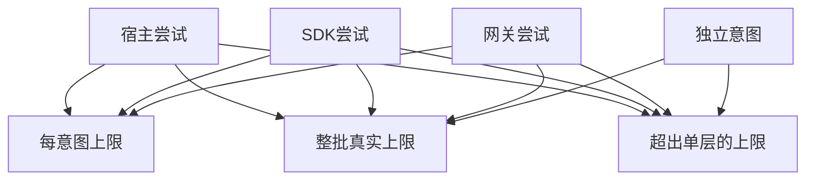

# 三层重试的最坏放大倍数

宿主、SDK、网关都可以重复同一次读取。
先在纸上计算最大真实下游尝试，再考虑将重试归一层管理。
输入是包含首次在内的总尝试。
假设每层都失败到上限，实际成功提前返回会更少。

## 先解决一个具体问题

**SDK 已经有重试，为什么外层重复一次会放大这么多？**

总尝试嵌套时是乘法关系。
下游记录真实投递而非上层函数进入次数，才看得见最坏放大。尽量让一层拥有瞬时重试并共享父预算。


先从具体的低档设定开始：宿主尝试取 1次、SDK尝试取 1次、网关尝试取 1次、独立意图取 5个。
三个结果依次是每意图上限 1次、整批真实上限 5次、超出单层的上限 0次。
先手算这个起点，读完后再把另一个输入切到高档，这样能知道数字变化时究竟改变了哪个假设。

## 先写清输入边界和三个观测量

用 a 表示宿主尝试，取 1次 或 3次，这两点是用于隔离因果影响的教学输入。

用 b 表示SDK尝试，取 1次 或 2次，这两点是用于隔离因果影响的教学输入。

用 c 表示网关尝试，取 1次 或 3次，这两点是用于隔离因果影响的教学输入。

用 d 表示独立意图，取 5个 或 12个，这两点是用于隔离因果影响的教学输入。

「每意图上限」的计算式为 `a*b*c`，按业务量展开是 `宿主尝试×SDK尝试×网关尝试`，输出单位为次。

「整批真实上限」的计算式为 `a*b*c*d`，按业务量展开是 `宿主尝试×SDK尝试×网关尝试×独立意图`，输出单位为次。

「超出单层的上限」的计算式为 `d*a*(b*c-1)`，按业务量展开是 `独立意图×宿主尝试×(SDK尝试×网关尝试-1)`，输出单位为次。

公式中 ceil 与 floor 分别向上、向下取整，% 在表达式中作取余，** 为乘方，三元条件按“条件 ? 成立值 : 其他值”读取。展示数值最多保留三位小数，比较和反推采用未舍入值。



图上的箭头表示该输入出现在计算式中。同一输入通向多个指标时，三个读数可能共同移动。分支、取整或相互抵消又会使某些边在具体样本上没有可见增量。

## 从输入按单位逐步算到可比较的结果

<details>
<summary>展开推演与对应反例</summary>

### 样本 0000：宿主尝试 1、SDK尝试 1

这一组设定为宿主尝试为 1次、SDK尝试为 1次、网关尝试为 1次、独立意图为 5个。

代入「每意图上限」：`1*1*1`，得到 1次。

代入「整批真实上限」：`1*1*1*5`，得到 5次。

代入「超出单层的上限」：`5*1*(1*1-1)`，得到 0次。

以「整批真实上限」作主读数时，本组单独切换宿主尝试的绝对变化最大或并列最大，读数会从 5次 变为 15次。

对角样本 1111 的主读数为 216次。它同时改了四项，差额不能充当任一单个因素的净收益。

### 样本 0001：宿主尝试 1、SDK尝试 1

这一组设定为宿主尝试为 1次、SDK尝试为 1次、网关尝试为 1次、独立意图为 12个。


代入「整批真实上限」：`1*1*1*12`，得到 12次。

代入「超出单层的上限」：`12*1*(1*1-1)`，得到 0次。

以「整批真实上限」作主读数时，本组单独切换宿主尝试的绝对变化最大或并列最大，读数会从 12次 变为 36次。

对角样本 1110 的主读数为 90次。它同时改了四项，差额不能充当任一单个因素的净收益。

### 样本 0010：宿主尝试 1、SDK尝试 1

这一组设定为宿主尝试为 1次、SDK尝试为 1次、网关尝试为 3次、独立意图为 5个。

代入「每意图上限」：`1*1*3`，得到 3次。

代入「整批真实上限」：`1*1*3*5`，得到 15次。

代入「超出单层的上限」：`5*1*(1*3-1)`，得到 10次。

以「整批真实上限」作主读数时，本组单独切换宿主尝试的绝对变化最大或并列最大，读数会从 15次 变为 45次。

对角样本 1101 的主读数为 72次。它同时改了四项，差额不能充当任一单个因素的净收益。

### 样本 0011：宿主尝试 1、SDK尝试 1

这一组设定为宿主尝试为 1次、SDK尝试为 1次、网关尝试为 3次、独立意图为 12个。


代入「整批真实上限」：`1*1*3*12`，得到 36次。

代入「超出单层的上限」：`12*1*(1*3-1)`，得到 24次。

以「整批真实上限」作主读数时，本组单独切换宿主尝试的绝对变化最大或并列最大，读数会从 36次 变为 108次。

对角样本 1100 的主读数为 30次。它同时改了四项，差额不能充当任一单个因素的净收益。

### 样本 0100：宿主尝试 1、SDK尝试 2

这一组设定为宿主尝试为 1次、SDK尝试为 2次、网关尝试为 1次、独立意图为 5个。

代入「每意图上限」：`1*2*1`，得到 2次。

代入「整批真实上限」：`1*2*1*5`，得到 10次。

代入「超出单层的上限」：`5*1*(2*1-1)`，得到 5次。

以「整批真实上限」作主读数时，本组单独切换宿主尝试的绝对变化最大或并列最大，读数会从 10次 变为 30次。

对角样本 1011 的主读数为 108次。它同时改了四项，差额不能充当任一单个因素的净收益。

### 样本 0101：宿主尝试 1、SDK尝试 2

这一组设定为宿主尝试为 1次、SDK尝试为 2次、网关尝试为 1次、独立意图为 12个。


代入「整批真实上限」：`1*2*1*12`，得到 24次。

代入「超出单层的上限」：`12*1*(2*1-1)`，得到 12次。

以「整批真实上限」作主读数时，本组单独切换宿主尝试的绝对变化最大或并列最大，读数会从 24次 变为 72次。

对角样本 1010 的主读数为 45次。它同时改了四项，差额不能充当任一单个因素的净收益。

### 样本 0110：宿主尝试 1、SDK尝试 2

这一组设定为宿主尝试为 1次、SDK尝试为 2次、网关尝试为 3次、独立意图为 5个。

代入「每意图上限」：`1*2*3`，得到 6次。

代入「整批真实上限」：`1*2*3*5`，得到 30次。

代入「超出单层的上限」：`5*1*(2*3-1)`，得到 25次。

以「整批真实上限」作主读数时，本组单独切换宿主尝试的绝对变化最大或并列最大，读数会从 30次 变为 90次。

对角样本 1001 的主读数为 36次。它同时改了四项，差额不能充当任一单个因素的净收益。

### 样本 0111：宿主尝试 1、SDK尝试 2

这一组设定为宿主尝试为 1次、SDK尝试为 2次、网关尝试为 3次、独立意图为 12个。


代入「整批真实上限」：`1*2*3*12`，得到 72次。

代入「超出单层的上限」：`12*1*(2*3-1)`，得到 60次。

以「整批真实上限」作主读数时，本组单独切换宿主尝试的绝对变化最大或并列最大，读数会从 72次 变为 216次。

对角样本 1000 的主读数为 15次。它同时改了四项，差额不能充当任一单个因素的净收益。

### 样本 1000：宿主尝试 3、SDK尝试 1

这一组设定为宿主尝试为 3次、SDK尝试为 1次、网关尝试为 1次、独立意图为 5个。

代入「每意图上限」：`3*1*1`，得到 3次。

代入「整批真实上限」：`3*1*1*5`，得到 15次。

代入「超出单层的上限」：`5*3*(1*1-1)`，得到 0次。

以「整批真实上限」作主读数时，本组单独切换网关尝试的绝对变化最大或并列最大，读数会从 15次 变为 45次。

对角样本 0111 的主读数为 72次。它同时改了四项，差额不能充当任一单个因素的净收益。

### 样本 1001：宿主尝试 3、SDK尝试 1

这一组设定为宿主尝试为 3次、SDK尝试为 1次、网关尝试为 1次、独立意图为 12个。


代入「整批真实上限」：`3*1*1*12`，得到 36次。

代入「超出单层的上限」：`12*3*(1*1-1)`，得到 0次。

以「整批真实上限」作主读数时，本组单独切换网关尝试的绝对变化最大或并列最大，读数会从 36次 变为 108次。

对角样本 0110 的主读数为 30次。它同时改了四项，差额不能充当任一单个因素的净收益。

### 样本 1010：宿主尝试 3、SDK尝试 1

这一组设定为宿主尝试为 3次、SDK尝试为 1次、网关尝试为 3次、独立意图为 5个。

代入「每意图上限」：`3*1*3`，得到 9次。

代入「整批真实上限」：`3*1*3*5`，得到 45次。

代入「超出单层的上限」：`5*3*(1*3-1)`，得到 30次。

以「整批真实上限」作主读数时，本组单独切换独立意图的绝对变化最大或并列最大，读数会从 45次 变为 108次。

对角样本 0101 的主读数为 24次。它同时改了四项，差额不能充当任一单个因素的净收益。

### 样本 1011：宿主尝试 3、SDK尝试 1

这一组设定为宿主尝试为 3次、SDK尝试为 1次、网关尝试为 3次、独立意图为 12个。


代入「整批真实上限」：`3*1*3*12`，得到 108次。

代入「超出单层的上限」：`12*3*(1*3-1)`，得到 72次。

以「整批真实上限」作主读数时，本组单独切换SDK尝试的绝对变化最大或并列最大，读数会从 108次 变为 216次。

对角样本 0100 的主读数为 10次。它同时改了四项，差额不能充当任一单个因素的净收益。

### 样本 1100：宿主尝试 3、SDK尝试 2

这一组设定为宿主尝试为 3次、SDK尝试为 2次、网关尝试为 1次、独立意图为 5个。

代入「每意图上限」：`3*2*1`，得到 6次。

代入「整批真实上限」：`3*2*1*5`，得到 30次。

代入「超出单层的上限」：`5*3*(2*1-1)`，得到 15次。

以「整批真实上限」作主读数时，本组单独切换网关尝试的绝对变化最大或并列最大，读数会从 30次 变为 90次。

对角样本 0011 的主读数为 36次。它同时改了四项，差额不能充当任一单个因素的净收益。

### 样本 1101：宿主尝试 3、SDK尝试 2

这一组设定为宿主尝试为 3次、SDK尝试为 2次、网关尝试为 1次、独立意图为 12个。


代入「整批真实上限」：`3*2*1*12`，得到 72次。

代入「超出单层的上限」：`12*3*(2*1-1)`，得到 36次。

以「整批真实上限」作主读数时，本组单独切换网关尝试的绝对变化最大或并列最大，读数会从 72次 变为 216次。

对角样本 0010 的主读数为 15次。它同时改了四项，差额不能充当任一单个因素的净收益。

### 样本 1110：宿主尝试 3、SDK尝试 2

这一组设定为宿主尝试为 3次、SDK尝试为 2次、网关尝试为 3次、独立意图为 5个。

代入「每意图上限」：`3*2*3`，得到 18次。

代入「整批真实上限」：`3*2*3*5`，得到 90次。

代入「超出单层的上限」：`5*3*(2*3-1)`，得到 75次。

以「整批真实上限」作主读数时，本组单独切换独立意图的绝对变化最大或并列最大，读数会从 90次 变为 216次。

对角样本 0001 的主读数为 12次。它同时改了四项，差额不能充当任一单个因素的净收益。

### 样本 1111：宿主尝试 3、SDK尝试 2

这一组设定为宿主尝试为 3次、SDK尝试为 2次、网关尝试为 3次、独立意图为 12个。


代入「整批真实上限」：`3*2*3*12`，得到 216次。

代入「超出单层的上限」：`12*3*(2*3-1)`，得到 180次。

以「整批真实上限」作主读数时，本组单独切换宿主尝试的绝对变化最大或并列最大，读数会从 216次 变为 72次。

对角样本 0000 的主读数为 5次。它同时改了四项，差额不能充当任一单个因素的净收益。

</details>

## 逐个干预：其余条件固定时，变化真的发生在哪里

<details>
<summary>展开推演与对应反例</summary>

### 只改变宿主尝试

固定SDK尝试为 1次、网关尝试为 1次、独立意图为 5个，只把宿主尝试从 1次改到 3次。
这一对的每意图上限从 1次 变为 3次，整批真实上限的差为 10次，超出单层的上限的差为 0次。

固定SDK尝试为 1次、网关尝试为 1次、独立意图为 12个，只把宿主尝试从 1次改到 3次。
这一对的每意图上限从 1次 变为 3次，整批真实上限的差为 24次，超出单层的上限的差为 0次。

固定SDK尝试为 1次、网关尝试为 3次、独立意图为 5个，只把宿主尝试从 1次改到 3次。
这一对的每意图上限从 3次 变为 9次，整批真实上限的差为 30次，超出单层的上限的差为 20次。

固定SDK尝试为 1次、网关尝试为 3次、独立意图为 12个，只把宿主尝试从 1次改到 3次。
这一对的每意图上限从 3次 变为 9次，整批真实上限的差为 72次，超出单层的上限的差为 48次。

固定SDK尝试为 2次、网关尝试为 1次、独立意图为 5个，只把宿主尝试从 1次改到 3次。
这一对的每意图上限从 2次 变为 6次，整批真实上限的差为 20次，超出单层的上限的差为 10次。

固定SDK尝试为 2次、网关尝试为 1次、独立意图为 12个，只把宿主尝试从 1次改到 3次。
这一对的每意图上限从 2次 变为 6次，整批真实上限的差为 48次，超出单层的上限的差为 24次。

固定SDK尝试为 2次、网关尝试为 3次、独立意图为 5个，只把宿主尝试从 1次改到 3次。
这一对的每意图上限从 6次 变为 18次，整批真实上限的差为 60次，超出单层的上限的差为 50次。

固定SDK尝试为 2次、网关尝试为 3次、独立意图为 12个，只把宿主尝试从 1次改到 3次。
这一对的每意图上限从 6次 变为 18次，整批真实上限的差为 144次，超出单层的上限的差为 120次。

综合八组受控背景，宿主尝试升到较高设定时「每意图上限」的差值区间是 2次 至 12次，共有 8 对出现可观察变化。

综合八组受控背景，宿主尝试升到较高设定时「整批真实上限」的差值区间是 10次 至 144次，共有 8 对出现可观察变化。

综合八组受控背景，宿主尝试升到较高设定时「超出单层的上限」的差值区间是 0次 至 120次，共有 6 对出现可观察变化。

### 只改变SDK尝试

固定宿主尝试为 1次、网关尝试为 1次、独立意图为 5个，只把SDK尝试从 1次改到 2次。
这一对的每意图上限从 1次 变为 2次，整批真实上限的差为 5次，超出单层的上限的差为 5次。

固定宿主尝试为 1次、网关尝试为 1次、独立意图为 12个，只把SDK尝试从 1次改到 2次。
这一对的每意图上限从 1次 变为 2次，整批真实上限的差为 12次，超出单层的上限的差为 12次。

固定宿主尝试为 1次、网关尝试为 3次、独立意图为 5个，只把SDK尝试从 1次改到 2次。
这一对的每意图上限从 3次 变为 6次，整批真实上限的差为 15次，超出单层的上限的差为 15次。

固定宿主尝试为 1次、网关尝试为 3次、独立意图为 12个，只把SDK尝试从 1次改到 2次。
这一对的每意图上限从 3次 变为 6次，整批真实上限的差为 36次，超出单层的上限的差为 36次。

固定宿主尝试为 3次、网关尝试为 1次、独立意图为 5个，只把SDK尝试从 1次改到 2次。

固定宿主尝试为 3次、网关尝试为 1次、独立意图为 12个，只把SDK尝试从 1次改到 2次。

固定宿主尝试为 3次、网关尝试为 3次、独立意图为 5个，只把SDK尝试从 1次改到 2次。
这一对的每意图上限从 9次 变为 18次，整批真实上限的差为 45次，超出单层的上限的差为 45次。

固定宿主尝试为 3次、网关尝试为 3次、独立意图为 12个，只把SDK尝试从 1次改到 2次。
这一对的每意图上限从 9次 变为 18次，整批真实上限的差为 108次，超出单层的上限的差为 108次。

综合八组受控背景，SDK尝试升到较高设定时「每意图上限」的差值区间是 1次 至 9次，共有 8 对出现可观察变化。

综合八组受控背景，SDK尝试升到较高设定时「整批真实上限」的差值区间是 5次 至 108次，共有 8 对出现可观察变化。

综合八组受控背景，SDK尝试升到较高设定时「超出单层的上限」的差值区间是 5次 至 108次，共有 8 对出现可观察变化。

### 只改变网关尝试

固定宿主尝试为 1次、SDK尝试为 1次、独立意图为 5个，只把网关尝试从 1次改到 3次。
这一对的每意图上限从 1次 变为 3次，整批真实上限的差为 10次，超出单层的上限的差为 10次。

固定宿主尝试为 1次、SDK尝试为 1次、独立意图为 12个，只把网关尝试从 1次改到 3次。
这一对的每意图上限从 1次 变为 3次，整批真实上限的差为 24次，超出单层的上限的差为 24次。

固定宿主尝试为 1次、SDK尝试为 2次、独立意图为 5个，只把网关尝试从 1次改到 3次。
这一对的每意图上限从 2次 变为 6次，整批真实上限的差为 20次，超出单层的上限的差为 20次。

固定宿主尝试为 1次、SDK尝试为 2次、独立意图为 12个，只把网关尝试从 1次改到 3次。
这一对的每意图上限从 2次 变为 6次，整批真实上限的差为 48次，超出单层的上限的差为 48次。

固定宿主尝试为 3次、SDK尝试为 1次、独立意图为 5个，只把网关尝试从 1次改到 3次。
这一对的每意图上限从 3次 变为 9次，整批真实上限的差为 30次，超出单层的上限的差为 30次。

固定宿主尝试为 3次、SDK尝试为 1次、独立意图为 12个，只把网关尝试从 1次改到 3次。
这一对的每意图上限从 3次 变为 9次，整批真实上限的差为 72次，超出单层的上限的差为 72次。

固定宿主尝试为 3次、SDK尝试为 2次、独立意图为 5个，只把网关尝试从 1次改到 3次。
这一对的每意图上限从 6次 变为 18次，整批真实上限的差为 60次，超出单层的上限的差为 60次。

固定宿主尝试为 3次、SDK尝试为 2次、独立意图为 12个，只把网关尝试从 1次改到 3次。
这一对的每意图上限从 6次 变为 18次，整批真实上限的差为 144次，超出单层的上限的差为 144次。

综合八组受控背景，网关尝试升到较高设定时「每意图上限」的差值区间是 2次 至 12次，共有 8 对出现可观察变化。

综合八组受控背景，网关尝试升到较高设定时「整批真实上限」的差值区间是 10次 至 144次，共有 8 对出现可观察变化。

综合八组受控背景，网关尝试升到较高设定时「超出单层的上限」的差值区间是 10次 至 144次，共有 8 对出现可观察变化。

### 只改变独立意图

固定宿主尝试为 1次、SDK尝试为 1次、网关尝试为 1次，只把独立意图从 5个改到 12个。
这一对的每意图上限从 1次 变为 1次，整批真实上限的差为 7次，超出单层的上限的差为 0次。

固定宿主尝试为 1次、SDK尝试为 1次、网关尝试为 3次，只把独立意图从 5个改到 12个。
这一对的每意图上限从 3次 变为 3次，整批真实上限的差为 21次，超出单层的上限的差为 14次。

固定宿主尝试为 1次、SDK尝试为 2次、网关尝试为 1次，只把独立意图从 5个改到 12个。
这一对的每意图上限从 2次 变为 2次，整批真实上限的差为 14次，超出单层的上限的差为 7次。

固定宿主尝试为 1次、SDK尝试为 2次、网关尝试为 3次，只把独立意图从 5个改到 12个。
这一对的每意图上限从 6次 变为 6次，整批真实上限的差为 42次，超出单层的上限的差为 35次。

固定宿主尝试为 3次、SDK尝试为 1次、网关尝试为 1次，只把独立意图从 5个改到 12个。
这一对的每意图上限从 3次 变为 3次，整批真实上限的差为 21次，超出单层的上限的差为 0次。

固定宿主尝试为 3次、SDK尝试为 1次、网关尝试为 3次，只把独立意图从 5个改到 12个。
这一对的每意图上限从 9次 变为 9次，整批真实上限的差为 63次，超出单层的上限的差为 42次。

固定宿主尝试为 3次、SDK尝试为 2次、网关尝试为 1次，只把独立意图从 5个改到 12个。
这一对的每意图上限从 6次 变为 6次，整批真实上限的差为 42次，超出单层的上限的差为 21次。

固定宿主尝试为 3次、SDK尝试为 2次、网关尝试为 3次，只把独立意图从 5个改到 12个。
这一对的每意图上限从 18次 变为 18次，整批真实上限的差为 126次，超出单层的上限的差为 105次。

综合八组受控背景，独立意图升到较高设定时「每意图上限」的差值区间是 0次，共有 0 对出现可观察变化。

综合八组受控背景，独立意图升到较高设定时「整批真实上限」的差值区间是 7次 至 126次，共有 8 对出现可观察变化。

综合八组受控背景，独立意图升到较高设定时「超出单层的上限」的差值区间是 0次 至 105次，共有 6 对出现可观察变化。

</details>

## 只拿到部分输入，结论还能缩小到多大范围

<details>
<summary>展开推演与对应反例</summary>

### 已知宿主尝试和SDK尝试

当宿主尝试为 1次、SDK尝试为 1次时，另两项有四种补全，主读数「整批真实上限」只能限定为 5次 至 36次。
这个条件下，取网关尝试为 1次、独立意图为 5个可得到下界 5次，取网关尝试为 3次、独立意图为 12个可达到上界 36次。

用同样可见的宿主尝试为 1次、SDK尝试为 1次去推「每意图上限」，能得到的范围为 1次 至 3次，不能把另一个指标的单位代入。

用同样可见的宿主尝试为 1次、SDK尝试为 1次去推「超出单层的上限」，能得到的范围为 0次 至 24次，不能把另一个指标的单位代入。

若只许再问一项，按最坏区间宽度优先核对网关尝试，补得低档时为 5次 至 12次，高档时为 15次 至 36次。

当宿主尝试为 1次、SDK尝试为 2次时，另两项有四种补全，主读数「整批真实上限」只能限定为 10次 至 72次。
这个条件下，取网关尝试为 1次、独立意图为 5个可得到下界 10次，取网关尝试为 3次、独立意图为 12个可达到上界 72次。

用同样可见的宿主尝试为 1次、SDK尝试为 2次去推「每意图上限」，能得到的范围为 2次 至 6次，不能把另一个指标的单位代入。

用同样可见的宿主尝试为 1次、SDK尝试为 2次去推「超出单层的上限」，能得到的范围为 5次 至 60次，不能把另一个指标的单位代入。

若只许再问一项，按最坏区间宽度优先核对网关尝试，补得低档时为 10次 至 24次，高档时为 30次 至 72次。

当宿主尝试为 3次、SDK尝试为 1次时，另两项有四种补全，主读数「整批真实上限」只能限定为 15次 至 108次。
这个条件下，取网关尝试为 1次、独立意图为 5个可得到下界 15次，取网关尝试为 3次、独立意图为 12个可达到上界 108次。

用同样可见的宿主尝试为 3次、SDK尝试为 1次去推「每意图上限」，能得到的范围为 3次 至 9次，不能把另一个指标的单位代入。

用同样可见的宿主尝试为 3次、SDK尝试为 1次去推「超出单层的上限」，能得到的范围为 0次 至 72次，不能把另一个指标的单位代入。

若只许再问一项，按最坏区间宽度优先核对网关尝试，补得低档时为 15次 至 36次，高档时为 45次 至 108次。

当宿主尝试为 3次、SDK尝试为 2次时，另两项有四种补全，主读数「整批真实上限」只能限定为 30次 至 216次。
这个条件下，取网关尝试为 1次、独立意图为 5个可得到下界 30次，取网关尝试为 3次、独立意图为 12个可达到上界 216次。

用同样可见的宿主尝试为 3次、SDK尝试为 2次去推「每意图上限」，能得到的范围为 6次 至 18次，不能把另一个指标的单位代入。

用同样可见的宿主尝试为 3次、SDK尝试为 2次去推「超出单层的上限」，能得到的范围为 15次 至 180次，不能把另一个指标的单位代入。

若只许再问一项，按最坏区间宽度优先核对网关尝试，补得低档时为 30次 至 72次，高档时为 90次 至 216次。

### 已知宿主尝试和网关尝试

当宿主尝试为 1次、网关尝试为 1次时，另两项有四种补全，主读数「整批真实上限」只能限定为 5次 至 24次。
这个条件下，取SDK尝试为 1次、独立意图为 5个可得到下界 5次，取SDK尝试为 2次、独立意图为 12个可达到上界 24次。

用同样可见的宿主尝试为 1次、网关尝试为 1次去推「每意图上限」，能得到的范围为 1次 至 2次，不能把另一个指标的单位代入。

用同样可见的宿主尝试为 1次、网关尝试为 1次去推「超出单层的上限」，能得到的范围为 0次 至 12次，不能把另一个指标的单位代入。

若只许再问一项，按最坏区间宽度优先核对独立意图，补得低档时为 5次 至 10次，高档时为 12次 至 24次。

当宿主尝试为 1次、网关尝试为 3次时，另两项有四种补全，主读数「整批真实上限」只能限定为 15次 至 72次。
这个条件下，取SDK尝试为 1次、独立意图为 5个可得到下界 15次，取SDK尝试为 2次、独立意图为 12个可达到上界 72次。

用同样可见的宿主尝试为 1次、网关尝试为 3次去推「每意图上限」，能得到的范围为 3次 至 6次，不能把另一个指标的单位代入。

用同样可见的宿主尝试为 1次、网关尝试为 3次去推「超出单层的上限」，能得到的范围为 10次 至 60次，不能把另一个指标的单位代入。

若只许再问一项，按最坏区间宽度优先核对独立意图，补得低档时为 15次 至 30次，高档时为 36次 至 72次。

当宿主尝试为 3次、网关尝试为 1次时，另两项有四种补全，主读数「整批真实上限」只能限定为 15次 至 72次。

用同样可见的宿主尝试为 3次、网关尝试为 1次去推「每意图上限」，能得到的范围为 3次 至 6次，不能把另一个指标的单位代入。

用同样可见的宿主尝试为 3次、网关尝试为 1次去推「超出单层的上限」，能得到的范围为 0次 至 36次，不能把另一个指标的单位代入。


当宿主尝试为 3次、网关尝试为 3次时，另两项有四种补全，主读数「整批真实上限」只能限定为 45次 至 216次。
这个条件下，取SDK尝试为 1次、独立意图为 5个可得到下界 45次，取SDK尝试为 2次、独立意图为 12个可达到上界 216次。

用同样可见的宿主尝试为 3次、网关尝试为 3次去推「每意图上限」，能得到的范围为 9次 至 18次，不能把另一个指标的单位代入。

用同样可见的宿主尝试为 3次、网关尝试为 3次去推「超出单层的上限」，能得到的范围为 30次 至 180次，不能把另一个指标的单位代入。

若只许再问一项，按最坏区间宽度优先核对独立意图，补得低档时为 45次 至 90次，高档时为 108次 至 216次。

### 已知SDK尝试和网关尝试

当SDK尝试为 1次、网关尝试为 1次时，另两项有四种补全，主读数「整批真实上限」只能限定为 5次 至 36次。
这个条件下，取宿主尝试为 1次、独立意图为 5个可得到下界 5次，取宿主尝试为 3次、独立意图为 12个可达到上界 36次。

用同样可见的SDK尝试为 1次、网关尝试为 1次去推「每意图上限」，能得到的范围为 1次 至 3次，不能把另一个指标的单位代入。

用同样可见的SDK尝试为 1次、网关尝试为 1次去推「超出单层的上限」，能得到的范围为 0次，不能把另一个指标的单位代入。

若只许再问一项，按最坏区间宽度优先核对宿主尝试，补得低档时为 5次 至 12次，高档时为 15次 至 36次。

当SDK尝试为 1次、网关尝试为 3次时，另两项有四种补全，主读数「整批真实上限」只能限定为 15次 至 108次。
这个条件下，取宿主尝试为 1次、独立意图为 5个可得到下界 15次，取宿主尝试为 3次、独立意图为 12个可达到上界 108次。

用同样可见的SDK尝试为 1次、网关尝试为 3次去推「每意图上限」，能得到的范围为 3次 至 9次，不能把另一个指标的单位代入。

用同样可见的SDK尝试为 1次、网关尝试为 3次去推「超出单层的上限」，能得到的范围为 10次 至 72次，不能把另一个指标的单位代入。

若只许再问一项，按最坏区间宽度优先核对宿主尝试，补得低档时为 15次 至 36次，高档时为 45次 至 108次。

当SDK尝试为 2次、网关尝试为 1次时，另两项有四种补全，主读数「整批真实上限」只能限定为 10次 至 72次。
这个条件下，取宿主尝试为 1次、独立意图为 5个可得到下界 10次，取宿主尝试为 3次、独立意图为 12个可达到上界 72次。

用同样可见的SDK尝试为 2次、网关尝试为 1次去推「每意图上限」，能得到的范围为 2次 至 6次，不能把另一个指标的单位代入。

用同样可见的SDK尝试为 2次、网关尝试为 1次去推「超出单层的上限」，能得到的范围为 5次 至 36次，不能把另一个指标的单位代入。

若只许再问一项，按最坏区间宽度优先核对宿主尝试，补得低档时为 10次 至 24次，高档时为 30次 至 72次。

当SDK尝试为 2次、网关尝试为 3次时，另两项有四种补全，主读数「整批真实上限」只能限定为 30次 至 216次。
这个条件下，取宿主尝试为 1次、独立意图为 5个可得到下界 30次，取宿主尝试为 3次、独立意图为 12个可达到上界 216次。

用同样可见的SDK尝试为 2次、网关尝试为 3次去推「每意图上限」，能得到的范围为 6次 至 18次，不能把另一个指标的单位代入。

用同样可见的SDK尝试为 2次、网关尝试为 3次去推「超出单层的上限」，能得到的范围为 25次 至 180次，不能把另一个指标的单位代入。

若只许再问一项，按最坏区间宽度优先核对宿主尝试，补得低档时为 30次 至 72次，高档时为 90次 至 216次。

### 已知宿主尝试和独立意图

当宿主尝试为 1次、独立意图为 5个时，另两项有四种补全，主读数「整批真实上限」只能限定为 5次 至 30次。
这个条件下，取SDK尝试为 1次、网关尝试为 1次可得到下界 5次，取SDK尝试为 2次、网关尝试为 3次可达到上界 30次。

用同样可见的宿主尝试为 1次、独立意图为 5个去推「每意图上限」，能得到的范围为 1次 至 6次，不能把另一个指标的单位代入。

用同样可见的宿主尝试为 1次、独立意图为 5个去推「超出单层的上限」，能得到的范围为 0次 至 25次，不能把另一个指标的单位代入。

若只许再问一项，按最坏区间宽度优先核对网关尝试，补得低档时为 5次 至 10次，高档时为 15次 至 30次。

当宿主尝试为 1次、独立意图为 12个时，另两项有四种补全，主读数「整批真实上限」只能限定为 12次 至 72次。
这个条件下，取SDK尝试为 1次、网关尝试为 1次可得到下界 12次，取SDK尝试为 2次、网关尝试为 3次可达到上界 72次。

用同样可见的宿主尝试为 1次、独立意图为 12个去推「每意图上限」，能得到的范围为 1次 至 6次，不能把另一个指标的单位代入。

用同样可见的宿主尝试为 1次、独立意图为 12个去推「超出单层的上限」，能得到的范围为 0次 至 60次，不能把另一个指标的单位代入。

若只许再问一项，按最坏区间宽度优先核对网关尝试，补得低档时为 12次 至 24次，高档时为 36次 至 72次。

当宿主尝试为 3次、独立意图为 5个时，另两项有四种补全，主读数「整批真实上限」只能限定为 15次 至 90次。
这个条件下，取SDK尝试为 1次、网关尝试为 1次可得到下界 15次，取SDK尝试为 2次、网关尝试为 3次可达到上界 90次。

用同样可见的宿主尝试为 3次、独立意图为 5个去推「每意图上限」，能得到的范围为 3次 至 18次，不能把另一个指标的单位代入。

用同样可见的宿主尝试为 3次、独立意图为 5个去推「超出单层的上限」，能得到的范围为 0次 至 75次，不能把另一个指标的单位代入。

若只许再问一项，按最坏区间宽度优先核对网关尝试，补得低档时为 15次 至 30次，高档时为 45次 至 90次。

当宿主尝试为 3次、独立意图为 12个时，另两项有四种补全，主读数「整批真实上限」只能限定为 36次 至 216次。
这个条件下，取SDK尝试为 1次、网关尝试为 1次可得到下界 36次，取SDK尝试为 2次、网关尝试为 3次可达到上界 216次。

用同样可见的宿主尝试为 3次、独立意图为 12个去推「每意图上限」，能得到的范围为 3次 至 18次，不能把另一个指标的单位代入。

用同样可见的宿主尝试为 3次、独立意图为 12个去推「超出单层的上限」，能得到的范围为 0次 至 180次，不能把另一个指标的单位代入。

若只许再问一项，按最坏区间宽度优先核对网关尝试，补得低档时为 36次 至 72次，高档时为 108次 至 216次。

### 已知SDK尝试和独立意图

当SDK尝试为 1次、独立意图为 5个时，另两项有四种补全，主读数「整批真实上限」只能限定为 5次 至 45次。
这个条件下，取宿主尝试为 1次、网关尝试为 1次可得到下界 5次，取宿主尝试为 3次、网关尝试为 3次可达到上界 45次。

用同样可见的SDK尝试为 1次、独立意图为 5个去推「每意图上限」，能得到的范围为 1次 至 9次，不能把另一个指标的单位代入。

用同样可见的SDK尝试为 1次、独立意图为 5个去推「超出单层的上限」，能得到的范围为 0次 至 30次，不能把另一个指标的单位代入。

若只许再问一项，按最坏区间宽度优先核对宿主尝试，补得低档时为 5次 至 15次，高档时为 15次 至 45次。

当SDK尝试为 1次、独立意图为 12个时，另两项有四种补全，主读数「整批真实上限」只能限定为 12次 至 108次。
这个条件下，取宿主尝试为 1次、网关尝试为 1次可得到下界 12次，取宿主尝试为 3次、网关尝试为 3次可达到上界 108次。

用同样可见的SDK尝试为 1次、独立意图为 12个去推「每意图上限」，能得到的范围为 1次 至 9次，不能把另一个指标的单位代入。

用同样可见的SDK尝试为 1次、独立意图为 12个去推「超出单层的上限」，能得到的范围为 0次 至 72次，不能把另一个指标的单位代入。

若只许再问一项，按最坏区间宽度优先核对宿主尝试，补得低档时为 12次 至 36次，高档时为 36次 至 108次。

当SDK尝试为 2次、独立意图为 5个时，另两项有四种补全，主读数「整批真实上限」只能限定为 10次 至 90次。
这个条件下，取宿主尝试为 1次、网关尝试为 1次可得到下界 10次，取宿主尝试为 3次、网关尝试为 3次可达到上界 90次。

用同样可见的SDK尝试为 2次、独立意图为 5个去推「每意图上限」，能得到的范围为 2次 至 18次，不能把另一个指标的单位代入。

用同样可见的SDK尝试为 2次、独立意图为 5个去推「超出单层的上限」，能得到的范围为 5次 至 75次，不能把另一个指标的单位代入。

若只许再问一项，按最坏区间宽度优先核对宿主尝试，补得低档时为 10次 至 30次，高档时为 30次 至 90次。

当SDK尝试为 2次、独立意图为 12个时，另两项有四种补全，主读数「整批真实上限」只能限定为 24次 至 216次。
这个条件下，取宿主尝试为 1次、网关尝试为 1次可得到下界 24次，取宿主尝试为 3次、网关尝试为 3次可达到上界 216次。

用同样可见的SDK尝试为 2次、独立意图为 12个去推「每意图上限」，能得到的范围为 2次 至 18次，不能把另一个指标的单位代入。

用同样可见的SDK尝试为 2次、独立意图为 12个去推「超出单层的上限」，能得到的范围为 12次 至 180次，不能把另一个指标的单位代入。

若只许再问一项，按最坏区间宽度优先核对宿主尝试，补得低档时为 24次 至 72次，高档时为 72次 至 216次。

### 已知网关尝试和独立意图

当网关尝试为 1次、独立意图为 5个时，另两项有四种补全，主读数「整批真实上限」只能限定为 5次 至 30次。
这个条件下，取宿主尝试为 1次、SDK尝试为 1次可得到下界 5次，取宿主尝试为 3次、SDK尝试为 2次可达到上界 30次。

用同样可见的网关尝试为 1次、独立意图为 5个去推「每意图上限」，能得到的范围为 1次 至 6次，不能把另一个指标的单位代入。

用同样可见的网关尝试为 1次、独立意图为 5个去推「超出单层的上限」，能得到的范围为 0次 至 15次，不能把另一个指标的单位代入。

若只许再问一项，按最坏区间宽度优先核对宿主尝试，补得低档时为 5次 至 10次，高档时为 15次 至 30次。

当网关尝试为 1次、独立意图为 12个时，另两项有四种补全，主读数「整批真实上限」只能限定为 12次 至 72次。
这个条件下，取宿主尝试为 1次、SDK尝试为 1次可得到下界 12次，取宿主尝试为 3次、SDK尝试为 2次可达到上界 72次。

用同样可见的网关尝试为 1次、独立意图为 12个去推「每意图上限」，能得到的范围为 1次 至 6次，不能把另一个指标的单位代入。

用同样可见的网关尝试为 1次、独立意图为 12个去推「超出单层的上限」，能得到的范围为 0次 至 36次，不能把另一个指标的单位代入。

若只许再问一项，按最坏区间宽度优先核对宿主尝试，补得低档时为 12次 至 24次，高档时为 36次 至 72次。

当网关尝试为 3次、独立意图为 5个时，另两项有四种补全，主读数「整批真实上限」只能限定为 15次 至 90次。
这个条件下，取宿主尝试为 1次、SDK尝试为 1次可得到下界 15次，取宿主尝试为 3次、SDK尝试为 2次可达到上界 90次。

用同样可见的网关尝试为 3次、独立意图为 5个去推「每意图上限」，能得到的范围为 3次 至 18次，不能把另一个指标的单位代入。

用同样可见的网关尝试为 3次、独立意图为 5个去推「超出单层的上限」，能得到的范围为 10次 至 75次，不能把另一个指标的单位代入。

若只许再问一项，按最坏区间宽度优先核对宿主尝试，补得低档时为 15次 至 30次，高档时为 45次 至 90次。

当网关尝试为 3次、独立意图为 12个时，另两项有四种补全，主读数「整批真实上限」只能限定为 36次 至 216次。
这个条件下，取宿主尝试为 1次、SDK尝试为 1次可得到下界 36次，取宿主尝试为 3次、SDK尝试为 2次可达到上界 216次。

用同样可见的网关尝试为 3次、独立意图为 12个去推「每意图上限」，能得到的范围为 3次 至 18次，不能把另一个指标的单位代入。

用同样可见的网关尝试为 3次、独立意图为 12个去推「超出单层的上限」，能得到的范围为 24次 至 180次，不能把另一个指标的单位代入。

若只许再问一项，按最坏区间宽度优先核对宿主尝试，补得低档时为 36次 至 72次，高档时为 108次 至 216次。

</details>

## 反过来审查一份报表：能从结果还原哪些输入

<details>
<summary>展开推演与对应反例</summary>

### 仅保留“每意图上限”的读数

报表只写「每意图上限=1次」时，在本实验的离散取值中有 2 组输入与之相容。

对这个 1次 的「每意图上限」读数，所有相容样本都要求宿主尝试为 1次、SDK尝试为 1次、网关尝试为 1次。

只凭「每意图上限」的 1次 无法确定独立意图：0000 与 0001 的取值分别为 5 和 12个。

报表只写「每意图上限=3次」时，在本实验的离散取值中有 4 组输入与之相容。

对这个 3次 的「每意图上限」读数，所有相容样本都要求SDK尝试为 1次。

只凭「每意图上限」的 3次 无法确定宿主尝试：0010 与 1000 的取值分别为 1 和 3次。

报表只写「每意图上限=2次」时，在本实验的离散取值中有 2 组输入与之相容。

对这个 2次 的「每意图上限」读数，所有相容样本都要求宿主尝试为 1次、SDK尝试为 2次、网关尝试为 1次。

只凭「每意图上限」的 2次 无法确定独立意图：0100 与 0101 的取值分别为 5 和 12个。

报表只写「每意图上限=6次」时，在本实验的离散取值中有 4 组输入与之相容。

对这个 6次 的「每意图上限」读数，所有相容样本都要求SDK尝试为 2次。

只凭「每意图上限」的 6次 无法确定宿主尝试：0110 与 1100 的取值分别为 1 和 3次。

报表只写「每意图上限=9次」时，在本实验的离散取值中有 2 组输入与之相容。

对这个 9次 的「每意图上限」读数，所有相容样本都要求宿主尝试为 3次、SDK尝试为 1次、网关尝试为 3次。

只凭「每意图上限」的 9次 无法确定独立意图：1010 与 1011 的取值分别为 5 和 12个。

报表只写「每意图上限=18次」时，在本实验的离散取值中有 2 组输入与之相容。

对这个 18次 的「每意图上限」读数，所有相容样本都要求宿主尝试为 3次、SDK尝试为 2次、网关尝试为 3次。

只凭「每意图上限」的 18次 无法确定独立意图：1110 与 1111 的取值分别为 5 和 12个。

### 仅保留“整批真实上限”的读数

报表只写「整批真实上限=5次」时，在本实验的离散取值中有 1 组输入与之相容。

对这个 5次 的「整批真实上限」读数，所有相容样本都要求宿主尝试为 1次、SDK尝试为 1次、网关尝试为 1次、独立意图为 5个。

报表只写「整批真实上限=12次」时，在本实验的离散取值中有 1 组输入与之相容。

对这个 12次 的「整批真实上限」读数，所有相容样本都要求宿主尝试为 1次、SDK尝试为 1次、网关尝试为 1次、独立意图为 12个。

报表只写「整批真实上限=15次」时，在本实验的离散取值中有 2 组输入与之相容。

对这个 15次 的「整批真实上限」读数，所有相容样本都要求SDK尝试为 1次、独立意图为 5个。

只凭「整批真实上限」的 15次 无法确定宿主尝试：0010 与 1000 的取值分别为 1 和 3次。

报表只写「整批真实上限=36次」时，在本实验的离散取值中有 2 组输入与之相容。

对这个 36次 的「整批真实上限」读数，所有相容样本都要求SDK尝试为 1次、独立意图为 12个。

只凭「整批真实上限」的 36次 无法确定宿主尝试：0011 与 1001 的取值分别为 1 和 3次。

报表只写「整批真实上限=10次」时，在本实验的离散取值中有 1 组输入与之相容。

对这个 10次 的「整批真实上限」读数，所有相容样本都要求宿主尝试为 1次、SDK尝试为 2次、网关尝试为 1次、独立意图为 5个。

报表只写「整批真实上限=24次」时，在本实验的离散取值中有 1 组输入与之相容。

对这个 24次 的「整批真实上限」读数，所有相容样本都要求宿主尝试为 1次、SDK尝试为 2次、网关尝试为 1次、独立意图为 12个。

报表只写「整批真实上限=30次」时，在本实验的离散取值中有 2 组输入与之相容。

对这个 30次 的「整批真实上限」读数，所有相容样本都要求SDK尝试为 2次、独立意图为 5个。

只凭「整批真实上限」的 30次 无法确定宿主尝试：0110 与 1100 的取值分别为 1 和 3次。

报表只写「整批真实上限=72次」时，在本实验的离散取值中有 2 组输入与之相容。

对这个 72次 的「整批真实上限」读数，所有相容样本都要求SDK尝试为 2次、独立意图为 12个。

只凭「整批真实上限」的 72次 无法确定宿主尝试：0111 与 1101 的取值分别为 1 和 3次。

报表只写「整批真实上限=45次」时，在本实验的离散取值中有 1 组输入与之相容。

对这个 45次 的「整批真实上限」读数，所有相容样本都要求宿主尝试为 3次、SDK尝试为 1次、网关尝试为 3次、独立意图为 5个。

报表只写「整批真实上限=108次」时，在本实验的离散取值中有 1 组输入与之相容。

对这个 108次 的「整批真实上限」读数，所有相容样本都要求宿主尝试为 3次、SDK尝试为 1次、网关尝试为 3次、独立意图为 12个。

报表只写「整批真实上限=90次」时，在本实验的离散取值中有 1 组输入与之相容。

对这个 90次 的「整批真实上限」读数，所有相容样本都要求宿主尝试为 3次、SDK尝试为 2次、网关尝试为 3次、独立意图为 5个。

报表只写「整批真实上限=216次」时，在本实验的离散取值中有 1 组输入与之相容。

对这个 216次 的「整批真实上限」读数，所有相容样本都要求宿主尝试为 3次、SDK尝试为 2次、网关尝试为 3次、独立意图为 12个。

### 仅保留“超出单层的上限”的读数

报表只写「超出单层的上限=0次」时，在本实验的离散取值中有 4 组输入与之相容。

对这个 0次 的「超出单层的上限」读数，所有相容样本都要求SDK尝试为 1次、网关尝试为 1次。

只凭「超出单层的上限」的 0次 无法确定宿主尝试：0000 与 1000 的取值分别为 1 和 3次。

报表只写「超出单层的上限=10次」时，在本实验的离散取值中有 1 组输入与之相容。

对这个 10次 的「超出单层的上限」读数，所有相容样本都要求宿主尝试为 1次、SDK尝试为 1次、网关尝试为 3次、独立意图为 5个。

报表只写「超出单层的上限=24次」时，在本实验的离散取值中有 1 组输入与之相容。

对这个 24次 的「超出单层的上限」读数，所有相容样本都要求宿主尝试为 1次、SDK尝试为 1次、网关尝试为 3次、独立意图为 12个。

报表只写「超出单层的上限=5次」时，在本实验的离散取值中有 1 组输入与之相容。

对这个 5次 的「超出单层的上限」读数，所有相容样本都要求宿主尝试为 1次、SDK尝试为 2次、网关尝试为 1次、独立意图为 5个。

报表只写「超出单层的上限=12次」时，在本实验的离散取值中有 1 组输入与之相容。

对这个 12次 的「超出单层的上限」读数，所有相容样本都要求宿主尝试为 1次、SDK尝试为 2次、网关尝试为 1次、独立意图为 12个。

报表只写「超出单层的上限=25次」时，在本实验的离散取值中有 1 组输入与之相容。

对这个 25次 的「超出单层的上限」读数，所有相容样本都要求宿主尝试为 1次、SDK尝试为 2次、网关尝试为 3次、独立意图为 5个。

报表只写「超出单层的上限=60次」时，在本实验的离散取值中有 1 组输入与之相容。

对这个 60次 的「超出单层的上限」读数，所有相容样本都要求宿主尝试为 1次、SDK尝试为 2次、网关尝试为 3次、独立意图为 12个。

报表只写「超出单层的上限=30次」时，在本实验的离散取值中有 1 组输入与之相容。

对这个 30次 的「超出单层的上限」读数，所有相容样本都要求宿主尝试为 3次、SDK尝试为 1次、网关尝试为 3次、独立意图为 5个。

报表只写「超出单层的上限=72次」时，在本实验的离散取值中有 1 组输入与之相容。

对这个 72次 的「超出单层的上限」读数，所有相容样本都要求宿主尝试为 3次、SDK尝试为 1次、网关尝试为 3次、独立意图为 12个。

报表只写「超出单层的上限=15次」时，在本实验的离散取值中有 1 组输入与之相容。

对这个 15次 的「超出单层的上限」读数，所有相容样本都要求宿主尝试为 3次、SDK尝试为 2次、网关尝试为 1次、独立意图为 5个。

报表只写「超出单层的上限=36次」时，在本实验的离散取值中有 1 组输入与之相容。

对这个 36次 的「超出单层的上限」读数，所有相容样本都要求宿主尝试为 3次、SDK尝试为 2次、网关尝试为 1次、独立意图为 12个。

报表只写「超出单层的上限=75次」时，在本实验的离散取值中有 1 组输入与之相容。

对这个 75次 的「超出单层的上限」读数，所有相容样本都要求宿主尝试为 3次、SDK尝试为 2次、网关尝试为 3次、独立意图为 5个。

报表只写「超出单层的上限=180次」时，在本实验的离散取值中有 1 组输入与之相容。

对这个 180次 的「超出单层的上限」读数，所有相容样本都要求宿主尝试为 3次、SDK尝试为 2次、网关尝试为 3次、独立意图为 12个。

</details>

## 给错误算法找反例，再给正确算法画使用边界

<details>
<summary>展开推演与对应反例</summary>

### 把嵌套尝试错加在一起

把「整批真实上限」错写成 `d*(a+b+c)`，在 16 组教学输入中有 12 组会与参照计算不同。

对于宿主尝试为 1次、SDK尝试为 1次、网关尝试为 1次、独立意图为 5个，这个错误口径得 15次，参照式为 5次，偏差为 10次。

对于宿主尝试为 1次、SDK尝试为 1次、网关尝试为 1次、独立意图为 12个，这个错误口径得 36次，参照式为 12次，偏差为 24次。

对于宿主尝试为 1次、SDK尝试为 1次、网关尝试为 3次、独立意图为 5个，这个错误口径得 25次，参照式为 15次，偏差为 10次。

对于宿主尝试为 1次、SDK尝试为 1次、网关尝试为 3次、独立意图为 12个，这个错误口径得 60次，参照式为 36次，偏差为 24次。

对于宿主尝试为 1次、SDK尝试为 2次、网关尝试为 1次、独立意图为 5个，这个错误口径得 20次，参照式为 10次，偏差为 10次。

对于宿主尝试为 1次、SDK尝试为 2次、网关尝试为 1次、独立意图为 12个，这个错误口径得 48次，参照式为 24次，偏差为 24次。

样本 0110 令错误式 `d*(a+b+c)` 恰好也给出 30次，因此仅拿这次「整批真实上限」做回归发现不了该缺陷。

样本 0111 令错误式 `d*(a+b+c)` 恰好也给出 72次，因此仅拿这次「整批真实上限」做回归发现不了该缺陷。

对于宿主尝试为 3次、SDK尝试为 1次、网关尝试为 1次、独立意图为 5个，这个错误口径得 25次，参照式为 15次，偏差为 10次。

对于宿主尝试为 3次、SDK尝试为 1次、网关尝试为 1次、独立意图为 12个，这个错误口径得 60次，参照式为 36次，偏差为 24次。

对于宿主尝试为 3次、SDK尝试为 1次、网关尝试为 3次、独立意图为 5个，这个错误口径得 35次，参照式为 45次，偏差为 -10次。

对于宿主尝试为 3次、SDK尝试为 1次、网关尝试为 3次、独立意图为 12个，这个错误口径得 84次，参照式为 108次，偏差为 -24次。

样本 1100 令错误式 `d*(a+b+c)` 恰好也给出 30次，因此仅拿这次「整批真实上限」做回归发现不了该缺陷。

样本 1101 令错误式 `d*(a+b+c)` 恰好也给出 72次，因此仅拿这次「整批真实上限」做回归发现不了该缺陷。

对于宿主尝试为 3次、SDK尝试为 2次、网关尝试为 3次、独立意图为 5个，这个错误口径得 40次，参照式为 90次，偏差为 -50次。

对于宿主尝试为 3次、SDK尝试为 2次、网关尝试为 3次、独立意图为 12个，这个错误口径得 96次，参照式为 216次，偏差为 -120次。

### 忽略网关的重放倍数

把「整批真实上限」错写成 `a*b*d`，在 16 组教学输入中有 8 组会与参照计算不同。

样本 0000 令错误式 `a*b*d` 恰好也给出 5次，因此仅拿这次「整批真实上限」做回归发现不了该缺陷。

样本 0001 令错误式 `a*b*d` 恰好也给出 12次，因此仅拿这次「整批真实上限」做回归发现不了该缺陷。

对于宿主尝试为 1次、SDK尝试为 1次、网关尝试为 3次、独立意图为 5个，这个错误口径得 5次，参照式为 15次，偏差为 -10次。

对于宿主尝试为 1次、SDK尝试为 1次、网关尝试为 3次、独立意图为 12个，这个错误口径得 12次，参照式为 36次，偏差为 -24次。

样本 0100 令错误式 `a*b*d` 恰好也给出 10次，因此仅拿这次「整批真实上限」做回归发现不了该缺陷。

样本 0101 令错误式 `a*b*d` 恰好也给出 24次，因此仅拿这次「整批真实上限」做回归发现不了该缺陷。

对于宿主尝试为 1次、SDK尝试为 2次、网关尝试为 3次、独立意图为 5个，这个错误口径得 10次，参照式为 30次，偏差为 -20次。

对于宿主尝试为 1次、SDK尝试为 2次、网关尝试为 3次、独立意图为 12个，这个错误口径得 24次，参照式为 72次，偏差为 -48次。

样本 1000 令错误式 `a*b*d` 恰好也给出 15次，因此仅拿这次「整批真实上限」做回归发现不了该缺陷。

样本 1001 令错误式 `a*b*d` 恰好也给出 36次，因此仅拿这次「整批真实上限」做回归发现不了该缺陷。

对于宿主尝试为 3次、SDK尝试为 1次、网关尝试为 3次、独立意图为 5个，这个错误口径得 15次，参照式为 45次，偏差为 -30次。

对于宿主尝试为 3次、SDK尝试为 1次、网关尝试为 3次、独立意图为 12个，这个错误口径得 36次，参照式为 108次，偏差为 -72次。

样本 1100 令错误式 `a*b*d` 恰好也给出 30次，因此仅拿这次「整批真实上限」做回归发现不了该缺陷。

样本 1101 令错误式 `a*b*d` 恰好也给出 72次，因此仅拿这次「整批真实上限」做回归发现不了该缺陷。

对于宿主尝试为 3次、SDK尝试为 2次、网关尝试为 3次、独立意图为 5个，这个错误口径得 30次，参照式为 90次，偏差为 -60次。

对于宿主尝试为 3次、SDK尝试为 2次、网关尝试为 3次、独立意图为 12个，这个错误口径得 72次，参照式为 216次，偏差为 -144次。

</details>

## 从教学算例回到可验证的工程结论

要把这些数写入项目说明，先用真实输入替换教学常数，列明样本分母、实际资源限制和观测边界，再验证公式所需前提。两点敏感性只描述这两个设定之间的差异。

## 面试复述与复算

面试题可以从“SDK 已经有重试，为什么外层重复一次会放大这么多？”起步。先给出本篇的触发条件和一条真实执行端可检查的证据，再用一个相邻反例限定结论的适用范围。

在仓库根目录执行下列命令可以重算本篇的一个输入。四位数字依次选择正文列出的四项条件，0 表示未成立或低档，1 表示成立或高档。
```powershell
node examples/reading-cases/replay.mjs 6 6 0101
```

[本周主文](../theory.md) · [配套实验](../lab.md) · [下一篇研读](07.md)
