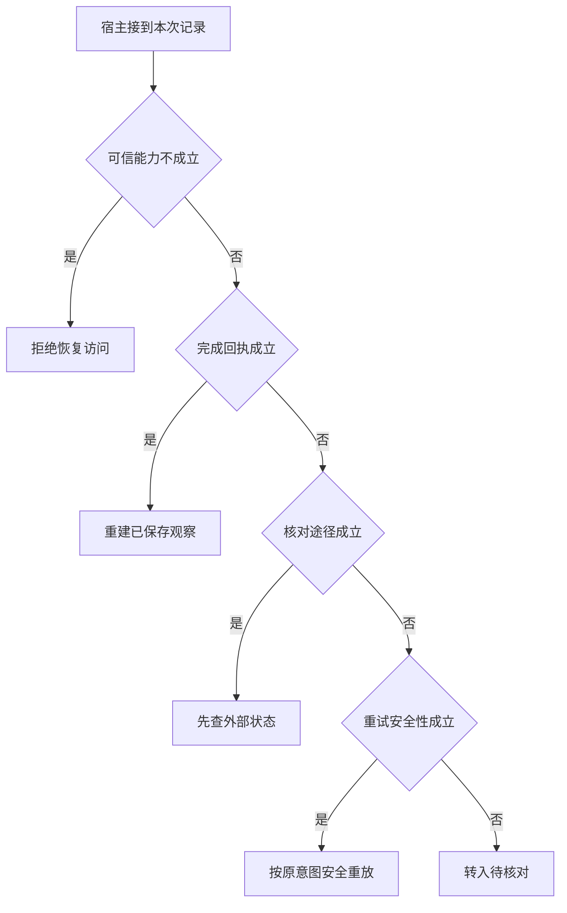

# 崩溃后从哪个事件继续

把一条写请求拆成准备、派发、外部提交、收到回执和装入历史。
落盘位置不同，恢复动作也不同。
尤其不要因日志只保存派发就重新生成一条新业务意图。

本篇用一个封闭的教学决策器说明这一问题。输入是宿主收到的记录，不保证每个下游字段都已经获准使用。前置检查未成立时，下游即使带着缓存值，也不能拿来作业务断言。

## 先解决一个具体问题

**有派发日志就可以在重启后认定操作成功吗？**

派发与业务提交中间仍可能崩溃。
恢复时优先查持久回执或按原业务键向下游核对，只有约定支持幂等才能安全重放已有意图。


先取一个能走到「转入待核对」的输入：宿主确认当前主体获准、只有派发记录、没有可用的状态核对接口、无法安全重放该操作。
把这四个条件代回后文的图，前面各个拦截分支都未满足，最终才有“不确定写入不可自动重复”这个判断。
还原这个现场时要分别问：哪些位来自可信状态，哪些只是在接口中出现、尚未获得解释资格的字段。

## 先沿一次决策走到底



从上到下取第一条成立的出口。只改一个开关时，只有它之前的检查都未截断，该变化才可能到达真实动作。

“可信能力”的两种输入分别是“宿主确认当前主体获准”与“当前主体未获授权”。
权限取自可信入口或执行端，不由模型生成。

“完成回执”的两种输入分别是“已持久化完成结果”与“只有派发记录”。
断点恢复能否复用结果取决于检查点位置。

“核对途径”的两种输入分别是“下游支持按业务键查状态”与“没有可用的状态核对接口”。
外部写入不确定时，先判断能否核对。

“重试安全性”的两种输入分别是“支持有界安全重试”与“无法安全重放该操作”。
可靠性要看副作用和实际恢复协议。

## 最少需要哪几项观察

### 拒绝恢复访问

恢复路径不能绕过现时授权。
在本节的全部组合中，有 8 种产生「拒绝恢复访问」，这只是逻辑空间的计数，不能当作实际用户请求的比例。

只取得当前主体未获授权，已经足以要求宿主「拒绝恢复访问」。
保持这些已知项，其余开关自由变化，仍有 8 种补全，判断没有翻转。

若删掉关于可信能力的证据，另一份允许的现场是宿主确认当前主体获准、只有派发记录、没有可用的状态核对接口、无法安全重放该操作，它会使宿主「转入待核对」。

### 重建已保存观察

已有持久完成凭证。
在本节的全部组合中，有 4 种产生「重建已保存观察」，这只是逻辑空间的计数，不能当作实际用户请求的比例。

只取得宿主确认当前主体获准、已持久化完成结果，已经足以要求宿主「重建已保存观察」。
保持这些已知项，其余开关自由变化，仍有 4 种补全，判断没有翻转。

若删掉关于可信能力的证据，另一份允许的现场是当前主体未获授权、已持久化完成结果、没有可用的状态核对接口、无法安全重放该操作，它会使宿主「拒绝恢复访问」。

若删掉关于完成回执的证据，另一份允许的现场是宿主确认当前主体获准、只有派发记录、没有可用的状态核对接口、无法安全重放该操作，它会使宿主「转入待核对」。

### 先查外部状态

缺回执但可用稳定键查询。
在本节的全部组合中，有 2 种产生「先查外部状态」，这只是逻辑空间的计数，不能当作实际用户请求的比例。

只取得宿主确认当前主体获准、只有派发记录、下游支持按业务键查状态，已经足以要求宿主「先查外部状态」。
保持这些已知项，其余开关自由变化，仍有 2 种补全，判断没有翻转。

若删掉关于可信能力的证据，另一份允许的现场是当前主体未获授权、只有派发记录、下游支持按业务键查状态、无法安全重放该操作，它会使宿主「拒绝恢复访问」。

若删掉关于完成回执的证据，另一份允许的现场是宿主确认当前主体获准、已持久化完成结果、下游支持按业务键查状态、无法安全重放该操作，它会使宿主「重建已保存观察」。

若删掉关于核对途径的证据，另一份允许的现场是宿主确认当前主体获准、只有派发记录、没有可用的状态核对接口、无法安全重放该操作，它会使宿主「转入待核对」。

### 按原意图安全重放

无状态查询时仍有幂等保证。
在本节的全部组合中，有 1 种产生「按原意图安全重放」，这只是逻辑空间的计数，不能当作实际用户请求的比例。

只取得宿主确认当前主体获准、只有派发记录、没有可用的状态核对接口、支持有界安全重试，已经足以要求宿主「按原意图安全重放」。
保持这些已知项，其余开关自由变化，仍有 1 种补全，判断没有翻转。

若删掉关于可信能力的证据，另一份允许的现场是当前主体未获授权、只有派发记录、没有可用的状态核对接口、支持有界安全重试，它会使宿主「拒绝恢复访问」。

若删掉关于完成回执的证据，另一份允许的现场是宿主确认当前主体获准、已持久化完成结果、没有可用的状态核对接口、支持有界安全重试，它会使宿主「重建已保存观察」。

若删掉关于核对途径的证据，另一份允许的现场是宿主确认当前主体获准、只有派发记录、下游支持按业务键查状态、支持有界安全重试，它会使宿主「先查外部状态」。

若删掉关于重试安全性的证据，另一份允许的现场是宿主确认当前主体获准、只有派发记录、没有可用的状态核对接口、无法安全重放该操作，它会使宿主「转入待核对」。

### 转入待核对

不确定写入不可自动重复。
在本节的全部组合中，有 1 种产生「转入待核对」，这只是逻辑空间的计数，不能当作实际用户请求的比例。

只取得宿主确认当前主体获准、只有派发记录、没有可用的状态核对接口、无法安全重放该操作，已经足以要求宿主「转入待核对」。

若删掉关于可信能力的证据，另一份允许的现场是当前主体未获授权、只有派发记录、没有可用的状态核对接口、无法安全重放该操作，它会使宿主「拒绝恢复访问」。

若删掉关于完成回执的证据，另一份允许的现场是宿主确认当前主体获准、已持久化完成结果、没有可用的状态核对接口、无法安全重放该操作，它会使宿主「重建已保存观察」。

若删掉关于核对途径的证据，另一份允许的现场是宿主确认当前主体获准、只有派发记录、下游支持按业务键查状态、无法安全重放该操作，它会使宿主「先查外部状态」。

若删掉关于重试安全性的证据，另一份允许的现场是宿主确认当前主体获准、只有派发记录、没有可用的状态核对接口、支持有界安全重试，它会使宿主「按原意图安全重放」。

## 以同一份契约解释截然不同的现场

<details>
<summary>展开推演与对应反例</summary>

下列样本按最先命中的业务分支排列。四位编码只作本篇页内定位，顺序与开头的四项输入一致。可以先猜下一动作，再展开相邻样本。

### 能够触发“拒绝恢复访问”的现场

**样本 0000**

业务侧交来当前主体未获授权、只有派发记录，执行侧还记录了没有可用的状态核对接口、无法安全重放该操作。
把样本压成最短证明，保留当前主体未获授权就能支持「拒绝恢复访问」。

在这份记录上，分别翻转「可信能力」中的任一项，其他项完全不变时，下一动作都会改变。

保持其余观察不动，单独切换「完成回执」、「核对途径」、「重试安全性」仍得到「拒绝恢复访问」，它们在这个现场不是决定性变量。

要从本例改走「转入待核对」，至少需要变动 1 项，一组最少改动是将当前主体未获授权换成宿主确认当前主体获准。

要从本例改走「按原意图安全重放」，至少需要变动 2 项，一组最少改动是将当前主体未获授权、无法安全重放该操作换成宿主确认当前主体获准、支持有界安全重试。

要从本例改走「先查外部状态」，至少需要变动 2 项，一组最少改动是将当前主体未获授权、没有可用的状态核对接口换成宿主确认当前主体获准、下游支持按业务键查状态。

要从本例改走「重建已保存观察」，至少需要变动 2 项，一组最少改动是将当前主体未获授权、只有派发记录换成宿主确认当前主体获准、已持久化完成结果。

**样本 0001**

业务侧交来当前主体未获授权、只有派发记录，执行侧还记录了没有可用的状态核对接口、支持有界安全重试。


要从本例改走「按原意图安全重放」，至少需要变动 1 项，一组最少改动是将当前主体未获授权换成宿主确认当前主体获准。

要从本例改走「转入待核对」，至少需要变动 2 项，一组最少改动是将当前主体未获授权、支持有界安全重试换成宿主确认当前主体获准、无法安全重放该操作。


**样本 0010**

业务侧交来当前主体未获授权、只有派发记录，执行侧还记录了下游支持按业务键查状态、无法安全重放该操作。


要从本例改走「先查外部状态」，至少需要变动 1 项，一组最少改动是将当前主体未获授权换成宿主确认当前主体获准。

要从本例改走「转入待核对」，至少需要变动 2 项，一组最少改动是将当前主体未获授权、下游支持按业务键查状态换成宿主确认当前主体获准、没有可用的状态核对接口。


要从本例改走「按原意图安全重放」，至少需要变动 3 项，一组最少改动是将当前主体未获授权、下游支持按业务键查状态、无法安全重放该操作换成宿主确认当前主体获准、没有可用的状态核对接口、支持有界安全重试。

**样本 0011**

业务侧交来当前主体未获授权、只有派发记录，执行侧还记录了下游支持按业务键查状态、支持有界安全重试。


要从本例改走「按原意图安全重放」，至少需要变动 2 项，一组最少改动是将当前主体未获授权、下游支持按业务键查状态换成宿主确认当前主体获准、没有可用的状态核对接口。


要从本例改走「转入待核对」，至少需要变动 3 项，一组最少改动是将当前主体未获授权、下游支持按业务键查状态、支持有界安全重试换成宿主确认当前主体获准、没有可用的状态核对接口、无法安全重放该操作。

**样本 0100**

业务侧交来当前主体未获授权、已持久化完成结果，执行侧还记录了没有可用的状态核对接口、无法安全重放该操作。


要从本例改走「重建已保存观察」，至少需要变动 1 项，一组最少改动是将当前主体未获授权换成宿主确认当前主体获准。

要从本例改走「转入待核对」，至少需要变动 2 项，一组最少改动是将当前主体未获授权、已持久化完成结果换成宿主确认当前主体获准、只有派发记录。

要从本例改走「按原意图安全重放」，至少需要变动 3 项，一组最少改动是将当前主体未获授权、已持久化完成结果、无法安全重放该操作换成宿主确认当前主体获准、只有派发记录、支持有界安全重试。

要从本例改走「先查外部状态」，至少需要变动 3 项，一组最少改动是将当前主体未获授权、已持久化完成结果、没有可用的状态核对接口换成宿主确认当前主体获准、只有派发记录、下游支持按业务键查状态。

**样本 0101**

业务侧交来当前主体未获授权、已持久化完成结果，执行侧还记录了没有可用的状态核对接口、支持有界安全重试。


要从本例改走「按原意图安全重放」，至少需要变动 2 项，一组最少改动是将当前主体未获授权、已持久化完成结果换成宿主确认当前主体获准、只有派发记录。

要从本例改走「转入待核对」，至少需要变动 3 项，一组最少改动是将当前主体未获授权、已持久化完成结果、支持有界安全重试换成宿主确认当前主体获准、只有派发记录、无法安全重放该操作。


**样本 0110**

业务侧交来当前主体未获授权、已持久化完成结果，执行侧还记录了下游支持按业务键查状态、无法安全重放该操作。


要从本例改走「先查外部状态」，至少需要变动 2 项，一组最少改动是将当前主体未获授权、已持久化完成结果换成宿主确认当前主体获准、只有派发记录。

要从本例改走「转入待核对」，至少需要变动 3 项，一组最少改动是将当前主体未获授权、已持久化完成结果、下游支持按业务键查状态换成宿主确认当前主体获准、只有派发记录、没有可用的状态核对接口。

要从本例改走「按原意图安全重放」，至少需要变动 4 项，一组最少改动是将当前主体未获授权、已持久化完成结果、下游支持按业务键查状态、无法安全重放该操作换成宿主确认当前主体获准、只有派发记录、没有可用的状态核对接口、支持有界安全重试。

**样本 0111**

业务侧交来当前主体未获授权、已持久化完成结果，执行侧还记录了下游支持按业务键查状态、支持有界安全重试。


要从本例改走「按原意图安全重放」，至少需要变动 3 项，一组最少改动是将当前主体未获授权、已持久化完成结果、下游支持按业务键查状态换成宿主确认当前主体获准、只有派发记录、没有可用的状态核对接口。

要从本例改走「转入待核对」，至少需要变动 4 项，一组最少改动是将当前主体未获授权、已持久化完成结果、下游支持按业务键查状态、支持有界安全重试换成宿主确认当前主体获准、只有派发记录、没有可用的状态核对接口、无法安全重放该操作。

### 能够触发“重建已保存观察”的现场

**样本 1100**

业务侧交来宿主确认当前主体获准、已持久化完成结果，执行侧还记录了没有可用的状态核对接口、无法安全重放该操作。
把样本压成最短证明，保留宿主确认当前主体获准、已持久化完成结果就能支持「重建已保存观察」。

在这份记录上，分别翻转「可信能力」、「完成回执」中的任一项，其他项完全不变时，下一动作都会改变。

保持其余观察不动，单独切换「核对途径」、「重试安全性」仍得到「重建已保存观察」，它们在这个现场不是决定性变量。

本例没走更靠前的「拒绝恢复访问」，因为宿主确认当前主体获准与那个入口的必要条件不符。

要从本例改走「拒绝恢复访问」，至少需要变动 1 项，一组最少改动是将宿主确认当前主体获准换成当前主体未获授权。

要从本例改走「转入待核对」，至少需要变动 1 项，一组最少改动是将已持久化完成结果换成只有派发记录。

要从本例改走「按原意图安全重放」，至少需要变动 2 项，一组最少改动是将已持久化完成结果、无法安全重放该操作换成只有派发记录、支持有界安全重试。

要从本例改走「先查外部状态」，至少需要变动 2 项，一组最少改动是将已持久化完成结果、没有可用的状态核对接口换成只有派发记录、下游支持按业务键查状态。

**样本 1101**

业务侧交来宿主确认当前主体获准、已持久化完成结果，执行侧还记录了没有可用的状态核对接口、支持有界安全重试。


要从本例改走「按原意图安全重放」，至少需要变动 1 项，一组最少改动是将已持久化完成结果换成只有派发记录。

要从本例改走「转入待核对」，至少需要变动 2 项，一组最少改动是将已持久化完成结果、支持有界安全重试换成只有派发记录、无法安全重放该操作。


**样本 1110**

业务侧交来宿主确认当前主体获准、已持久化完成结果，执行侧还记录了下游支持按业务键查状态、无法安全重放该操作。


要从本例改走「先查外部状态」，至少需要变动 1 项，一组最少改动是将已持久化完成结果换成只有派发记录。

要从本例改走「转入待核对」，至少需要变动 2 项，一组最少改动是将已持久化完成结果、下游支持按业务键查状态换成只有派发记录、没有可用的状态核对接口。

要从本例改走「按原意图安全重放」，至少需要变动 3 项，一组最少改动是将已持久化完成结果、下游支持按业务键查状态、无法安全重放该操作换成只有派发记录、没有可用的状态核对接口、支持有界安全重试。

**样本 1111**

业务侧交来宿主确认当前主体获准、已持久化完成结果，执行侧还记录了下游支持按业务键查状态、支持有界安全重试。


要从本例改走「按原意图安全重放」，至少需要变动 2 项，一组最少改动是将已持久化完成结果、下游支持按业务键查状态换成只有派发记录、没有可用的状态核对接口。

要从本例改走「转入待核对」，至少需要变动 3 项，一组最少改动是将已持久化完成结果、下游支持按业务键查状态、支持有界安全重试换成只有派发记录、没有可用的状态核对接口、无法安全重放该操作。

### 能够触发“先查外部状态”的现场

**样本 1010**

业务侧交来宿主确认当前主体获准、只有派发记录，执行侧还记录了下游支持按业务键查状态、无法安全重放该操作。
把样本压成最短证明，保留宿主确认当前主体获准、只有派发记录、下游支持按业务键查状态就能支持「先查外部状态」。

在这份记录上，分别翻转「可信能力」、「完成回执」、「核对途径」中的任一项，其他项完全不变时，下一动作都会改变。

保持其余观察不动，单独切换「重试安全性」仍得到「先查外部状态」，它们在这个现场不是决定性变量。


本例没走更靠前的「重建已保存观察」，因为只有派发记录与那个入口的必要条件不符。


要从本例改走「转入待核对」，至少需要变动 1 项，一组最少改动是将下游支持按业务键查状态换成没有可用的状态核对接口。

要从本例改走「重建已保存观察」，至少需要变动 1 项，一组最少改动是将只有派发记录换成已持久化完成结果。

要从本例改走「按原意图安全重放」，至少需要变动 2 项，一组最少改动是将下游支持按业务键查状态、无法安全重放该操作换成没有可用的状态核对接口、支持有界安全重试。

**样本 1011**

业务侧交来宿主确认当前主体获准、只有派发记录，执行侧还记录了下游支持按业务键查状态、支持有界安全重试。


要从本例改走「按原意图安全重放」，至少需要变动 1 项，一组最少改动是将下游支持按业务键查状态换成没有可用的状态核对接口。


要从本例改走「转入待核对」，至少需要变动 2 项，一组最少改动是将下游支持按业务键查状态、支持有界安全重试换成没有可用的状态核对接口、无法安全重放该操作。

### 能够触发“按原意图安全重放”的现场

**样本 1001**

业务侧交来宿主确认当前主体获准、只有派发记录，执行侧还记录了没有可用的状态核对接口、支持有界安全重试。
把样本压成最短证明，保留宿主确认当前主体获准、只有派发记录、没有可用的状态核对接口、支持有界安全重试就能支持「按原意图安全重放」。

在这份记录上，分别翻转「可信能力」、「完成回执」、「核对途径」、「重试安全性」中的任一项，其他项完全不变时，下一动作都会改变。


本例没走更靠前的「先查外部状态」，因为没有可用的状态核对接口与那个入口的必要条件不符。


要从本例改走「转入待核对」，至少需要变动 1 项，一组最少改动是将支持有界安全重试换成无法安全重放该操作。

要从本例改走「先查外部状态」，至少需要变动 1 项，一组最少改动是将没有可用的状态核对接口换成下游支持按业务键查状态。


### 能够触发“转入待核对”的现场

**样本 1000**

业务侧交来宿主确认当前主体获准、只有派发记录，执行侧还记录了没有可用的状态核对接口、无法安全重放该操作。
把样本压成最短证明，保留宿主确认当前主体获准、只有派发记录、没有可用的状态核对接口、无法安全重放该操作就能支持「转入待核对」。


本例没走更靠前的「按原意图安全重放」，因为无法安全重放该操作与那个入口的必要条件不符。


要从本例改走「按原意图安全重放」，至少需要变动 1 项，一组最少改动是将无法安全重放该操作换成支持有界安全重试。


</details>

## 当你只能看见一半记录

<details>
<summary>展开推演与对应反例</summary>

这次隐藏两个字段，保留另两个。对每个可见现场，检查四种合法补全是否同意。如仍有歧义，选择能使最坏剩余候选动作最少的字段继续查。并列时采用本篇字段顺序。

### 只保留可信能力与完成回执

已知当前主体未获授权、只有派发记录时，四种补全的动作分布为拒绝恢复访问（4 种）。

就“拒绝恢复访问”这个动作而言，在当前主体未获授权、只有派发记录的前提下，另外两项观察不会推翻它。

已知当前主体未获授权、已持久化完成结果时，四种补全的动作分布为拒绝恢复访问（4 种）。

就“拒绝恢复访问”这个动作而言，在当前主体未获授权、已持久化完成结果的前提下，另外两项观察不会推翻它。

已知宿主确认当前主体获准、只有派发记录时，四种补全的动作分布为先查外部状态（2 种）、按原意图安全重放（1 种）、转入待核对（1 种）。

在宿主确认当前主体获准、只有派发记录这个现场补读「核对途径」，最坏还剩 2 种动作，计算时只衡量歧义，尚未扣读取代价。
若补来的观察为“没有可用的状态核对接口”，范围缩成「转入待核对」、「按原意图安全重放」。若为“下游支持按业务键查状态”，则保留「先查外部状态」。

区分不了的两条执行可以具体写成 1000 与 1001：它们共享已展示字段，却分别需要「转入待核对」和「按原意图安全重放」。

已知宿主确认当前主体获准、已持久化完成结果时，四种补全的动作分布为重建已保存观察（4 种）。

就“重建已保存观察”这个动作而言，在宿主确认当前主体获准、已持久化完成结果的前提下，另外两项观察不会推翻它。

### 只保留可信能力与核对途径

已知当前主体未获授权、没有可用的状态核对接口时，四种补全的动作分布为拒绝恢复访问（4 种）。

就“拒绝恢复访问”这个动作而言，在当前主体未获授权、没有可用的状态核对接口的前提下，另外两项观察不会推翻它。

已知当前主体未获授权、下游支持按业务键查状态时，四种补全的动作分布为拒绝恢复访问（4 种）。

就“拒绝恢复访问”这个动作而言，在当前主体未获授权、下游支持按业务键查状态的前提下，另外两项观察不会推翻它。

已知宿主确认当前主体获准、没有可用的状态核对接口时，四种补全的动作分布为重建已保存观察（2 种）、按原意图安全重放（1 种）、转入待核对（1 种）。

在宿主确认当前主体获准、没有可用的状态核对接口这个现场补读「完成回执」，最坏还剩 2 种动作，计算时只衡量歧义，尚未扣读取代价。
若补来的观察为“只有派发记录”，范围缩成「转入待核对」、「按原意图安全重放」。若为“已持久化完成结果”，则保留「重建已保存观察」。


已知宿主确认当前主体获准、下游支持按业务键查状态时，四种补全的动作分布为重建已保存观察（2 种）、先查外部状态（2 种）。

在宿主确认当前主体获准、下游支持按业务键查状态这个现场补读「完成回执」，最坏还剩 1 种动作，计算时只衡量歧义，尚未扣读取代价。
若补来的观察为“只有派发记录”，范围缩成「先查外部状态」。若为“已持久化完成结果”，则保留「重建已保存观察」。

区分不了的两条执行可以具体写成 1010 与 1110：它们共享已展示字段，却分别需要「先查外部状态」和「重建已保存观察」。

### 只保留完成回执与核对途径

已知只有派发记录、没有可用的状态核对接口时，四种补全的动作分布为拒绝恢复访问（2 种）、按原意图安全重放（1 种）、转入待核对（1 种）。

在只有派发记录、没有可用的状态核对接口这个现场补读「可信能力」，最坏还剩 2 种动作，计算时只衡量歧义，尚未扣读取代价。
若补来的观察为“当前主体未获授权”，范围缩成「拒绝恢复访问」。若为“宿主确认当前主体获准”，则保留「转入待核对」、「按原意图安全重放」。

区分不了的两条执行可以具体写成 0000 与 1000：它们共享已展示字段，却分别需要「拒绝恢复访问」和「转入待核对」。

已知只有派发记录、下游支持按业务键查状态时，四种补全的动作分布为拒绝恢复访问（2 种）、先查外部状态（2 种）。

在只有派发记录、下游支持按业务键查状态这个现场补读「可信能力」，最坏还剩 1 种动作，计算时只衡量歧义，尚未扣读取代价。
若补来的观察为“当前主体未获授权”，范围缩成「拒绝恢复访问」。若为“宿主确认当前主体获准”，则保留「先查外部状态」。

区分不了的两条执行可以具体写成 0010 与 1010：它们共享已展示字段，却分别需要「拒绝恢复访问」和「先查外部状态」。

已知已持久化完成结果、没有可用的状态核对接口时，四种补全的动作分布为拒绝恢复访问（2 种）、重建已保存观察（2 种）。

在已持久化完成结果、没有可用的状态核对接口这个现场补读「可信能力」，最坏还剩 1 种动作，计算时只衡量歧义，尚未扣读取代价。
若补来的观察为“当前主体未获授权”，范围缩成「拒绝恢复访问」。若为“宿主确认当前主体获准”，则保留「重建已保存观察」。

区分不了的两条执行可以具体写成 0100 与 1100：它们共享已展示字段，却分别需要「拒绝恢复访问」和「重建已保存观察」。

已知已持久化完成结果、下游支持按业务键查状态时，四种补全的动作分布为拒绝恢复访问（2 种）、重建已保存观察（2 种）。

在已持久化完成结果、下游支持按业务键查状态这个现场补读「可信能力」，最坏还剩 1 种动作，计算时只衡量歧义，尚未扣读取代价。

区分不了的两条执行可以具体写成 0110 与 1110：它们共享已展示字段，却分别需要「拒绝恢复访问」和「重建已保存观察」。

### 只保留可信能力与重试安全性

已知当前主体未获授权、无法安全重放该操作时，四种补全的动作分布为拒绝恢复访问（4 种）。

就“拒绝恢复访问”这个动作而言，在当前主体未获授权、无法安全重放该操作的前提下，另外两项观察不会推翻它。

已知当前主体未获授权、支持有界安全重试时，四种补全的动作分布为拒绝恢复访问（4 种）。

就“拒绝恢复访问”这个动作而言，在当前主体未获授权、支持有界安全重试的前提下，另外两项观察不会推翻它。

已知宿主确认当前主体获准、无法安全重放该操作时，四种补全的动作分布为重建已保存观察（2 种）、先查外部状态（1 种）、转入待核对（1 种）。

在宿主确认当前主体获准、无法安全重放该操作这个现场补读「完成回执」，最坏还剩 2 种动作，计算时只衡量歧义，尚未扣读取代价。
若补来的观察为“只有派发记录”，范围缩成「转入待核对」、「先查外部状态」。若为“已持久化完成结果”，则保留「重建已保存观察」。

区分不了的两条执行可以具体写成 1000 与 1010：它们共享已展示字段，却分别需要「转入待核对」和「先查外部状态」。

已知宿主确认当前主体获准、支持有界安全重试时，四种补全的动作分布为重建已保存观察（2 种）、先查外部状态（1 种）、按原意图安全重放（1 种）。

在宿主确认当前主体获准、支持有界安全重试这个现场补读「完成回执」，最坏还剩 2 种动作，计算时只衡量歧义，尚未扣读取代价。
若补来的观察为“只有派发记录”，范围缩成「按原意图安全重放」、「先查外部状态」。若为“已持久化完成结果”，则保留「重建已保存观察」。

区分不了的两条执行可以具体写成 1001 与 1011：它们共享已展示字段，却分别需要「按原意图安全重放」和「先查外部状态」。

### 只保留完成回执与重试安全性

已知只有派发记录、无法安全重放该操作时，四种补全的动作分布为拒绝恢复访问（2 种）、先查外部状态（1 种）、转入待核对（1 种）。

在只有派发记录、无法安全重放该操作这个现场补读「可信能力」，最坏还剩 2 种动作，计算时只衡量歧义，尚未扣读取代价。
若补来的观察为“当前主体未获授权”，范围缩成「拒绝恢复访问」。若为“宿主确认当前主体获准”，则保留「转入待核对」、「先查外部状态」。


已知只有派发记录、支持有界安全重试时，四种补全的动作分布为拒绝恢复访问（2 种）、先查外部状态（1 种）、按原意图安全重放（1 种）。

在只有派发记录、支持有界安全重试这个现场补读「可信能力」，最坏还剩 2 种动作，计算时只衡量歧义，尚未扣读取代价。
若补来的观察为“当前主体未获授权”，范围缩成「拒绝恢复访问」。若为“宿主确认当前主体获准”，则保留「按原意图安全重放」、「先查外部状态」。

区分不了的两条执行可以具体写成 0001 与 1001：它们共享已展示字段，却分别需要「拒绝恢复访问」和「按原意图安全重放」。

已知已持久化完成结果、无法安全重放该操作时，四种补全的动作分布为拒绝恢复访问（2 种）、重建已保存观察（2 种）。

在已持久化完成结果、无法安全重放该操作这个现场补读「可信能力」，最坏还剩 1 种动作，计算时只衡量歧义，尚未扣读取代价。


已知已持久化完成结果、支持有界安全重试时，四种补全的动作分布为拒绝恢复访问（2 种）、重建已保存观察（2 种）。

在已持久化完成结果、支持有界安全重试这个现场补读「可信能力」，最坏还剩 1 种动作，计算时只衡量歧义，尚未扣读取代价。

区分不了的两条执行可以具体写成 0101 与 1101：它们共享已展示字段，却分别需要「拒绝恢复访问」和「重建已保存观察」。

### 只保留核对途径与重试安全性

已知没有可用的状态核对接口、无法安全重放该操作时，四种补全的动作分布为拒绝恢复访问（2 种）、重建已保存观察（1 种）、转入待核对（1 种）。

在没有可用的状态核对接口、无法安全重放该操作这个现场补读「可信能力」，最坏还剩 2 种动作，计算时只衡量歧义，尚未扣读取代价。
若补来的观察为“当前主体未获授权”，范围缩成「拒绝恢复访问」。若为“宿主确认当前主体获准”，则保留「转入待核对」、「重建已保存观察」。


已知没有可用的状态核对接口、支持有界安全重试时，四种补全的动作分布为拒绝恢复访问（2 种）、重建已保存观察（1 种）、按原意图安全重放（1 种）。

在没有可用的状态核对接口、支持有界安全重试这个现场补读「可信能力」，最坏还剩 2 种动作，计算时只衡量歧义，尚未扣读取代价。
若补来的观察为“当前主体未获授权”，范围缩成「拒绝恢复访问」。若为“宿主确认当前主体获准”，则保留「按原意图安全重放」、「重建已保存观察」。


已知下游支持按业务键查状态、无法安全重放该操作时，四种补全的动作分布为拒绝恢复访问（2 种）、重建已保存观察（1 种）、先查外部状态（1 种）。

在下游支持按业务键查状态、无法安全重放该操作这个现场补读「可信能力」，最坏还剩 2 种动作，计算时只衡量歧义，尚未扣读取代价。
若补来的观察为“当前主体未获授权”，范围缩成「拒绝恢复访问」。若为“宿主确认当前主体获准”，则保留「先查外部状态」、「重建已保存观察」。


已知下游支持按业务键查状态、支持有界安全重试时，四种补全的动作分布为拒绝恢复访问（2 种）、重建已保存观察（1 种）、先查外部状态（1 种）。

在下游支持按业务键查状态、支持有界安全重试这个现场补读「可信能力」，最坏还剩 2 种动作，计算时只衡量歧义，尚未扣读取代价。

区分不了的两条执行可以具体写成 0011 与 1011：它们共享已展示字段，却分别需要「拒绝恢复访问」和「先查外部状态」。

</details>

## 单因素干预与边界测试

<details>
<summary>展开推演与对应反例</summary>

### 只改变可信能力

固定另外三个条件得到八对现场，从“当前主体未获授权”转为“宿主确认当前主体获准”时，8 对翻转动作，另外 0 对保持不变。

有 1 对现场沿「拒绝恢复访问」变到「转入待核对」，可复现的一组受控背景为只有派发记录、没有可用的状态核对接口、无法安全重放该操作。

有 1 对现场沿「拒绝恢复访问」变到「按原意图安全重放」，可复现的一组受控背景为只有派发记录、没有可用的状态核对接口、支持有界安全重试。

有 2 对现场沿「拒绝恢复访问」变到「先查外部状态」，可复现的一组受控背景为只有派发记录、下游支持按业务键查状态、无法安全重放该操作。

有 4 对现场沿「拒绝恢复访问」变到「重建已保存观察」，可复现的一组受控背景为已持久化完成结果、没有可用的状态核对接口、无法安全重放该操作。

### 只改变完成回执

固定另外三个条件得到八对现场，从“只有派发记录”转为“已持久化完成结果”时，4 对翻转动作，另外 4 对保持不变。

令当前主体未获授权、没有可用的状态核对接口、无法安全重放该操作，完成回执的两个取值均得到「拒绝恢复访问」。在八对中，共有 4 对表现为这一种稳定出口。

有 1 对现场沿「转入待核对」变到「重建已保存观察」，可复现的一组受控背景为宿主确认当前主体获准、没有可用的状态核对接口、无法安全重放该操作。

有 1 对现场沿「按原意图安全重放」变到「重建已保存观察」，可复现的一组受控背景为宿主确认当前主体获准、没有可用的状态核对接口、支持有界安全重试。

有 2 对现场沿「先查外部状态」变到「重建已保存观察」，可复现的一组受控背景为宿主确认当前主体获准、下游支持按业务键查状态、无法安全重放该操作。

### 只改变核对途径

固定另外三个条件得到八对现场，从“没有可用的状态核对接口”转为“下游支持按业务键查状态”时，2 对翻转动作，另外 6 对保持不变。

令当前主体未获授权、只有派发记录、无法安全重放该操作，核对途径的两个取值均得到「拒绝恢复访问」。在八对中，共有 4 对表现为这一种稳定出口。

有 1 对现场沿「转入待核对」变到「先查外部状态」，可复现的一组受控背景为宿主确认当前主体获准、只有派发记录、无法安全重放该操作。

有 1 对现场沿「按原意图安全重放」变到「先查外部状态」，可复现的一组受控背景为宿主确认当前主体获准、只有派发记录、支持有界安全重试。

令宿主确认当前主体获准、已持久化完成结果、无法安全重放该操作，核对途径的两个取值均得到「重建已保存观察」。在八对中，共有 2 对表现为这一种稳定出口。

### 只改变重试安全性

固定另外三个条件得到八对现场，从“无法安全重放该操作”转为“支持有界安全重试”时，1 对翻转动作，另外 7 对保持不变。

令当前主体未获授权、只有派发记录、没有可用的状态核对接口，重试安全性的两个取值均得到「拒绝恢复访问」。在八对中，共有 4 对表现为这一种稳定出口。

有 1 对现场沿「转入待核对」变到「按原意图安全重放」，可复现的一组受控背景为宿主确认当前主体获准、只有派发记录、没有可用的状态核对接口。

令宿主确认当前主体获准、只有派发记录、下游支持按业务键查状态，重试安全性的两个取值均得到「先查外部状态」。在八对中，共有 1 对表现为这一种稳定出口。

令宿主确认当前主体获准、已持久化完成结果、没有可用的状态核对接口，重试安全性的两个取值均得到「重建已保存观察」。在八对中，共有 2 对表现为这一种稳定出口。

</details>

## 哪些回归样本真能抓住实现错误

<details>
<summary>展开推演与对应反例</summary>

如果删除“拒绝恢复访问”这个分支，在本篇 16 种输入里有 8 种会改走另一出口。

反例 0000 的完整记录为当前主体未获授权、只有派发记录、没有可用的状态核对接口、无法安全重放该操作。正确结果是「拒绝恢复访问」，这个改坏的实现却给出「转入待核对」。

如果删除“重建已保存观察”这个分支，在本篇 16 种输入里有 4 种会改走另一出口。

反例 1100 的完整记录为宿主确认当前主体获准、已持久化完成结果、没有可用的状态核对接口、无法安全重放该操作。正确结果是「重建已保存观察」，这个改坏的实现却给出「转入待核对」。

如果删除“先查外部状态”这个分支，在本篇 16 种输入里有 2 种会改走另一出口。

反例 1010 的完整记录为宿主确认当前主体获准、只有派发记录、下游支持按业务键查状态、无法安全重放该操作。正确结果是「先查外部状态」，这个改坏的实现却给出「转入待核对」。

如果删除“按原意图安全重放”这个分支，在本篇 16 种输入里有 1 种会改走另一出口。

反例 1001 的完整记录为宿主确认当前主体获准、只有派发记录、没有可用的状态核对接口、支持有界安全重试。正确结果是「按原意图安全重放」，这个改坏的实现却给出「转入待核对」。

如果交换“拒绝恢复访问”和“重建已保存观察”的判断次序，在本篇 16 种输入里有 4 种会改走另一出口。

反例 0100 的完整记录为当前主体未获授权、已持久化完成结果、没有可用的状态核对接口、无法安全重放该操作。正确结果是「拒绝恢复访问」，这个改坏的实现却给出「重建已保存观察」。

如果交换“重建已保存观察”和“先查外部状态”的判断次序，在本篇 16 种输入里有 2 种会改走另一出口。

反例 1110 的完整记录为宿主确认当前主体获准、已持久化完成结果、下游支持按业务键查状态、无法安全重放该操作。正确结果是「重建已保存观察」，这个改坏的实现却给出「先查外部状态」。

如果交换“先查外部状态”和“按原意图安全重放”的判断次序，在本篇 16 种输入里有 1 种会改走另一出口。

反例 1011 的完整记录为宿主确认当前主体获准、只有派发记录、下游支持按业务键查状态、支持有界安全重试。正确结果是「先查外部状态」，这个改坏的实现却给出「按原意图安全重放」。

补入样本 0100（当前主体未获授权、已持久化完成结果、没有可用的状态核对接口、无法安全重放该操作）能新增检出「删除“拒绝恢复访问”这个分支」、「交换“拒绝恢复访问”和“重建已保存观察”的判断次序」。

补入样本 1011（宿主确认当前主体获准、只有派发记录、下游支持按业务键查状态、支持有界安全重试）能新增检出「删除“先查外部状态”这个分支」、「交换“先查外部状态”和“按原意图安全重放”的判断次序」。

补入样本 1110（宿主确认当前主体获准、已持久化完成结果、下游支持按业务键查状态、无法安全重放该操作）能新增检出「删除“重建已保存观察”这个分支」、「交换“重建已保存观察”和“先查外部状态”的判断次序」。

补入样本 1001（宿主确认当前主体获准、只有派发记录、没有可用的状态核对接口、支持有界安全重试）能新增检出「删除“按原意图安全重放”这个分支」。

这里每次选覆盖尚未捕获缺陷最多的样本，并不保证用例数全局最小。它给出的反例能作为 Java 单测输入。真实模型是否会自主产生这些提议，仍须单独评测。

</details>

## 把状态覆盖换成有抽样偏差的评测批次

<details>
<summary>展开推演与对应反例</summary>

前面的十六种记录各有一票。现在只改样本构成：对一个给定字段，把成立侧的每种记录各取三份、另一侧各取一份。这是人为配比的 32 份回放，不是线上频率估计。
将偏向成立与偏向不成立的两次批次对照，可以隔离分母变化。底层宿主和所有答案保持相同，比例仍可能移动。

### 改变“可信能力”的样本配比

只看「拒绝恢复访问」，在宿主确认当前主体获准的八个不同输入中有 0 个命中，在当前主体未获授权的另八个输入中有 8 个命中。
把「可信能力」成立侧按三倍取样，「拒绝恢复访问」占 8/32，反过来向未成立侧倾斜后占 24/32。
这次重加权使「拒绝恢复访问」的占比相差 50 个百分点。若按两种不同的“可信能力”分布跑新旧版，不能把这项差异全部归功于实现。

只看「重建已保存观察」，在宿主确认当前主体获准的八个不同输入中有 4 个命中，在当前主体未获授权的另八个输入中有 0 个命中。
把「可信能力」成立侧按三倍取样，「重建已保存观察」占 12/32，反过来向未成立侧倾斜后占 4/32。
这次重加权使「重建已保存观察」的占比相差 25 个百分点。若按两种不同的“可信能力”分布跑新旧版，不能把这项差异全部归功于实现。

只看「先查外部状态」，在宿主确认当前主体获准的八个不同输入中有 2 个命中，在当前主体未获授权的另八个输入中有 0 个命中。
把「可信能力」成立侧按三倍取样，「先查外部状态」占 6/32，反过来向未成立侧倾斜后占 2/32。
这次重加权使「先查外部状态」的占比相差 12.5 个百分点。若按两种不同的“可信能力”分布跑新旧版，不能把这项差异全部归功于实现。

只看「按原意图安全重放」，在宿主确认当前主体获准的八个不同输入中有 1 个命中，在当前主体未获授权的另八个输入中有 0 个命中。
把「可信能力」成立侧按三倍取样，「按原意图安全重放」占 3/32，反过来向未成立侧倾斜后占 1/32。
这次重加权使「按原意图安全重放」的占比相差 6.25 个百分点。若按两种不同的“可信能力”分布跑新旧版，不能把这项差异全部归功于实现。

只看「转入待核对」，在宿主确认当前主体获准的八个不同输入中有 1 个命中，在当前主体未获授权的另八个输入中有 0 个命中。
把「可信能力」成立侧按三倍取样，「转入待核对」占 3/32，反过来向未成立侧倾斜后占 1/32。
这次重加权使「转入待核对」的占比相差 6.25 个百分点。若按两种不同的“可信能力”分布跑新旧版，不能把这项差异全部归功于实现。

### 改变“完成回执”的样本配比

只看「拒绝恢复访问」，在已持久化完成结果的八个不同输入中有 4 个命中，在只有派发记录的另八个输入中有 4 个命中。
把「完成回执」成立侧按三倍取样，「拒绝恢复访问」占 16/32，反过来向未成立侧倾斜后占 16/32。
两批「拒绝恢复访问」的边际比例相同，是因为这个出口在“完成回执”的两侧计数相等，这不能单独证明每一对现场都不受它影响。

只看「重建已保存观察」，在已持久化完成结果的八个不同输入中有 4 个命中，在只有派发记录的另八个输入中有 0 个命中。
把「完成回执」成立侧按三倍取样，「重建已保存观察」占 12/32，反过来向未成立侧倾斜后占 4/32。
这次重加权使「重建已保存观察」的占比相差 25 个百分点。若按两种不同的“完成回执”分布跑新旧版，不能把这项差异全部归功于实现。

只看「先查外部状态」，在已持久化完成结果的八个不同输入中有 0 个命中，在只有派发记录的另八个输入中有 2 个命中。
把「完成回执」成立侧按三倍取样，「先查外部状态」占 2/32，反过来向未成立侧倾斜后占 6/32。
这次重加权使「先查外部状态」的占比相差 12.5 个百分点。若按两种不同的“完成回执”分布跑新旧版，不能把这项差异全部归功于实现。

只看「按原意图安全重放」，在已持久化完成结果的八个不同输入中有 0 个命中，在只有派发记录的另八个输入中有 1 个命中。
把「完成回执」成立侧按三倍取样，「按原意图安全重放」占 1/32，反过来向未成立侧倾斜后占 3/32。
这次重加权使「按原意图安全重放」的占比相差 6.25 个百分点。若按两种不同的“完成回执”分布跑新旧版，不能把这项差异全部归功于实现。

只看「转入待核对」，在已持久化完成结果的八个不同输入中有 0 个命中，在只有派发记录的另八个输入中有 1 个命中。
把「完成回执」成立侧按三倍取样，「转入待核对」占 1/32，反过来向未成立侧倾斜后占 3/32。
这次重加权使「转入待核对」的占比相差 6.25 个百分点。若按两种不同的“完成回执”分布跑新旧版，不能把这项差异全部归功于实现。

### 改变“核对途径”的样本配比

只看「拒绝恢复访问」，在下游支持按业务键查状态的八个不同输入中有 4 个命中，在没有可用的状态核对接口的另八个输入中有 4 个命中。
把「核对途径」成立侧按三倍取样，「拒绝恢复访问」占 16/32，反过来向未成立侧倾斜后占 16/32。
两批「拒绝恢复访问」的边际比例相同，是因为这个出口在“核对途径”的两侧计数相等，这不能单独证明每一对现场都不受它影响。

只看「重建已保存观察」，在下游支持按业务键查状态的八个不同输入中有 2 个命中，在没有可用的状态核对接口的另八个输入中有 2 个命中。
把「核对途径」成立侧按三倍取样，「重建已保存观察」占 8/32，反过来向未成立侧倾斜后占 8/32。
两批「重建已保存观察」的边际比例相同，是因为这个出口在“核对途径”的两侧计数相等，这不能单独证明每一对现场都不受它影响。

只看「先查外部状态」，在下游支持按业务键查状态的八个不同输入中有 2 个命中，在没有可用的状态核对接口的另八个输入中有 0 个命中。
把「核对途径」成立侧按三倍取样，「先查外部状态」占 6/32，反过来向未成立侧倾斜后占 2/32。
这次重加权使「先查外部状态」的占比相差 12.5 个百分点。若按两种不同的“核对途径”分布跑新旧版，不能把这项差异全部归功于实现。

只看「按原意图安全重放」，在下游支持按业务键查状态的八个不同输入中有 0 个命中，在没有可用的状态核对接口的另八个输入中有 1 个命中。
把「核对途径」成立侧按三倍取样，「按原意图安全重放」占 1/32，反过来向未成立侧倾斜后占 3/32。
这次重加权使「按原意图安全重放」的占比相差 6.25 个百分点。若按两种不同的“核对途径”分布跑新旧版，不能把这项差异全部归功于实现。

只看「转入待核对」，在下游支持按业务键查状态的八个不同输入中有 0 个命中，在没有可用的状态核对接口的另八个输入中有 1 个命中。
把「核对途径」成立侧按三倍取样，「转入待核对」占 1/32，反过来向未成立侧倾斜后占 3/32。
这次重加权使「转入待核对」的占比相差 6.25 个百分点。若按两种不同的“核对途径”分布跑新旧版，不能把这项差异全部归功于实现。

### 改变“重试安全性”的样本配比

只看「拒绝恢复访问」，在支持有界安全重试的八个不同输入中有 4 个命中，在无法安全重放该操作的另八个输入中有 4 个命中。
把「重试安全性」成立侧按三倍取样，「拒绝恢复访问」占 16/32，反过来向未成立侧倾斜后占 16/32。
两批「拒绝恢复访问」的边际比例相同，是因为这个出口在“重试安全性”的两侧计数相等，这不能单独证明每一对现场都不受它影响。

只看「重建已保存观察」，在支持有界安全重试的八个不同输入中有 2 个命中，在无法安全重放该操作的另八个输入中有 2 个命中。
把「重试安全性」成立侧按三倍取样，「重建已保存观察」占 8/32，反过来向未成立侧倾斜后占 8/32。
两批「重建已保存观察」的边际比例相同，是因为这个出口在“重试安全性”的两侧计数相等，这不能单独证明每一对现场都不受它影响。

只看「先查外部状态」，在支持有界安全重试的八个不同输入中有 1 个命中，在无法安全重放该操作的另八个输入中有 1 个命中。
把「重试安全性」成立侧按三倍取样，「先查外部状态」占 4/32，反过来向未成立侧倾斜后占 4/32。
两批「先查外部状态」的边际比例相同，是因为这个出口在“重试安全性”的两侧计数相等，这不能单独证明每一对现场都不受它影响。

只看「按原意图安全重放」，在支持有界安全重试的八个不同输入中有 1 个命中，在无法安全重放该操作的另八个输入中有 0 个命中。
把「重试安全性」成立侧按三倍取样，「按原意图安全重放」占 3/32，反过来向未成立侧倾斜后占 1/32。
这次重加权使「按原意图安全重放」的占比相差 6.25 个百分点。若按两种不同的“重试安全性”分布跑新旧版，不能把这项差异全部归功于实现。

只看「转入待核对」，在支持有界安全重试的八个不同输入中有 0 个命中，在无法安全重放该操作的另八个输入中有 1 个命中。
把「重试安全性」成立侧按三倍取样，「转入待核对」占 1/32，反过来向未成立侧倾斜后占 3/32。
这次重加权使「转入待核对」的占比相差 6.25 个百分点。若按两种不同的“重试安全性”分布跑新旧版，不能把这项差异全部归功于实现。

</details>

## 只看终态，能逆推出多少原始事实

<details>
<summary>展开推演与对应反例</summary>

### 只保留“拒绝恢复访问”这条结果时

在本节契约与完整输入域内，仅知「拒绝恢复访问」就能倒推出当前主体未获授权，这一推断依赖版本未变且日志中的终态可信。

「拒绝恢复访问」不能证明完成回执取哪一侧：0000 和 0100 有相同终态，却分别记为“只有派发记录”和“已持久化完成结果”。

「拒绝恢复访问」不能证明核对途径取哪一侧：0000 和 0010 有相同终态，却分别记为“没有可用的状态核对接口”和“下游支持按业务键查状态”。

「拒绝恢复访问」不能证明重试安全性取哪一侧：0000 和 0001 有相同终态，却分别记为“无法安全重放该操作”和“支持有界安全重试”。

反查「拒绝恢复访问」的诊断日志，优先保留能区分样本 0000 与 1000 的「可信能力」，否则很容易把邻近的「转入待核对」看成同一种故障。

### 只保留“重建已保存观察”这条结果时

在本节契约与完整输入域内，仅知「重建已保存观察」就能倒推出宿主确认当前主体获准，这一推断依赖版本未变且日志中的终态可信。

在本节契约与完整输入域内，仅知「重建已保存观察」就能倒推出已持久化完成结果，这一推断依赖版本未变且日志中的终态可信。

「重建已保存观察」不能证明核对途径取哪一侧：1100 和 1110 有相同终态，却分别记为“没有可用的状态核对接口”和“下游支持按业务键查状态”。

「重建已保存观察」不能证明重试安全性取哪一侧：1100 和 1101 有相同终态，却分别记为“无法安全重放该操作”和“支持有界安全重试”。

反查「重建已保存观察」的诊断日志，优先保留能区分样本 1100 与 0100 的「可信能力」，否则很容易把邻近的「拒绝恢复访问」看成同一种故障。

### 只保留“先查外部状态”这条结果时

在本节契约与完整输入域内，仅知「先查外部状态」就能倒推出宿主确认当前主体获准，这一推断依赖版本未变且日志中的终态可信。

在本节契约与完整输入域内，仅知「先查外部状态」就能倒推出只有派发记录，这一推断依赖版本未变且日志中的终态可信。

在本节契约与完整输入域内，仅知「先查外部状态」就能倒推出下游支持按业务键查状态，这一推断依赖版本未变且日志中的终态可信。

「先查外部状态」不能证明重试安全性取哪一侧：1010 和 1011 有相同终态，却分别记为“无法安全重放该操作”和“支持有界安全重试”。

反查「先查外部状态」的诊断日志，优先保留能区分样本 1010 与 0010 的「可信能力」，否则很容易把邻近的「拒绝恢复访问」看成同一种故障。

### 只保留“按原意图安全重放”这条结果时

在本节契约与完整输入域内，仅知「按原意图安全重放」就能倒推出宿主确认当前主体获准，这一推断依赖版本未变且日志中的终态可信。

在本节契约与完整输入域内，仅知「按原意图安全重放」就能倒推出只有派发记录，这一推断依赖版本未变且日志中的终态可信。

在本节契约与完整输入域内，仅知「按原意图安全重放」就能倒推出没有可用的状态核对接口，这一推断依赖版本未变且日志中的终态可信。

在本节契约与完整输入域内，仅知「按原意图安全重放」就能倒推出支持有界安全重试，这一推断依赖版本未变且日志中的终态可信。

反查「按原意图安全重放」的诊断日志，优先保留能区分样本 1001 与 0001 的「可信能力」，否则很容易把邻近的「拒绝恢复访问」看成同一种故障。

### 只保留“转入待核对”这条结果时

在本节契约与完整输入域内，仅知「转入待核对」就能倒推出宿主确认当前主体获准，这一推断依赖版本未变且日志中的终态可信。

在本节契约与完整输入域内，仅知「转入待核对」就能倒推出只有派发记录，这一推断依赖版本未变且日志中的终态可信。

在本节契约与完整输入域内，仅知「转入待核对」就能倒推出没有可用的状态核对接口，这一推断依赖版本未变且日志中的终态可信。

在本节契约与完整输入域内，仅知「转入待核对」就能倒推出无法安全重放该操作，这一推断依赖版本未变且日志中的终态可信。

反查「转入待核对」的诊断日志，优先保留能区分样本 1000 与 0000 的「可信能力」，否则很容易把邻近的「拒绝恢复访问」看成同一种故障。

</details>

## 面试复述与复算

面试题可以从“有派发日志就可以在重启后认定操作成功吗？”起步。先给出本篇的触发条件和一条真实执行端可检查的证据，再用一个相邻反例限定结论的适用范围。

在仓库根目录执行下列命令可以重算本篇的一个输入。四位数字依次选择正文列出的四项条件，0 表示未成立或低档，1 表示成立或高档。
```powershell
node examples/reading-cases/replay.mjs 6 7 0101
```

[本周主文](../theory.md) · [配套实验](../lab.md)
