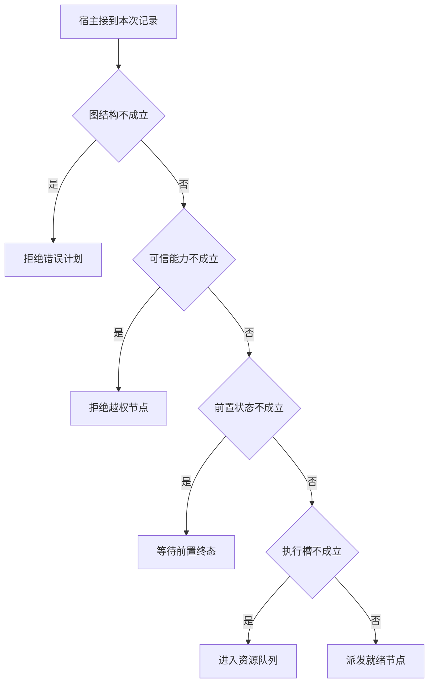

# 把一份计划变成可以派发的 DAG

计划写着查甲、比较、查乙，文字通顺却不能先比较后取证。
宿主先校验图，再检查每个节点的授权、实际就绪状态和可用执行槽。

本篇用一个封闭的教学决策器说明这一问题。输入是宿主收到的记录，不保证每个下游字段都已经获准使用。前置检查未成立时，下游即使带着缓存值，也不能拿来作业务断言。

## 先解决一个具体问题

**拓扑排序通过后，可以直接并发所有节点吗？**

无环只说明存在合法顺序。
每个节点仍要等真实前置终态、授权和资源槽。归并器开始运行也不代表所有分支业务成功。


先取一个能走到「派发就绪节点」的输入：依赖图合法且无环、宿主确认当前主体获准、真实前置条件已满足、当前还有空闲执行槽。
把这四个条件代回后文的图，前面各个拦截分支都未满足，最终才有“结构权限和运行条件均成立”这个判断。
还原这个现场时要分别问：哪些位来自可信状态，哪些只是在接口中出现、尚未获得解释资格的字段。

## 先沿一次决策走到底



从上到下取第一条成立的出口。只改一个开关时，只有它之前的检查都未截断，该变化才可能到达真实动作。

“图结构”的两种输入分别是“依赖图合法且无环”与“依赖错误或存在环”。
计划可读不等于执行器能调度。

“可信能力”的两种输入分别是“宿主确认当前主体获准”与“当前主体未获授权”。
权限取自可信入口或执行端，不由模型生成。

“前置状态”的两种输入分别是“真实前置条件已满足”与“前置仍未达到要求”。
拓扑顺序不等于运行时已经就绪。

“执行槽”的两种输入分别是“当前还有空闲执行槽”与“当前隔离池已满”。
独立分支也可能竞争同一个有限资源。

## 最少需要哪几项观察

### 拒绝错误计划

循环或缺依赖使计划不可执行。
在本节的全部组合中，有 8 种产生「拒绝错误计划」，这只是逻辑空间的计数，不能当作实际用户请求的比例。

只取得依赖错误或存在环，已经足以要求宿主「拒绝错误计划」。
保持这些已知项，其余开关自由变化，仍有 8 种补全，判断没有翻转。

若删掉关于图结构的证据，另一份允许的现场是依赖图合法且无环、当前主体未获授权、前置仍未达到要求、当前隔离池已满，它会使宿主「拒绝越权节点」。

### 拒绝越权节点

结构正确不能弥补授权缺失。
在本节的全部组合中，有 4 种产生「拒绝越权节点」，这只是逻辑空间的计数，不能当作实际用户请求的比例。

只取得依赖图合法且无环、当前主体未获授权，已经足以要求宿主「拒绝越权节点」。
保持这些已知项，其余开关自由变化，仍有 4 种补全，判断没有翻转。

若删掉关于图结构的证据，另一份允许的现场是依赖错误或存在环、当前主体未获授权、前置仍未达到要求、当前隔离池已满，它会使宿主「拒绝错误计划」。

若删掉关于可信能力的证据，另一份允许的现场是依赖图合法且无环、宿主确认当前主体获准、前置仍未达到要求、当前隔离池已满，它会使宿主「等待前置终态」。

### 等待前置终态

拓扑上可执行不代表此刻已就绪。
在本节的全部组合中，有 2 种产生「等待前置终态」，这只是逻辑空间的计数，不能当作实际用户请求的比例。

只取得依赖图合法且无环、宿主确认当前主体获准、前置仍未达到要求，已经足以要求宿主「等待前置终态」。
保持这些已知项，其余开关自由变化，仍有 2 种补全，判断没有翻转。

若删掉关于图结构的证据，另一份允许的现场是依赖错误或存在环、宿主确认当前主体获准、前置仍未达到要求、当前隔离池已满，它会使宿主「拒绝错误计划」。

若删掉关于可信能力的证据，另一份允许的现场是依赖图合法且无环、当前主体未获授权、前置仍未达到要求、当前隔离池已满，它会使宿主「拒绝越权节点」。

若删掉关于前置状态的证据，另一份允许的现场是依赖图合法且无环、宿主确认当前主体获准、真实前置条件已满足、当前隔离池已满，它会使宿主「进入资源队列」。

### 进入资源队列

依赖满足但执行槽不足。
在本节的全部组合中，有 1 种产生「进入资源队列」，这只是逻辑空间的计数，不能当作实际用户请求的比例。

只取得依赖图合法且无环、宿主确认当前主体获准、真实前置条件已满足、当前隔离池已满，已经足以要求宿主「进入资源队列」。
保持这些已知项，其余开关自由变化，仍有 1 种补全，判断没有翻转。

若删掉关于图结构的证据，另一份允许的现场是依赖错误或存在环、宿主确认当前主体获准、真实前置条件已满足、当前隔离池已满，它会使宿主「拒绝错误计划」。

若删掉关于可信能力的证据，另一份允许的现场是依赖图合法且无环、当前主体未获授权、真实前置条件已满足、当前隔离池已满，它会使宿主「拒绝越权节点」。

若删掉关于前置状态的证据，另一份允许的现场是依赖图合法且无环、宿主确认当前主体获准、前置仍未达到要求、当前隔离池已满，它会使宿主「等待前置终态」。

若删掉关于执行槽的证据，另一份允许的现场是依赖图合法且无环、宿主确认当前主体获准、真实前置条件已满足、当前还有空闲执行槽，它会使宿主「派发就绪节点」。

### 派发就绪节点

结构权限和运行条件均成立。
在本节的全部组合中，有 1 种产生「派发就绪节点」，这只是逻辑空间的计数，不能当作实际用户请求的比例。

只取得依赖图合法且无环、宿主确认当前主体获准、真实前置条件已满足、当前还有空闲执行槽，已经足以要求宿主「派发就绪节点」。

若删掉关于图结构的证据，另一份允许的现场是依赖错误或存在环、宿主确认当前主体获准、真实前置条件已满足、当前还有空闲执行槽，它会使宿主「拒绝错误计划」。

若删掉关于可信能力的证据，另一份允许的现场是依赖图合法且无环、当前主体未获授权、真实前置条件已满足、当前还有空闲执行槽，它会使宿主「拒绝越权节点」。

若删掉关于前置状态的证据，另一份允许的现场是依赖图合法且无环、宿主确认当前主体获准、前置仍未达到要求、当前还有空闲执行槽，它会使宿主「等待前置终态」。

若删掉关于执行槽的证据，另一份允许的现场是依赖图合法且无环、宿主确认当前主体获准、真实前置条件已满足、当前隔离池已满，它会使宿主「进入资源队列」。

## 以同一份契约解释截然不同的现场

<details>
<summary>展开推演与对应反例</summary>

下列样本按最先命中的业务分支排列。四位编码只作本篇页内定位，顺序与开头的四项输入一致。可以先猜下一动作，再展开相邻样本。

### 能够触发“拒绝错误计划”的现场

**样本 0000**

业务侧交来依赖错误或存在环、当前主体未获授权，执行侧还记录了前置仍未达到要求、当前隔离池已满。
把样本压成最短证明，保留依赖错误或存在环就能支持「拒绝错误计划」。

在这份记录上，分别翻转「图结构」中的任一项，其他项完全不变时，下一动作都会改变。

保持其余观察不动，单独切换「可信能力」、「前置状态」、「执行槽」仍得到「拒绝错误计划」，它们在这个现场不是决定性变量。

要从本例改走「拒绝越权节点」，至少需要变动 1 项，一组最少改动是将依赖错误或存在环换成依赖图合法且无环。

要从本例改走「等待前置终态」，至少需要变动 2 项，一组最少改动是将依赖错误或存在环、当前主体未获授权换成依赖图合法且无环、宿主确认当前主体获准。

要从本例改走「进入资源队列」，至少需要变动 3 项，一组最少改动是将依赖错误或存在环、当前主体未获授权、前置仍未达到要求换成依赖图合法且无环、宿主确认当前主体获准、真实前置条件已满足。

要从本例改走「派发就绪节点」，至少需要变动 4 项，一组最少改动是将依赖错误或存在环、当前主体未获授权、前置仍未达到要求、当前隔离池已满换成依赖图合法且无环、宿主确认当前主体获准、真实前置条件已满足、当前还有空闲执行槽。

**样本 0001**

业务侧交来依赖错误或存在环、当前主体未获授权，执行侧还记录了前置仍未达到要求、当前还有空闲执行槽。


要从本例改走「派发就绪节点」，至少需要变动 3 项，一组最少改动是将依赖错误或存在环、当前主体未获授权、前置仍未达到要求换成依赖图合法且无环、宿主确认当前主体获准、真实前置条件已满足。

要从本例改走「进入资源队列」，至少需要变动 4 项，一组最少改动是将依赖错误或存在环、当前主体未获授权、前置仍未达到要求、当前还有空闲执行槽换成依赖图合法且无环、宿主确认当前主体获准、真实前置条件已满足、当前隔离池已满。

**样本 0010**

业务侧交来依赖错误或存在环、当前主体未获授权，执行侧还记录了真实前置条件已满足、当前隔离池已满。


要从本例改走「进入资源队列」，至少需要变动 2 项，一组最少改动是将依赖错误或存在环、当前主体未获授权换成依赖图合法且无环、宿主确认当前主体获准。

要从本例改走「等待前置终态」，至少需要变动 3 项，一组最少改动是将依赖错误或存在环、当前主体未获授权、真实前置条件已满足换成依赖图合法且无环、宿主确认当前主体获准、前置仍未达到要求。

要从本例改走「派发就绪节点」，至少需要变动 3 项，一组最少改动是将依赖错误或存在环、当前主体未获授权、当前隔离池已满换成依赖图合法且无环、宿主确认当前主体获准、当前还有空闲执行槽。

**样本 0011**

业务侧交来依赖错误或存在环、当前主体未获授权，执行侧还记录了真实前置条件已满足、当前还有空闲执行槽。


要从本例改走「派发就绪节点」，至少需要变动 2 项，一组最少改动是将依赖错误或存在环、当前主体未获授权换成依赖图合法且无环、宿主确认当前主体获准。


要从本例改走「进入资源队列」，至少需要变动 3 项，一组最少改动是将依赖错误或存在环、当前主体未获授权、当前还有空闲执行槽换成依赖图合法且无环、宿主确认当前主体获准、当前隔离池已满。

**样本 0100**

业务侧交来依赖错误或存在环、宿主确认当前主体获准，执行侧还记录了前置仍未达到要求、当前隔离池已满。


要从本例改走「等待前置终态」，至少需要变动 1 项，一组最少改动是将依赖错误或存在环换成依赖图合法且无环。

要从本例改走「拒绝越权节点」，至少需要变动 2 项，一组最少改动是将依赖错误或存在环、宿主确认当前主体获准换成依赖图合法且无环、当前主体未获授权。

要从本例改走「进入资源队列」，至少需要变动 2 项，一组最少改动是将依赖错误或存在环、前置仍未达到要求换成依赖图合法且无环、真实前置条件已满足。

要从本例改走「派发就绪节点」，至少需要变动 3 项，一组最少改动是将依赖错误或存在环、前置仍未达到要求、当前隔离池已满换成依赖图合法且无环、真实前置条件已满足、当前还有空闲执行槽。

**样本 0101**

业务侧交来依赖错误或存在环、宿主确认当前主体获准，执行侧还记录了前置仍未达到要求、当前还有空闲执行槽。


要从本例改走「派发就绪节点」，至少需要变动 2 项，一组最少改动是将依赖错误或存在环、前置仍未达到要求换成依赖图合法且无环、真实前置条件已满足。

要从本例改走「进入资源队列」，至少需要变动 3 项，一组最少改动是将依赖错误或存在环、前置仍未达到要求、当前还有空闲执行槽换成依赖图合法且无环、真实前置条件已满足、当前隔离池已满。

**样本 0110**

业务侧交来依赖错误或存在环、宿主确认当前主体获准，执行侧还记录了真实前置条件已满足、当前隔离池已满。


要从本例改走「进入资源队列」，至少需要变动 1 项，一组最少改动是将依赖错误或存在环换成依赖图合法且无环。


要从本例改走「等待前置终态」，至少需要变动 2 项，一组最少改动是将依赖错误或存在环、真实前置条件已满足换成依赖图合法且无环、前置仍未达到要求。

要从本例改走「派发就绪节点」，至少需要变动 2 项，一组最少改动是将依赖错误或存在环、当前隔离池已满换成依赖图合法且无环、当前还有空闲执行槽。

**样本 0111**

业务侧交来依赖错误或存在环、宿主确认当前主体获准，执行侧还记录了真实前置条件已满足、当前还有空闲执行槽。


要从本例改走「派发就绪节点」，至少需要变动 1 项，一组最少改动是将依赖错误或存在环换成依赖图合法且无环。


要从本例改走「进入资源队列」，至少需要变动 2 项，一组最少改动是将依赖错误或存在环、当前还有空闲执行槽换成依赖图合法且无环、当前隔离池已满。

### 能够触发“拒绝越权节点”的现场

**样本 1000**

业务侧交来依赖图合法且无环、当前主体未获授权，执行侧还记录了前置仍未达到要求、当前隔离池已满。
把样本压成最短证明，保留依赖图合法且无环、当前主体未获授权就能支持「拒绝越权节点」。

在这份记录上，分别翻转「图结构」、「可信能力」中的任一项，其他项完全不变时，下一动作都会改变。

保持其余观察不动，单独切换「前置状态」、「执行槽」仍得到「拒绝越权节点」，它们在这个现场不是决定性变量。

本例没走更靠前的「拒绝错误计划」，因为依赖图合法且无环与那个入口的必要条件不符。

要从本例改走「拒绝错误计划」，至少需要变动 1 项，一组最少改动是将依赖图合法且无环换成依赖错误或存在环。

要从本例改走「等待前置终态」，至少需要变动 1 项，一组最少改动是将当前主体未获授权换成宿主确认当前主体获准。

要从本例改走「进入资源队列」，至少需要变动 2 项，一组最少改动是将当前主体未获授权、前置仍未达到要求换成宿主确认当前主体获准、真实前置条件已满足。

要从本例改走「派发就绪节点」，至少需要变动 3 项，一组最少改动是将当前主体未获授权、前置仍未达到要求、当前隔离池已满换成宿主确认当前主体获准、真实前置条件已满足、当前还有空闲执行槽。

**样本 1001**

业务侧交来依赖图合法且无环、当前主体未获授权，执行侧还记录了前置仍未达到要求、当前还有空闲执行槽。


要从本例改走「派发就绪节点」，至少需要变动 2 项，一组最少改动是将当前主体未获授权、前置仍未达到要求换成宿主确认当前主体获准、真实前置条件已满足。

要从本例改走「进入资源队列」，至少需要变动 3 项，一组最少改动是将当前主体未获授权、前置仍未达到要求、当前还有空闲执行槽换成宿主确认当前主体获准、真实前置条件已满足、当前隔离池已满。

**样本 1010**

业务侧交来依赖图合法且无环、当前主体未获授权，执行侧还记录了真实前置条件已满足、当前隔离池已满。


要从本例改走「进入资源队列」，至少需要变动 1 项，一组最少改动是将当前主体未获授权换成宿主确认当前主体获准。

要从本例改走「等待前置终态」，至少需要变动 2 项，一组最少改动是将当前主体未获授权、真实前置条件已满足换成宿主确认当前主体获准、前置仍未达到要求。

要从本例改走「派发就绪节点」，至少需要变动 2 项，一组最少改动是将当前主体未获授权、当前隔离池已满换成宿主确认当前主体获准、当前还有空闲执行槽。

**样本 1011**

业务侧交来依赖图合法且无环、当前主体未获授权，执行侧还记录了真实前置条件已满足、当前还有空闲执行槽。


要从本例改走「派发就绪节点」，至少需要变动 1 项，一组最少改动是将当前主体未获授权换成宿主确认当前主体获准。


要从本例改走「进入资源队列」，至少需要变动 2 项，一组最少改动是将当前主体未获授权、当前还有空闲执行槽换成宿主确认当前主体获准、当前隔离池已满。

### 能够触发“等待前置终态”的现场

**样本 1100**

业务侧交来依赖图合法且无环、宿主确认当前主体获准，执行侧还记录了前置仍未达到要求、当前隔离池已满。
把样本压成最短证明，保留依赖图合法且无环、宿主确认当前主体获准、前置仍未达到要求就能支持「等待前置终态」。

在这份记录上，分别翻转「图结构」、「可信能力」、「前置状态」中的任一项，其他项完全不变时，下一动作都会改变。

保持其余观察不动，单独切换「执行槽」仍得到「等待前置终态」，它们在这个现场不是决定性变量。


本例没走更靠前的「拒绝越权节点」，因为宿主确认当前主体获准与那个入口的必要条件不符。


要从本例改走「拒绝越权节点」，至少需要变动 1 项，一组最少改动是将宿主确认当前主体获准换成当前主体未获授权。

要从本例改走「进入资源队列」，至少需要变动 1 项，一组最少改动是将前置仍未达到要求换成真实前置条件已满足。

要从本例改走「派发就绪节点」，至少需要变动 2 项，一组最少改动是将前置仍未达到要求、当前隔离池已满换成真实前置条件已满足、当前还有空闲执行槽。

**样本 1101**

业务侧交来依赖图合法且无环、宿主确认当前主体获准，执行侧还记录了前置仍未达到要求、当前还有空闲执行槽。


要从本例改走「派发就绪节点」，至少需要变动 1 项，一组最少改动是将前置仍未达到要求换成真实前置条件已满足。

要从本例改走「进入资源队列」，至少需要变动 2 项，一组最少改动是将前置仍未达到要求、当前还有空闲执行槽换成真实前置条件已满足、当前隔离池已满。

### 能够触发“进入资源队列”的现场

**样本 1110**

业务侧交来依赖图合法且无环、宿主确认当前主体获准，执行侧还记录了真实前置条件已满足、当前隔离池已满。
把样本压成最短证明，保留依赖图合法且无环、宿主确认当前主体获准、真实前置条件已满足、当前隔离池已满就能支持「进入资源队列」。

在这份记录上，分别翻转「图结构」、「可信能力」、「前置状态」、「执行槽」中的任一项，其他项完全不变时，下一动作都会改变。


本例没走更靠前的「等待前置终态」，因为真实前置条件已满足与那个入口的必要条件不符。


要从本例改走「等待前置终态」，至少需要变动 1 项，一组最少改动是将真实前置条件已满足换成前置仍未达到要求。

要从本例改走「派发就绪节点」，至少需要变动 1 项，一组最少改动是将当前隔离池已满换成当前还有空闲执行槽。

### 能够触发“派发就绪节点”的现场

**样本 1111**

业务侧交来依赖图合法且无环、宿主确认当前主体获准，执行侧还记录了真实前置条件已满足、当前还有空闲执行槽。
把样本压成最短证明，保留依赖图合法且无环、宿主确认当前主体获准、真实前置条件已满足、当前还有空闲执行槽就能支持「派发就绪节点」。


本例没走更靠前的「进入资源队列」，因为当前还有空闲执行槽与那个入口的必要条件不符。


要从本例改走「进入资源队列」，至少需要变动 1 项，一组最少改动是将当前还有空闲执行槽换成当前隔离池已满。

</details>

## 当你只能看见一半记录

<details>
<summary>展开推演与对应反例</summary>

这次隐藏两个字段，保留另两个。对每个可见现场，检查四种合法补全是否同意。如仍有歧义，选择能使最坏剩余候选动作最少的字段继续查。并列时采用本篇字段顺序。

### 只保留图结构与可信能力

已知依赖错误或存在环、当前主体未获授权时，四种补全的动作分布为拒绝错误计划（4 种）。

就“拒绝错误计划”这个动作而言，在依赖错误或存在环、当前主体未获授权的前提下，另外两项观察不会推翻它。

已知依赖错误或存在环、宿主确认当前主体获准时，四种补全的动作分布为拒绝错误计划（4 种）。

就“拒绝错误计划”这个动作而言，在依赖错误或存在环、宿主确认当前主体获准的前提下，另外两项观察不会推翻它。

已知依赖图合法且无环、当前主体未获授权时，四种补全的动作分布为拒绝越权节点（4 种）。

就“拒绝越权节点”这个动作而言，在依赖图合法且无环、当前主体未获授权的前提下，另外两项观察不会推翻它。

已知依赖图合法且无环、宿主确认当前主体获准时，四种补全的动作分布为等待前置终态（2 种）、进入资源队列（1 种）、派发就绪节点（1 种）。

在依赖图合法且无环、宿主确认当前主体获准这个现场补读「前置状态」，最坏还剩 2 种动作，计算时只衡量歧义，尚未扣读取代价。
若补来的观察为“前置仍未达到要求”，范围缩成「等待前置终态」。若为“真实前置条件已满足”，则保留「进入资源队列」、「派发就绪节点」。

区分不了的两条执行可以具体写成 1100 与 1110：它们共享已展示字段，却分别需要「等待前置终态」和「进入资源队列」。

### 只保留图结构与前置状态

已知依赖错误或存在环、前置仍未达到要求时，四种补全的动作分布为拒绝错误计划（4 种）。

就“拒绝错误计划”这个动作而言，在依赖错误或存在环、前置仍未达到要求的前提下，另外两项观察不会推翻它。

已知依赖错误或存在环、真实前置条件已满足时，四种补全的动作分布为拒绝错误计划（4 种）。

就“拒绝错误计划”这个动作而言，在依赖错误或存在环、真实前置条件已满足的前提下，另外两项观察不会推翻它。

已知依赖图合法且无环、前置仍未达到要求时，四种补全的动作分布为拒绝越权节点（2 种）、等待前置终态（2 种）。

在依赖图合法且无环、前置仍未达到要求这个现场补读「可信能力」，最坏还剩 1 种动作，计算时只衡量歧义，尚未扣读取代价。
若补来的观察为“当前主体未获授权”，范围缩成「拒绝越权节点」。若为“宿主确认当前主体获准”，则保留「等待前置终态」。

区分不了的两条执行可以具体写成 1000 与 1100：它们共享已展示字段，却分别需要「拒绝越权节点」和「等待前置终态」。

已知依赖图合法且无环、真实前置条件已满足时，四种补全的动作分布为拒绝越权节点（2 种）、进入资源队列（1 种）、派发就绪节点（1 种）。

在依赖图合法且无环、真实前置条件已满足这个现场补读「可信能力」，最坏还剩 2 种动作，计算时只衡量歧义，尚未扣读取代价。
若补来的观察为“当前主体未获授权”，范围缩成「拒绝越权节点」。若为“宿主确认当前主体获准”，则保留「进入资源队列」、「派发就绪节点」。

区分不了的两条执行可以具体写成 1010 与 1110：它们共享已展示字段，却分别需要「拒绝越权节点」和「进入资源队列」。

### 只保留可信能力与前置状态

已知当前主体未获授权、前置仍未达到要求时，四种补全的动作分布为拒绝错误计划（2 种）、拒绝越权节点（2 种）。

在当前主体未获授权、前置仍未达到要求这个现场补读「图结构」，最坏还剩 1 种动作，计算时只衡量歧义，尚未扣读取代价。
若补来的观察为“依赖错误或存在环”，范围缩成「拒绝错误计划」。若为“依赖图合法且无环”，则保留「拒绝越权节点」。

区分不了的两条执行可以具体写成 0000 与 1000：它们共享已展示字段，却分别需要「拒绝错误计划」和「拒绝越权节点」。

已知当前主体未获授权、真实前置条件已满足时，四种补全的动作分布为拒绝错误计划（2 种）、拒绝越权节点（2 种）。

在当前主体未获授权、真实前置条件已满足这个现场补读「图结构」，最坏还剩 1 种动作，计算时只衡量歧义，尚未扣读取代价。

区分不了的两条执行可以具体写成 0010 与 1010：它们共享已展示字段，却分别需要「拒绝错误计划」和「拒绝越权节点」。

已知宿主确认当前主体获准、前置仍未达到要求时，四种补全的动作分布为拒绝错误计划（2 种）、等待前置终态（2 种）。

在宿主确认当前主体获准、前置仍未达到要求这个现场补读「图结构」，最坏还剩 1 种动作，计算时只衡量歧义，尚未扣读取代价。
若补来的观察为“依赖错误或存在环”，范围缩成「拒绝错误计划」。若为“依赖图合法且无环”，则保留「等待前置终态」。

区分不了的两条执行可以具体写成 0100 与 1100：它们共享已展示字段，却分别需要「拒绝错误计划」和「等待前置终态」。

已知宿主确认当前主体获准、真实前置条件已满足时，四种补全的动作分布为拒绝错误计划（2 种）、进入资源队列（1 种）、派发就绪节点（1 种）。

在宿主确认当前主体获准、真实前置条件已满足这个现场补读「图结构」，最坏还剩 2 种动作，计算时只衡量歧义，尚未扣读取代价。
若补来的观察为“依赖错误或存在环”，范围缩成「拒绝错误计划」。若为“依赖图合法且无环”，则保留「进入资源队列」、「派发就绪节点」。

区分不了的两条执行可以具体写成 0110 与 1110：它们共享已展示字段，却分别需要「拒绝错误计划」和「进入资源队列」。

### 只保留图结构与执行槽

已知依赖错误或存在环、当前隔离池已满时，四种补全的动作分布为拒绝错误计划（4 种）。

就“拒绝错误计划”这个动作而言，在依赖错误或存在环、当前隔离池已满的前提下，另外两项观察不会推翻它。

已知依赖错误或存在环、当前还有空闲执行槽时，四种补全的动作分布为拒绝错误计划（4 种）。

就“拒绝错误计划”这个动作而言，在依赖错误或存在环、当前还有空闲执行槽的前提下，另外两项观察不会推翻它。

已知依赖图合法且无环、当前隔离池已满时，四种补全的动作分布为拒绝越权节点（2 种）、等待前置终态（1 种）、进入资源队列（1 种）。

在依赖图合法且无环、当前隔离池已满这个现场补读「可信能力」，最坏还剩 2 种动作，计算时只衡量歧义，尚未扣读取代价。
若补来的观察为“当前主体未获授权”，范围缩成「拒绝越权节点」。若为“宿主确认当前主体获准”，则保留「等待前置终态」、「进入资源队列」。


已知依赖图合法且无环、当前还有空闲执行槽时，四种补全的动作分布为拒绝越权节点（2 种）、等待前置终态（1 种）、派发就绪节点（1 种）。

在依赖图合法且无环、当前还有空闲执行槽这个现场补读「可信能力」，最坏还剩 2 种动作，计算时只衡量歧义，尚未扣读取代价。
若补来的观察为“当前主体未获授权”，范围缩成「拒绝越权节点」。若为“宿主确认当前主体获准”，则保留「等待前置终态」、「派发就绪节点」。

区分不了的两条执行可以具体写成 1001 与 1101：它们共享已展示字段，却分别需要「拒绝越权节点」和「等待前置终态」。

### 只保留可信能力与执行槽

已知当前主体未获授权、当前隔离池已满时，四种补全的动作分布为拒绝错误计划（2 种）、拒绝越权节点（2 种）。

在当前主体未获授权、当前隔离池已满这个现场补读「图结构」，最坏还剩 1 种动作，计算时只衡量歧义，尚未扣读取代价。


已知当前主体未获授权、当前还有空闲执行槽时，四种补全的动作分布为拒绝错误计划（2 种）、拒绝越权节点（2 种）。

在当前主体未获授权、当前还有空闲执行槽这个现场补读「图结构」，最坏还剩 1 种动作，计算时只衡量歧义，尚未扣读取代价。

区分不了的两条执行可以具体写成 0001 与 1001：它们共享已展示字段，却分别需要「拒绝错误计划」和「拒绝越权节点」。

已知宿主确认当前主体获准、当前隔离池已满时，四种补全的动作分布为拒绝错误计划（2 种）、等待前置终态（1 种）、进入资源队列（1 种）。

在宿主确认当前主体获准、当前隔离池已满这个现场补读「图结构」，最坏还剩 2 种动作，计算时只衡量歧义，尚未扣读取代价。
若补来的观察为“依赖错误或存在环”，范围缩成「拒绝错误计划」。若为“依赖图合法且无环”，则保留「等待前置终态」、「进入资源队列」。


已知宿主确认当前主体获准、当前还有空闲执行槽时，四种补全的动作分布为拒绝错误计划（2 种）、等待前置终态（1 种）、派发就绪节点（1 种）。

在宿主确认当前主体获准、当前还有空闲执行槽这个现场补读「图结构」，最坏还剩 2 种动作，计算时只衡量歧义，尚未扣读取代价。
若补来的观察为“依赖错误或存在环”，范围缩成「拒绝错误计划」。若为“依赖图合法且无环”，则保留「等待前置终态」、「派发就绪节点」。

区分不了的两条执行可以具体写成 0101 与 1101：它们共享已展示字段，却分别需要「拒绝错误计划」和「等待前置终态」。

### 只保留前置状态与执行槽

已知前置仍未达到要求、当前隔离池已满时，四种补全的动作分布为拒绝错误计划（2 种）、拒绝越权节点（1 种）、等待前置终态（1 种）。

在前置仍未达到要求、当前隔离池已满这个现场补读「图结构」，最坏还剩 2 种动作，计算时只衡量歧义，尚未扣读取代价。
若补来的观察为“依赖错误或存在环”，范围缩成「拒绝错误计划」。若为“依赖图合法且无环”，则保留「拒绝越权节点」、「等待前置终态」。


已知前置仍未达到要求、当前还有空闲执行槽时，四种补全的动作分布为拒绝错误计划（2 种）、拒绝越权节点（1 种）、等待前置终态（1 种）。

在前置仍未达到要求、当前还有空闲执行槽这个现场补读「图结构」，最坏还剩 2 种动作，计算时只衡量歧义，尚未扣读取代价。


已知真实前置条件已满足、当前隔离池已满时，四种补全的动作分布为拒绝错误计划（2 种）、拒绝越权节点（1 种）、进入资源队列（1 种）。

在真实前置条件已满足、当前隔离池已满这个现场补读「图结构」，最坏还剩 2 种动作，计算时只衡量歧义，尚未扣读取代价。
若补来的观察为“依赖错误或存在环”，范围缩成「拒绝错误计划」。若为“依赖图合法且无环”，则保留「拒绝越权节点」、「进入资源队列」。


已知真实前置条件已满足、当前还有空闲执行槽时，四种补全的动作分布为拒绝错误计划（2 种）、拒绝越权节点（1 种）、派发就绪节点（1 种）。

在真实前置条件已满足、当前还有空闲执行槽这个现场补读「图结构」，最坏还剩 2 种动作，计算时只衡量歧义，尚未扣读取代价。
若补来的观察为“依赖错误或存在环”，范围缩成「拒绝错误计划」。若为“依赖图合法且无环”，则保留「拒绝越权节点」、「派发就绪节点」。

区分不了的两条执行可以具体写成 0011 与 1011：它们共享已展示字段，却分别需要「拒绝错误计划」和「拒绝越权节点」。

</details>

## 单因素干预与边界测试

<details>
<summary>展开推演与对应反例</summary>

### 只改变图结构

固定另外三个条件得到八对现场，从“依赖错误或存在环”转为“依赖图合法且无环”时，8 对翻转动作，另外 0 对保持不变。

有 4 对现场沿「拒绝错误计划」变到「拒绝越权节点」，可复现的一组受控背景为当前主体未获授权、前置仍未达到要求、当前隔离池已满。

有 2 对现场沿「拒绝错误计划」变到「等待前置终态」，可复现的一组受控背景为宿主确认当前主体获准、前置仍未达到要求、当前隔离池已满。

有 1 对现场沿「拒绝错误计划」变到「进入资源队列」，可复现的一组受控背景为宿主确认当前主体获准、真实前置条件已满足、当前隔离池已满。

有 1 对现场沿「拒绝错误计划」变到「派发就绪节点」，可复现的一组受控背景为宿主确认当前主体获准、真实前置条件已满足、当前还有空闲执行槽。

### 只改变可信能力

固定另外三个条件得到八对现场，从“当前主体未获授权”转为“宿主确认当前主体获准”时，4 对翻转动作，另外 4 对保持不变。

令依赖错误或存在环、前置仍未达到要求、当前隔离池已满，可信能力的两个取值均得到「拒绝错误计划」。在八对中，共有 4 对表现为这一种稳定出口。

有 2 对现场沿「拒绝越权节点」变到「等待前置终态」，可复现的一组受控背景为依赖图合法且无环、前置仍未达到要求、当前隔离池已满。

有 1 对现场沿「拒绝越权节点」变到「进入资源队列」，可复现的一组受控背景为依赖图合法且无环、真实前置条件已满足、当前隔离池已满。

有 1 对现场沿「拒绝越权节点」变到「派发就绪节点」，可复现的一组受控背景为依赖图合法且无环、真实前置条件已满足、当前还有空闲执行槽。

### 只改变前置状态

固定另外三个条件得到八对现场，从“前置仍未达到要求”转为“真实前置条件已满足”时，2 对翻转动作，另外 6 对保持不变。

令依赖错误或存在环、当前主体未获授权、当前隔离池已满，前置状态的两个取值均得到「拒绝错误计划」。在八对中，共有 4 对表现为这一种稳定出口。

令依赖图合法且无环、当前主体未获授权、当前隔离池已满，前置状态的两个取值均得到「拒绝越权节点」。在八对中，共有 2 对表现为这一种稳定出口。

有 1 对现场沿「等待前置终态」变到「进入资源队列」，可复现的一组受控背景为依赖图合法且无环、宿主确认当前主体获准、当前隔离池已满。

有 1 对现场沿「等待前置终态」变到「派发就绪节点」，可复现的一组受控背景为依赖图合法且无环、宿主确认当前主体获准、当前还有空闲执行槽。

### 只改变执行槽

固定另外三个条件得到八对现场，从“当前隔离池已满”转为“当前还有空闲执行槽”时，1 对翻转动作，另外 7 对保持不变。

令依赖错误或存在环、当前主体未获授权、前置仍未达到要求，执行槽的两个取值均得到「拒绝错误计划」。在八对中，共有 4 对表现为这一种稳定出口。

令依赖图合法且无环、当前主体未获授权、前置仍未达到要求，执行槽的两个取值均得到「拒绝越权节点」。在八对中，共有 2 对表现为这一种稳定出口。

令依赖图合法且无环、宿主确认当前主体获准、前置仍未达到要求，执行槽的两个取值均得到「等待前置终态」。在八对中，共有 1 对表现为这一种稳定出口。

有 1 对现场沿「进入资源队列」变到「派发就绪节点」，可复现的一组受控背景为依赖图合法且无环、宿主确认当前主体获准、真实前置条件已满足。

</details>

## 哪些回归样本真能抓住实现错误

<details>
<summary>展开推演与对应反例</summary>

如果删除“拒绝错误计划”这个分支，在本篇 16 种输入里有 8 种会改走另一出口。

反例 0000 的完整记录为依赖错误或存在环、当前主体未获授权、前置仍未达到要求、当前隔离池已满。正确结果是「拒绝错误计划」，这个改坏的实现却给出「拒绝越权节点」。

如果删除“拒绝越权节点”这个分支，在本篇 16 种输入里有 4 种会改走另一出口。

反例 1000 的完整记录为依赖图合法且无环、当前主体未获授权、前置仍未达到要求、当前隔离池已满。正确结果是「拒绝越权节点」，这个改坏的实现却给出「等待前置终态」。

如果删除“等待前置终态”这个分支，在本篇 16 种输入里有 2 种会改走另一出口。

反例 1100 的完整记录为依赖图合法且无环、宿主确认当前主体获准、前置仍未达到要求、当前隔离池已满。正确结果是「等待前置终态」，这个改坏的实现却给出「进入资源队列」。

如果删除“进入资源队列”这个分支，在本篇 16 种输入里有 1 种会改走另一出口。

反例 1110 的完整记录为依赖图合法且无环、宿主确认当前主体获准、真实前置条件已满足、当前隔离池已满。正确结果是「进入资源队列」，这个改坏的实现却给出「派发就绪节点」。

如果交换“拒绝错误计划”和“拒绝越权节点”的判断次序，在本篇 16 种输入里有 4 种会改走另一出口。


如果交换“拒绝越权节点”和“等待前置终态”的判断次序，在本篇 16 种输入里有 2 种会改走另一出口。


如果交换“等待前置终态”和“进入资源队列”的判断次序，在本篇 16 种输入里有 1 种会改走另一出口。


补入样本 0000（依赖错误或存在环、当前主体未获授权、前置仍未达到要求、当前隔离池已满）能新增检出「删除“拒绝错误计划”这个分支」、「交换“拒绝错误计划”和“拒绝越权节点”的判断次序」。

补入样本 1000（依赖图合法且无环、当前主体未获授权、前置仍未达到要求、当前隔离池已满）能新增检出「删除“拒绝越权节点”这个分支」、「交换“拒绝越权节点”和“等待前置终态”的判断次序」。

补入样本 1100（依赖图合法且无环、宿主确认当前主体获准、前置仍未达到要求、当前隔离池已满）能新增检出「删除“等待前置终态”这个分支」、「交换“等待前置终态”和“进入资源队列”的判断次序」。

补入样本 1110（依赖图合法且无环、宿主确认当前主体获准、真实前置条件已满足、当前隔离池已满）能新增检出「删除“进入资源队列”这个分支」。

这里每次选覆盖尚未捕获缺陷最多的样本，并不保证用例数全局最小。它给出的反例能作为 Java 单测输入。真实模型是否会自主产生这些提议，仍须单独评测。

</details>

## 把状态覆盖换成有抽样偏差的评测批次

<details>
<summary>展开推演与对应反例</summary>

前面的十六种记录各有一票。现在只改样本构成：对一个给定字段，把成立侧的每种记录各取三份、另一侧各取一份。这是人为配比的 32 份回放，不是线上频率估计。
将偏向成立与偏向不成立的两次批次对照，可以隔离分母变化。底层宿主和所有答案保持相同，比例仍可能移动。

### 改变“图结构”的样本配比

只看「拒绝错误计划」，在依赖图合法且无环的八个不同输入中有 0 个命中，在依赖错误或存在环的另八个输入中有 8 个命中。
把「图结构」成立侧按三倍取样，「拒绝错误计划」占 8/32，反过来向未成立侧倾斜后占 24/32。
这次重加权使「拒绝错误计划」的占比相差 50 个百分点。若按两种不同的“图结构”分布跑新旧版，不能把这项差异全部归功于实现。

只看「拒绝越权节点」，在依赖图合法且无环的八个不同输入中有 4 个命中，在依赖错误或存在环的另八个输入中有 0 个命中。
把「图结构」成立侧按三倍取样，「拒绝越权节点」占 12/32，反过来向未成立侧倾斜后占 4/32。
这次重加权使「拒绝越权节点」的占比相差 25 个百分点。若按两种不同的“图结构”分布跑新旧版，不能把这项差异全部归功于实现。

只看「等待前置终态」，在依赖图合法且无环的八个不同输入中有 2 个命中，在依赖错误或存在环的另八个输入中有 0 个命中。
把「图结构」成立侧按三倍取样，「等待前置终态」占 6/32，反过来向未成立侧倾斜后占 2/32。
这次重加权使「等待前置终态」的占比相差 12.5 个百分点。若按两种不同的“图结构”分布跑新旧版，不能把这项差异全部归功于实现。

只看「进入资源队列」，在依赖图合法且无环的八个不同输入中有 1 个命中，在依赖错误或存在环的另八个输入中有 0 个命中。
把「图结构」成立侧按三倍取样，「进入资源队列」占 3/32，反过来向未成立侧倾斜后占 1/32。
这次重加权使「进入资源队列」的占比相差 6.25 个百分点。若按两种不同的“图结构”分布跑新旧版，不能把这项差异全部归功于实现。

只看「派发就绪节点」，在依赖图合法且无环的八个不同输入中有 1 个命中，在依赖错误或存在环的另八个输入中有 0 个命中。
把「图结构」成立侧按三倍取样，「派发就绪节点」占 3/32，反过来向未成立侧倾斜后占 1/32。
这次重加权使「派发就绪节点」的占比相差 6.25 个百分点。若按两种不同的“图结构”分布跑新旧版，不能把这项差异全部归功于实现。

### 改变“可信能力”的样本配比

只看「拒绝错误计划」，在宿主确认当前主体获准的八个不同输入中有 4 个命中，在当前主体未获授权的另八个输入中有 4 个命中。
把「可信能力」成立侧按三倍取样，「拒绝错误计划」占 16/32，反过来向未成立侧倾斜后占 16/32。
两批「拒绝错误计划」的边际比例相同，是因为这个出口在“可信能力”的两侧计数相等，这不能单独证明每一对现场都不受它影响。

只看「拒绝越权节点」，在宿主确认当前主体获准的八个不同输入中有 0 个命中，在当前主体未获授权的另八个输入中有 4 个命中。
把「可信能力」成立侧按三倍取样，「拒绝越权节点」占 4/32，反过来向未成立侧倾斜后占 12/32。
这次重加权使「拒绝越权节点」的占比相差 25 个百分点。若按两种不同的“可信能力”分布跑新旧版，不能把这项差异全部归功于实现。

只看「等待前置终态」，在宿主确认当前主体获准的八个不同输入中有 2 个命中，在当前主体未获授权的另八个输入中有 0 个命中。
把「可信能力」成立侧按三倍取样，「等待前置终态」占 6/32，反过来向未成立侧倾斜后占 2/32。
这次重加权使「等待前置终态」的占比相差 12.5 个百分点。若按两种不同的“可信能力”分布跑新旧版，不能把这项差异全部归功于实现。

只看「进入资源队列」，在宿主确认当前主体获准的八个不同输入中有 1 个命中，在当前主体未获授权的另八个输入中有 0 个命中。
把「可信能力」成立侧按三倍取样，「进入资源队列」占 3/32，反过来向未成立侧倾斜后占 1/32。
这次重加权使「进入资源队列」的占比相差 6.25 个百分点。若按两种不同的“可信能力”分布跑新旧版，不能把这项差异全部归功于实现。

只看「派发就绪节点」，在宿主确认当前主体获准的八个不同输入中有 1 个命中，在当前主体未获授权的另八个输入中有 0 个命中。
把「可信能力」成立侧按三倍取样，「派发就绪节点」占 3/32，反过来向未成立侧倾斜后占 1/32。
这次重加权使「派发就绪节点」的占比相差 6.25 个百分点。若按两种不同的“可信能力”分布跑新旧版，不能把这项差异全部归功于实现。

### 改变“前置状态”的样本配比

只看「拒绝错误计划」，在真实前置条件已满足的八个不同输入中有 4 个命中，在前置仍未达到要求的另八个输入中有 4 个命中。
把「前置状态」成立侧按三倍取样，「拒绝错误计划」占 16/32，反过来向未成立侧倾斜后占 16/32。
两批「拒绝错误计划」的边际比例相同，是因为这个出口在“前置状态”的两侧计数相等，这不能单独证明每一对现场都不受它影响。

只看「拒绝越权节点」，在真实前置条件已满足的八个不同输入中有 2 个命中，在前置仍未达到要求的另八个输入中有 2 个命中。
把「前置状态」成立侧按三倍取样，「拒绝越权节点」占 8/32，反过来向未成立侧倾斜后占 8/32。
两批「拒绝越权节点」的边际比例相同，是因为这个出口在“前置状态”的两侧计数相等，这不能单独证明每一对现场都不受它影响。

只看「等待前置终态」，在真实前置条件已满足的八个不同输入中有 0 个命中，在前置仍未达到要求的另八个输入中有 2 个命中。
把「前置状态」成立侧按三倍取样，「等待前置终态」占 2/32，反过来向未成立侧倾斜后占 6/32。
这次重加权使「等待前置终态」的占比相差 12.5 个百分点。若按两种不同的“前置状态”分布跑新旧版，不能把这项差异全部归功于实现。

只看「进入资源队列」，在真实前置条件已满足的八个不同输入中有 1 个命中，在前置仍未达到要求的另八个输入中有 0 个命中。
把「前置状态」成立侧按三倍取样，「进入资源队列」占 3/32，反过来向未成立侧倾斜后占 1/32。
这次重加权使「进入资源队列」的占比相差 6.25 个百分点。若按两种不同的“前置状态”分布跑新旧版，不能把这项差异全部归功于实现。

只看「派发就绪节点」，在真实前置条件已满足的八个不同输入中有 1 个命中，在前置仍未达到要求的另八个输入中有 0 个命中。
把「前置状态」成立侧按三倍取样，「派发就绪节点」占 3/32，反过来向未成立侧倾斜后占 1/32。
这次重加权使「派发就绪节点」的占比相差 6.25 个百分点。若按两种不同的“前置状态”分布跑新旧版，不能把这项差异全部归功于实现。

### 改变“执行槽”的样本配比

只看「拒绝错误计划」，在当前还有空闲执行槽的八个不同输入中有 4 个命中，在当前隔离池已满的另八个输入中有 4 个命中。
把「执行槽」成立侧按三倍取样，「拒绝错误计划」占 16/32，反过来向未成立侧倾斜后占 16/32。
两批「拒绝错误计划」的边际比例相同，是因为这个出口在“执行槽”的两侧计数相等，这不能单独证明每一对现场都不受它影响。

只看「拒绝越权节点」，在当前还有空闲执行槽的八个不同输入中有 2 个命中，在当前隔离池已满的另八个输入中有 2 个命中。
把「执行槽」成立侧按三倍取样，「拒绝越权节点」占 8/32，反过来向未成立侧倾斜后占 8/32。
两批「拒绝越权节点」的边际比例相同，是因为这个出口在“执行槽”的两侧计数相等，这不能单独证明每一对现场都不受它影响。

只看「等待前置终态」，在当前还有空闲执行槽的八个不同输入中有 1 个命中，在当前隔离池已满的另八个输入中有 1 个命中。
把「执行槽」成立侧按三倍取样，「等待前置终态」占 4/32，反过来向未成立侧倾斜后占 4/32。
两批「等待前置终态」的边际比例相同，是因为这个出口在“执行槽”的两侧计数相等，这不能单独证明每一对现场都不受它影响。

只看「进入资源队列」，在当前还有空闲执行槽的八个不同输入中有 0 个命中，在当前隔离池已满的另八个输入中有 1 个命中。
把「执行槽」成立侧按三倍取样，「进入资源队列」占 1/32，反过来向未成立侧倾斜后占 3/32。
这次重加权使「进入资源队列」的占比相差 6.25 个百分点。若按两种不同的“执行槽”分布跑新旧版，不能把这项差异全部归功于实现。

只看「派发就绪节点」，在当前还有空闲执行槽的八个不同输入中有 1 个命中，在当前隔离池已满的另八个输入中有 0 个命中。
把「执行槽」成立侧按三倍取样，「派发就绪节点」占 3/32，反过来向未成立侧倾斜后占 1/32。
这次重加权使「派发就绪节点」的占比相差 6.25 个百分点。若按两种不同的“执行槽”分布跑新旧版，不能把这项差异全部归功于实现。

</details>

## 只看终态，能逆推出多少原始事实

<details>
<summary>展开推演与对应反例</summary>

### 只保留“拒绝错误计划”这条结果时

在本节契约与完整输入域内，仅知「拒绝错误计划」就能倒推出依赖错误或存在环，这一推断依赖版本未变且日志中的终态可信。

「拒绝错误计划」不能证明可信能力取哪一侧：0000 和 0100 有相同终态，却分别记为“当前主体未获授权”和“宿主确认当前主体获准”。

「拒绝错误计划」不能证明前置状态取哪一侧：0000 和 0010 有相同终态，却分别记为“前置仍未达到要求”和“真实前置条件已满足”。

「拒绝错误计划」不能证明执行槽取哪一侧：0000 和 0001 有相同终态，却分别记为“当前隔离池已满”和“当前还有空闲执行槽”。

反查「拒绝错误计划」的诊断日志，优先保留能区分样本 0000 与 1000 的「图结构」，否则很容易把邻近的「拒绝越权节点」看成同一种故障。

### 只保留“拒绝越权节点”这条结果时

在本节契约与完整输入域内，仅知「拒绝越权节点」就能倒推出依赖图合法且无环，这一推断依赖版本未变且日志中的终态可信。

在本节契约与完整输入域内，仅知「拒绝越权节点」就能倒推出当前主体未获授权，这一推断依赖版本未变且日志中的终态可信。

「拒绝越权节点」不能证明前置状态取哪一侧：1000 和 1010 有相同终态，却分别记为“前置仍未达到要求”和“真实前置条件已满足”。

「拒绝越权节点」不能证明执行槽取哪一侧：1000 和 1001 有相同终态，却分别记为“当前隔离池已满”和“当前还有空闲执行槽”。

反查「拒绝越权节点」的诊断日志，优先保留能区分样本 1000 与 0000 的「图结构」，否则很容易把邻近的「拒绝错误计划」看成同一种故障。

### 只保留“等待前置终态”这条结果时

在本节契约与完整输入域内，仅知「等待前置终态」就能倒推出依赖图合法且无环，这一推断依赖版本未变且日志中的终态可信。

在本节契约与完整输入域内，仅知「等待前置终态」就能倒推出宿主确认当前主体获准，这一推断依赖版本未变且日志中的终态可信。

在本节契约与完整输入域内，仅知「等待前置终态」就能倒推出前置仍未达到要求，这一推断依赖版本未变且日志中的终态可信。

「等待前置终态」不能证明执行槽取哪一侧：1100 和 1101 有相同终态，却分别记为“当前隔离池已满”和“当前还有空闲执行槽”。

反查「等待前置终态」的诊断日志，优先保留能区分样本 1100 与 0100 的「图结构」，否则很容易把邻近的「拒绝错误计划」看成同一种故障。

### 只保留“进入资源队列”这条结果时

在本节契约与完整输入域内，仅知「进入资源队列」就能倒推出依赖图合法且无环，这一推断依赖版本未变且日志中的终态可信。

在本节契约与完整输入域内，仅知「进入资源队列」就能倒推出宿主确认当前主体获准，这一推断依赖版本未变且日志中的终态可信。

在本节契约与完整输入域内，仅知「进入资源队列」就能倒推出真实前置条件已满足，这一推断依赖版本未变且日志中的终态可信。

在本节契约与完整输入域内，仅知「进入资源队列」就能倒推出当前隔离池已满，这一推断依赖版本未变且日志中的终态可信。

反查「进入资源队列」的诊断日志，优先保留能区分样本 1110 与 0110 的「图结构」，否则很容易把邻近的「拒绝错误计划」看成同一种故障。

### 只保留“派发就绪节点”这条结果时

在本节契约与完整输入域内，仅知「派发就绪节点」就能倒推出依赖图合法且无环，这一推断依赖版本未变且日志中的终态可信。

在本节契约与完整输入域内，仅知「派发就绪节点」就能倒推出宿主确认当前主体获准，这一推断依赖版本未变且日志中的终态可信。

在本节契约与完整输入域内，仅知「派发就绪节点」就能倒推出真实前置条件已满足，这一推断依赖版本未变且日志中的终态可信。

在本节契约与完整输入域内，仅知「派发就绪节点」就能倒推出当前还有空闲执行槽，这一推断依赖版本未变且日志中的终态可信。

反查「派发就绪节点」的诊断日志，优先保留能区分样本 1111 与 0111 的「图结构」，否则很容易把邻近的「拒绝错误计划」看成同一种故障。

</details>

## 面试复述与复算

面试题可以从“拓扑排序通过后，可以直接并发所有节点吗？”起步。先给出本篇的触发条件和一条真实执行端可检查的证据，再用一个相邻反例限定结论的适用范围。

在仓库根目录执行下列命令可以重算本篇的一个输入。四位数字依次选择正文列出的四项条件，0 表示未成立或低档，1 表示成立或高档。
```powershell
node examples/reading-cases/replay.mjs 7 1 0101
```

[本周主文](../theory.md) · [配套实验](../lab.md) · [下一篇研读](02.md)
