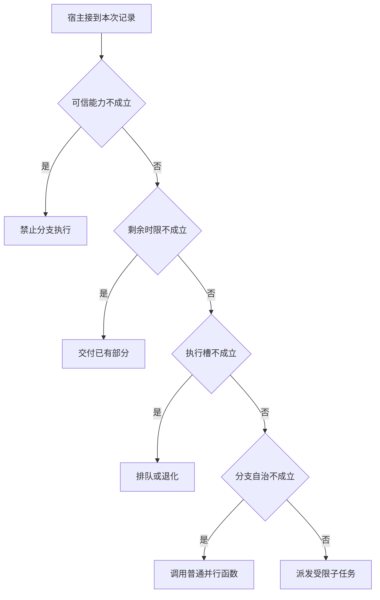

# 并行函数与独立 worker 的边界

两个已知参数的读取用普通执行器就能并行。
独立 worker 的区别是分支还能在看见新观察后自行选动作。
多出来的模型和上下文要有任务收益才能解释。

本篇用一个封闭的教学决策器说明这一问题。输入是宿主收到的记录，不保证每个下游字段都已经获准使用。前置检查未成立时，下游即使带着缓存值，也不能拿来作业务断言。

## 先解决一个具体问题

**两个 CompletableFuture 算不算多 Agent？**

若分支参数已经确定，普通函数并发即可。
独立 Agent 增加的是局部上下文与决策权，适用于分支需要自己选源、改道或判断结束的任务。


先取一个能走到「派发受限子任务」的输入：分支内需独立选下一步、宿主确认当前主体获准、当前还有空闲执行槽、截止前仍能完成下一动作。
把这四个条件代回后文的图，前面各个拦截分支都未满足，最终才有“分支确有独立策略需求且资源允许”这个判断。
还原这个现场时要分别问：哪些位来自可信状态，哪些只是在接口中出现、尚未获得解释资格的字段。

## 先沿一次决策走到底



从上到下取第一条成立的出口。只改一个开关时，只有它之前的检查都未截断，该变化才可能到达真实动作。

“分支自治”的两种输入分别是“分支内需独立选下一步”与“分支只执行已知函数”。
并行普通工具与独立决策者有不同代价。

“可信能力”的两种输入分别是“宿主确认当前主体获准”与“当前主体未获授权”。
权限取自可信入口或执行端，不由模型生成。

“执行槽”的两种输入分别是“当前还有空闲执行槽”与“当前隔离池已满”。
独立分支也可能竞争同一个有限资源。

“剩余时限”的两种输入分别是“截止前仍能完成下一动作”与“剩余时限不足”。
总时间应包含排队、动作和结果交付。

## 最少需要哪几项观察

### 禁止分支执行

委托不能扩大父权限。
在本节的全部组合中，有 8 种产生「禁止分支执行」，这只是逻辑空间的计数，不能当作实际用户请求的比例。

只取得当前主体未获授权，已经足以要求宿主「禁止分支执行」。
保持这些已知项，其余开关自由变化，仍有 8 种补全，判断没有翻转。

若删掉关于可信能力的证据，另一份允许的现场是分支只执行已知函数、宿主确认当前主体获准、当前隔离池已满、剩余时限不足，它会使宿主「交付已有部分」。

### 交付已有部分

截止内无法完成新增工作。
在本节的全部组合中，有 4 种产生「交付已有部分」，这只是逻辑空间的计数，不能当作实际用户请求的比例。

只取得宿主确认当前主体获准、剩余时限不足，已经足以要求宿主「交付已有部分」。
保持这些已知项，其余开关自由变化，仍有 4 种补全，判断没有翻转。

若删掉关于可信能力的证据，另一份允许的现场是分支只执行已知函数、当前主体未获授权、当前隔离池已满、剩余时限不足，它会使宿主「禁止分支执行」。

若删掉关于剩余时限的证据，另一份允许的现场是分支只执行已知函数、宿主确认当前主体获准、当前隔离池已满、截止前仍能完成下一动作，它会使宿主「排队或退化」。

### 排队或退化

执行槽已尽需按时间预算处理。
在本节的全部组合中，有 2 种产生「排队或退化」，这只是逻辑空间的计数，不能当作实际用户请求的比例。

只取得宿主确认当前主体获准、当前隔离池已满、截止前仍能完成下一动作，已经足以要求宿主「排队或退化」。
保持这些已知项，其余开关自由变化，仍有 2 种补全，判断没有翻转。

若删掉关于可信能力的证据，另一份允许的现场是分支只执行已知函数、当前主体未获授权、当前隔离池已满、截止前仍能完成下一动作，它会使宿主「禁止分支执行」。

若删掉关于执行槽的证据，另一份允许的现场是分支只执行已知函数、宿主确认当前主体获准、当前还有空闲执行槽、截止前仍能完成下一动作，它会使宿主「调用普通并行函数」。

若删掉关于剩余时限的证据，另一份允许的现场是分支只执行已知函数、宿主确认当前主体获准、当前隔离池已满、剩余时限不足，它会使宿主「交付已有部分」。

### 调用普通并行函数

分支只需已知参数的读取。
在本节的全部组合中，有 1 种产生「调用普通并行函数」，这只是逻辑空间的计数，不能当作实际用户请求的比例。

只取得分支只执行已知函数、宿主确认当前主体获准、当前还有空闲执行槽、截止前仍能完成下一动作，已经足以要求宿主「调用普通并行函数」。
保持这些已知项，其余开关自由变化，仍有 1 种补全，判断没有翻转。

若删掉关于分支自治的证据，另一份允许的现场是分支内需独立选下一步、宿主确认当前主体获准、当前还有空闲执行槽、截止前仍能完成下一动作，它会使宿主「派发受限子任务」。

若删掉关于可信能力的证据，另一份允许的现场是分支只执行已知函数、当前主体未获授权、当前还有空闲执行槽、截止前仍能完成下一动作，它会使宿主「禁止分支执行」。

若删掉关于执行槽的证据，另一份允许的现场是分支只执行已知函数、宿主确认当前主体获准、当前隔离池已满、截止前仍能完成下一动作，它会使宿主「排队或退化」。

若删掉关于剩余时限的证据，另一份允许的现场是分支只执行已知函数、宿主确认当前主体获准、当前还有空闲执行槽、剩余时限不足，它会使宿主「交付已有部分」。

### 派发受限子任务

分支确有独立策略需求且资源允许。
在本节的全部组合中，有 1 种产生「派发受限子任务」，这只是逻辑空间的计数，不能当作实际用户请求的比例。

只取得分支内需独立选下一步、宿主确认当前主体获准、当前还有空闲执行槽、截止前仍能完成下一动作，已经足以要求宿主「派发受限子任务」。

若删掉关于分支自治的证据，另一份允许的现场是分支只执行已知函数、宿主确认当前主体获准、当前还有空闲执行槽、截止前仍能完成下一动作，它会使宿主「调用普通并行函数」。

若删掉关于可信能力的证据，另一份允许的现场是分支内需独立选下一步、当前主体未获授权、当前还有空闲执行槽、截止前仍能完成下一动作，它会使宿主「禁止分支执行」。

若删掉关于执行槽的证据，另一份允许的现场是分支内需独立选下一步、宿主确认当前主体获准、当前隔离池已满、截止前仍能完成下一动作，它会使宿主「排队或退化」。

若删掉关于剩余时限的证据，另一份允许的现场是分支内需独立选下一步、宿主确认当前主体获准、当前还有空闲执行槽、剩余时限不足，它会使宿主「交付已有部分」。

## 以同一份契约解释截然不同的现场

<details>
<summary>展开推演与对应反例</summary>

下列样本按最先命中的业务分支排列。四位编码只作本篇页内定位，顺序与开头的四项输入一致。可以先猜下一动作，再展开相邻样本。

### 能够触发“禁止分支执行”的现场

**样本 0000**

业务侧交来分支只执行已知函数、当前主体未获授权，执行侧还记录了当前隔离池已满、剩余时限不足。
把样本压成最短证明，保留当前主体未获授权就能支持「禁止分支执行」。

在这份记录上，分别翻转「可信能力」中的任一项，其他项完全不变时，下一动作都会改变。

保持其余观察不动，单独切换「分支自治」、「执行槽」、「剩余时限」仍得到「禁止分支执行」，它们在这个现场不是决定性变量。

要从本例改走「交付已有部分」，至少需要变动 1 项，一组最少改动是将当前主体未获授权换成宿主确认当前主体获准。

要从本例改走「排队或退化」，至少需要变动 2 项，一组最少改动是将当前主体未获授权、剩余时限不足换成宿主确认当前主体获准、截止前仍能完成下一动作。

要从本例改走「调用普通并行函数」，至少需要变动 3 项，一组最少改动是将当前主体未获授权、当前隔离池已满、剩余时限不足换成宿主确认当前主体获准、当前还有空闲执行槽、截止前仍能完成下一动作。

要从本例改走「派发受限子任务」，至少需要变动 4 项，一组最少改动是将分支只执行已知函数、当前主体未获授权、当前隔离池已满、剩余时限不足换成分支内需独立选下一步、宿主确认当前主体获准、当前还有空闲执行槽、截止前仍能完成下一动作。

**样本 0001**

业务侧交来分支只执行已知函数、当前主体未获授权，执行侧还记录了当前隔离池已满、截止前仍能完成下一动作。


要从本例改走「排队或退化」，至少需要变动 1 项，一组最少改动是将当前主体未获授权换成宿主确认当前主体获准。

要从本例改走「交付已有部分」，至少需要变动 2 项，一组最少改动是将当前主体未获授权、截止前仍能完成下一动作换成宿主确认当前主体获准、剩余时限不足。

要从本例改走「调用普通并行函数」，至少需要变动 2 项，一组最少改动是将当前主体未获授权、当前隔离池已满换成宿主确认当前主体获准、当前还有空闲执行槽。

要从本例改走「派发受限子任务」，至少需要变动 3 项，一组最少改动是将分支只执行已知函数、当前主体未获授权、当前隔离池已满换成分支内需独立选下一步、宿主确认当前主体获准、当前还有空闲执行槽。

**样本 0010**

业务侧交来分支只执行已知函数、当前主体未获授权，执行侧还记录了当前还有空闲执行槽、剩余时限不足。


要从本例改走「调用普通并行函数」，至少需要变动 2 项，一组最少改动是将当前主体未获授权、剩余时限不足换成宿主确认当前主体获准、截止前仍能完成下一动作。

要从本例改走「排队或退化」，至少需要变动 3 项，一组最少改动是将当前主体未获授权、当前还有空闲执行槽、剩余时限不足换成宿主确认当前主体获准、当前隔离池已满、截止前仍能完成下一动作。

要从本例改走「派发受限子任务」，至少需要变动 3 项，一组最少改动是将分支只执行已知函数、当前主体未获授权、剩余时限不足换成分支内需独立选下一步、宿主确认当前主体获准、截止前仍能完成下一动作。

**样本 0011**

业务侧交来分支只执行已知函数、当前主体未获授权，执行侧还记录了当前还有空闲执行槽、截止前仍能完成下一动作。


要从本例改走「调用普通并行函数」，至少需要变动 1 项，一组最少改动是将当前主体未获授权换成宿主确认当前主体获准。

要从本例改走「排队或退化」，至少需要变动 2 项，一组最少改动是将当前主体未获授权、当前还有空闲执行槽换成宿主确认当前主体获准、当前隔离池已满。


要从本例改走「派发受限子任务」，至少需要变动 2 项，一组最少改动是将分支只执行已知函数、当前主体未获授权换成分支内需独立选下一步、宿主确认当前主体获准。

**样本 1000**

业务侧交来分支内需独立选下一步、当前主体未获授权，执行侧还记录了当前隔离池已满、剩余时限不足。


要从本例改走「派发受限子任务」，至少需要变动 3 项，一组最少改动是将当前主体未获授权、当前隔离池已满、剩余时限不足换成宿主确认当前主体获准、当前还有空闲执行槽、截止前仍能完成下一动作。

要从本例改走「调用普通并行函数」，至少需要变动 4 项，一组最少改动是将分支内需独立选下一步、当前主体未获授权、当前隔离池已满、剩余时限不足换成分支只执行已知函数、宿主确认当前主体获准、当前还有空闲执行槽、截止前仍能完成下一动作。

**样本 1001**

业务侧交来分支内需独立选下一步、当前主体未获授权，执行侧还记录了当前隔离池已满、截止前仍能完成下一动作。


要从本例改走「派发受限子任务」，至少需要变动 2 项，一组最少改动是将当前主体未获授权、当前隔离池已满换成宿主确认当前主体获准、当前还有空闲执行槽。

要从本例改走「调用普通并行函数」，至少需要变动 3 项，一组最少改动是将分支内需独立选下一步、当前主体未获授权、当前隔离池已满换成分支只执行已知函数、宿主确认当前主体获准、当前还有空闲执行槽。

**样本 1010**

业务侧交来分支内需独立选下一步、当前主体未获授权，执行侧还记录了当前还有空闲执行槽、剩余时限不足。


要从本例改走「派发受限子任务」，至少需要变动 2 项，一组最少改动是将当前主体未获授权、剩余时限不足换成宿主确认当前主体获准、截止前仍能完成下一动作。

要从本例改走「调用普通并行函数」，至少需要变动 3 项，一组最少改动是将分支内需独立选下一步、当前主体未获授权、剩余时限不足换成分支只执行已知函数、宿主确认当前主体获准、截止前仍能完成下一动作。


**样本 1011**

业务侧交来分支内需独立选下一步、当前主体未获授权，执行侧还记录了当前还有空闲执行槽、截止前仍能完成下一动作。


要从本例改走「派发受限子任务」，至少需要变动 1 项，一组最少改动是将当前主体未获授权换成宿主确认当前主体获准。

要从本例改走「调用普通并行函数」，至少需要变动 2 项，一组最少改动是将分支内需独立选下一步、当前主体未获授权换成分支只执行已知函数、宿主确认当前主体获准。


### 能够触发“交付已有部分”的现场

**样本 0100**

业务侧交来分支只执行已知函数、宿主确认当前主体获准，执行侧还记录了当前隔离池已满、剩余时限不足。
把样本压成最短证明，保留宿主确认当前主体获准、剩余时限不足就能支持「交付已有部分」。

在这份记录上，分别翻转「可信能力」、「剩余时限」中的任一项，其他项完全不变时，下一动作都会改变。

保持其余观察不动，单独切换「分支自治」、「执行槽」仍得到「交付已有部分」，它们在这个现场不是决定性变量。

本例没走更靠前的「禁止分支执行」，因为宿主确认当前主体获准与那个入口的必要条件不符。

要从本例改走「禁止分支执行」，至少需要变动 1 项，一组最少改动是将宿主确认当前主体获准换成当前主体未获授权。

要从本例改走「排队或退化」，至少需要变动 1 项，一组最少改动是将剩余时限不足换成截止前仍能完成下一动作。

要从本例改走「调用普通并行函数」，至少需要变动 2 项，一组最少改动是将当前隔离池已满、剩余时限不足换成当前还有空闲执行槽、截止前仍能完成下一动作。

要从本例改走「派发受限子任务」，至少需要变动 3 项，一组最少改动是将分支只执行已知函数、当前隔离池已满、剩余时限不足换成分支内需独立选下一步、当前还有空闲执行槽、截止前仍能完成下一动作。

**样本 0110**

业务侧交来分支只执行已知函数、宿主确认当前主体获准，执行侧还记录了当前还有空闲执行槽、剩余时限不足。


要从本例改走「调用普通并行函数」，至少需要变动 1 项，一组最少改动是将剩余时限不足换成截止前仍能完成下一动作。

要从本例改走「排队或退化」，至少需要变动 2 项，一组最少改动是将当前还有空闲执行槽、剩余时限不足换成当前隔离池已满、截止前仍能完成下一动作。

要从本例改走「派发受限子任务」，至少需要变动 2 项，一组最少改动是将分支只执行已知函数、剩余时限不足换成分支内需独立选下一步、截止前仍能完成下一动作。

**样本 1100**

业务侧交来分支内需独立选下一步、宿主确认当前主体获准，执行侧还记录了当前隔离池已满、剩余时限不足。


要从本例改走「派发受限子任务」，至少需要变动 2 项，一组最少改动是将当前隔离池已满、剩余时限不足换成当前还有空闲执行槽、截止前仍能完成下一动作。

要从本例改走「调用普通并行函数」，至少需要变动 3 项，一组最少改动是将分支内需独立选下一步、当前隔离池已满、剩余时限不足换成分支只执行已知函数、当前还有空闲执行槽、截止前仍能完成下一动作。

**样本 1110**

业务侧交来分支内需独立选下一步、宿主确认当前主体获准，执行侧还记录了当前还有空闲执行槽、剩余时限不足。


要从本例改走「派发受限子任务」，至少需要变动 1 项，一组最少改动是将剩余时限不足换成截止前仍能完成下一动作。

要从本例改走「调用普通并行函数」，至少需要变动 2 项，一组最少改动是将分支内需独立选下一步、剩余时限不足换成分支只执行已知函数、截止前仍能完成下一动作。


### 能够触发“排队或退化”的现场

**样本 0101**

业务侧交来分支只执行已知函数、宿主确认当前主体获准，执行侧还记录了当前隔离池已满、截止前仍能完成下一动作。
把样本压成最短证明，保留宿主确认当前主体获准、当前隔离池已满、截止前仍能完成下一动作就能支持「排队或退化」。

在这份记录上，分别翻转「可信能力」、「执行槽」、「剩余时限」中的任一项，其他项完全不变时，下一动作都会改变。

保持其余观察不动，单独切换「分支自治」仍得到「排队或退化」，它们在这个现场不是决定性变量。


本例没走更靠前的「交付已有部分」，因为截止前仍能完成下一动作与那个入口的必要条件不符。


要从本例改走「交付已有部分」，至少需要变动 1 项，一组最少改动是将截止前仍能完成下一动作换成剩余时限不足。

要从本例改走「调用普通并行函数」，至少需要变动 1 项，一组最少改动是将当前隔离池已满换成当前还有空闲执行槽。

要从本例改走「派发受限子任务」，至少需要变动 2 项，一组最少改动是将分支只执行已知函数、当前隔离池已满换成分支内需独立选下一步、当前还有空闲执行槽。

**样本 1101**

业务侧交来分支内需独立选下一步、宿主确认当前主体获准，执行侧还记录了当前隔离池已满、截止前仍能完成下一动作。


要从本例改走「派发受限子任务」，至少需要变动 1 项，一组最少改动是将当前隔离池已满换成当前还有空闲执行槽。

要从本例改走「调用普通并行函数」，至少需要变动 2 项，一组最少改动是将分支内需独立选下一步、当前隔离池已满换成分支只执行已知函数、当前还有空闲执行槽。

### 能够触发“调用普通并行函数”的现场

**样本 0111**

业务侧交来分支只执行已知函数、宿主确认当前主体获准，执行侧还记录了当前还有空闲执行槽、截止前仍能完成下一动作。
把样本压成最短证明，保留分支只执行已知函数、宿主确认当前主体获准、当前还有空闲执行槽、截止前仍能完成下一动作就能支持「调用普通并行函数」。

在这份记录上，分别翻转「分支自治」、「可信能力」、「执行槽」、「剩余时限」中的任一项，其他项完全不变时，下一动作都会改变。


本例没走更靠前的「排队或退化」，因为当前还有空闲执行槽与那个入口的必要条件不符。


要从本例改走「排队或退化」，至少需要变动 1 项，一组最少改动是将当前还有空闲执行槽换成当前隔离池已满。


要从本例改走「派发受限子任务」，至少需要变动 1 项，一组最少改动是将分支只执行已知函数换成分支内需独立选下一步。

### 能够触发“派发受限子任务”的现场

**样本 1111**

业务侧交来分支内需独立选下一步、宿主确认当前主体获准，执行侧还记录了当前还有空闲执行槽、截止前仍能完成下一动作。
把样本压成最短证明，保留分支内需独立选下一步、宿主确认当前主体获准、当前还有空闲执行槽、截止前仍能完成下一动作就能支持「派发受限子任务」。


本例没走更靠前的「调用普通并行函数」，因为分支内需独立选下一步与那个入口的必要条件不符。

要从本例改走「调用普通并行函数」，至少需要变动 1 项，一组最少改动是将分支内需独立选下一步换成分支只执行已知函数。


</details>

## 当你只能看见一半记录

<details>
<summary>展开推演与对应反例</summary>

这次隐藏两个字段，保留另两个。对每个可见现场，检查四种合法补全是否同意。如仍有歧义，选择能使最坏剩余候选动作最少的字段继续查。并列时采用本篇字段顺序。

### 只保留分支自治与可信能力

已知分支只执行已知函数、当前主体未获授权时，四种补全的动作分布为禁止分支执行（4 种）。

就“禁止分支执行”这个动作而言，在分支只执行已知函数、当前主体未获授权的前提下，另外两项观察不会推翻它。

已知分支只执行已知函数、宿主确认当前主体获准时，四种补全的动作分布为交付已有部分（2 种）、排队或退化（1 种）、调用普通并行函数（1 种）。

在分支只执行已知函数、宿主确认当前主体获准这个现场补读「执行槽」，最坏还剩 2 种动作，计算时只衡量歧义，尚未扣读取代价。
若补来的观察为“当前隔离池已满”，范围缩成「交付已有部分」、「排队或退化」。若为“当前还有空闲执行槽”，则保留「交付已有部分」、「调用普通并行函数」。

区分不了的两条执行可以具体写成 0100 与 0101：它们共享已展示字段，却分别需要「交付已有部分」和「排队或退化」。

已知分支内需独立选下一步、当前主体未获授权时，四种补全的动作分布为禁止分支执行（4 种）。

就“禁止分支执行”这个动作而言，在分支内需独立选下一步、当前主体未获授权的前提下，另外两项观察不会推翻它。

已知分支内需独立选下一步、宿主确认当前主体获准时，四种补全的动作分布为交付已有部分（2 种）、排队或退化（1 种）、派发受限子任务（1 种）。

在分支内需独立选下一步、宿主确认当前主体获准这个现场补读「执行槽」，最坏还剩 2 种动作，计算时只衡量歧义，尚未扣读取代价。
若补来的观察为“当前隔离池已满”，范围缩成「交付已有部分」、「排队或退化」。若为“当前还有空闲执行槽”，则保留「交付已有部分」、「派发受限子任务」。

区分不了的两条执行可以具体写成 1100 与 1101：它们共享已展示字段，却分别需要「交付已有部分」和「排队或退化」。

### 只保留分支自治与执行槽

已知分支只执行已知函数、当前隔离池已满时，四种补全的动作分布为禁止分支执行（2 种）、交付已有部分（1 种）、排队或退化（1 种）。

在分支只执行已知函数、当前隔离池已满这个现场补读「可信能力」，最坏还剩 2 种动作，计算时只衡量歧义，尚未扣读取代价。
若补来的观察为“当前主体未获授权”，范围缩成「禁止分支执行」。若为“宿主确认当前主体获准”，则保留「交付已有部分」、「排队或退化」。

区分不了的两条执行可以具体写成 0000 与 0100：它们共享已展示字段，却分别需要「禁止分支执行」和「交付已有部分」。

已知分支只执行已知函数、当前还有空闲执行槽时，四种补全的动作分布为禁止分支执行（2 种）、交付已有部分（1 种）、调用普通并行函数（1 种）。

在分支只执行已知函数、当前还有空闲执行槽这个现场补读「可信能力」，最坏还剩 2 种动作，计算时只衡量歧义，尚未扣读取代价。
若补来的观察为“当前主体未获授权”，范围缩成「禁止分支执行」。若为“宿主确认当前主体获准”，则保留「交付已有部分」、「调用普通并行函数」。

区分不了的两条执行可以具体写成 0010 与 0110：它们共享已展示字段，却分别需要「禁止分支执行」和「交付已有部分」。

已知分支内需独立选下一步、当前隔离池已满时，四种补全的动作分布为禁止分支执行（2 种）、交付已有部分（1 种）、排队或退化（1 种）。

在分支内需独立选下一步、当前隔离池已满这个现场补读「可信能力」，最坏还剩 2 种动作，计算时只衡量歧义，尚未扣读取代价。

区分不了的两条执行可以具体写成 1000 与 1100：它们共享已展示字段，却分别需要「禁止分支执行」和「交付已有部分」。

已知分支内需独立选下一步、当前还有空闲执行槽时，四种补全的动作分布为禁止分支执行（2 种）、交付已有部分（1 种）、派发受限子任务（1 种）。

在分支内需独立选下一步、当前还有空闲执行槽这个现场补读「可信能力」，最坏还剩 2 种动作，计算时只衡量歧义，尚未扣读取代价。
若补来的观察为“当前主体未获授权”，范围缩成「禁止分支执行」。若为“宿主确认当前主体获准”，则保留「交付已有部分」、「派发受限子任务」。

区分不了的两条执行可以具体写成 1010 与 1110：它们共享已展示字段，却分别需要「禁止分支执行」和「交付已有部分」。

### 只保留可信能力与执行槽

已知当前主体未获授权、当前隔离池已满时，四种补全的动作分布为禁止分支执行（4 种）。

就“禁止分支执行”这个动作而言，在当前主体未获授权、当前隔离池已满的前提下，另外两项观察不会推翻它。

已知当前主体未获授权、当前还有空闲执行槽时，四种补全的动作分布为禁止分支执行（4 种）。

就“禁止分支执行”这个动作而言，在当前主体未获授权、当前还有空闲执行槽的前提下，另外两项观察不会推翻它。

已知宿主确认当前主体获准、当前隔离池已满时，四种补全的动作分布为交付已有部分（2 种）、排队或退化（2 种）。

在宿主确认当前主体获准、当前隔离池已满这个现场补读「剩余时限」，最坏还剩 1 种动作，计算时只衡量歧义，尚未扣读取代价。
若补来的观察为“剩余时限不足”，范围缩成「交付已有部分」。若为“截止前仍能完成下一动作”，则保留「排队或退化」。


已知宿主确认当前主体获准、当前还有空闲执行槽时，四种补全的动作分布为交付已有部分（2 种）、调用普通并行函数（1 种）、派发受限子任务（1 种）。

在宿主确认当前主体获准、当前还有空闲执行槽这个现场补读「分支自治」，最坏还剩 2 种动作，计算时只衡量歧义，尚未扣读取代价。
若补来的观察为“分支只执行已知函数”，范围缩成「交付已有部分」、「调用普通并行函数」。若为“分支内需独立选下一步”，则保留「交付已有部分」、「派发受限子任务」。

区分不了的两条执行可以具体写成 0110 与 0111：它们共享已展示字段，却分别需要「交付已有部分」和「调用普通并行函数」。

### 只保留分支自治与剩余时限

已知分支只执行已知函数、剩余时限不足时，四种补全的动作分布为禁止分支执行（2 种）、交付已有部分（2 种）。

在分支只执行已知函数、剩余时限不足这个现场补读「可信能力」，最坏还剩 1 种动作，计算时只衡量歧义，尚未扣读取代价。
若补来的观察为“当前主体未获授权”，范围缩成「禁止分支执行」。若为“宿主确认当前主体获准”，则保留「交付已有部分」。


已知分支只执行已知函数、截止前仍能完成下一动作时，四种补全的动作分布为禁止分支执行（2 种）、排队或退化（1 种）、调用普通并行函数（1 种）。

在分支只执行已知函数、截止前仍能完成下一动作这个现场补读「可信能力」，最坏还剩 2 种动作，计算时只衡量歧义，尚未扣读取代价。
若补来的观察为“当前主体未获授权”，范围缩成「禁止分支执行」。若为“宿主确认当前主体获准”，则保留「排队或退化」、「调用普通并行函数」。

区分不了的两条执行可以具体写成 0001 与 0101：它们共享已展示字段，却分别需要「禁止分支执行」和「排队或退化」。

已知分支内需独立选下一步、剩余时限不足时，四种补全的动作分布为禁止分支执行（2 种）、交付已有部分（2 种）。

在分支内需独立选下一步、剩余时限不足这个现场补读「可信能力」，最坏还剩 1 种动作，计算时只衡量歧义，尚未扣读取代价。


已知分支内需独立选下一步、截止前仍能完成下一动作时，四种补全的动作分布为禁止分支执行（2 种）、排队或退化（1 种）、派发受限子任务（1 种）。

在分支内需独立选下一步、截止前仍能完成下一动作这个现场补读「可信能力」，最坏还剩 2 种动作，计算时只衡量歧义，尚未扣读取代价。
若补来的观察为“当前主体未获授权”，范围缩成「禁止分支执行」。若为“宿主确认当前主体获准”，则保留「排队或退化」、「派发受限子任务」。

区分不了的两条执行可以具体写成 1001 与 1101：它们共享已展示字段，却分别需要「禁止分支执行」和「排队或退化」。

### 只保留可信能力与剩余时限

已知当前主体未获授权、剩余时限不足时，四种补全的动作分布为禁止分支执行（4 种）。

就“禁止分支执行”这个动作而言，在当前主体未获授权、剩余时限不足的前提下，另外两项观察不会推翻它。

已知当前主体未获授权、截止前仍能完成下一动作时，四种补全的动作分布为禁止分支执行（4 种）。

就“禁止分支执行”这个动作而言，在当前主体未获授权、截止前仍能完成下一动作的前提下，另外两项观察不会推翻它。

已知宿主确认当前主体获准、剩余时限不足时，四种补全的动作分布为交付已有部分（4 种）。

就“交付已有部分”这个动作而言，在宿主确认当前主体获准、剩余时限不足的前提下，另外两项观察不会推翻它。

已知宿主确认当前主体获准、截止前仍能完成下一动作时，四种补全的动作分布为排队或退化（2 种）、调用普通并行函数（1 种）、派发受限子任务（1 种）。

在宿主确认当前主体获准、截止前仍能完成下一动作这个现场补读「分支自治」，最坏还剩 2 种动作，计算时只衡量歧义，尚未扣读取代价。
若补来的观察为“分支只执行已知函数”，范围缩成「排队或退化」、「调用普通并行函数」。若为“分支内需独立选下一步”，则保留「排队或退化」、「派发受限子任务」。

区分不了的两条执行可以具体写成 0101 与 0111：它们共享已展示字段，却分别需要「排队或退化」和「调用普通并行函数」。

### 只保留执行槽与剩余时限

已知当前隔离池已满、剩余时限不足时，四种补全的动作分布为禁止分支执行（2 种）、交付已有部分（2 种）。

在当前隔离池已满、剩余时限不足这个现场补读「可信能力」，最坏还剩 1 种动作，计算时只衡量歧义，尚未扣读取代价。


已知当前隔离池已满、截止前仍能完成下一动作时，四种补全的动作分布为禁止分支执行（2 种）、排队或退化（2 种）。

在当前隔离池已满、截止前仍能完成下一动作这个现场补读「可信能力」，最坏还剩 1 种动作，计算时只衡量歧义，尚未扣读取代价。
若补来的观察为“当前主体未获授权”，范围缩成「禁止分支执行」。若为“宿主确认当前主体获准”，则保留「排队或退化」。


已知当前还有空闲执行槽、剩余时限不足时，四种补全的动作分布为禁止分支执行（2 种）、交付已有部分（2 种）。

在当前还有空闲执行槽、剩余时限不足这个现场补读「可信能力」，最坏还剩 1 种动作，计算时只衡量歧义，尚未扣读取代价。


已知当前还有空闲执行槽、截止前仍能完成下一动作时，四种补全的动作分布为禁止分支执行（2 种）、调用普通并行函数（1 种）、派发受限子任务（1 种）。

在当前还有空闲执行槽、截止前仍能完成下一动作这个现场补读「分支自治」，最坏还剩 2 种动作，计算时只衡量歧义，尚未扣读取代价。
若补来的观察为“分支只执行已知函数”，范围缩成「禁止分支执行」、「调用普通并行函数」。若为“分支内需独立选下一步”，则保留「禁止分支执行」、「派发受限子任务」。

区分不了的两条执行可以具体写成 0011 与 0111：它们共享已展示字段，却分别需要「禁止分支执行」和「调用普通并行函数」。

</details>

## 单因素干预与边界测试

<details>
<summary>展开推演与对应反例</summary>

### 只改变分支自治

固定另外三个条件得到八对现场，从“分支只执行已知函数”转为“分支内需独立选下一步”时，1 对翻转动作，另外 7 对保持不变。

令当前主体未获授权、当前隔离池已满、剩余时限不足，分支自治的两个取值均得到「禁止分支执行」。在八对中，共有 4 对表现为这一种稳定出口。

令宿主确认当前主体获准、当前隔离池已满、剩余时限不足，分支自治的两个取值均得到「交付已有部分」。在八对中，共有 2 对表现为这一种稳定出口。

令宿主确认当前主体获准、当前隔离池已满、截止前仍能完成下一动作，分支自治的两个取值均得到「排队或退化」。在八对中，共有 1 对表现为这一种稳定出口。

有 1 对现场沿「调用普通并行函数」变到「派发受限子任务」，可复现的一组受控背景为宿主确认当前主体获准、当前还有空闲执行槽、截止前仍能完成下一动作。

### 只改变可信能力

固定另外三个条件得到八对现场，从“当前主体未获授权”转为“宿主确认当前主体获准”时，8 对翻转动作，另外 0 对保持不变。

有 4 对现场沿「禁止分支执行」变到「交付已有部分」，可复现的一组受控背景为分支只执行已知函数、当前隔离池已满、剩余时限不足。

有 2 对现场沿「禁止分支执行」变到「排队或退化」，可复现的一组受控背景为分支只执行已知函数、当前隔离池已满、截止前仍能完成下一动作。

有 1 对现场沿「禁止分支执行」变到「调用普通并行函数」，可复现的一组受控背景为分支只执行已知函数、当前还有空闲执行槽、截止前仍能完成下一动作。

有 1 对现场沿「禁止分支执行」变到「派发受限子任务」，可复现的一组受控背景为分支内需独立选下一步、当前还有空闲执行槽、截止前仍能完成下一动作。

### 只改变执行槽

固定另外三个条件得到八对现场，从“当前隔离池已满”转为“当前还有空闲执行槽”时，2 对翻转动作，另外 6 对保持不变。

令分支只执行已知函数、当前主体未获授权、剩余时限不足，执行槽的两个取值均得到「禁止分支执行」。在八对中，共有 4 对表现为这一种稳定出口。

令分支只执行已知函数、宿主确认当前主体获准、剩余时限不足，执行槽的两个取值均得到「交付已有部分」。在八对中，共有 2 对表现为这一种稳定出口。

有 1 对现场沿「排队或退化」变到「调用普通并行函数」，可复现的一组受控背景为分支只执行已知函数、宿主确认当前主体获准、截止前仍能完成下一动作。

有 1 对现场沿「排队或退化」变到「派发受限子任务」，可复现的一组受控背景为分支内需独立选下一步、宿主确认当前主体获准、截止前仍能完成下一动作。

### 只改变剩余时限

固定另外三个条件得到八对现场，从“剩余时限不足”转为“截止前仍能完成下一动作”时，4 对翻转动作，另外 4 对保持不变。

令分支只执行已知函数、当前主体未获授权、当前隔离池已满，剩余时限的两个取值均得到「禁止分支执行」。在八对中，共有 4 对表现为这一种稳定出口。

有 2 对现场沿「交付已有部分」变到「排队或退化」，可复现的一组受控背景为分支只执行已知函数、宿主确认当前主体获准、当前隔离池已满。

有 1 对现场沿「交付已有部分」变到「调用普通并行函数」，可复现的一组受控背景为分支只执行已知函数、宿主确认当前主体获准、当前还有空闲执行槽。

有 1 对现场沿「交付已有部分」变到「派发受限子任务」，可复现的一组受控背景为分支内需独立选下一步、宿主确认当前主体获准、当前还有空闲执行槽。

</details>

## 哪些回归样本真能抓住实现错误

<details>
<summary>展开推演与对应反例</summary>

如果删除“禁止分支执行”这个分支，在本篇 16 种输入里有 8 种会改走另一出口。

反例 0000 的完整记录为分支只执行已知函数、当前主体未获授权、当前隔离池已满、剩余时限不足。正确结果是「禁止分支执行」，这个改坏的实现却给出「交付已有部分」。

如果删除“交付已有部分”这个分支，在本篇 16 种输入里有 4 种会改走另一出口。

反例 0100 的完整记录为分支只执行已知函数、宿主确认当前主体获准、当前隔离池已满、剩余时限不足。正确结果是「交付已有部分」，这个改坏的实现却给出「排队或退化」。

如果删除“排队或退化”这个分支，在本篇 16 种输入里有 2 种会改走另一出口。

反例 0101 的完整记录为分支只执行已知函数、宿主确认当前主体获准、当前隔离池已满、截止前仍能完成下一动作。正确结果是「排队或退化」，这个改坏的实现却给出「调用普通并行函数」。

如果删除“调用普通并行函数”这个分支，在本篇 16 种输入里有 1 种会改走另一出口。

反例 0111 的完整记录为分支只执行已知函数、宿主确认当前主体获准、当前还有空闲执行槽、截止前仍能完成下一动作。正确结果是「调用普通并行函数」，这个改坏的实现却给出「派发受限子任务」。

如果交换“禁止分支执行”和“交付已有部分”的判断次序，在本篇 16 种输入里有 4 种会改走另一出口。


如果交换“交付已有部分”和“排队或退化”的判断次序，在本篇 16 种输入里有 2 种会改走另一出口。


如果交换“排队或退化”和“调用普通并行函数”的判断次序，在本篇 16 种输入里有 1 种会改走另一出口。


补入样本 0000（分支只执行已知函数、当前主体未获授权、当前隔离池已满、剩余时限不足）能新增检出「删除“禁止分支执行”这个分支」、「交换“禁止分支执行”和“交付已有部分”的判断次序」。

补入样本 0100（分支只执行已知函数、宿主确认当前主体获准、当前隔离池已满、剩余时限不足）能新增检出「删除“交付已有部分”这个分支」、「交换“交付已有部分”和“排队或退化”的判断次序」。

补入样本 0101（分支只执行已知函数、宿主确认当前主体获准、当前隔离池已满、截止前仍能完成下一动作）能新增检出「删除“排队或退化”这个分支」、「交换“排队或退化”和“调用普通并行函数”的判断次序」。

补入样本 0111（分支只执行已知函数、宿主确认当前主体获准、当前还有空闲执行槽、截止前仍能完成下一动作）能新增检出「删除“调用普通并行函数”这个分支」。

这里每次选覆盖尚未捕获缺陷最多的样本，并不保证用例数全局最小。它给出的反例能作为 Java 单测输入。真实模型是否会自主产生这些提议，仍须单独评测。

</details>

## 把状态覆盖换成有抽样偏差的评测批次

<details>
<summary>展开推演与对应反例</summary>

前面的十六种记录各有一票。现在只改样本构成：对一个给定字段，把成立侧的每种记录各取三份、另一侧各取一份。这是人为配比的 32 份回放，不是线上频率估计。
将偏向成立与偏向不成立的两次批次对照，可以隔离分母变化。底层宿主和所有答案保持相同，比例仍可能移动。

### 改变“分支自治”的样本配比

只看「禁止分支执行」，在分支内需独立选下一步的八个不同输入中有 4 个命中，在分支只执行已知函数的另八个输入中有 4 个命中。
把「分支自治」成立侧按三倍取样，「禁止分支执行」占 16/32，反过来向未成立侧倾斜后占 16/32。
两批「禁止分支执行」的边际比例相同，是因为这个出口在“分支自治”的两侧计数相等，这不能单独证明每一对现场都不受它影响。

只看「交付已有部分」，在分支内需独立选下一步的八个不同输入中有 2 个命中，在分支只执行已知函数的另八个输入中有 2 个命中。
把「分支自治」成立侧按三倍取样，「交付已有部分」占 8/32，反过来向未成立侧倾斜后占 8/32。
两批「交付已有部分」的边际比例相同，是因为这个出口在“分支自治”的两侧计数相等，这不能单独证明每一对现场都不受它影响。

只看「排队或退化」，在分支内需独立选下一步的八个不同输入中有 1 个命中，在分支只执行已知函数的另八个输入中有 1 个命中。
把「分支自治」成立侧按三倍取样，「排队或退化」占 4/32，反过来向未成立侧倾斜后占 4/32。
两批「排队或退化」的边际比例相同，是因为这个出口在“分支自治”的两侧计数相等，这不能单独证明每一对现场都不受它影响。

只看「调用普通并行函数」，在分支内需独立选下一步的八个不同输入中有 0 个命中，在分支只执行已知函数的另八个输入中有 1 个命中。
把「分支自治」成立侧按三倍取样，「调用普通并行函数」占 1/32，反过来向未成立侧倾斜后占 3/32。
这次重加权使「调用普通并行函数」的占比相差 6.25 个百分点。若按两种不同的“分支自治”分布跑新旧版，不能把这项差异全部归功于实现。

只看「派发受限子任务」，在分支内需独立选下一步的八个不同输入中有 1 个命中，在分支只执行已知函数的另八个输入中有 0 个命中。
把「分支自治」成立侧按三倍取样，「派发受限子任务」占 3/32，反过来向未成立侧倾斜后占 1/32。
这次重加权使「派发受限子任务」的占比相差 6.25 个百分点。若按两种不同的“分支自治”分布跑新旧版，不能把这项差异全部归功于实现。

### 改变“可信能力”的样本配比

只看「禁止分支执行」，在宿主确认当前主体获准的八个不同输入中有 0 个命中，在当前主体未获授权的另八个输入中有 8 个命中。
把「可信能力」成立侧按三倍取样，「禁止分支执行」占 8/32，反过来向未成立侧倾斜后占 24/32。
这次重加权使「禁止分支执行」的占比相差 50 个百分点。若按两种不同的“可信能力”分布跑新旧版，不能把这项差异全部归功于实现。

只看「交付已有部分」，在宿主确认当前主体获准的八个不同输入中有 4 个命中，在当前主体未获授权的另八个输入中有 0 个命中。
把「可信能力」成立侧按三倍取样，「交付已有部分」占 12/32，反过来向未成立侧倾斜后占 4/32。
这次重加权使「交付已有部分」的占比相差 25 个百分点。若按两种不同的“可信能力”分布跑新旧版，不能把这项差异全部归功于实现。

只看「排队或退化」，在宿主确认当前主体获准的八个不同输入中有 2 个命中，在当前主体未获授权的另八个输入中有 0 个命中。
把「可信能力」成立侧按三倍取样，「排队或退化」占 6/32，反过来向未成立侧倾斜后占 2/32。
这次重加权使「排队或退化」的占比相差 12.5 个百分点。若按两种不同的“可信能力”分布跑新旧版，不能把这项差异全部归功于实现。

只看「调用普通并行函数」，在宿主确认当前主体获准的八个不同输入中有 1 个命中，在当前主体未获授权的另八个输入中有 0 个命中。
把「可信能力」成立侧按三倍取样，「调用普通并行函数」占 3/32，反过来向未成立侧倾斜后占 1/32。
这次重加权使「调用普通并行函数」的占比相差 6.25 个百分点。若按两种不同的“可信能力”分布跑新旧版，不能把这项差异全部归功于实现。

只看「派发受限子任务」，在宿主确认当前主体获准的八个不同输入中有 1 个命中，在当前主体未获授权的另八个输入中有 0 个命中。
把「可信能力」成立侧按三倍取样，「派发受限子任务」占 3/32，反过来向未成立侧倾斜后占 1/32。
这次重加权使「派发受限子任务」的占比相差 6.25 个百分点。若按两种不同的“可信能力”分布跑新旧版，不能把这项差异全部归功于实现。

### 改变“执行槽”的样本配比

只看「禁止分支执行」，在当前还有空闲执行槽的八个不同输入中有 4 个命中，在当前隔离池已满的另八个输入中有 4 个命中。
把「执行槽」成立侧按三倍取样，「禁止分支执行」占 16/32，反过来向未成立侧倾斜后占 16/32。
两批「禁止分支执行」的边际比例相同，是因为这个出口在“执行槽”的两侧计数相等，这不能单独证明每一对现场都不受它影响。

只看「交付已有部分」，在当前还有空闲执行槽的八个不同输入中有 2 个命中，在当前隔离池已满的另八个输入中有 2 个命中。
把「执行槽」成立侧按三倍取样，「交付已有部分」占 8/32，反过来向未成立侧倾斜后占 8/32。
两批「交付已有部分」的边际比例相同，是因为这个出口在“执行槽”的两侧计数相等，这不能单独证明每一对现场都不受它影响。

只看「排队或退化」，在当前还有空闲执行槽的八个不同输入中有 0 个命中，在当前隔离池已满的另八个输入中有 2 个命中。
把「执行槽」成立侧按三倍取样，「排队或退化」占 2/32，反过来向未成立侧倾斜后占 6/32。
这次重加权使「排队或退化」的占比相差 12.5 个百分点。若按两种不同的“执行槽”分布跑新旧版，不能把这项差异全部归功于实现。

只看「调用普通并行函数」，在当前还有空闲执行槽的八个不同输入中有 1 个命中，在当前隔离池已满的另八个输入中有 0 个命中。
把「执行槽」成立侧按三倍取样，「调用普通并行函数」占 3/32，反过来向未成立侧倾斜后占 1/32。
这次重加权使「调用普通并行函数」的占比相差 6.25 个百分点。若按两种不同的“执行槽”分布跑新旧版，不能把这项差异全部归功于实现。

只看「派发受限子任务」，在当前还有空闲执行槽的八个不同输入中有 1 个命中，在当前隔离池已满的另八个输入中有 0 个命中。
把「执行槽」成立侧按三倍取样，「派发受限子任务」占 3/32，反过来向未成立侧倾斜后占 1/32。
这次重加权使「派发受限子任务」的占比相差 6.25 个百分点。若按两种不同的“执行槽”分布跑新旧版，不能把这项差异全部归功于实现。

### 改变“剩余时限”的样本配比

只看「禁止分支执行」，在截止前仍能完成下一动作的八个不同输入中有 4 个命中，在剩余时限不足的另八个输入中有 4 个命中。
把「剩余时限」成立侧按三倍取样，「禁止分支执行」占 16/32，反过来向未成立侧倾斜后占 16/32。
两批「禁止分支执行」的边际比例相同，是因为这个出口在“剩余时限”的两侧计数相等，这不能单独证明每一对现场都不受它影响。

只看「交付已有部分」，在截止前仍能完成下一动作的八个不同输入中有 0 个命中，在剩余时限不足的另八个输入中有 4 个命中。
把「剩余时限」成立侧按三倍取样，「交付已有部分」占 4/32，反过来向未成立侧倾斜后占 12/32。
这次重加权使「交付已有部分」的占比相差 25 个百分点。若按两种不同的“剩余时限”分布跑新旧版，不能把这项差异全部归功于实现。

只看「排队或退化」，在截止前仍能完成下一动作的八个不同输入中有 2 个命中，在剩余时限不足的另八个输入中有 0 个命中。
把「剩余时限」成立侧按三倍取样，「排队或退化」占 6/32，反过来向未成立侧倾斜后占 2/32。
这次重加权使「排队或退化」的占比相差 12.5 个百分点。若按两种不同的“剩余时限”分布跑新旧版，不能把这项差异全部归功于实现。

只看「调用普通并行函数」，在截止前仍能完成下一动作的八个不同输入中有 1 个命中，在剩余时限不足的另八个输入中有 0 个命中。
把「剩余时限」成立侧按三倍取样，「调用普通并行函数」占 3/32，反过来向未成立侧倾斜后占 1/32。
这次重加权使「调用普通并行函数」的占比相差 6.25 个百分点。若按两种不同的“剩余时限”分布跑新旧版，不能把这项差异全部归功于实现。

只看「派发受限子任务」，在截止前仍能完成下一动作的八个不同输入中有 1 个命中，在剩余时限不足的另八个输入中有 0 个命中。
把「剩余时限」成立侧按三倍取样，「派发受限子任务」占 3/32，反过来向未成立侧倾斜后占 1/32。
这次重加权使「派发受限子任务」的占比相差 6.25 个百分点。若按两种不同的“剩余时限”分布跑新旧版，不能把这项差异全部归功于实现。

</details>

## 只看终态，能逆推出多少原始事实

<details>
<summary>展开推演与对应反例</summary>

### 只保留“禁止分支执行”这条结果时

「禁止分支执行」不能证明分支自治取哪一侧：0000 和 1000 有相同终态，却分别记为“分支只执行已知函数”和“分支内需独立选下一步”。

在本节契约与完整输入域内，仅知「禁止分支执行」就能倒推出当前主体未获授权，这一推断依赖版本未变且日志中的终态可信。

「禁止分支执行」不能证明执行槽取哪一侧：0000 和 0010 有相同终态，却分别记为“当前隔离池已满”和“当前还有空闲执行槽”。

「禁止分支执行」不能证明剩余时限取哪一侧：0000 和 0001 有相同终态，却分别记为“剩余时限不足”和“截止前仍能完成下一动作”。

反查「禁止分支执行」的诊断日志，优先保留能区分样本 0000 与 0100 的「可信能力」，否则很容易把邻近的「交付已有部分」看成同一种故障。

### 只保留“交付已有部分”这条结果时

「交付已有部分」不能证明分支自治取哪一侧：0100 和 1100 有相同终态，却分别记为“分支只执行已知函数”和“分支内需独立选下一步”。

在本节契约与完整输入域内，仅知「交付已有部分」就能倒推出宿主确认当前主体获准，这一推断依赖版本未变且日志中的终态可信。

「交付已有部分」不能证明执行槽取哪一侧：0100 和 0110 有相同终态，却分别记为“当前隔离池已满”和“当前还有空闲执行槽”。

在本节契约与完整输入域内，仅知「交付已有部分」就能倒推出剩余时限不足，这一推断依赖版本未变且日志中的终态可信。

反查「交付已有部分」的诊断日志，优先保留能区分样本 0100 与 0000 的「可信能力」，否则很容易把邻近的「禁止分支执行」看成同一种故障。

### 只保留“排队或退化”这条结果时

「排队或退化」不能证明分支自治取哪一侧：0101 和 1101 有相同终态，却分别记为“分支只执行已知函数”和“分支内需独立选下一步”。

在本节契约与完整输入域内，仅知「排队或退化」就能倒推出宿主确认当前主体获准，这一推断依赖版本未变且日志中的终态可信。

在本节契约与完整输入域内，仅知「排队或退化」就能倒推出当前隔离池已满，这一推断依赖版本未变且日志中的终态可信。

在本节契约与完整输入域内，仅知「排队或退化」就能倒推出截止前仍能完成下一动作，这一推断依赖版本未变且日志中的终态可信。

反查「排队或退化」的诊断日志，优先保留能区分样本 0101 与 0001 的「可信能力」，否则很容易把邻近的「禁止分支执行」看成同一种故障。

### 只保留“调用普通并行函数”这条结果时

在本节契约与完整输入域内，仅知「调用普通并行函数」就能倒推出分支只执行已知函数，这一推断依赖版本未变且日志中的终态可信。

在本节契约与完整输入域内，仅知「调用普通并行函数」就能倒推出宿主确认当前主体获准，这一推断依赖版本未变且日志中的终态可信。

在本节契约与完整输入域内，仅知「调用普通并行函数」就能倒推出当前还有空闲执行槽，这一推断依赖版本未变且日志中的终态可信。

在本节契约与完整输入域内，仅知「调用普通并行函数」就能倒推出截止前仍能完成下一动作，这一推断依赖版本未变且日志中的终态可信。

反查「调用普通并行函数」的诊断日志，优先保留能区分样本 0111 与 0011 的「可信能力」，否则很容易把邻近的「禁止分支执行」看成同一种故障。

### 只保留“派发受限子任务”这条结果时

在本节契约与完整输入域内，仅知「派发受限子任务」就能倒推出分支内需独立选下一步，这一推断依赖版本未变且日志中的终态可信。

在本节契约与完整输入域内，仅知「派发受限子任务」就能倒推出宿主确认当前主体获准，这一推断依赖版本未变且日志中的终态可信。

在本节契约与完整输入域内，仅知「派发受限子任务」就能倒推出当前还有空闲执行槽，这一推断依赖版本未变且日志中的终态可信。

在本节契约与完整输入域内，仅知「派发受限子任务」就能倒推出截止前仍能完成下一动作，这一推断依赖版本未变且日志中的终态可信。

反查「派发受限子任务」的诊断日志，优先保留能区分样本 1111 与 0111 的「分支自治」，否则很容易把邻近的「调用普通并行函数」看成同一种故障。

</details>

## 面试复述与复算

面试题可以从“两个 CompletableFuture 算不算多 Agent？”起步。先给出本篇的触发条件和一条真实执行端可检查的证据，再用一个相邻反例限定结论的适用范围。

在仓库根目录执行下列命令可以重算本篇的一个输入。四位数字依次选择正文列出的四项条件，0 表示未成立或低档，1 表示成立或高档。
```powershell
node examples/reading-cases/replay.mjs 7 2 0101
```

[本周主文](../theory.md) · [配套实验](../lab.md) · [下一篇研读](03.md)
